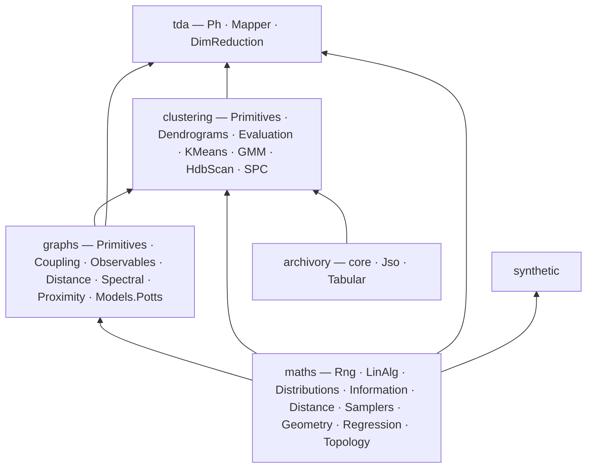

# ThermoMapper

ThermoMapper is a **WIP** .NET 10 C# library for **topological and thermodynamic data analysis**. It covers:

- proximity graphs on flat and curved spaces;
- superparamagnetic (Potts-model) clustering;
- HDBSCAN and Gaussian mixtures;
- persistent and zigzag homology;
- Mapper;
- SPRED, a persistence-preserving dimensionality reduction;
- Riemannian statistics;
- Bayesian regression.

Everything is implemented in managed code. The only external package is `System.Numerics.Tensors`.

This documentation describes the design and concepts of the 30 library projects whose sources live under `src/{maths, graphs, clustering, tda, synthetic, archivory}`.

---

Development is currently paused for some refactoring and redesign, including a likely migration to F# for math and pipeline heavy aspects of the code.

---


**EyeTorusToy.** A 3D toroidal interpretation of the toy data in
[Blatt, Wiseman & Domany (1996)](https://doi.org/10.1103/PhysRevLett.76.3251).
The live editor's eye preset, with full tube depth and a solid pupil, seed 42.
Colors identify the generator's components.

[More fixture screenshots and how to reproduce them](./docs/Gallery.md).

---

## Architecture at a glance



The projects form eight dependency layers, from `Maths.Rng` (layer 0) up to `TDA.Mapper` (layer 7). The main workflows are:

1. **SPC clustering:** coupling graph → Swendsen–Wang temperature sweep → chosen temperature → cut or hierarchy.
2. **HDBSCAN:** core distances → mutual-reachability MST → condensed tree → labels with noise.
3. **Mapper:** lens → cover → per-bin clustering → nerve → diagnostics and sweeps.
4. **Persistence on graphs:** distance graph → flag filtration → barcode. H1 loop edges can be fed back into graph construction as a protect set.
5. **BARS transition readout:** a thermal curve → Bayesian splines → peak location and span posteriors.
6. **SPRED:** persistence-matching projection by subspace annealing, optionally distributed over data blocks.

See [Architecture](./docs/Architecture.md) for the layer table, the data flows and the cross-module contracts.

## Core concepts

- **Currencies.** A few shared types carry results between modules: the CSR graph, per-edge fields (`Affinities`, `Alignments`, `CoMembership`), node landscapes, `Dendrogram`, `Barcode`. Producers and consumers depend on these types, not on each other. See [Concepts](./docs/Concepts.md).
- **The resolution spine.** Clusterers resolve into shared carriers: SPC resolvers return an `Assignment`, and HDBSCAN, GMM merging and SPC thermal trees produce a `Dendrogram`; `Groups` is the soft carrier, with no producer yet. Abstention (−1) is a first-class answer, and trees carry an exact cost-axis string. See [Concepts](./docs/Concepts.md#resolution-carriers).
- **Declarative config, pure engine.** Immutable config records are executed by static engines. See [DesignPrinciples](./docs/Design.md#1-declarative-config-pure-engine).
- **Struct-generic specialization.** Metrics, manifolds, robust losses and sampler configs are `struct` type parameters; manifolds, losses and sampler configs also carry `static abstract` flags. A metric spec string is bridged once to its struct type by a visitor. See [DesignPrinciples](./docs/Design.md#2-compile-time-specialization).
- **Reproducible seeding.** Generators are passed explicitly, seeds are derived by index, and sampler state is checkpointable. See [DesignPrinciples](./docs/Design.md#6-reproducible-randomness).

## Module index

| Area       | Project                        | Purpose                                                                                          | Doc                                                                                                  | Maturity                                                                                            |
| ---------- | ------------------------------ | ------------------------------------------------------------------------------------------------ | ---------------------------------------------------------------------------------------------------- | --------------------------------------------------------------------------------------------------- |
| maths      | `Maths.Rng`                    | xoshiro256++ generator, `SeedTree`                                                               | [ProbabilityAndInformation](./docs/Maths/ProbabilityAndInformation.md)                                     | core                                                                                                |
|            | `Maths.Distributions`          | Normal, Gamma and Beta distributions; log-gamma                                                  | [ProbabilityAndInformation](./docs/Maths/ProbabilityAndInformation.md)                                     | core                                                                                                |
|            | `Maths.Information`            | Entropies and divergences                                                                        | [ProbabilityAndInformation](./docs/Maths/ProbabilityAndInformation.md)                                     | core; `IDivergence<T>` partial                                                                      |
|            | `Maths.LinAlg`                 | Jacobi and LOBPCG eigensolvers, Cholesky, band LDLᵀ, FFT, PCA                                    | [LinearAlgebra](./docs/Maths/LinearAlgebra.md)                                                             | core; FastICA partial                                                                               |
|            | `Maths.Distance`               | Point metrics (Euclidean, Mahalanobis, geodesic, probability)                                    | [DistanceMetrics](./docs/Graphs/DistanceMetrics.md)                                                         | core; `EarthMover` partial                                                                          |
|            | `Maths.Geometry`               | Manifolds, IRLS statistics, heat-kernel calibration, subspace annealing                          | [RiemannianGeometry](./docs/Maths/RiemannianGeometry.md)                                                   | core; `StiefelManifold`, `MxPbf` partial                                                            |
|            | `Maths.Samplers`               | Reversible-jump MCMC, tempering, ensemble shell, noise fields                                    | [Samplers](./docs/Maths/Samplers.md)                                                                       | core                                                                                                |
|            | `Maths.Regression`             | BARS, BAPS, Bayesian GP, exact changepoints                                                      | [BayesianRegression](./docs/Maths/BayesianRegression.md)                                                   | core                                                                                                |
|            | `Maths.Topology`               | Simplex indexing, $\mathbb Z/2$ linear algebra                                                   | [PersistentHomology](./docs/TDA/PersistentHomology.md)                                                   | core; `Z2LinearAlgebra` is oracle support                                                           |
| graphs     | `Graphs.Primitives`            | CSR graph, currencies, MST, traversal                                                            | [GraphSubstrate](./docs/Graphs/GraphSubstrate.md)                                                           | core                                                                                                |
|            | `Graphs.Coupling`              | Kernel descriptors and evaluators                                                                | [GraphSubstrate](./docs/Graphs/GraphSubstrate.md)                                                           | core                                                                                                |
|            | `Graphs.Observables`           | Graph signals, connectivity, cycles                                                              | [GraphSubstrate](./docs/Graphs/GraphSubstrate.md)                                                           | core                                                                                                |
|            | `Graphs.Distance`              | Metric registry and metric properties                                                            | [DistanceMetrics](./docs/Graphs/DistanceMetrics.md)                                                         | core; property validator partial                                                                    |
|            | `Graphs.Spectral`              | Laplacians, bottom-k spectra, effective resistance                                               | [SpectralGraphs](./docs/Graphs/SpectralGraphs.md)                                                           | core                                                                                                |
|            | `Graphs.Proximity`             | Five-stage graph compiler and bandwidth estimation                                               | [GraphConstruction](./docs/Graphs/GraphConstruction.md)                                                     | core                                                                                                |
|            | `Graphs.Models.Potts`          | Potts configuration, FK bond kernel, critical-temperature estimate and thermodynamic observables | [SpcEngine](./docs/Clustering/SpcEngine.md)                                                                     | core                                                                                                |
| clustering | `Clustering.Primitives`        | `Assignment`, `Groups`, `Landscape`                                                              | [ClusterResolution](./docs/Clustering/ClusterResolution.md)                                                     | core; `Groups` has no producer yet                                                                  |
|            | `Clustering.Dendrograms`       | Merge trees, condensation, landscape walks                                                       | [ClusterResolution](./docs/Clustering/ClusterResolution.md)                                                     | core                                                                                                |
|            | `Clustering.Evaluation`        | External, internal and graph validity indices                                                    | [ClusterEvaluation](./docs/Clustering/ClusterEvaluation.md)                                                     | core                                                                                                |
|            | `Clustering.Export`            | Shared currency tables (partition, edge currencies) for run bundles                              | [SpcAnalysis](./docs/Clustering/SpcAnalysis.md#export-bundle), [CumulativeField](./docs/Clustering/CumulativeField.md) | core                                                                                                |
|            | `Clustering.Geometric.KMeans`  | k-means++                                                                                        | [GaussianMixtures](./docs/Clustering/GaussianMixtures.md)                                                       | core                                                                                                |
|            | `Clustering.Statistical.GMM`   | Gaussian mixtures and modal merging                                                              | [GaussianMixtures](./docs/Clustering/GaussianMixtures.md)                                                       | core                                                                                                |
|            | `Clustering.Graphical.HdbScan` | HDBSCAN (exact and sparse)                                                                       | [Hdbscan](./docs/Clustering/Hdbscan.md)                                                                         | core                                                                                                |
|            | `Clustering.Graphical.SPC`     | Swendsen–Wang engine; sweeps, profiles, cuts, hierarchies, export                                | [SpcEngine](./docs/Clustering/SpcEngine.md), [SpcAnalysis](./docs/Clustering/SpcAnalysis.md)                               | core; `SpcOutputPathHelper` is superseded by `SpcRunPaths`                                         |
|            | `Clustering.Graphical.CumulativeField` | Deterministic cumulative-field solver; sweeps, landscapes                                 | [CumulativeField](./docs/Clustering/CumulativeField.md)                                                       | core; `MonteCarloAffinityDemo` is a demonstration                                                  |
| tda        | `TDA.Ph`                       | Persistent, cohomology, involuted and zigzag homology; nerve sweeps                              | [PersistentHomology](./docs/TDA/PersistentHomology.md), [ZigzagPersistence](./docs/TDA/ZigzagPersistence.md) | core; some partial and oracle pieces                                                                |
|            | `TDA.Mapper`                   | Mapper, lenses, covers, clusterer adapters, diagnostics                                          | [Mapper](./docs/TDA/Mapper.md)                                                                           | core                                                                                                |
|            | `TDA.DimReduction`             | SPRED and distributed SPRED                                                                      | [Spred](./docs/TDA/Spred.md)                                                                             | core                                                                                                |
| synthetic  | `Synthetic`                    | Ground-truth datasets (Euclidean, hyperbolic, simplex)                                           | [SyntheticDatasets](./docs/Synthetic/SyntheticDatasets.md)                                                     | core; `GaussianManifold` partial                                                                    |
| archivory  | `Archivory`                    | Run tree, atomic writes, binary checkpoints                                                      | [Archivory](./docs/Archivory/Archivory.md)                                                                     | core                                                                                                |
|            | `Archivory.Jso`                | JSON and JSONL conventions                                                                       | [Archivory](./docs/Archivory/Archivory.md)                                                                     | core                                                                                                |
|            | `Archivory.Tabular`            | Tabular projections and CSV                                                                      | [Archivory](./docs/Archivory/Archivory.md)                                                                     | core                                                                                                |

## Building

- **Solution:** `ThermoMapper/ThermoMapper.sln`. Each module is a project under `projects/<Name>/`, which compiles linked sources from `src/`. Tests live under `tests/`, and helper scripts under `scripts/`.
- **Shared settings** (`Directory.Build.props`):
  - `net10.0`, latest C#, nullable enabled, implicit usings disabled, unsafe code allowed;
  - XML documentation generated;
  - all build output under `artifacts/bin/<Project>` and `artifacts/obj/<Project>`.
- **Reference builds.** `ExtraDefineConstants` is appended to `DefineConstants`. For example, this switches the dense eigensolver to the reference Jacobi implementation:

  ```bash
  dotnet build ThermoMapper/ThermoMapper.sln -p:ExtraDefineConstants=EIGEN_REFERENCE
  ```

## Modules outside this documentation

These source folders are consumers and tools that sit outside the library documented here. Documenting them is **planned for a future iteration**.

| Folder             | Role                                                                                                    |
| ------------------ | ------------------------------------------------------------------------------------------------------- |
| `src/user-repl`    | Interactive REPL (`UserRepl`, `UserRepl.Commands`, `UserRepl.Publish`) for SPC, cumulative-field and HDBSCAN runs |
| `src/viz`          | Visualization contracts and scene types (`Viz.Contracts`, `Viz.Scene`)                                  |
| `src/viz-core`     | Scene building and HTML rendering for datasets and mixtures (`VizCore`, used by `VizApi`)               |
| `src/hashish`      | Hashing, sketching and text-similarity utilities (`Hashish`)                                            |
| `src/repo-audit`   | Roslyn-based repository audit tool (`RepoAudit`)                                                        |
| `src/test-harness` | Lightweight fact runner (`TestHarness.Runner`)                                                          |

## Project status

ThermoMapper is a research codebase of uneven maturity. Most modules are complete, and some pieces are partial, experimental or oracle-only. Each doc gives the specifics in a short **Status and caveats** section. Where a doc comment and the code disagree, the docs describe what the code does.

## Documentation map

| Group                 | Docs                                                                                                                                                                                                                                                                                                |
| --------------------- | --------------------------------------------------------------------------------------------------------------------------------------------------------------------------------------------------------------------------------------------------------------------------------------------------- |
| Start here            | [Architecture](./docs/Architecture.md) · [Concepts](./docs/Concepts.md) · [DesignPrinciples](./docs/Design.md) · [Glossary](./docs/Glossary.md)                                                                                                                                           |
| Numerical foundations | [LinearAlgebra](./docs/Maths/LinearAlgebra.md) · [SpectralGraphs](./docs/Graphs/SpectralGraphs.md) · [ProbabilityAndInformation](./docs/Maths/ProbabilityAndInformation.md) · [Samplers](./docs/Maths/Samplers.md) · [BayesianRegression](./docs/Maths/BayesianRegression.md) · [PosteriorContraction](./docs/Maths/PosteriorContraction.md) · [RiemannianGeometry](./docs/Maths/RiemannianGeometry.md) |
| Graphs                | [DistanceMetrics](./docs/Graphs/DistanceMetrics.md) · [GraphSubstrate](./docs/Graphs/GraphSubstrate.md) · [GraphConstruction](./docs/Graphs/GraphConstruction.md)                                                                                                                                                        |
| Clustering            | [ClusterResolution](./docs/Clustering/ClusterResolution.md) · [Hdbscan](./docs/Clustering/Hdbscan.md) · [GaussianMixtures](./docs/Clustering/GaussianMixtures.md) · [ClusterEvaluation](./docs/Clustering/ClusterEvaluation.md) · [SpcEngine](./docs/Clustering/SpcEngine.md) · [SpcAnalysis](./docs/Clustering/SpcAnalysis.md)                                       |
| Topology              | [PersistentHomology](./docs/TDA/PersistentHomology.md) · [ZigzagPersistence](./docs/TDA/ZigzagPersistence.md) · [Mapper](./docs/TDA/Mapper.md) · [Spred](./docs/TDA/Spred.md)                                                                                                                                       |
| Data and I/O          | [SyntheticDatasets](./docs/Synthetic/SyntheticDatasets.md) · [Archivory](./docs/Archivory/Archivory.md)                                                                                                                                                                                                                 |
