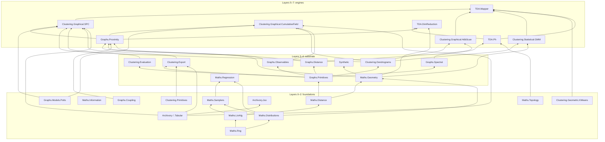
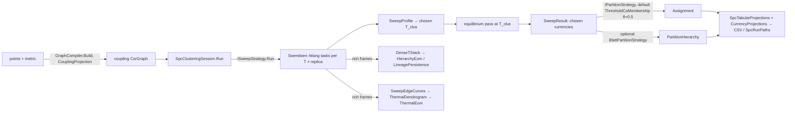
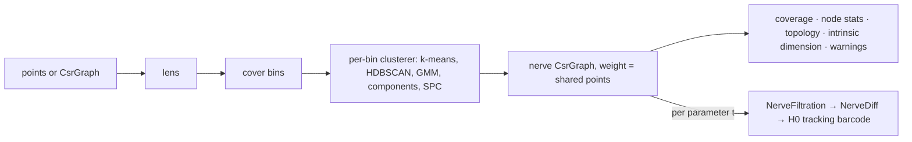
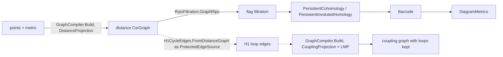
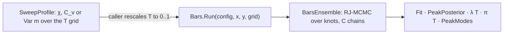
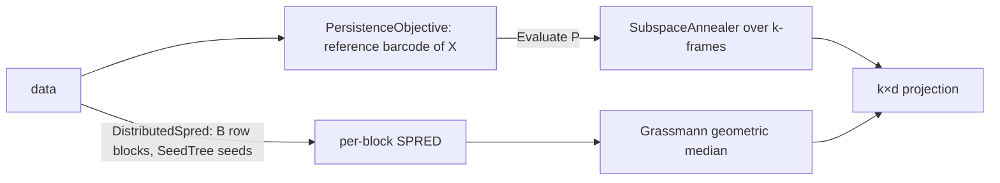

# Architecture

ThermoMapper is a .NET 10 C# library for topological and thermodynamic data analysis. This page covers four things:

- how the 30 in-scope projects are layered;
- what each area is responsible for;
- how data flows through the six main workflows;
- which contracts hold the modules together.

The shared data types are defined in [Concepts](./Concepts.md), and the recurring design choices in [Design Principles](./DesignPrinciples.md).

## Repository layout

```text
ThermoMapper/
├── Directory.Build.props   shared build settings (net10.0, nullable, artifacts path, ExtraDefineConstants)
├── ThermoMapper.sln
├── src/                    all source code, by area
│   ├── maths/  graphs/  clustering/  tda/  synthetic/  archivory/        ← in scope
│   └── hashish/  repo-audit/  test-harness/  user-repl/  viz/  viz-core/  ← consumers and tools
├── projects/<Name>/<Name>.csproj   one project per module; compiles linked files from src/
├── tests/                  test projects and smoke executables
└── scripts/                harness and audit scripts
```

**Source and projects are separate trees.** Each `.csproj` sets `EnableDefaultCompileItems=false` and pulls its files from `src/` with a linked `Compile Include` glob; for example, `TDA.Ph` compiles `src/tda/ph/**`. A folder under `src/` is therefore not a project boundary by itself, and one area can feed several projects. Project names follow the `Area.Module` pattern (`Graphs.Proximity`, `Clustering.Graphical.SPC`), and root namespaces usually match them.

**Shared build settings** (`Directory.Build.props`):

- `net10.0`, `LangVersion latest`, `Nullable enable`, and implicit usings **disabled**;
- unsafe blocks allowed;
- XML documentation files generated, with warning 1591 suppressed;
- build output under `artifacts/bin/<Project>` and `artifacts/obj/<Project>`;
- `ExtraDefineConstants`, appended to `DefineConstants`, so that reference builds can be selected from the command line. For example, `-p:ExtraDefineConstants=EIGEN_REFERENCE` switches dense eigensolves to the reference Jacobi solver ([Linear Algebra](./LinearAlgebra.md)).

`TDA.Ph` and `TDA.DimReduction` grant `InternalsVisibleTo` to their test projects.

## Dependency layers

A project's layer is the length of its longest `ProjectReference` chain to an in-scope leaf, so layer 0 has no in-scope dependencies. Eight layers result:

| Layer | Projects |
|---|---|
| 0 | `Maths.Rng`, `Maths.Information`, `Maths.Topology`, `Graphs.Coupling`, `Graphs.Models.Potts`, `Clustering.Primitives`, `Clustering.Geometric.KMeans`, `Archivory`, `Archivory.Tabular` |
| 1 | `Maths.LinAlg`, `Maths.Distributions`, `Archivory.Jso` |
| 2 | `Maths.Distance`, `Maths.Samplers` |
| 3 | `Graphs.Primitives`, `Maths.Geometry`, `Maths.Regression` |
| 4 | `Graphs.Distance`, `Graphs.Observables`, `Graphs.Spectral`, `Clustering.Dendrograms`, `Clustering.Evaluation`, `Clustering.Export`, `Synthetic` |
| 5 | `Graphs.Proximity`, `Clustering.Graphical.HdbScan`, `Clustering.Statistical.GMM`, `TDA.Ph` |
| 6 | `Clustering.Graphical.SPC`, `Clustering.Graphical.CumulativeField`, `TDA.DimReduction` |
| 7 | `TDA.Mapper` |



The diagram shows the main edges only; the `ProjectReference` items in each `.csproj` are authoritative. Notable properties of the graph:

- **The widest direct fan-out** is `Clustering.Graphical.SPC`. It references 15 in-scope projects, including `Archivory` for checkpoints and exports. On the fan-in side, `Maths.LinAlg` and `Graphs.Primitives` are the most referenced.
- **`TDA.Mapper`** is the only layer-7 project. It adapts four clustering engines (k-means, GMM, HDBSCAN, SPC) behind its clusterer interfaces.
- **`TDA.Ph` does not depend on `TDA.Mapper`.** Nerve-sweep types store only graphs and member arrays.
- **`Graphs.Proximity` does not depend on `TDA.Ph`.** Topological criteria are injected through a delegate instead (see [Workflows](#4-persistence-on-graphs-and-the-h1-protect-set)).
- **`Maths.Regression` and `Clustering.Graphical.SPC` do not reference each other.** Transition readouts are composed by the caller.

## Responsibilities by area

| Area | Projects | Responsibility | Docs |
|---|---|---|---|
| **maths** | `Maths.Rng`, `.Distributions`, `.Information` | Seeded generators, distributions, information measures | [ProbabilityAndInformation](./ProbabilityAndInformation.md) |
| | `Maths.LinAlg` | Dense and iterative eigensolvers, Cholesky and band LDLᵀ, FFT, PCA and ICA | [LinearAlgebra](./LinearAlgebra.md) |
| | `Maths.Distance` | Point metrics (Euclidean, Mahalanobis, geodesic, probability metrics) | [DistanceMetrics](./DistanceMetrics.md) |
| | `Maths.Geometry` | Riemannian manifolds, IRLS location and scatter, heat-kernel calibration, subspace annealing | [RiemannianGeometry](./RiemannianGeometry.md) |
| | `Maths.Samplers` | Reversible-jump MCMC, tempering, ensemble shell, diagnostics, noise fields | [Samplers](./Samplers.md) |
| | `Maths.Regression` | BARS, BAPS, Bayesian GP, changepoints | [BayesianRegression](./BayesianRegression.md) |
| | `Maths.Topology` | Simplex indexing, $\mathbb Z/2$ linear algebra | [PersistentHomology](./PersistentHomology.md) |
| **graphs** | `Graphs.Primitives`, `.Coupling`, `.Observables` | CSR graph, currencies, MST, traversal, coupling kernels, graph signals | [GraphSubstrate](./GraphSubstrate.md) |
| | `Graphs.Distance` | Metric registry and properties | [DistanceMetrics](./DistanceMetrics.md) |
| | `Graphs.Spectral` | Laplacians, bottom-k spectra, effective resistance | [SpectralGraphs](./SpectralGraphs.md) |
| | `Graphs.Proximity` | The five-stage graph compiler, bandwidth estimation, diagnostics | [GraphConstruction](./GraphConstruction.md) |
| | `Graphs.Models.Potts` | Potts configuration, FK bond kernel, critical-temperature estimate, thermodynamic observables | [SpcEngine](./SpcEngine.md) |
| **clustering** | `Clustering.Primitives`, `.Dendrograms` | Resolution carriers, merge trees, condensation, landscape walks | [ClusterResolution](./ClusterResolution.md) |
| | `Clustering.Graphical.HdbScan` | HDBSCAN | [Hdbscan](./Hdbscan.md) |
| | `Clustering.Statistical.GMM`, `.Geometric.KMeans` | Gaussian mixtures, modal merging, k-means++ | [GaussianMixtures](./GaussianMixtures.md) |
| | `Clustering.Evaluation` | External, internal and graph validity indices | [ClusterEvaluation](./ClusterEvaluation.md) |
| | `Clustering.Export` | Shared currency tables (partition, edge currencies) for every method's run bundle | [SpcAnalysis](./SpcAnalysis.md#export-bundle), [CumulativeField](./CumulativeField.md) |
| | `Clustering.Graphical.SPC` | Swendsen–Wang engine, sweeps, profiles, cuts, hierarchies, export | [SpcEngine](./SpcEngine.md), [SpcAnalysis](./SpcAnalysis.md) |
| | `Clustering.Graphical.CumulativeField` | Deterministic cumulative-field solver, sweeps, landscapes | [CumulativeField](./CumulativeField.md) |
| **tda** | `TDA.Ph` | Standard, cohomology and involuted persistence; zigzag engines; nerve sweeps | [PersistentHomology](./PersistentHomology.md), [ZigzagPersistence](./ZigzagPersistence.md) |
| | `TDA.Mapper` | Mapper and its diagnostics | [Mapper](./Mapper.md) |
| | `TDA.DimReduction` | SPRED | [Spred](./Spred.md) |
| **synthetic** | `Synthetic` | Ground-truth datasets | [SyntheticDatasets](./SyntheticDatasets.md) |
| **archivory** | `Archivory`, `.Jso`, `.Tabular` | Run tree, atomic writes, JSON, CSV | [Archivory](./Archivory.md) |

## Workflows

Six end-to-end flows exercise most of the library. Each is described at the level of the public entry points.

### 1. SPC clustering



1. [Graph construction](./GraphConstruction.md) turns the data into a coupling graph. It selects kNN neighbors, filters, repairs, optionally refines, then applies the kernel. The bandwidth is estimated from the k-th-neighbor sample when the descriptor's δ is 0; the default config of `SpcClusteringSession.Run(features)` instead uses `Gaussian(0.5)`, a fixed δ.
2. A fixed-grid sweep runs Swendsen–Wang on every (temperature, replica) task. Each task has its own derived seed, so the results do not depend on worker count ([SPC Engine](./SpcEngine.md)).
3. The sweep profile locates the superparamagnetic plateau, and its midpoint becomes the chosen temperature. An equilibrium pass there mints the currencies.
4. A flat cut at the chosen temperature gives the `Assignment`. Optional hierarchical strategies and the dense T-stack resolvers give multi-scale results ([SPC Analysis](./SpcAnalysis.md)).
5. Results are scored ([Cluster Evaluation](./ClusterEvaluation.md)) and exported through [Archivory](./Archivory.md).

### 2. HDBSCAN


The metric spec string is bridged once to a struct type, so the $O(n^2)$ loops run specialized. Condensation and selection are the shared [Cluster Resolution](./ClusterResolution.md) routines. The same `Dendrogram` type also carries SPC thermal trees and GMM merge trees ([Hdbscan](./Hdbscan.md)).

### 3. Mapper



Mapper reuses the clustering stack through thin adapters. The nerve it returns is an ordinary `CsrGraph`, so graph observables apply to it directly. A parameter sweep produces a component-tracking `Barcode` ([Mapper](./Mapper.md)).

### 4. Persistence on graphs and the H1 protect set



- **Barcodes.** A distance-weighted graph is filtered by edge length. Its barcode comes from the fast cohomology engine, or from the involuted engine when cycle representatives are needed ([Persistent Homology](./PersistentHomology.md)).
- **The feedback loop.** `GraphCompiler.Build` accepts an optional `ProtectedEdgeSource`. When LMP runs during a coupling build (`LmpRescale = true`, or `null` and auto-triggered), the compiler passes the conditioned *distance* graph to the source; with `LmpRescale = false` the source is ignored. `H1CycleEdges.FromDistanceGraph` computes the H1 loop edges, and local mutual-proximity rescaling leaves those edges untouched. Topology thus steers graph construction without `Graphs.Proximity` referencing `TDA.Ph`.
- **Time-varying graphs.** For graphs that change over time, a `ZigzagFiltration` of vertex and edge additions and deletions goes to `GraphZigzag.Compute` instead ([Zigzag Persistence](./ZigzagPersistence.md)).

### 5. BARS transition readout



A thermal curve, such as a susceptibility or specific heat from the SPC profile, is smoothed by Bayesian adaptive regression splines. The readouts locate transitions with uncertainty:

- the posterior of the exact peak location;
- the peak intensity λ(T);
- the span coverage π(T);
- mass-ranked peak modes.

`Maths.Regression` does not reference SPC, so the caller supplies the curve and maps the unit-interval domain back to temperatures ([Bayesian Regression](./BayesianRegression.md), [Samplers](./Samplers.md)).

### 6. SPRED



SPRED searches for a linear projection whose barcode matches the data's own. Every proposal is re-graphed with the same graph recipe, filtered and compared by a diagram distance. The distributed variant aggregates block solutions on the Grassmannian ([SPRED](./Spred.md), [Riemannian Geometry](./RiemannianGeometry.md)).

## Cross-module contracts

| Seam | Between | Contract |
|---|---|---|
| `CsrGraph` + slot-indexed fields | graphs ↔ everything | Symmetric storage; values only at the j > i slot ([Concepts](./Concepts.md#the-csr-graph)) |
| `EdgeWeightKind` | graph construction → consumers | Distance vs coupling vs affinity weights; informational only |
| Currencies, `IGraphSignal<in TCurrency>` | samplers → cuts, signals | Producer-agnostic per-edge fields ([Concepts](./Concepts.md#per-edge-currencies)) |
| `Dendrogram.CostAxis` = `Landscape.Axis` | tree producers → selectors | Exact string equality ([Concepts](./Concepts.md#resolution-carriers)) |
| `Assignment` / `Groups` | every clusterer → evaluation, export | Abstention by −1 |
| `Barcode` / `Bar` | persistence engines → distances, SPRED, visualization | Step coordinates for zigzag; `IntervalEnd` ([Concepts](./Concepts.md#barcodes)) |
| `ProtectedEdgeSource` | TDA → graph construction | A distance graph in, normalized `(Lo, Hi)` pairs out |
| `IClusterer`, `IGraphClusterer` | Mapper → clustering engines | Labels aligned to the bin's point indices; grouped by raw value, so −1 (HDBSCAN noise) becomes a node of its own |
| `SubspaceObjectiveFunction` | SPRED → subspace annealer | A frame in, a scalar out |
| `IEnsembleModel<TDraw>`, `IChain<TDraw>` | regression → samplers | BARS and BGP plug into the ensemble shell; each chain gets its own kernel seed and readout seed from one `SeedTree` expansion |
| `ArtifactScope` + `WriteAtomic` | SPC export → archivory | Scope-relative paths; atomic replace |

## External dependencies

The in-scope code has a single NuGet dependency: **`System.Numerics.Tensors` 10.0.0**. `Maths.Distance`, `Maths.Geometry` and `Maths.Information` use it for vectorized primitives. Everything else is the .NET base class library, including `System.Text.Json` for artifacts. There are no native libraries and no BLAS or LAPACK: dense and iterative linear algebra is implemented in `Maths.LinAlg`.

## Consumers outside the documented scope

The following projects consume or support the library. They are documented as placeholders in the [README](../README.md#modules-outside-this-documentation) and are candidates for a later iteration.

| Source folder | Projects | Role | Uses |
|---|---|---|---|
| `src/user-repl` | `UserRepl.Commands`, `UserRepl`, `UserRepl.Publish` | Interactive REPL for SPC, cumulative-field and HDBSCAN runs, datasets and run manifests | SPC, cumulative field, dendrograms, HDBSCAN, evaluation, graphs, `TDA.Ph`, `Synthetic`, all three `Archivory` projects |
| `src/viz-core` | `VizCore` | Scene building and HTML rendering for datasets and mixtures | `Synthetic`, `Maths.LinAlg`, `Maths.Geometry`, `Clustering.Statistical.GMM` |
| `src/viz` | `Viz.Contracts`, `Viz.Scene` | Visualization contracts and scene types | — |
| — | `VizApi` | Visualization host | `VizCore`, `Synthetic`, `Graphs.Proximity`, `Graphs.Spectral`, `Maths.Geometry`, `Graphs.Distance` |
| `src/hashish` | `Hashish` | Hashing, sketching and text-similarity utilities (Bloom filter, count-min, HyperLogLog, CTPH, Jaccard, cosine, Levenshtein, BM25/IDF) | `System.Numerics.Tensors` only |
| `src/repo-audit` | `RepoAudit` | Repository audit tool built on Roslyn | `Microsoft.CodeAnalysis` |
| `src/test-harness` | `TestHarness.Runner` | Lightweight fact runner used by the scripts | — |

The test tree has 21 projects: 16 test libraries and 5 executables for smoke and analysis runs.

**See also:** [Concepts](./Concepts.md) · [DesignPrinciples](./DesignPrinciples.md) · [Glossary](./Glossary.md) · [README](../README.md)
