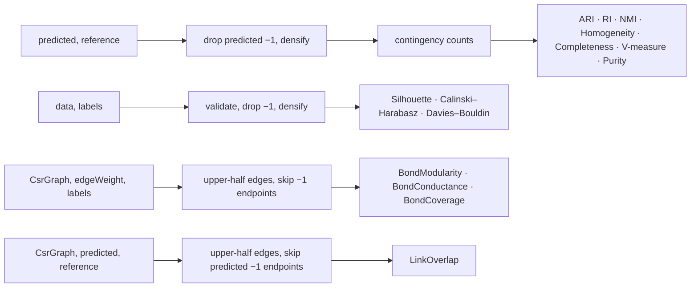

# Cluster Evaluation

> Cluster-validation indices in three families: **external** indices compare a predicted labeling with a reference; **internal point** indices judge a partition from the data alone; **graph** indices judge a partition on a weighted graph. All of them follow ThermoMapper's rule that points a clusterer declined to place are not scored. · **Project:** `Clustering.Evaluation` (namespaces `Clustering.Evaluation.External`, `Clustering.Evaluation.Internal`) · **Maturity:** core

## Overview

`Clustering.Evaluation` sits in layer 4 of the [architecture](./Architecture.md). It depends on [`Clustering.Primitives`](./ClusterResolution.md) for the `Unassigned` sentinel and on [`Graphs.Primitives`](./GraphSubstrate.md) for `CsrGraph`. The [HDBSCAN](./Hdbscan.md) and [SPC](./SpcAnalysis.md) session facades call it to score their results, and so does the REPL.

## Key concepts

- **The assigned-only rule.** A label of `Assignment.Unassigned` (−1) marks a point the clusterer declined to place, such as HDBSCAN noise or an SPC abstention. Every evaluator scores only the **assigned subset**.
  - For external indices, only points whose *predicted* label is −1 are dropped. Reference labels are not filtered.
  - As a result, the documented symmetries hold exactly only when neither labeling contains −1: ARI, NMI and V-measure are symmetric, and $\mathrm{Completeness}(p,t)=\mathrm{Homogeneity}(t,p)$.
- **The edge weight is any per-edge field.** Graph indices take a slot-indexed `double[]`, such as the `G` array of an [`Affinities`](./Concepts.md#per-edge-currencies) currency (Swendsen–Wang bond activity or the cumulative-field closed-form affinity). One implementation therefore scores every method's output with the same formula; scores are comparable across methods only when the fields share a scale.

## Design

**Four interfaces.** Each evaluator is a stateless sealed class behind one of them:

| Interface | Signature | Implementations |
|---|---|---|
| `IExternalClusterEvaluator` | `double Evaluate(int[] predictedLabels, int[] referenceLabels)` | `AdjustedRandIndex`, `RandIndex`, `NormalizedMutualInformation`, `Homogeneity`, `Completeness`, `VMeasure`, `Purity` |
| `IInternalClusterEvaluator` | `double Evaluate(double[][] data, int[] labels)` | `SilhouetteEvaluator`, `CalinskiHarabaszEvaluator`, `DaviesBouldinEvaluator` |
| `IGraphPartitionEvaluator` | `double Evaluate(CsrGraph graph, double[] edgeWeight, int[] labels, int clusterCount)` | `BondModularity`, `BondConductance`, `BondCoverage` |
| `IGraphExternalClusterEvaluator` | `double Evaluate(CsrGraph graph, int[] predictedLabels, int[] referenceLabels)` | `LinkOverlap` |

**Names.**

- The external and graph interfaces have a default interface member `Name => GetType().Name`. Each concrete class implements `Name` with a short key, such as `"ARI"`, `"NMI"` or `"BondModularity"`, and that key becomes the result-dictionary key or CSV column.
- `IInternalClusterEvaluator` has no `Name`.

**Shared preprocessing.**

- The internal helpers `EvaluationHelpers` and `ContingencyTable` densify labels in first-appearance order and tally a predicted × reference table.
- `Completeness` reuses `Homogeneity`'s marginal-entropy helper but computes its conditional entropy itself.

## API at a glance

| Evaluator | `Name` | Direction |
|---|---|---|
| `AdjustedRandIndex` | ARI | higher is better (1 = identical) |
| `RandIndex` | RI | higher is better, in [0, 1] |
| `NormalizedMutualInformation` | NMI | higher is better, in [0, 1] |
| `Homogeneity` / `Completeness` / `VMeasure` | Homogeneity / Completeness / VMeasure | higher is better, in [0, 1] |
| `Purity` (+ static `Purity.Compute`) | Purity | higher is better, in [0, 1] |
| `SilhouetteEvaluator` | — | higher is better, in [−1, 1] |
| `CalinskiHarabaszEvaluator` | — | higher is better |
| `DaviesBouldinEvaluator` | — | lower is better (0 is ideal) |
| `BondModularity` | BondModularity | higher is better |
| `BondConductance` | BondConductance | lower is better |
| `BondCoverage` | BondCoverage | higher is better |
| `LinkOverlap` (`weighted` option) | LinkOverlap / LinkOverlapWeighted | higher is better, in [0, 1] |

## Algorithms

### External indices

These are computed on the assigned subset, from the contingency counts $n_{rc}$ with row sums $a_r$ (predicted) and column sums $b_c$ (reference). Logarithms are natural.

| Index | Formula | Degenerate values |
|---|---|---|
| ARI | $\dfrac{\sum_{rc}\binom{n_{rc}}2-E}{\tfrac12(A+B)-E}$, where $A=\sum_r\binom{a_r}2$, $B=\sum_c\binom{b_c}2$ and $E=AB/\binom n2$ | n = 0 → 0; n = 1 → 1; zero denominator → 1 |
| RI | $1+\dfrac{2\sum_{rc}\binom{n_{rc}}2-A-B}{\binom n2}$, the fraction of point pairs on which the two labelings agree (together in both or apart in both) | n = 0 → 0; n = 1 → 1 |
| NMI | $\dfrac{2I(U;V)}{H(U)+H(V)}$ (arithmetic-mean normalization) | n = 0 → 0; both entropies 0 → 1; clamped to [0, 1] |
| Homogeneity | $1-H(C\mid K)/H(C)$ | n = 0 → 0; $H(C)\le0$ → 1; clamped to [0, 1] |
| Completeness | $1-H(K\mid C)/H(K)$ | n = 0 → 0; $H(K)\le0$ → 1; clamped to [0, 1] |
| V-measure | $2hc/(h+c)$ with β = 1 | $h+c\le0$ → 0; clamped to [0, 1] |
| Purity | $\frac1n\sum_r\max_c n_{rc}$ | n = 0 → 0 |

Here C is the reference class and K the predicted cluster. `VMeasure` runs the homogeneity and completeness pipelines separately.

### Internal point indices (Euclidean)

These first validate the inputs (no ragged rows), then drop unassigned points and densify labels. K below means the number of assigned clusters.

- **Silhouette.** $s_i=(b_i-a_i)/\max(a_i,b_i)$, where $a_i$ is the mean distance to the point's own cluster and $b_i$ the mean distance to the nearest other cluster.
  - $s_i=0$ for singletons.
  - The index is the mean over all assigned points, and 0 when K < 2.
  - It is exact, with no sampling, and costs $O(n^2D)$.
- **Calinski–Harabasz.** $\dfrac{B/(K-1)}{W/(n-K)}$, from the between-cluster and within-cluster sums of squares. It is NaN if K < 2 or n ≤ K, and +∞ if W = 0.
- **Davies–Bouldin.** $\frac1K\sum_c\max_{d\ne c}\frac{S_c+S_d}{\|\bar x_c-\bar x_d\|}$, where $S_c$ is the mean distance to the centroid. It is +∞ if two centroids coincide, and NaN if K < 2.

### Graph indices

Each index walks every undirected edge once, using its upper-half slot, so self-loops are skipped. Edges with an unassigned endpoint are ignored. Let m be the total retained weight and $d_i$ the weighted degree over retained edges.

- **Modularity.** $Q=\sum_c\big[W^{\text{in}}_c/m-(D_c/2m)^2\big]$, with $D_c=\sum_{i\in c}d_i$.
- **Conductance.** $\phi(c)=\text{cut}(c)/\min(\text{vol}(c),\,2m-\text{vol}(c))$, averaged over the clusters with a positive denominator.
- **Bond coverage (`BondCoverage`).** $\sum_{c_i=c_j}w_{ij}/\sum w_{ij}$ over retained edges. This is not `Assignment.Coverage`, the assigned fraction.

**Label contract.** Modularity and Conductance index per-cluster arrays directly. They require labels in $[0,\text{clusterCount})\cup\{-1\}$, and return 0 when `clusterCount` ≤ 0 or m ≤ 0. Coverage only compares labels for equality: it accepts any labels, with −1 excluded, and ignores `clusterCount`. All three return 0, rather than throwing, when `labels.Length` differs from `graph.NodeCount` or the graph has no nodes. They throw `InvalidOperationException` when `edgeWeight` is not parallel to the CSR slots.

**Cost.** $O(n+\text{nnz}+\text{clusterCount})$.

### Graph external index

`LinkOverlap` compares a predicted and a reference labeling on the graph's edges rather than over all point pairs. Each undirected edge is read once from its upper-half slot and scored unless an endpoint's *predicted* label is −1. An edge agrees when its endpoints are together in both labelings or apart in both:

$$Q=\frac{\sum_e w_e\,[\text{same}_A(e)=\text{same}_B(e)]}{\sum_e w_e},$$

with $w_e=1$ by default, or the coupling `CsrGraph.Weights` when `weighted`.

- **Relation to Rand.** On the complete graph Q equals the Rand index. On a sparse coupling graph it reads where two partitions draw their boundaries, which all-pairs indices average away. It is the spin-glass link overlap of two Potts states (Hed and Domany 2007).
- **Degenerate values.** 0 when no edge is scored. Not chance-corrected.
- **Cost.** $O(n+\text{nnz})$.

## Configuration

The evaluators take no configuration. The only convention is the sentinel `Assignment.Unassigned = −1`.

## Status and caveats

- **ARI integer overflow.** ARI accumulates pair counts as 32-bit integer products. These overflow silently once any count reaches about 46,000, so ARI is unreliable on very large datasets.
- **ARI's zero test is exact.** Its guard on the denominator uses `double.Epsilon`, the smallest subnormal number, not machine epsilon.
- **Single-cluster conductance.** A partition with a single cluster scores 0 conductance, the best possible value, because clusters with a zero denominator are skipped.
- **Asymmetric filtering.** External indices filter only the first (predicted) argument, and a −1 in the reference is scored as an ordinary class. Swapping the arguments therefore changes the result whenever either labeling contains −1.
- **Stale documentation.**
  - The `IInternalClusterEvaluator` documentation says the graph indices live in an SPC assembly. They live here, in `Clustering.Evaluation.Internal`.
  - The external-index documentation lists Fowlkes–Mallows, which is not implemented.

## Source map

| Role | Files (`ThermoMapper/src/clustering/evaluation/`) |
|---|---|
| Shared helpers | `EvaluationHelpers.cs`, `external/ContingencyTable.cs` |
| External | `external/IExternalClusterEvaluator.cs`, `AdjustedRandIndex.cs`, `RandIndex.cs`, `NormalizedMutualInformation.cs`, `Homogeneity.cs`, `Completeness.cs`, `VMeasure.cs`, `Purity.cs` |
| Internal (point) | `internal/IInternalClusterEvaluator.cs`, `SilhouetteEvaluator.cs`, `CalinskiHarabaszEvaluator.cs`, `DaviesBouldinEvaluator.cs` |
| Internal (graph) | `internal/IGraphPartitionEvaluator.cs`, `BondModularity.cs`, `BondConductance.cs`, `BondCoverage.cs` |
| External (graph) | `external/IGraphExternalClusterEvaluator.cs`, `LinkOverlap.cs` |

**See also:** [ClusterResolution](./ClusterResolution.md) (`Assignment`) · [Hdbscan](./Hdbscan.md) · [SpcAnalysis](./SpcAnalysis.md) · [GaussianMixtures](./GaussianMixtures.md)
