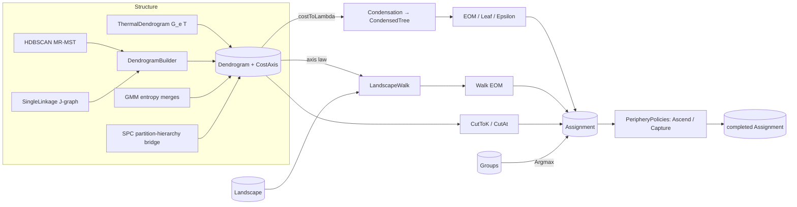

# Cluster Resolution

> The model-agnostic end of ThermoMapper's clustering stack. It turns an algorithm-specific structure into a crisp answer: which points belong together, and which points the method declines to place. That structure can be an MST, a thermal coupling sweep, an entropy-merge sequence or a temperature stack. It defines the shared carriers (`Assignment`, `Groups`, `Landscape`), a producer-neutral merge tree (`Dendrogram`), two families of selectors (HDBSCAN-style condensation and landscape walks), and completion policies for points left unassigned. · **Projects:** `Clustering.Primitives`, `Clustering.Dendrograms` · **Maturity:** core; `Groups` is complete but nothing in the library produces it yet

## Overview

`Clustering.Primitives` sits at layer 0 of the [architecture](./Architecture.md) and has no project references. `Clustering.Dendrograms` sits at layer 4 and depends on `Clustering.Primitives` for the carriers and on [`Graphs.Primitives`](./GraphSubstrate.md) for the CSR graph, union–find and Kruskal. They are consumed by:

- [HDBSCAN](./Hdbscan.md), through condensation and selection;
- [SPC analysis](./SpcAnalysis.md), through thermal dendrograms, landscape walks and periphery completion;
- [Gaussian mixtures](./GaussianMixtures.md), whose entropy-merge sequence is exported as a `Dendrogram`;
- the [cluster evaluators](./ClusterEvaluation.md), which read `Assignment`.

**The resolution spine** runs structure → height → selector → completion:

## Key concepts

- **`Assignment`: the crisp result.** Per-point labels, dense in $[0,\text{Count})$, or `Unassigned = −1`. **Abstention is first-class.** It generalizes HDBSCAN's "noise" to every method: resolvers return −1 rather than force a label.
- **`Groups`: the soft result.** An N×K row-major membership field (the buffer is aliased, not copied); $M_{ik}\ge0$ is a convention the constructor does not check. `Argmax` resolves it, breaking ties to the lowest group id, and never abstains except when K = 0, where every point is `Unassigned`.
- **`Landscape`: the height field.** A per-node scalar field sampled on a strictly ascending grid over a *named* axis, for example the temperature axis. It is the "height" that landscape selectors integrate.
- **Cost axis and the axis-alignment law.** Every `Dendrogram` carries a free-text `CostAxis` naming what its merge heights mean. A landscape walk is defined only when `Dendrogram.CostAxis == Landscape.Axis`, checked as an ordinal string comparison. Always use the exact strings that producers stamp (see [Algorithms](#merge-trees)).
- **λ (persistence).** For condensation, merge heights are mapped to $\lambda=1/h$ by default. The consumer makes this conversion; the tree itself stores the raw height.
- **Periphery.** Points left unassigned by a selector. Completion policies may fill them in; they never relabel an assigned point.

## Design

- **Index-based trees with light allocation.** Leaves are $0..N-1$, and merge i is node $N+i$. There are no node objects. Leaf traversal (`VisitLeaves`) is iterative over a caller-owned stack. The walk's labeling and the condensed tree's descendant marking allocate their own stacks.
- **A neutral DTO, interpreted by the consumer.** `DendrogramNode.Distance` is "the scalar at which the subtrees merge", whatever its physical meaning. Condensation takes the cost→λ map as a parameter. The walk checks the axis *label* at run time rather than through types.
- **The negation trick.** Single linkage on couplings and the thermal dendrogram both need a *maximum* spanning tree. Each negates its weights and runs the shared ascending Kruskal.
  - `ThermalDendrogram` restores the physical height (temperature) afterwards.
  - `SingleLinkage` keeps the negated value as the height, with cost axis `"neg_coupling"`.
- **Order-independent completion.** `PeripheryPolicies` read the *original* labels and write into a copy, so the result does not depend on the order nodes are visited.
- **Two parallel selector families.**
  - Condensed-tree selection (HDBSCAN) condenses by `minClusterSize` and measures stability in λ.
  - Walk selection works on the raw binary tree and uses `minClusterSize` only as an eligibility floor. Tree condensation is not implemented on the walk side.
- **Extension points.**
  - A new structure producer only has to emit a build-ordered `Dendrogram`.
  - A new height is a `Landscape` whose `Axis` matches the producer's `CostAxis`.
  - A new λ map is a `costToLambda` delegate. It is applied only to positive heights; heights ≤ 0 are forced to $\lambda=+\infty$ before the map runs, so a tree with non-positive heights (such as `"neg_coupling"`) cannot be condensed meaningfully.

## API at a glance

| Type | Essentials |
|---|---|
| `Assignment` | `required int[] Labels`, `required int Count`; `IsAssigned(i)`, `AssignedCount`, `Coverage`, `Assigned`, `FromLabels(labels)`; `Unassigned = −1` |
| `Groups` | `Groups(membership, pointCount, groupCount)`; `this[i, k]`, `Row(i)`, `Argmax()` |
| `Landscape`, `LandscapeProvenance` | `Axis`, `Grid`, `ValuesByGridPoint[g][node]`, `Provenance`; `Landscape.Create(axis, grid, valuesByGridPoint, provenance?)` |
| `Dendrogram`, `DendrogramNode` | `(Merges, LeafCount, CostAxis = "distance")`; `CutToK(k)`, `CutAt(level)` |
| `DendrogramBuilder` | `BuildSingleLinkageDendrogram(sortedEdges, leafCount, uf)` → `DendrogramNode[]` (exactly `leafCount − 1` edges; the caller wraps it in a `Dendrogram` and stamps `CostAxis`); `VisitLeaves(...)` |
| `SingleLinkage` | `FromCouplingGraph(CsrGraph)` |
| `ThermalDendrogram` | `FromEdgeCurves(graph, temperatures, edgeFieldByGridPoint, theta = 0.5)` |
| `Condensation`, `CondensedTree` | `Condense(dendrogram, minClusterSize, costToLambda?)`; `SelectByExcessOfMass`, `SelectByLeaf`, `SelectByEpsilon`, `ResolveLabeled`, `ToAssignment` |
| `LandscapeWalk`, `ClusterWalkReport` | `ClusterProfiles(dendrogram, landscape)`, `SelectByExcessOfMass(dendrogram, mass, allowRoot = false, minClusterSize = 1)`, `ToAssignment(dendrogram, selected)` |
| `PeripheryPolicies` | `Ascend(partial, graph, landscapeSlice)`, `Capture(partial, graph, edgeField)` |

## Algorithms

### Merge trees

- **`DendrogramBuilder`.** Takes MST edges sorted by non-decreasing weight. Merge i joins the current clusters of its endpoints at height $w_i$. `UnionFind.Reroot` stamps each merged root with the new node id, so the union–find needs capacity $2N-1$.
- **`SingleLinkage.FromCouplingGraph`.** Reads the upper-half CSR couplings J, uses weights $-J$, runs Kruskal, and throws if the tree does not span. Heights are $-J$, so `CutAt(level)` keeps couplings $J\ge-\text{level}$.
- **`ThermalDendrogram.FromEdgeCurves`.** For each edge it takes the **decoupling temperature** $T_e=\max\{T_t: G_e(T_t)\ge\theta\}$, with θ = 0.5 by default. Edges that never reach θ are dropped. It then builds a maximum spanning *forest* in $T_e$.
  - Heights are **non-increasing** in build order: hot couplings merge first and the cold root comes last.
  - Heights are grid-quantized, so ties are common. The unstable sort makes tie topology depend on input order.
- **Cuts.**
  - `CutToK(k)` applies the first $N-k$ merges and works for any build order, but it throws if fewer than $N-k$ merges exist, so a forest cannot be cut below its number of components.
  - `CutAt(level)` applies merges with height ≤ level, and is correct only for non-decreasing trees.
  - Clusters are numbered in order of first appearance by leaf index.

**Cost-axis strings stamped by producers:**

| Producer | `CostAxis` |
|---|---|
| default | `"distance"` |
| HDBSCAN | `"mutual_reachability_distance"` |
| `SingleLinkage` | `"neg_coupling"` |
| `ThermalDendrogram` | `"temperature"` |
| SPC `PartitionHierarchyDendrogram.ToDendrogram` | `"temperature"` |
| GMM `EntropyMergeStrategy` | `"entropy_reduction"` |

The `Dendrogram` doc comment's example strings (`"entropy_delta"`, `"single_linkage_distance"`) are not what any producer stamps.

### Condensation (HDBSCAN-style)

With $\lambda_i=\text{costToLambda}(h_i)$, and $\lambda=+\infty$ whenever $h\le0$, merges are visited top-down from the root. The root is cluster 0, born at $\lambda=0$. At a merge inside condensed cluster P, with child sizes $s_L,s_R$ and minimum size m, one of three things happens:

- **Both children ≥ m (real split).** P dies at $\lambda_i$, and two new clusters are born there.
- **Exactly one child ≥ m.** The small side's points *fall out* of P at $\lambda_i$, and the large child continues as P.
- **Both children < m.** P dissolves, and all its points fall out.

Stability is the Campello–Moulavi–Sander quantity:

$$\sigma(C)=\sum_{x\in C}\big(\lambda_{\text{out}}(x,C)-\lambda_{\text{birth}}(C)\big).$$

Cluster ids are allocated top-down, so $\text{Parent}[c]<c$.

**Selectors.**

- **EOM.** Bottom-up: select C if $\sigma(C)\ge\sum_{\text{children}}\hat\sigma$, with ties going to the parent, and keep only the topmost selections. The root is eligible only with `allowSingleCluster`.
- **Leaf.** Selects every childless cluster. The root is childless only if the tree never split, and is then selected only with `allowSingleCluster`.
- **Epsilon.** A post-filter on a base selection. A selected cluster whose birth distance $1/\lambda_{\text{birth}}$ is below ε climbs to the first ancestor whose birth distance exceeds ε. If the climb reaches a node whose parent is the root, the result is the root when `allowSingleCluster` is set; otherwise it is **that child-of-root node**, which need not be C itself. This mirrors sklearn's `cluster_selection_epsilon`.

**Resolution.** Each point climbs from its deepest cluster to the nearest selected ancestor, or becomes `Unassigned` if there is none. Its membership probability is:

| Case | Probability |
|---|---|
| The deepest cluster is selected, with $0<\lambda_{\text{death}}<\infty$ | $\min(1,\lambda_{\text{out}}(x)/\lambda_{\text{death}})$ |
| The deepest cluster is selected with $\lambda_{\text{death}}$ of 0 or ∞, or the selection is a strict ancestor | 1 |
| Noise | 0 |

**Duplicates and infinite λ.** Coincident points give merge height 0, so $\lambda=\infty$.

- Every condensed cluster born at $\lambda=\infty$ has NaN stability and is never selected by EOM.
- Any cluster born at finite λ that loses points at $\lambda=\infty$ (by a split, a fallout or dissolution) has $+\infty$ stability and dominates EOM.
- NaN does not propagate upward.

Because the core distance excludes the point itself, this needs at least `minPts + 1` coincident points.

### Landscape walks

With $L_g(p)$ the landscape value of node p at grid point g:

$$S(C,g)=\sum_{p\in C}L_g(p),\qquad M(C)=\sum_{g\in W(C)}S(C,g)\,\Delta_g,\qquad g^*=\arg\max_{g\in W(C)}S(C,g)/|C|.$$

- **Mass M** is a generalized excess-of-mass: the landscape integrated over the cluster's lifetime window.
- **Grid widths.** $\Delta_g$ are Riemann widths on the grid; the last width is replicated.
- **Orientation.** A tree counts as descending when strictly decreasing height steps outnumber increasing ones.
- **Lifetime window.**
  - Ascending trees: $W=\{g: b_C\le t_g<d_C\}$.
  - Descending (thermal) trees: $W=\{g:d_C<t_g\le b_C\}$.
  - Here $b_C$ is the cluster's own merge height and $d_C$ its parent's.
  - Roots get $d_C=\pm\infty$.
- **Profile accumulation.** Profiles are built incrementally up the tree, by adding the right child's profile into the left child's buffer. The cost is $O((N+m)G)$.
- **Degenerate windows.** An equal-height parent/child pair gives an empty window, so the cluster has mass 0 and no peak.

**Walk selection.** A node is selected when all of these hold:

- it is eligible: not a root, unless `allowRoot`, and of size ≥ `minClusterSize`;
- $M>0$;
- $M\ge$ the sum of its children's best values.

Only the topmost selected node on each path is kept. Unlike condensed EOM, there is no condensation, strict positivity is required, roots are excluded by default, and forests may have several roots.

With $L\equiv1$, the mass is $|C|\times$ the grid-quantized lifetime on the *landscape axis*. It is analogous to HDBSCAN stability, but not identical to it.

### Periphery completion

- **`Ascend`** is a quick-shift-style modal ascent. Each originally unassigned node repeatedly moves to its neighbor with the largest key $(L(j),-j)$, as long as that key is higher than its own. It adopts the label of the first originally assigned node it reaches, and stays unassigned at a local maximum. The key strictly increases, so the walk terminates. It depends only on the order of L.
- **`Capture`** is edge-greedy (Domany's peripheral capture). Each unassigned node follows its strongest incident edge until it reaches an assigned node (adopt), revisits a node (abstain) or finds no edge. It has no potential function, so it can cross valleys.

## Configuration

| Setting | Default | Meaning |
|---|---|---|
| `Dendrogram.CostAxis` | `"distance"` | Axis label |
| `ThermalDendrogram.FromEdgeCurves` theta | 0.5 | Coupling threshold on $G_e(T)$ |
| `Condensation.Condense` costToLambda | $1/h$, and $+\infty$ for $h\le0$ | Persistence map |
| `Condensation.Condense` minClusterSize | required, ≥ 2 | Condensation threshold |
| `LandscapeWalk.SelectByExcessOfMass` allowRoot / minClusterSize | false / 1 | Root eligibility; size floor |
| `Assignment.Unassigned` | −1 | Sentinel for "abstain" |

## Status and caveats

- **`Condense` assumes a single root.** It treats the last merge as the only root. For a forest, which thermal dendrograms can produce, the leaves of the other trees keep cluster 0 and a fallout λ of 0. Use landscape walks for forests.
- **Inconsistent noise tests.** `Assignment` treats only −1 as unassigned, while `HdbscanResult.IsNoise` tests `< 0`.
- **Direct `Landscape` construction skips validation.** `Landscape.Create` validates the grid and column shapes. Initializing the required members directly bypasses those checks, and the walk depends on them.
- **Stale doc-comment claims.** `CondensedTree`'s documentation says `Death` is 0 for a cluster that never splits again. In the code, `Death` is set when a cluster dissolves, so leaf clusters get a nonzero or infinite `Death`. The `Mass` documentation's "classic HDBSCAN stability at L ≡ 1" is only an analogy; see [Landscape walks](#landscape-walks).
- **`Groups` has no producer yet.** It is a complete type, but nothing in the library constructs it.

## Source map

| Role | Files |
|---|---|
| Carriers | `ThermoMapper/src/clustering/primitives/Assignment.cs`, `Groups.cs`, `Landscape.cs` |
| Merge trees | `ThermoMapper/src/clustering/dendrogram/Dendrogram.cs`, `DendrogramNode.cs`, `DendrogramBuilder.cs`, `SingleLinkage.cs`, `ThermalDendrogram.cs` |
| Selection and completion | `ThermoMapper/src/clustering/dendrogram/Condensation.cs`, `LandscapeWalk.cs`, `PeripheryPolicies.cs` |

**See also:** [Hdbscan](./Hdbscan.md) · [SpcAnalysis](./SpcAnalysis.md) (thermal EOM, hierarchy EOM) · [GaussianMixtures](./GaussianMixtures.md) (entropy dendrogram) · [Concepts](./Concepts.md#resolution-carriers)
