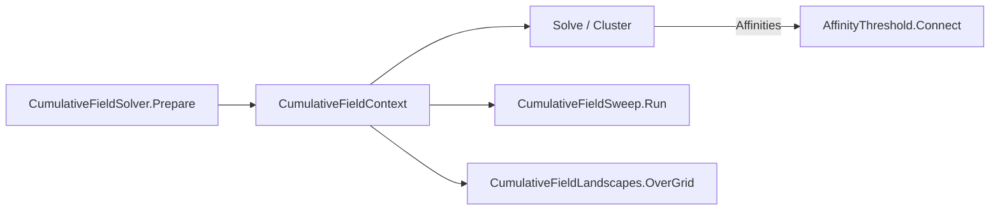

# Cumulative Field

> A deterministic graphical clusterer. It sorts a coupling graph's edges into a **cumulative-energy ladder** $H^{\text{cum}}$ once, then evaluates each edge's survival affinity $G_e(T)=1-e^{-H^{\text{cum}}_e/T}$ in closed form at any temperature, with no Monte Carlo. A fixed threshold on G gives thermal single linkage over the ladder. The ladder can be pooled globally or per node. · **Project:** `Clustering.Graphical.CumulativeField` · **Maturity:** core; `MonteCarloAffinityDemo` is a demonstration

## Overview

`Clustering.Graphical.CumulativeField` is a sibling of [SPC](./SpcEngine.md) and [HDBSCAN](./Hdbscan.md). It has no Potts spins and no sampler: its temperature is a cut coordinate on the ladder, not a thermodynamic temperature. It builds on:

- [`Graphs.Primitives`](./GraphSubstrate.md): the CSR graph, the `Affinities` currency and endpoint symmetrization;
- `Graphs.Models.Potts`: the bond kernel `FkKernel.BondProbability`;
- `Graphs.Observables`: the per-node marginals that feed landscapes;
- `Clustering.Dendrograms`: the threshold-and-connect close `AffinityThreshold.Connect`;
- `Archivory`: the run bundle's artifact scope and tabular writing.

Its `Affinities` and `Landscape` outputs are the same currencies Swendsen–Wang produces, so the shared resolvers in [SPC analysis](./SpcAnalysis.md) and [ClusterResolution](./ClusterResolution.md) consume them unchanged. The REPL reaches it through `spc --solver cumulative-field`.

## Key concepts

**Cumulative-energy ladder.** Sort couplings ascending and take rank-inclusive cumulative sums, so the strongest edge carries the total mass. A larger $H^{\text{cum}}$ means a stronger, longer-surviving edge.

**Field.** How the ladder is pooled:

- **`Field.Mean`:** one global ladder over the undirected edges. Density-blind: a dense region's couplings crowd the ladder and lift the cut everywhere.
- **`Field.Local`:** each node ranks its own incident couplings, so the two directed slots of an edge carry values from each endpoint's ranking. Adaptive to density variation, not to frustration.

**Symmetrization.** For `Local`, the two directed values are reconciled into the upper-half slot by a `SymmetrizationRule`: `Mutual` (minimum, the default), `Inclusive` (maximum) or `Mean` (average).

## Design

- **Prepare once, evaluate anywhere.** `Prepare` builds the temperature-independent ladder. `Solve` applies only the kernel, so a sweep is one $O(E\log E)$ prepare plus $O(E)$ per temperature, and the immutable context is safe to fan out.
- **Struct-generic fields.** `IField` is a static-abstract struct interface with one implementation per `Field` value (`MeanField`, `LocalField`). The JIT specializes the ladder build and nothing else. New fields add a struct and a case in `Prepare`.
- **Currencies as the narrow waist.** `Solve` writes `Affinities` directly. Once produced, the currency carries no trace of which method made it.

## API at a glance

| Area | Entry points |
|---|---|
| Solver | `CumulativeFieldSolver.Prepare(graph, weightKind, field, rule = Mutual)` → `CumulativeFieldContext`; `Solve(context, T)` → `Affinities`; `Cluster(context, T, theta = 0.5)` → `Assignment`; `EstimateBracket` |
| Sweep | `CumulativeFieldSweep.Run(graph, weightKind, temperatures, field, rule, theta)` → `CumulativeFieldSweepResult` |
| Landscapes | `CumulativeFieldLandscapes.OverGrid(context, temperatures, sink)`; `CumulativeFieldLandscapeSink` (`BondMass`, `LocalEnergy`) |
| Export | `CumulativeFieldRunLayout`, `CumulativeFieldRunPaths(scope)`; `CumulativeFieldCsvWriter.WriteSweep`; partition and edge currencies via `Clustering.Export`'s `CurrencyCsvWriter` |
| Demo | `MonteCarloAffinityDemo.Sample(context, T, draws, seed?)` (not for production use) |

## Algorithms

**Building the ladder.**

- **`Field.Mean`:** sort the M undirected couplings in ascending order. Each edge's upper-half slot receives the rank-inclusive cumulative sum $H^{\text{cum}}_{(r)}=\sum_{s\le r}J_{(s)}$.
- **`Field.Local`:** each row sorts its own couplings and writes its rank-inclusive cumulative sums into its own outgoing slots.

**Kernel.** $G_e(T)=1-e^{-H^{\text{cum}}_e/T}$ when $H^{\text{cum}}_e>0$, otherwise 0. For `Local`, the two directed values are then reconciled per the rule.

**Clustering.** `Cluster` thresholds G at θ (default ½) and takes connected components. θ must lie in [0, 1]; other values throw `InvalidOperationException`.

- For `Field.Mean`, $G_e>\theta\iff H^{\text{cum}}_e>-T\ln(1-\theta)$. Each edge is active below its cut temperature $T^*_e=-H^{\text{cum}}_e/\ln(1-\theta)$, which is $H^{\text{cum}}_e/\ln2$ at the default θ = ½, and because $H^{\text{cum}}$ increases with coupling rank, the partition equals **single linkage on couplings**.
- For `Field.Local`, the cut applies to the reconciled value:
  - under `Mutual` or `Inclusive`, the minimum or maximum of the two directed $H$ values;
  - under the `Mean` rule, no single-$H$ form exists.

  Partitions remain nested in T in every case.

**Bracket.** `EstimateBracket` takes quantiles 2% and 98% of the positive $H^{\text{cum}}$ values, divides by $\ln 2$, and pads by factors 0.5 and 2.

**Monte Carlo demonstration.** `MonteCarloAffinityDemo` estimates $G_e$ by averaging exponential energy-budget draws, the estimator of Wang et al. (2020). It converges to `Solve` as the draw count grows; the closed form is that limit with zero variance.

**Run bundle.** `CumulativeFieldRunLayout` names `manifest.json`, `summary.json`, `graph_health.json` and a `csv/` sub-directory; `CumulativeFieldRunPaths` resolves them against an Archivory `ArtifactScope`. The CSV names belong to `CumulativeFieldCsvWriter`:

| CSV file | Columns |
|---|---|
| `sweep.csv` | `temperature`, `cluster_count`, one row per grid temperature in caller order |
| `partition.csv` | the shared partition schema: `node_index`, `x0…x{d−1}`, `true_label` (optional), `label` |
| `edge_currencies.csv` | the shared edge schema at one representative temperature: `source`, `target`, `weight`, `affinity`, `alignment` and `co_membership` (NaN: the solver mints affinities only) |

## Configuration

| Setting | Default | Meaning |
|---|---|---|
| `Field` | `Mean` in the REPL | Global or per-node ladder |
| `SymmetrizationRule` | `Mutual` | Reconciliation of directed `Local` values |
| θ | 0.5 | Affinity threshold for `Cluster` and `CumulativeFieldSweep.Run` |
| `EstimateBracket` | quantiles 0.02–0.98, pads 0.5 and 2.0 | Native temperature bracket |

## Status and caveats

- **Temperature units.** The temperature axis is in $H^{\text{cum}}$ units and is not comparable with the Swendsen–Wang temperature.
- **Coupling graphs only.** `Prepare` rejects any `weightKind` other than `EdgeWeightKind.Coupling`; it trusts the declared kind and does not inspect the weights.
- **`EstimateBracket` ignores the rule and θ.** It brackets the unsymmetrized directed ladder values and always divides by $\ln 2$, so for `Local` fields and for θ ≠ ½ the bracket is approximate.
- **The `Mean` rule averages after the exponential.** The effective score is a temperature-dependent soft minimum of the two directed values, so θ reorders edges rather than only rescaling the temperature axis.
- **REPL placement.** The REPL still dispatches through the `spc` command (`--solver cumulative-field`), so its bundle lands under the `spc` run family.

## Source map

| Role | Files |
|---|---|
| Solver | `ThermoMapper/src/clustering/graphical/cumulative-field/` (`CumulativeFieldSolver.cs`, `CumulativeFieldContext.cs`, `Field.cs`, `IField.cs`, `MeanField.cs`, `LocalField.cs`) |
| Sweep and landscapes | `…/cumulative-field/` (`CumulativeFieldSweep.cs`, `CumulativeFieldSweepResult.cs`, `CumulativeFieldLandscapes.cs`) |
| Export | `…/cumulative-field/export/` (`CumulativeFieldRunLayout.cs`, `CumulativeFieldRunPaths.cs`, `CumulativeFieldCsvWriter.cs`); shared tables in `ThermoMapper/src/clustering/export/` (`CurrencyProjections.cs`, `CurrencyCsvWriter.cs`) |
| Demo | `…/cumulative-field/demos/MonteCarloAffinityDemo.cs` |
| Threshold close | `ThermoMapper/src/clustering/dendrogram/AffinityThreshold.cs`, `UnionFindLabeler.cs` |

**See also:** [SpcEngine](./SpcEngine.md) · [SpcAnalysis](./SpcAnalysis.md) · [ClusterResolution](./ClusterResolution.md) · [GraphSubstrate](./GraphSubstrate.md)
