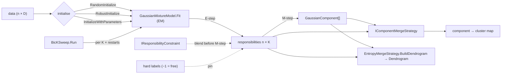

# Gaussian Mixtures and k-means++

> Finite Gaussian mixture modeling fitted by expectation–maximization (EM). It supports hard and soft supervision, choosing K by BIC, and two ways to merge the fitted components into clusters: by classification entropy and by density modes. The page also covers k-means++, a standalone geometric clusterer. · **Projects:** `Clustering.Statistical.GMM` (namespace `Clustering.Statistical.GMM`), `Clustering.Geometric.KMeans` · **Maturity:** core

This page is the reference that several GMM source comments point to as `docs/gmm.md`.

## Overview

The GMM project sits in layer 5 of the [architecture](./Architecture.md). It uses:

- `CholeskyDecomposition` from [LinearAlgebra](./LinearAlgebra.md);
- Mahalanobis distance from [DistanceMetrics](./DistanceMetrics.md);
- `EuclideanMedian` from [RiemannianGeometry](./RiemannianGeometry.md) for robust initialization;
- `SeedTree` from [ProbabilityAndInformation](./ProbabilityAndInformation.md);
- `Dendrogram` from [ClusterResolution](./ClusterResolution.md), to export the merge hierarchy.

[Mapper](./Mapper.md) consumes both the mixture model and k-means++ as clusterers.

## Key concepts

- **Components vs clusters.** EM fits K Gaussian **components**. A merge strategy then maps components to fewer **clusters**, so one non-Gaussian cluster can be covered by several components.
- **Responsibility.** $r_{ik}=P(k\mid x_i)$, the soft N×K assignment produced by the E-step.
- **Supervision.** *Hard labels* pin chosen points to a component. A *soft constraint* blends a supervisor's confidence matrix into the responsibilities, with a weight λ that is annealed linearly from `lambdaStart` to `lambdaEnd` (by default it decays from 0.8 to 0).
- **Dead component.** A component with $N_k\le10^{-12}$. The M-step leaves its mean and covariance unchanged and sets its weight to $N_k/n\approx0$, which suppresses it in later E-steps.

## Design

- **`GaussianComponent` holds parameters and a cache.** It exposes `Weight`, `Mean` and `Covariance`, whose arrays are written in place. It caches $\Sigma^{-1}$, the log-normalizer, $\ln\pi$ and a Cholesky factor for sampling. **After writing parameters directly, call `UpdateCache()`.** Merge strategies and mode ascent assume the cache is current.
- **`GaussianMixtureModel` is a stateful engine.** It owns the components, the last responsibility matrix and the fit diagnostics.
  - Initialization is a separate, optional step. After any initializer has run, **a later `Fit` warm-starts from the previous fit** instead of re-initializing.
  - Four public `Fit` overloads (unsupervised; soft; hard; hard and soft) all delegate to one core.
- **Strategy interfaces.** Supervision (`IResponsibilityConstraint`) and hierarchy (`IComponentMergeStrategy`) are pluggable. Merge strategies take the components plus an optional responsibility matrix. Entropy merging needs it; modal merging ignores it.
- **Static kernels with reusable scratch.** `ModeAscent` has an allocation-free overload that takes a `ModeAscentScratch`. `BicKSweep`, `BhattacharyyaCoefficient` and `KMeansPlusPlus` are static.
- **Hierarchy as a shared carrier.** `EntropyMergeStrategy.BuildDendrogram` emits a standard `Dendrogram` with cost axis `"entropy_reduction"`. GMM thereby joins HDBSCAN and thermal single linkage as a producer on the shared [resolution spine](./ClusterResolution.md).

## API at a glance

| Area | Entry points |
|---|---|
| Model | `GaussianMixtureModel(k, dimension, covarianceRegularization = 1e-6)`; `K`, `Dimension`, `Components`, `IsConverged`, `FinalLogLikelihood`, `NumIterations` |
| Initialization | `RandomInitialize(data, rng?)`, `RobustInitialize(data, seeds?, consistencyFactor = 1.0, rng?)`, `InitializeWithParameters(means, covariances, weights)` |
| Fitting | `Fit(data[, hardLabels][, constraint], maxIterations = 100, tolerance = 1e-4)` |
| Inference | `Predict`, `PredictProba`, `GetFinalResponsibilities()` (the live buffer), `Pdf`, `Mahal`, `Sample(n, rng?, componentIndices?)` |
| Component | `GaussianComponent` (`Weight`, `Mean`, `Covariance`, `CovarianceInverse`, `LogNormalizationFactor`, `LogWeight`, `UpdateCache`, `EvaluateLogPdf`, `MahalanobisSquared`, `Sample`) |
| Supervision | `IResponsibilityConstraint`; `AnnealedSoftConstraint(confidenceMatrix, normalizeRows = false, lambdaStart = 0.8, lambdaEnd = 0.0, lambdaHorizon = null)` |
| Model selection | `BicKSweep.Run(data, dimension, kMin = 1, kMax = 10, maxIterations = 100, tolerance = 1e-4, restarts = 1, randomSeed = null)` → `KSweepResult[]`; `BicKSweep.BestByBic` |
| Hierarchy | `IComponentMergeStrategy`; `EntropyMergeStrategy(targetClusters = 1)` (`Merge`, `MergeSequence` → `MergeStep[]`, `BuildDendrogram`); `ModalMergeStrategy(modeTolerance = NaN, maxAscentSteps = 50, ascentTol = 1e-7)`; `ModeAscent.Ascend`, `ModeAscent.GetBasin` |
| Diagnostics | `BhattacharyyaCoefficient.Between`, `Distance` |
| k-means | `KMeansPlusPlus.Cluster(data, k, maxIterations = 100, seed = 42, tol = 1e-6)` → `KMeansResult(Labels, Centroids, K)` |

**Typical flow.**

1. Run `BicKSweep.Run`, then `BestByBic`.
2. Take the best model and pass its `Components` and `GetFinalResponsibilities()` to a merge strategy.
3. Combine `Predict` labels with the component-to-cluster map.
4. Score the result with any [evaluator](./ClusterEvaluation.md).

## Algorithms

### Initialization

- **Random.**
  - Means: K distinct rows chosen by partial Fisher–Yates.
  - Covariances: every component gets $\operatorname{diag}(s_d^2+\varepsilon)$, where $s_d^2$ is the per-dimension sample variance.
  - Weights: uniform.
  - `Fit` calls this automatically, with an unseeded `Random`, if no initializer has run.
- **Robust.**
  - Assign each point to its nearest seed (given, or chosen at random).
  - For each non-empty cluster, the mean becomes the cluster's **geometric median** and the covariance its Weiszfeld scatter, both from `EuclideanMedian.ComputeWithScatter`. `consistencyFactor` is forwarded. Then add $\varepsilon I$.
  - Weights: uniform.
  - An empty cluster gets its seed point as the mean and $\Sigma=\varepsilon I$.
- **Warm start** (`InitializeWithParameters`). The given covariances are used **as given**, with no ridge added; they are protected only by the Cholesky pivot floor. Weights are renormalized.

### EM

**E-step** (parallel over points):

$$\ell_{ik}=\ln\pi_k+\ln\mathcal N(x_i\mid\mu_k,\Sigma_k),\qquad r_{ik}=\frac{e^{\ell_{ik}-m_i}}{\sum_je^{\ell_{ij}-m_i}},\qquad \mathcal L=\sum_i\Big(m_i+\ln\sum_je^{\ell_{ij}-m_i}\Big)$$

with $m_i=\max_k\ell_{ik}$. A pinned point gets a one-hot row and contributes $\ln\pi_{z_i}+\ln\mathcal N(x_i\mid\cdot)$. With hard labels, $\mathcal L$ is therefore a joint log-likelihood for the labeled points plus a marginal one for the rest.

**M-step** (sequential over components):

$$N_k=\sum_ir_{ik},\quad\mu_k=\tfrac1{N_k}\sum_ir_{ik}x_i,\quad\Sigma_k=\tfrac1{N_k}\sum_ir_{ik}(x_i-\mu_k)(x_i-\mu_k)^\top+\varepsilon I,\quad\pi_k=N_k/n.$$

The covariance is computed in centered (two-pass) form. Responsibilities below $10^{-15}$ are skipped in the covariance pass.

**Loop and convergence.** Each iteration:

1. Runs the E-step.
2. Tests the **absolute** change in total log-likelihood, $|\mathcal L_t-\mathcal L_{t-1}|<$ `tolerance`. The test comes **before** the M-step. On success the fit returns at once, so `FinalLogLikelihood` and the responsibilities match the current parameters.
3. Otherwise applies the soft constraint, re-pins the hard labels, and runs the M-step.

If `maxIterations` runs out, one extra E-step makes the outputs consistent with the final parameters. That extra step is not counted in `NumIterations`.

**Cost.** Each iteration is $O(nKD^2+KD^3)$. Responsibilities are kept and reused across fits of the same size.

### Soft supervision

For each row with a non-zero confidence sum:

$$\hat r_{ik}\leftarrow\frac{(1-\lambda_t)r_{ik}+\lambda_ts_{ik}}{\sum_j[(1-\lambda_t)r_{ij}+\lambda_ts_{ij}]},\qquad \lambda_t=\lambda_{\text{start}}+(\lambda_{\text{end}}-\lambda_{\text{start}})\min\!\Big(1,\frac{t}{H-1}\Big).$$

- H is `lambdaHorizon`, or `maxIterations` if the horizon is null.
- t is the 0-based EM iteration. If H ≤ 1, λ equals `lambdaEnd` from the first iteration. When λ < 10⁻¹², the constraint leaves the responsibilities unchanged.
- Rows whose confidence sums to zero *abstain* and keep the E-step result.
- With the defaults (λ from 0.8 to 0 over the horizon), the supervisor dominates early and fades out.

The stopping test uses the model's own E-step likelihood, while the M-step consumes blended responsibilities. With λ > 0 the iteration is therefore not strict EM, and it can stop before λ has decayed.

### Choosing K by BIC

$$\mathrm{BIC}(K)=-2\ln\hat L_K+p_K\ln N,\qquad p_K=KD+K\frac{D(D+1)}2+(K-1).$$

For each K, `restarts` randomly initialized fits are run, seeded from `SeedTree.Derive(baseSeed, restarts)`. The one with the highest log-likelihood is kept. `BestByBic` returns the lowest BIC. The sweep is reproducible only when `randomSeed` is given. `KSweepResult.LogLikelihood` is the final log-likelihood whether or not that fit converged.

### Entropy merging

This follows Baudry et al., JCGS 2010, and works on the pooled responsibilities with no refitting. With $\phi(v)=v\ln v$:

$$H=-\sum_i\sum_g\phi(r_{ig}),\qquad \Delta H(j,l)=\sum_i\big[\phi(r_{ij})+\phi(r_{il})-\phi(r_{ij}+r_{il})\big]\le0.$$

Each step merges the pair with the **minimum** ΔH, which is the largest entropy decrease.

- `MergeSequence` returns every level from K clusters down to 1, each with its entropy and a dense component-to-cluster map.
- `Merge` returns the first level with at most `TargetClusters` clusters.
- `BuildDendrogram` exports the same sequence. The merge at 0-based index m gets node id `LeafCount + m`, and its height, the cumulative entropy reduction, is stored in `DendrogramNode.Distance`.
- Cost is $O(K^2N+K^3)$.
- Choosing the number of clusters automatically (for example from an elbow in the entropy plot) is not implemented.

### Modal merging and mode ascent

`ModeAscent` climbs $\ln p(x)$ from a start point, typically a component mean. The gradient is

$$\nabla\ln p(x)=\sum_kr_k(x)\,\Sigma_k^{-1}(\mu_k-x),$$

and each step uses a backtracking line search over α = 1, ½, …, 2⁻²⁹ (30 trials) that accepts the first step where $\ln p$ increases strictly. Ascent stops when no trial succeeds, when a step moves less than `ascentTol` (Euclidean norm), or after `maxAscentSteps` steps. This is plain gradient ascent, not the Gaussian mean-shift fixed point.

`ModalMergeStrategy` ascends from every component mean and groups components greedily:

- A component joins the first existing cluster whose *founding* mode lies within τ. Otherwise it founds a new cluster.
- The default τ is 5% of the mean pairwise distance between component means.
- The grouping is order-dependent and not transitive.

### Bhattacharyya distance

$$D_B=\tfrac18(\mu_1-\mu_2)^\top\bar\Sigma^{-1}(\mu_1-\mu_2)+\tfrac12\Big[\ln|\bar\Sigma|-\tfrac12(\ln|\Sigma_1|+\ln|\Sigma_2|)\Big],\qquad BC=e^{-D_B},$$

with $\bar\Sigma=\tfrac12(\Sigma_1+\Sigma_2)$. It measures overlap between components. The component overload reads $\ln|\Sigma|$ from each component's cache.

### k-means++

- **Seeding.** The first centroid is a uniformly random row. Each subsequent centroid is drawn with probability $\propto D^2(x)$, the squared distance to the nearest centroid chosen so far.
- **Lloyd iterations.** Each iteration assigns points to the nearest centroid (ties go to the lowest index), recomputes the means, and keeps the previous centroid for an empty cluster.
- **Stopping.** The run stops when $|\Delta\text{SSE}|<$ `tol` or when no label changes.
- **Determinism.** The run is deterministic for a given seed (default 42).
- **Result.** The labels, the centroids and K. The SSE, iteration count and convergence flag are not returned.

## Configuration

| Setting | Default | Meaning |
|---|---|---|
| `covarianceRegularization` (ε) | 1e-6 | Ridge added in the M-step and in random and robust initialization; `BicKSweep` always uses the default 1e-6 |
| `Fit` maxIterations / tolerance | 100 / 1e-4 | Iteration cap; absolute change in log-likelihood |
| `RandomInitialize` / `RobustInitialize` rng | unseeded `new Random()` | Pass an `rng` for reproducibility |
| `AnnealedSoftConstraint` lambdaStart / lambdaEnd / lambdaHorizon | 0.8 / 0.0 / `maxIterations` | Linear annealing |
| `BicKSweep` kMin / kMax / restarts / randomSeed | 1 / 10 / 1 / null (`Environment.TickCount`) | K range; random restarts per K (best log-likelihood kept); master seed for `SeedTree.Derive` |
| `EntropyMergeStrategy.TargetClusters` | 1 | Level at which `Merge` stops |
| `ModalMergeStrategy` ModeTolerance / MaxAscentSteps / AscentTol | NaN (5% rule) / 50 / 1e-7 | Mode-merge radius τ (Euclidean); ascent step cap; stop when an ascent step moves less than this |
| `KMeansPlusPlus.Cluster` maxIterations / seed / tol | 100 / 42 / 1e-6 | Lloyd iteration cap; `System.Random` seed; stop when \|ΔSSE\| < tol |

## Status and caveats

- **Warm starts and live buffers.** A second `Fit` on the same model continues from the previous parameters. `GetFinalResponsibilities()` returns a live buffer that the next `Fit` overwrites.
- **Reproducibility.** GMM initializers and `BicKSweep` are not seeded unless you pass an `rng` or a `randomSeed`.
- **Input errors are not always clear.** A row of the wrong length throws from the Mahalanobis dependency, wrapped in `AggregateException` by the parallel E-step, or from the initializer. `RandomInitialize` with K > n indexes out of range. Hard labels of K or above are not checked.
- **`KMeansResult.Labels` may lag `Centroids`.** Unless the run stopped because no label changed, the labels are from the assignment *before* the final centroid update.
- **Modal merging edge case.** If all component means coincide, τ becomes 0 and every component ends up in its own cluster.

## Source map

| Role | Files (in `ThermoMapper/src/clustering/statistical/gmm/` unless a full path is given) |
|---|---|
| Model and EM | `ThermoMapper/src/clustering/statistical/gmm/GaussianMixtureModel.cs`, `GaussianComponent.cs` |
| Supervision | `IResponsibilityConstraint.cs`, `AnnealedSoftConstraint.cs` |
| Model selection | `BicKSweep.cs`, `KSweepResult.cs` |
| Hierarchy | `IComponentMergeStrategy.cs`, `EntropyMergeStrategy.cs` (`MergeStep`), `ModalMergeStrategy.cs`, `ModeAscent.cs` (`ModeAscentScratch`) |
| Diagnostics | `BhattacharyyaCoefficient.cs` |
| k-means | `ThermoMapper/src/clustering/geometric/kmeans/kmeans.cs` |

**See also:** [ClusterEvaluation](./ClusterEvaluation.md) · [ClusterResolution](./ClusterResolution.md) · [Mapper](./Mapper.md) (`ModalGmmClusterer`, `KMeansClusterer`)
