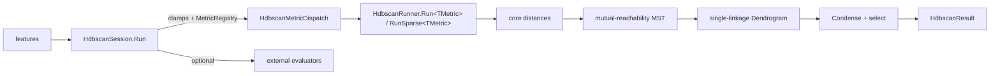

# HDBSCAN

> A complete hierarchical density-based clustering pipeline. It computes core distances and a mutual-reachability MST (exactly, or by a kNN approximation), builds a single-linkage tree, then condenses the tree and selects clusters with the shared machinery in [ClusterResolution](./ClusterResolution.md). The outputs are labels, including noise, and membership probabilities. · **Project:** `Clustering.Graphical.HdbScan` · **Maturity:** core

## Overview

`Clustering.Graphical.HdbScan` sits in layer 5 of the [architecture](./Architecture.md). It builds on:

- [`Graphs.Primitives`](./GraphSubstrate.md): core distances, Prim, Kruskal, Borůvka, union–find;
- [`Graphs.Distance`](./DistanceMetrics.md): the metric registry;
- `Clustering.Dendrograms`: tree building and condensation;
- [`Clustering.Evaluation`](./ClusterEvaluation.md): optional scoring.

Callers are the Mapper `HdbscanClusterer` and the REPL.

## Key concepts

- **Core distance.** $\kappa(i)$ is the distance from point i to its `minPts`-th nearest *other* point. The point itself is excluded, so `minPts = m` corresponds to `min_samples = m + 1` in the common HDBSCAN libraries.
- **Mutual reachability.** $d_{mr}(u,v)=\max\{\kappa(u),\kappa(v),d(u,v)\}$.
- **Condensed tree and selection.** See [ClusterResolution](./ClusterResolution.md#condensation-hdbscan-style), which covers EOM, Leaf and Epsilon selection.

## Design

- **Declarative settings, a pure engine and a thin facade.**
  - `HdbscanSettings` is pure data.
  - `HdbscanSession` applies clamps, dispatches on the metric and, when reference labels are supplied, runs the external evaluators after mapping noise (−1) to its own extra cluster id.
  - `HdbscanRunner` owns pre-allocated scratch and is reusable for the same n.
- **Struct-generic metric.** `Run<TMetric> where TMetric : struct, IDistanceMetric` lets the JIT specialize the $O(n^2)$ loops. `HdbscanMetricDispatch` turns a metric spec string into that generic call by passing a visitor struct to `MetricRegistry.Invoke`. The switch from metric kind to struct therefore exists only in the registry, and a new registry metric is picked up automatically.
- **Shared resolution spine.** Condensation and selection are the shared `Clustering.Dendrograms` routines, not a private copy.

## API at a glance

| Type | Essentials |
|---|---|
| `HdbscanSession` | `Run(double[][] features, HdbscanSettings? settings = null, IEnumerable<IExternalClusterEvaluator>? externalEvaluators = null, int[]? referenceLabels = null)` → `HdbscanSessionResult` (includes `NoiseCount` and `Purity`) |
| `HdbscanSettings` | `MinPts`, `MinClusterSize`, `AllowSingleCluster`, `ClusterSelectionMethod`, `ClusterSelectionEpsilon`, `MstAlgorithm`, `GraphNeighbors`, `Metric` |
| `HdbscanRunner` | `new(n)`; `Run<TMetric>(data, dim, minPts, metric, minClusterSize?, allowSingleCluster = true, selectionMethod = Eom, clusterSelectionEpsilon = 0)`; `RunSparse<TMetric>(…, graphK, …)` |
| `HdbscanResult` | `Labels` (−1 = noise), `MembershipProbabilities`, `ClusterCount`, `Dendrogram`, `IsNoise(i)` |
| Enums | `ClusterSelectionMethod` (`Eom`, `Leaf`); `MstAlgorithm` (`Dense`, `SparseKnn`) |

## Algorithms

### Dense path (`Run`)

1. **Core distances.** A brute-force scan with a sorted insertion buffer, $O(n^2(\text{dim}+\text{minPts}))$.
2. **Mutual-reachability MST.** Implicit Prim seeded at node 0, with no edge list: $O(n^2\,\text{dim})$ time, $O(n)$ space.
3. **Edges.** $(\text{parent}[v],v,\text{weight})$ for $v=1..n-1$, sorted ascending.
4. **Tree.** `DendrogramBuilder` turns the sorted edges into merge nodes, which the runner wraps in a `Dendrogram` with cost axis `"mutual_reachability_distance"`.
5. **Extraction.** `Condense` (with $\lambda=1/d$), then Leaf or EOM selection, then optional epsilon selection, then `ResolveLabeled`.

**Scratch.** The constructor allocates the union–find, the core-distance, visited, weight and parent arrays, and the MST edge array. Each `Run` re-initializes them. An instance is reusable for the same n but **not thread-safe**. The session creates a new runner per call.

### Approximate sparse path (`RunSparse`)

1. **kNN.** Exact brute-force kNN with `graphK` neighbors, in $O(n^2(\text{dim}+k))$. `graphK` must be at least `minPts` and is clamped to $n-1$. The core distance is read from the `minPts`-th neighbor.
2. **Candidate edges.** All kNN pairs, deduplicated, weighted by mutual reachability.
3. **MST.** Kruskal over the candidates. If they do not span, Borůvka adds minimal bridges using the mutual-reachability distance. If the result still does not span, the method throws.
4. **Rest of the pipeline.** Tree building and extraction are as in the dense path.

With `graphK = n − 1` the sparse path reproduces the dense MST's weight and merge heights. When weights tie, the binary topologies can differ: Prim and Kruskal may pick different minimum spanning trees, and the unstable sort of tied edges before tree building can order equal-height merges differently. Merge heights are unaffected.

### Membership probabilities

A point whose deepest condensed cluster L is selected gets $\min(1,\lambda_{\text{out}}/\lambda_{\text{death}}(L))$ when $0<\lambda_{\text{death}}(L)<\infty$, and 1 otherwise. A point whose selected cluster is a strict ancestor gets 1, and noise gets 0 (see [ClusterResolution](./ClusterResolution.md#condensation-hdbscan-style)).

## Configuration

| Setting | Default | Meaning |
|---|---|---|
| `MinPts` | 5 | Core-distance rank. The session clamps it to $\max(2,\min(\text{MinPts},n-1))$ |
| `MinClusterSize` | null, meaning the effective `MinPts` | Condensation threshold, ≥ 2 |
| `AllowSingleCluster` | **true** | The root may be selected. Common reference implementations default to false |
| `ClusterSelectionMethod` | `Eom` | EOM or Leaf |
| `ClusterSelectionEpsilon` | 0 (off) | Birth-distance floor |
| `MstAlgorithm` | `Dense` | Exact Prim, or the kNN approximation `SparseKnn` |
| `GraphNeighbors` | null, meaning $\max(\text{MinPts},10)$ | kNN degree for `SparseKnn`, clamped to $[\text{effMinPts},n-1]$ |
| `Metric` | `"euclidean"` | `MetricRegistry` spec string ([DistanceMetrics](./DistanceMetrics.md#the-registry)) |

## Status and caveats

- **Precondition `minPts ≤ n − 1`.** The runner does not enforce it. With `minPts == n`, the dense `Run` throws from inside the union–find, and `RunSparse` silently reads wrong core distances before throwing. The session's clamp reaches this case only at n = 2.
- **Differences from the reference HDBSCAN.**
  - `minPts` excludes the point itself.
  - `allowSingleCluster` is true by default.
  - When the root is selected, every point is labeled. Reference implementations label only the points that persist to the root's maximum λ.
- **Duplicate points.** Groups of `minPts + 1` or more identical points merge at height 0 ($\lambda=\infty$). The condensed cluster that contains them gets $+\infty$ stability and wins EOM, and any sub-cluster born at $\lambda=\infty$ has NaN stability and is never selected (see [ClusterResolution](./ClusterResolution.md#condensation-hdbscan-style)).
- **Unvalidated feature dimensions.** `HdbscanSession` takes the dimension from the first row. A shorter row throws, and a longer row is silently truncated.

## Source map

| Role | Files (`ThermoMapper/src/clustering/graphical/hdbscan/`) |
|---|---|
| Runner and result | `Hdbscan.cs` (`HdbscanRunner`, `HdbscanResult`) |
| Facade and settings | `HdbscanSession.cs`, `HdbscanSettings.cs` |
| Metric dispatch | `HdbscanMetricDispatch.cs` |

**See also:** [ClusterResolution](./ClusterResolution.md) · [GraphSubstrate](./GraphSubstrate.md#minimum-spanning-trees-and-core-distances) · [Mapper](./Mapper.md) · [ClusterEvaluation](./ClusterEvaluation.md)
