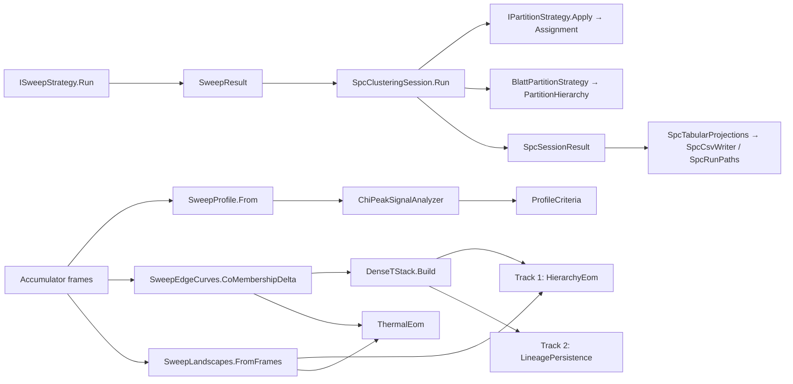

# SPC Analysis

> What superparamagnetic clustering does after sampling. It turns per-temperature sampler frames into a **temperature profile** of thermodynamic signals, picks a **chosen temperature**, cuts a flat **partition** there, and can build and resolve a multi-temperature **hierarchy**. It also writes a CSV and run-layout **export** bundle. `SpcClusteringSession` is the end-to-end entry point. · **Project:** `Clustering.Graphical.SPC` (partitions, profiling, export, session) · **Maturity:** core; `SpcOutputPathHelper` has been superseded by `SpcRunPaths`

## Overview

This layer sits on top of the [SPC engine](./SpcEngine.md), which provides the sweep, the frames and the currencies. It also uses:

- [ClusterResolution](./ClusterResolution.md): dendrograms, landscape walks, periphery completion;
- [ClusterEvaluation](./ClusterEvaluation.md): scoring;
- the Potts observables' reduction functions;
- [Archivory](./Archivory.md): export.

## Key concepts

- **Frame.** One `Accumulator`: the sufficient statistics of one Swendsen–Wang run at one temperature and replica. A *rich* sweep's frames also carry per-edge and per-node arrays.
- **Phases.**
  - Ferromagnetic (FM, cold): one cluster.
  - Superparamagnetic (SP): clusters are internally ordered but disordered relative to each other.
  - Paramagnetic (PM, hot): singletons.

  $T_{fs}$ (FM→SP) and $T_{ps}$ (SP→PM) bound the **SP plateau**, and $T_{\text{clus}}$ is its midpoint.
- **eq-4 discriminant** (BWD 1996 eq. 4). $\bar\delta_{ij}=\big((q-1)\langle n_{ij}\rangle+1\big)/q$ is the expected spin agreement implied by the co-membership. It lies in $[1/q,1]$.
- **Friends-of-friends cut.** Threshold a per-edge field at θ and take the connected components.
- **T-stack.** A `PartitionHierarchy`: one partition per temperature, cold to hot. It **nests** when every hotter cluster lies inside a single colder cluster.
- **Three hierarchical resolvers:**
  - **Track 1** (`HierarchyEom`): convert a nested T-stack to a dendrogram and resolve it by excess of mass over a thermal landscape.
  - **Track 2** (`LineagePersistence`): track cluster *lineages* through the stack and select them by persistence.
  - **Thermal EOM** (`ThermalEom`): the same walk as Track 1, but the tree is built from the per-edge $\bar\delta(T)$ curves instead of from partitions.
- **Peripheral capture** (Domany's step 2). Also join each node to its strongest neighbor.

## Design

- **Three seams, each with a single shape.**
  - `IPartitionStrategy.Apply(graph, affinities, alignments?, coMembership?) → Assignment`
  - `IHierarchicalPartitionStrategy.Apply(SweepResult, CsrGraph) → PartitionHierarchy`
  - `IPseudoTransitionDetector.Detect(SweepProfile) → double[]`

  `ISignalAnalyzer.Analyze(SweepProfile) → ProfileCriteria` is a fourth.
- **One partition kernel.** All three flat strategies and `DenseTStack` delegate to one threshold-and-connect routine, `AffinityThreshold.Connect` in `Clustering.Dendrograms`. They differ only in which field they pass it.
- **Producer-agnostic cores.** `DenseTStack`, `HierarchyEom`, `LineagePersistence` and `ThermalEom` each have two entry points:
  - an SPC adapter taking frames (`SweepDenseTStack`, `SweepHierarchyEom`, `SweepLineagePersistence`, `SweepThermalEom`: pool the frames, then call the core);
  - the core itself, in `Clustering.Dendrograms` ([ClusterResolution](./ClusterResolution.md)), taking explicit columns, a stack or a landscape, so a closed-form solver such as the [cumulative-field solver](./CumulativeField.md) can feed the same resolver.
- **Pool, then reduce.**
  - Linear per-frame reductions are averaged across replicas.
  - Nonlinear quantities pool their sufficient statistics first: label entropy (pooled histograms), $\bar\delta$ (pooled counts and draws), landscapes (pooled sums), bond entropy (pooled bond counts).
- **Honest abstention.** Resolvers return `Unassigned` rather than force labels, with completion available as an opt-in.
- **The "don't-warp" gate.** A T-stack is converted to a dendrogram only if it nests. Otherwise the conversion throws, and `HierarchyEom` either restores nesting or abstains.
- **Export as projections.**
  - `SpcTabularProjections` maps SPC's own domain objects to tables; the partition and edge-currency tables every method shares come from `CurrencyProjections` in `Clustering.Export`.
  - `SpcCsvWriter` owns file naming and writes each table atomically through Archivory's `WriteToFile`.
  - `SpcRunLayout` and `SpcRunPaths` own the directory layout.
- **Extension points.**
  - flat cuts (`IPartitionStrategy`);
  - hierarchical strategies;
  - detectors, for example $C_v$ or label-entropy peaks;
  - analyzers (`ISignalAnalyzer`), which fill `ProfileCriteria` for reporting and export; in `FixedGridSweepStrategy` they run after `SpcProfileAnalysis.SpPlateau` has fixed the chosen temperature, and do not change it;
  - landscape sinks;
  - the `SusceptibilityKind` used as the primary χ.

## API at a glance

| Area | Entry points |
|---|---|
| Session | `SpcClusteringSession.Run(graph, partitionStrategy?, analyzer?, sweepStrategy, hierarchicalStrategy?, externalEvaluators?, spcEvaluators?, referenceLabels?)` (`sweepStrategy` is declared optional, but null throws `ArgumentNullException`); a features overload `Run(features, metric?, graphConfig?, …)` that also builds the graph; `SpcSessionResult` |
| Flat cuts | `ThresholdSpinAgreement`, `ThresholdBondFrequency`, `ThresholdCoMembership`, each with `{ Theta, PeripheralCapture }` |
| Blatt hierarchy | `BlattPartitionStrategy(BlattPartitionConfig?)`; `MagnetizationPeakDetector`; `PartitionHierarchy`, `HierarchyLevel`, `PartitionNesting.Holds` (in `Clustering.Dendrograms`) |
| Dense resolvers | Swendsen–Wang adapters over frames: `SweepDenseTStack.Build`, `SweepHierarchyEom.Resolve`, `SweepLineagePersistence.Resolve`, `SweepThermalEom.Resolve`. Cores in `Clustering.Dendrograms`: `DenseTStack.Build`; `HierarchyEom.Resolve` → `HierarchyEomResult`; `LineagePersistence.Resolve` → `LineagePersistenceResult` (`ClusterLineage`); `ThermalEom.Resolve` → `ThermalEomResult`; `PartitionHierarchyDendrogram.ToDendrogram` (cost axis `"temperature"`) |
| Profiling | `SweepProfile.From(runs, kind)`, `SweepCurves.ByTemperature`, `SweepCurves.ByTemperatureWithSpread` → `SweepCurve`, `SweepEdgeCurves.CoMembershipDelta`, `SweepLandscapes.FromFrames`, `LabelEntropyCurve.From`; `SpcProfileAnalysis` (`SpPlateau`, `ComputeHalfMaximumBand`, `PickPeakTemperature`, `ComputeStability`); `ChiPeakSignalAnalyzer`; `SusceptibilityKind` |
| Export | `SpcCsvWriter.Write*`, `WriteAllToDirectory`; `SpcTabularProjections.Create*Projection`; shared `CurrencyCsvWriter.WritePartition` / `WriteEdgeCurrencies` (`Clustering.Export`); `SpcRunLayout`, `SpcRunPaths`; `SpcOutputPathHelper` (legacy) |

The frame adapters and their cores are static resolvers. The session does not call them; it accepts only an `IHierarchicalPartitionStrategy`, which in this project means Blatt.

## Algorithms

### The session

1. `sweep = sweepStrategy.Run(graph, analyzer)`. The chosen temperature is decided inside the sweep strategy (see [SpcEngine](./SpcEngine.md#sweeps)).
2. The partition is `(partitionStrategy ?? new ThresholdCoMembership { Theta = 0.5 }).Apply(...)` at the chosen temperature. The default cut is **co-membership**; the class documentation says spin agreement, but the code uses co-membership. Graphs with N < 2 give a single cluster.
3. The optional hierarchy comes from `hierarchicalStrategy.Apply(sweep, graph)`.
4. Scores:
   - `"Coverage"` is always included.
   - External evaluators run when both they and the reference labels are supplied.
   - Graph evaluators run on the chosen affinities.

When no `graphConfig` is passed, the features overload builds a kNN graph (K = 10) with a Gaussian kernel of bandwidth 0.5 and LMP disabled.

### Flat cuts

Every flat cut unions the upper-half edges with field value above θ (θ in [0, 1], default 0.5). With peripheral capture, each node is also joined to its strongest positive neighbor. Labels are dense in order of first appearance, and flat cuts never abstain.

| Strategy | Field | Requires |
|---|---|---|
| `ThresholdSpinAgreement` | Alignments $\langle 1_{s_i=s_j}\rangle$ (the classic Blatt 1996 cut) | Alignments |
| `ThresholdBondFrequency` | Affinities $\langle\omega_e\rangle$ | — |
| `ThresholdCoMembership` | $\bar\delta_{ij}=((q-1)\langle n_{ij}\rangle+1)/q$ | CoMembership with $Q\ge2$ |

For co-membership, $\bar\delta>\theta$ is equivalent to $\langle n_{ij}\rangle>(q\theta-1)/(q-1)$. At q = 20 and θ = ½ the threshold is 9/19 ≈ 0.474. Any θ < 1/q joins every edge.

### Reading a sweep profile

`SweepProfile.From` groups frames by exact temperature, in ascending order, and computes:

- **FK susceptibility** $\chi_{FK}$ and a giant-excluded variant $\chi_{\text{red}}$, both per site;
- **Energy and magnetization moments** (per-frame means averaged over replicas);
- $\mathrm{Var}(m)$;
- **Specific heat** $C_v=\max(0,\langle E^2\rangle-\langle E\rangle^2)/T^2$;
- **Monte Carlo errors** (`MonteCarloError`) for $C_v$, for the detection curve $\mathrm{Var}(m)$, and for $\chi_{FK}$, whose error over N is the pair connectivity $S_2$'s: sd/√ESS over the replicas' pooled per-draw values, with the ESS from `ChainDiagnostics.MeanEss` and the replicas as chains. A mean ($\chi_{FK}$) uses the per-draw $\sum|c|^2/N$; a variance uses $y=(x-\bar x)^2$, so its autocorrelation is y's (`OfMean`, `OfVariance`). NaN without a record, for unequal replicas or fewer than four draws, and for replicas frozen at different values; 0 for a constant series;
- **Magnetic susceptibility** $\chi_m=(N/T)\mathrm{Var}(m)$;
- **Binder cumulant** $U=1-\langle m^4\rangle/(3\langle m^2\rangle^2)$, from each replica's per-draw m series, its $\langle m^4\rangle$ averaged over replicas beside $\langle m^2\rangle$ and reduced once (NaN where a frame carries no per-draw record);
- **Energy cumulant** $V=1-\langle E^4\rangle/(3\langle E^2\rangle^2)$ (Challa, Landau and Binder 1986), built the same way from the per-draw energies; its minimum stays below 2/3 at a first-order transition;
- **Label entropy**, from pooled cluster-size histograms, in nats;
- **Bond entropy**, from pooled bond rates, when available.

The primary `Susceptibility` is set by `SusceptibilityKind`:

| `SusceptibilityKind` | Primary susceptibility |
|---|---|
| `FkCluster` (default) | $\chi_{FK}$ |
| `FkReduced` | $\chi_{\text{red}}$ |
| `Magnetization` | $\chi_m$ |
| `MagnetizationVariance` | $\mathrm{Var}(m)$ |

`AdditionalChannels` always holds twelve series: `MeanEnergy`, `MeanMagnetization`, `MagnetizationSecondMoment`, `MagnetizationVariance`, `SusceptibilityFkCluster`, `SusceptibilityFkReduced`, `SusceptibilityMagnetization`, `BinderCumulant`, `EnergyCumulant`, `SpecificHeatMonteCarloError`, `MagnetizationVarianceMonteCarloError`, `SusceptibilityFkClusterMonteCarloError`. So every primary-χ choice is also available by name. $C_v$, label entropy and bond entropy are separate properties.

`SweepCurves.ByTemperatureWithSpread` assembles a per-frame reduction as `ByTemperature` does, with bit-identical means, and keeps the replicas' spread beside each: their sample standard deviation (n − 1 denominator, NaN for a single replica) and their count. `SweepProfile`'s curves are unchanged by it.

**SP-plateau landmarks** (`SpPlateau`), on the primary χ:

1. Smooth χ with a 3-point moving average, using 2 points at the ends.
2. $T_{fs}$ is the temperature at the global smoothed argmax.
3. $T_{ps}$ is the first later temperature where the smoothed χ falls below $0.8\times$ that peak.
4. $T_{\text{clus}}=(T_{fs}+T_{ps})/2$.

If the peak falls in the last two points, or χ never drops below the threshold, the method falls back to $T_{\text{clus}}=T_{fs}$ with `CliffFound = false`.

**Other landmarks.**

- The half-maximum band on the raw χ.
- The stability score $1-(hi-lo)/(T_{\max}-T_{\min})$, clamped to [0, 1].
- The default `ChiPeakSignalAnalyzer` packages these into `ProfileCriteria`: `AnchorTemperature` = $T_{fs}$, `AnchorBand` = the half-maximum band, `RefinedTemperature` = $T_{\text{clus}}$, `CorroborationScore` = stability, and the `Enrichments` `Stability`, `BandWidth`, `PeakChi`, `BondEntropy` (at the grid point nearest $T_{\text{clus}}$; NaN without bond entropy), `TFs`, `TPs`, `TClus` and `CliffFound` (1/0).

### Blatt hierarchy

`BlattPartitionStrategy` works in three steps:

1. It detects pseudo-transitions as peaks of $\mathrm{Var}(m)$. `MagnetizationPeakDetector` counts an interior point as a peak when it rises above both immediate neighbors by at least 10% of the signal's range.
2. Between consecutive peaks, and between the extreme peaks and the ends of the grid, it takes geometric-midpoint phase temperatures: $T^{(k)}=\sqrt{p_kp_{k+1}}$. With no detected peaks there is a single phase at $\sqrt{T_{\min}T_{\max}}$; a profile with fewer than two temperatures yields an empty hierarchy.
3. At each phase temperature it runs a fresh equilibrium (Q = 20, budget (1000, 5000), all currencies) and cuts it with spin agreement by default.

`NestingHolds` is recorded for information only. The levels ascend in temperature as long as the detector's peaks lie inside the sweep range, which the default detector guarantees.

### Dense T-stack and resolvers

- **`SweepEdgeCurves.CoMembershipDelta`.** Pools co-membership counts and draws at each temperature, and converts them to $\bar\delta$ columns.
- **`DenseTStack.Build`.** Cuts each column with the flat kernel. Non-uniform grids are allowed.
- **Track 1 (`HierarchyEom`).**
  1. If the stack does not nest, `RestoreNesting` refines each hotter level by the colder one. It only splits clusters, never merges them, so the output nests by construction.
  2. With `restoreNesting = false`, a stack that does not nest is not bridged: the resolver **abstains** and every point gets −1. With restoration on, this branch is never reached, because the restored stack always nests.
  3. Otherwise the stack becomes a dendrogram through `PartitionHierarchyDendrogram`. The dendrogram is walked with `LandscapeWalk` over a thermal landscape (mean cluster size, or giant participation), resolved by excess of mass, and optionally completed with `PeripheryPolicies.Ascend` on the coldest landscape column.
- **Track 2 (`LineagePersistence`).**
  1. Keep clusters of size ≥ `MinClusterSize`, optionally within a temperature window.
  2. Give each cluster a *decidedness* $d_c$: the mean $\bar\delta$ over its internal edges.
  3. Link each cluster to its plurality successor at the next temperature, unless it splits: a second-successor share $s_2\ge$ `SplitShare` ends the lineage.
  4. Score each lineage **$\int\bar\delta\,d\ln T=\sum_\ell w_\ell d_\ell$**. Each level $\ell$ owns the half-gaps to its neighbours in $\ln T$, $w_\ell$, and $d_\ell$ averages $d_c$ over the lineage's clusters there. Its lifetime is $\sum_\ell w_\ell$. Every level stays on `ClusterLineage.Levels`, and `Representative` picks the one that stands for the lineage.
  5. Take a reading:
     - **Longest-lived on each branch**, the default. Walk the lineages by descending score, drop any whose representative shares at least half of the smaller set with an already-kept lineage ($|A\cap B|/\min(|A|,|B|)\ge 0.5$), and keep the rest.
     - **A slice**, given `SliceTemperature`. The lineages alive at the level nearest T\* in $\ln T$, each represented whole. A T\* outside the levels read throws.

     `SelectTopK` caps either reading.
  6. Label points by lineage rank, higher scores claiming first. A lineage left with no point isn't selected. Points not covered become −1.

  `ClusterLineage.ColdCensored` marks a lineage reaching the coldest level read, whose lifetime is therefore a lower bound. Track 2 does not restore nesting.

  The choices are in [Track 2's decided choices](#track-2s-decided-choices).
- **Thermal EOM (`ThermalEom`).** Builds the tree with `ThermalDendrogram.FromEdgeCurves` from the $\bar\delta(T)$ columns, then walks it exactly as Track 1 does.

### Track 2's decided choices

Each was measured on iris, the BWD toy, Landsat and BlattHierarchy under two kernels: 12 seeds at two budgets, on two seed streams (`issues/spc-BARS/stopping-theory-primer.md`, §13.15–§13.16, C57). That is exploration on five graphs with one generator seed each. Numbers below are low budget, then high.

**The graphs.** Every number below is read on these, and default settings aren't correct settings. All are Euclidean kNN with the mutual filter, MST repair (`MstMin`), refinement `PathNeighbor` (which has no effect under Euclidean distance), the kernel's bandwidth at the mean edge length over the repaired edges, gauge 1/K̂, no LMP, no edge cut by the floor, one component, and q = 20.

| Graph | K | Kernel | Bandwidth | K̂ | Repair edges | Largest component before repair |
|---|---|---|---|---|---|---|
| Iris | 5 | Gaussian | 0.3065 | 3.49 | 15 | 53% |
| BWD toy | 10 | Gaussian | 0.1622 | 7.91 | 12 | 99% |
| Landsat | 5 | Gaussian | 22.71 | 2.81 | 983 | 78% |
| BlattHierarchy | 5 | Gaussian | 0.0831 | 3.615 | 82 | 4% |
| BlattHierarchy | 5 | Cauchy | 0.0831 | 3.615 | 82 | 4% |

**What those settings could explain**, from a probe over K and the coupling (primer §13.16):

- *Not the defects* the choices below fix. The first forms' representative, level count and threshold misbehave on every graph probed. Whether the ratio cut fires depends on how far apart a graph's scores stand, but nothing justifies it where it does.
- *The level reading, yes.* With $T_{fs}$ as the window, iris reads setosa plus the pair under a Gaussian at K = 5–15 and a Cauchy at K = 10, and the species with setosa in pieces under shared-neighbour couplings at K = 5. With the full window, the Cauchy at K = 5 and shared neighbours at K = 5 and 7 read one 150-point lineage, flagged `ColdCensored`.
- *T\*, yes.* It's in this graph's units. Iris's species read near 0.05–0.07 at K = 5 and near 0.11 at K = 10, and no T\* tried reads them at K = 15.
- *The split share, yes.* See its row below.
- *Largest against midpoint, yes, and the direction firms up.* See below.
- *Landsat's cost, yes.* The first forms' high purity there belongs to K = 5: at K = 10 and 20 they pass the parity assertions on 1 and 2 of 12 seeds, at purity 0.55 and 0.59.
- *The toy, yes.* The stripes hold at K = 10 and 20, and at K = 5 the graph breaks them up (2 of 12 seeds), whichever representative is used.
- *Iris's first stage, on this graph.* One edge joins setosa to the rest. Under the Gaussian at K = 5 it has $J=1.7\cdot10^{-7}$, shut at every level swept, so the graph enforces the split, and the iris row below measures the representative's capture of a split it couldn't lose. Under a Cauchy at K = 10 it has $J=0.0067$ and opens inside the grid, and there the resolver follows it: one lineage of 150 at T\* = 0.001, then setosa's whole 50 plus the pair from 0.005 up, on 12 of 12 seeds.

Only K and the coupling were varied. The filter, the repair, the bandwidth rule, the gauge, q and θ were not, and each of those findings could still move with them.

| Choice | Decided | Alternatives measured | What it costs |
|---|---|---|---|
| Score | $\int\bar\delta\,d\ln T$. A lifetime holds within 0.06 e-folds across a grid's density, where the same lineage counts 18–70 levels | A count of levels (the first form); $\ln T$ alone; mass over $\ln T$ | It still moves with the grid's extent, so `ColdCensored` marks it. The $\bar\delta$ factor changes selections only on Landsat, where it raises the worst ARI between seeds on both seed streams, and the median clearly on one |
| Selection | Keep every lineage left after the overlap rule. A lineage disjoint from the others has no reason to go for living less long | A cut at the largest score ratio (the first form, which dropped iris's pair at a ratio of 1.55 on 9 and 7 of 12 seeds at the high budget, once its representative was whole); half the top score; a floor on lifetime, which can't reach a stage shorter than its children | More small lineages on a graph that has them |
| Split share | A fixed 0.10, **fitted to these five graphs and provisional**, so it's exposed | A gap in the observed shares (the first form: those shares have no gap, so its threshold moved 0.29–0.47 between seeds); the size rule (any second successor of at least the minimum size), which cuts a stage at each small chip; 0.20 and above, which leave a class under a fifth of its cluster in the chain | Fit on these graphs. On Landsat at K = 5 and the low budget, the largest representative clears the parity test's purity on 24, 21, 18, 15 and 15 of 24 seeds at the size rule, 0.10, 0.15, 0.20 and 0.25. That order doesn't hold across K: at K = 10 and 20, on 12 seeds each, it passes 4 and 6 at the size rule, 9 and 8 at 0.10, 11 and 9 at 0.25, though 0.10 keeps the higher median purity (0.940 and 0.961, against 0.890 and 0.912) |
| Representative | The largest level | The midpoint in $\ln T$ and the least-decided level, both selectable; the most-decided level and a per-point core, which track the largest and the midpoint | See below |
| The level | Longest-lived by default, with an optional T\* | A floor on lifetime; a mass share, tuned on iris | Which stage of a hierarchy to report is a modelling choice. Longest-lived takes the widest stage the grid shows and depends on the grid's extent. A slice costs a number in units of T |

**Largest against midpoint, the closest call.**

| | Largest | Midpoint |
|---|---|---|
| Iris, ARI to the first stage | 0.964 | 0.855 |
| BlattHierarchy (Gaussian), ARI to fine | 0.977 | 0.93 |
| BlattHierarchy (Cauchy, `auto` bracket), ARI to fine | 0.98 | 0.93 |
| Landsat, points covered of 6,435 | 2,368–2,610 | 1,720–1,894 |
| Landsat, seeds with purity ≥ 0.85 at the low budget | 21 of 24, minimum 0.818 | 24 of 24, minimum 0.886 |
| Landsat, seeds with purity ≥ 0.85 at the higher budget | 12 of 12, minimum 0.903 | 12 of 12, minimum 0.913 |
| Landsat, ARI between seeds at the higher budget | 0.81–0.82 | 0.93–0.94 |

All at the K of the table above. The largest level captures more, so it's the default. Its purity cost on Landsat is mostly a low-budget one, which sampling closes, while the midpoint's lower capture stays. That cost is also K = 5's: at the 0.10 share, at K = 10 and 20, the midpoint falls behind on purity too (median 0.640 and 0.705, against 0.940 and 0.961, with 2 and 5 of 12 seeds passing, against 9 and 8), and on iris the largest leads at every K probed. Take the midpoint when it's measured to help on the graph at hand.

**Reading a hierarchy.** T\* reaches each stage the grid holds: on BlattHierarchy under a Cauchy kernel, coarse at $10^{-5}$, medium at $10^{-3}$ and fine at $0.01$, on 12 of 12 seeds. Longest-lived reads medium on that grid and fine on the `auto` bracket, which stops above the medium stage. A bridge of coupling $J$ between two blocks clears $\bar\delta=0.5$ near $T\approx J/\ln(1+q)$, which is how to tell what a grid can show. Under a Gaussian kernel at the mean-edge bandwidth, BlattHierarchy's stages above fine lie out of reach: its medium stage needs $T\approx10^{-9}$, and the merges above it tie at the coupling clamp. So there the fine level is the only one on offer, whichever reading is asked for.

### Closure gap

Each level of the T-stack closes a θ-graph into connected components. `ClosureGap` prices that step, and `SweepClosureGap` reads it as a curve over a sweep's temperatures, on the same cut `SweepDenseTStack` makes.

With costs $a$ for a false merge and $b$ for a false split (D. A. Binder's 1978 loss, unrelated to the Binder cumulant), a pair decided alone links when $\langle n_{ij}\rangle>\theta_n=a/(a+b)$. So $\theta_n$, which is θ moved to the co-membership scale as in [Flat cuts](#flat-cuts), is a cost ratio for the θ-graph and not for its components. With $a=\theta_n$ and $b=1-\theta_n$:

$$L(\theta\text{-graph})\le L(\text{best partition})\le L(\text{closure}),\qquad \Delta=L(\text{closure})-L(\theta\text{-graph})=\sum|\langle n_{ij}\rangle-\theta_n|,$$

the sum running over the pairs where the closure contradicts their own rule. At $\Delta=0$ the closure is the exact optimum, and $\Delta$ bounds what any search for a better partition could gain. It needs no search. Integrated over the cut, $\int_0^1\Delta\,d\theta_n=\tfrac12\sum(m_{ij}-\langle n_{ij}\rangle)^2$, with $m_{ij}$ the level at which the closure first joins the pair: the single-linkage tree's distortion of the field, one number per temperature.

| Scope | Reads | Sees | Misses |
|---|---|---|---|
| `OverEdges` | `AccumulationSpec.CoMembership`, every draw | False merges on the graph's edges, at low noise | Every pair with no edge. A pure chain reads 0 however far apart its ends are, and so does a pair more connected than any edge (two poles joined through parallel middles) |
| `OverPairs` | `AccumulationSpec.PartitionEvery`, the kept draws | Every pair, false merges and false splits | Nothing by scope, but under thinning its closure can differ from the T-stack's near θ, and `DenseCoMembership` costs $N(N-1)/2$ counts |

**Sampling noise.** Reading a pair's rule and its cost off one estimate inflates $\Delta$, since a pair near the cut whose noise lands it on the wrong side always adds. `ClosureGapCurve.Results` is that plug-in form. `CrossFitGap` decides on one half of the replicas and evaluates on the other, both ways round, which removes the inflation and needs at least two replicas. It measures decisions made on half the data, and it can come out negative. Their difference reads the noise floor. The integrated form is plug-in only.

The gap holds for ferromagnetic couplings at $q\ge1$, and says nothing about whether the clusters are real: it compares the closure with the sampled measure, not with external labels. The derivations and checks are in `issues/spc/bayesian-clustering-design.md`.

### Export bundle

`SpcRunLayout` names the files: `manifest.json`, `summary.json`, `graph_health.json` and `partition_hierarchy.json`, with sub-directories `csv/`, `tabular/` and `checkpoints/`. `SpcRunPaths` resolves them against an Archivory `ArtifactScope`.

`SpcCsvWriter.WriteAllToDirectory` always writes the sweep, partition, criteria and session tables. It writes the partition-schedule table only when rollups are given, and the dataset table only when both features and true labels are given. Replica traces and equilibrium edges are written by separate calls.

| Projection (CSV file) | Columns |
|---|---|
| Sweep (`spc_sweep.csv`) | `T`, `Chi` (the primary susceptibility), `Cv`, `LabelEntropy`, `BondEntropy` (if present), then the channels |
| Partition (`spc_partition.csv`, shared schema) | `node_index`, `x0…x{d−1}` (if features given), `true_label` (optional), `label` |
| Dataset (`spc_dataset.csv`) | `Index`, `x0…`, `label` |
| Criteria (`spc_criteria.csv`) | `AnchorTemperature`, `AnchorBandLo`, `AnchorBandHi`, `RefinedTemperature`, `CorroborationScore`, then the enrichments |
| Session (`spc_session.csv`) | 5 criteria columns, `ClusterCount`, 7 sweep-summary columns, `BondEntropyAtChosenT` (if present), then enrichments and evaluator scores |
| Partition schedule (`spc_partition_schedule.csv`) | `T`, `replicas`, `clusters`, `pooled_cycles`, `purity_{level}` |
| Replica traces (`spc_replica_traces.csv`) | `temperature`, `replica_index`, `cycle_count`, `chi_fk`, `cv`, `label_entropy`, `mean_energy`, `mean_magnetization`, `magnetization_variance` |
| Equilibrium edges (`spc_equilibrium_edges.csv`, shared schema) | `source`, `target`, `weight`, `affinity` (bond frequency), `alignment` (spin agreement), `co_membership` (NaN when absent); one row per upper-half edge |

Columns derived from dictionaries (channels, enrichments, scores) follow the fixed columns in ordinal key order.

## Walkthrough

1. **Graph.** Build or supply a `CsrGraph` of couplings. The features overload defaults to kNN (K = 10) with a Gaussian kernel.
2. **Sweep.** Choose a sweep: `FixedGridSweepStrategy` over a grid that brackets the transitions. `AutoGridFixedSweep.BuildConfig` gives a 12-point log grid. For the hierarchical resolvers, enable co-membership accumulation, and also a cluster-size landscape for Track 1 and Thermal EOM.
3. **Profile.** The sweep assembles the profile and picks $T_{\text{clus}}$.
4. **Flat cut.** At $T_{\text{clus}}$ the currencies are computed and a flat cut applied. The default is $\bar\delta>0.5$.
5. **Hierarchy (optional).** Either a Blatt hierarchy (partitions per phase between the $\mathrm{Var}(m)$ peaks), or a dense T-stack resolved by Track 1, Track 2 (optionally windowed to $[T_{fs},T_{ps}]$) or Thermal EOM.
6. **Score and export.** Score with evaluators, then export with `SpcCsvWriter.WriteAllToDirectory` or bind paths with `SpcRunPaths`.

## Configuration

| Setting | Default | Meaning |
|---|---|---|
| Session partition strategy | `ThresholdCoMembership { Theta = 0.5 }` | Flat cut |
| Flat cut Theta / PeripheralCapture | 0.5 / false | — |
| `BlattPartitionConfig` Q / EquilibriumBudget / Accumulation | 20 / (1000, 5000) / `Currencies` | Equilibrium per phase |
| `BlattPartitionConfig` Detector / CutPolicy / BaseSeed | `MagnetizationPeakDetector` / `ThresholdSpinAgreement { Theta = 0.5 }` / null | — |
| `MagnetizationPeakDetector` SignalChannelName / MinProminence | `"MagnetizationVariance"` / 0.1 | — |
| `SweepHierarchyEom.Resolve` theta / sink / minClusterSize / restoreNesting / completion | 0.5 / `MeanClusterSize` / 1 / true / `None` | Track 1 |
| `SweepLineagePersistence.Resolve` theta | 0.5 | Track 2 |
| `LineagePersistenceConfig` MinClusterSize / SplitShare / TemperatureWindow / Representative / SliceTemperature / SelectTopK | 3 / 0.10 (provisional) / full grid / `Largest` / null, the longest-lived reading / null, all | Track 2. REPL: `--min-cluster-size`, `--lineage-split-share`, `--lineage-representative`, `--lineage-temperature` |
| `SweepThermalEom.Resolve` theta / sink / minClusterSize / completion | 0.5 / `MeanClusterSize` / 1 / `None` | — |
| `SweepProfile.From` kind | `FkCluster` | Primary χ |
| SP-plateau departure fraction | 0.8 | Fixed |

## Status and caveats

- **The default cut can throw on a reused rich sweep.** `ThresholdCoMembership` requires CoMembership. When $T_{\text{clus}}$ lands on a grid point, which always happens in the no-cliff fallback and often on uniform linear grids, the sweep's replica-0 frame is reused. If that sweep did not accumulate co-membership, the session's default cut throws.
- **Detector scaling.** $\chi_m=(N/T)\mathrm{Var}(m)$ varies with $1/T$ across the grid. Peaks of $\mathrm{Var}(m)$ and of $\chi_m$ can therefore differ, although the detector's documentation says they do not.
- **Track 2's open points.**
  - The split share of 0.10 is fitted to five graphs and provisional.
  - The longest-lived reading depends on the grid's extent. On the BWD toy with the cold edge at $10^{-6}$ it returns the one giant lineage on 12 of 12 seeds. `ColdCensored` shows when a selected lineage is exposed to this, and a slice isn't.
  - The REPL bounds the longest-lived reading by $[T_{fs},T_{ps}]$ where the parity tests use $T_{fs}$ alone. On Landsat that upper bound passes the test's assertions on only 5 of 12 seeds and 3 of 6, so it limits the reading there. Not settled.
- **Blatt passes no co-membership to its cut.** A `ThresholdCoMembership` cut policy therefore throws inside Blatt.
- **Pooling and consistency checks.**
  - Profile moments are equal-weight averages across replicas. They equal draw-pooled values only when replicas have equal draw counts.
  - `SweepEdgeCurves` and `SweepLandscapes` check slot and node counts only among frames at the same temperature.

## Source map

| Role | Files (`ThermoMapper/src/clustering/graphical/spc/`) |
|---|---|
| Session | `SpcClusteringSession.cs` |
| Flat cuts | `partitions/IPartitionStrategy.cs`, `partitions/strategies/Threshold*.cs` |
| Hierarchy | `partitions/hierarchical/*.cs` (`BlattPartitionStrategy`, `MagnetizationPeakDetector`, `SweepDenseTStack`, `SweepHierarchyEom`, `SweepLineagePersistence`, …), `partitions/thermal/SweepThermalEom.cs`; the cores are in `ThermoMapper/src/clustering/dendrogram/` (see [ClusterResolution](./ClusterResolution.md)) |
| Profiling | `profiling/*.cs`, `profiling/signals/*.cs` |
| Export | `export/SpcCsvWriter.cs`, `export/SpcTabularProjections.cs`, `export/SpcRunLayout.cs`, `export/SpcRunPaths.cs`, `export/SpcOutputPathHelper.cs` |

**See also:** [SpcEngine](./SpcEngine.md) · [ClusterResolution](./ClusterResolution.md) · [ClusterEvaluation](./ClusterEvaluation.md) · [Archivory](./Archivory.md) · [Architecture](./Architecture.md#workflows)
