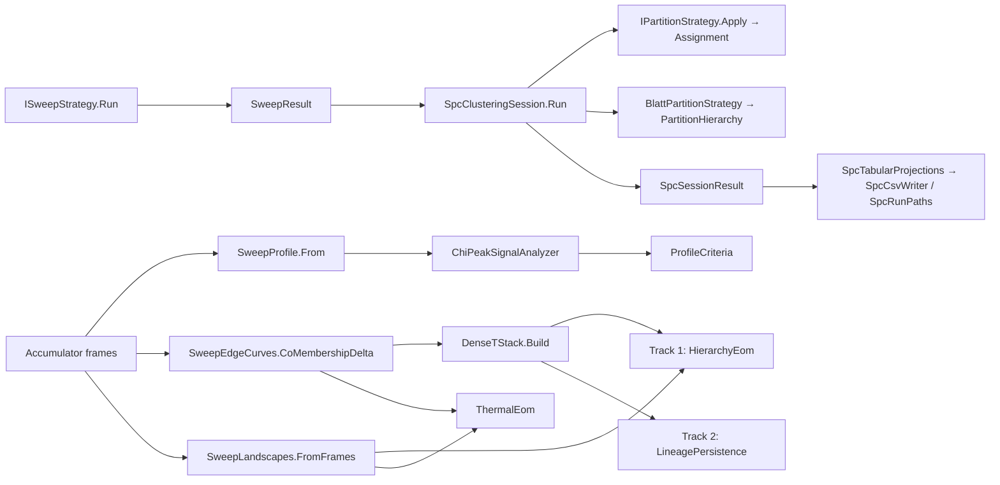

# SPC Analysis

> What superparamagnetic clustering does after sampling. It turns per-temperature sampler frames into a **temperature profile** of thermodynamic signals, picks a **chosen temperature**, cuts a flat **partition** there, and can build and resolve a multi-temperature **hierarchy**. It also writes a CSV and run-layout **export** bundle. `SpcClusteringSession` is the end-to-end entry point. · **Project:** `Clustering.Graphical.SPC` (partitions, profiling, export, session) · **Maturity:** core; `SpcOutputPathHelper` has been superseded by `SpcRunPaths`

## Overview

This layer sits on top of the [SPC engine](./SpcEngine.md), which provides the sweep, the frames and the currencies. It also uses:

- [ClusterResolution](./ClusterResolution.md): dendrograms, landscape walks, periphery completion;
- [ClusterEvaluation](./ClusterEvaluation.md): scoring;
- the Potts observables' reduction functions;
- [Archivory](./Archivory.md): export.

## Key concepts

- **Frame.** One `Accumulator`: the sufficient statistics of one Swendsen–Wang run at one temperature and replica. A *rich* sweep's frames also carry per-edge and per-node arrays.
- **Phases.**
  - Ferromagnetic (FM, cold): one cluster.
  - Superparamagnetic (SP): clusters are internally ordered but disordered relative to each other.
  - Paramagnetic (PM, hot): singletons.

  $T_{fs}$ (FM→SP) and $T_{ps}$ (SP→PM) bound the **SP plateau**, and $T_{\text{clus}}$ is its midpoint.
- **eq-4 discriminant** (BWD 1996 eq. 4). $\bar\delta_{ij}=\big((q-1)\langle n_{ij}\rangle+1\big)/q$ is the expected spin agreement implied by the co-membership. It lies in $[1/q,1]$.
- **Friends-of-friends cut.** Threshold a per-edge field at θ and take the connected components.
- **T-stack.** A `PartitionHierarchy`: one partition per temperature, cold to hot. It **nests** when every hotter cluster lies inside a single colder cluster.
- **Three hierarchical resolvers:**
  - **Track 1** (`HierarchyEom`): convert a nested T-stack to a dendrogram and resolve it by excess of mass over a thermal landscape.
  - **Track 2** (`LineagePersistence`): track cluster *lineages* through the stack and select them by persistence.
  - **Thermal EOM** (`ThermalEom`): the same walk as Track 1, but the tree is built from the per-edge $\bar\delta(T)$ curves instead of from partitions.
- **Peripheral capture** (Domany's step 2). Also join each node to its strongest neighbor.

## Design

- **Three seams, each with a single shape.**
  - `IPartitionStrategy.Apply(graph, affinities, alignments?, coMembership?) → Assignment`
  - `IHierarchicalPartitionStrategy.Apply(SweepResult, CsrGraph) → PartitionHierarchy`
  - `IPseudoTransitionDetector.Detect(SweepProfile) → double[]`

  `ISignalAnalyzer.Analyze(SweepProfile) → ProfileCriteria` is a fourth.
- **One partition kernel.** All three flat strategies and `DenseTStack` delegate to one threshold-and-connect routine, `AffinityThreshold.Connect` in `Clustering.Dendrograms`. They differ only in which field they pass it.
- **Producer-agnostic cores.** `DenseTStack`, `HierarchyEom`, `LineagePersistence` and `ThermalEom` each have two entry points:
  - an SPC adapter taking frames (`SweepDenseTStack`, `SweepHierarchyEom`, `SweepLineagePersistence`, `SweepThermalEom`: pool the frames, then call the core);
  - the core itself, in `Clustering.Dendrograms` ([ClusterResolution](./ClusterResolution.md)), taking explicit columns, a stack or a landscape, so a closed-form solver such as the [cumulative-field solver](./CumulativeField.md) can feed the same resolver.
- **Pool, then reduce.**
  - Linear per-frame reductions are averaged across replicas.
  - Nonlinear quantities pool their sufficient statistics first: label entropy (pooled histograms), $\bar\delta$ (pooled counts and draws), landscapes (pooled sums), bond entropy (pooled bond counts).
- **Honest abstention.** Resolvers return `Unassigned` rather than force labels, with completion available as an opt-in.
- **The "don't-warp" gate.** A T-stack is converted to a dendrogram only if it nests. Otherwise the conversion throws, and `HierarchyEom` either restores nesting or abstains.
- **Export as projections.**
  - `SpcTabularProjections` maps SPC's own domain objects to tables; the partition and edge-currency tables every method shares come from `CurrencyProjections` in `Clustering.Export`.
  - `SpcCsvWriter` owns file naming and writes each table atomically through Archivory's `WriteToFile`.
  - `SpcRunLayout` and `SpcRunPaths` own the directory layout.
- **Extension points.**
  - flat cuts (`IPartitionStrategy`);
  - hierarchical strategies;
  - detectors, for example $C_v$ or label-entropy peaks;
  - analyzers (`ISignalAnalyzer`), which fill `ProfileCriteria` for reporting and export; in `FixedGridSweepStrategy` they run after `SpcProfileAnalysis.SpPlateau` has fixed the chosen temperature, and do not change it;
  - landscape sinks;
  - the `SusceptibilityKind` used as the primary χ.

## API at a glance

| Area | Entry points |
|---|---|
| Session | `SpcClusteringSession.Run(graph, partitionStrategy?, analyzer?, sweepStrategy, hierarchicalStrategy?, externalEvaluators?, spcEvaluators?, referenceLabels?)` (`sweepStrategy` is declared optional, but null throws `ArgumentNullException`); a features overload `Run(features, metric?, graphConfig?, …)` that also builds the graph; `SpcSessionResult` |
| Flat cuts | `ThresholdSpinAgreement`, `ThresholdBondFrequency`, `ThresholdCoMembership`, each with `{ Theta, PeripheralCapture }` |
| Blatt hierarchy | `BlattPartitionStrategy(BlattPartitionConfig?)`; `MagnetizationPeakDetector`; `PartitionHierarchy`, `HierarchyLevel`, `PartitionNesting.Holds` (in `Clustering.Dendrograms`) |
| Dense resolvers | Swendsen–Wang adapters over frames: `SweepDenseTStack.Build`, `SweepHierarchyEom.Resolve`, `SweepLineagePersistence.Resolve`, `SweepThermalEom.Resolve`. Cores in `Clustering.Dendrograms`: `DenseTStack.Build`; `HierarchyEom.Resolve` → `HierarchyEomResult`; `LineagePersistence.Resolve` → `LineagePersistenceResult` (`ClusterLineage`); `ThermalEom.Resolve` → `ThermalEomResult`; `PartitionHierarchyDendrogram.ToDendrogram` (cost axis `"temperature"`) |
| Profiling | `SweepProfile.From(runs, kind)`, `SweepCurves.ByTemperature`, `SweepEdgeCurves.CoMembershipDelta`, `SweepLandscapes.FromFrames`, `LabelEntropyCurve.From`; `SpcProfileAnalysis` (`SpPlateau`, `ComputeHalfMaximumBand`, `PickPeakTemperature`, `ComputeStability`); `ChiPeakSignalAnalyzer`; `SusceptibilityKind` |
| Export | `SpcCsvWriter.Write*`, `WriteAllToDirectory`; `SpcTabularProjections.Create*Projection`; shared `CurrencyCsvWriter.WritePartition` / `WriteEdgeCurrencies` (`Clustering.Export`); `SpcRunLayout`, `SpcRunPaths`; `SpcOutputPathHelper` (legacy) |

The frame adapters and their cores are static resolvers. The session does not call them; it accepts only an `IHierarchicalPartitionStrategy`, which in this project means Blatt.

## Algorithms

### The session

1. `sweep = sweepStrategy.Run(graph, analyzer)`. The chosen temperature is decided inside the sweep strategy (see [SpcEngine](./SpcEngine.md#sweeps)).
2. The partition is `(partitionStrategy ?? new ThresholdCoMembership { Theta = 0.5 }).Apply(...)` at the chosen temperature. The default cut is **co-membership**; the class documentation says spin agreement, but the code uses co-membership. Graphs with N < 2 give a single cluster.
3. The optional hierarchy comes from `hierarchicalStrategy.Apply(sweep, graph)`.
4. Scores:
   - `"Coverage"` is always included.
   - External evaluators run when both they and the reference labels are supplied.
   - Graph evaluators run on the chosen affinities.

When no `graphConfig` is passed, the features overload builds a kNN graph (K = 10) with a Gaussian kernel of bandwidth 0.5 and LMP disabled.

### Flat cuts

Every flat cut unions the upper-half edges with field value above θ (θ in [0, 1], default 0.5). With peripheral capture, each node is also joined to its strongest positive neighbor. Labels are dense in order of first appearance, and flat cuts never abstain.

| Strategy | Field | Requires |
|---|---|---|
| `ThresholdSpinAgreement` | Alignments $\langle 1_{s_i=s_j}\rangle$ (the classic Blatt 1996 cut) | Alignments |
| `ThresholdBondFrequency` | Affinities $\langle\omega_e\rangle$ | — |
| `ThresholdCoMembership` | $\bar\delta_{ij}=((q-1)\langle n_{ij}\rangle+1)/q$ | CoMembership with $Q\ge2$ |

For co-membership, $\bar\delta>\theta$ is equivalent to $\langle n_{ij}\rangle>(q\theta-1)/(q-1)$. At q = 20 and θ = ½ the threshold is 9/19 ≈ 0.474. Any θ < 1/q joins every edge.

### Reading a sweep profile

`SweepProfile.From` groups frames by exact temperature, in ascending order, and computes:

- **FK susceptibility** $\chi_{FK}$ and a giant-excluded variant $\chi_{\text{red}}$, both per site;
- **Energy and magnetization moments** (per-frame means averaged over replicas);
- $\mathrm{Var}(m)$;
- **Specific heat** $C_v=\max(0,\langle E^2\rangle-\langle E\rangle^2)/T^2$;
- **Magnetic susceptibility** $\chi_m=(N/T)\mathrm{Var}(m)$;
- **Binder cumulant** $U=1-\langle m^4\rangle/(3\langle m^2\rangle^2)$, from each replica's per-draw m series, its $\langle m^4\rangle$ averaged over replicas beside $\langle m^2\rangle$ and reduced once (NaN where a frame carries no per-draw record);
- **Label entropy**, from pooled cluster-size histograms, in nats;
- **Bond entropy**, from pooled bond rates, when available.

The primary `Susceptibility` is set by `SusceptibilityKind`:

| `SusceptibilityKind` | Primary susceptibility |
|---|---|
| `FkCluster` (default) | $\chi_{FK}$ |
| `FkReduced` | $\chi_{\text{red}}$ |
| `Magnetization` | $\chi_m$ |
| `MagnetizationVariance` | $\mathrm{Var}(m)$ |

`AdditionalChannels` always holds eight series: `MeanEnergy`, `MeanMagnetization`, `MagnetizationSecondMoment`, `MagnetizationVariance`, `SusceptibilityFkCluster`, `SusceptibilityFkReduced`, `SusceptibilityMagnetization`, `BinderCumulant`. So every primary-χ choice is also available by name. $C_v$, label entropy and bond entropy are separate properties.

**SP-plateau landmarks** (`SpPlateau`), on the primary χ:

1. Smooth χ with a 3-point moving average, using 2 points at the ends.
2. $T_{fs}$ is the temperature at the global smoothed argmax.
3. $T_{ps}$ is the first later temperature where the smoothed χ falls below $0.8\times$ that peak.
4. $T_{\text{clus}}=(T_{fs}+T_{ps})/2$.

If the peak falls in the last two points, or χ never drops below the threshold, the method falls back to $T_{\text{clus}}=T_{fs}$ with `CliffFound = false`.

**Other landmarks.**

- The half-maximum band on the raw χ.
- The stability score $1-(hi-lo)/(T_{\max}-T_{\min})$, clamped to [0, 1].
- The default `ChiPeakSignalAnalyzer` packages these into `ProfileCriteria`: `AnchorTemperature` = $T_{fs}$, `AnchorBand` = the half-maximum band, `RefinedTemperature` = $T_{\text{clus}}$, `CorroborationScore` = stability, and the `Enrichments` `Stability`, `BandWidth`, `PeakChi`, `BondEntropy` (at the grid point nearest $T_{\text{clus}}$; NaN without bond entropy), `TFs`, `TPs`, `TClus` and `CliffFound` (1/0).

### Blatt hierarchy

`BlattPartitionStrategy` works in three steps:

1. It detects pseudo-transitions as peaks of $\mathrm{Var}(m)$. `MagnetizationPeakDetector` counts an interior point as a peak when it rises above both immediate neighbors by at least 10% of the signal's range.
2. Between consecutive peaks, and between the extreme peaks and the ends of the grid, it takes geometric-midpoint phase temperatures: $T^{(k)}=\sqrt{p_kp_{k+1}}$. With no detected peaks there is a single phase at $\sqrt{T_{\min}T_{\max}}$; a profile with fewer than two temperatures yields an empty hierarchy.
3. At each phase temperature it runs a fresh equilibrium (Q = 20, budget (1000, 5000), all currencies) and cuts it with spin agreement by default.

`NestingHolds` is recorded for information only. The levels ascend in temperature as long as the detector's peaks lie inside the sweep range, which the default detector guarantees.

### Dense T-stack and resolvers

- **`SweepEdgeCurves.CoMembershipDelta`.** Pools co-membership counts and draws at each temperature, and converts them to $\bar\delta$ columns.
- **`DenseTStack.Build`.** Cuts each column with the flat kernel. Non-uniform grids are allowed.
- **Track 1 (`HierarchyEom`).**
  1. If the stack does not nest, `RestoreNesting` refines each hotter level by the colder one. It only splits clusters, never merges them, so the output nests by construction.
  2. With `restoreNesting = false`, a stack that does not nest is not bridged: the resolver **abstains** and every point gets −1. With restoration on, this branch is never reached, because the restored stack always nests.
  3. Otherwise the stack becomes a dendrogram through `PartitionHierarchyDendrogram`. The dendrogram is walked with `LandscapeWalk` over a thermal landscape (mean cluster size, or giant participation), resolved by excess of mass, and optionally completed with `PeripheryPolicies.Ascend` on the coldest landscape column.
- **Track 2 (`LineagePersistence`).**
  1. Keep clusters of size ≥ 3, optionally within a temperature window.
  2. Give each cluster a *decidedness* $d_c$: the mean $\bar\delta$ over its internal edges.
  3. Link each cluster to its plurality successor at the next temperature, unless it splits: its second-successor share $s_2$ must be below a split threshold τ. τ comes from the observed $s_2$ values strictly inside (0.2, 0.5): it is the midpoint of the largest gap between consecutive sorted values when that gap exceeds 0.05, the value itself when only one lies in the band, and 0.3 otherwise. An explicit `splitShare` overrides the rule.
  4. Score each lineage as **member-cluster count × mean decidedness**.
  5. Walk the lineages with positive score in descending order, and drop any whose representative shares at least half of the smaller set with an already-kept lineage ($|A\cap B|/\min(|A|,|B|)\ge 0.5$).
  6. Select by the largest score ratio (≥ 1.5). Failing that, keep lineages scoring ≥ ½ the maximum. `selectTopK` forces the top K.
  7. Label points by lineage rank. Points not covered become −1.

  Track 2 does not restore nesting.
- **Thermal EOM (`ThermalEom`).** Builds the tree with `ThermalDendrogram.FromEdgeCurves` from the $\bar\delta(T)$ columns, then walks it exactly as Track 1 does.

### Export bundle

`SpcRunLayout` names the files: `manifest.json`, `summary.json`, `graph_health.json` and `partition_hierarchy.json`, with sub-directories `csv/`, `tabular/` and `checkpoints/`. `SpcRunPaths` resolves them against an Archivory `ArtifactScope`.

`SpcCsvWriter.WriteAllToDirectory` always writes the sweep, partition, criteria and session tables. It writes the partition-schedule table only when rollups are given, and the dataset table only when both features and true labels are given. Replica traces and equilibrium edges are written by separate calls.

| Projection (CSV file) | Columns |
|---|---|
| Sweep (`spc_sweep.csv`) | `T`, `Chi` (the primary susceptibility), `Cv`, `LabelEntropy`, `BondEntropy` (if present), then the channels |
| Partition (`spc_partition.csv`, shared schema) | `node_index`, `x0…x{d−1}` (if features given), `true_label` (optional), `label` |
| Dataset (`spc_dataset.csv`) | `Index`, `x0…`, `label` |
| Criteria (`spc_criteria.csv`) | `AnchorTemperature`, `AnchorBandLo`, `AnchorBandHi`, `RefinedTemperature`, `CorroborationScore`, then the enrichments |
| Session (`spc_session.csv`) | 5 criteria columns, `ClusterCount`, 7 sweep-summary columns, `BondEntropyAtChosenT` (if present), then enrichments and evaluator scores |
| Partition schedule (`spc_partition_schedule.csv`) | `T`, `replicas`, `clusters`, `pooled_cycles`, `purity_{level}` |
| Replica traces (`spc_replica_traces.csv`) | `temperature`, `replica_index`, `cycle_count`, `chi_fk`, `cv`, `label_entropy`, `mean_energy`, `mean_magnetization`, `magnetization_variance` |
| Equilibrium edges (`spc_equilibrium_edges.csv`, shared schema) | `source`, `target`, `weight`, `affinity` (bond frequency), `alignment` (spin agreement), `co_membership` (NaN when absent); one row per upper-half edge |

Columns derived from dictionaries (channels, enrichments, scores) follow the fixed columns in ordinal key order.

## Walkthrough

1. **Graph.** Build or supply a `CsrGraph` of couplings. The features overload defaults to kNN (K = 10) with a Gaussian kernel.
2. **Sweep.** Choose a sweep: `FixedGridSweepStrategy` over a grid that brackets the transitions. `AutoGridFixedSweep.BuildConfig` gives a 12-point log grid. For the hierarchical resolvers, enable co-membership accumulation, and also a cluster-size landscape for Track 1 and Thermal EOM.
3. **Profile.** The sweep assembles the profile and picks $T_{\text{clus}}$.
4. **Flat cut.** At $T_{\text{clus}}$ the currencies are computed and a flat cut applied. The default is $\bar\delta>0.5$.
5. **Hierarchy (optional).** Either a Blatt hierarchy (partitions per phase between the $\mathrm{Var}(m)$ peaks), or a dense T-stack resolved by Track 1, Track 2 (optionally windowed to $[T_{fs},T_{ps}]$) or Thermal EOM.
6. **Score and export.** Score with evaluators, then export with `SpcCsvWriter.WriteAllToDirectory` or bind paths with `SpcRunPaths`.

## Configuration

| Setting | Default | Meaning |
|---|---|---|
| Session partition strategy | `ThresholdCoMembership { Theta = 0.5 }` | Flat cut |
| Flat cut Theta / PeripheralCapture | 0.5 / false | — |
| `BlattPartitionConfig` Q / EquilibriumBudget / Accumulation | 20 / (1000, 5000) / `Currencies` | Equilibrium per phase |
| `BlattPartitionConfig` Detector / CutPolicy / BaseSeed | `MagnetizationPeakDetector` / `ThresholdSpinAgreement { Theta = 0.5 }` / null | — |
| `MagnetizationPeakDetector` SignalChannelName / MinProminence | `"MagnetizationVariance"` / 0.1 | — |
| `SweepHierarchyEom.Resolve` theta / sink / minClusterSize / restoreNesting / completion | 0.5 / `MeanClusterSize` / 1 / true / `None` | Track 1 |
| `SweepLineagePersistence.Resolve` theta / minClusterSize / splitShare / temperatureWindow / selectTopK | 0.5 / 3 / gap rule (fallback 0.3) / full grid / gap rule | Track 2 |
| `SweepThermalEom.Resolve` theta / sink / minClusterSize / completion | 0.5 / `MeanClusterSize` / 1 / `None` | — |
| `SweepProfile.From` kind | `FkCluster` | Primary χ |
| SP-plateau departure fraction | 0.8 | Fixed |

## Status and caveats

- **The default cut can throw on a reused rich sweep.** `ThresholdCoMembership` requires CoMembership. When $T_{\text{clus}}$ lands on a grid point, which always happens in the no-cliff fallback and often on uniform linear grids, the sweep's replica-0 frame is reused. If that sweep did not accumulate co-membership, the session's default cut throws.
- **Detector scaling.** $\chi_m=(N/T)\mathrm{Var}(m)$ varies with $1/T$ across the grid. Peaks of $\mathrm{Var}(m)$ and of $\chi_m$ can therefore differ, although the detector's documentation says they do not.
- **Track 2 has open design points.**
  - The rule for choosing a lineage's representative is marked for refinement.
  - `ClusterLineage.LevelCount` counts member clusters. On a stack that does not nest, this can overstate the number of levels a lineage survives.
  - The `splitShare` value reported on early exits (0.25) differs from the fallback actually used (0.3).
- **Blatt passes no co-membership to its cut.** A `ThresholdCoMembership` cut policy therefore throws inside Blatt.
- **Pooling and consistency checks.**
  - Profile moments are equal-weight averages across replicas. They equal draw-pooled values only when replicas have equal draw counts.
  - `SweepEdgeCurves` and `SweepLandscapes` check slot and node counts only among frames at the same temperature.

## Source map

| Role | Files (`ThermoMapper/src/clustering/graphical/spc/`) |
|---|---|
| Session | `SpcClusteringSession.cs` |
| Flat cuts | `partitions/IPartitionStrategy.cs`, `partitions/strategies/Threshold*.cs` |
| Hierarchy | `partitions/hierarchical/*.cs` (`BlattPartitionStrategy`, `MagnetizationPeakDetector`, `SweepDenseTStack`, `SweepHierarchyEom`, `SweepLineagePersistence`, …), `partitions/thermal/SweepThermalEom.cs`; the cores are in `ThermoMapper/src/clustering/dendrogram/` (see [ClusterResolution](./ClusterResolution.md)) |
| Profiling | `profiling/*.cs`, `profiling/signals/*.cs` |
| Export | `export/SpcCsvWriter.cs`, `export/SpcTabularProjections.cs`, `export/SpcRunLayout.cs`, `export/SpcRunPaths.cs`, `export/SpcOutputPathHelper.cs` |

**See also:** [SpcEngine](./SpcEngine.md) · [ClusterResolution](./ClusterResolution.md) · [ClusterEvaluation](./ClusterEvaluation.md) · [Archivory](./Archivory.md) · [Architecture](./Architecture.md#workflows)
