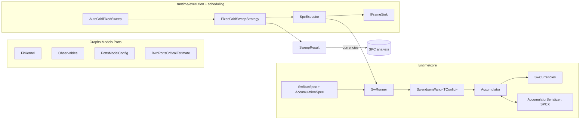

# SPC Engine

> The computational core of **superparamagnetic clustering (SPC)**, after Blatt, Wiseman and Domany. A coupling-weighted graph is treated as a ferromagnetic q-state Potts model. The engine samples it with the Swendsen–Wang cluster algorithm. It accumulates thermodynamic statistics and the per-edge currencies used for clustering, and runs temperature sweeps in parallel with checkpointing and reproducible seeding. · **Projects:** `Clustering.Graphical.SPC` (`runtime/**`), `Graphs.Models.Potts` · **Maturity:** core

## Overview

The engine sits between [graph construction](./GraphConstruction.md), which supplies a coupling graph, and [SPC analysis](./SpcAnalysis.md), which turns sweep results into profiles, partitions and hierarchies. Outside SPC it is used by [Mapper](./Mapper.md) (`MapperSpcClusterer`) and by the REPL.

## Key concepts

**The physical picture.** Each node carries a color $\sigma_i\in[0,q)$, and each edge a coupling $J_{ij}\ge0$. As the temperature rises the system passes through three phases:

- **Cold:** the whole graph aligns, giving one cluster.
- **Hot:** the system is disordered, giving singletons.
- **Superparamagnetic (SP) band:** densely coupled regions align internally but not with each other. The pairwise correlations then identify the clusters.

**Fortuin–Kasteleyn (FK) bond probability.** $p_e=1-e^{-J_e/T}$ links the couplings to random-cluster bonds.

**Draw.** One Swendsen–Wang update:

1. Freeze bonds on aligned edges.
2. Find the resulting clusters with union–find.
3. Give each cluster a new random color.

**Accumulator.** The running sums folded in at every draw (scalar moments, optional per-edge counts, optional per-node sums), plus the resume state (spins and RNG words).

**Currencies (per-edge "1-forms").** Model-agnostic per-edge fields indexed by CSR slot, meaningful only at the j > i slot (see [Concepts](./Concepts.md#per-edge-currencies)):

- **Affinities:** bond survival. Universal; the deterministic [cumulative-field solver](./CumulativeField.md) produces it too.
- **Alignments:** spin agreement. Swendsen–Wang only.
- **CoMembership:** same-cluster frequency. Swendsen–Wang only.

**Landscapes (per-node "0-forms").** Examples are the mean FK cluster size and giant-cluster participation.

**Sweep and chosen temperature.** A sweep runs Swendsen–Wang over a temperature grid × replicas. The analysis layer then picks a **chosen temperature** from the resulting profile, and the currencies computed there are handed on.

## Design

- **Declarative spec with a pure engine.** `AccumulationSpec` declares *what* to collect. `SwRunner.CreateModel` maps that to an engine at a cold boundary, so the hot loop never sees the spec.
- **Struct-generic JIT specialization.**
  - `ISwConfig` declares `static abstract bool Affinities` and `Alignments`.
  - Four `readonly struct`s fold them to constants: `NoCurrencies`, `AffinitiesOnly`, `AlignmentsOnly`, `BothCurrencies`.
  - `SwendsenWang<TConfig>` guards its per-edge writes with `if (TConfig.Alignments)` and `if (TConfig.Affinities)`, which the JIT removes when false.
  - The code's own rule: only an inner-loop scatter write earns a compile-time flag. $O(N)$ or $O(E)$ post-passes (landscapes, co-membership) are checked at run time.
  - The [cumulative-field solver](./CumulativeField.md) reuses the pattern with `IField`.
- **Type erasure at the boundary.** The internal `ISwEngine` hides the generic parameter, so virtual dispatch costs one call per run, not one per draw.
- **Currencies as the narrow waist.** Swendsen–Wang (through `SwCurrencies`) and the cumulative-field solver (through `Solve`) both produce `Affinities`. Once produced, a currency carries no trace of which solver made it.
- **Capability = nullability.** An optional accumulator array is present exactly when its gate was on. The SPCX format writes a presence flag for each optional array.
- **Planner and dumb runner.** `WorkerBudgetResolver` decides how many workers to use. `SpcExecutor` only runs `Parallel.For` behind a single dispatch point.
- **Persistence through a sink.** An `IFrameSink` owns both "already done?" and "what to do with a result". The executor loop is the same for disk, memory and no-op sinks.
- **Extension points.**
  - new `ISweepStrategy` implementations (an adaptive strategy is referenced as parked);
  - new `IFrameSink`s;
  - new `ISwConfig` structs, whose mapping lives in `SwRunner.CreateModel`.

## API at a glance

| Area | Entry points |
|---|---|
| Potts model | `FkKernel.BondProbability`; `PottsModelConfig` (Q = 20); `BwdPottsCriticalEstimate.TpsUpperBound`; `Susceptibility`, `MeanEnergy`, `SpecificHeat`, `Magnetization`, `MagnetizationSusceptibility` (`.Reduce`) |
| Single run | `SwRunner.Run(SwRunSpec)` → `SwRunResult`; `SwRunSpec`, `RunBudget`, `AccumulationSpec` (`None`, `Currencies`, …), `Accumulator` |
| Reductions | `SwCurrencies.ToAffinities` / `ToAlignments` / `ToCoMembership`; `SwLandscapes.MeanClusterSize` / `GiantParticipation` |
| Checkpoints | `AccumulatorSerializer.Instance` (SPCX v7, `.spcx`) |
| Execution | `ISpcExecutor` / `SpcExecutor` (`BuildTaskList`, `Run`, `RunBatch`, `ExecuteAll`, `ExecuteBatch`, `ExecuteTask`); `SpcTaskSpec`, `SpcBatchResult`, `SpcExecutionOptions`, `SpcRunResult`; sinks `InMemoryFrameSink`, `NullFrameSink`, `SpcxDiskFrameSink`; `WorkerBudgetPolicy`, `WorkerBudgetResolver`; `SpcGraphBuilder.BuildResult` |
| Scheduling | `ISweepStrategy`; `FixedGridSweepStrategy(FixedGridSweepConfig).Run(graph, analyzer?)` → `SweepResult`; `AutoGridFixedSweep.BuildConfig`; `SpcScheduleHelpers` (`LogSpaceGrid`, `Estimate`, `EstimateBracket`); `SpcSeedHelper.Derive`; `SweepKernel` |

## Algorithms

### Potts model

$$H(\sigma)=-\sum_{\{i,j\}\in E}J_{ij}\,\delta_{\sigma_i\sigma_j},\qquad p_e=1-e^{-J_e/T}.$$

Swendsen–Wang passes the raw coupling to the bond kernel; the [cumulative-field solver](./CumulativeField.md) passes a cumulative energy instead. The critical-temperature anchor is $T_{ps}(q)=\tfrac{e^{-1/2}}{4}\ln(1+\sqrt q)$. It holds for the $1/\hat K$-normalized Gaussian kernel and requires $q\ge2$.

### One Swendsen–Wang draw

1. **Bonds and energy**, in one pass over the edges. For each upper-half slot whose *current* spins agree:
   - count the agreement (if Alignments is on);
   - add $-J_e$ to the energy;
   - with probability $p_e$, form a bond: count it (if Affinities is on) and union the endpoints.
2. **Cluster flip.** Each union–find root draws a color uniformly from $[0,q)$, and every member inherits it.
3. **FK moments.**
   - Accumulate $\sum_c|c|^2$, and also $\sum_c|c|^2-\max_c|c|^2$, which excludes the giant cluster.
   - Both are computed from union–find roots, so they are unaffected by color collisions.
4. **Magnetization,** measured on the post-flip spins: $m=\frac{q\,N_{\max}/N-1}{q-1}$, where $N_{\max}$ is the size of the largest color class (so, unlike the FK sums, it sees color collisions). Accumulate m and m².
5. **Cluster-size histogram,** binned by $\lfloor\log_2|c|\rfloor$.
6. **Per-node landscapes** (optional, checked at run time).
   - Accumulate $|c(i)|$ and $\mathbb 1[i\in\text{giant}]$.
   - The giant cluster is the lowest-index root of maximal size.
7. **Co-membership** (optional, checked at run time): count the slots whose endpoints share a root.

**Measurement alignment.**

- Energy and alignments are measured on the configuration *entering* the draw.
- Magnetization is measured on the configuration *leaving* it.
- The FK sums, co-membership and landscapes use this draw's bond clusters.

**A useful invariant.** A bond forms only between equal spins. So for every edge, the counts satisfy bonds ≤ co-memberships ≤ agreements ($B_e\le K_e\le S_e$).

**Cost.** Each draw is $O(N+\text{nnz})$ with no allocation. Burn-in draws are discarded by resetting the sums while keeping the spins and RNG state.

**Memory.**

- Five `int[N]` arrays (spins, the two union–find arrays, root sizes and the cluster map), about 20N bytes, plus `int[q]` color buckets.
- The bond-probability table, at 8 bytes per slot.
- Each optional per-edge count adds 4 bytes per slot.
- Each optional per-node landscape adds 8 bytes per node.

### Observables

With D retained draws:

| Observable | Formula |
|---|---|
| FK susceptibility | $\chi=\dfrac{\sum_d\sum_c\vert c\vert^2}{D\cdot N}$ |
| Mean energy | $\langle E\rangle$ |
| Specific heat | $C_v=\max(0,\langle E^2\rangle-\langle E\rangle^2)/T^2$ (extensive: no $1/N$) |
| Magnetization | $\langle m\rangle$, $\langle m^2\rangle$ and their variance |
| Magnetic susceptibility | $\chi_m=\frac NT\max(0,\langle m^2\rangle-\langle m\rangle^2)$ |

`MagnetizationSusceptibility` should be fed *pooled* moments (averaged over all replicas at one T), so the variance is taken once and no Jensen bias arises; the function cannot check this. `Susceptibility`, `MeanEnergy`, `SpecificHeat` and `Magnetization` return 0 when D ≤ 0; `Susceptibility` and `MagnetizationSusceptibility` also return 0 when N ≤ 0, and `SpecificHeat` and `MagnetizationSusceptibility` when T ≤ 0.

### Currencies and landscapes

- **Currencies.** $G_e=\text{count}_e/D$ for every slot:
  - Affinities from the bond counts;
  - Alignments from the agreement counts;
  - CoMembership from the co-membership counts, as a raw fraction with no $(q-1)/q$ rescaling.

  In expectation, $E[S_e/D]=\langle\delta_{\sigma_i\sigma_j}\rangle$ and $E[B_e/D]=p_e\langle\delta\rangle$.
- **Landscapes.** Two producers create `Landscape` objects: `SweepLandscapes.FromFrames` for Swendsen–Wang (in the analysis layer) and `CumulativeFieldLandscapes.OverGrid` ([CumulativeField](./CumulativeField.md)). `SwLandscapes` is a per-accumulator helper that returns raw per-node arrays, and nothing in the source currently calls it.

### Sweeps

**Temperature bracket.**

- `SpcScheduleHelpers.Estimate` gives $\hat T=\tilde J\cdot\bar k_w/\ln q$, where $\tilde J$ is the median coupling and $\bar k_w$ the mean weighted degree.
- `EstimateBracket` returns $(0.05\hat T,\,5\hat T)$.
- `LogSpaceGrid` spaces points geometrically, endpoints included.
- `AutoGridFixedSweep.BuildConfig` combines these into 12 geometric points spanning a factor of 100.

**`FixedGridSweepStrategy.Run`.**

1. **Stage 1.** Build one task per (replica, temperature), each with seed `Derive(BaseSeed, T, replica, 0)`, and run them through the executor.
2. **Profile.** The analysis layer builds a `SweepProfile` and picks the chosen temperature $T_{\text{clus}}$, the midpoint of the SP plateau.
3. **Stage 2.** On a rich sweep (Affinities accumulated), the replica-0 run at $T_{\text{clus}}$ is reused if it lies on the grid, which happens when no plateau cliff is found or the midpoint coincides with a grid point. Otherwise an equilibrium pass runs at $T_{\text{clus}}$ with `AccumulationSpec.Currencies`.
4. **Output.** Mint the currencies into a `SweepResult`. In the default sweep, the equilibrium pass collects every currency, so `ChosenAlignments` and `ChosenCoMembership` are non-null. When a rich sweep is reused, they follow that sweep's accumulation settings. This contradicts the `SweepResult` documentation, which ties their presence to the sweep's accumulation flags. Graphs with fewer than two nodes skip the sweep (`SweepKernel.BuildTrivialResult`): `ChosenAffinities` is empty and both optional currencies are null.

**Cost.** Stage 1 is $O(|\mathcal T|\,R\,(B+C)(N+\text{nnz}))$ work spread over W workers. Unless a rich sweep is reused, Stage 2 adds one single-worker equilibrium pass of $O((B_{\text{eq}}+C_{\text{eq}})(N+\text{nnz}))$; at the defaults (6,000 draws against 1,200 per sweep task) it can dominate wall time.

### Execution, seeds and checkpoints

- **Seeds.** `SpcSeedHelper.Derive` folds (base seed, $\lfloor T\cdot f\rfloor$, replica, round) through the SplitMix64 finalizer, with f = 1000. The result is stable across processes and platforms. Temperatures are truncated to an absolute resolution of $10^{-3}$, and the conversion assumes $|T f|<2^{31}$.
- **Worker budget.**
  - Auto: $\max(1,L-\min(R,L-1))$, reserving R = 2 of L logical cores.
  - Explicit: clamped to $[1,L]$.
  - Either way, capped at the number of tasks.
- **Determinism.** Each task owns its RNG, so given seeds the results do not depend on worker count or scheduling.
- **SPCX v7** (little-endian):
  1. Magic `SPCX` and version 7.
  2. T, Q, replica index and draw count.
  3. The spins and the histogram.
  4. Four RNG state words.
  5. Six scalar sums.
  6. For each optional array: a presence byte, then its length and payload.
  7. A UTC timestamp.

  The reader requires the exact magic and version. Checkpoint files are named `T_{T:F5}_rep_{r}_s{k}.spcx` by the fixed-grid sweep (k = 0 for sweep tasks, 1 for the equilibrium pass), and `T_{T:F5}_rep_{r}.spcx` by `SpcExecutor.BuildTaskList`.
- **`Restore` validation.**
  - It checks presence of Affinities, Alignments and landscapes in both directions, but CoMembership only when the engine tracks it.
  - It checks T, Q and array lengths, but not the replica index.

## Configuration

| Setting | Default | Meaning |
|---|---|---|
| `PottsModelConfig.Q` | 20 | Number of Potts colors |
| `AccumulationSpec` | `None` | Scalar moments and histogram only; `Currencies` adds all three edge counts |
| `FixedGridSweepConfig` Replicas / SweepBudget / EquilibriumBudget | 1 / (200, 1000) / (1000, 5000) | (burn-in, measured cycles) |
| `FixedGridSweepConfig` SusceptibilityKind / BaseSeed / CheckpointDirectory | `FkCluster` / null / null | Primary χ; OS entropy; no checkpoints (`NullFrameSink`) |
| `FixedGridSweepConfig` Sampler / Parallelism | `new PottsModelConfig()` / `new WorkerBudgetPolicy()` | — |
| `AutoGridFixedSweep.BuildConfig` | 12 steps, cold 0.05, hot 5.0, sweep (200, 400), equilibrium (1000, 5000) | — |
| `SpcExecutionOptions` FrameSink / BaseSeed / TemperatureQuantizationFactor | null (disk sink) / null / 1000 | — |
| `WorkerBudgetPolicy` MaxWorkers / ReservedCores | null (auto) / 2 | — |

The fixed-grid sweep builds its own execution options. It pre-derives seeds with the default quantization factor, so `SpcExecutionOptions.TemperatureQuantizationFactor` has no effect on that path.

## Status and caveats

- **The bracket heuristic scales with J².** $\hat T$ is quadratic in the coupling scale, although temperature should scale linearly with J. Check the bracket when couplings are rescaled.
- **Duplicate grid temperatures collide.** With a `BaseSeed`, temperatures that truncate to the same $\lfloor 1000\,T\rfloor$ (for example, every grid point below $10^{-3}$) get the same seed for a given replica. Temperatures that format to the same 5-decimal string also share a checkpoint path, and with a checkpoint directory set they are written concurrently.
- **Resume works per task.** The SPCX resume state (spins and RNG) is saved, but `Restore` has no caller. Resuming means skipping each task whose checkpoint file already exists. The loaded file is not checked against the task's budget, accumulation or Q, so reuse a checkpoint directory only with an identical configuration.
- **Couplings must be non-negative.** This is assumed but not checked. A negative coupling gives a bond probability below 0, contrary to the kernel's documentation.
- **`SpcExecutor.BuildTaskList` with an explicit `baseSeed`.** It stamps that same seed on every task, so all temperatures and replicas share one stream. The production sweep derives distinct seeds per task and is unaffected.

## Source map

| Role | Files |
|---|---|
| Potts model | `ThermoMapper/src/graphs/models/potts/FkKernel.cs`, `PottsModelConfig.cs`, `BwdPottsCriticalEstimate.cs`, `observables/*.cs` |
| Sampler | `ThermoMapper/src/clustering/graphical/spc/runtime/core/sampler/` (`SwendsenWang.cs`, `SwRunner.cs`, `Accumulator.cs`, `AccumulationSpec.cs`, `ISwConfig.cs`, `SwCurrencies.cs`, `SwLandscapes.cs`, `SwRunSerialization.cs`, …) |
| Execution | `…/runtime/execution/` (`SpcExecutor.cs`, `SpcTaskSpec.cs`, `SpcBatchResult.cs`, `SpcGraphBuilder.cs`, `sinks/*`) |
| Scheduling | `…/runtime/scheduling/` (`FixedGridSweepStrategy.cs`, `AutoGridFixedSweep.cs`, `SpcScheduleHelpers.cs`, `SpcSeedHelper.cs`, `SweepKernel.cs`, `SweepResult.cs`, `WorkerBudget*.cs`) |

**See also:** [SpcAnalysis](./SpcAnalysis.md) · [CumulativeField](./CumulativeField.md) · [GraphSubstrate](./GraphSubstrate.md) (currency types) · [GraphConstruction](./GraphConstruction.md) · [Concepts](./Concepts.md)
