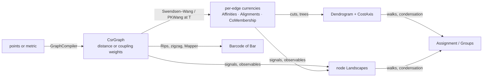

# Core Concepts

ThermoMapper's modules communicate through a small set of shared data types, its **currencies**. A clusterer does not know which sampler produced the per-edge field it reads. A landscape selector does not know which tree builder produced its dendrogram. A diagram distance does not know which persistence engine produced its barcode. This page defines those contracts once. The module docs refer back to it.

## The CSR graph

`Graphs.Primitives.CsrGraph` is the substrate for every graph algorithm (see [Graph Substrate](./GraphSubstrate.md)).

- **Symmetric storage.** `CsrGraph` is a struct with `Targets`, `Weights`, `RowPointers` and `NodeCount`. Each undirected edge is stored **twice**, once in each endpoint's row, with the same weight. Rows are not sorted. `CsrGraph.FromEdges(edges, n)` builds the graph from an `Edge[]` in which each edge appears exactly once.
- **Slots.** A *slot* is an index into `Targets`/`Weights`, i.e. one directed half-edge. For an undirected edge {i, j}:
  - its **canonical** slot is the one in the row of the smaller endpoint, where `Targets[e] > i` (the "j > i" slot);
  - its **mirror** slot is the reverse half-edge, located by `FindSlot` or by the precomputed `BuildReverseSlotMap()`.
- **Per-edge fields.** A per-edge field is a `double[]` of length `Targets.Length`, indexed by slot. **Only canonical slots carry meaning**, and mirror slots may hold anything. The idiom for visiting each undirected edge once is `for i; for e in row i; if (Targets[e] <= i) continue;`. It is also packaged as the allocation-free `graph.UndirectedEdges()` walk.
- **Subgraphs.** `InducedSubgraph(mask, out newToOld, out oldToNew)` returns a new CSR graph together with both index maps. Consumers that work on a subgraph must translate labels between the two index spaces. Mapper's SPC clusterer, for example, reads `partition.Labels[oldToNew[origIdx]]` for each preimage point.

## Edge weights: distance, coupling, affinity

The same `Weights` array can carry numbers with opposite meanings. `EdgeWeightKind` (namespace `Graphs`, project `Graphs.Proximity`) names the four cases:

| Kind | Meaning | Larger means | Produced by | Read by |
|---|---|---|---|---|
| `Distance` | a (conditioned) dissimilarity | farther | `DistanceProjection` | Rips filtrations, `Dijkstra`, protected-edge sources (the H1 protect set) |
| `Coupling` | a Potts interaction $J=K(d;\delta)$ | closer | `CouplingProjection` (`GraphBuildResult.WeightKind` defaults to `Coupling`) | SPC samplers, single linkage, Laplacians |
| `Affinity` | a similarity in [0, 1] for spectral or diffusion use | closer | `AffinityProjection` (declared, not yet supported) | — |
| `Unweighted` | adjacency only | — | — | — |

`GraphBuildResult.WeightKind` records the kind of graph a build returned. The field is documentation, not enforcement.

- `Edge.J` is named and documented as a coupling. `Dijkstra` nevertheless treats the same field as an additive length. Using a coupling graph where a distance graph is expected, or the reverse, silently inverts the meaning.
- Persistent homology requires distances. A Rips filtration takes an edge's weight as its birth value.
- The SPC samplers require couplings. The Fortuin–Kasteleyn bond probability is $p_e=1-e^{-J_e/T}$.

The distance-to-coupling step is a kernel evaluation: Gaussian, Laplacian, Cauchy, linear, or a Gaussian/Cauchy/Laplacian mixture. It uses a bandwidth δ (see [Temperature and bandwidth](#temperature-and-bandwidth)).

## Per-edge currencies

A **currency** is a per-edge field evaluated at one temperature. It is produced by a sampler and consumed by cuts, trees and signals. Each currency is a `sealed record` in `Graphs.Primitives` with:

- `Temperature`;
- `G`, a slot-indexed `double[]`;
- `ReplicaIndex`, for provenance.

| Currency | $G_{ij}$ | Produced by | Typical consumers |
|---|---|---|---|
| `Affinities` | bond activity or edge survival, in [0, 1] | **every** sampler: Swendsen–Wang, and the PKWang direct solver | affinity signals, cuts, thermal dendrograms |
| `Alignments` | spin agreement $\langle\delta(\sigma_i,\sigma_j)\rangle$ | Swendsen–Wang only | spin-agreement cuts, eigencentrality |
| `CoMembership` | same-cluster frequency $\langle n_{ij}\rangle$ (a raw fraction); also carries the Potts `Q` | Swendsen–Wang only | co-membership cuts, the eq-4 discriminant |

Under Swendsen–Wang, each currency is a count divided by the number of draws D:

- $E[S_e/D]=\langle\delta_{\sigma_i\sigma_j}\rangle$ for alignments;
- $E[B_e/D]=p_e\langle\delta\rangle$ for bond activity.

The BWD eq-4 discriminant $\bar\delta_{ij}=((q-1)\langle n_{ij}\rangle+1)/q$ converts co-membership into an implied spin agreement in $[1/q,1]$ (see [SPC Analysis](./SpcAnalysis.md)).

**The currency seam.** Consumers never depend on which producer minted a currency. `IGraphSignal<in TCurrency>` turns a currency into a per-node field, `double[] Compute(TCurrency currency, CsrGraph graph)`. It is contravariant, and its implementations are distinct measurements, not interchangeable strategies.

## Node landscapes

Currencies are per-edge fields ("1-forms"). **Landscapes** are per-node fields ("0-forms") sampled along an axis.

- `Clustering.Primitives.Landscape` has:
  - an `Axis` name;
  - a strictly ascending `Grid`;
  - `ValuesByGridPoint[gridIndex][node]`;
  - optional `LandscapeProvenance(Sink, GraphId, GaugeNote)`.

  `Landscape.Create` validates the shape.
- Typical landscapes over the temperature axis are the mean Fortuin–Kasteleyn cluster size and giant-cluster participation. Producers include `SweepLandscapes.FromFrames` for Swendsen–Wang and `PKWangLandscapes.OverGrid`.
- A landscape is the *height* that the selectors in [Cluster Resolution](./ClusterResolution.md#landscape-walks) integrate along a tree.

## Resolution carriers

The clustering methods resolve into the same carriers. SPC resolvers return an `Assignment`, and HDBSCAN, GMM merging and SPC thermal trees produce a `Dendrogram`. k-means (`KMeansResult`) and HDBSCAN (`HdbscanResult`) also expose raw `int[]` labels with −1 for noise. `Groups` has no producer in the library yet.

**`Assignment`: the crisp result.**

- `Labels[i]` is dense in `[0, Count)` or equal to `Assignment.Unassigned = −1`.
- **Abstention is first-class.** Resolvers return −1 rather than force a label, and evaluators score only the assigned subset.
- `Coverage` reports the assigned fraction separately from quality. "Refused 40%, nailed the 60%" is therefore distinguishable from "assigned everything at 60%".
- Use `Assigned` to iterate safely.
- `FromLabels` derives `Count` as max + 1.

**`Groups`: the soft result.**

- An N×K row-major membership buffer, which is aliased, not copied.
- Access through `this[i, k]` or `Row(i)`.
- `Argmax()` resolves it to an `Assignment` and never abstains.

**`Dendrogram`: the hierarchy.** `Dendrogram(DendrogramNode[] Merges, int LeafCount, string CostAxis = "distance")`.

- Leaves are `0..N−1`, and merge i is node `N + i`.
- `DendrogramNode(LeftChild, RightChild, Distance, Size)` records the scalar at which the subtrees merge, whatever its physical meaning. The consumer interprets it.
- **`CostAxis`** is a free-text label naming that scalar. These are the exact strings the producers stamp:

| Producer | `CostAxis` | Height order in build order |
|---|---|---|
| record default (no producer relies on it) | `"distance"` | — |
| HDBSCAN | `"mutual_reachability_distance"` | non-decreasing |
| `SingleLinkage.FromCouplingGraph` | `"neg_coupling"` (heights are −J) | non-decreasing |
| `ThermalDendrogram.FromEdgeCurves`, `PartitionHierarchyDendrogram.ToDendrogram` | `"temperature"` | non-increasing for `ThermalDendrogram` (hot couplings merge first) |
| GMM `EntropyMergeStrategy` | `"entropy_reduction"` | — |

Two of the example strings in the `Dendrogram` doc comment, `"entropy_delta"` and `"single_linkage_distance"`, are not stamped by any producer; GMM stamps `"entropy_reduction"` and single linkage `"neg_coupling"`.

- **Axis-alignment law.** A landscape walk is defined only when `Dendrogram.CostAxis == Landscape.Axis`, compared as ordinal strings. The check happens at run time, not through types, so a typo means the walk refuses to run.
- **λ (persistence).** HDBSCAN-style condensation maps a height h to $\lambda=1/h$ by default. The consumer makes this conversion; the tree stores raw heights.
- **Cut direction.** `CutAt(level)` assumes non-decreasing heights. `CutToK(k)` works for any build order.

## Barcodes

`TDA.Ph.Barcode` is the output of every persistence path: standard, cohomology, involuted, zigzag, graph zigzag, codimension-one, and Mapper sweeps. Every consumer reads it: diagram distances, SPRED, and visualization.

- `Bar(double Birth, double Death, int Dimension, int? Generator = null, int[]? Cocycle = null, int[]? Cycle = null, IntervalEnd BirthEnd = Closed, IntervalEnd DeathEnd = Closed)` is a `readonly record struct`. It has `Persistence` and `IsInfinite` properties.
- `Barcode(IReadOnlyList<Bar> bars, string axisLabel = "")`. The axis label names the sweep parameter, such as `"T"` or `"Zigzag Step"`. It varies by engine, so do not use it to identify the producer.
- **Essential bars** have `Death = +∞`. Diagram distances match them separately, under an `EssentialPolicy`.
- **Payloads are optional.** `Cocycle` and `Cycle` are lists of simplex indices in the filtration's order, filled only on request. `Generator` is an optional single filtration index.

Bar coordinates depend on the kind of persistence:

| Kind | Birth and Death are | Survivors | End types |
|---|---|---|---|
| Standard (filtration) persistence | filtration values, e.g. edge distances | `Death = +∞` (essential) | Closed (defaults) |
| Zigzag persistence | **step indices**: the creating step and the killing step | finite `Death = m`, open end | `IntervalEnd` from the arrows: Add→Closed birth, Delete→Open birth, Add→Open death, Delete→Closed death |
| Mapper parameter sweeps | parameter values t | `Death = +∞` | Closed |

A Mapper sweep barcode is a *component-tracking* summary of independent runs. It is not the persistence module of a filtration (see [Mapper](./Mapper.md#nerve-filtrations-and-the-tracking-barcode)).

Zigzag inputs have their own carrier. `ZigzagFiltration` is a sequence of `ZigzagStep(GlobalCellId, Direction, BoundaryAtAdd)`, in which faces are referenced by global cell id (see [Zigzag Persistence](./ZigzagPersistence.md)).

## Neighbor selections and eigenpairs

- **`NeighborSelection`** is the directed k-nearest-neighbor result from the first stage of graph construction. It holds `AllNeighbors`, `NearestNeighborDistances` and `KthNeighborDistances`.
  - Later stages symmetrize and repair the graph but carry the directed **k-th-neighbor distance vector unchanged**. The one exception is mutual-kNN filtering with `MutualBandwidthSource.MutualKth`, which substitutes each row's largest mutual distance. The k-th-sample bandwidth estimators read this vector, so long bridge edges never pollute them (`MeanEdgeDistance` on the single-kernel path averages all retained edges instead).
  - `GraphBuildResult.DirectedSelection` returns the selection to the caller.
- **`EigenPair(double Lambda, double[] Vector)`** is the common output of the dense and iterative eigensolvers. The vector is always a fresh copy. Bottom-k lists are ascending and top-k lists descending. Spectral graph code (Fiedler vectors, effective resistance, spectral layouts) consumes these lists (see [Linear Algebra](./LinearAlgebra.md) and [Spectral Graphs](./SpectralGraphs.md)).

## Temperature and bandwidth

- **Temperature T.** This is the Potts temperature, which sets the bond probability $1-e^{-J/T}$.
  - Sweeps run on a caller-supplied grid. `AutoGridFixedSweep` builds a geometric (log-spaced, 12-point by default) grid over the automatic bracket $(0.05\hat T,\,5\hat T)$ around the estimate $\hat T=\tilde J\,\bar k_w/\ln q$.
  - The **chosen temperature** $T_{\text{clus}}$ is the midpoint of the superparamagnetic plateau (the χ peak when no high-T cliff is found). An equilibrium pass at $T_{\text{clus}}$ mints the currencies; it is skipped only when a rich sweep (Affinities accumulated) already has a replica-0 run at exactly that temperature.
  - Seeds fold T at a resolution of $10^{-3}$ (see [SPC Engine](./SpcEngine.md#execution-seeds-and-checkpoints)).
- **Bandwidth δ.** This is the kernel length scale, and **δ = 0 on a kernel descriptor means "estimate automatically"**.
  - The estimate is made during graph construction, from the k-th-neighbor sample. The default estimator is $c\cdot\mathrm{MAD}$, with a consistency factor c that depends on the kernel and the space geometry.
  - Intrinsic kernels on curved spaces calibrate δ by heat-kernel moment matching instead (see [Graph Construction](./GraphConstruction.md#bandwidth-estimation)).
  - The kernel evaluators do not guard against δ = 0, so the sentinel must be resolved before evaluation.

## Reproducibility contract

- **Explicit generators.** Samplers, sweeps and solvers take a `Maths.Rng.Xoshiro256PlusPlus`, or a seed that constructs one, as an explicit argument.
  - An `int` seed expands through SplitMix64.
  - A `null` seed draws OS entropy and is **not reproducible**.
- **Derived seeds.** `SeedTree.Derive(master, n)` gives each child task a seed fixed by its *index*. The results therefore do not depend on worker count or scheduling. SPC derives each task seed from (base seed, T, replica, round) with its own SplitMix64 fold (`SpcSeedHelper.Derive`), so its seeds are likewise independent of scheduling.
- **Checkpoints.** Generator state can be saved and restored. SPC checkpoints store the four state words, so a resumed run continues the same stream.
- **Separate streams.** Where two random processes must not disturb each other, they get separate streams. Examples are kernel and readout seeds, or the eye dataset's structure and its noise field.
- **Exceptions.** A few components use `System.Random` instead:
  - `Synthetic` generators, seeded, so each is reproducible;
  - the GMM initializers, unseeded unless an `rng` is passed;
  - the dense Cholesky sampler;
  - k-means++ (seeded, default 42);
  - LOBPCG's random starting block and FastICA's initialization (both seeded).

  These are outside the `SeedTree` discipline.

See [Design Principles](./DesignPrinciples.md#6-reproducible-randomness) for the rationale.

**See also:** [Glossary](./Glossary.md) · [Architecture](./Architecture.md) · [DesignPrinciples](./DesignPrinciples.md)
