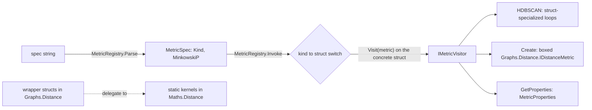

# Distance Metrics

> How ThermoMapper measures distance between points, in two tiers. `Maths.Distance` provides stateless metric kernels: the Minkowski family, cosine, compression distance, and geodesics on spherical, hyperbolic and statistical manifolds. `Graphs.Distance` wraps some of them as `readonly struct` metrics that carry a `MetricProperties` descriptor, and a `MetricRegistry` turns a spec string into a specialized metric type. · **Projects:** `Maths.Distance` (namespaces `Maths.Distance`, `.Euclidean`, `.Geodesic`), `Graphs.Distance` · **Maturity:** core; `EarthMover` and the property validator are partial

## Overview

The distance metrics are the first step of every graph pipeline (see [Architecture](./Architecture.md)): feature vectors → metric → neighbor selection → coupling kernel → CSR graph. The HDBSCAN branch goes metric → core distances → mutual-reachability MST.

**Who uses them.**

| Consumer | Uses |
|---|---|
| [Graph construction](./GraphConstruction.md) | a metric's `MetricProperties`, to pick a bandwidth estimator and a curvature treatment |
| [HDBSCAN](./Hdbscan.md) | the registry's visitor, to run its $O(N^2)$ loops over a struct-specialized metric |
| [Riemannian geometry](./RiemannianGeometry.md) | the geodesic kernels (sphere, Poincaré ball, hyperboloid) |

## Key concepts

- **Two `IDistanceMetric` interfaces.**
  - `Maths.Distance.IDistanceMetric` declares only the distance: `Distance(a, b)` plus a `ref`/dimension overload for hot loops.
  - `Graphs.Distance.IDistanceMetric` extends it with `MetricProperties Properties`.

  Because the graph interface inherits from the maths one, a metric handed out by the registry also satisfies the maths-level generic constraints used by `Prim` and `CoreDistances`.
- **Metric properties.** A companion descriptor that tells graph construction how to treat a metric. It records:
  - whether the metric is bounded, and its maximum;
  - input requirements (probability vectors, unit norm, fixed dimension);
  - a curvature class, `SpaceGeometry`;
  - a recommended `BandwidthStrategy`.
- **Spec string.** A short user-facing name for a metric, such as `euclidean` or `minkowski:p=1.5`, which the registry parses.

## Design

**A runtime spec bridged to a compile-time type.** `MetricRegistry.Invoke` is the only place that switches from a metric kind to a concrete struct. It calls `IMetricVisitor<TResult>.Visit<TMetric>(TMetric metric)` with a concrete struct instance (for Minkowski, one carrying the clamped `P`), in continuation-passing style, so callers such as HDBSCAN run a JIT-specialized loop without knowing which metric was chosen. `Create` is the boxed path for cold callers, and `GetProperties` reads the descriptor through the same kind of visitor.



**Stateless kernels.** Each maths metric is a static `Distance` function. Scratch memory is tiered: `stackalloc` up to 64 elements, a per-thread 512-element buffer up to 512, and `ArrayPool` above that (Mahalanobis, Fisher–Rao simplex).

**Extension point.** A new registry metric needs four things: a struct implementing `Graphs.Distance.IDistanceMetric`, a `MetricKind` value, an `Available` row, and matching `Parse` and `Invoke` cases.

## API at a glance

| Area | Entry points |
|---|---|
| Kernels | `Canberra`, `Cosine` (+ `NormAwareSimilarity`, `IsotropizeInPlace`), `EarthMover.Distance1D`, `Jaccard`, `Mahalanobis` (+ `DistanceSquared`), `NormalizedCompressionDistance` + `NcdCompressor`, `Euclidean.Hamming`, `Euclidean.Minkowski`, `Geodesic.FisherRaoHalfPlane`, `Geodesic.FisherRaoSimplex`, `Geodesic.Lorentz` (+ `InnerProduct`, `ProjectToHyperboloid`), `Geodesic.Poincare` (+ `ClampToBall`), `Geodesic.SphericalGeodesic`, `Geodesic.Wasserstein1` |
| Registry | `MetricRegistry.Available`, `Parse`, `Invoke`, `Create`, `GetProperties`; `MetricKind`, `MetricSpec`, `MetricDescriptor` (Kind, Id, DisplayName, Aliases, RequiresParameter, ParameterName), `IMetricVisitor<T>` |
| Properties | `MetricProperties` (+ `Default`, `ValidateDimension`), `BandwidthStrategy`, `SpaceGeometry` |
| Wrappers | `ManhattanMetric`, `EuclideanMetric`, `MinkowskiMetric(P)`, `HammingMetric`, `SphericalGeodesicMetric`, `PoincareMetric`, `FisherRaoSimplexMetric`, `FisherRaoHalfPlaneMetric`, `Wasserstein1Metric` |

## Algorithms

### Metric catalog (`Maths.Distance`)

In the table, $\Delta_i=a_i-b_i$.

| Kernel | Formula | Edge cases | Range |
|---|---|---|---|
| `Canberra` | $\sum_i\vert\Delta_i\vert/(\vert a_i\vert+\vert b_i\vert)$ | terms with a denominator below 1e-15 are skipped | [0, n] |
| `Cosine.Distance` | $1-\frac{a\cdot b}{\Vert a\Vert\Vert b\Vert}$ | similarity 0 if either norm is 0 | [0, 2] |
| `Cosine.NormAwareSimilarity` | $\alpha s+(1-\alpha)\frac{\min(\Vert a\Vert,\Vert b\Vert)}{\max(\Vert a\Vert,\Vert b\Vert)}$ | α = 0.5 by default and not validated | [−α, 1] |
| `EarthMover.Distance1D` | $\frac1n\sum_i\big\vert\sum_{k\le i}(a_{(k)}-b_{(k)})\big\vert$ over sorted copies | see Status | ≥ 0 |
| `Jaccard` | $1-\vert A\cap B\vert/\vert A\cup B\vert$, $A=\{i:a_i>\theta\}$ | θ = 0.5; both sets empty gives 0 | [0, 1] |
| `Mahalanobis` | $\sqrt{\max(0,\Delta^\top M\Delta)}$, where $M$ is the caller's inverse covariance | $O(D^2)$ | ≥ 0 |
| `NormalizedCompressionDistance` | $\frac{C(ab)-\min(C_a,C_b)}{\max(C_a,C_b)}$ | Brotli by default; not clamped | ≈ [0, 1+] |
| `Euclidean.Hamming` | popcount$(a\oplus b)$ on a `ulong` | hardware popcount | [0, 64] |
| `Euclidean.Minkowski` | $p$ clamped to [1, 2]; $p=1$: $\sum\vert\Delta_i\vert$; $p=2$: vectorized Euclidean; otherwise $m\big(\sum(\vert\Delta_i\vert/m)^p\big)^{1/p}$ with $m=\max\vert\Delta_i\vert$ | scaled for stability | ≥ 0 |
| `Geodesic.FisherRaoHalfPlane` | $\sqrt2\,\operatorname{arcosh}\!\big(1+\frac{\Delta\mu^2+2\Delta\sigma^2}{4\sigma_1\sigma_2}\big)$ | inputs `[μ, log σ]` | [0, ∞) |
| `Geodesic.FisherRaoSimplex` | $2\arccos\sum_i\sqrt{p_iq_i}$ | Bhattacharyya coefficient clamped; no renormalization | [0, π] |
| `Geodesic.Lorentz` | $\operatorname{arcosh}(-\langle a,b\rangle_L)$, time-like coordinate last | 0 if the argument is below 1 | [0, ∞) |
| `Geodesic.Poincare` | $\operatorname{arcosh}\!\big(1+\frac{2\Vert a-b\Vert^2}{(1-\Vert a\Vert^2)(1-\Vert b\Vert^2)}\big)$ | points beyond radius $1-10^{-5}$ are rescaled onto it | [0, ∞) |
| `Geodesic.SphericalGeodesic` | $\arccos\operatorname{clamp}\big(\frac{a\cdot b}{\Vert a\Vert\Vert b\Vert}\big)$ | normalizes internally; a zero vector gives π/2 | [0, π] |
| `Geodesic.Wasserstein1` | $\sum_i\vert P_i-Q_i\vert$ over the cumulative sums $P,Q$ | unit bin spacing; no mass normalization | ≥ 0 |

**Vectorization.** Minkowski with $p=2$ and the Fisher–Rao simplex use `TensorPrimitives`, and Hamming uses hardware popcount. The other kernels are scalar loops.

### The registry

**Spec grammar.** Case-insensitive, after trimming:

```text
spec := head [ ":" tail ]
head := euclidean | manhattan | l1 | minkowski | hamming | poincare | cosine
tail := [ name "=" ] number        (read only for minkowski, where it is required; ignored after other heads;
                                     the name before "=" is not checked; invariant culture)
```

**Registered kinds.** Six kinds map to wrapper structs. **`cosine` maps to `SphericalGeodesicMetric`**, the arc length on [0, π], and not to `Cosine.Distance` (which is $1-\cos$). The display name "Cosine (spherical geodesic)" says so; only the short id is misleading. The Fisher–Rao and Wasserstein wrappers exist but cannot be reached from a spec string.

**Wrapper properties.**

| Wrapper | Delegates to | Bounded | Requires | Geometry | Bandwidth strategy |
|---|---|---|---|---|---|
| `ManhattanMetric`, `EuclideanMetric`, `MinkowskiMetric(P)` | `Minkowski.Distance` (P clamped to [1, 2]) | no | — | Euclidean | `MadConsistencyFactor` |
| `HammingMetric` | count of $a_i\ne b_i$ over doubles (not a bit popcount) | no | — | Euclidean | `MadConsistencyFactor` |
| `SphericalGeodesicMetric` | `SphericalGeodesic` | yes (π) | unit norm (declared) | Spherical | `QuantileNormalized` |
| `PoincareMetric` | `Poincare` | no | — | Hyperbolic | `LogScaleHyperbolic` |
| `FisherRaoSimplexMetric` | `FisherRaoSimplex` | yes (π) | probability vectors | Spherical | `QuantileNormalized` |
| `FisherRaoHalfPlaneMetric` | `FisherRaoHalfPlane` | no | fixed dimension 2 | Hyperbolic | `LogScaleHyperbolic` |
| `Wasserstein1Metric` | `Wasserstein1` | no | — | Euclidean | `MadConsistencyFactor` |

### Bandwidth vocabulary

The bandwidth strategy tells [graph construction](./GraphConstruction.md#bandwidth-estimation) how to estimate a kernel bandwidth from nearest-neighbor distances:

| `BandwidthStrategy` | Meaning |
|---|---|
| `MadConsistencyFactor` | median absolute deviation of the neighbor distances × the kernel's consistency factor |
| `QuantileNormalized` | clamp neighbor distances above their 95th percentile (nearest rank) to that value, then MAD × the consistency factor; for bounded metrics |
| `LogScaleHyperbolic` | $\exp\big(\operatorname{med}\ell+c\cdot\mathrm{MAD}(\ell)\big)$ with $\ell=\ln\max(d,10^{-12})$; for hyperbolic distances |
| `MeanEdgeDistance` | plain mean of neighbor distances, no consistency factor: over all retained neighbor pairs on the single-kernel path, over the k-th-neighbor sample on the mixture path; reproduces the classical SPC papers' convention |

`SpaceGeometry` (Euclidean, κ = 0; Hyperbolic, κ < 0; Spherical, κ > 0) selects which consistency factors apply. It also selects how curvature enters the kernel.

## Configuration

| Setting | Default | Meaning |
|---|---|---|
| `MetricSpec.MinkowskiP` | 2.0 | Exponent. The parser still requires one explicitly |
| Minkowski exponent range | [1, 2] | Values outside are clamped |
| `Poincare.BoundaryMargin` | 1e-5 | The ball radius is $1-\varepsilon$ |
| `Jaccard.Distance` threshold | 0.5 | Binarization cut |
| `Cosine.NormAwareSimilarity` α | 0.5 | Mix of angular and radial terms |
| `NormalizedCompressionDistance` compressor | Brotli (Optimal) | Alternatives in `NcdCompressor` |
| `MetricProperties.Default` | unbounded, Euclidean, `MadConsistencyFactor` | Placeholder descriptor |

## Status and caveats

- **Minkowski exponent is clamped.** The registry lists "Minkowski (Lᵖ)", but p is clamped to [1, 2]. p < 1 is raised silently; a stderr warning is written only for p > 2, and only when a `MinkowskiMetric` is constructed. The parser also accepts `NaN`, which passes the clamp unchanged and makes every non-zero distance NaN.
- **`EarthMover` is partial.** It accumulates sorted values, and its result is neither sample W₁ nor histogram W₁; it also disagrees with `Wasserstein1`. It has no callers. Use `Wasserstein1` for histograms.
- **Truncation and silent clamping.** Several kernels iterate over `a.Length`, so a longer `b` is silently truncated: `Canberra.Distance`, `EarthMover.Distance1D` and `Minkowski.ManhattanDistance` (called directly; `Minkowski.Distance` and `ManhattanMetric` check lengths). Poincaré moves points outside the ball onto its boundary.
- **`MetricProperties.ValidateDimension` is partial.** It enforces only a fixed dimension. The probability-vector and unit-norm requirements are declared but not checked. `SphericalGeodesicMetric` declares that it requires unit-norm input, but its kernel normalizes internally.
- **Two different Hamming metrics.** `Maths.Distance.Euclidean.Hamming` is a 64-bit popcount. The registry's `HammingMetric` counts unequal double coordinates. They are different measures.

## Source map

| Role | Files |
|---|---|
| Kernels | `ThermoMapper/src/maths/distance/Canberra.cs`, `Cosine.cs`, `EarthMover.cs`, `Jaccard.cs`, `Mahalanobis.cs`, `Ncd.cs`, `IDistanceMetric.cs`, `euclidean/Hamming.cs`, `euclidean/Minkowski.cs`, `geodesic/FisherRaoHalfPlane.cs`, `geodesic/FisherRaoSimplex.cs`, `geodesic/Lorentz.cs`, `geodesic/Poincare.cs`, `geodesic/SphericalGeodesic.cs`, `geodesic/Wasserstein1.cs` |
| Registry and wrappers | `ThermoMapper/src/graphs/distance/IDistanceMetric.cs`, `MetricProperties.cs`, `MetricRegistry.cs`, `wrappers/EuclideanMetrics.cs`, `wrappers/GeodesicMetrics.cs` |

**See also:** [GraphSubstrate](./GraphSubstrate.md) · [GraphConstruction](./GraphConstruction.md) · [Hdbscan](./Hdbscan.md) · [DesignPrinciples](./DesignPrinciples.md)
