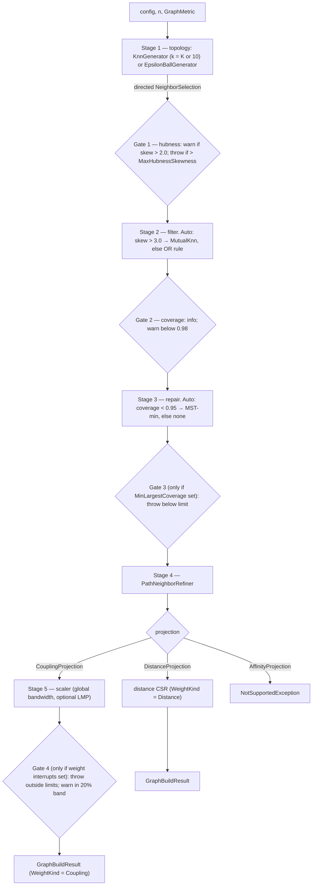

# Graph Construction

> The declarative proximity-graph engine. `GraphCompiler.Build` takes a point set, given only as a distance function over indices, and produces a sparse symmetric weighted `CsrGraph`. It runs a fixed five-stage pipeline (topology → filter → repair → refinement → projection) driven by one immutable configuration. Bandwidth estimation is aware of the space's geometry, and diagnostic gates can stop the build early. · **Project:** `Graphs.Proximity` (namespace `Graphs` and sub-namespaces) · **Maturity:** core

## Overview

`Graphs.Proximity` sits in layer 5 of the [architecture](./Architecture.md). It builds on:

- [`Graphs.Primitives`](./GraphSubstrate.md): CSR graphs, heaps, the Borůvka minimum spanning tree (MST), bounded Dijkstra;
- [`Graphs.Distance`](./DistanceMetrics.md): metric properties;
- `Graphs.Coupling`: kernels;
- `Graphs.Observables`: connectivity and weight summaries;
- [`Maths.Geometry`](./RiemannianGeometry.md): manifolds and heat-kernel calibration.

Its consumers need either couplings or distances:

| Consumer | Needs |
|---|---|
| [SPC clustering](./SpcEngine.md) | couplings |
| [HDBSCAN](./Hdbscan.md) | none yet: `HdbscanSession` builds its own mutual-reachability MST and does not call `GraphCompiler`; a sparse path over a `DistanceProjection` graph is planned |
| [Mapper](./Mapper.md) graph input | any `CsrGraph` (distance or coupling) |
| [SPRED](./Spred.md) | distances |
| The REPL (out of scope) | either |



When repair was applied, both output paths also return a `PreRepairGraph`, built from the filtered, pre-repair selection.

## Key concepts

- **Directed selection.** Stage 1's k-nearest-neighbor (kNN) nominations, before symmetrization. They are carried in a `NeighborSelection`, which holds per-node neighbor rows, a nearest-neighbor vector and a **k-th-neighbor distance vector**.
- **OR vs AND.** The OR rule keeps edge (i, j) if either endpoint nominated the other. It connects the graph well but produces hubs in high dimensions. The AND rule ("mutual kNN") keeps an edge only if both endpoints nominated each other. It suppresses hubs but can shatter the graph into pieces.
- **MST-min repair.** Adds only the Borůvka bridges needed to join the components.
- **Bandwidth δ.** The kernel length scale. By default it is estimated from the per-node k-th-neighbor distances (the "k-th sample").
- **Coupling fidelity.**
  - `GeodesicLinear`: a flat kernel applied to geodesic distance.
  - `Intrinsic`: the manifold heat kernel, including the Van Vleck volume correction.
- **LMP (local mutual proximity).** Replaces each weight with a product of local ranks at its two endpoints. It rescues edges that a single global bandwidth would crush toward zero.
- **Protected edges (the protect set).** Pairs, typically loop edges found by [persistent homology](./PersistentHomology.md#cycle-representatives-and-the-h1-protect-set), that LMP must leave alone.
- **Pathology interrupts.** Optional thresholds that make the build fail fast with `GraphPathologyException`.

## Design

**Declarative config and a pure static engine.**

- `GraphCompiler` is a static class with no instance state.
- `GraphCompilerConfig` is an immutable record with one sub-record per stage. Every strategy defaults to `Auto` except topology and projection, which are required.
- `GraphSession(n, metric)` binds data for repeated builds. It does no caching.
- The code notes that fluent builders belong at the REPL boundary, not in the engine.

**One strategy interface per stage.** `ITopologyGenerator` → `ITopologyFilter` → `ITopologyRepair` → `IMetricRefiner` → `IEdgeScaler`. Each has a single method over `NeighborSelection`. Private `Resolve*` switches map config kinds to implementations; nothing is discovered by reflection.

**Auto decisions are made at run time from the previous stage's diagnostics.** The filter choice reads Stage-1 hubness, and the repair choice reads Stage-2 coverage. So the config is resolved incrementally. Invalid choices therefore fail late: Euclidean refinement throws after stages 1–3, and `AffinityProjection` after stages 1–4.

**The k-th sample is never polluted.** The k-th-distance vector passes unchanged through OR symmetrization, repair and refinement, so long bridge edges never enter the k-th-sample estimators. The exception is `MeanEdgeDistance` on the single-kernel path, which averages every row entry of the refined selection, bridges included.

**Scalers compose as decorators.** `BuildScaler` creates a `GlobalBandwidthScaler`, for a single kernel or a mixture. It then wraps it in `LocalMutualProximityScaler` (LMP forced), `AutoLmpScaler` (LMP decided at run time) or nothing. The LMP scalers run the inner scaler first, then re-weight its graph.

**A consumer-neutral seam for topology.** A `ProtectedEdgeSource` receives the conditioned *distance* graph and returns normalized `(Lo, Hi)` pairs. Topological criteria are therefore injected from above instead of imported by a stage.

**Diagnostics are a first-class output.** Every decision appends an Info or Warning message to the `DiagnosticsLog` returned in the result. Configured thresholds throw instead of logging a fatal message.

## API at a glance

| Area | Entry points |
|---|---|
| Build | `GraphCompiler.Build(config, n, metric, protectedEdges?)` → `GraphBuildResult`; `GraphSession(n, metric).Build(config, …)` |
| Data binding | `GraphMetric(Distance, Properties?, AmbientDimension?, Features?, Manifold?)`; `GraphMetric.FromFeatures(features, metric?)`, which infers the manifold for Poincaré, spherical and Fisher–Rao metrics |
| Config | `GraphCompilerConfig`; `TopologyConfig`, `FilterConfig`, `RepairConfig`, `RefinementConfig`, `PathologyInterruptConfig`; the enums `TopologyKind`, `FilterKind`, `RepairKind`, `RefinementKind`, `MutualBandwidthSource`, `CouplingFidelity`, `SphericalIntrinsicMode` |
| Projection | `IEdgeProjection`: `DistanceProjection`, `CouplingProjection` (Kernel, LmpRescale, BandwidthOverride, Fidelity, SphericalMode), `AffinityProjection` (not yet supported); `Kernel` is an `IKernelDescriptor` (`Gaussian`, `Cauchy`, `Laplacian`, `Linear`, `Mixture` in `Graphs.Coupling`) |
| Result | `GraphBuildResult` (`Graph`, `DirectedSelection`, `SingleBandwidth`, `MixtureBandwidth`, `EnsureConnectedApplied`, `PreRepairGraph`, `Metric`, `Diagnostics`, `WeightKind`, `RepresentativeBandwidth`); `EdgeWeightKind` |
| Stages | `KnnGenerator`, `EpsilonBallGenerator`, `PassThroughFilter`, `MutualKnnFilter`, `NoRepair`, `MstMinRepair`, `PathNeighborRefiner`, `GlobalBandwidthScaler(KernelType, …)`, `LocalMutualProximityScaler`; helpers `DirectedKnn`, `Symmetrization`, `ConnectivityRepair`, `ProximityGraph`, `LocalMutualProximity` |
| Bandwidth | `BandwidthEstimation.*` (usable standalone) |
| Diagnostics | `GraphHealth.Evaluate(build, k)`, `Hubness.Analyze`, `NeighborhoodScale.Compute`, `MstBridge.Compare`, `DiagnosticsLog`, `GraphPathologyException` |

A typical composition:

```csharp
var gm  = GraphMetric.FromFeatures(X, metric);
var cfg = new GraphCompilerConfig {
    Topology   = new TopologyConfig { Kind = TopologyKind.Knn, K = 10 },
    Projection = new CouplingProjection { Kernel = new Gaussian() }   // Bandwidth 0 → auto
};
var result = GraphCompiler.Build(cfg, X.Length, gm);
var health = GraphHealth.Evaluate(result, k: 10);
```

## Algorithms

### Stage 1: topology

- **Directed kNN.** For each node, keep its k nearest other nodes using a bounded max-heap.
  - If the row filled exactly and $k<n-1$, it is widened to *every* node within the k-th distance. This tie-inclusive rule keeps mutual kNN symmetric on quantized data.
  - Rows run in parallel. That costs about $2n(n-1)$ distance calls in total, $\Theta(n^2)$ overall.
  - **The distance function must therefore be thread-safe.**
- **ε-ball.** $E=\{\{i,j\}: d(i,j)<\varepsilon\}$, with the k-th sample set to each node's farthest included distance. It costs $n(n-1)/2$ distance calls, in parallel.

### Stages 2–4: filter, repair, refinement

- **OR union.** Keeps the pair union and the smaller of the two nominated distances. Rows are rebuilt symmetric and sorted by distance.
  - `PassThroughFilter` skips this if a heuristic says the input is already symmetric, which is right for ε-ball input. See [Status](#status-and-caveats).
- **Mutual intersection** keeps only reciprocal nominations. For the bandwidth sample, `MutualBandwidthSource.DirectedKth` (the default) keeps the directed k-th vector. `MutualKth` instead uses each row's largest mutual distance, and $+\infty$ for rows with no mutual neighbor.
- **MST-min repair.**
  - Seeds a union–find with every selection edge, then adds Borůvka minimal bridges until the graph is connected. That costs $O(n^2\log C)$ for C initial components.
  - It **always** rebuilds a symmetric, distance-sorted selection, even for a connected input. That rebuild costs $O(n+E+\sum\deg\log\deg)$.
- **Path-neighbor refinement.**
  - Sets $d'_{ij}=\min(d_{ij},\mathrm{sp}_G(i,j))$ over the repaired digraph, using a bounded, target-masked Dijkstra from each source.
  - The edge (i, j) itself is in G, and a true metric satisfies the triangle inequality, so **refinement is the identity for metric inputs**. It can only shorten edges, and only for non-metric dissimilarities. It does not lengthen bridges.
  - It has a $\Theta(n^2)$ baseline from per-source scratch resets.

### Bandwidth estimation

The sample $s_i$ is `KthNeighborDistances[i]`. The consistency factor c depends on the kernel and the space geometry. $\mathrm{MAD}(x)=\operatorname{med}|x-\operatorname{med}x|$.

| Strategy | δ |
|---|---|
| `MadConsistencyFactor` (default) | $c\cdot\mathrm{MAD}(s)$ |
| `QuantileNormalized` | clamp $s$ at its 95th percentile (nearest rank), then $c\cdot\mathrm{MAD}$ |
| `LogScaleHyperbolic` | $\exp\big(\operatorname{med}\ell+c\cdot\mathrm{MAD}(\ell)\big)$ with $\ell_i=\ln\max(s_i,10^{-12})$ |
| `MeanEdgeDistance` | the mean of the finite $s_i$ on the mixture path; on the single-kernel path, the mean over *all* row entries |

| Consistency factor c | Euclidean | Hyperbolic | Spherical |
|---|---|---|---|
| Gaussian | 1.4826 | 1.4826 | 1.4826 |
| Laplacian | 1.4427 | 1.67 | 1.34 |
| Cauchy | 1.0 | 0.0 (intended for the log route only) | 1.0 |

**Choosing the strategy and geometry.**

- The strategy is `BandwidthOverride`, else the metric's declared strategy, else `MadConsistencyFactor`.
- The geometry comes from the metric's properties, else Euclidean.
- A warning is logged when the declared strategy is not the "natural" one for its geometry: log-scale for hyperbolic, quantile for spherical.

**Intrinsic Gaussian kernels.** On hyperbolic and spherical spaces, unless δ is explicit or the strategy is `MeanEdgeDistance`, the bandwidth comes from heat-kernel calibration instead of the configured strategy. The second moment of the k-th sample is matched by `Hyperbolic.MatchBeta` / `Spherical.MatchBeta` (see [RiemannianGeometry](./RiemannianGeometry.md#heat-kernel-bandwidth-calibration)), with heat time $t=\delta^2/2$.

**Per-kernel details.** `ForLinear` returns the maximum of the sample, ignoring strategy and geometry. An empty sample returns a fallback of 1.0. Estimators reject NaN, infinite or negative sample values, except `Mean`, which skips non-finite values.

### Stage 5: kernel scaling

**Single kernel.** For each undirected edge:

$$J_{ij}=\kappa\cdot K(d_{ij};\delta)\cdot V(d_{ij}),\qquad \text{kept only if } J_{ij}>10^{-10}.$$

- **Kernel K.** One of Gaussian, Cauchy, Laplacian or Linear (formulas in [GraphSubstrate](./GraphSubstrate.md#coupling-kernels)).
- **Normalization κ.** $\kappa=1/\hat K=n/\sum_i|N(i)|$ applies only on the single-kernel path under `MeanEdgeDistance`, and then even when δ is explicit. This is the classical SPC normalization $J=\hat K^{-1}e^{-d^2/2a^2}$. Otherwise $\kappa=1$.
- **Van Vleck factor V.** It is 1 unless fidelity is `Intrinsic`. It is also 1 for $r<10^{-12}$, for Euclidean geometry, and when its exponent is ≤ 0. Otherwise:
  - hyperbolic: $V=(r/\sinh r)^{(d-1)/2}$;
  - spherical: $V=(r/\sin r)^{(m-1)/2}$,

  where d is `AmbientDimension` (the Poincaré-ball dimension) and m is the sphere's intrinsic dimension (`SphericalManifold.IntrinsicDimension`, else `AmbientDimension` − 1).

**Fidelity selection.** `Auto` resolves to `Intrinsic` on spherical metrics and to `GeodesicLinear` otherwise. Intrinsic fidelity supports only a single Gaussian kernel; any other kernel throws `NotSupportedException` at scaling time. On a spherical metric with a non-Gaussian kernel, set `Fidelity = GeodesicLinear` explicitly.

**Spherical intrinsic modes.**

- `LocalParametrix` (the Auto default) skips edges with $r\ge0.9\pi$.
- `GlobalSchoenberg` uses the normalized Gegenbauer heat-kernel series with $\lambda=(m-1)/2$:

$$K_t(r)=\sum_{n=0}^{50}\frac{n+\lambda}{\lambda}C_n^{\lambda}(\cos r)e^{-n(n+2\lambda)t},\qquad J=K_t(r)/K_t(0).$$

For m = 1 (λ = 0) the code uses the circle series $K_t(r)=1+2\sum_{n=1}^{50}\cos(nr)\,e^{-n^2t}$.

**Mixture kernels.** A weighted Gaussian + Cauchy + Laplacian sum, with its own δ per component, the same $10^{-10}$ cut, and no κ or V.

**Bandwidth sanity check.** For single-kernel builds only, a warning is logged if δ is outside $[0.1\tilde s,10\tilde s]$, where $\tilde s$ is the median k-th-neighbor distance.

### Local mutual proximity

For slot $(u,v)$ with weight w:

$$p_u=\frac{\#\{e'\in\mathrm{row}(u): w_{e'}\prec w\}}{\deg u},\qquad \mathrm{MP}_{uv}=p_u\,p_v,$$

where $\prec$ means "weaker": `<` for couplings, `>` for distances. Protected pairs keep their weight. The implementation uses AVX2 compares and popcounts and runs in parallel over nodes, in $O(\sum_u\deg(u)^2)$.

- **Exact zeros.** Because $p_u$ counts *strictly* weaker edges, each node's weakest edge gets $p=0$ at that endpoint. So LMP writes **exact zeros** into at least $1/\overline{\deg}$ of the slots, and the $10^{-10}$ floor does not hold for the final graph once LMP has run.
- **When LMP runs.** `AutoLmpScaler` applies LMP when more than 5% of the tentative weights fall below $10^{-8}$.

### Diagnostics and gates

**`Hubness`.**

- A node's in-degree over the directed rows gives the skewness.
- A node is a hub if its in-degree is at least $10k$, and an anti-hub if it is at most $0.1k$.
- `TopHubCoverage` is the in-degree share of the top $\sqrt n$ nodes.
- In `Build`'s hubness gate, ε-ball builds use k = 0, so every node counts as a hub. `GraphHealth.Evaluate` still needs k > 0 for ε-ball builds, because `NeighborhoodScale.Compute` throws for k ≤ 0.

**`NeighborhoodScale`** is the ratio of the median k-th distance to the median nearest-neighbor distance.

**`MstBridge`** summarizes the weights of the edges repair added.

**`GraphHealth.Evaluate`** combines connectivity, degree and weight summaries with hubness, neighborhood scale, cycles, λ₂ (graphs with at most 2,000 nodes by default) and, when a `PreRepairGraph` exists, MST-bridge statistics into a `GraphHealthReport`. It derives a `GraphHealthVerdict` and one recommendation. The component analyses return their own records (`HubnessReport`, `NeighborhoodScaleReport`, `MstBridgeReport`).

**Gate 4** reads the *final* weights. When LMP ran, those are the post-LMP weights, including the exact zeros LMP writes.

### Performance notes

- **Distance calls dominate.** Directed kNN makes about $2n(n-1)$ calls, and ε-ball $n(n-1)/2$.
- **Other significant costs:**
  - refinement's $\Theta(n^2)$ baseline;
  - LMP at $O(\sum\deg^2)$;
  - row sorts at $O(\sum\deg\log\deg)$;
  - in Schoenberg mode, about 100 terms per edge, with $K_t(0)$ recomputed for each edge.
- **When repair runs,** a second full scaling pass builds the `PreRepairGraph`. It re-resolves δ and the auto-LMP decision on the filtered selection and calls the protected-edge source again. Under `MeanEdgeDistance`, or when auto-LMP fires on only one pass, its weights are therefore not on the same scale as `Graph`.
- **Memory.** Refinement rents its per-thread scratch arrays from `ArrayPool`; other stages allocate per call.

## Configuration

| Setting | Default | Meaning |
|---|---|---|
| `TopologyConfig.Kind` / `K` / `Epsilon` | required / 10 / required for ε-ball | Stage 1 |
| `FilterConfig.Kind` / `MutualBandwidthSource` | `Auto` / `DirectedKth` | Auto: skew > 3.0 → mutual kNN |
| `RepairConfig.Kind` | `Auto` | Auto: coverage < 0.95 → MST-min |
| `RefinementConfig.Kind` / `MaxDistance` | `Auto` (path-neighbor) / ∞ | `Euclidean` throws |
| `PathologyInterruptConfig` MaxHubnessSkewness / MinLargestCoverage / MinMedianWeight / MaxMedianWeight / MaxNearZeroEdgeRatio | all null (off) | Fail-fast thresholds |
| `CouplingProjection.Kernel` | required | Bandwidth 0 means estimate |
| `CouplingProjection.LmpRescale` | null | null = auto (ratio > 0.05), true = force, false = off |
| `CouplingProjection.BandwidthOverride` / `Fidelity` / `SphericalMode` | null / `Auto` / `Auto` → `LocalParametrix` | — |
| Fixed engine constants | hub warning 2.0; coverage warning 0.98; auto skew 3.0; auto coverage 0.95; near-zero 1e-8; coupling floor 1e-10; parametrix cutoff 0.9π; Schoenberg series truncated at n = 50 | Not configurable |

## Status and caveats

- **The OR filter can leave rows directed.** `PassThroughFilter` checks symmetry on a single edge. For directed kNN input it often returns the directed rows unchanged. The CSR builders keep only i < j entries, so an edge nominated only by its higher-index endpoint is dropped. If MST-min then runs, it re-symmetrizes the rows, and `EnsureConnectedApplied` is set even when no bridge was added.
- **Isolated nodes.** An ε-ball build with an isolated node throws, because the per-node vectors come out shorter than n. Under `MutualKth`, a node with no mutual neighbor puts $+\infty$ into the bandwidth sample. The MAD, quantile, log-scale, intrinsic and linear estimators then throw `ArgumentOutOfRangeException`; `MeanEdgeDistance` skips or ignores the value.
- **Bandwidth labels are inverted.** All four kernels increase with δ, so a *low* median weight means δ is too *small*. `GraphHealth` labels that case `BandwidthTooLarge` ("halve --bandwidth"), and the interrupt messages invert the direction the same way. `Build`'s own δ-vs-median warning gives the correct direction.
- **Zero bandwidth is not guarded.** MAD is 0 when more than half of the k-th distances are equal, as with quantized data. The hyperbolic Cauchy factor under MAD also gives 0. With δ = 0, every coupling fails the $10^{-10}$ test and the graph comes out empty, and the sanity warning does not fire.
- **`MaxNearZeroEdgeRatio` fails on LMP builds.** LMP writes exact zeros, so the 0.05 recommended in the `MaxNearZeroEdgeRatio` doc comment will likely throw on builds where LMP runs.

## Source map

| Role | Files (`ThermoMapper/src/graphs/`) |
|---|---|
| Engine and config | `GraphCompiler.cs`, `GraphCompilerConfig.cs`, `GraphBuildResult.cs`, `GraphMetric.cs`, `GraphProjection.cs`, `GraphSelection.cs`, `GraphEnums.cs`, `Bandwidth.cs` (`BandwidthEstimation`) |
| Stage contracts and implementations | `pipeline/I*.cs`, `pipeline/generators/*`, `pipeline/filters/*`, `pipeline/repair/*`, `pipeline/refinement/PathNeighborRefiner.cs`, `pipeline/scalers/GlobalBandwidthScaler.cs`, `LocalMutualProximityScaler.cs`, `AutoLmpScaler.cs` |
| Neighbor primitives | `neighbors/DirectedKnn.cs`, `Symmetrization.cs`, `proximity/EpsilonBall.cs`, `KNNGraph.cs`, `LMPGraph.cs`, `ConnectivityRepair.cs` |
| Diagnostics | `diagnostics/DiagnosticsLog.cs`, `GraphHealth.cs`, `Hubness.cs`, `MstBridge.cs`, `NeighborhoodScale.cs` |

**See also:** [Concepts](./Concepts.md) · [Glossary](./Glossary.md) · [GraphSubstrate](./GraphSubstrate.md) · [DistanceMetrics](./DistanceMetrics.md) · [RiemannianGeometry](./RiemannianGeometry.md) · [SpcEngine](./SpcEngine.md) · [PersistentHomology](./PersistentHomology.md)
