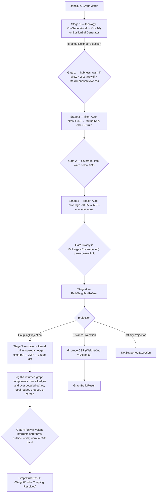

# Graph Construction

> The declarative proximity-graph engine. `GraphCompiler.Build` takes a point set, given only as a distance function over indices, and produces a sparse symmetric weighted `CsrGraph`. It runs a fixed five-stage pipeline (topology → filter → repair → refinement → projection) driven by one immutable configuration. Bandwidth estimation is aware of the space's geometry, and diagnostic gates can stop the build early. · **Project:** `Graphs.Proximity` (namespace `Graphs` and sub-namespaces) · **Maturity:** core

## Overview

`Graphs.Proximity` sits in layer 5 of the [architecture](./Architecture.md). It builds on:

- [`Graphs.Primitives`](./GraphSubstrate.md): CSR graphs, heaps, the Borůvka minimum spanning tree (MST), bounded Dijkstra;
- [`Graphs.Distance`](./DistanceMetrics.md): metric properties;
- `Graphs.Coupling`: kernels;
- `Graphs.Observables`: connectivity and weight summaries;
- [`Maths.Geometry`](./RiemannianGeometry.md): manifolds and heat-kernel calibration.

Its consumers need either couplings or distances:

| Consumer | Needs |
|---|---|
| [SPC clustering](./SpcEngine.md) | couplings |
| [HDBSCAN](./Hdbscan.md) | none yet: `HdbscanSession` builds its own mutual-reachability MST and does not call `GraphCompiler`; a sparse path over a `DistanceProjection` graph is planned |
| [Mapper](./Mapper.md) graph input | any `CsrGraph` (distance or coupling) |
| [SPRED](./Spred.md) | distances |
| The REPL (out of scope) | either |



When repair was applied, both output paths also return a `PreRepairGraph`: the returned graph without the repair edges, in the same units, so `MstBridge.Compare` sees the topology change alone.

## Key concepts

- **Directed selection.** Stage 1's k-nearest-neighbor (kNN) nominations, before symmetrization. They are carried in a `NeighborSelection`, which holds per-node neighbor rows, a nearest-neighbor vector and a **k-th-neighbor distance vector**.
- **OR vs AND.** The OR rule keeps edge (i, j) if either endpoint nominated the other. It connects the graph well but produces hubs in high dimensions. The AND rule ("mutual kNN") keeps an edge only if both endpoints nominated each other. It suppresses hubs but can shatter the graph into pieces.
- **MST-min repair.** Adds only the Borůvka bridges needed to join the components. The added edges are the **repair edges** (`RepairEdgeSet`): the coupling floor never cuts them, and LMP leaves them their kernel coupling.
- **Bandwidth δ.** The kernel length scale. By default it is estimated from the per-node k-th-neighbor distances (the "k-th sample"); `ScaleRank` r reads each node's r-th neighbor instead, so K can grow without widening the kernel.
- **Gauge.** One global factor on the finished couplings, applied last (`Gauge = InverseMeanDegree` multiplies by $1/\hat K$, with $\hat K$ the returned graph's mean degree). It follows every threshold, so it is exactly a rescaling of temperature.
- **Resolved construction.** `GraphBuildResult.Resolved`, echoed into the manifest beside the requested config: what each `Auto` picked and the statistic behind it, the bandwidth, the gauge factor, the floor, the cut and restored counts, the connectivity of the returned graph, and whether the couplings are the classic units BWD's q-only $T_{ps}(q)$ is derived for.
- **Coupling fidelity.**
  - `GeodesicLinear`: a flat kernel applied to geodesic distance.
  - `Intrinsic`: the manifold heat kernel, including the Van Vleck volume correction.
- **LMP (local mutual proximity).** Replaces each weight with a product of local ranks at its two endpoints. The rank is strict by default (it counts strictly weaker edges), which writes an exact 0 on every node's weakest edge; `LmpRank = Inclusive` counts the edge itself and writes none.
- **Protected edges (the protect set).** Pairs, typically loop edges found by [persistent homology](./PersistentHomology.md#cycle-representatives-and-the-h1-protect-set), that LMP must leave alone.
- **Pathology interrupts.** Optional thresholds that make the build fail fast with `GraphPathologyException`.

## Design

**Declarative config and a pure static engine.**

- `GraphCompiler` is a static class with no instance state.
- `GraphCompilerConfig` is an immutable record with one sub-record per stage. Every strategy defaults to `Auto` except topology and projection, which are required.
- `GraphSession(n, metric)` binds data for repeated builds. It does no caching.
- The code notes that fluent builders belong at the REPL boundary, not in the engine.

**One strategy interface per stage.** `ITopologyGenerator` → `ITopologyFilter` → `ITopologyRepair` → `IMetricRefiner` → `IEdgeScaler`. Each has a single method over `NeighborSelection`. Private `Resolve*` switches map config kinds to implementations; nothing is discovered by reflection.

**Auto decisions are made at run time from the previous stage's diagnostics.** The filter choice reads Stage-1 hubness, and the repair choice reads Stage-2 coverage. So the config is resolved incrementally. Invalid choices therefore fail late: Euclidean refinement throws after stages 1–3, and `AffinityProjection` after stages 1–4.

**The k-th sample is never polluted.** The k-th-distance vector passes unchanged through OR symmetrization, repair and refinement, so long bridge edges never enter the k-th-sample estimators. `MeanEdgeDistance` on the single-kernel path averages the unique edges of the pre-repair selection by default (`ScaleEdges = BeforeRepair`); `AfterRepair` averages the repaired edges, bridges included, as the BWD papers do.

**Scalers compose as decorators.** `BuildScaler` creates a `GlobalBandwidthScaler`, for a single kernel or a mixture. It then wraps it in `LocalMutualProximityScaler` (LMP forced), `AutoLmpScaler` (LMP decided at run time) or nothing, and last in `GaugeScaler` when a gauge is set. Each runs the inner scaler first, then re-weights its graph, so the order is fixed: scale and shape, thinning, measure, gauge. A `ScalingContext` hands the scalers the repair edges, the floor and the neighbor sample the bandwidth reads.

**A consumer-neutral seam for topology.** A `ProtectedEdgeSource` receives the conditioned *distance* graph and returns normalized `(Lo, Hi)` pairs. Topological criteria are therefore injected from above instead of imported by a stage.

**Diagnostics are a first-class output.** Every decision appends an Info or Warning message to the `DiagnosticsLog` returned in the result. Configured thresholds throw instead of logging a fatal message.

## API at a glance

| Area | Entry points |
|---|---|
| Build | `GraphCompiler.Build(config, n, metric, protectedEdges?)` → `GraphBuildResult`; `GraphSession(n, metric).Build(config, …)` |
| Data binding | `GraphMetric(Distance, Properties?, AmbientDimension?, Features?, Manifold?)`; `GraphMetric.FromFeatures(features, metric?)`, which infers the manifold for Poincaré, spherical and Fisher–Rao metrics |
| Config | `GraphCompilerConfig`; `TopologyConfig`, `FilterConfig`, `RepairConfig`, `RefinementConfig`, `PathologyInterruptConfig`, `AutoThresholds`; the enums `TopologyKind`, `FilterKind`, `RepairKind`, `RefinementKind`, `MutualBandwidthSource`, `CouplingFidelity`, `SphericalIntrinsicMode`, `GaugeKind`, `ScaleEdgeSet`, `LmpRankRule` |
| Projection | `IEdgeProjection`: `DistanceProjection`, `CouplingProjection` (Kernel, LmpRescale, BandwidthOverride, Fidelity, SphericalMode, CouplingFloor, LmpRank, Gauge, ScaleEdges, ScaleRank), `AffinityProjection` (not yet supported); `Kernel` is an `IKernelDescriptor` (`Gaussian`, `Cauchy`, `Laplacian`, `Linear`, `Mixture` in `Graphs.Coupling`) |
| Result | `GraphBuildResult` (`Graph`, `DirectedSelection`, `SingleBandwidth`, `MixtureBandwidth`, `EnsureConnectedApplied`, `PreRepairGraph`, `Metric`, `Diagnostics`, `WeightKind`, `Resolved`, `RepresentativeBandwidth`); `ResolvedConstruction`, `CouplingResolution`; `EdgeWeightKind` |
| Stages | `KnnGenerator`, `EpsilonBallGenerator`, `PassThroughFilter`, `MutualKnnFilter`, `NoRepair`, `MstMinRepair`, `PathNeighborRefiner`, `GlobalBandwidthScaler(KernelType, …)`, `LocalMutualProximityScaler`, `GaugeScaler`; `RepairEdgeSet`, `ScalingContext`; helpers `DirectedKnn`, `Symmetrization`, `ConnectivityRepair`, `ProximityGraph`, `LocalMutualProximity` |
| Bandwidth | `BandwidthEstimation.*` (usable standalone) |
| Diagnostics | `GraphHealth.Evaluate(build, k)`, `Hubness.Analyze`, `NeighborhoodScale.Compute`, `MstBridge.Compare`, `DiagnosticsLog`, `GraphPathologyException` |

A typical composition:

```csharp
var gm  = GraphMetric.FromFeatures(X, metric);
var cfg = new GraphCompilerConfig {
    Topology   = new TopologyConfig { Kind = TopologyKind.Knn, K = 10 },
    Projection = new CouplingProjection { Kernel = new Gaussian() }   // Bandwidth 0 → auto
};
var result = GraphCompiler.Build(cfg, X.Length, gm);
var health = GraphHealth.Evaluate(result, k: 10);
```

## Algorithms

### Stage 1: topology

- **Directed kNN.** For each node, keep its k nearest other nodes using a bounded max-heap.
  - If the row filled exactly and $k<n-1$, it is widened to *every* node within the k-th distance. This tie-inclusive rule keeps mutual kNN symmetric on quantized data.
  - Rows run in parallel. That costs about $2n(n-1)$ distance calls in total, $\Theta(n^2)$ overall.
  - **The distance function must therefore be thread-safe.**
- **ε-ball.** $E=\{\{i,j\}: d(i,j)<\varepsilon\}$, with the k-th sample set to each node's farthest included distance. It costs $n(n-1)/2$ distance calls, in parallel.

### Stages 2–4: filter, repair, refinement

- **OR union.** Keeps the pair union and the smaller of the two nominated distances. Rows are rebuilt symmetric and sorted by distance.
  - `PassThroughFilter` skips this if a heuristic says the input is already symmetric, which is right for ε-ball input. See [Status](#status-and-caveats).
- **Mutual intersection** keeps only reciprocal nominations. For the bandwidth sample, `MutualBandwidthSource.DirectedKth` (the default) keeps the directed k-th vector. `MutualKth` instead uses each row's largest mutual distance, and $+\infty$ for rows with no mutual neighbor.
- **MST-min repair.**
  - Seeds a union–find with every selection edge, then adds Borůvka minimal bridges until the graph is connected. That costs $O(n^2\log C)$ for C initial components.
  - It **always** rebuilds a symmetric, distance-sorted selection, even for a connected input. That rebuild costs $O(n+E+\sum\deg\log\deg)$.
- **Path-neighbor refinement.**
  - Sets $d'_{ij}=\min(d_{ij},\mathrm{sp}_G(i,j))$ over the repaired digraph, using a bounded, target-masked Dijkstra from each source.
  - The edge (i, j) itself is in G, and a true metric satisfies the triangle inequality, so **refinement is the identity for metric inputs**. It can only shorten edges, and only for non-metric dissimilarities. It does not lengthen bridges.
  - It has a $\Theta(n^2)$ baseline from per-source scratch resets.

### Bandwidth estimation

The sample $s_i$ is `KthNeighborDistances[i]`. The consistency factor c depends on the kernel and the space geometry. $\mathrm{MAD}(x)=\operatorname{med}|x-\operatorname{med}x|$.

| Strategy | δ |
|---|---|
| `MadConsistencyFactor` (default) | $c\cdot\mathrm{MAD}(s)$ |
| `QuantileNormalized` | clamp $s$ at its 95th percentile (nearest rank), then $c\cdot\mathrm{MAD}$ |
| `LogScaleHyperbolic` | $\exp\big(\operatorname{med}\ell+c\cdot\mathrm{MAD}(\ell)\big)$ with $\ell_i=\ln\max(s_i,10^{-12})$ |
| `MeanEdgeDistance` | the mean of the finite $s_i$ on the mixture path; on the single-kernel path, the mean over the unique edges of the selection `ScaleEdges` names (pre-repair by default), or of the first `ScaleRank` directed neighbors of each node |

| Consistency factor c | Euclidean | Hyperbolic | Spherical |
|---|---|---|---|
| Gaussian | 1.4826 | 1.4826 | 1.4826 |
| Laplacian | 1.4427 | 1.67 | 1.34 |
| Cauchy | 1.0 | 0.0 (intended for the log route only) | 1.0 |

**Choosing the strategy and geometry.**

- The strategy is `BandwidthOverride`, else the metric's declared strategy, else `MadConsistencyFactor`.
- The geometry comes from the metric's properties, else Euclidean.
- A warning is logged when the declared strategy is not the "natural" one for its geometry: log-scale for hyperbolic, quantile for spherical.

**Intrinsic Gaussian kernels.** On hyperbolic and spherical spaces, unless δ is explicit or the strategy is `MeanEdgeDistance`, the bandwidth comes from heat-kernel calibration instead of the configured strategy. The second moment of the k-th sample is matched by `Hyperbolic.MatchBeta` / `Spherical.MatchBeta` (see [RiemannianGeometry](./RiemannianGeometry.md#heat-kernel-bandwidth-calibration)), with heat time $t=\delta^2/2$.

**Per-kernel details.** `ForLinear` returns the maximum of the sample, ignoring strategy and geometry. An empty sample returns a fallback of 1.0. Estimators reject NaN, infinite or negative sample values, except `Mean`, which skips non-finite values.

### Stage 5: scale, kernel, thinning, measure, gauge

The stages run in this order, and each owns one concern. The bandwidth δ is read from a declared edge set, the kernel is applied to every edge, weak edges are thinned on the raw coupling, LMP re-weights if asked, and the gauge multiplies the finished couplings last.

**Single kernel.** For each undirected edge, the raw coupling is

$$J^{\mathrm{raw}}_{ij}=K(d_{ij};\delta)\cdot V(d_{ij}).$$

- **Thinning.** An edge is kept when $J^{\mathrm{raw}}_{ij}>f$, with $f$ = `CouplingFloor` (default $10^{-10}$; $f=0$ keeps every edge, a zero coupling included). A **repair edge** is exempt: it keeps its kernel coupling, raised to $10^{-300}$ when the kernel underflowed, so a repaired graph stays connected under any kernel. The floor doesn't change what is connected either: after thinning, the strongest dropped edge across each split it opened goes back, at its kernel coupling and raised the same way. These **restored edges** are the dropped part of a maximum spanning forest of the couplings, one per split, so the floor leaves every single-linkage merge height where it was. An edge with no kernel value (NaN, or outside the spherical parametrix) isn't the floor's to restore; if that leaves the graph less connected than the repair stage reported, the build log warns.
- **Kernel K.** One of Gaussian, Cauchy, Laplacian or Linear (formulas in [GraphSubstrate](./GraphSubstrate.md#coupling-kernels)).
- **Gauge g.** `GaugeKind.InverseMeanDegree` multiplies every finished coupling by $g=1/\hat K=n/\sum_i\deg(i)$ of the *returned* graph, after thinning and LMP. `None` (the default) leaves the couplings alone. The classical SPC kernel $J=\hat K^{-1}e^{-d^2/2a^2}$ is `MeanEdgeDistance` bandwidth with this gauge; the bandwidth estimator no longer implies it. Because it follows every threshold, $J\to gJ$ is exactly $T\to gT$: the bond probabilities $1-e^{-J/T}$ are unchanged.
- **Van Vleck factor V.** It is 1 unless fidelity is `Intrinsic`. It is also 1 for $r<10^{-12}$, for Euclidean geometry, and when its exponent is ≤ 0. Otherwise:
  - hyperbolic: $V=(r/\sinh r)^{(d-1)/2}$;
  - spherical: $V=(r/\sin r)^{(m-1)/2}$,

  where d is `AmbientDimension` (the Poincaré-ball dimension) and m is the sphere's intrinsic dimension (`SphericalManifold.IntrinsicDimension`, else `AmbientDimension` − 1).

**Fidelity selection.** `Auto` resolves to `Intrinsic` on spherical metrics and to `GeodesicLinear` otherwise. Intrinsic fidelity supports only a single Gaussian kernel; any other kernel throws `NotSupportedException` at scaling time. On a spherical metric with a non-Gaussian kernel, set `Fidelity = GeodesicLinear` explicitly.

**Spherical intrinsic modes.**

- `LocalParametrix` (the Auto default) skips edges with $r\ge0.9\pi$.
- `GlobalSchoenberg` uses the normalized Gegenbauer heat-kernel series with $\lambda=(m-1)/2$:

$$K_t(r)=\sum_{n=0}^{50}\frac{n+\lambda}{\lambda}C_n^{\lambda}(\cos r)e^{-n(n+2\lambda)t},\qquad J=K_t(r)/K_t(0).$$

For m = 1 (λ = 0) the code uses the circle series $K_t(r)=1+2\sum_{n=1}^{50}\cos(nr)\,e^{-n^2t}$.

**Mixture kernels.** A weighted Gaussian + Cauchy + Laplacian sum, with its own δ per component, the same thinning and repair-edge exemption, the same optional gauge, and no V.

**Bandwidth sanity check.** For single-kernel builds only, a warning is logged if δ is outside $[0.1\tilde s,10\tilde s]$, where $\tilde s$ is the median k-th-neighbor distance.

### Log couplings

The coupling projection also fills `CsrGraph.LogWeights`, ln J per slot, beside the linear `Weights`.

- **Kernel.** The kernels' `LogEvaluate` (exact in the tail; see [GraphSubstrate](./GraphSubstrate.md#coupling-kernels)) plus the Van Vleck factor in logs, $\ln V=\tfrac{d-1}{2}\ln(r/\sinh r)$ (the sinh by its large-r form) or $\tfrac{m-1}{2}\ln(r/\sin r)$. The Schoenberg series has no tail form, so its log is the log of its value.
- **Thinning** compares ln J with ln f, so it holds where the linear value is 0; a floor of 0 keeps an underflowed edge at its exact finite log. A repair or restored edge keeps the kernel's own ln J; its linear weight is raised to $10^{-300}$, and a kernel that gives it exactly 0 (a Linear kernel past its support) gets the minimum in both.
- **Gauge.** The factor is a shift: $\ln J\to\ln J+\ln g$, which is the $T\to gT$ of the linear form in a log coordinate.
- **LMP** ranks by the log when the graph has it (so edges the linear weights tie at 0 still order) and stores $\ln$ of its rank products, −∞ for an exact zero; a protected edge keeps its kernel log.
- **Connectivity.** "Coupled" means ln J above −∞, so a coupling that underflowed in `Weights` still joins; the build log's coupled-component count and `Resolved.Coupling.CoupledComponents` read it.
- **Use.** On BlattHierarchy (spread 0.15, mutual kNN + MST-min, Gaussian, mean-edge bandwidth, K = 5) the merge heights are −29.7 to −31.0 within a medium cluster, −2,341 to −2,832 between medium clusters (not tied: they differ by the gaps' squared lengths), and −17,530 between the coarse pair; the Cauchy kernel gives −4.1, −8.5 to −8.6 and −10.5. In the cumulative field's thermal single-linkage (`Field.Mean`, ln T grid step 0.25), the stage widths in e-folds of ln T are Gaussian K = 5: fine 10.8, medium 2,312, coarse 15,150 (K = 10: 7.8, 1,251, 8,201); Cauchy K = 5: 2.5, 3.8, 3.2 (K = 10: 2.8, 3.8, 3.2). A stage is a run of grid points with exactly k clusters of at least 0.4 of the level's smallest class. The widths grow as $d^2/2a^2$ under the Gaussian, which is why they lie far below any reachable temperature.
- **The cumulative-field command runs on it.** `--temperatures lnspace:lnTmin,lnTmax,N` (or `auto-ln`) runs the command, session and thermal EOM on a grid of ln T; see [CumulativeField](../Clustering/CumulativeField.md#algorithms).
- **Not done.** SW still takes a double T, so it does not sample at ln T = −1250.

### Local mutual proximity

For slot $(u,v)$ with weight w:

$$p_u=\frac{\#\{e'\in\mathrm{row}(u): w_{e'}\prec w\}}{\deg u},\qquad \mathrm{MP}_{uv}=p_u\,p_v,$$

where $\prec$ means "weaker": `<` for couplings, `>` for distances. Protected pairs keep their weight. The implementation uses AVX2 compares and popcounts and runs in parallel over nodes, in $O(\sum_u\deg(u)^2)$.

- **Rank rules.** `LmpRankRule.Strict` (the default) counts strictly weaker edges, so each node's weakest edge gets $p=0$ at that endpoint, and a degree-1 node loses its only edge. LMP then writes **exact zeros** into at least $1/\overline{\deg}$ of the slots, and the floor does not hold for the final graph. The zero edges stay in the graph and join nothing, so a graph that is connected by structure can split into many components over its coupled edges (mutual kNN + MST-min, Cauchy, K = 5, no injected protect set: Iris 111 of 262 edges zero, 30 coupled components; Landsat 3,754 of 9,048, 1,862; BlattHierarchy 828 of 2,169, 213). `LmpRankRule.Inclusive` counts the edges at most as strong, the edge itself included (the empirical CDF): the weakest edge ranks $1/\deg$, no edge is zero, and the same graphs stay in one coupled component.
- **Repair and restored edges.** The repair stage's bridges and the floor's restored edges join the protect set and keep their kernel coupling. Under the strict rule either is the weakest edge at both ends and would be written 0.
- **When LMP runs.** `AutoLmpScaler` applies LMP when more than `Auto.LmpNearZeroRatio` (5%) of the kept tentative weights, repair and restored edges aside, fall below `Auto.NearZeroCoupling` ($10^{-8}$). Edges the floor dropped do not count: LMP fragments sparse graphs, so dropped edges must not switch it on.

### Diagnostics and gates

**`Hubness`.**

- A node's in-degree over the directed rows gives the skewness.
- A node is a hub if its in-degree is at least $10k$, and an anti-hub if it is at most $0.1k$.
- `TopHubCoverage` is the in-degree share of the top $\sqrt n$ nodes.
- In `Build`'s hubness gate, ε-ball builds use k = 0, so every node counts as a hub. `GraphHealth.Evaluate` still needs k > 0 for ε-ball builds, because `NeighborhoodScale.Compute` throws for k ≤ 0.

**`NeighborhoodScale`** is the ratio of the median k-th distance to the median nearest-neighbor distance.

**`MstBridge`** summarizes the weights of the edges repair added.

**The returned graph's connectivity.** After scaling, the build logs the component count and largest-component coverage of the graph it returns, over all edges and (for couplings) over the edges of positive weight, the number of edges the floor dropped and the number it restored, and how many repair edges are absent or carry zero coupling. A warning fires when the returned graph has more components than the repaired topology. `Connectivity.Validate(graph, positiveWeightsOnly: true)` is the coupled count.

**`GraphHealth.Evaluate`** combines connectivity, degree and weight summaries with hubness, neighborhood scale, cycles, λ₂ (graphs with at most 2,000 nodes by default) and, when a `PreRepairGraph` exists, MST-bridge statistics into a `GraphHealthReport`. It derives a `GraphHealthVerdict` and one recommendation. The component analyses return their own records (`HubnessReport`, `NeighborhoodScaleReport`, `MstBridgeReport`).

**Gate 4** reads the *final* weights. When LMP ran, those are the post-LMP weights, including the exact zeros LMP writes.

### Performance notes

- **Distance calls dominate.** Directed kNN makes about $2n(n-1)$ calls, and ε-ball $n(n-1)/2$.
- **Other significant costs:**
  - refinement's $\Theta(n^2)$ baseline;
  - LMP at $O(\sum\deg^2)$;
  - row sorts at $O(\sum\deg\log\deg)$;
  - in Schoenberg mode, about 100 terms per edge, with $K_t(0)$ recomputed for each edge.
- **Memory.** Refinement rents its per-thread scratch arrays from `ArrayPool`; other stages allocate per call.

## Configuration

| Setting | Default | Meaning |
|---|---|---|
| `TopologyConfig.Kind` / `K` / `Epsilon` | required / 10 / required for ε-ball | Stage 1 |
| `FilterConfig.Kind` / `MutualBandwidthSource` | `Auto` / `DirectedKth` | Auto: skew > 3.0 → mutual kNN |
| `RepairConfig.Kind` | `Auto` | Auto: coverage < 0.95 → MST-min |
| `RefinementConfig.Kind` / `MaxDistance` | `Auto` (path-neighbor) / ∞ | Path-neighbor is the one refiner |
| `PathologyInterruptConfig` MaxHubnessSkewness / MinLargestCoverage / MinMedianWeight / MaxMedianWeight / MaxNearZeroEdgeRatio | all null (off) | Fail-fast thresholds |
| `CouplingProjection.Kernel` | required | Bandwidth 0 means estimate |
| `CouplingProjection.LmpRescale` / `LmpRank` | null / `Strict` | null = auto (ratio > `Auto.LmpNearZeroRatio`), true = force, false = off; strict or inclusive rank |
| `CouplingProjection.BandwidthOverride` / `Fidelity` / `SphericalMode` | null / `Auto` / `Auto` → `LocalParametrix` | — |
| `CouplingProjection.CouplingFloor` | 1e-10 | Thinning on kernel couplings; repair edges exempt, the strongest edge across each split restored; 0 keeps every edge |
| `CouplingProjection.Gauge` | `None` | `InverseMeanDegree` multiplies the finished couplings by 1/K̂, last |
| `CouplingProjection.ScaleEdges` / `ScaleRank` | `BeforeRepair` / null (K) | The edges `MeanEdgeDistance` averages; read the bandwidth from each node's first r neighbors (r ≤ K, k-NN only) |
| `GraphCompilerConfig.Auto` (`AutoThresholds`) | `FilterSkewness` 3.0; `RepairCoverage` 0.95; `NearZeroCoupling` 1e-8; `LmpNearZeroRatio` 0.05 | What the `Auto` strategies and the collapse detectors decide by; recorded in the manifest |
| Fixed engine constants | hub warning 2.0; coverage warning 0.98; median-weight warning band 20%; repair-edge minimum 1e-300; parametrix cutoff 0.9π; Schoenberg series truncated at n = 50 | Not configurable |

## Status and caveats

- **The OR filter can leave rows directed.** `PassThroughFilter` checks symmetry on a single edge. For directed kNN input it often returns the directed rows unchanged. The CSR builders keep only i < j entries, so an edge nominated only by its higher-index endpoint is dropped. If MST-min then runs, it re-symmetrizes the rows, and `EnsureConnectedApplied` is set even when no bridge was added.
- **Isolated nodes.** An ε-ball build with an isolated node throws, because the per-node vectors come out shorter than n. Under `MutualKth`, a node with no mutual neighbor puts $+\infty$ into the bandwidth sample. The MAD, quantile, log-scale, intrinsic and linear estimators then throw `ArgumentOutOfRangeException`; `MeanEdgeDistance` skips or ignores the value.
- **Bandwidth labels are inverted.** All four kernels increase with δ, so a *low* median weight means δ is too *small*. `GraphHealth` labels that case `BandwidthTooLarge` ("halve --bandwidth"), and the interrupt messages invert the direction the same way. `Build`'s own δ-vs-median warning gives the correct direction.
- **Zero bandwidth is not guarded.** MAD is 0 when more than half of the k-th distances are equal, as with quantized data. The hyperbolic Cauchy factor under MAD also gives 0. With δ = 0, every coupling fails the $10^{-10}$ test and the graph comes out empty, and the sanity warning does not fire.
- **Far Gaussian gaps underflow in `Weights`, and not in `LogWeights`.** With a Gaussian kernel a coarse gap's coupling $e^{-d^2/2a^2}$ can fall below the double range. Its repair edge's linear weight is then clamped to $10^{-300}$, and every merge across such a gap ties there in any reading of `Weights`. The compiler's `LogWeights` (below) hold the exact ln J, and `MergeHeights` and the cumulative-field log ladder read it. A consumer of the linear weights (SW at a double-range temperature, the Laplacian, LMP's output) is unaffected.
- **`MaxNearZeroEdgeRatio` fails on LMP builds.** LMP writes exact zeros, so the 0.05 recommended in the `MaxNearZeroEdgeRatio` doc comment will likely throw on builds where LMP runs.

## Order of operations, and the decisions behind it

The brief (`issues/spc-BARS/graph-compiler-brief.md`, §4.1) found the gauge decided at the wrong point: it rode on the mean-edge bandwidth, ahead of the floor, with K̂ read off the post-repair, pre-cut edges, and two rules chose temperature units downstream. The order now is **structure** (topology, filter, repair) → **scale** (bandwidth from a declared edge set) → **shape** (kernel on every edge) → **thinning** (floor, repair edges exempt) → **measure** (LMP, one place) → **gauge** (last, declared). Each choice below was decided with its alternatives on 2026-11-01.

| Decision | Chosen | Alternatives | Trade-off |
|---|---|---|---|
| Coupling floor and repair edges | Repair edges never cut; kernel coupling, raised to 1e-300 on underflow. Other edges keep the 1e-10 thinning as a field. | No floor; a floor value for repair edges; keep the cut and report it. | Restores the structure (components, what PH, Mapper and the cumulative-field ladder see). It does not change what SW sees on a Gaussian graph: a bridge at $10^{-31}$ activates near $T=10^{-31}$. A floor large enough to be reachable would be a modelling constant that sets where the coarse stage lands. |
| Coupling floor and connectivity | After thinning, the strongest dropped edge across each split goes back and joins the LMP protect set. | Keep the cut and report it; exempt graph bridges only; a floor of 0. | Measured on 90 graphs (five datasets, K = 5, 10, 20, three settings, two kernels; `issues/spc-BARS/stopping-theory-primer.md` §13.20): the floor split 24, all Gaussian, 22 of them under the MAD bandwidth or compiler defaults, with half of BlattHierarchy's points split off at defaults, K = 5. Exempting bridges fixes 6 of the 24, because a piece held on by two weak edges has no bridge. A floor of 0 keeps up to 4,573 more edges and moves K̂ by up to 2.9. This rule adds 1–103 edges and moves K̂ by at most 0.064. SW doesn't feel them at reachable T (ln J is at most about −23); merge heights, the thermal dendrogram and S₂'s cold limit do. |
| Thinning before the measure step | Floor on raw kernel couplings, then LMP. | Thin after LMP (the first proposal). | The floor is defined on kernel couplings and LMP outputs rank products; thinning after would change every LMP graph that cuts a non-repair edge, and 1e-10 means nothing on rank weights. |
| Gauge | Its own field, applied last; K̂ is the returned graph's mean degree. | Implied by the bandwidth strategy (before). | A pure $T\to gT$ only when no threshold depends on it. |
| Edge set for the bandwidth | Pre-repair by default; `AfterRepair` selectable. | Always the repaired edges (before). | Bridges are the longest edges by construction: on Blatt K = 5, 82 of 2,169 edges. The BWD papers' mean includes the superimposed MST, so the BWD presets and the parity config select `AfterRepair`. |
| `PreRepairGraph` | The returned graph without the repair edges. | A second scaling pass on the filtered edges (before). | Same units, topology change only; one scaling pass fewer. |
| LMP and repair edges | Repair edges join the protect set. Inclusive rank added beside strict; default strict. | Strict as is; flip the default. | Strict zeroes every node's weakest edge (above). Inclusive is a different estimator, so flipping the default moves every LMP graph. The comparison in the brief was mixed, and the user kept strict as the default (2026-11-01). |
| Auto-LMP trigger | Counts kept, non-repair edges only. | Count dropped edges too (commit 7a35ffd did). | Dropped edges would switch a graph to the scaler that fragments it. |
| Temperature units | The build declares them (`Resolved`); `SpcScheduleHelpers.AutoBracket` is the one function both the REPL and `AutoGridFixedSweep` call. Classic units take $[0.05,4]\cdot T_{ps}(q)$; otherwise the data heuristic divided by the gauge. | A caller reading `BandwidthStrategy` (the REPL before); the heuristic always (the library before). | The heuristic goes as $J^2$ and a gauge scales $J$, so dividing by the gauge makes the bracket move by exactly g. On the parity graphs it lands 1.2 to 1.6 times $T_{ps}(20)=0.089$, against 0.15 to 0.4 times without the division. This moves `auto` grids for Cauchy or LMP graphs with mean-edge bandwidth, which took $T_{ps}$ before. Mapper patches carry no declaration. |
| A bracket spanning the graph | `SpcScheduleHelpers.SpanBracket`, an option beside `auto` (`--temperatures span`), read from the couplings alone: top $p_{90}(s)/\ln(1+\sqrt q)$, bottom $J_{first}/(4\ln(1+q))$ with $J_{first}$ the coldest split into two parts of the reading's smallest cluster size, levels at the 48-level bracket's spacing up to 240. | `auto` alone. A fixed ratio below the top, top/80. Counting the edges under the floor for the bottom. | `auto`'s top stops below the last melt under narrow bandwidths, and $T_{fs}$ sits on its bottom on 11 of 33 graphs, against 2 of 63 here. A fixed ratio loses iris's and the toy's cold structure. Edges under the floor would drop the bottom by up to 33 decades. The cost is time, 2.5–4.5 times `auto`'s on the toy's and Landsat's narrow graphs, and a dependence on the reading's cluster size. Measured on four datasets with every constant set on them; LMP and Mapper patches are unmeasured. Primer §13.21. |
| K and the bandwidth | `ScaleRank` r ≤ K. | None (K widens the kernel). | The sample is each node's r-th neighbor (MAD family) or the unique pairs among the first r (mean-edge). With r < K it is a subset of the topology's edges. |

**Deferred**, each landing on the restructured stages: the multi-scale union of kNN scales (brief §2.4), a power-law exponent for the Cauchy kernel (§2.5), shared-neighbour and mutual-reachability couplings (§2.6), `MstAll` (§2.8, after checking the BWD paper). §2.9 (how a gap is coupled) is the floor decision: the closest pair is the default; the surface is K.

### Knob register

Every knob has one concern; the invariance test is what keeps it there. Constants that decide an outcome are fields or recorded in `Resolved`.

| Knob | Concern | Default | Entangled with | Invariance test (`tests/VizCore.Tests`) |
|---|---|---|---|---|
| `Topology.K` | structure | 10 | the bandwidth, unless `ScaleRank` is set | `GraphCompilerScaleTests.ScaleRank_FixesTheBandwidthWhileKGrows` |
| `Filter.Kind`, `Auto.FilterSkewness` | structure | Auto, 3.0 | repair coverage | `GraphCompilerResolvedTests.AutoFilter_ResolvesBySkewness…` |
| `Repair.Kind`, `Auto.RepairCoverage` | structure | Auto, 0.95 | the floor and LMP (exempt, protected) | `GraphCompilerReturnedGraphTests.GaussianRepairBridge_UnderTheFloor_StaysInTheReturnedGraph`; `GraphBuilderBandwidthTests.Build_EnsureConnected_PreservesWeightsOnExistingEdges` |
| `BandwidthOverride`, metric strategy | scale | the metric's | the kernel | `GraphBuilderBandwidthTests` |
| `ScaleEdges` | scale | `BeforeRepair` | repair | `GraphCompilerScaleTests.MeanEdgeBandwidth_BeforeRepair_DoesNotDependOnWhetherRepairRan` |
| `ScaleRank` | scale | null (K) | K | `GraphCompilerScaleTests.ScaleRank_*` |
| `Kernel`, `Fidelity`, `SphericalMode` | shape | required, Auto | the bandwidth | `GraphBuilderBandwidthTests`, the geometry harnesses |
| `CouplingFloor` | thinning | 1e-10 | repair edges (exempt), restored edges (LMP protects them), the auto-LMP trigger | `GraphCompilerReturnedGraphTests.CouplingFloorOfZero_KeepsEveryEdge`, `FloorKeepsTheStrongestEdgeAcrossASplit…`, `TheFloorLeavesEveryMergeHeightWhereItWas` |
| `LmpRescale`, `Auto.LmpNearZeroRatio`, `Auto.NearZeroCoupling` | measure | null, 0.05, 1e-8 | the floor (the trigger reads kept edges, repair and restored aside) | `GraphCompilerReturnedGraphTests.AutoLmp_ReadsTheKeptEdgesOnly…`; `GraphCompilerResolvedTests.AutoLmp_RecordsTheRatioItRead…` |
| `LmpRank` | measure | `Strict` | LMP | `LmpRankRuleTests` |
| `Gauge` | gauge | `None` | the temperature bracket | `GraphCompilerGaugeTests` (pure rescale; bond probabilities at (gJ, gT); no threshold moves); `GraphUnitsBracketTests` (the bracket moves by exactly g) |
| `Interrupts.*` | diagnostic | off | the floor (the near-zero interrupt counts dropped edges) | `GraphCompilerReturnedGraphTests.NearZeroInterrupt_…` |
| Fixed constants | — | listed above | — | — |

## Source map

| Role | Files (`ThermoMapper/src/graphs/`) |
|---|---|
| Engine and config | `GraphCompiler.cs`, `GraphCompilerConfig.cs`, `GraphBuildResult.cs`, `ResolvedConstruction.cs`, `GraphMetric.cs`, `GraphProjection.cs`, `GraphSelection.cs`, `GraphEnums.cs`, `Bandwidth.cs` (`BandwidthEstimation`) |
| Stage contracts and implementations | `pipeline/I*.cs`, `pipeline/generators/*`, `pipeline/filters/*`, `pipeline/repair/*`, `pipeline/refinement/PathNeighborRefiner.cs`, `pipeline/RepairEdgeSet.cs`, `pipeline/ScalingContext.cs`, `pipeline/scalers/GlobalBandwidthScaler.cs`, `LocalMutualProximityScaler.cs`, `AutoLmpScaler.cs`, `GaugeScaler.cs`, `EdgeWeightThresholds.cs` |
| Neighbor primitives | `neighbors/DirectedKnn.cs`, `Symmetrization.cs`, `proximity/EpsilonBall.cs`, `KNNGraph.cs`, `LMPGraph.cs`, `ConnectivityRepair.cs` |
| Diagnostics | `diagnostics/DiagnosticsLog.cs`, `GraphHealth.cs`, `Hubness.cs`, `MstBridge.cs`, `NeighborhoodScale.cs` |

**See also:** [Concepts](./Concepts.md) · [Glossary](./Glossary.md) · [GraphSubstrate](./GraphSubstrate.md) · [DistanceMetrics](./DistanceMetrics.md) · [RiemannianGeometry](./RiemannianGeometry.md) · [SpcEngine](./SpcEngine.md) · [PersistentHomology](./PersistentHomology.md)
