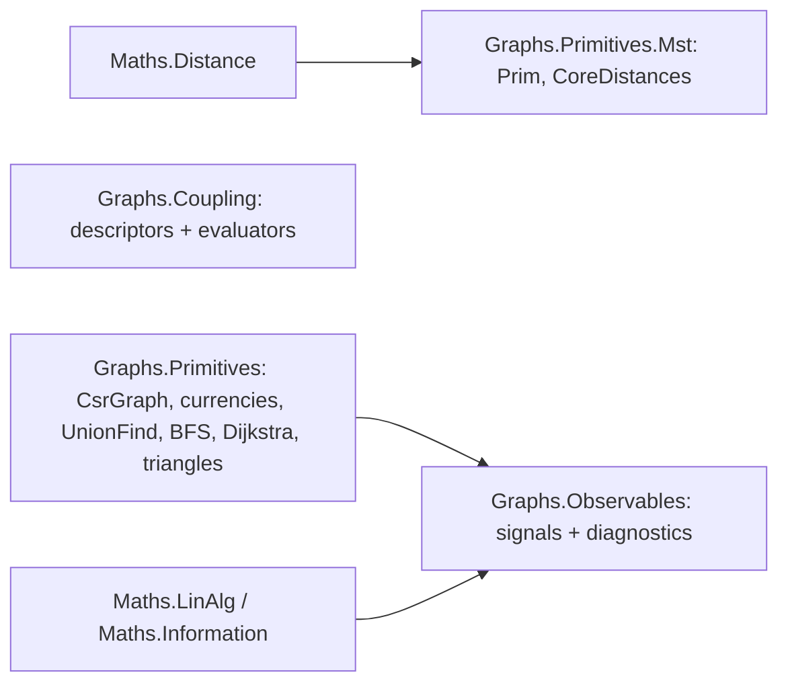

# Graph Substrate

> The shared graph layer underneath every graph method in ThermoMapper. It defines the symmetric compressed-sparse-row graph (`CsrGraph`) and its slot-keyed per-edge fields; the per-edge "currencies" that samplers produce; classical algorithms (union–find, BFS, bounded Dijkstra, triangle counting, three MST variants, core distances); coupling kernels that turn distances into edge weights; and observables that reduce edge fields to per-node signals and graph diagnostics. · **Projects:** `Graphs.Primitives` (incl. `.Mst`, `.Traversal`), `Graphs.Coupling`, `Graphs.Observables` · **Maturity:** core

## Overview

These projects sit at layers 0–4 of the [architecture](./Architecture.md). `Graphs.Primitives` depends only on [`Maths.Distance`](./DistanceMetrics.md). `Graphs.Coupling` imports nothing project-internal. `Graphs.Observables` adds `Maths.LinAlg` and `Maths.Information`. Almost every other graph or clustering module consumes them: [graph construction](./GraphConstruction.md), [spectral analysis](./SpectralGraphs.md), [SPC](./SpcEngine.md), [HDBSCAN](./Hdbscan.md), [dendrograms](./ClusterResolution.md), [persistent homology](./PersistentHomology.md) and [Mapper](./Mapper.md).

## Key concepts

- **CSR graph.** Every undirected edge is stored twice, once in each endpoint's row, with the same weight. Rows are **not sorted**.
- **Slots.**
  - A *slot* is an index into `Targets`/`Weights`, i.e. one directed half-edge.
  - The *upper-half* (j > i) slot, where row `i` has `Targets[e] > i`, is the canonical slot of an undirected edge.
  - The *mirror* slot is the reverse half-edge.
- **Per-edge field.** A `double[]` of length `Targets.Length`, indexed by slot. Values are meaningful only at upper-half slots.
- **Currency.** A per-edge field at one temperature, produced by a sampler and consumed by partition steps and signals. There are three:

| Currency | Meaning | Produced by |
|---|---|---|
| `Affinities` | bond activity / edge-survival strength $G_{ij}\in[0,1]$ | every sampler (universal) |
| `Alignments` | spin agreement $\langle\delta(\sigma_i,\sigma_j)\rangle$ | Swendsen–Wang only |
| `CoMembership` | same-cluster frequency $\langle n_{ij}\rangle$ | Swendsen–Wang only |

- **Coupling vs length.** `Edge.J` is documented as a coupling, i.e. a similarity where larger means closer, and most consumers read it that way. `Dijkstra` reads the same field as an additive length. See [Concepts](./Concepts.md#edge-weights-distance-coupling-affinity).

## Design

**Slot-keyed fields and the j > i idiom.** Every per-edge array has length `Targets.Length`, and only upper-half slots carry values.

- The hand-written loop `for i; for e in row i; if Targets[e] <= i continue` appears in several places: `EdgeFieldSymmetrization`, `AffinityDegree`, `AffinityBinaryEntropySum`, `AlignmentEigenCentrality`, `EdgeWeights` and `Connectivity`.
- It is packaged as the allocation-free `UndirectedEdgeWalk` (`graph.UndirectedEdges()`). Hot sampler loops deliberately keep their hand-written versions.

**Currency seam.**

- Producers emit `sealed record`s, each with `Temperature`, `G` and `ReplicaIndex`. `CoMembership` also carries `Q`.
- Consumers never depend on which producer minted a currency.
- `IGraphSignal<in TCurrency>` is contravariant. Its implementations are distinct measurements, not interchangeable strategies.

**Descriptor vs evaluator (coupling).** Kernel descriptors are parameter-carrying `readonly record struct`s that serialize through one polymorphic JSON declaration. The mathematics lives in static `*Kernel.Evaluate(distance, delta)` methods (`GaussianKernel`, `LaplacianKernel`, `CauchyKernel`, `LinearKernel`) and `MixtureKernel.Evaluate(distance, MixtureBandwidth, MixtureWeights)`, called directly without virtual dispatch. **A bandwidth of 0 on a descriptor means "estimate automatically"**. That estimate is made upstream, in [graph construction](./GraphConstruction.md#bandwidth-estimation).

**Caller-owned scratch.** `Prim` works entirely in caller-supplied spans and `Dijkstra` in caller-supplied spans plus a caller-supplied `PriorityQueue<int, double>`, and `UnionFind.WriteRootSizesTo` allocates nothing, so all three can reuse per-thread buffers under `Parallel.For`. `CoreDistances` writes into a caller span but allocates one buffer of size `minPts` per call.

**Report records with sentinels.** Diagnostics return small `readonly record struct` reports and signal a size gate with sentinel values instead of throwing.

- `AlgebraicConnectivityReport` has a `Computed` flag.
- `Cycles` has no such flag. When its size gate trips, `TriangleCount`, `Girth` and `MaxCycleLength` are −1 and `TriangleSaturation` and `MeanCycleLength` are NaN. A girth of −1 can also mean the graph is acyclic, or that no cycle of length ≥ 3 was found.

**Extension points.** New kernel: a descriptor, an evaluator and a JSON derived-type registration; the dispatching scaler lives in graph construction. New signal: implement `IGraphSignal<TCurrency>`.

## API at a glance

| Area | Entry points |
|---|---|
| CSR graph | `Edge`; `CsrGraph` (`FromEdges`, `Degree`, `WeightedDegree`, `FindSlot`, `BuildReverseSlotMap`, `InducedSubgraph`, `WriteTo` / `FromBinary`); `UndirectedEdges()` → `UndirectedEdge(Source, Target, Slot)`; `EdgeFieldSymmetrization` + `SymmetrizationRule` |
| Currencies | `Affinities`, `Alignments`, `CoMembership` |
| Algorithms | `UnionFind`; `BfsShells` → `BfsShellsResult` (`Distances`, `Shells`, `SeedNode`, `MaxDepth`, `ReachableNodeCount`); `BoundedMinHeap` over `Neighbor`; `TriangleCount.OnCsrGraph`; `Statistics`; `Dijkstra.ComputeBoundedDistances` (plus a target-mask overload) |
| MST | `Prim.ComputeMutualReachabilityMst<TMetric>`; `Boruvka.AddMinimalBridges` → `BridgeEdge` list; `Kruskal.BuildMinimumSpanningTree`; `CoreDistances.Compute<TMetric>`; `MstEdge` |
| Coupling | `Gaussian`, `Cauchy`, `Laplacian`, `Linear` (each `Bandwidth = 0`), `Mixture` (+ `MixtureWeights`, `MixtureBandwidth`); `*Kernel.Evaluate`; `Kernels.*` factories |
| Observables | signals `AffinityDegree`, `AffinityBinaryEntropySum`, `AlignmentEigenCentrality` (`IGraphSignal<T>`); `AffinityNodeMarginals`, `AffinityEntropy`, `ClusterSizeEntropy`, `LinkOverlap`; diagnostics `Connectivity`, `Degree`, `EdgeWeights`, `Cycles`, `AlgebraicConnectivity` |

## Algorithms

### CSR construction and slot machinery

- **`FromEdges`** is a counting sort. It counts degrees, prefix-sums them into `RowPointers`, and writes each edge into both endpoint rows. Rows keep input order. There is no sorting or deduplication, and no range or self-loop check; a self-loop is stored twice. Cost is $O(N+E)$.
- **`FindSlot`** scans a row linearly and throws if the target is absent. **`BuildReverseSlotMap`** (the mirror map) calls it for every slot, so it costs $O(\sum_v\deg(v)^2)$.
- **`InducedSubgraph`** renumbers the surviving nodes densely and copies their rows in four $O(N+E)$ passes. It returns `oldToNew` (−1 for dropped nodes) and `newToOld`.
- **`EdgeFieldSymmetrization`** reconciles a directed per-edge field into its upper-half slots. It uses $\min$ for `Mutual` (the AND rule), $\max$ for `Inclusive` (the OR rule, close to single linkage) and the mean for `Mean`.

### Classical algorithms

| Algorithm | Behavior | Cost |
|---|---|---|
| `UnionFind` | Full path compression; union by size. `Reroot` assigns HDBSCAN dendrogram ids. `Reset` supports reuse across sweeps | amortized $O(\alpha(N))$ |
| `BfsShells` | Level-synchronous BFS; `Distances[i] = −1` for unreached nodes; `Shells[d]` holds the nodes at hop d; optional `maxDepth` | $O(N+E)$ |
| `Dijkstra` (bounded) | Lazy-deletion Dijkstra on `Weights` as lengths (negative weights clamped to 0). A settled node with hops ≥ `maxHops` or distance ≥ `maxDistance` is not expanded, so hop counts never exceed `maxHops` but recorded distances can exceed `maxDistance` by one edge. The hop cap prunes the shortest-*distance* tree; it is not a hop-constrained shortest path. The target-mask overload stops once every target is settled | $O(\vert\text{scratch}\vert+E\log E)$ |
| `TriangleCount` | Sorts row copies, then counts common neighbors $w>v>u$ by merging | $O(\sum_v d_v^2)$ worst case |
| `BoundedMinHeap(k)` | Despite the name, a **max-heap** of the k smallest distances seen so far. `GetSorted` returns them in ascending order | $O(\log k)$ per insert |

### Minimum spanning trees and core distances

- **`Prim`** (implicit, matrix-free) builds the HDBSCAN mutual-reachability MST with edge weight $\max(\mathrm{core}_u,\mathrm{core}_v,d(u,v))$. It is seeded at node 0 and makes exactly $N(N-1)/2$ distance calls, for $O(N^2\cdot\text{dim})$ time. It makes no explicit allocations. Its inner call is the interface's default `ref`/dimension overload, so whether the JIT avoids boxing there is not established.
- **`Boruvka.AddMinimalBridges`** takes a union–find pre-seeded with components. It adds the cheapest edge leaving each component, phase by phase, which yields the MST of the component quotient graph. It needs at most $\lceil\log_2C_0\rceil$ phases of $O(N^2)$ pair scans. The full-MST variant is not exposed.
- **`Kruskal`** scans a caller-sorted edge span with a union–find cycle check and returns the number of edges accepted. Fewer than N−1 means the result is a spanning forest. It neither sorts nor checks the input order.
- **`CoreDistances`** gives each point's distance to its `minPts`-th nearest *other* point, by a brute-force scan, in $O(n^2(\text{dim}+\text{minPts}))$.

### Coupling kernels

With distance d and bandwidth δ:

$$K_G=e^{-d^2/(2\delta^2)},\qquad K_C=\frac{1}{1+d^2/\delta^2},\qquad K_L=e^{-d/\delta},\qquad K_{\mathrm{Lin}}=\max(0,1-d/\delta).$$

The mixture is $J=w_GK_G(d;\delta_G)+w_CK_C(d;\delta_C)+w_LK_L(d;\delta_L)$. The weights are not normalized, and there is no linear component. The evaluators have **no δ guard**: with δ = 0 they return 0 for d > 0 and NaN at d = 0. The 0 sentinel must therefore always be resolved before evaluation.

### Observables

**Per-node signals.** Each reads only the upper-half slot. The three sums add its value to both endpoints; eigen-centrality mirrors it into a dense symmetric matrix.

| Observable | Definition |
|---|---|
| `AffinityDegree` (also `AffinityNodeMarginals.BondMass`) | $D_i=\sum_{j\in N(i)}G_{ij}$ |
| `AffinityBinaryEntropySum` | $V_i=\sum_jH_2(G_{ij})$, in bits |
| `AffinityNodeMarginals.LocalEnergy` | $E_i=\sum_jJ_{ij}(1-G_{ij})$, the frustration field |
| `AlignmentEigenCentrality` | top eigenvector of $A$ with $A_{ii}=1$ and $A_{ij}=G_{ij}$ on edges, sign-fixed so that $\sum_iv_i\ge0$. Dense; $O(N^2)$ memory |

**Scalar entropies.** `AffinityEntropy` computes the Shannon entropy of the normalized G over **all** slots. It therefore relies on the mirror slots being zero. `ClusterSizeEntropy` computes the entropy of a histogram of cluster sizes. Both are in nats.

**Partition comparison.** `LinkOverlap.Compute(graph, a, b, weighted = false)` compares two node labelings on the graph's edges: $Q=\sum_e w_e[\text{same}_a(e)=\text{same}_b(e)]/\sum_e w_e$, with $w_e=1$ or the coupling when `weighted`. It is the spin-glass link overlap of two Potts states (Hed and Domany 2007): it compares where two partitions draw their boundaries, and on the complete graph it equals the Rand index. Uses include two methods, two settings, two sampler replicas at one temperature, or a result against a reference. A negative label marks an unplaced node, and an edge touching one in either labeling is not counted, so Q is symmetric; it is 0 when no edge counts.

**Structural diagnostics.**

- **`Connectivity.Validate`** returns components, isolated nodes and the largest-component coverage.
- **`Degree.Distribution`** reports the distribution of row counts. `IsolatedCount` counts degree 0 and `UndersampledCount` counts degree 1.
- **`EdgeWeights.Summary`** returns the count, min, max, mean and median over upper-half slots, and `NearZeroBridges`.
- **`AlgebraicConnectivity`** computes λ₂ of the dense $L=D-W$. It is gated at 2,000 nodes.
- **`Cycles`** computes the cyclomatic number, triangles and girth; lengths are taken from BFS fundamental cycles. It is gated at 5,000 nodes. The minimum over all BFS roots is the exact girth on simple graphs. `MaxCycleLength` and `MeanCycleLength` are taken over the set of *distinct* closure lengths found from all BFS roots (each length counted once), so the mean is not a per-cycle average.

## Configuration

| Setting | Default | Meaning |
|---|---|---|
| Kernel `Bandwidth` (all descriptors, `Kernels.*`) | 0.0 | Estimate automatically; > 0 sets δ explicitly |
| `Mixture` weights and bandwidths | 0.0 each | A weight of 0 switches the component off |
| `Dijkstra` maxDistance / maxHops | +∞ / `int.MaxValue` | Expansion bounds |
| `BfsShells` maxDepth | null | Unbounded |
| `AlgebraicConnectivity` maxNodesForDense / weakThreshold | 2000 / 1e-6 | Dense gate; weak-connectivity cut |
| `AlignmentEigenCentrality` MaxSweeps / Tolerance | 256 / 1e-12 | Jacobi controls |
| `Cycles` maxNodesForCycleStats | 5000 | Size gate |
| `EdgeWeights` nearZeroEpsilon | 1e-10 | Near-zero bridge cut |
| `Statistics` variance floor | 1e-12 | Skewness returns 0 below it |

## Status and caveats

- **Self-loops are handled inconsistently.** `FromEdges` stores a self-loop twice, and `Degree` counts it twice. The j > i walks skip it. `Connectivity.EdgeCount` includes it but `EdgeWeights.EdgeCount` does not, and `AlgebraicConnectivity` adds it to the Laplacian diagonal. Avoid self-loops.
- **Duplicate edges in `AlgebraicConnectivity`.** It assigns off-diagonal Laplacian entries rather than accumulating them, while degrees accumulate every weight.
- **Eigen-centrality assumes a connected graph.** On a disconnected graph the top eigenvalue can be degenerate, and the sign convention becomes arbitrary.
- **Mixture sentinel.** If explicit and auto (0) bandwidths are mixed in a `Mixture`, `ToLegacy` passes the zeros through. A δ = 0 component then yields NaN at d = 0, even when its weight is 0.
- **Core-distance convention.** `CoreDistances` excludes the point itself, so `minPts = m` here corresponds to `min_samples = m + 1` in the common HDBSCAN libraries. `minPts = n` yields +∞.

## Source map

| Role | Files (`ThermoMapper/src/graphs/`) |
|---|---|
| CSR and fields | `primitives/CsrGraph.cs`, `UndirectedEdgeWalk.cs`, `EdgeFieldSymmetrization.cs`, `SymmetrizationRule.cs`, `Neighbor.cs` |
| Currencies | `primitives/Affinities.cs`, `primitives/Alignments.cs`, `primitives/CoMembership.cs` |
| Algorithms | `primitives/UnionFind.cs`, `primitives/BfsShells.cs`, `primitives/BoundedMinHeap.cs`, `primitives/TriangleCount.cs`, `primitives/Statistics.cs`, `primitives/traversal/Dijkstra.cs`, `primitives/mst/Prim.cs`, `primitives/mst/Boruvka.cs`, `primitives/mst/Kruskal.cs`, `primitives/mst/CoreDistances.cs`, `primitives/mst/MstEdge.cs` |
| Coupling | `coupling/Gaussian.cs`, `coupling/Cauchy.cs`, `coupling/Laplacian.cs`, `coupling/Linear.cs`, `coupling/Mixture.cs`, `coupling/MixtureTypes.cs`, `coupling/Kernels.cs`, `coupling/IKernelDescriptor.cs` |
| Observables | `observables/*.cs` (13 files) |

**See also:** [Concepts](./Concepts.md) · [DistanceMetrics](./DistanceMetrics.md) · [GraphConstruction](./GraphConstruction.md) · [SpcEngine](./SpcEngine.md) (currency producers)
