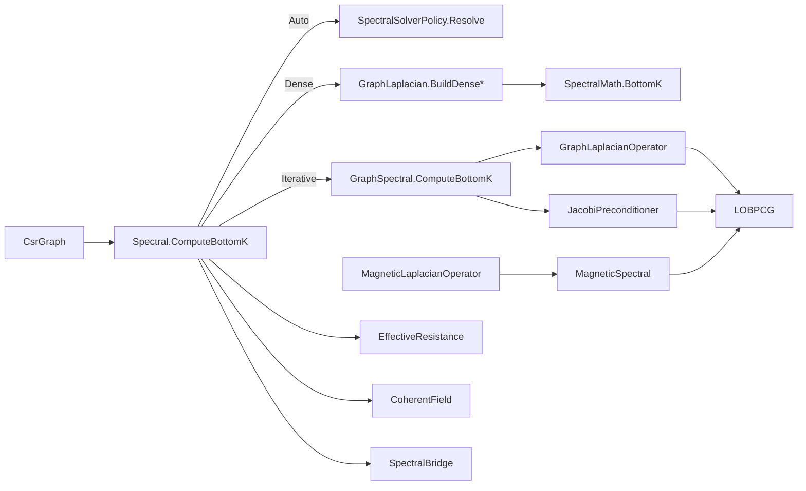

# Spectral Graphs

> Turns a symmetric weighted graph (`CsrGraph`) into spectral objects. It provides combinatorial and normalized Laplacians, either materialized or matrix-free; bottom-k eigenpairs through a dense or an iterative route, chosen by the caller or, under `Auto`, by a size policy; a magnetic Laplacian that is sensitive to edge orientation; effective resistance; and three visualization-oriented adapters. · **Project:** `Graphs.Spectral` (namespace `Graphs.Spectral`) · **Maturity:** core

## Overview

`Graphs.Spectral` sits in layer 4 of the [architecture](./Architecture.md). It builds on `Graphs.Primitives` for the CSR graph and on [LinearAlgebra](./LinearAlgebra.md) for the eigensolvers. Its consumers:

| Consumer | Uses |
|---|---|
| [PersistentHomology](./PersistentHomology.md) | effective resistance as a filtration metric |
| [Mapper](./Mapper.md) | the Fiedler-vector lens (`FiedlerVectorFilter`) |
| Visualization API (outside the documented scope) | `SpectralBridge.LineFieldFromFiedler` (which calls `Spectral`) |

`CoherentField` and `GraphLaplacianSmoother` are complete but currently have no callers in the repository. The magnetic operator is exercised only by tests.

## Key concepts

- **Laplacian type.** `LaplacianType.Combinatorial` is $L=D-W$. `LaplacianType.NormalizedSymmetric` is $L=I-D^{-1/2}WD^{-1/2}$.
- **Weight clamp.** `GraphLaplacian` and `GraphLaplacianOperator` treat a non-positive weight as 1.0 in degrees, and in the combinatorial off-diagonal as well: $\tilde w=w$ if $w>0$, else $1$. `GraphLaplacianSmoother` and `SpectralBridge` use raw weights, and the magnetic operator ignores weights.
- **Trivial (null) mode.** The $\lambda\approx0$ eigenvector. For the combinatorial Laplacian it is the constant vector. For the normalized Laplacian it is $D^{1/2}\mathbf 1$. The latter is an **exact** null vector only when every edge weight is positive; see [Status](#status-and-caveats).
- **Bottom-k route.** *Dense* materializes the $n\times n$ Laplacian and runs a full decomposition. *Iterative* runs LOBPCG on a matrix-free operator. *Auto* chooses between them by a fixed policy.
- **Magnetic Laplacian.** A Hermitian operator in which each edge carries a phase $e^{i\,2\pi q\,\Theta_e}$. Cycles then become sensitive to edge orientation, measured by their *flux*.

## Design

**Lockstep construction.** `GraphLaplacian`, the dense builder, and `GraphLaplacianOperator`, the matrix-free operator, deliberately repeat the same clamping rules, so both routes see the same matrix. Floating-point products in the normalized path are grouped differently, so the results agree to rounding error, not bit for bit.

**Graph concerns are wired in through the LOBPCG seam.** `GraphSpectral.ComputeBottomK` passes three things to the graph-agnostic LOBPCG primitive:

- the operator;
- a Jacobi preconditioner (`Options.Preconditioner`);
- optionally a single null vector (`Options.Constraints`).

**Single tuning point.** `SpectralSolverPolicy.Resolve(n, k)` is the only place the Auto decision is made.

**Magnetic operator as an embedding.** The Hermitian operator is applied through a real $2n\times2n$ symmetric embedding, so the real-valued LOBPCG can solve it unchanged.

## API at a glance

| Area | Entry points |
|---|---|
| Bottom-k | `Spectral.ComputeBottomK(graph, seed = 0, k = 8, lapType, solverKind, …)` → `IReadOnlyList<EigenPair>`; `GraphSpectral.ComputeBottomK(graph, k = 8, maxIter, tol, lapType, seed = 12345, deflateNullSpace)` → `LOBPCG.Result` |
| Laplacians and policy | `GraphLaplacian.BuildDense`, `BuildDenseColumnMajor`; `GraphLaplacianOperator` (`Apply`, `Degree`, `InverseSqrtDegree`); `JacobiPreconditioner`; `SpectralSolverPolicy.Resolve`; enums `LaplacianType`, `DenseLaplacianMaterialization`, `SolverKind` |
| Magnetic | `MagneticLaplacianOperator` (constructor, `FromDirectedEdges`, `FromBackboneAndChords`, `Apply`, `ToDenseEmbedding`, `EdgePhase`, `EnclosedFlux`); `MagneticSpectral.BottomKEigenvalues` |
| Effective resistance | `EffectiveResistance.ComputeEigenpairs`, `Pair`, `BuildEdgeWeights` |
| Visualization adapters | `CoherentField.Build`, `SpectralBridge.LineFieldFromEigenvector` / `LineFieldFromFiedler`, `GraphLaplacianSmoother.Smooth` / `AutoLambda` |

## Algorithms

### Laplacians

Let $w_e$ be the raw weight of CSR slot $e=(i\to t)$, $\tilde w_e$ the clamped weight, and $d_i=\sum_{e\in\text{row }i}\tilde w_e$ the clamped degree.

- **Combinatorial.** $L_{ii}=d_i$ and $L_{it}\mathrel{-}=\tilde w_e$. Because entries accumulate, duplicate slots add up, and a self-loop subtracts from the diagonal.
- **Normalized.** $L_{ii}=1$ and $L_{it}\mathrel{-}=w_e\,d_i^{-1/2}d_t^{-1/2}$, using the **raw** weight with **clamped** degrees. If $d_i\le10^{-12}$ then $d_i^{-1/2}:=0$, so an isolated node gets an identity row and contributes eigenvalue 1, not 0.
- **Dense storage.** `BuildDense` writes a `double[,]`. `BuildDenseColumnMajor` writes $L_{it}$ at `destination[t*n+i]`. Both cost $O(n^2+\text{nnz})$.

**Matrix-free application.** `GraphLaplacianOperator.Apply` computes the same matrix without allocating:

- combinatorial: $(Lx)_i=d_ix_i-\sum_e\tilde w_e x_t$;
- normalized: $(Lx)_i=x_i-d_i^{-1/2}\sum_e w_e d_t^{-1/2}x_t$.

It costs $O(\text{columns}\cdot(n+\text{nnz}))$.

**Jacobi preconditioner.** $(Mr)_i=r_i/d_i$ for the combinatorial Laplacian, with $d<10^{-12}$ treated as 1. For the normalized Laplacian it is the identity, because the diagonal is already 1.

### Choosing and running a route

**Auto policy.** `SpectralSolverPolicy.Resolve` returns `Iterative` if and only if $n\ge256$ and $1\le k\le32$; otherwise `Dense`. The code's remarks attribute these thresholds to a benchmark crossover.

**`Spectral.ComputeBottomK`** handles the three route values as follows:

- **Defaults:** `k` = 8, `Combinatorial`, `SolverKind.Dense`, `Rectangular` materialization, `seed` = 0.
- **Dense:** materialize, then `SpectralMath.BottomK`. This runs the full decomposition and then selects K pairs. It returns min(k, n) pairs.
- **Iterative:** calls `GraphSpectral.ComputeBottomK` with `deflateNullSpace: false`, 300 iterations and tolerance 1e-9. It returns only the eigenpairs; the convergence flag is dropped. It returns min(k, n−1) pairs.

**`GraphSpectral.ComputeBottomK`** defaults to `k` = 8, 300 iterations, tolerance 1e-9, seed 12345, and `deflateNullSpace: true`. It deflates **one** null vector: $\mathbf 1/\sqrt n$, or $D^{1/2}\mathbf 1$ normalized. On a graph with c components, the other c−1 near-zero modes remain in the output.

### Magnetic Laplacian

$$\big(L^{(q)}z\big)_i=D_i z_i-\sum_{e=(i\to j)} e^{i\theta_e}z_j,\qquad \theta_e=2\pi q\,\Theta_e,\quad \Theta_e\in\{+1,-1,0\}.$$

**Operator properties.**

- $D_i$ is the **unweighted** degree (the row length), and edge magnitudes are 1: CSR weights are ignored.
- Hermitian symmetry requires $\Theta_{j\to i}=-\Theta_{i\to j}$. The constructor checks only the array length, not this antisymmetry.
- Because $\Theta$ is an integer, the operator is 1-periodic in q.

**Real embedding.** With $H=A_{re}+iB_{im}$, `Apply` streams the real symmetric matrix $\begin{bmatrix}A_{re}&-B_{im}\\B_{im}&A_{re}\end{bmatrix}$, laying out each column as $[x;y]$, so `Dimension` = 2n. Every eigenvalue of H appears in the embedding with **doubled multiplicity**. `ToDenseEmbedding` is a dense version of `Apply`, and matches it only for simple graphs: with no self-loops and no duplicate slots. For such slots, the dense builder assigns entries where `Apply` accumulates them.

**Factories.** `FromDirectedEdges` and `FromBackboneAndChords` build a unit-weight symmetric CSR and set $\Theta=+1$ on each `from→to` slot and $-1$ on its reverse. Chords get $\Theta=0$.

**Spectrum and flux.**

- `MagneticSpectral.BottomKEigenvalues` solves for 2k pairs and keeps the entries at even positions. The result is the **k smallest eigenvalues of $L^{(q)}$, counted with multiplicity** (not de-duplicated). It is valid only if LOBPCG converged, which the method does not check.
- `EdgePhase(u, v)` $=2\pi q\,\Theta_{u\to v}$.
- `EnclosedFlux(walk)` $=q\sum\Theta$ around a closed walk.

### Effective resistance

$$R_{\text{eff}}(i,j)=\sum_{\lambda_k>10^{-12}}\frac{\big(\varphi_k(i)-\varphi_k(j)\big)^2}{\lambda_k},\qquad R_{\text{eff}}=+\infty\ \text{across components}.$$

**Exact or approximate.** With every nonzero mode this equals $(e_i-e_j)^\top L^+(e_i-e_j)$, the standard effective resistance for the combinatorial Laplacian (the default). With only the bottom K modes it is a **lower bound** that keeps the terms with the largest $1/\lambda$ weights.

**Adaptive K** (`ComputeEigenpairs`):

- **Growth.** Start at $\min(8,\text{cap})$ with $\text{cap}=\min(n,\text{kMax})$. Grow to $\min(\max(k+8,2k),\text{cap})$ until $\lambda_1^+/\lambda_K\le\varepsilon$, where $\lambda_1^+$ is the smallest eigenvalue above $10^{-12}$ and $\lambda_K$ the largest in the set.
- **No non-trivial mode.** Growth also stops when the current set has no eigenvalue above $10^{-12}$, for example on a graph with at least K components. Every within-component $R_{\text{eff}}$ is then 0.
- **Defaults.** $\varepsilon$ = 1e-2, kMax = 256.
- **What the rule bounds.** It limits the weight of the last *included* term. It does not bound the omitted tail.
- **Cost of growth.** Each growth step recomputes from scratch, and under Auto the route can switch from Iterative to Dense as K passes 32.

**Per-edge weights.** `BuildEdgeWeights` returns $R_{\text{eff}}$ for each undirected edge in canonical `(u < v)` order, and computes component ids internally. `Pair` needs component ids **from the caller**, and the class offers no public way to compute them.

### Visualization adapters

- **`CoherentField.Build`** maps each node to a point on $S^{\text{fieldDim}-1}$, defined up to a per-mode sign. A node whose packed row has squared norm ≤ $10^{-12}$ is left unnormalized, and components with no available non-trivial mode stay 0:
  1. Drops the leading modes with $\lambda<10^{-7}$.
  2. Packs the next `fieldDim` eigenvectors into a row-major N×fieldDim buffer.
  3. Normalizes each node's row to unit length.

  The sum of squares is unrolled for fieldDim 2 and 3. The scaling step uses `Vector256` when fieldDim ≥ 4.
- **`SpectralBridge`** computes $v_i=\sum_{e=(i\to j)}w_e(\varphi_j-\varphi_i)(p_j-p_i)$ and normalizes it.
  - This weighted first-moment vector is a *proxy* for the direction of the ambient gradient of φ. It is exact only for isotropic neighborhoods.
  - It is signed, following the arbitrary sign of the eigenvector.
  - `LineFieldFromFiedler` uses the second pair from a k = 2 solve. On a disconnected graph that pair is another null mode, not a Fiedler vector.
- **`GraphLaplacianSmoother`** solves $(I+\lambda L)X=X_0$, the minimizer of $\|X-X_0\|_F^2+\lambda\operatorname{tr}(X^\top LX)$, for N×3 layouts.
  - $L=D-W$ uses **raw** weights, unlike `GraphLaplacian`, which clamps them.
  - It runs three conjugate-gradient recurrences that share one CSR traversal per iteration.
  - It stops at an absolute tolerance of 1e-6 or after 300 iterations.
  - `AutoLambda` = $0.1/\text{median}^2$ of the edge lengths, taken over all CSR slots.

## Configuration

| Setting | Default | Meaning |
|---|---|---|
| `Spectral.ComputeBottomK` k / lapType / solverKind / materialization / seed | 8 / `Combinatorial` / `Dense` / `Rectangular` / 0 | — |
| `SpectralSolverPolicy.IterativeMinNodes` / `IterativeMaxK` | 256 / 32 | Auto chooses Iterative iff n ≥ 256 and 1 ≤ k ≤ 32 |
| `GraphSpectral.ComputeBottomK` k / maxIter / tol / seed / deflateNullSpace | 8 / 300 / 1e-9 / 12345 / true | — |
| Degree floor | 1e-12 | $d^{-1/2}:=0$; the Jacobi preconditioner uses d := 1 |
| `EffectiveResistance` tail ε / kMax / zero-mode cutoff / initial K | 1e-2 / 256 / 1e-12 / 8 | — |
| `EffectiveResistance.ComputeEigenpairs` seed / solverKind | 0 / `Auto` | — |
| `CoherentField.Build` fieldDim / basisK / solverKind / seed | 2 / 8 / `Auto` / 0 | Modes with λ < 1e-7 are treated as trivial |
| `SpectralBridge.LineFieldFromFiedler` seed / solverKind | 0 / `Auto` | Uses k = 2 |
| `GraphLaplacianSmoother.Smooth` maxIter / tol | 300 / 1e-6 | Absolute residual |

## Status and caveats

- **Default seeds and the iterative route.** `Spectral.ComputeBottomK`, `EffectiveResistance.ComputeEigenpairs`, `CoherentField.Build` and `SpectralBridge.LineFieldFromFiedler` all default to `seed = 0`, and pass that seed to LOBPCG on the iterative route. LOBPCG rejects seed 0. When the solver is (or resolves to) Iterative, so $n\ge256$ and $k\le32$ under Auto, these calls throw unless you pass a nonzero seed. The Mapper Fiedler lens (`FiedlerVectorFilter`, which hard-codes seed 0 with `Auto`) and `EffectiveResistanceWeights.FromGraph` (default seed 0) fail the same way on graphs with $n\ge256$.
- **Normalized null vector.** $D^{1/2}\mathbf 1$ is built from clamped degrees, but the normalized off-diagonal uses raw weights. If any edge weight is ≤ 0, the deflated vector is not an exact eigenvector.
- **Disconnected graphs.** Only one null vector is deflated, so each extra component contributes a further near-zero mode to the "non-trivial" output.
- **Convergence is not always reported.** The iterative branch of `Spectral.ComputeBottomK` and `MagneticSpectral.BottomKEigenvalues` do not surface LOBPCG's `Converged` flag.
- **Smoother with a zero coordinate axis.** `GraphLaplacianSmoother` produces NaN for an identically zero coordinate axis, such as z ≡ 0 in a planar layout.

## Source map

| Role | Files (`ThermoMapper/src/graphs/spectral/`) |
|---|---|
| Laplacians, operators, policy | `GraphLaplacian.cs`, `GraphSpectralOperators.cs`, `SpectralSolverPolicy.cs`, `Spectral.cs` |
| Magnetic Laplacian | `MagneticLaplacianOperator.cs` |
| Effective resistance | `EffectiveResistance.cs` |
| Visualization adapters | `CoherentField.cs`, `SpectralBridge.cs`, `GraphLaplacianSmoother.cs` |

**See also:** [LinearAlgebra](./LinearAlgebra.md) · [GraphSubstrate](./GraphSubstrate.md) (`CsrGraph`) · [PersistentHomology](./PersistentHomology.md) (effective-resistance filtrations) · [Mapper](./Mapper.md) (Fiedler lens)
