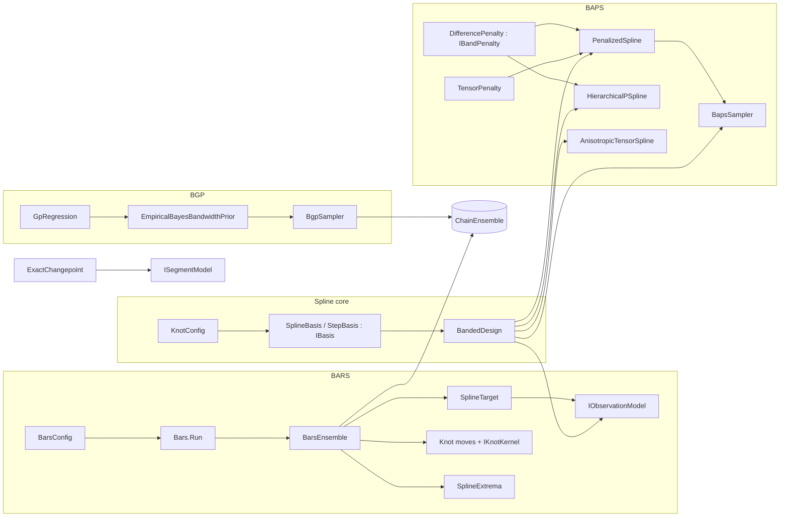

# Bayesian Regression

> Four Bayesian smoothing families that share one strategy: exploit Gaussian conjugacy in the regression coefficients (integrating them out, or drawing them from closed-form conditionals), then sample or select the remaining hyperparameters. **BARS** fits free-knot splines by reversible-jump MCMC. **BAPS** fits penalized splines (P-splines), including hierarchical and bivariate variants. The **Bayesian GP (BGP)** samples a kernel bandwidth under an empirical-Bayes prior. The **exact changepoint** model computes a piecewise-constant regression by dynamic programming. · **Project:** `Maths.Regression` (areas `spline/`, `spline/bars/`, `spline/baps/`, `bgp/`, `changepoint/`) · **Maturity:** core (see [Status](#status-and-caveats))

## Overview

`Maths.Regression` sits in layer 3 of the [architecture](./Architecture.md). It builds on:

- [Samplers](./Samplers.md): the reversible-jump engine and the ensemble shell;
- [LinearAlgebra](./LinearAlgebra.md): banded LDLᵀ and dense Cholesky;
- [ProbabilityAndInformation](./ProbabilityAndInformation.md): generators, the Gamma and Beta distributions, log-gamma.

The domain use visible in the code is **locating transitions in a curve over a thermal grid**: where it peaks, how many peaks it has, and where it changes level. BARS, for example, reduces each posterior curve to its exact peak and to significant-peak spans.

## Key concepts

- **Marginalize, then sample.**
  - BARS integrates out the spline coefficients (and, for the Normal model, the noise scale) and samples the *number and positions* of knots.
  - BAPS integrates the coefficients out in `MarginalEvidence` mode and in REML selection, and samples or selects the smoothing strength λ. Its `Gibbs`/`AdaptiveGibbs` modes and `HierarchicalPSpline` instead draw β from closed-form Gaussian conditionals, jointly with the variance components.
  - BGP integrates out the regression function and samples the bandwidth t.
- **Knot configuration.** The pair $(k,\xi)$: k interior knots $\xi_1<\dots<\xi_k$ in the open interval $(0,1)$. The domain is fixed to $[0,1]$, so inputs and evaluation grids must be pre-scaled.
- **Basis, design and band storage.** A basis turns a knot configuration into an $m\times\nu$ design matrix Z. Every model forms $Z^\top WZ$ in LAPACK lower-band storage (`band[d, j] = A(j+d, j)`) and factors it with band LDLᵀ. The dense $\nu\times\nu$ matrix is never formed.
- **Readouts.** Per-draw summaries pooled across draws and chains: fitted grid values, knot count, the exact argmax, **peak intensity** λ(T) (expected significant peaks per grid cell) and **span coverage** π(T) (the posterior expected number of significant-peak spans covering T: a probability when a draw's spans do not overlap, which nested peaks can violate).

## Design

**BARS is a declarative config plus a strict core.** `BarsConfig` is an immutable record whose defaults are component instances. `Bars.Run(config, x, y, grid)` maps it onto a `BarsEnsemble`. The components plug in through interfaces:

| Seam | Implementations |
|---|---|
| `IBasis` | `SplineBasis` (clamped B-splines), `StepBasis` (piecewise constant) |
| `IObservationModel` | `WeightedNormalModel` (default), `PoissonModel`, `WhittleModel`, `GibbsLossModel` |
| `IComplexityPrior` | `UniformPrior`, `PoissonPrior` (default λ = 5), `EbicPrior` |
| `IKnotKernel` | `UniformKernel`, `LocalBetaKernel` (default τ = 50), `AdaptiveLocalBetaKernel` |
| `IWeightResampler` (optional) | `StudentTWeights`, `ContaminatedNormalWeights` |

`Bars.Run` passes only basis, model, prior, kernel and robustness settings. The DMGK move schedule and parallel tempering are reachable only by constructing `BarsEnsemble` directly. Per-chain adaptive τ (`adaptKernelTau`) is also a constructor option; see [Status](#status-and-caveats) for the other route.

**Three orchestration styles coexist.**

- `BarsEnsemble` and `BgpSampler` are clients of the ensemble shell `ChainEnsemble` (parallel replicas, R̂ and ESS on functionals).
- `BapsSampler` runs its own `Parallel.For` over seed-tree seeds and calls `ChainDiagnostics.RHat` on ln λ. It computes no ESS.
- `HierarchicalPSpline` runs a single chain with no diagnostics.

**Precompute invariants.**

- `GpRegression` caches pairwise squared distances.
- `BapsSampler` (Gibbs modes), `HierarchicalPSpline` and `AnisotropicTensorSpline` cache $Z^\top Z$ and $Z^\top y$. `PenalizedSpline`, and hence `BapsSampler`'s `MarginalEvidence` mode, re-assembles and refactors on every call (three solves per recorded step).
- `PenalizedSpline` re-assembles and refactors on every call.

**Extension points.**

- New bases, observation models, priors, kernels and resamplers for BARS (the interfaces above).
- `IBandPenalty` for new banded penalties in `PenalizedSpline` (REML evaluation; `BapsSampler` and `HierarchicalPSpline` accept only `DifferencePenalty`).
- `IGpKernel` for new radial GP kernels.
- `ISegmentModel` for new changepoint noise and level models.

## API at a glance

| Family | Entry points |
|---|---|
| Spline core | `KnotConfig`; `IBasis`; `SplineBasis(degree = 3)`; `StepBasis`; `BSpline.EvaluateBasis`, `BSpline.MakeClampedKnots`; `BandedDesign` (`Accumulate`, `AccumulateRhs`) |
| BARS | `BarsConfig`; `Bars.Run(config, x, y, grid)` → `BarsResult`; `BarsEnsemble(basis, model, prior, kernel, resampler?, dmgkConstant?, adaptKernelTau?, temperLevels?, temperBetaMin = 0.05)`; `PeakPosterior`, `PeakMode`, `PeakSpan`; `SplineExtrema` (`Argmax`, `SignificantPeaks`, `SignificantPeakSpans`) |
| BAPS | `DifferencePenalty(order = 2)`; `PenalizedSpline(design, y, IBandPenalty)` (`Coefficients`, `ProfiledVariance`, `RemlLogEvidence`, `EffectiveDegreesOfFreedom`, `EdfSlope`); `BapsSampler(...).Run(BapsLambdaUpdate, …)` → `BapsResult`; `HierarchicalPSpline(...).Run` → `HierarchicalResult`; `TensorProductDesign.Build` → `TensorDesign`; `TensorPenalty`; `AnisotropicTensorSpline` (`Coefficients`, `RemlLogEvidence`) |
| BGP | `SquaredExponentialKernel : IGpKernel`; `GpRegression(x, y, sigma2, kernel, scaling = Similarity)` (`Fit(t)` → `GpFit`, `PredictMean`, `KernelAffinity`, `Transform` → `GpTransform`); `EmpiricalBayesBandwidthPrior(gp, …)`; `BgpSampler(gp, prior).Run(...)` → `BgpResult` |
| Changepoint | `ExactChangepoint.Infer(y, σ², ν, ρ², maxSegments)` or `Infer(y, ISegmentModel, maxSegments)` → `ChangepointResult`; `DefaultHyperparameters(y)`; `GaussianSegmentModel`, `CauchySegmentModel` |

## Algorithms

### Spline core

- **Knot vector.** `MakeClampedKnots` builds $[0^{\times(p+1)},\xi_1..\xi_k,1^{\times(p+1)}]$, so a degree-p basis has $\nu=k+p+1$ functions. The default is cubic ($p=3$).
- **Basis evaluation.** `EvaluateBasis` finds the knot span by a linear search clamped to $[p,\nu-1]$, so $t=1$ falls in the last span. It then applies the Cox–de Boor recurrence (Piegl–Tiller A2.2) with zero-denominator guards and returns a dense row of length ν.
- **`StepBasis`.** An indicator design with $\nu=k+1$, used for changepoint-style carriers.
- **`BandedDesign`.** Scans each row for its first and last non-zero entry. Its bandwidth is the data-derived maximum span, which is at most p, not the spline degree itself. It accumulates $Z^\top WZ$ into band storage and $Z^\top Wr$ into a vector.

### BARS: target and moves

**Target.** $\log p(y\mid Z(\xi),W)+\log p(k)$. It includes no density term for ξ given k.

**Moves.** The default constant selection weights are birth 0.4, death 0.4 and relocate 0.2. With $\bar q(x\mid\xi)=\frac1k\sum_ih(x\mid\xi_i)$:

| Move | Proposal | $\log$ auxiliary ratio |
|---|---|---|
| Birth (`KnotBirthMove`) | $\xi^*\sim U[0,1)$ if $k=0$; otherwise $h(\cdot\mid\xi_c)$ around a uniformly chosen knot | $-\log(k+1)-\log\bar q(\xi^*\mid\xi)$ |
| Death (`KnotDeathMove`) | remove a uniformly chosen knot (unavailable at $k=0$) | $+\log k+\log\bar q(\xi_d\mid\xi\setminus\xi_d)$ |
| Relocate (`KnotRelocateMove`) | perturb one uniformly chosen knot and re-sort | $\log h(\xi_{\text{old}}\mid\xi_{\text{new}})-\log h(\xi_{\text{new}}\mid\xi_{\text{old}})$ |

All Jacobians are 0.

**Kernels.**

- `LocalBetaKernel` proposes $\mathrm{Beta}(c\tau,(1-c)\tau)$ around center c, which concentrates new knots near existing ones.
- `AdaptiveLocalBetaKernel` tunes $\log\tau$ toward 0.44 relocate acceptance during burn-in (Robbins–Monro), with $\tau\in[1,10^5]$. It then freezes. Adaptation reads the live chain's relocate counters, and a robustness resampler rebuilds the chain every `WeightEvery` steps, so with the default of 25 each 200-step window sees no new attempts and τ stays at its initial value. Do not combine adaptive τ with a resampler.

**DMGK schedule.** $b_k=c\min\{1,p(k+1)/p(k)\}$, $d_k=c\min\{1,p(k-1)/p(k)\}$ and $r_k=1-b_k-d_k$, with $c\in(0,0.5]$ (default 0.4). The selection ratio then cancels the prior ratio exactly.

**Priors.**

- `UniformPrior`: flat on $0..\text{max}$.
- `PoissonPrior`: $k\log\lambda-\lambda-\log k!$.
- `EbicPrior(gamma, candidateCount)`: $-\gamma\log\binom{n_c}{k}$ with $n_c$ = `candidateCount` and $\gamma\in[0,1]$; −∞ for $k>n_c$.

**Implied knot-count distribution.** Birth's $-\log(k+1)$ is the correct Hastings factor for a target with Lebesgue measure on the ordered knot simplex. That simplex has volume $1/k!$. Under a flat likelihood, the stationary knot-count marginal is therefore $\propto p(k)/k!$, not $p(k)$. See [Status](#status-and-caveats).

### BARS: observation models

**`WeightedNormalModel`** (default) is the exact unit-information (Zellner $g=m$) marginal, with the coefficients and σ integrated out:

$$\log p(y\mid Z,W)=-\tfrac{\nu}{2}\log(m+1)-\tfrac m2\log a,\qquad a=y^\top Wy-\tfrac{m}{m+1}\,b^\top A^{-1}b,$$

where $A=Z^\top WZ$ and $b=Z^\top Wy$. It returns −∞ when $m\le\nu$, when the band factor hits its pivot floor (singular design), or when $a\le0$. The posterior mean is $\frac{m}{m+1}A^{-1}b$.

**Laplace/BIC-type models.** Each returns (log-likelihood at the estimate) $-\tfrac\nu2\log m$:

- **`PoissonModel`** (counts): log link, IRLS maximum-likelihood estimate, η clamped to ±30. Weights are ignored.
- **`WhittleModel`** (periodograms): $\ell=\sum(-\eta_i-I_ie^{-\eta_i})$, fitted by IRLS with unit weights.
- **`GibbsLossModel`**: a Tukey-bisquare pseudo-likelihood with $c=4.685$ and a difference-based MAD scale.

For these three models, only $m\le\nu$ yields −∞. A singular design still gives a finite value.

**Robust weights.** `StudentTWeights` ($\nu=4$) and `ContaminatedNormalWeights` ($\pi=0.05$, $\kappa=10$) resample per-point weights from the residuals of the posterior-mean fit, using a MAD-based scale. They run every `WeightEvery` steps (default 25). This is an *approximate* Gibbs block: it conditions on the posterior-mean fit and a plug-in scale, not on a draw. Only the Normal model uses the weights.

### BARS: orchestration and readouts

**Chain start.** Each chain starts overdispersed: $k\sim U\{0..4\}$ with sorted uniform knots. With `temperLevels` set, each chain is a parallel-tempering ladder, which cannot be combined with the resampler or with `adaptKernelTau`.

**Functionals.** Index 0 is the knot count. Indices $1..g$ are the fitted grid values. Among the shell functionals, ESS is computed for the knot count only; `PeakPosterior` computes its own R̂ and ESS on the argmax draws.

**What one draw represents.** Under the default Normal model, and under Whittle and Gibbs, each draw's curve is the **conditional posterior mean given the knots**, not a coefficient draw. The readouts therefore reflect knot uncertainty only. Only `PoissonModel` draws coefficients. It proposes from the Laplace approximation $N(\hat\beta,J^{-1})$ and keeps the first draw when its log MH ratio exceeds −10; otherwise it runs up to 5 independence Metropolis–Hastings tests from $\hat\beta$, which may be returned. Only there does the readout seed matter.

**Exact extrema.** `SplineExtrema` builds a candidate set: the domain endpoints, knot breaks, and the real derivative roots within each span. The spline is monotone between consecutive candidates. For degree ≤ 3, each span's polynomial is recovered from four evaluations and its critical points are found in closed form. Higher degrees use Vandermonde interpolation and Durand–Kerner root finding with tolerances.

**Significant peaks and spans.** A local maximum is kept when its prominence is at least `PeakProminence` × (max − min). Its span is the level crossing at $f_i-\delta\cdot\text{prominence}$, with $\delta$ = `SpanDropFraction`.

**Pooled outputs.**

- `Fit`: the grid posterior means, with a per-grid R̂ consensus map (`RHatFit`, each reading with its state) and its worst reading (`RHatFitMax`).
- `PeakPosterior`: the mean argmax location and height, a 95% interval from type-7 quantiles, and R̂/ESS.
- λ(T) and π(T).
- `PeakModes`: interior local maxima of λ. Each has a λ-weighted location, a span equal to the contiguous region with π ≥ 0.5 (a fixed coverage cutoff), and a mass. Modes are sorted by mass.

### BAPS: penalized splines

**Penalty.** The order-r difference operator has coefficients $c_l=(-1)^l\binom rl$ and penalty $P=D^\top D$, which has half-bandwidth r and null space of dimension r. The default is $r=2$. `AccumulateStrided` writes the penalty at a stride, which lets two 1-D penalties compose a Kronecker penalty.

**Solve and REML (`PenalizedSpline`).**

$$A=Z^\top Z+\lambda P,\quad\hat\beta=A^{-1}Z^\top y,\quad \hat\sigma^2=\mathrm{RSS}_{\text{pen}}/(n-r),\quad \ell_p(\lambda)=-\tfrac12\big[(n-r)\ln\mathrm{RSS}_{\text{pen}}-(\nu-r)\ln\lambda+\ln|A|\big].$$

$\ell_p$ equals, up to a constant, the log evidence with σ² integrated out under $p(\sigma^2)\propto1/\sigma^2$.

**`BapsSampler` λ-update modes.**

- **`Gibbs`** uses the priors $\sigma^2,\tau^2\sim IG(a,b)$ (default $10^{-3}$). Each sweep:
  1. Draw $\beta=A^{-1}Z^\top y+\sigma v$, with $v\sim N(0,A^{-1})$ from the band factor and $\lambda=\sigma^2/\tau^2$.
  2. Draw $\sigma^2\sim IG(a+\tfrac n2,\,b+\tfrac12\|y-Z\beta\|^2)$.
  3. Draw $\tau^2\sim IG(a+\tfrac{\nu-r}2,\,b+\tfrac12\|D\beta\|^2)$.
- **`MarginalEvidence`** runs a random walk on $u=\ln\lambda$ (step 0.6) with target $\ell_p(e^u)+\ln|d\,\mathrm{edf}/du|$. This is exact Metropolis–Hastings for $p(u\mid y)$ under a Jeffreys prior on σ² and a uniform prior on the effective degrees of freedom $\mathrm{edf}(\lambda)=\operatorname{tr}[(Z^\top Z+\lambda P)^{-1}Z^\top Z]\in(r,\nu)$ (Hodges & Sargent 2001; a uniform shrinkage prior in the sense of Natarajan & Kass 2000). That prior induces the density $|d\,\mathrm{edf}/du|=\sum_j\lambda\mu_j(1-\mu_j)/(1-\mu_j+\lambda\mu_j)^2$ on u, where $\mu_j\in[0,1]$ are the generalized eigenvalues of P relative to $Z^\top Z+P$, computed once from the band factor and a dense eigensolve. $\ell_p$ levels off as λ → ∞, so a flat prior on u would be improper; the edf prior decays like 1/λ, which makes the target proper. It has no hyperparameter and is unchanged by rescaling Z, y or P. It records the Rao–Blackwellized $\hat\beta(\lambda)$. Its `SigmaMean` averages the plug-in $\hat\sigma(\lambda)$; it is not a posterior mean of σ.
- **`AdaptiveGibbs`** gives each difference a local multiplier $\eta_i\sim\mathrm{Gamma}(\phi,\text{rate }\phi)$ ($\phi=1$), so $A=Z^\top Z+D^\top\operatorname{diag}(\lambda\eta)D$. It updates τ² and η by conjugate Gibbs.

`BapsResult` summarizes λ by quantiles of the pooled draws: `LambdaMedian`, `LambdaLo` (2.5%) and `LambdaHi` (97.5%). It reports a median, not a mean, because λ can be heavy-tailed enough that its posterior mean does not exist. The λ modes use **different priors**, so their λ posteriors, and hence these summaries, are not the same quantity.

**Hierarchical P-spline** (Behseta–Kass–Wallstrom). Replicate curves $\beta_r\sim N(\beta_0,\tau_u^2I)$ share a penalized population curve $\beta_0$. It uses conjugate banded Gibbs updates for $\beta_r$, $\beta_0$, σ², $\tau_u^2$ and $\tau_0^2$, in that order, in a single chain. Each draw conditions on the current values of the others; in particular, the $\tau_u^2$ statistic $\sum_r\|\beta_r-\beta_0\|^2$ uses the $\beta_0$ drawn in the same sweep.

**Bivariate smoothing.**

- **Design.** `TensorProductDesign` builds the dense row-wise Kronecker design, with columns indexed $j\nu_y+k$.
- **Isotropic.** $P=P_x\otimes I+I\otimes P_y$ with one λ, via `PenalizedSpline` + `TensorPenalty`.
- **Anisotropic.** $A=Z^\top Z+\lambda_x(P_x\otimes I)+\lambda_y(I\otimes P_y)$. It evaluates REML from the 1-D penalty spectra: the combined penalty's eigenvalues are the pairwise sums $\lambda_xa_i+\lambda_yb_j$, so its pseudo-determinant is their product over the non-zero pairs.
- **Cost.** The factor's half-bandwidth is $\max(\approx\deg_x\nu_y+\deg_y,\ r_x\nu_y,\ r_y)$, and the design term dominates for cubic bases. Each evaluation costs $O(\nu_x\nu_y\cdot\text{bw}^2)$.

### Bayesian GP bandwidth (BGP)

**Input units and the fitted transform.** `GpRegression` fits one `GpTransform` on the training inputs, and training and prediction share it:

- **Inputs.** The default, `GpInputScaling.Similarity`, is the isotropic map $\phi(x)=(x-\mathrm{lo})/s$. Here lo is the per-coordinate training minimum and s the largest coordinate span, so the data fill the unit cube with their shape preserved. A constant coordinate maps to 0. `GpInputScaling.None` uses the inputs as given, for callers whose coordinates already have squared distances of order 1.
- **Units.** Bandwidths, the prior's support and $T_n$ are all in the mapped frame. A bandwidth t there is $s^2t$ in the original units; `BgpResult.InputScale` reports s.
- **Validation.** Non-finite inputs or responses are rejected, and so are all-identical inputs under `Similarity`.

The response is not rescaled, so σ² stays in response units.

**GP model.** $y=m\mathbf1+g+\varepsilon$, where g is a zero-mean GP with squared-exponential kernel $k_t(d^2)=\exp(-d^2/2t)$ on mapped distances, the noise σ² is known, and the constant mean m has a flat prior and is integrated out. With $K=K_t+\sigma^2I$, the evidence is

$$\log\int p(y\mid m,t)\,dm=-\tfrac12\Big[y^\top K^{-1}y-\frac{(\mathbf1^\top K^{-1}y)^2}{\mathbf1^\top K^{-1}\mathbf1}\Big]-\tfrac12\log|K|-\tfrac12\log\mathbf1^\top K^{-1}\mathbf1-\tfrac{n-1}2\log2\pi.$$

The term $-\tfrac12\log\mathbf1^\top K^{-1}\mathbf1$ depends on t, so it is kept. The GLS mean $\hat m=\mathbf1^\top K^{-1}y/\mathbf1^\top K^{-1}\mathbf1$ is the posterior mean of m. With $\alpha=K^{-1}(y-\hat m\mathbf1)$, predictions return the mean only, $\hat f(x_*)=\hat m+\sum_jk_t(\|\phi(x_*)-\phi(x_j)\|^2)\alpha_j$, and revert to $\hat m$ away from the data. A constant shift of y moves $\hat m$ and the predictions by the same amount and leaves the evidence unchanged. Each fit makes one extra solve, for $K^{-1}\mathbf1$, on the same factor. Internally, the training mean ȳ is subtracted before the solves for numerical conditioning only; the results do not depend on it.

**Empirical-Bayes prior** (Tang, Wu, Cheng & Dunson 2025):

$$\log p(t)=-a_0\ln t-\frac{b_0}{\hat v_n(t)},\qquad t\in(\gamma_1T_n^2,\,1],$$

- $\hat v_n(t)$ is the mean off-diagonal kernel value.
- $T_n$ is the mean distance to the K-th nearest neighbor, where the neighbor list counts the point itself first. So $K=2$ means the nearest *other* point.
- $K=2$ for $n<200$, and $\lceil\gamma_2(\ln n)^2\rceil$ otherwise.
- The defaults are $a_0=b_0=1$ and $\gamma_1=\gamma_2=0.25$.
- The upper bound 1 is fixed, which assumes squared distances of order 1 in the mapped frame; TWCD2025 take the domain to be $[0,1]^D$. The default similarity map provides that, but very few points in four or more dimensions can still give $\gamma_1T_n^2\ge1$.
- The support must be nonempty and finite in $\ln t$. Construction rejects fewer than two inputs, non-finite inputs or $T_n$, $\gamma_1T_n^2\ge1$ (empty support), and $T_n=0$ (every point's nearest others are duplicates, so $\ln t$ is unbounded below).

**Coordinate scaling and the theory.** A fixed nonsingular affine map of the inputs, including per-coordinate (anisotropic) scales, keeps the TWCD2025 rates, which depend only on the intrinsic dimension and the smoothness. This is a deduction from the theorem's hypotheses applied to the transformed manifold, not a new proof. The map changes only the constants: the curvature, reach, volume and diameter of the transformed manifold. An empirical transform fitted on the sample, such as the default similarity map or a per-coordinate min–max, depends on n, and a degenerating span needs further control; neither the paper nor a proof here covers that case. See BGP-2 in [the BGP lemma notes](../../lean/Protolemmata/BARS/bgp-twcd-lemmas.md).

**Sampler.** A random-walk Metropolis–Hastings on $u=\ln t$ with target $\log p(y\mid e^u)+\log p(e^u)+u$. The last term is the Jacobian of $t=e^u$.

- The default proposal standard deviation is 0.4, with 2 chains, 200 burn-in steps and 600 draws.
- The chains start at the geometric midpoint $\sqrt{\gamma_1T_n^2}$ of the support; an explicit start outside the support is rejected.
- A proposal outside the prior's support is rejected without fitting.
- The posterior mean prediction averages $\hat f_t$ over all pooled draws.
- The bandwidth interval uses the type-7 2.5% and 97.5% quantiles of the pooled draws.
- Each step costs $O(n^3)$.

### Exact changepoint regression

**Model and prior.** The number of segments is uniform on $1..K$, and segmentations are uniform given the count. The segment model fills tables of per-segment log evidence $\log D(a,b)$ and level moments.

**Forward and backward recursions.**

$$F_s(b)=\operatorname*{LSE}_{a}\big[F_{s-1}(a)+\log D(a+1,b)\big],\qquad B_s(a)=\operatorname*{LSE}_{c}\big[\log D(a+1,c)+B_{s-1}(c)\big].$$

**Outputs.**

- The segment-count posterior and its MAP; ties go to the smaller count.
- The log evidence, which includes the $-\ln K$ prior term.
- Per-position break probabilities: $n-1$ values, where entry $i-1$ is "break after position i".
- A posterior-mean regression curve with its standard deviation.

**Segment models.**

- **Gaussian:** closed form for $\log N(y_{a..b};\nu\mathbf1,\sigma^2I+\rho^2\mathbf1\mathbf1^\top)$.
- **Cauchy (outlier-robust):** grid quadrature over $\nu\pm6\rho$ with 512 nodes. Posterior mass beyond that range is truncated.

**Default hyperparameters.**

- $\nu=\bar y$.
- $\sigma^2=\max\big(\operatorname{med}_i[(y_{i+1}-y_i)^2]/0.9098,\ 10^{-6}\big)$, the lower median of the squared first differences ($\sigma^2=10^{-6}$ when $n=1$).
- $\rho^2=\max(\text{var}-\sigma^2,\ 0.1\,\text{var}+10^{-9})$. The doc comment says "data variance", but the code uses this formula.

**Complexity.** Filling the segment tables costs $O(n^2)$ for the Gaussian model and $O(n^2G)$ for the Cauchy model ($G$ = `gridPoints`, default 512). The dynamic programs cost $O(Kn^2)$ and the regression curve $O(n^2K^2)$, where $K=\min(\text{maxSegments},n)$. With the Cauchy model the table fill dominates unless $K^2>G$.

## Configuration

| Setting | Default | Meaning |
|---|---|---|
| `BarsConfig` Degree / Model / Prior / Kernel | 3 / `WeightedNormalModel` / `PoissonPrior(5)` / `LocalBetaKernel(50)` | Components |
| `BarsConfig` Chains / MasterSeed / BurnIn / MaxSamples | 4 / 0 / 2000 / 2000 | Ensemble |
| `BarsConfig` StartDispersion / WeightEvery | 4 / 25 | Start $k\sim U\{0..4\}$; resampler period |
| `BarsConfig` RHatTarget / BatchSize | 0 / 0 | No early stop; single round |
| `BarsConfig` PeakProminence / SpanDropFraction | 0.1 / 0.5 | Peak significance; span level |
| `BarsEnsemble` dmgkConstant / adaptKernelTau / temperLevels / temperBetaMin | null / null / null / 0.05 | Constant weights 0.4/0.4/0.2; fixed kernel; no tempering |
| `BapsSampler` priorShape / priorScale / mhLogStep / phi | 1e-3 / 1e-3 / 0.6 / 1.0 | IG hyperprior; random-walk step on ln λ; adaptivity |
| `BapsSampler.Run` chains / masterSeed / burn / samples | 4 / 1 / 500 / 1500 | — |
| `HierarchicalPSpline.Run` burn / samples / seed | 1000 / 2000 / 1 | Single chain |
| `GpRegression` scaling | `Similarity` | Inputs mapped by $(x-\mathrm{lo})/s$; constant mean integrated out |
| `EmpiricalBayesBandwidthPrior` a0 / b0 / gamma1 / gamma2 | 1 / 1 / 0.25 / 0.25 | Support $(\gamma_1T_n^2,1]$ in the mapped frame |
| `BgpSampler.Run` draws / burn / proposalSd / chains / seed | 600 / 200 / 0.4 / 2 / 0 | — |
| `CauchySegmentModel` gridPoints | 512 (minimum 8) | Quadrature nodes on $\nu\pm6\rho$ |

## Status and caveats

- **The knot-count prior acts as $p(k)/k!$.** The BARS target adds only $\log p(k)$, and the birth move's Hastings factor assumes Lebesgue measure on ordered knots, so the stationary knot-count marginal is $\propto p(k)/k!$. If an ordered i.i.d.-uniform knot prior was intended, the target lacks $+\log k!$. The code does not state which prior was intended.
- **The BAPS `MarginalEvidence` posterior of λ is heavy-tailed.** Under the uniform-edf prior the density of ln λ decays like $e^{-u}$, so $E[\lambda]$ is infinite; `BapsResult` therefore reports the median. $\ell_p$ is computed as $y^\top y-\hat\beta^\top Z^\top y$ and loses precision above about λ = 10¹⁰ (NaN near 10¹⁴), but the prior keeps the chain far below that range. The λ modes target different posteriors.
- **An adaptive kernel passed through `BarsConfig.Kernel` is shared.** Passing an `AdaptiveLocalBetaKernel` this way does enable adaptation, but every parallel chain (and every tempering replica) then shares and mutates the same kernel instance. Only `adaptKernelTau` gives each chain its own kernel.
- **Knot count and peak location mix slowly.** In the regression tests, knot-count ESS is about 1.75% of draws and untempered peak-location ESS about 0.14%. A 5-rung tempering ladder gave about 8% on similar data, though not in a controlled comparison. Judge a run by ESS, not by draw count: an R̂ early stop can fire at 100 draws per chain, which for these readouts is only a few effective draws.
- **Reporting limits.**
  - `AnisotropicTensorSpline` evaluates REML but provides no optimizer; callers must search $(\lambda_x,\lambda_y)$ themselves.
  - BGP's `AcceptanceRate` includes burn-in.
  - Single-chain runs report NaN ESS.

## Source map

| Role | Files (`ThermoMapper/src/maths/regression/`) |
|---|---|
| Spline core | `spline/KnotConfig.cs`, `IBasis.cs`, `SplineBasis.cs`, `BSpline.cs`, `BandedDesign.cs` |
| BARS | `spline/bars/Bars.cs`, `BarsEnsemble.cs`, `SplineTarget.cs`, `KnotMoves.cs`, `KnotKernels.cs`, `AdaptiveLocalBetaKernel.cs`, `DmgkSchedule.cs`, `ComplexityPriors.cs`, `WeightedNormalModel.cs`, `PoissonModel.cs`, `WhittleModel.cs`, `GibbsLossModel.cs`, `WeightResampling.cs`, `StepBasis.cs`, `SplineExtrema.cs`, `IObservationModel.cs`, `IKnotKernel.cs` |
| BAPS | `spline/baps/DifferencePenalty.cs`, `IBandPenalty.cs`, `PenalizedSpline.cs`, `BapsSampler.cs`, `HierarchicalPSpline.cs`, `TensorProductDesign.cs`, `TensorPenalty.cs`, `AnisotropicTensorSpline.cs` |
| BGP | `bgp/GpKernel.cs`, `GpTransform.cs`, `GpRegression.cs`, `EmpiricalBayesBandwidthPrior.cs`, `BgpSampler.cs` |
| Changepoint | `changepoint/ExactChangepoint.cs`, `SegmentModels.cs` |

**See also:** [Samplers](./Samplers.md) · [LinearAlgebra](./LinearAlgebra.md#band-cholesky--ldlᵀ-bandcholesky) · [ProbabilityAndInformation](./ProbabilityAndInformation.md)
