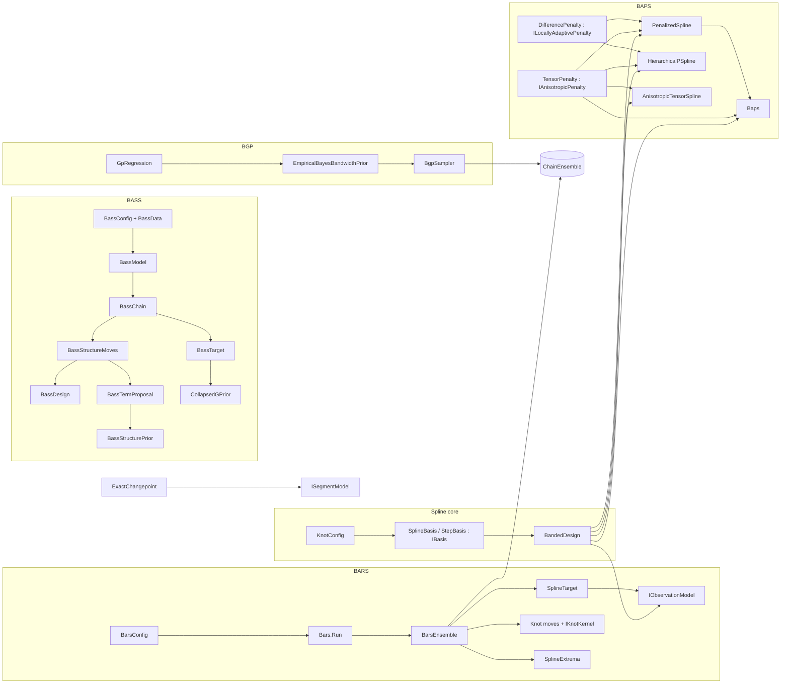

# Bayesian Regression

> Five Bayesian smoothing families that share one strategy: exploit Gaussian conjugacy in the regression coefficients (integrating them out, or drawing them from closed-form conditionals), then sample or select the remaining hyperparameters. **BARS** fits free-knot splines by reversible-jump MCMC. **BAPS** fits penalized splines (P-splines), including hierarchical and bivariate variants. The **Bayesian GP (BGP)** samples a kernel bandwidth under an empirical-Bayes prior. The **exact changepoint** model computes a piecewise-constant regression by dynamic programming. **BASS** fits adaptive spline surfaces over any number of continuous and categorical predictors, with scalar or direct functional responses, by reversible jump over products of hinges; its fitting engine is being built. · **Project:** `Maths.Regression` (areas `spline/`, `spline/bars/`, `spline/bass/`, `spline/baps/`, `bgp/`, `changepoint/`) · **Maturity:** core; BASS in construction (see [Status](#status-and-caveats))

## Overview

`Maths.Regression` sits in layer 3 of the [architecture](./Architecture.md). It builds on:

- [Samplers](./Samplers.md): the reversible-jump engine, block scans and slice steps, and the ensemble shell;
- [LinearAlgebra](./LinearAlgebra.md): banded LDLᵀ and dense Cholesky, and for BASS the bordered Cholesky, the Khatri–Rao contractions and pairwise sums;
- [ProbabilityAndInformation](./ProbabilityAndInformation.md): generators, the Gamma and Beta distributions, log-gamma and digamma, and for BASS Wallenius' noncentral hypergeometric.

The domain use visible in the code is **locating transitions in a curve over a thermal grid**: where it peaks, how many peaks it has, and where it changes level. BARS, for example, reduces each posterior curve to its exact peak and to significant-peak spans.

BASS, ported from R BASS 1.3.1, serves surfaces over many inputs, such as emulators of computer simulations: scalar responses, mixed continuous and categorical predictors, and direct functional responses whose cases share one set of output locations. Prediction, sensitivity analysis and calibration follow its fitting engine ([the port hub](../../issues/regression/bass-full-port-brief.md)).

## Key concepts

- **Marginalize, then sample.**
  - BARS integrates out the spline coefficients (and, for the Normal model, the noise scale) and samples the *number and positions* of knots.
  - BAPS integrates the coefficients out in `Collapsed` scheme and in REML selection, and samples or selects the smoothing strength λ. Its `Gibbs`/`LocallyAdaptiveGibbs` schemes and `HierarchicalPSpline` instead draw β from closed-form Gaussian conditionals, jointly with the variance components.
  - BGP integrates out the regression function and samples the bandwidth t.
  - BASS integrates out the coefficients and σ² and samples the structure, the collection of terms, and τ, the g-prior's precision multiplier, through the same collapsed g-prior block as BARS.
- **Knot configuration.** The pair $(k,\xi)$: k interior knots $\xi_1<\dots<\xi_k$ in the open interval $(0,1)$. The domain is fixed to $[0,1]$, so inputs and evaluation grids must be pre-scaled.
- **Terms and structures (BASS).** A term is a product of hinges $(s(x-t))_+^q$ on distinct continuous predictors, indicators of level subsets on distinct categorical predictors and, for a direct functional response, hinges on the output variables. A structure is an unordered collection of M distinct terms beside the intercept. Its support F is the set of structures within the basis cap whose terms have enough nonzero values and whose columns pass the numerical gate ([BASS: the design and admission](#bass-the-design-and-admission)), and which, under the Jeffreys σ² option, do not fit y exactly.
- **Basis, design and band storage.** A basis turns a knot configuration into an $m\times\nu$ design matrix Z. Every model forms $Z^\top WZ$ in LAPACK lower-band storage (`band[d, j] = A(j+d, j)`) and factors it with band LDLᵀ. The dense $\nu\times\nu$ matrix is never formed.
- **Readouts.** Per-draw summaries pooled across draws and chains: fitted grid values, knot count, the exact argmax, **peak intensity** λ(T) (expected significant peaks per grid cell) and **span coverage** π(T) (the posterior probability that T lies in some significant peak's span; a draw counts T once even where nested spans overlap).

## Design

**BARS is a declarative config plus a strict core.** `BarsConfig` is an immutable record whose defaults are component instances. `Bars.Run(config, x, y, grid)` maps it onto a `BarsEnsemble`. The components plug in through interfaces:

| Seam | Implementations |
|---|---|
| `IBasis` | `SplineBasis` (clamped B-splines), `StepBasis` (piecewise constant) |
| `IObservationModel` | `WeightedNormalModel` (default), `PoissonModel`, `WhittleModel`, `GibbsLossModel` |
| `IComplexityPrior` | `UniformPrior`, `PoissonPrior` (default λ = 5), `ConwayMaxwellPoissonPrior`, `EbicPrior` |
| `IKnotKernel` | `UniformKernel`, `LocalBetaKernel` (default τ = 50); immutable, because one instance is shared by every chain. Adaptive τ is requested with `adaptKernelTau` / `BarsConfig.AdaptKernelTau`, which builds an internal `AdaptiveLocalBetaKernel` per chain. |
| `IWeightResampler` (optional) | `StudentTWeights`, `ContaminatedNormalWeights` |

`Bars.Run` passes only basis, model, prior, kernel and robustness settings. The DMGK move schedule and parallel tempering are reachable only by constructing `BarsEnsemble` directly. Per-chain adaptive τ (`adaptKernelTau`) is also a constructor option; see [Status](#status-and-caveats) for the other route.

**BASS is a config of values plus a strict core** (the [contract shapes](../../issues/regression/bass/port-fitting-brief.md#contract-shapes-decided-2026-10-28), decided 2026-10-28).
- **Values throughout.** `BassConfig` holds values only. The decisions' closed sets are records with a `Kind` discriminator (`SampledG` or `FixedG`; `EqualOverAvailable` or `PriorCancelling`), and σ²'s prior and the intercept are the shared g-prior namespace's `Sigma2Prior` and `GPriorCentre`. So the record serializes to canonical JSON whole (`ToJson`, and `FromJson`, which refuses an unknown field) and is its own manifest, and `Bass.Fingerprint` hashes that JSON with the data's exact bits. `BarsConfig` holds component instances instead, so its checkpoint identity covers their types and not their parameters (OQ10).
- **The trade-off is extension.** A new prior or kernel joins its closed set with its decision, rather than plugging in as an instance.
- **Auto-picks** are resolved once at entry into `BassResolved`, with the automation log (below, under Configuration).
- **Shared parts and per-chain state.** `BassModel` assembles one fit's immutable parts once (the resolution, the input transform and inputs, the basis, the admission rules, the structure prior, the proposals and the target) and every chain shares them; each chain adds only its own mutable design.

**Two orchestration styles coexist.**

- **`BarsEnsemble`, `BgpSampler` and `Baps` are clients of the ensemble shell `ChainEnsemble`:** parallel replicas, with R̂ and ESS on functionals, an optional early stop and checkpoints.
  - **BAPS monitors ln λ and ln σ².** It joined the shell on 2026-10-23 with its draws unchanged: the shell derives the same kernel and readout seeds BAPS used, and each chain keeps its step order.
- **`HierarchicalPSpline`'s τ_u² mixes slowly** under the centred parameterization: about 2% of draws effective on a 6-replicate test fit, against 15–20% for σ² and τ₀². The shell's diagnostics show it, and an early stop waits for it.

**Precompute invariants.**

- `GpRegression` caches pairwise squared distances.
- `Baps`, `PenalizedSpline`, `HierarchicalPSpline` and `AnisotropicTensorSpline` cache $Z^\top Z$ and $Z^\top y$.
- `PenalizedSpline` factors A once per λ it is asked about. `Baps`'s `Collapsed` scheme keeps the accepted proposal's factor for the draw, so it factors once per proposal and never for a draw.
  - Until `7d90e2e` each evaluation also re-assembled $Z^\top Z$, and each draw factored A again.
  - Single-chain collapsed runs (ν = 44, 2,500 sweeps) went from 59 to 24 ms at n = 200 and from 314 to 20 ms at n = 2,000. The cost no longer grows with n.

**Extension points.**

- New bases, observation models, priors, kernels and resamplers for BARS (the interfaces above).
- `IBandPenalty` for new banded penalties in `PenalizedSpline` (REML evaluation), `Baps` and `HierarchicalPSpline` (their Gibbs conditionals). `ILocallyAdaptivePenalty` adds the per-difference terms that `BapsScheme.LocallyAdaptiveGibbs` needs; only a penalty whose difference matrix has full row rank can implement it.
- `IObservationModel.FitConditional` for a model that can serve the conditional mean, variance and draw from one fit.
- `IAnisotropicPenalty` for a penalty whose components are smoothed separately, $P(\lambda)=\sum_j\lambda_jP_j$, with their joint spectrum (`PenaltySpectrum`). It serves `AnisotropicTensorSpline`'s REML, `BapsScheme.AnisotropicGibbs` and `HierarchicalPSpline`'s anisotropic smoothing.
- `ISmoothingVariancePrior` for a new prior on the anisotropic smoothing variances: the log density of ln τ² with its first and second derivatives.
- `IGpKernel` for new radial GP kernels.
- `ISegmentModel` for new changepoint noise and level models.

## API at a glance

| Family | Entry points |
|---|---|
| Spline core | `KnotConfig`; `IBasis`; `SplineBasis(degree = 3)`; `StepBasis`; `BSpline.EvaluateBasis`, `BSpline.MakeClampedKnots`; `BandedDesign` (`Accumulate`, `AccumulateRhs`) |
| BARS | `BarsConfig`; `Bars.Run(config, x, y, grid)` → `BarsResult`; `BarsEnsemble(basis, model, prior, kernel, resampler?, dmgkConstant?, adaptKernelTau?, temperLevels?, temperHotEnd = 0.05, temperPath = Likelihood, temperSchedule = DeterministicEvenOdd, temperAdaptLadder = true, …, temperReferenceRung = false, evidence = true)` with `ReportsEvidence`; `BarsResult.Evidence` → `BarsEvidence` (`SteppingStone`, `PathSampling`, `Priors`, `LogEvidence`, `MonteCarloError`), `BarsEvidenceEstimate`, `BarsEvidencePriors`; `WeightedNormalModel.HasCompleteMarginal`, `ResolvedPriors`; `ITemperedMarginal.LogMarginalLikelihoodSlope`; `PeakPosterior`, `PeakMode`, `PeakSpan`; `SplineExtrema` (`Argmax`, `SignificantPeaks`, `SignificantPeakSpans`) |
| BASS (stage 4) | `BassConfig` (`ToJson`, `FromJson`, `Validate`) with `BassStructureSpec`, `SupportRule` (`SupportKind`), `CategoricalSubsetMeasure`, `BassCountPrior`, `SampledG` / `FixedG`, `BassSampling`, `EqualOverAvailable` / `PriorCancelling`; `BassData(predictors, response)` with `ContinuousPredictor`, `CategoricalPredictor`, `ScalarResponse`, `FunctionalResponse`; `BassResolved.Resolve(config, data)` (`AutoPicks`); `Bass.Fingerprint(config, data)`; `BassModel.Create(config, data, form)`; `BassInputTransform.Fit`, `BassInputs.Prepare`; `BassTerm`, `HingeFactor`, `CategoricalFactor`, `BassTermTable`; `BassBasis` (`CaseColumn`, `OutputColumn`, `Support`); `BassStructurePrior` (`LogPrior`, `LogCollectionWeight`, `LogCountRatio`) and `BassTermCounts`; `BassTermProposal` (`DrawBirth`, `DrawChange`, `LogBirth`, `LogBirthRatio`, `LogDeathRatio`); `BassDesign` (`ProposeBirth`, `ProposeDeath`, `ProposeChange`, `Accept`, `Load`, `Rebuild`, `Angle`, `MinAngle`) → `DesignProposal`, with `BassAdmission` and `BassRefusal`; `BassTarget` (`Evaluate`, `Defines`, `Marginal`, `LogTauDensity`, `Refusal`) → `BassEvaluation`, `BassStructureFit`; `BassChain` (`Step`, `Compose`), `BassStructureMoves` (`Refusals`, `EmptyBirths`), `BassTauBlock`; `BassState`, `BassDraw`, `BassStructure`; `Bass.Fit(config, data, run)` and `Bass.Resume(checkpoint, config, data, run)` → `BassFit` (`PointwiseLogDensity(data, units, content)`, `ResidualDependenceFor(data, index)`), with `BassRunOptions`, `BassDiagnostics` (`BassMonitoredPoint`), `BassPriorSampler`; `TemperingSpec`, `BassLadder`, `BassTemperingReadout`, `BassEvidence` (`BassEvidenceEstimate`, `BassEvidencePriors`); `BassPointwise` (`LogDensity`, `DefaultUnits`); `BassResidualDependence.Of`, `ResidualDependence` (`LagOne`, `MoransI`), `ResidualIndex` (`AlongVariable`, `AlongOrder`, `NearestNeighbours`), `ResidualStatistic` |
| BASS (stage 5) | `BassDecomposition.FromPca(y, BassPcaSpec)`, `FromBasis(K, W, offsets, scales, …)` with `TruncationResiduals` (`TruncationResidual.LeaveOneCaseOut` / `InSample`) and `ReconstructionMap` / `LinearReconstruction`; `BassComponents.Fit(decomposition, predictors, config)` → `BassBasisFit` (`Decomposition`, `Components`, `JointDraws`, `Predict`, `PointwiseLogDensity(units, BasisDensitySpace)`); `BassJointDraws.Pair`; `BassFit.Predict(data, PredictionCases, BassPredictOptions)` → `BassPrediction` (`Latent`, `Predictive`, `MeanSurface`, the range flags); `PredictionCases`, `ContinuousColumn`, `CategoricalColumn`, `UnseenLevel`; `PredictiveMixture.Quantile` |
| BASS (stage 6) | `BassFit.Sensitivity(data, SensitivitySpec)` → `SobolAnalysis` of `SobolDecomposition` (`MainIndex`, `TotalIndex`, `MeanMainIndices`, `MeanTotalIndices`, `Status`); `BassFit.Effects(data, spec, EffectSpec)` → `EffectAnalysis`; measures `UniformMeasure`, `MixtureMeasure` (`NormalComponent`, `StudentComponent`, `MixtureWeighting`), `EmpiricalMeasure`, `CategoricalMeasure`; `FunctionalForm`; `BassMoments.On(inputs, degree, measure)` (`Mean`, `Cross`, `Pair` → `TermPairMoments`); `PiecewisePolynomial` |
| BAPS | `IBandPenalty` (`Bandwidth`, `Nullity`, `AccumulateInto`, `Roughness`), `ILocallyAdaptivePenalty` and `IAnisotropicPenalty` (`Components`, `AccumulateComponents`, `ComponentRoughness`, `SamplePrior`, `Spectrum` → `PenaltySpectrum`: `LogPseudoDeterminant`, with its gradient and Hessian in ln λ); `ISmoothingVariancePrior` (`LogDensityOfLog`) and `ISmoothingVariancePriorChoice` (`Resolve`): `ScaledWeibullPrior(tailProbability = 0.05)`, `InverseGammaVariancePrior(shape, scale)`, `WeibullVariancePrior(scale, shape = ½)` (`Rate`), `WeibullVariancePrior.ScaledTo(design, penalty, bound, tailProbability = 0.05)` and `ScaledToResponse(design, penalty, y)`; `SmoothingVarianceUpdate` (`Slice`, `Newton`); `NoiseVariancePrior` (`InverseGamma`, `Jeffreys`); `DifferencePenalty(order = 2)`; `PenalizedSpline(design, y, IBandPenalty)` (`Coefficients`, `ProfiledVariance`, `RemlLogEvidence`, `EffectiveDegreesOfFreedom`, `EdfSlope`); `Baps(..., componentPrior, componentUpdate, noisePrior).Run(BapsScheme, …)` (`ComponentPrior`) with `BapsScheme` (`Gibbs`, `Collapsed`, `LocallyAdaptiveGibbs`, `AnisotropicGibbs`) → `BapsResult` (`PosteriorDraws`, `FitBand(design)` → `PointwiseBand`, `Sigma2Interval`, `Tau2Interval`, `ComponentLambdaInterval(j)` → `PosteriorInterval`, `ComponentLogLambdaConvergence`); `HierarchicalPSpline(..., anisotropicSmoothing = false, componentPrior, componentUpdate, noisePrior).Run` (`ComponentPrior`) → `HierarchicalResult` (`PosteriorDraws` per chain, Rao–Blackwellized means, `PopulationBand`, `ReplicateBand`, three variance intervals, `ComponentSmoothingVarianceInterval(j)`, three convergence diagnostics, `ComponentSmoothingVarianceConvergence`, `RHatPopulation`, `Checkpoint`); `HierarchicalStart` (`Overdispersed`, `Fixed`); `HierarchicalScheme` (`Centred`, `CollapsedPopulation`, `Interweaved`, `CollapsedInterweaved`, `ParameterExpanded`); `HalfTDeviationPrior(Degrees, Scale)`; `TensorProductDesign.Build` → `TensorDesign`; `TensorPenalty`; `AnisotropicTensorSpline` (`Coefficients`, `RemlLogEvidence`, `RemlOptimum` → `AnisotropicReml`, `Penalty`) |
| BGP | `SquaredExponentialKernel : IGpKernel`; `GpRegression(x, y, sigma2, kernel, scaling = Similarity)` or `GpRegression.WithUnknownScale(x, y, kernel, scaling)` (`NoiseModel`, `Fit(t, η)` for an unknown scale; `Fit(t)` → `GpFit`, `PredictMean`, `PredictVariance`, `KernelAffinity`, `Transform` → `GpTransform`); `EmpiricalBayesBandwidthPrior(gp, …)`; `BgpSampler(gp, prior).Run(...)` → `BgpResult` (`PosteriorMean`, `PosteriorSd`, `BandwidthDraws`) |
| Changepoint | `ExactChangepoint.Infer(y, σ², ν, ρ², maxSegments)` or `Infer(y, ISegmentModel, maxSegments)` → `ChangepointResult`; `DefaultHyperparameters(y)`; `GaussianSegmentModel`, `CauchySegmentModel`; `ChangepointResult.Posterior.Sample(draws, seed)` → `ChangepointDraw` |
| Pointwise and predictive checks | `UnitPartition(unitOf, stratumOf)`, `UnitPartition.EachObservation(n)`, `ConsecutiveBlocks(blocks, size)`; `PointwiseLogDensity` (`Values`, `Units`, `Latents`, `ChainLengths`, `LeavesUnitsOut`); `LatentReport`, `LatentScope`, `LatentTreatment`; `PointwiseContent`; `BarsEnsemble.PointwiseLogDensity(result, x, y, units, content)`, `IConditionalFit.LeaveOutLogDensities(units)`, `GPriorConditional.LeaveOutLogDensity(sigmaPrior, design, y, weights, unit)` and, with the unit's τ-free quadratic forms taken once (`LeaveOutQuadratics(design, unit)`), `LeaveOutLogDensity(sigmaPrior, design, y, weights, quadratics)`, `Baps.PointwiseLogDensity(result, units)`, `BgpSampler.PointwiseLogDensity(result, units)`, `GpRegression.LeaveOutLogDensities(fit, units)`, `HierarchicalPSpline.PointwiseLogDensity(result, units)`, `ChangepointPosterior.PointwiseLogDensity(draws, units)`; `PredictiveChecks.Waic`, `PsisLoo` → `PredictiveCheck` (`MonteCarloError`, `JointMonteCarloError`, `MonteCarloErrors`, `RelativeEfficiency`), `ParetoKThreshold`, `FitGeneralizedPareto`; `IWeightResampler.MarginalLogDensity`, `ISegmentModel.LogLikelihood` |

## Algorithms

### Spline core

- **Knot vector.** `MakeClampedKnots` builds $[0^{\times(p+1)},\xi_1..\xi_k,1^{\times(p+1)}]$, so a degree-p basis has $\nu=k+p+1$ functions. The default is cubic ($p=3$).
- **Basis evaluation.** `EvaluateBasis` finds the knot span by a linear search clamped to $[p,\nu-1]$, so $t=1$ falls in the last span. It then applies the Cox–de Boor recurrence (Piegl–Tiller A2.2) with zero-denominator guards and returns a dense row of length ν.
- **`StepBasis`.** An indicator design with $\nu=k+1$, used for changepoint-style carriers.
- **`BandedDesign`.** Scans each row for its first and last non-zero entry. Its bandwidth is the data-derived maximum span, which is at most p, not the spline degree itself. It accumulates $Z^\top WZ$ into band storage and $Z^\top Wr$ into a vector.

### BARS: target and moves

**Target.** $\log p(y\mid Z(\xi),W)+\log p(k)$. It includes no density term for ξ given k.

**Moves.** The default constant selection weights are birth 0.4, death 0.4 and relocate 0.2. The birth density is $q(x\mid\xi)=\varepsilon\,b(x)+(1-\varepsilon)\,\bar q(x\mid\xi)$, with $\bar q(x\mid\xi)=\frac1k\sum_ih(x\mid\xi_i)$ and $q=b$ when $k=0$ (`KnotBirthDensity`, below):

| Move | Proposal | $\log$ auxiliary ratio |
|---|---|---|
| Birth (`KnotBirthMove`) | $\xi^*\sim q(\cdot\mid\xi)$: from the base $b$ with probability ε (always when $k=0$), otherwise $h(\cdot\mid\xi_c)$ around a uniformly chosen knot | $-\log(k+1)-\log q(\xi^*\mid\xi)$ |
| Death (`KnotDeathMove`) | remove a uniformly chosen knot (unavailable at $k=0$) | $+\log k+\log q(\xi_d\mid\xi\setminus\xi_d)$ |
| Relocate (`KnotRelocateMove`) | perturb one uniformly chosen knot and re-sort | $\log h(\xi_{\text{old}}\mid\xi_{\text{new}})-\log h(\xi_{\text{new}}\mid\xi_{\text{old}})$ |

All Jacobians are 0.

**Relocation kernel** (measured 2026-10-22, `MixingBenchmark`, `RELOC_BENCH`). With births from the uniform base, the local kernel drives relocations only. Ten seeds per arm on `BirthBenchmark`'s seven fits, 4 chains × 10,000 draws. Peak-location ESS relative to the default local Beta kernel (τ = 50), medians:

| Arm | Narrow peak | Jump | Skewed design | Sine | Sine with outliers | Oscillation |
|---|---|---|---|---|---|---|
| Fixed τ = 10 (step SD about 0.15) | 0.72 | 0.38 | 0.93 | 1.22 | 0.97 | 0.52 |
| Fixed τ = 500 (about 0.02) | 1.01 | 2.45 | 1.35 | 0.58 | 0.65 | 0.94 |
| Adaptive from τ = 50 (`adaptKernelTau`) | 0.87 | 2.70 | 1.27 | 1.20 | 0.98 | 0.98 |
| Uniform, a global relocation | 0.42 | 0.13 | 0.55 | 1.12 | 0.72 | 0.53 |
| Even mixture of uniform and τ = 50 | 0.84 | 0.53 | 1.14 | 1.06 | 0.87 | 0.62 |

- **The adaptive kernel is the robust choice.** Its knot-count ESS was 0.98–1.09× of the default's on every fit, and its peak-location ESS 0.87–2.70×. Each fixed spread wins on some fits and loses badly on others.
- **Global relocation hurts every fit with several knots** (0.13–0.55×), because a uniform draw rarely improves a fitted arrangement. ABMRS's global relocations work over a discrete candidate grid instead.
- **No arm fixes the narrow peak's location** (τ ≈ 330), so its slow mixing is not a matter of relocation reach.
- **The data gap** is indifferent to the kernel.
- **Confirmed** with two Poisson fits added (`CONFIRM_BENCH=10`, nine fits). Knot-count ESS ranged over 0.98–1.19× with a geometric mean of 1.05, and peak-location ESS over 0.87–2.70× with a geometric mean of 1.15. Mean knots stayed within 1% and MSE within 4%. It passed the criterion set before the run: both geometric means above 1, no fit below 0.8× on either readout, and the posterior unmoved. It is a candidate default, not yet the default.

**Birth density (step 3.9, OQ11).** Birth and death share one `KnotBirthDensity`, so the reverse density always matches.
- **The default:** ε = 1 with the uniform base, so every birth is uniform on (0, 1). This is the birth of Denison et al. (1998), and the global birth that ABMRS uses over its candidates and BASS over observed values. Locality stays in the relocation move.
- **The settings:** `BarsConfig.BirthExploration`, or `birthExploration`. Below 1 it restores DMGK's local births in part, and at 0 entirely. `BirthBase.Design` draws from a histogram of the inputs mixed with the uniform at weight 0.1 (`DesignHistogramBase`).
- **Why.** A death's acceptance carries the reverse birth's density at the removed knot. Under local births, a knot far from the others is almost never removed: from knots at 0.39 and 0.96 that density is $e^{-37}$ or $e^{-61}$. Any ε > 0 bounds it below by ε·b(t).
- **What was measured** (`BirthBenchmark`, 10 seeds per arm, 4 chains × 10,000 draws; ESS relative to ε = 0):

  | Fit | Knot-count ESS at ε = 0.1 / 0.5 / 1 | Peak-location ESS at ε = 1 | Knot autocorrelation time, ε = 0 → 1 |
  |---|---|---|---|
  | Sine, n = 100 (the adaptive-stop fit) | 10× / 24× / 27× | 3.7× | 388 → 14 |
  | Sine with outliers, n = 120 | 23× / 54× / 76× | 31× | 3,377 → 45 |
  | Data gap, n = 120 | 23× / 38× / 38× | 1.2× | 265 → 7 |
  | Jump, n = 150 | 12× / 12× / 13× | 0.9× | 390 → 31 |
  | Skewed design, n = 150 | 3.5× / 5.0× / 5.5× | 1.0× | 249 → 45 |
  | Narrow peak, n = 150 | 1.6× / 1.8× / 2.1× | 1.0× | 121 → 59 |
  | Oscillation with about 13 knots, n = 200 | 0.9× / 0.9× / 0.9× | 0.95× | — |

  - **Unchanged:** mean knot counts and fit MSE at every ε, and the cost per step.
  - **The design base was never better than uniform:** 27× against 38× on the gap at ε = 1, and about equal on the skewed design.
  - **Densely packed knots** gain nothing (the 0.9× is within noise). Every knot has neighbors there, so the trap does not arise.
- **Trade-offs.**
  - **Wasted births.** Uniform births are mostly refused where the data do not want a knot. Those landing in data gaps are refused cheaply by the support gate, before any factorization (refusals as `ThinSupport` stayed at 2–7% of evaluations).
  - **Possible regimes outside the benchmark.** Local births could still help fits it does not cover, which is why ε stays a setting.
- **Alternatives considered.**
  - **A separate global birth/death pair:** it escapes the trap only at the global death's selection rate.
  - **The design base:** measured, no advantage.
  - **DMGK's local births (ε = 0):** they strand knots, as above.

**Kernels.**

- `LocalBetaKernel` proposes $\mathrm{Beta}(c\tau,(1-c)\tau)$ around center c, which concentrates new knots near existing ones.
- `AdaptiveLocalBetaKernel` tunes $\log\tau$ toward 0.44 relocate acceptance during burn-in (Robbins–Monro), with $\tau\in[1,10^5]$. It then freezes. Adaptation reads the chain's cumulative relocate counters in 200-step windows. A robustness resampler hands the chain its new target in place (`ReversibleJumpChain.ReplaceTarget`) every `WeightEvery` steps, so the counters, and the adaptation, carry across resamples.

**DMGK schedule.** $b_k=c\min\{1,p(k+1)/p(k)\}$, $d_k=c\min\{1,p(k-1)/p(k)\}$ and $r_k=1-b_k-d_k$, with $c\in(0,1]$ (default 0.4); the weights sum to one while $b_k+d_k\le1$. `DmgkSchedule.GreenConstant(prior, maxKnots, budget)` gives Green's own choice, the largest $c$ with $b_k+d_k\le0.9$. The schedule is Green's (1995, §4.1); Denison et al. (1998) and DMGK (2001) use it with $c=0.4$. It makes $b_kp(k)=d_{k+1}p(k+1)$, so the selection ratio cancels the prior ratio exactly. It is off by default (constant weights 0.4/0.4/0.2).

- **Effect on mixing.** Write $\pi(x)=p(k)L(x)$ and let $\tilde A=L\,q$ be a birth or death proposal's flow with the prior factored out. The stationary flow between $x\in\mathcal M_k$ and $x'\in\mathcal M_{k+1}$ is
  $$F_{\text{DMGK}}=c\min(p_k,p_{k+1})\min(\tilde A_f,\tilde A_r),\qquad F_{\text{const}}=c\min(p_k\tilde A_f,\,p_{k+1}\tilde A_r).$$
  Under the prior alone, Green's motivating case, the two agree, and DMGK turns the constant schedule's rejections into relocations. With a likelihood, $F_{\text{DMGK}}\le F_{\text{const}}$ at equal $c$: the prior moves from the acceptance into the proposal rate, and the acceptance cap means the lost proposals are not recovered. So the lag-1 autocorrelation and the expected squared jump of $k$ favor constant weights exactly. ESS(k) is not ordered, because the extra relocations interact with later dimension moves.
- **Normalization.** Equal $c$ gives DMGK a smaller dimension budget: under Poisson(4) at $c=0.4$, $\max_k(b_k+d_k)=0.72$, against 0.8. Green instead takes the largest $c$ with $b_k+d_k\le0.9$: 0.6 under Poisson(1), 0.5 under Poisson(4), 0.45 at a cap of 5. At equal budget neither schedule dominates. DMGK leads where the posterior sits on a flat prior top, and loses about a factor $p(k+1)/p(k)$ where prior and likelihood conflict.
- **Hard caps.** Birth weight vanishes where $p(k+1)=0$, so a cap costs no rejected proposals.
- **Measured.** On `DmgkScheduleTests`' problem (posterior at the Poisson(4) mode, equal $c$, before the knot-measure fix), 12 seeds showed no ESS(k) difference.
- **The schedule comparison** (2026-10-22, `MixingBenchmark`, `SCHEDULE_BENCH`). Uniform births throughout. 20 seeds per arm and regime, each pooling 4 chains × 10,000 steps after 2,000. The data: the sine (n = 100) under Poisson(2), with the posterior at the prior's mode; sin 7πx (n = 150), which wants about 8 knots, under Poisson(1), a conflict; and the same data under a uniform prior capped at 8. Medians, as ratios to the default constant 0.4/0.4/0.2, per step:

  | Regime | Arm | Knot count | Energy | Fit at 0.5 | Peak location |
  |---|---|---|---|---|---|
  | At the prior's mode | DMGK, c = 0.4 | 1.14 | 1.41 | 1.16 | 1.58 |
  | | Constant 0.3/0.3/0.4 | 0.90 | 1.23 | 0.93 | 1.39 |
  | | DMGK at Green's c (0.54) | 1.25 | 1.06 | 1.20 | 1.06 |
  | Prior–likelihood conflict | DMGK, c = 0.4 | 1.63 | 2.30 | 1.95 | 2.56 |
  | | Constant 0.3/0.3/0.4 | 1.44 | 2.07 | 1.40 | 1.97 |
  | | DMGK at Green's c (0.6) | 1.63 | 1.33 | 1.47 | 1.63 |
  | Active cap at 8 | DMGK, c = 0.4 | 1.06 | 1.15 | 1.25 | 1.22 |
  | | Constant 0.3/0.3/0.4 | 1.18 | 1.53 | 1.61 | 1.53 |
  | | DMGK at Green's c (0.45) | 0.92 | 0.94 | 0.99 | 0.96 |

  - **The default schedule is the worst, or nearly, everywhere.** DMGK at c = 0.4 beat it on every regime and readout, and was the best arm at the mode and under conflict. Under the cap the relocation-heavier constant schedule led. Per second the gains were as large or larger.
  - **Why.** At the posterior's k, DMGK spends about a third of its proposals on relocations, against the default's fifth, and it also scales the dimension moves by the prior. A constant schedule masked at DMGK's budget (b = d = 1/3 at the mode) recovered only part of the gain (1.19–1.27× on energy and peak location), so the prior-awareness counts beyond the relocation share.
  - **The theory holds.** ESJD(k) was equal at the mode (0.177 both) and favored the constant schedule under conflict (0.024 against 0.020), as derived above, while ESS(k) favored DMGK.
  - **Reversals** (a dimension change undone by the next one) ran at 72–86% in every arm, so no schedule moves k with persistence.
  - **The masked arm** equals the 0.3/0.3/0.4 schedule under Poisson(1), and their results agreed within seed noise, a check on the harness.
  - **Scope.** Normal fits only, with uniform births.
  - **The other conflict** (the confirmation run, `CONFIRM_BENCH=10`: `BirthBenchmark`'s seven fits and two Poisson fits under a Poisson(5) prior). Where the prior wants more knots than the data, on the gap and the counts (mean k 0.67), DMGK at c = 0.4 cut knot-count ESS to 0.29–0.33×. A death from k = 1 is proposed at 0.4·p(0)/p(1) = 0.08, the factor p(k+1)/p(k) the flow identity predicts. Over the nine fits its knot-count ESS averaged 0.73× (geometric mean), against 1.08× for the peak location.
  - **So no schedule dominates, and the default stays constant.** The schedule study's conflict ran the other way, a prior wanting fewer knots than the data, which is where DMGK wins. The relocation-heavier constant schedule, 0.3/0.3/0.4, never lost badly there (0.90× at worst), but it is untested on the other conflict.

**Priors.**

- `UniformPrior`: flat on $0..\text{max}$.
- `PoissonPrior`: $k\log\lambda-\lambda-\log k!$.
- `ConwayMaxwellPoissonPrior(lambda, nu)`: $k\log\lambda-\nu\log k!$, unnormalized (Conway and Maxwell 1962; Shmueli et al. 2005). ν = 1 is Poisson(λ); ν = 2 is the effective prior BARS ran under before the knot-measure fix; ν < 1 has heavier tails. With ν = 0 it is geometric and needs λ < 1.
- `EbicPrior(gamma, candidateCount)`: $(1-\gamma)\log\binom{C}{k}$ with $C$ = `candidateCount` and $\gamma\ge0$, He, Yang and Kang's convention (step 3.8); −∞ for $k>C$.

**Knot measure.** Given $k$, the knot locations are the order statistics of $k$ independent uniforms on $(0,1)$: density $k!$ on the ordered simplex $0<\xi_1<\dots<\xi_k<1$. The target's log prior is $\log p(k)+\log k!$, so $p(k)$ is exactly the knot-count prior. Off the open simplex, or where $p(k)=0$, the evaluation builds no design. Birth's $-\log(k+1)$ is the Hastings factor for that ordered representation, and the target is −∞ off the open simplex.

- **Checked.** Under a constant likelihood, `CountLawTests` recovers $p(k)$ bin by bin for Poisson, capped-uniform and Conway–Maxwell–Poisson priors, under both move schedules. The check is generic over the target and the move set, so BASS's term-measure check reuses it.
- **Before the fix** (until 2026-10-20), the target lacked $\log k!$, so the effective count prior was $p(k)/k!$. For `PoissonPrior(λ)` that is $\lambda^k/(k!)^2$, which `ConwayMaxwellPoissonPrior(λ, 2)` reproduces exactly. Runs with `PoissonPrior` now carry a weaker penalty and use more knots. `UniformPrior(max)` is now flat; it used to act as $1/k!$.
- **Choosing ν.** On the three `DmgkValidationTests` fits (smooth, sharp peak, jump; 8 seeds each):
  - ν = 1 used about half a knot more than ν = 2: mean $\bar k$ of 2.36, 4.70 and 4.78, against 1.82, 4.12 and 4.09.
  - Its mean fit-to-data MSE ratio was slightly lower: 0.077, 0.078 and 0.103, against 0.086, 0.096 and 0.110. The differences lie mostly within seed noise; ν = 1 won 6, 5 and 4 of the 8 paired seeds.
  - Both pass the same thresholds.

  At these sample sizes the marginal's Occam factor, about $\tfrac12\log(m+1)$ per basis function, matters more than the count prior. ν = 2 suits fits where over-knotting is costly, such as readouts that count peaks; ν = 1 lets the data decide. The default stays `PoissonPrior(5)`, which is ν = 1.
- **Support.** `Beta.Sample` can underflow to exactly 0 or 1, where `LocalBetaKernel`'s density is 0, so a birth or relocation there carried a Hastings term of +∞. Under a flat likelihood such knots were accepted and never removed, and the chain ran away; with data, design admission rejected them. The support rule now rejects them, and the engine rejects any candidate whose log target is −∞ or NaN, whatever its proposal ratio.
- **`EbicPrior`** (step 3.8). Its count law is He, Yang and Kang's: $\binom{C}{k}^{1-\gamma}$, the knot-count marginal of their joint prior $\tau(\mathcal M_k)^{-\gamma}$, where $\tau(\mathcal M_k)=\binom{C}{k}$ counts the k-knot models over C candidates (ABMRS Web Appendix A).
  - **The three regimes.** γ = 0 is BIC's uniform prior over models, which favors k near C/2. Between 0 and 1 it is EBIC's interpolation toward flat. γ = 1 is flat in k. Above 1 it penalizes.
  - **The range.** The authors recommend γ ∈ [0.5, 2] with default 1, and run 0.8, 1.0 and 1.2. Any γ ≥ 0 is accepted, since the recommendation is calibration, not a constraint of the law.
  - **The support** is [0, C], as theirs. For γ > 1 the law is symmetric in $k\leftrightarrow C-k$: it falls until C/2 and rises after, back to its starting value at k = C (`CountLawTests` reproduces that U shape). So choose C at least twice the largest knot count the data can support. Their package sets C = 3m. Data and the support gate keep chains far below C/2 in practice.
  - **Alternative considered:** truncating at ⌊C/2⌋, a declared extension of their law. It was not taken, because they do not truncate and the guidance suffices; it would remain available as a separate support rule.
  - **Only the count law is theirs.** BARS keeps its continuous ordered-uniform knot measure, so C is a complexity parameter rather than a grid, and nothing samples candidate positions.
  - **Mapping from the earlier convention.** Before step 3.8, `EbicPrior(γ)` was $-\gamma\log\binom{C}{k}$, which is this law at $\gamma_{\text{HYK}}=\gamma+1$. Callers add 1.
  - **How the pieces map.** Their EBIC posterior is a BIC-type marginal plus this count law. In BARS, the Normal model's g-prior marginal is their Lemma 1, so `WeightedNormalModel` with `EbicPrior` is ABMRS's Normal model on continuous knots. Their released code uses the BIC-type ratio instead (preparation brief, step 3.8). For non-normal responses they describe a BIC-type plug-in; here `PoissonModel` with `EbicPrior` pairs their count law with the g-prior's Laplace marginal, since the BIC pathway is retired ([Corrections to the sources](#corrections-to-the-sources)).

### The collapsed g-prior block

`CollapsedGPrior` (namespace `Maths.Regression.GPrior`) holds the closed forms shared by the free-knot engines, BARS now and BASS next. The model is

$$y\sim N(Z\beta,\sigma^2W^{-1}),\qquad \beta\mid\sigma^2\sim N(\mu_0,\sigma^2(\tau G)^{-1}),\qquad G=Z^\top Z,$$

with the likelihood raised to an inverse temperature $b$ (1 is untempered).

- **Prior mean.** $\mu_0$ is zero unless the design layer centres it (`GPriorCentre`). The block's statistics are then those of the centred response $\tilde y=y-Z\mu_0$, and $\mu_0$ is added back to every mean and draw; below, $y$ stands for $\tilde y$. `BandedGPrior.Fit(…, centre)` builds a level centre, $\mu_0=c\,G^{-1}Z^\top\mathbf 1$ with $c$ the response's median or mean, unweighted even when weights enter.

- **Unweighted, W = I.**
  - The block caches the statistics that depend on neither τ nor $b$: the factor of $G$, $\hat\beta_{\text{OLS}}$, $\lVert r\rVert^2=\lVert y-Z\hat\beta\rVert^2$ and $Q=\lVert Z\hat\beta\rVert^2$.
  - `At(τ, b)` then costs O(1), plus the mean vector: $S=b\,(\lVert r\rVert^2+\tfrac{\tau}{\tau+b}Q)$, the determinant term $\tfrac p2\ln\tfrac{\tau}{\tau+b}$, mean $\tfrac{b}{\tau+b}\hat\beta$, and $\operatorname{Cov}(\beta\mid\sigma^2)=\sigma^2G^{-1}/(\tau+b)$.
  - `MarginalAt(τ, b)` is the same marginal without the mean: a `GPriorMarginal` value holding $S$, the determinant term and $m$, so a τ update or a tempered swap allocates nothing (N12). `At` carries the same value, so the two return the same double; the Normal model's tempered marginal reads it.
  - Because $S$ is a sum of non-negative terms from the explicit residual, a small τ on a close fit keeps its digits. The subtracted form $b\,y^\top y-b^2Q/(\tau+b)$ loses about $\log_{10}((1+\tau)/\tau)$ of them.
- **Weighted (the robust path, Q2).** The posterior precision $P_a=Z^\top(W+\tau I)Z$ depends on τ, so this form is built at one τ and $b=1$. Its scale is $S=\lVert y-Z\tilde\beta\rVert_W^2+\tau\lVert Z\tilde\beta\rVert^2$.
- **Centred, with the intercept apart (BASS, D03).** `FromCentredLeastSquares` takes the design BASS holds: columns $Z_c$ centred over all $N$ rows, so the constant is orthogonal to them and its Gram entry $N$ stands apart, with the factor of $G_c=Z_c^\top Z_c$, the least-squares fit of $\tilde y=y-\bar y$ on $Z_c$ and $\bar y$. The coefficients are $(\alpha,\beta_c)$, the intercept first, and the convention (`Intercept`, a `GPriorCentre`) places $\alpha$:
  - *Level centring* (`Mean`): inside the g-prior, centred on $\bar y$, with $k=M+1$. The explicit column, $[1, Z_c]$ with $\mu_0=\bar y\,e_0$ through `FromLeastSquares`, gives the same block.
  - *The zero centre* (`Zero`): inside the g-prior at 0, with $k=M+1$ and $\alpha$'s fitted energy $N\bar y^2$ added to $Q$.
  - *The flat intercept* (`Flat`, Liang et al. 2008): $\alpha$ under a flat prior, integrated out, with $k=M$. At inverse temperature $b$ the integral is $(2\pi\sigma^2/(Nb))^{1/2}$, which spends one observation.
    - So $\nu=Nb-1$, and the determinant term gains $-\tfrac12\ln(Nb)$. Under the Jeffreys limit the marginal is $(1+g)^{(N-1-M)/2}(1+g(1-R^2))^{-(N-1)/2}$, $g=1/\tau$ (D03).
    - $b=0$ is out of reach on this form, which refuses it; the linear form reaches it (D05).
    - The marginal is defined up to the flat prior's constant. That constant cancels from every within-rung ratio and every swap, so the form gives no evidence.
    - Given σ², $\alpha\sim N(\bar y,\sigma^2/(Nb))$, apart from $\beta_c$. `Sample` draws it after $\beta_c$. `LeaveOutLogDensity` and `ConditionalVariance` carry its variance, and the leave-out's Student t has $\nu=N-1$.
  - *Why a factory that takes the convention.* BASS's design layer holds the factor of $G_c$ alone, with $\bar y$ apart, and its config carries the convention as a `GPriorCentre`. One call then builds every convention's block from the same statistics, where `FromLeastSquares` would need the intercept bordered into the factor. The median centre is refused there: it is the robust path's, on a basis that carries the constant.
- **σ².** The prior is IG($g_1, g_2$), which BARS takes by default scaled to the response (`Sigma2Prior`, below), or the improper $1/\sigma^2$. The posterior is $\sigma^2\mid y\sim\mathrm{IG}(g_1+\nu/2,\ g_2+S/2)$, with $\nu=mb$, or $mb-1$ under the flat intercept (below).
  - `LogMarginal` is the complete $\ln p_b(y\mid Z,\tau)$ (derivations review §3), comparable across τ and $b$. Under the improper prior it is defined up to that prior's constant.
  - `Sample` is a composition draw: σ² first, then β through the factor's precision draw.
  - `ConditionalVariance` returns $E[\sigma^2\mid y]\,z^\top\operatorname{Cov}z$.
- **Seams.** The factor is any `ISpdFactor`. `BandedGPrior` builds the block from a banded spline design; BASS's design layer builds it through `FromCentredLeastSquares`. The block does not decide admission (it reports the factors' statuses) and knows nothing about the basis.
- **Admission comes before the fit.** `BandedGPrior.Fit` takes the caller's admission rule and applies it to each factor as soon as it exists, before anything is solved with it; a refused factor gives no block. A factor that breaks down can solve to NaN, from which no least-squares statistic may be formed. Until 2026-10-21 the Normal model judged the factor after building the block, so such a design threw instead of scoring −∞ (register R17; a likelihood-tempered hot rung found it).
- **Checks** (`CollapsedGPriorTests`):
  - scale, mean and determinant term against dense algebra at four (τ, $b$) settings;
  - the complete log marginal against quadrature over σ², under improper and proper priors and at tempered rungs;
  - draw moments at a tempered rung;
  - conditional variances;
  - a constructed near-interpolating fit, where the subtracted form loses its digits and the block keeps them;
  - the median- and mean-centred blocks against the zero-centred block on $y-c$, at offsets 0, 5 and −300, with and without weights;
  - `MarginalAt` against `At`'s log marginal bit for bit, under the Jeffreys, scaled and fixed priors, $b\in\{0, 0.3, 1\}$ and τ from $10^{-6}$ to $10^3$, with no allocation.
- **Checks of the centred forms** (`CollapsedGPriorInterceptTests`):
  - dense algebra on $[1, Z_c]$ at four (τ, $b$) settings, and for the g-prior conventions on the uncentred $[1, H]$, whose column space is the same;
  - level centring against the explicit column through `FromLeastSquares`;
  - the flat marginal and σ²'s posterior mean against quadrature over $\alpha$ and σ², at $b$ = 1, 0.5 and 0.2, under the improper and a proper prior;
  - Liang's and level centring's Bayes factors, τ integrated under Zellner–Siow, against F-O9's oracle on F-O8's grid to $10^{-8}$;
  - on a hinge design, the g-forms, and invariance to shifting y by 10 and −250 under both conventions, while the zero centre moves;
  - draws, leave-out densities and readout variances against their dense counterparts;
  - `MarginalAt` against `At` bit for bit, with no allocation, and the refusals ($b=0$, a shape the improper prior cannot integrate, the median centre).

### BARS: observation models

**`WeightedNormalModel`** (default) is the exact unit-information (Zellner $g=m$) marginal, with the coefficients and σ integrated out, under the prior $\beta\sim N(\mu_0, m\sigma^2G^{-1})$:

$$\log p(y\mid Z)=-\tfrac{\nu}{2}\log(m+1)-\tfrac m2\log a,\qquad a=\tilde y^\top\tilde y-\tfrac{m}{m+1}\,b^\top G^{-1}b,$$

where $G=Z^\top Z$, $\tilde y=y-Z\mu_0$ and $b=Z^\top\tilde y$. By default the prior is centred on the response's median (`GPriorCentre.Median`, $Z\mu_0=\operatorname{med}(y)\mathbf 1$ for B-splines); `GPriorCentre.Mean` centres it on the mean, and `GPriorCentre.Zero` is DMGK's original, $\tilde y=y$ (below). It returns −∞ when $m\le\nu$, when the design fails admission (below), or when $a\le0$. Because $a=\lVert \tilde y-Z\hat\beta\rVert^2+b^\top G^{-1}b/(m+1)$, the last case occurs only when $\tilde y$ is identically zero: a zero response, or under a level centre any constant one. An interpolating fit with $m>\nu$ stays finite. It is computed through the collapsed g-prior block at τ = 1/m, from the explicit residual, $a=\lVert y-Z\hat\beta\rVert^2+\lVert Z\hat\beta\rVert^2/(m+1)$. At BARS's τ the subtracted form would lose at most $\log_{10}(m+1)$ digits; the explicit form loses none. The posterior mean is $\mu_0+\frac{m}{m+1}G^{-1}b$.

With per-point weights $W$ (robust runs, $y\sim N(Z\beta,\sigma^2W^{-1})$), the coefficient prior stays the **unweighted** g-prior $\beta\sim N(\mu_0, m\sigma^2G^{-1})$, centred on the unweighted median, so the prior on the curve does not depend on the weights. The marginal is

$$\log p(y\mid Z,W)=\tfrac12\log\lvert G/m\rvert-\tfrac12\log\lvert P_a\rvert+\tfrac12\textstyle\sum_i\log w_i-\tfrac m2\log S,$$

with $P_a=Z^\top(W+I/m)Z$, $h=Z^\top W\tilde y$ and $S=\tilde y^\top W\tilde y-h^\top P_a^{-1}h=\lVert \tilde y-Z\tilde\beta\rVert_W^2+\tilde\beta^\top(G/m)\tilde\beta$. The posterior mean is $\mu_0+\tilde\beta$ with $\tilde\beta=P_a^{-1}h$, and the covariance given σ² is $\sigma^2P_a^{-1}$. At unit weights this reduces to the form above. Admission reads $G$ alone (see the numerical gate).

**Centring the Normal prior (2026-10-22, after step 3.10).**
- **The defect.** DMGK's prior is centred at zero, so it shrinks the whole fit toward zero, level included, by $m/(m+1)$, and the level's energy enters the scale, $a=\lVert y-Z\hat\beta\rVert^2+\lVert Z\hat\beta\rVert^2/(m+1)$. For a response far from zero against its noise, that term swamps the residual, so a knot barely moves the marginal.
  - **Measured** on a sine with noise 0.15 (n = 100, 4 chains × 3,000 draws), shifted by a constant:

    | Offset | Mean knots | Fit MSE | Mean pointwise SD | Level error |
    |---|---|---|---|---|
    | 0 | 1.80 | 0.004 | 0.046 | −0.01 |
    | 3 | 0.82 | 0.006 | 0.083 | −0.04 |
    | 10 | 0.42 | 0.018 | 0.21 | −0.11 |
    | 300 | 0.40 | 8.9 | 6.2 | −2.99 |

  - **Unseen until now** because every test curve sat near zero, and BARS did not centre the response.
- **The fix.** The prior is centred on the response's level, $\mu_0=c\,G^{-1}Z^\top\mathbf 1$, the projection of the level onto the basis. The prior then shrinks the fit's shape toward flat, and leaves its level where the data put it. The level was first the mean; it is the median since OQ15 (below).
  - **Location-invariant.** A constant shift of the response moves only the fit's level. On the sine above, every offset from 0 to 300 gives 1.80 knots, MSE 0.0040 and mean SD 0.046 (`NormalCentreTests`).
  - **Robust runs.** The centre is unweighted. A centre that depended on the weights would put the prior into the weights' conditional and break the exact Gamma or Bernoulli draw.
- **Trade-offs.**
  - **The prior reads the data,** through ȳ, the null model's estimate. Every configuration contains the constant, so the level contributes the same factor to every configuration's marginal, as a flat intercept's would.
  - **A constant response** has nothing left once centred, so it is refused as `ZeroResponse`. Under DMGK's centre only an identically zero one was. The centre keeps the constant exactly. A constant response takes its value as ȳ, and a basis that sums to one holds μ₀ = ȳ·1 with no solve. Another basis whose span holds the constant sets a constant response's centred value to zero. Before this, a projected constant left roundoff of about 1e-16, which the improper σ² prior admitted as a near-perfect fit (second external review).
  - **Why the median (OQ15).** The mean ignores the robust weights, which keeps the weights' conditional exact. But as an outlier's weight goes to zero it still shifts the mean centre by R/m, and the fit by about R/m², where R is its size. The median depends only on the data too, and a single response cannot drag it far (`NormalCentreTests`):
    - **Contamination.** In the second external review's intercept-only fixture (m = 40, an outlier at weight 1e-12), the median centre's fit stays at about 1e-12·R/m (2.5e-8 at R = 10⁶), against the mean centre's R/m² (625).
    - **A robust BARS fit** of a sine under noise 0.15 with one reading at 10⁶, with Student-t weights, reaches MSE 0.00328 under the median centre against 0.00296 without the glitch. Under the mean centre it reaches 6,790.
    - **Translation equivariance** holds as for the mean: the median shifts with the response.
    - **Clean asymmetric responses** cost the median only its distance from the mean. For a basis that sums to one the conditional-mean fit is $\tfrac{m}{m+1}f_{\text{OLS}}+c/(m+1)$, so the two centres' fits differ by exactly (median − mean)/(m + 1). On a narrow peak over a flat baseline (median 0.013, mean 0.155, n = 150) that is 0.0009, against noise of 0.05. Over the chains: 5.50 against 5.60 knots, and MSE 0.000309 against 0.000282 on one seed.
    - **Left open:** robust centring more generally, for a later look at robust statistics (OQ15). The flat intercept (Liang et al. 2008), the exact form, has its closed forms in the block since 2026-10-28 (its centred form, above), for BASS; BARS cannot take it (below).
  - **σ² gets m, not m − 1, degrees of freedom.** The level is centred on the data's own mean at no charge, where a flat intercept would spend one. Bayes factors differ from the flat-intercept form only as m does from m − 1 in one exponent.
- **Alternatives considered.**
  - **Zero, DMGK's original:** kept as `GPriorCentre.Zero` on its own terms, for a response whose level is known to be zero; on any other it carries the defect above ([Corrections to the sources](#corrections-to-the-sources)).
  - **A flat intercept with a centred design** (Liang et al. 2008): the same comparisons up to the m − 1 above. It needs the constant split out of the basis, which B-splines do not do. `GPriorCentre.Flat` names it (2026-10-28) for BASS's option, and the block's centred form computes it; BARS refuses it with that reason, at the model and at the block's builder.
  - **Centring the response outside the model:** equivalent for B-splines, but every caller would have to remember it, and a basis that does not sum to one would then need the projection anyway.
- **Effect on step 3.7's fits,** whose response averages about 0.6 against noise 0.1, an offset of 6σ:
  - knot counts rose 3–20% (dense 5.61 → 5.78, gap 0.72 → 0.79, sparse gap 0.85 → 0.96, robust gap 0.66 → 0.79);
  - pointwise SDs fell by up to 14%;
  - MSE moved both ways, within single-seed noise.
  - Knot-count ESS fell on two fits (dense 495 → 188, robust gap 1,809 → 939), on one seed; the mixing studies remeasure it.
  - Fits near zero mean moved by about 0.1%, the level's old shrinkage.

**Tempered marginal (step 3.1).** `IObservationModel.TemperedMarginal(design, y, weights)` builds one design's marginal as a function of the likelihood's inverse temperature $b$, with β and σ² integrated against $p(y\mid\beta,\sigma^2)^b$. `SplineTarget` hands it to the samplers as the likelihood half of a configuration's evaluation ([Samplers](./Samplers.md)). For the unweighted Normal model under the Jeffreys prior, from the block at τ = 1/m:

$$\ell_b(Z)=\tfrac{\nu}{2}\log\tfrac{\tau}{\tau+b}-\tfrac{mb}{2}\log S_b,\qquad S_b=b\big(\lVert \tilde y-Z\hat\beta\rVert^2+\tfrac{\tau}{\tau+b}\lVert Z\hat\beta\rVert^2\big).$$

- **The omitted constant.** $\ell_b$ is the complete improper-prior marginal less $\log\Gamma(mb/2)-\tfrac{mb}{2}\log\pi$, which depends on m and b only. It cancels in Metropolis ratios, in swaps between rungs and in normalized SMC weights; an evidence estimate must restore it. `TemperedMarginalTests` checks that the difference is the same across designs of different sizes. Under a proper σ² prior, the default, nothing is omitted: the model returns the block's complete marginal.
- **At b = 1** it is exactly `LogMarginalLikelihood`, computed once per design, since every chain and swap reads it.
- **b = 0 needs a proper σ² prior.** Under the default proper prior (`Sigma2Prior`, below) the block allows $b=0$, the marginal there is exactly 0, and either form takes an exact reference rung. Under the Jeffreys prior σ² has no posterior at $b=0$, so the integrated form's hottest rung needs $b>0$ (step 3.2); the linear form reaches 0 regardless.
- **The weighted marginal serves b = 1 only**, because $P_a$ depends on b. Tempering therefore stays incompatible with the robust resampler, which `BarsEnsemble` already enforces.
- **Poisson, Whittle and Gibbs-loss temper linearly,** $\ell_b=b\,\ell_1$: their Laplace (or pseudo-) marginal raised to $b$, with the knot prior untempered. Integrating β against the tempered likelihood would need an IRLS fit at every rung and at every swap. The linear form also runs to the posterior from $b=0$, where it is 0. A marginal of −∞ stays −∞ at every $b$, $b=0$ included, so that endpoint is the prior restricted to the configurations the model admits, not the prior itself (OQ2 splits the refusal reasons an exact reference must treat).
  - **Two forms, one path.** Both are likelihood-tempered: the prior is whole and the hot measure is the same in every representation. They differ in how hard a hot rung charges for dimension. The integrated form's Occam factor per basis function is $(1+mb)^{-1/2}$, about 0.97 nats at $b=0.05$, $m=120$; the linear form charges $b$ times its untempered penalty, $b\cdot\tfrac12\log m$ for the BIC term, about 0.12 nats there.
  - **Measured** (ladder 1 → 0.05, Poisson(5) count prior, 20,000 sweeps): the Normal model's rungs average 3.10, 1.68, 1.51 and 1.97 knots; Poisson's, on count data, 0.58, 2.19, 3.66 and 4.37, close to the prior mean. On the powered path both head for Poisson(5^b) ≈ 1.08 knots at $b=0.05$ (1.03 and 1.10).
  - **The interface default** still serves $b=1$ only, so a custom model must opt in (`TemperedMarginal`, `CanTemperLikelihood`).
- **m ≤ ν, an inadmissible design or a zero response** is −∞ at every b, so admission does not depend on the temperature.

**The σ² prior** (`Sigma2Prior`, 2026-10-27). `WeightedNormalModel(sigma2Prior: …)` takes one of three, from the g-prior namespace that BASS will share. The default is `ScaledToResponse()`; the Jeffreys prior, the default before, stays selectable. It is a value (2026-10-28, BASS's F-C2): a record of its kind and that kind's parameters, compared by value and serializable, with a parameter the kind does not take null rather than NaN. Its constructor checks the parameters against the kind, so a prior read back from JSON is checked as a built one is.
- **`Jeffreys`**, DMGK's: $p(\sigma^2)\propto1/\sigma^2$. It is scale-free, but the marginal is known only up to a constant. So there is no evidence and no $b=0$ in the integrated form, and a configuration that fits the response exactly has no posterior.
- **`ScaledToResponse(a)`**, the default at $a=10^{-3}$: IG($a$, $a\,s^2$), with $s^2=\tfrac1m\sum_i(y_i-c)^2$ about the centre's level $c$ (the median, mean or zero). It reads the data alone, never the robust weights, and is the same for every design.
  - *Scale-free.* Rescaling y by k scales $s^2$ by $k^2$ and shifts every configuration's marginal by the same $-\tfrac{mb}{2}\ln k^2$, so the posterior over knots is unchanged. This is OQ19's route (b); `TemperedMarginalTests` checks it over twelve decades, against a raw-unit IG(10⁻³, 10⁻³) that moves.
  - *$a=10^{-3}$, the default shape,* is IG(10⁻³, 10⁻³) on the standardized response, the setting Bach & Klein's code uses. Against the Jeffreys prior it lowers a configuration's marginal by about $a\,s^2/\hat\sigma^2$ nats, nearly alike across configurations: differences move by that times the relative gap in their residual variances, hundredths of a nat at ordinary signal-to-noise. Near an exact fit it keeps σ² off 0, which is its point.
  - *$a=\tfrac12$* is a unit-information prior: one observation's worth at the null fit's variance. It is informative where the fit is close, since S gains $s^2$ against $m\hat\sigma^2$, which pulls σ² towards the response's own spread.
- **`InverseGamma(a, b)`**, in the response's raw units (OQ19's caveat), for parity with an analysis that fixes it.
- **What a proper prior buys.**
  - The marginal is complete: an evidence.
  - It is defined at every $b\in[0,1]$ and is exactly 0 at $b=0$, so the integrated form takes an exact reference rung and SMC can start at the prior.
  - It is finite for an exact fit, so the posterior over designs stays proper.
  - A constant response still has no posterior under the scaled prior, which finds no spread (`ZeroResponse`); a fixed IG admits it.
- **Trade-offs.**
  - The scaled prior reads the response, as the median centre does. That empirical scale leaves the posterior over knots alone and is invariant to units, but it enters the evidence through $a\ln(a\,s^2)$, as every proper prior's constants do.
  - The evidence also depends on $a$, by about $\ln(1/a)$ at small $a$. That term is common to all designs, so it cancels within one fit and between engines that share the prior, but not between engines that do not.
  - The scaled prior costs one pass over y per evaluation; the centre's median is shared with the block's centring (`BandedGPrior.Level`).
- **Why it is the default** (the user's decision, 2026-10-27). At ordinary signal-to-noise the posterior over knots is all but the Jeffreys prior's (within 0.05 nats on the test fit), and every default fit gains an evidence, an exact reference rung for the integrated form, and a proper posterior near an exact fit. Results recorded before that date ran under the Jeffreys prior: the tempering, mixing, birth and LOO benchmarks and the bimodal rung study. Their conclusions rest on differences between configurations, which the switch moves by hundredths of a nat.

**Laplace/BIC-type models.** `WhittleModel` and `GibbsLossModel` return (log-likelihood at the estimate) $-\tfrac\nu2\log m$. `PoissonModel` returns the Laplace marginal under a g-prior:

- **`PoissonModel`** (counts): log link, IRLS fit, η clamped to ±30. Weights are ignored. Its knot marginal is the g-prior's Laplace marginal (step 3.10, OQ12):
  - **The prior** is the unit-information g-prior $\beta\sim N(\beta_0,\Lambda^{-1})$ with $\Lambda=\tfrac{\bar y}{m}B^\top B$. That is $g\,(B^\top W_0B)^{-1}$, with $g=m$ and $W_0=\bar yI$ the Fisher weight of the null fit $\mu=\bar y$. The mean $\beta_0$ projects the null fit's log-intensity $\log\bar y$ onto the basis ($\beta_0=\log\bar y\cdot\mathbf 1$ for B-splines, which sum to one).
    - **The fit.** The mode comes from penalized IRLS started at $\beta_0$: $(B^\top\hat WB+\Lambda)\beta^+=B^\top\hat Wz+\Lambda\beta_0$.
    - **The marginal** is its Laplace approximation, $\ell(\hat\beta)-\tfrac12(\hat\beta-\beta_0)^\top\Lambda(\hat\beta-\beta_0)+\tfrac12\log|\Lambda|-\tfrac12\log|H|$, with $H=B^\top\hat WB+\Lambda$ (the $2\pi$ terms cancel).
    - **Its rules.** A zero response, $\bar y=0$, is refused as `ZeroResponse`. The numerical gate applies to both factored matrices, $B^\top B$ and $H$.
  - **DiMatteo, Genovese and Kass's BIC at the MLE,** $\ell(\hat\beta)-\tfrac\nu2\log m$, was the pathway before step 3.10 and is retired (2026-10-27): over a run of zero counts its MLE lies at −∞ while it still gives the configuration real mass ([Corrections to the sources](#corrections-to-the-sources)).
  - **The coefficient draw** corrects the Laplace proposal by independence Metropolis–Hastings, against the likelihood times the coefficient prior. That prior is the g-prior itself.
- **`WhittleModel`** (periodograms): $\ell=\sum(-\eta_i-I_ie^{-\eta_i})$, fitted by IRLS with unit weights.
- **`GibbsLossModel`**: a Tukey-bisquare pseudo-likelihood with $c=4.685$ and a difference-based MAD scale.

The three IRLS fits (Poisson, Whittle and GibbsLoss's Tukey reweighting) return −∞ when the iteration cap (100, 100 and 50) is reached before the step settles (squared step < 1e-9).

**The Poisson g-prior (step 3.10, OQ12).**
- **The defect it fixes.** Over a run of zero counts the Poisson MLE lies at −∞. IRLS stopped at a fixed point of the η clamp and the μ floor, and the BIC marginal still gave those configurations real mass. Behind that were two coefficient priors: the draw targeted the likelihood times the N(0, 100) ridge, while BIC approximates the Bayes factor under a unit-information prior (Kass and Wasserman 1995).
- **Why this prior.**
  - **It makes BIC's prior explicit and proper.** The g-prior with g = m is the GLM analogue of the Normal model's Zellner prior at g = m (Sabanés Bové and Held 2011; Li and Clyde 2018). Its mode stays finite in a separated direction, so the clamp and the floor go back to being overflow guards.
  - **Its Occam factor.** It is $\tfrac12\log|I+\Lambda^{-1}B^\top\hat WB|$, about $\tfrac12\log(1+m\,\mu_j/\bar y)$ per basis function, where $\mu_j$ is the fitted rate under it. At a flat fit that is $\tfrac12\log(1+m)$, BIC's charge. Where the rate is low a knot costs less, because the data there carry less information.
- **Why the null fit's information.** At the MLE the information in a separated direction is near zero, so a prior scaled by it, as in Li and Clyde's $J(\hat\beta)$ form, would be infinitely wide there and keep the separation. The null fit's $\bar yI$ is positive wherever there are any counts.
- **Why the null fit's mean.** The preparation brief wrote the prior at mean 0, the form of the Normal model's Zellner prior. On the log-intensity, mean 0 puts the prior's one pseudo-observation at one count per bin. That pulls the log-rate toward 0 by about $\log\bar y/(m+1)$, about 4% of the rate at $\bar y=50$, $m=100$. Its penalty on the fit's shape also scales with $1-\log\bar y$, so it changes sign above $\bar y=e$. Centring at the null fit removes both. It is a proper counterpart of Sabanés Bové and Held's flat intercept, and needs neither an intercept column nor the constant in the basis's span.
- **Trade-offs.**
  - **More work per IRLS fit.** Each evaluation also factors $B^\top B$ and $H$, and solves once for $\beta_0$. It is still faster than BIC's (measured below).
  - **The prior reads the data,** through $\bar y$ in its scale and mean, as the null-information choice requires. Both are the same for every knot configuration.
  - **It is a Laplace approximation.** Against importance sampling at m = 40 and ν = 5 or 6, its error is −0.017 and −0.024 nats, and −0.008 for their ratio (`PoissonGPriorTests`). That is about 1% of the Occam factor per basis function.
  - **It is not fixed-scale shrinkage.** The prior's scale follows $B^\top B$, so a basis function with little data under it gets a wide prior there. The support gate refuses the worst of those, and the question stays parked with BASS's coefficient-prior decisions (D03).
- **Alternatives considered.**
  - **A penalized mode with a fixed ridge** (OQ12's remedy a). Its Occam factor, about $\tfrac12\log(1+100\,J_{jj})$, depends on the ridge's arbitrary scale and makes knots cheap where μ is small.
  - **A count gate** (remedy b), refusing configurations with a basis function that sees no counts. It is a support restriction that depends on the response, and it leaves the two priors mismatched.
  - **The MLE's information,** $J(\hat\beta)$: it fails under separation, as above.
  - **A flat intercept** (Sabanés Bové and Held): improper in the constant direction. It needs the constant to be in the basis's span, and it differs from the null-centred prior by $O(1/m)$.
  - **Mean 0:** it biases the level, as above.
- **Measured** (4 chains × 3,000 draws after 1,500, Poisson(6) count prior).
  - **Step 3.7's low-rate fit** (rate $e^{1.5-5x}$, from 4.5 counts per bin to 0.03, n = 150), g-prior against BIC:
    - the log-intensity's MSE over the data fell from 163,982 to 0.16, and beyond x = 0.6 from 412,006 to 0.33;
    - its largest posterior SD fell from 199 to 0.54;
    - R̂(k) went from 1.058 to 1.002, and knot-count ESS from 119 to 638;
    - the 14 inadmissible or non-converged evaluations went to none.
  - **Five count fits**, 5 data seeds each, g-prior / BIC, medians:

    | Fit | Mean knots | Log-intensity MSE |
    |---|---|---|
    | Peak (`PoissonTests`), 3.3 to 12 counts, n = 150 | 3.29 / 3.26 | 0.011 / 0.011 |
    | Spike histogram, baseline 0.5 and peak 8.5 counts, n = 120 | 4.84 / 4.61 | 0.168 / 0.170 |
    | Sine, 1.6 to 12 counts, n = 150 | 1.43 / 1.23 | 0.009 / 0.008 |
    | Sine, 20 to 55 counts, n = 150 | 3.93 / 3.81 | 0.003 / 0.003 |
    | Low rate (above) | 1.26 / 0.68 | 0.17 / 12,948 |

  - **Away from separation the fits agree** within seed noise, and the g-prior carries 0.03–0.23 more knots, because its Occam factor is lighter where the rate is low. Its bias in the level stays under 0.01 on the log scale at every count level.
  - **Speed.** On the peak fit (ν = 6 and 9), an evaluation took 52–59 µs against BIC's 76–99 µs. IRLS starts at the null fit and needs fewer steps, which more than pays for the extra factorizations.

**Design admission (Q6, step 3.7).** A knot configuration is scored only if it passes two gates, which answer different questions. Otherwise its score is −∞, and `BarsResult.Evaluations` counts the refusal by reason.
- **Support gate** (`SplineTarget.MinColumnMass`, `BarsConfig.MinColumnMass`, default 1). Every basis function needs column mass $\sum_i B_j(x_i)\ge1$, one data point's worth. It is checked before anything is factored, and a refusal is counted as `ThinSupport`.
  - **What it means.** It reads only the inputs and the knots, so it is a declared restriction of the knot prior's support. The effective knot prior is $p(k)\,k!\,\mathbf 1\{\text{supported}\}$ on the ordered simplex, so the knot count's prior law becomes $p(k)\,s(k)/Z$, where $s(k)$ is the chance that k uniform knots pass (`CountLawTests` checks this against direct sampling).
  - **Its resolution limit.** For uniformly spread data an interior basis function's mass is about the number of points per knot interval, and the first one's is about $n\xi_1/4$. So the gate needs about four points before the first interior knot.
  - **Why mass.** In a data gap, a basis function whose data sit only in its cubic tail gets a coefficient of about $r/B_j(x_i)$. The fit spikes inside the gap, and coefficient draws, whose variance grows like $1/B^2$, swing further. The g-prior's shrinkage is isotropic, so it adds nothing there. Of the statistics tried on such designs (preparation brief, admission evidence), mass ≥ 1 alone refused every wild configuration and no sane one on dense data.
  - **Alternatives considered.**
    - A data count per basis function: BASS's `npart`, the right statistic for half-space hinges. It counts tail points fully and passes wild configurations.
    - The Kish effective size, which ignores a common scale.
    - Mass ≥ 2.5, which also refuses sane boundary configurations.
    - Leverage, which measures the instability exactly but flags every fit across a real gap; it belongs among the readouts.
- **Numerical gate** (`DesignAdmission`). The model's strict factor, with no pivot floor, must be positive definite, with `MinRelativePivot` ≥ 1e-10 and an estimated equilibrated condition number of at most 1e10 (`MaxCondition`, added in the review follow-up). Inside an IRLS fit each step checks the pivots (`PivotsAdmit`), and the final system gets the full gate. A refusal is counted as `Inadmissible`.
  - **Why the equilibrated matrix.** The condition number of $D^{-1/2}AD^{-1/2}$, $D=\operatorname{diag}A$, governs Cholesky's accuracy (van der Sluis 1969; Demmel 1989). Above 10¹⁰ a solve may lose ten of its sixteen digits.
  - **Why both checks.** 1/`MinRelativePivot` only bounds that condition number from below. A small pivot proves a bad matrix, but a healthy one proves nothing: a matrix with every relative pivot at 0.2 can have a condition number near 10¹⁵ (`DesignAdmissionTests`). The condition estimate ([Linear Algebra](./LinearAlgebra.md)) measures it, and the pivots stay as the free first test.
  - **Measured on spline Grams.** Over about 17,000 configurations that pass the support gate (40 points; even, gapped and clustered designs; cubic splines), the worst equilibrated condition number was 537, and 1/`MinRelativePivot` came within 60× of it. The step probes were byte-identical once the estimate was added, so it refused nothing that real fits proposed. It guards designs outside that range, such as BASS's dense ones.
  - **Scale-free.** Neither check changes when a column is rescaled (`DesignAdmissionTests`).
  - **What it means.** For the Normal and Whittle models the factored matrix depends only on the inputs, so the gate restricts the prior support further, to designs that are not nearly collinear.
    - **Robust runs.** The weighted block admits on $G=Z^\top Z$ alone, so a weight update cannot move the current knots out of the support, and robust and plain fits share one knot support. $P_a=Z^\top(W+\tau I)Z\succeq\tau G$ is then positive definite whenever G is, and its conditioning is within $(w_{\max}+\tau)/(w_{\min}+\tau)$ of G's. A $P_a$ that still fails to factor throws.
    - **Poisson and GibbsLoss.** Their matrix is weighted by the fit, so the gate depends on the response and truncates the posterior numerically. The same holds for the IRLS non-convergence rule. That weighting is a function of the knots and the data, not a sampled state, so no conditional has to respect it.
  - **Alternatives considered.**
    - *Joint knot/weight admission,* gating $P_a$ too, as before the review follow-up. It is exact only with a weight update that rejects draws refusing the current knots, and it makes the knot support depend on latent outlier weights.
    - *Model-specific admission:* a proper coefficient prior could admit rank-deficient designs. Rejected, because coefficients of data-free basis functions would then be set by the prior alone.
    - *The pivot ratio,* used before step 3.7: scale-dependent, and in effect a threshold on column energy against the largest pivot, so it mixed thin support with conditioning.
    - *The absolute pivot floor alone:* it misreads scale.
- **Effect on results** (step 3.7's probe, 4 chains × 3,000 draws):
  - **Across a data gap,** the fit's MSE fell 29× (0.0060 → 0.0002) and its largest posterior SD in the gap 11× (0.37 → 0.03).
  - **Beside a sharp transient at x = 0.03,** the MSE on [0, 0.1] fell 25× and the posterior SD there 68× (5.1 → 0.075), with the transient still located at 0.0309 [0.0289, 0.0329].
  - **Dense data** were unchanged.
  - **How often each gate refuses.** The support gate refused 0.6–10% of evaluations. The numerical gate alone changed only the few configurations the pivot ratio had misjudged.
  - **Poisson's BIC pathway** was the exception (OQ12), and is retired ([Corrections to the sources](#corrections-to-the-sources)).

**Robust weights.** `StudentTWeights` ($\nu=4$) and `ContaminatedNormalWeights` ($\pi=0.05$, $\kappa=10$) are scale mixtures of normals. Every `WeightEvery` steps (default 25), the weight block runs an exact Gibbs sweep:

1. Draw $(\sigma^2,\beta)$ from their conditional given the knots and the current weights: $\sigma^2\sim\mathrm{IG}(m/2,S/2)$, then $\beta\sim N(\tilde\beta,\sigma^2P_a^{-1})$.
2. Draw each weight from its full conditional given the residual $r_i=y_i-z_i\beta$ and $\sigma^2$:
   - Student-t: $w_i\sim\mathrm{Gamma}\big((\nu+1)/2,\ \text{rate } (\nu+r_i^2/\sigma^2)/2\big)$;
   - contaminated normal: $w_i=1/\kappa^2$ with the posterior probability that $r_i$ came from the inflated component, and 1 otherwise.
3. Hand the chain the target given the new weights (`ReplaceTarget`).

The knot moves integrate β and σ² out given the weights, so the sweep is a valid collapse-then-redraw scan. The block draws from its own stream. Each chain seed fans out into three child seeds, one each for the start and untempered chain, the tempering ladder, and the weight block, so no two generators share a stream.

- **Gross outliers.** The contaminated-normal responsibility comes from its log odds, $\log\frac{\pi}{(1-\pi)\kappa}+\tfrac12\frac{r^2}{\sigma^2}(1-\kappa^{-2})$. As a ratio of the two densities it was 0/0 past about 386σ, which gave the grossest outliers full weight (fixed in the review follow-up).
- **Model requirement.** Robust weights require `WeightedNormalModel`, the only model that conditions on weights and draws σ². The ensemble rejects a resampler paired with any other model.
- **Trade-offs.** The unweighted prior makes the weight update an exact Gamma (or Bernoulli) draw, at the cost of two banded factorizations per proposal in robust runs ($G$ and $P_a$) instead of one. The alternative, a g-prior on the weighted Gram $Z^\top WZ$, keeps one factorization. But its prior on the curve shifts with the outlier weights, and the weights' conditional gains a $\lvert Z^\top WZ\rvert^{1/2}$ factor that needs a Metropolis correction.
- **Effect.** The exact block is justified by targeting the right posterior, not by a measured gain. On the robustness test problem, MSE to the truth is 110× (Student-t) and 144× (contaminated normal) lower than least squares. These single-seed ratios move by tens of percent when only the seeds change, so they do not separate the exact block from the plug-in one it replaced.

### BARS: orchestration and readouts

**Chain start.** Each chain starts overdispersed: $k\sim U\{0..4\}$ with sorted uniform knots. With `temperLevels` set, each chain is a parallel-tempering ladder, which cannot be combined with the resampler or with `adaptKernelTau`.
- **On the support.** A start the posterior refuses sheds knots at random until it is admissible; a start it admits is kept and draws nothing. A chain started off the support leaves only by a proposal onto it, so with more knots than a few observations admit it never moved. At 6–9 points a 4-knot start held for the whole run, and its NaN draws made the pooled curve NaN (found by the SPC × BARS work, 2026-10-24).
- **No admissible start.** If even the zero-knot design is refused, `Run` throws with the reason. Under the default support gate, 5 evenly spaced points refuse even the zero-knot cubic: its interior columns carry 0.94 points' mass. Before, such runs returned NaN curves whose peak modes still came out.
- **Retained draws stay on the support.** A draw off it throws, instead of passing NaN or unconverged coefficients into the curve and the peaks.

**Readouts, admission outcomes and checkpoints (step 3.4).**
- **Readouts.** Each chain's readout statistics (`BarsReadout`) merge across chains once ([Samplers](./Samplers.md), "Readouts, traces and checkpoints"):
  - the conditional-variance field behind `FitSd`;
  - the λ and π fields;
  - the peak location, height and count;
  - the peak sample for the credible interval;
  - an admission tally.

  The peak location's ordered draws are a separate trace, which `Peak.LocationConvergence` reads.
- **Admission outcomes.** `BarsResult.Evaluations` counts every evaluated knot configuration, burn-in and every ladder rung included, by why it was refused, so the truncation the support rules and admission impose stays visible. The reasons (`DesignRejection`) are: outside the open simplex; a zero count prior; thin support (the support gate, step 3.7); m ≤ ν; an inadmissible factor; an IRLS fit that did not settle; a zero response. The observation models report them through `ITemperedMarginal.Rejection`.
- **Checkpoints.** `BarsEnsemble.Run(…, checkpoint: true)` returns the run's restart state in `BarsResult.Checkpoint`. `Run(…, resumeFrom: c, samples: n)` continues it for n more draws, exactly as the uninterrupted run would have, and reports every draw since burn-in. Each chain's state holds:
  - its knot configuration, robust weights and their cadence;
  - every RNG stream's words;
  - the adaptive kernel's log τ, saved exactly rather than as τ, since rebuilding from τ = e^{log τ} could move it by an ulp;
  - the chain's or ladder's snapshot;
  - the ladder's burn-in counts;
  - copies of its readout and peak trace.

  The fingerprint covers the data, the run settings and each component's type; the components' internal parameters (a prior's mean, a kernel's spread) are the caller's to keep the same.

**Tempering path (Q5, step 3.2).** `temperPath` declares the ladder's path ([Samplers](./Samplers.md)).
- **Default: likelihood-tempered** (Q5, decided per engine 2026-10-21). Rung $b$ samples $p(k)\,k!\,e^{\ell_b}$ with $\ell_b$ the tempered marginal above. The knot prior stays whole, so the hottest rungs approach the prior itself, and they do so in any representation of the knots ([Samplers](./Samplers.md), "What separates them"). This is BARS's own principled default. Other engines choose their own path, and both paths stay selectable here. Whether BARS should default to the powered path is an open question (the preparation brief's OQ1), settled by comparing ladders tuned on their own terms.
- **Alternative: `TemperingPath.Powered`,** $(p(k)\,k!\,e^{\ell_1})^b$. Its hot rungs leave the prior in the direction the ordered-simplex measure sets: under a constant likelihood and a Poisson(λ) prior, rung $b$'s knot count is Poisson(λ^b), so hot rungs carry fewer knots than the prior. `CountLawTests` checks both laws rung by rung.
- **The same cold chain.** Both paths' cold rung is the posterior. On the probe data, a 4-rung ladder on each path agrees with untempered chains 15 times longer on mean knot count, fitted values, pointwise SD and peak count (8 seeds each, all |z| ≤ 1.6). Short untempered runs did not: one of 12 seeds sat at a mean of 1.6 knots against about 3.0, the slow knot-count mixing noted under caveats.
- **Requirements.** The likelihood path needs a model with a tempered marginal at every rung, `CanTemperLikelihood`. Every built-in model has one at unit weights: the Normal model's integrated marginal, and the linear form for Poisson, Whittle and Gibbs-loss. A custom model without one must use the powered path; the constructor rejects the combination. `temperHotEnd` must lie in (0, 1): a geometric ladder cannot reach 0, and $b=0$ enters only as the exact reference rung (`temperReferenceRung`), which the Normal model's integrated form takes under its default proper σ² prior and refuses under the Jeffreys prior.
- **Poisson on the likelihood path.** A 4-rung ladder agrees with untempered chains 15 times longer, and with a powered ladder, on mean knots, fitted values, pointwise SD and peak count (8 seeds each, all |z| ≤ 1.66).
- **Trade-off.** Likelihood-path hot rungs hold about as many knots as the prior (λ = 5 by default), where powered hot rungs hold fewer, and each proposal's cost grows with the knot count. The likelihood rungs also query $\ell_b$ at $b<1$, an O(p) step on top of the cached $b=1$ value.

**Evidence (2026-10-27).** `BarsResult.Evidence` (a `BarsEvidence`) is the run's ln p(y): the data's marginal likelihood under the knot prior restricted to its support (the support gate and admission).
- **When it is reported.** The ensemble's `evidence` knob is on by default, and `ReportsEvidence` says whether a run can give one. That takes three things:
  - a likelihood-path ladder that ends at an exact reference rung (`temperLevels` and `temperReferenceRung`);
  - the Normal model under a proper σ² prior (its default), in either form: `WeightedNormalModel.HasCompleteMarginal`, the model whose priors `BarsEvidencePriors` describes;
  - the knob left on.
  Otherwise it is null and costs nothing. The default BARS run is untempered, and the reference rung is opt-in (OQ2), so an evidence means asking for that ladder.
- **How.** Each chain's ladder traces its rungs from the end of burn-in, after its adaptation (`ParallelTempering.TraceRungs`), at one extra marginal per rung per scan. Each chain gives its own estimates (`LadderEvidence.FromLadders`), since each adapts its own rungs. The run's (`BarsEvidenceEstimate`) is their mean, with error √Σ err_c² / C, and its `Chains` keeps each chain's so their spread checks the errors.
  - *Stepping-stone, and path sampling on the linear form.* `LogEvidence` is stepping-stone's, which reads ℓ_b alone. The linear form's slope is ℓ₁ (`ITemperedMarginal.LogMarginalLikelihoodSlope`), so its runs also report `PathSampling` over the same draws. ℓ_b is linear in b there, so the Friel–Hurn–Wyse diagnostic reads the integrand's true derivative, and path sampling minus stepping-stone reads the trapezoid's error against an estimator that has none.
  - *The integrated form supplies no slope.* ∂_b ℓ_b has a closed form, but on that b-nonlinear path the diagnostic would also need E_b[∂²ℓ_b], so the form stays with stepping-stone alone (as BASS's integrated path would; D05).
  - *The fingerprint* includes whether runs report an evidence, so a resume continues the traces.
- **What it depends on.** `BarsEvidence.Priors` (`BarsEvidencePriors`) carries the count prior, the support gate, the centre and its level, and the σ² prior as specified and as resolved (IG(a, a·s²) under the default, `WeightedNormalModel.ResolvedPriors`). The σ² prior and the centre set constants every configuration shares, and both read the response, so two evidences on the same data compare as a Bayes factor between count priors or bases only where these agree (D05 asks the evidence to carry them).
- **Checks** (`BarsEvidenceTests`). Truth from outside the ladder:
  - with no knots allowed it is the empty design's marginal, exactly;
  - with at most one it is a quadrature over the knot's position, 20,000 points: −1.6231, against BARS's −1.6165 ± 0.0059 (chains −1.6239 ± 0.0081 and −1.6090 ± 0.0085);
  - on the linear form, the same truth (it depends on ℓ₁ alone): stepping-stone −1.6313 ± 0.0047 and path sampling −1.6322 ± 0.0049 at 10 levels, with a diagnostic of 0.0010;
  - the priors carried, the gating, and the knob.

**Swap schedule and ladder adaptation (step 3.3).** `temperSchedule` defaults to deterministic even-odd, and `temperAdaptLadder` to true ([Samplers](./Samplers.md)).
- **Adaptation in burn-in.** Burn-in runs Syed et al.'s Algorithm 4: rounds of 1, 2, 4, … scans, each followed by a re-spacing of the interior rungs to equal rejection rates. Sampling keeps the last ladder. The geometric ladder from `temperHotEnd` is the start, and both ends stay put.
- **Measured** (`TemperingBenchmark`, 3 seeds × 20,000 scans per configuration).
  - Adaptation raised DEO's round trips on the sine fit by about 1.3× at 4 rungs and 1.2× at 8, and was neutral on the peak and count fits.
  - An adapted 8-rung likelihood ladder on the sine fit: 1, 0.864, 0.711, 0.562, 0.433, 0.309, 0.157, 0.05.
- **The cold chain's law is unchanged.** Mean knots agree across every schedule, path and adaptation setting: sine 2.96–3.16, peak 5.58–5.65, counts 0.56–0.65.
- **Comparing paths.** Round trips cannot compare the likelihood and powered ladders, because their hot ends differ ([Samplers](./Samplers.md), "What round trips do not measure"). The neutral measure is the cold chain's ESS at equal work.
  - **Measured** (step 3.4: 8 chains per estimate, two replicate groups, 20,000 scans, adapted 8-rung ladders, hot end b = 0.05). The table gives knot-count bulk ESS.

    | Fit | Likelihood ladder | Powered ladder | Untempered, equal work |
    |---|---|---|---|
    | counts | 17,300–17,800 | 86,100–88,100 | 7,500 |
    | peak | 4,700–5,000 | 7,800 | 6,600 |
    | sine | 1,200–1,400 | 1,400 | 240 (R̂ 1.18) |

  - **The shared hot end favours the powered ladder.** The ESS ordering follows each ladder's barrier: on counts Λ̂ is 0.24 for the powered ladder and 1.4 for the likelihood ladder. At b = 0.05 the likelihood rung is nearly the knot prior, a reach a unimodal posterior does not need, while the powered rung stays near the posterior.
  - **These runs used local births** (ε = 0), the trapped kernel of OQ11. The measurement below replaces them.
- **Measured on the default kernel** (2026-10-22, OQ1 and OQ4). `TemperingBenchmark` with births from the uniform base, adapted DEO ladders, 8 ladders per estimate in two replicate groups, 20,000 scans each. The reference is untempered chains of equal work (8 × L chains, each as long), and the table gives cold-chain ESS per replica-step relative to it. The two groups agree to about 10%, and 4 rungs tell the same story.

    | Fit, 8 rungs | Knot count: hot end 0.05 / 0.2 / 0.35 / 0.5 / powered 0.05 | Peak location: the same arms |
    |---|---|---|
    | Narrow peak, n = 150 | 0.51 / 0.78 / 1.00 / 1.18 / 0.65 | 1.03 / 1.40 / 1.63 / 1.65 / 1.37 |
    | Sine with outliers, n = 120 | 0.65 / 0.73 / 0.85 / 0.96 / 0.70 | 0.65 / 0.71 / 0.75 / 0.91 / 0.65 |
    | Counts, n = 120 | 0.34 / 0.37 / 0.38 / 0.40 / 0.46 | 0.36 / 0.37 / 0.38 / 0.41 / 0.42 |
    | Oscillation, about 13 knots, n = 200 | 0.31 / 0.58 / 0.73 / 0.96 / 0.33 | 0.37 / 0.65 / 0.64 / 1.10 / 0.37 |

  - **Tempering rarely pays.** On the knot count no arm beat untempered chains, apart from the shallowest on the narrow peak (1.18×). The one real gain is the narrow peak's location, its slow readout (τ ≈ 330): 1.4–1.65× with the hot end from 0.2 to 0.5.
  - **A deeper hot end is worse.** Efficiency rose with the hot end on every fit and readout, and 0.05, the default, was the worst likelihood arm everywhere. The powered path at 0.05 never beat the likelihood path at 0.35–0.5 on the Normal fits. On counts both lost to untempered chains (0.46× and 0.40×).
  - **Step 3.4's lead was the trapped kernel's.** Under local births, tempering escaped the stranded-knot trap; uniform births escape it directly.
  - **No multimodal fit was found.** On six two-bump designs (n = 150, noise 0.15–0.2, Poisson(1)–(5) priors), untempered chains crossed between the bumps freely: R̂ of the peak location stayed at or below 1.011. Switching which feature a small model fits passes through fitting neither. That costs at most one feature's evidence, which is comparable to its Occam cost when only one can be afforded, so the barrier stays low.
- **When to temper** (OQ4). Run untempered first and read `BarsResult.Knots` and `Peak.LocationConvergence`. On the measured fits untempered chains matched or beat every ladder, except for a sharp peak's location, where a shallow likelihood ladder (hot end 0.35–0.5) gained up to 1.65×. A deep ladder is for a posterior with real barriers, which none of these fits had. The default hot end stays at 0.05 (OQ3): tempering is for suspected barriers, which a shallow ladder cannot cross, and on a unimodal fit the deep end costs efficiency, not correctness.
- **Readouts** (step 3.4). `BarsResult.Tempering`, null for an untempered run, reports the sampling phase averaged over chains: round-trip and annealed-restart rates per scan, each pair's mean rejection rate, the barrier, Theorem 1's ideal rate (NaN for the sweep), and each chain's final rungs.

**Functionals.** Index 0 is the knot count. Indices $1..g$ are the fitted grid values. Among the shell functionals, ESS is computed for the knot count only; `PeakPosterior` computes its own R̂ and ESS on the argmax draws.

**What one draw represents.** Each posterior draw is a knot configuration, and each readout uses whichever of two curves its form allows:

- **Readouts affine in the curve** — the fitted values (`Fit`, `RHatFit`), and by extension derivatives and integrals — use the *conditional mean* given the knots. Averaging conditional means is exact for these and has lower Monte Carlo variance than averaging coefficient draws (Rao–Blackwell).
- **Readouts nonlinear in the curve** — the argmax (`Peak`), significant peaks, their spans and counts (λ, π, `PeakCountMean`, `PeakModes`) — use a *coefficient draw* from the conditional posterior, so they include coefficient uncertainty as well as knot uncertainty. The conditional mean would understate their spread (Jensen).
- **`FitSd`** is the pointwise posterior sd by the law of total variance: $\mathrm{Var}[f(T)] = \mathrm{Var}_{\text{draws}}[m(T)] + \mathrm{E}_{\text{draws}}[v(T)]$, with $m$ the conditional mean and $v$ the model's conditional variance. It is exact, with no extra sampling.

How exact the draws and $v$ are depends on the model (`BarsResult.Uncertainty`, `CoefficientUncertainty`):

| Model | Label | Draw | Conditional variance $v(T)$ |
|---|---|---|---|
| `WeightedNormalModel` | `Exact` | $\sigma^2\sim\mathrm{IG}(m/2, a/2)$, then $\beta\sim N(\mu_0+\tfrac{m}{m+1}A^{-1}b,\ \sigma^2\tfrac{m}{m+1}A^{-1})$ | $\tfrac{a}{m-2}\cdot\tfrac{m}{m+1}\,z(T)^\top A^{-1}z(T)$ (σ integrated out) |
| `WhittleModel` | `Approximate` | Laplace: $N(\hat\beta, (B^\top B)^{-1})$ | $z(T)^\top(B^\top B)^{-1}z(T)$, on the log-spectrum |
| `PoissonModel` | `Approximate` | Independence Metropolis–Hastings: starts from a Laplace draw $N(\hat\beta, H^{-1})$, $H=B^\top\hat WB+\Lambda$ at the mode, and runs 5 accept/reject steps against the likelihood times the g-prior | Laplace: $z(T)^\top H^{-1}z(T)$, on the log-intensity |
| `GibbsLossModel` | `KnotOnly` | The M-estimate, with no coefficient uncertainty | None, so `FitSd` is the knot spread only |

**Trade-offs and implications.**

- **Alternatives considered:**
  - *Draws for every readout:* simpler, but adds avoidable Monte Carlo noise to the fitted curve and to R̂.
  - *Conditional means for every readout* (the previous behavior): intervals and counts omit coefficient uncertainty.
- **How much it matters.** On the test problems, at high signal-to-noise, nonlinear readouts barely move: the single-bump peak interval stays [0.394, 0.404]. Knot uncertainty dominates there. Expect larger changes where the noise is comparable to the features.
- **Peak counts and spans.** These now see each draw's coefficient wiggle, so `PeakProminence` is a threshold against posterior noise as well as structure.
- **Autocorrelation.** The argmax sequence carries independent coefficient noise, so its ESS rises (652 → 1620 in the tempering test) while the quantity it measures becomes noisier per draw.
- **The readout seed** (`BarsChainRun.ReadoutRng`, decoupled from the chain) now matters for every model except GibbsLoss.
- **The design is not final.** The BARS-for-SPC application is not deployed, so these readouts follow a general rule rather than a fixed peak and elbow contract.

**Exact extrema.** `SplineExtrema` builds a candidate set: the domain endpoints, knot breaks, and the real derivative roots within each span. The spline is monotone between consecutive candidates. For degree ≤ 3, each span's polynomial is recovered from four evaluations and its critical points are found in closed form. Higher degrees use Vandermonde interpolation and Durand–Kerner root finding with tolerances.

**Significant peaks and spans.** A local maximum is kept when its prominence is at least `PeakProminence` × (max − min). Its span is the level crossing at $f_i-\delta\cdot\text{prominence}$, with $\delta$ = `SpanDropFraction`.

**Pooled outputs.**

- `Fit`: the grid posterior means, with a per-grid R̂ consensus map (`RHatFit`, each reading with its state) and its worst reading (`RHatFitMax`).
- `FitSd`: the pointwise posterior sd (above), and `Uncertainty`: the model's `CoefficientUncertainty` label.
- `PeakPosterior`: the mean argmax location and height, a 95% interval from type-7 quantiles, and R̂/ESS, all read from the retained draws' peak readouts (each chain's argmax draws in order are its trace). A basis without closed-form peaks has no argmax, so these are NaN or unavailable, not a location of 0. `PeakCountMean` is likewise the mean span count over the draws.
- `Draws`: every retained draw's state, per chain in draw order (`BarsDraw`). It travels with checkpoints. A draw holds:
  - `Knots`: the knot configuration the chain held;
  - `Coefficients` and `Sigma2`: one joint draw from their conditional posterior given the knots and the weights, on the readout stream (`IObservationModel.SampleConditional`). It is exact for the Normal model and labelled by `Uncertainty` otherwise. σ² is NaN for a model without a noise scale (Poisson, Whittle, Gibbs loss);
  - `Weights`: the robust weights in force at the draw, or null without the weight block. The block replaces the array at each update, so the draws between two updates share one array;
  - `Peak`: the draw's exact peak readout (`PeakDraw`), read off its coefficients. It holds the closed-form argmax (location and height) and each significant span in location order (`PeakSpan`: location, height, both crossings, both clipping flags). Nothing in it is snapped to the grid. A basis without closed-form peaks records a NaN argmax and no spans.
- **What a draw does not store.** The conditional mean curve behind `Fit` and the conditional variance behind `FitSd` are recomputable from `Knots` and `Weights` (`PosteriorMeanCoefficients`, `ConditionalVariance`), so they are not stored. Storing them would cost a grid's worth of numbers per draw, twice.
- **Cost.** About (2k + 4) numbers per draw for a cubic spline with k knots, plus n per weight update. At 4 chains × 10,000 draws and k ≈ 5 that is a few MB.
- **The coefficient seam.** `SampleConditional` returns the coefficients and σ² together. It replaced `SampleCoefficients`, which returned β and dropped the σ² the Normal model drew with it. Every basis now draws coefficients; a basis without closed-form peaks used to skip the draw. The draw uses only the readout stream, so every other output is unchanged.
- **One fit per draw.** The readout fits the draw's knot configuration once (`IObservationModel.FitConditional` → `IConditionalFit`) and reads the conditional mean, the conditional variance and the joint draw from that fit. Until `895e77a` it fitted the configuration three times, once per readout.
  - **Models.** The default implementation calls the three methods separately, so a new model works unchanged. The Normal, Poisson and Whittle models override it, and Poisson builds its Laplace factor only when a variance or a draw asks for it. Gibbs loss returns its mean alone.
  - **Effect.** Every output is bit-identical. Single-chain runs take 12–25% less time.
- λ(T) and π(T): views over the draws' peak readouts. Per draw, λ counts each significant span once at the grid point nearest its location, and π counts once each grid point some span covers. Both are divided by the draw count. Only these two views are grid-aligned; the clipping flags, the exact crossings and the heights are in the draws alone.
- `PeakModes`: interior local maxima of λ. Each has a λ-weighted location, a span equal to the contiguous region with π ≥ 0.5 (a fixed coverage cutoff), and a mass. Modes are sorted by mass.
- **Span coverage under nesting.** A lower peak joined to a higher one by a col above the higher peak's half-prominence level has its span inside the higher peak's span. π(T) counts T once per draw (the union of the draw's spans), so it stays a probability and the ½ cutoff in `PeakModes` is a probability threshold. Counting each covering span instead gave π ≈ 1.93 on such a curve, an expected coverage count rather than a probability. A count readout would be another view over the draws, computable from a finished result, if nesting depth turns out to matter.
- **Consequence for `PeakModes`.** It reads only the pooled π, so nested modes share one span: the region covered by either. On the nested test curve, both modes report [0.307, 0.573], the higher peak's span. A nested peak's own, narrower span would need its spans matched across draws, which the retained draws allow without a rerun.

### BASS: terms and the prior

BASS, Bayesian adaptive spline surfaces (Francom et al. 2018; Francom and Sansó 2020), fits a surface over any number of predictors as a sum of products of hinges, by reversible jump over the collection of terms. It is being ported from R BASS 1.3.1 under the [port hub](../../issues/regression/bass-full-port-brief.md). Its fitting decisions, D01–D06, were taken in the design pass of 2026-10-27, and the contract shapes and the [stage-4 plan](../../issues/regression/bass/port-fitting-brief.md#stage-4-plan-decided-2026-10-28) on 2026-10-28; the [fitting segment](../../issues/regression/bass/port-fitting-brief.md) records each with its derivation. This section and the seven after it describe stage 4 as built: S1–S6 here and in the next three, then the run (S7), tempering and the evidence (S8), the pointwise density and the residual check (S9), and the qualification (S10). Their tests and reviews are in the [checklist's reports](../../issues/regression/bass/port-fitting-checklist.md#reports). BASS shares BARS's collapsed g-prior block and its reversible-jump engine; what it adds is the term space over many predictors, its prior and proposals, and a design that admits terms in any order.

**The references.** The checks below lean on R oracles under `r/oracles`, run by `r/scripts/bass_stage1_checks.R` and `bass_stage4_checks.R`: stage 1's reference fixtures F-O1–F-O9 (named in the fitting checklist), and the exact posterior over an enumerable structure space, τ integrated by quadrature (`bass_enumeration_oracle.R`'s `posterior` mode). Its fixtures are built by recipe, and the C# tests write their own data:
- *A:* two continuous predictors on {0, ½, 1}, N = 27;
- *B:* two on a four-point grid, N = 32;
- *C:* A's grid crossed with a three-level factor;
- *E:* A's inputs with the exact response 1 + 2(x₁ − ½)₊.

**Terms** (`BassTerm`, D01). A term has up to three parts, each over distinct variables, and at least one factor:
- *continuous:* hinges $(s(x-t))_+^q$ on continuous predictors, with a sign s = ±1, a knot t and the fit's degree q (1 by default, any positive integer);
- *categorical:* indicators 1(z ∈ D) of a proper, nonempty subset D of a factor's training levels;
- *functional:* hinges on the output variables of a direct functional response.

An empty part is the constant 1, and the intercept is not a term. Terms are held canonically, each part sorted by variable, and compare by value, so a model's terms form a set. A `HingeFactor(Variable, Sign, Knot)` indexes its variable's knots. A `CategoricalFactor` holds its subset as sorted level indices, so a factor of any number of levels is one value, with no ceiling at 64. `BassTermTable` interns terms, one id per distinct term in the order first seen, and retained draws hold ids: a storage choice, which leaves the measure unchanged.

**The basis** (`BassBasis`, R's `makeBasis` and `makeBasisCat`). A term evaluates as two factors:
- the case side $a(x,z)=\prod_j(s_j(x_j-t_j))_+^q/c\cdot\prod_l 1(z_l\in D_l)$, with c the hinge product's largest value on [0, 1], or 1 where that is 0 (a knot at the end its hinge faces);
- the output side h(t), the functional hinges normalized the same way.

A scalar response's column is the case side, over its n_x cases. A direct functional response observes each case at the same n_r output locations, N = n_x·n_r observations in all, and its column is $a(x_i)\,h(t_r)$ at case i and location r: a Khatri–Rao product that the design contracts without forming the $N\times M$ design.
- *Inputs.* `BassInputTransform` is fitted once on the training data: R's range scaling to [0, 1] for continuous predictors and output variables, keeping each column's (min, max), and each factor's training levels, the declared levels some case takes (the others are left out and logged). Each variable's knots are its distinct scaled values, so two raw values that scale to one double are one knot.
- *Refused at entry* (`BassData`): a constant continuous column, which has no knot; a factor taking fewer than two levels; a non-finite value; mismatched lengths; a name used twice, output variables included. The data's arrays are copied, so a fit never sees a value change.
- *Checked* (`BassBasisParityTests`): 60 random terms mixing every part, at degrees 1–3 on tied predictors, against R BASS's own functions at the pinned commit (`bass_basis_oracle.R`), within 10⁻¹⁴, and the scaled columns within 10⁻¹⁵. `BassBasisTests` checks a direct design's separable form against an explicit $N\times k$ design.

**The term measure** (`BassStructurePrior`, D01). A model is an unordered collection of M distinct terms. Its measure is the prior on labelled terms times the M! orderings, as in Nott, Kuk and Duc (2005), so a birth from M carries p(M+1)/p(M) once and no further factor of M + 1. A term's prior, for each part the fit has:
- the order K uniform: on {1, …, K_max}, with K_max the part's interaction cap, when the fit has one part; on {0, …, cap} for each part independently when it has several (decided 2026-10-28), the term whose parts are all empty being the intercept, outside the support;
- given K ≥ 1, the variable set uniform over the C(p, K) subsets of the part's p variables;
- each hinge's sign uniform and its knot uniform over its variable's distinct values, n_v of them for variable v;
- each categorical subset from the declared measure.

With one part and no support restriction this is Francom et al.'s constant $c_K=2^{-K}\binom pK^{-1}\prod_k n_{v_k}^{-1}$, times $1/K_{\max}$ for the order. With several parts, the all-empty combination's share of the measure is cut by the global truncation (below), like any term outside F, with no renormalization.
- *Knots on distinct values,* following Francom et al. 2018 ("the number of unique marginal values") and R; a functional variable's knots are the distinct values in its column of the output coordinates. *Not adopted:* Nott, Kuk and Duc's uniform over the n observations, which weights tied values by their multiplicity, and the continuous Unif(0, 1) of the JSS and GBMARS texts, which describes the range rather than the measure the code samples.
- *Categorical subsets.* R's measure is the default (`CategoricalSubsetMeasure.SizeUniform`): the size uniform on {1, …, n_v − 1}, then the subset uniform among those of that size, which mirrors the continuous rule (the order, then the set). Francom et al. 2019 state the uniform over the $2^{n_v}-2$ proper subsets, selectable as `Uniform`. The two agree up to three levels, which covers every factor in the paper's application; from four levels on, the paper's puts more mass on mid-sized subsets. Both are coherent, so this is a divergence between paper and code, not a correction.
- *Repeated terms lie outside the support.* An identical term duplicates a column, which the design refuses (below). Every admitted collection then has distinct members, which keeps the M! count exact.
- *Complement pairs.* With the intercept in every model, a categorical main effect on D and one on its complement span the same space, so the two models are one, and the measure counts it twice. It is a tilt to report, not a defect. A model holding both terms is refused, since their columns and the intercept are collinear.
- *R's scoring of the orders is a defect, not an option.* R samples each part's order on {0, …, cap}, but `logProbChangeMod` scores order 0 by its proposal weight, which moves with the counts, and each order J ≥ 1 at 1/cap, so the orders' masses sum past one ([Corrections](#corrections-to-the-sources)).

**The support F and the count prior** (D01, D02). The prior is restricted globally to the feasible set F: the basis cap M_max on the number of terms, each term's support (below), numerical admission (D06) and, under the Jeffreys σ² option, no exact fit (D03). There are no per-order or per-λ normalizers.
- *λ integrated out* (KHAOS). With λ ~ Gamma(h₁, rate h₂) and M | λ Poisson, one global normalizer keeps λ's integral closed-form. A collection of M terms with its orderings weighs $\Gamma(h_1+M)/(\Gamma(h_1)(h_2+1)^M)$ (`LogCollectionWeight`), and a birth's count factor is $(M+h_1)/((M+1)(h_2+1))$ (`LogCountRatio`). λ leaves the chain, and each retained draw gets λ | M ~ Gamma(h₁ + M, rate h₂ + 1), exact under global truncation: F-O3 matches its mixture over the count law to the prior tilted by F, to 2·10⁻¹⁴.
- *The defaults,* h₁ = h₂ = 10, are R's and Nott, Kuk and Duc's Gamma(10, 10). Francom et al. 2018 name λ's prior as the main control on overfitting.
- *Not adopted: the papers' truncation per λ.* JSS and Francom et al. 2018 write the Poisson truncated and renormalized for each λ. λ's update then needs the cap's normalizer, a regularized incomplete gamma function, which is tractable for the cap alone and intractable once support and admission join F. The global reading is what R and GBMARS sample (GBMARS calls its update approximate because its stated prior is the per-λ one), and one mechanism then covers the cap, support and admission. It changes the model the papers state.
- *Not adopted as the default: per-order normalization,* in which c_K is one over the number of admissible order-K terms, and for which Francom et al. recommend the unconstrained constant "as a conservative proxy". No implementation samples it, and its constant needs a data-dependent count. It stays computable on enumerable fixtures, to measure the tilt.
- *The tilts this leaves.* The order's marginal becomes π(K) ∝ P(admissible | K)/K_max. Products of hinges have more zeros and fail the support count more often, so high orders get less mass than under per-order normalization: on F-O3's fixtures the order law at M = 1 is 2/3 and 1/3 against the unconstrained ½ and ½, in proportion to the admitted prior mass per order (0.50 and 0.25 at p = 3). λ's marginal is its Gamma prior tilted by P_λ(F); at the default cap, min(1000, N − 1), the cap rarely binds. The run is to report the support-rejection rate per order and the posterior mass at the cap (S7).
- *KHAOS's manuscript* keeps both the death's 1/(M + 1) and the labelled prior's, which puts an extra 1/M! on the count law. It is a defect fixture (F-O6): 0.229 in total variation from the stated law on a two-predictor enumeration.

**Proposals** (`BassTermProposal`, D01; Nott, Kuk and Duc, extended by BASS to higher interaction orders and to several parts).
- *Birth.* For each part, its order from $I(K)\propto w_1+(\text{terms of order }K)$; for K = 1 its variable uniformly over the part's p variables; for K ≥ 2 its variables by weighted sampling without replacement, with $z_u\propto w_2+(\text{terms using }u)$; signs, knots and subsets from the prior. A draw that leaves every part empty is the intercept, a failed birth, as in R. The moves propose nothing and count it (`EmptyBirths`), where R counts a rejected birth, so the acceptance tallies differ and the law does not.
- *Death.* A term uniformly. Its reverse is the removed term's birth under the reduced structure's counts.
- *Change.* A term uniformly, then one of its factors uniformly, whose sign and knot, or subset, is redrawn from the prior. For a hinge the proposal is symmetric; for a subset its ratio is the redrawn subset's prior ratio, which cancels the target's. Either way the acceptance is the likelihood ratio alone. A change to the same term is the same state.
- *Within-move ratios,* which the chain adds to its target and selection ratios: for a term t and the current structure S, a birth's $\ln\tfrac1{M+1}-\ln q_b(t\mid S)$, and a death's $\ln q_b(t\mid S\setminus t)+\ln M$, with $q_b$ the birth's probability under a structure's counts. With the prior's ratio they make D02's count factor.
- *The pseudo-counts w₁ and w₂* (`OrderWeight` and `VariableWeight`, 5 each by default) are validated positive, never 0. A death's acceptance carries its reverse birth's probability: with w₁ = 0, an order used only by the removed term would have proposal probability 0 there, and with w₂ = 0 so would a variable used only by a removed interaction, so such deaths could never be accepted. Larger weights pull the births towards uniform orders and variables, smaller ones towards the current counts.
- *The variable set's probability* is Wallenius' noncentral hypergeometric with one ball per variable: for a set V, $P(V)=\int_0^1\prod_{i\in V}(1-t^{\alpha_i})\,dt$ with $\alpha_i=z_i/\sum_{k\notin V}z_k$ (`Maths.Distributions.Wallenius`).
  - *R's evaluation,* `dmwnchBass`, is inclusion–exclusion over the 2^K subsets, an alternating sum that loses digits under skewed weights.
  - *The port's* sums over draw orders instead, by the recursion $G(U)=\sum_{i\in U}z_iG(U\setminus i)/(\bar Z+Z_U)$ from G(∅) = 1, so that P(V) = G(V). Here $\bar Z$ is the weight outside V, Z_U the weight in U, and G(U) the probability that weighted draws from U and that outside weight take U's members first. Every term and denominator is a sum of positives, so it is exact to a few ulps at any weights, in O(K·2^K). Above K = 10 it takes adaptive quadrature of Chesson's positive integrand. D01 was amended to this on 2026-10-28 (`a2034ea`). The recursion costs 0.1–0.5 µs at K ≤ 5, against 40–85 µs for the quadrature.
  - *Checked* (`WalleniusParityTests`): every subset of orders 1–6 against F-O5's brute force over draw orders, within 1.1·10⁻¹⁴ relative, at BASS's default w₂ = 5 with skewed counts and at w₂ = 0.01 with counts in the hundreds. On the same subsets `dmwnchBass` errs by up to 2.2·10⁻⁹ and 2.8·10⁴ relative, at K = 5.
- *Exact discrete draws.* Knots, single variables, subset sizes and shuffles use Lemire's multiply-shift with rejection, which is exactly uniform. The generator's `NextInt` carries a bias of order n/2³² on a draw over n values, which knot draws over thousands of distinct values would feel in the law the acceptance ratio assumes.
- *Considered, not adopted* (the hub's [register](../../issues/regression/bass-full-port-brief.md#what-the-lineage-taught)):
  - delayed rejection of structurally invalid births (KHAOS), which can condition on its rejected set because that set's probability is computable; BASS's births fail on data-dependent support, whose probability is not, so a failed birth counts as a rejection;
  - a uniform prior over basis functions (KHAOS); BASS's prior, uniform over the order and then over that order's terms, already corrects for how many terms each order has.

  KHAOS's Bernoulli-inclusion variable proposal and its variable swap are extensions.
- *Checked* (`BassProposalTests`, on six term spaces of up to 8,294 terms, which the test enumerates from the definitions): the prior sums to one with the empty combination's mass (2·10⁻¹³); the birth proposal sums to one at count states up to M = 7 (1.9·10⁻¹³); 400,000 births per space match their stated probabilities by Pearson's χ² on 490 to 8,295 cells, every z below 1.6; every death's ratio reverses its birth's within 10⁻¹³; and the change draws and ratios match the exact law.

**Move schedules** (D01). The `ReversibleJumpChain` owns the state-dependent selection ratio, so a schedule is a set of move weights at M.
- *Default: equal over the moves available* (Nott, Kuk and Duc; `EqualOverAvailable`): birth only at M = 0, death and change ½ each at M_max, ⅓ each between.
- *Not ported: R's fixed thirds.* R selects its moves by this rule but puts ⅓ in every ratio. Under a constant likelihood that makes π(1)/π(0) three times the target's and π(M_max)/π(M_max − 1) two-thirds of it (F-O4), and it puts R's own chain 0.020 off its posterior in total variation on F-O6's enumerable space (0.100 at three predictors). Here the thirds have nowhere to enter.
- *Option: prior-cancelling* (`PriorCancelling(C = 0.4)`, C ∈ (0, ½]; Green 1995, as used by BARS's DMGK schedule and by He, Yang and Kang). It sets $b_M=C\min(1,p(M+1)/p(M))$ and $d_M=C\min(1,p(M-1)/p(M))$, with $p(M+1)/p(M)=(M+h_1)/((M+1)(h_2+1))$, and gives the change $1-b_M-d_M$ even at M = 0, where it proposes nothing, so the weights sum to one and the count prior cancels at the boundary too. Its trade-off is BARS's ([DMGK schedule](#bars-target-and-moves)): there the winner depended on the direction of prior–likelihood conflict, so it waits for a pre-registered comparison (F-M1) before it could become a default.
- *Checked* (`BassSweepTests`). Under a constant likelihood, on both schedules, four chains of 60,000 sweeps against the prior on F, which the test enumerates through the design (2,263 states; count law 0.6037, 0.3049, 0.0781, 0.0132): the count law within five batch-means errors, π(1)/π(0) within 5% where R's thirds would triple it, the order law, τ's prior and λ's retained mean. With data, the prior-cancelling schedule matches fixture A's exact posterior at M_max = 2 (`BassChainParityTests`).

### BASS: the design and admission

`BassDesign` (one per chain; D06) holds a structure's columns, the factor of their Gram and the least-squares fit, through births, deaths and changes (`BorderedCholesky`'s proposals; a change's new column goes last).

**The centred basis.** Under every intercept convention the collapsed marginal depends only on the column space of [1, Z], so the design holds Z_c, the columns centred over all N rows, and ỹ = y − ȳ. The intercept is orthogonal to Z_c, and its Gram entry N stands apart: the Gram is $N\oplus G_c$, with $G_c=Z_c^\top Z_c$. The design's statistics are the least-squares fit's residual ‖r‖² and its fitted sum $Q_c=\tilde y^\top Z_cG_c^{-1}Z_c^\top\tilde y$; each convention adds its own pieces in the target (the zero centre's Nȳ², [below](#bass-the-collapsed-target)).
- *Scalar fits* hold explicitly centred columns. *Direct fits* hold the case-side and output-side factors and form Gram entries by the centred Hadamard form $G_c=(A_c^\top A_c)\circ(H_c^\top H_c)+n_x(\bar a\bar a^\top)\circ(H_c^\top H_c)+n_r(\bar h\bar h^\top)\circ(A_c^\top A_c)$ (`KhatriRao.CentredGram`, `CentredBorder`). It is a sum of three positive semidefinite terms, so the diagonal forms without cancellation, and it keeps the separable structure. Every inner product is a pairwise sum (`PairwiseSum`, N10).
- *Not used: the rank-one downdate* $B^\top B-N\bar b\bar b^\top$ of the uncentred Gram. For a column whose mean is large against its spread it cancels: the diagonal entry loses about ε/ρ_j relative, with $\rho_j=\lVert b_j-\bar b_j\mathbf 1\rVert^2/\lVert b_j\rVert^2$. On F-O7's indicator true for all but one case in 10⁵ (ρ = 10⁻⁵), s came out with a relative error of 3·10⁻³ by the downdate against 3·10⁻⁷ explicitly centred. On a direct design, the Hadamard form matched explicit centring to 2·10⁻¹⁶ in the Gram, where the downdate gave 4·10⁻¹³.
- *Pairwise sums are part of the decision.* Summed left to right, the Gram of F-O7's designs with a near-constant column gave s ≈ 10⁻⁹ with relative errors of 7·10⁻⁴ to 2·10⁻³, against about 2·10⁻⁷ from ε times the equilibrated condition number: the column's many equal centred values, added after one large one, round the same way every time. Summed pairwise, the errors were 2·10⁻⁷ to 3·10⁻⁷.
- *The design pass's correction* (2026-10-27). The proper-defaults draft claimed that level centring would let the gate read R's uncentred Gram and spare the downdate. The column-space argument makes the centred basis exact under every convention, so admission does not depend on the intercept choice.
- *Cost.* `KhatriRao.CentredBorder` re-centres every current factor on each call, so a direct proposal allocates O(M(n_x + n_r)): correct, and a candidate for S10's cost baseline.

**The numerical gate** (D06, in Q6's two-gate form, as for BARS). A structure is admitted only when every column's angle to the span of all the others and the intercept satisfies $s_j=1/(G_{jj}(G^{-1})_{jj})\ge s_{\min}$, read from the centred Gram. So s_j is the reciprocal of column j's centred variance inflation factor, and the intercept's own s is 1. The floor is $s_{\min}=10^{-10}$ (`AngleFloor`), BARS's `MinRelativePivot` threshold.
- *Why order-free.* A newest-column angle depends on insertion order. With b₁ = e₁, b₂ = e₁ + 10⁻³e₂ and b₃ = e₂ + 10⁻³e₃, the leave-one-out values are (10⁻¹², 10⁻¹², 10⁻⁶): added last, b₃ shows 10⁻⁶ and b₁ shows 10⁻¹². Under a newest-column rule at 10⁻¹⁰, the same set would be admitted or refused by its history, so F would not be a set and the target restricted to it would be undefined. BARS's columns come in a canonical order (sorted knots), so its `MinRelativePivot` is already a property of the set; BASS's terms are unordered.
  - On three hinges at neighbouring knots (`BassDesignTests`) the set's smallest leave-one-out angle is 5.5·10⁻⁵, while a newest-column rule sees 1.6·10⁻³ when h₂ follows h₁ and 2.2·10⁻⁴ when h₃ comes last. At a floor of 1.1·10⁻⁴ all six orders refuse the third birth, where a newest-column rule would admit the set in four of them.
- *Trade-off.* The gate reads every column's angle, not the newest one's. The bordered inverse keeps diag(G⁻¹) in O(M²) per birth or death. The gate is downward closed, since removing a column only widens the others' angles, so a death never fails it. It is at least as strict as a pivot gate in any order.
- *Centred against uncentred.* Both angles start from the same residual, b_j projected off the other columns and 1, and divide it by ‖b_j − b̄_j1‖² or by ‖b_j‖², so uncentred s_j = centred s_j·ρ_j (F-O7, to 3·10⁻¹⁵). The uncentred gate is stricter for columns whose mean is large against their spread: a full hinge on uniform data has ρ = 1/4, and an indicator true for all but a few cases has ρ near zero. F-O7's indicator has a centred s of 10⁻⁹, which the gate admits, and an uncentred s of 10⁻¹⁴, which an uncentred gate would refuse. The marginal reads only the column space, so the centred angle is the one that measures the model.
- *Strict confirmation.* When the bordered factor fails the gate or comes within a factor of two of s_min, a strict factorization of the candidate's Gram decides, and an admitted candidate is accepted from it. A computed s_j carries a relative error of about u_G·κ(E), with u_G the relative error made in forming the Gram and κ(E) the equilibrated condition number, and the band covers it for designs that pass. At a binding floor of 3·10⁻³, `BassDesignTests` saw 24 admitted candidates within the band, decided by the strict factorization.
- *Statistics.* 1/s_min = 10¹⁰ bounds every coefficient's variance inflation. It is a numerical guard, not a modelling restriction: the marginal's Occam factor already discourages redundant terms. *Option:* `MaxVarianceInflation`, a declared cap, a statistical support restriction for stable extrapolation, off by default.
- *Not ported: R's `getQf` rule,* a pivot-ratio gate on the uncentred factor, refusing when max_{j≥2} r_jj / min_j r_jj exceeds 10³ (commented "a hack, otherwise we get huge variance inflation in beta"). It depends on column norms, so it refuses well-conditioned local terms whose columns are small, and more often as n grows. At n = 40,000, a 20-point local term with values 0.01 gives R's ratio 1291, refused, while the design's smallest leave-one-out angle is 0.25. It is a defect fixture (`bass_admission_oracle.R`).

**Support per part** (D01, D06). A term needs a threshold of nonzero values in its case side and, in a direct fit, in its output side, counted apart (R's `npart` and `npart.func`). By default the threshold is min(20, 0.1·n), with n = n_x for the case side and n_r for the output side. It is a prior support restriction inside F, checked on the uncentred factors, not a numerical test.
- *The count, the default:* every BASS source uses it, and Francom et al. 2018 justify it by the edge instability of hinge terms with few nonzero values.
- *Option: column mass* (`SupportKind.ColumnMass`), Σᵢ B(xᵢ) with hinges normalized to a maximum of one, BARS's Q6 rule. It weighs each nonzero value by its size, so a hinge whose nonzero values lie near its knot carries less mass than its count.

**Refusals.** A birth or a change is checked for the cap, a repeated term (a duplicated column, s = 0), the support in each part, the angle gate and the declared variance-inflation cap, in that order; a death needs no gate. A refused candidate carries its reason (`BassRefusal`: `Cap`, `Support`, `Numerical`, `VarianceInflation`, and the target's `ExactFit`), the target scores it off the support, and the moves tally it (`Tally<BassRefusal>`).
- *A ridge is a prior, never a numerical repair.* Under the g-prior a rank-deficient design lies outside F, and a ridge enters only as a declared coefficient prior (D03). ABMRS's code instead drops thin columns silently and adds a 10⁻⁸ ridge; the register corrects that by refusal, as the He, Yang and Kang row of [Corrections](#corrections-to-the-sources) records for BARS.

**The residual.** A candidate's ‖r′‖² updates the current residual's: a birth removes (zᵀr)²/δ, with z the new centred column and δ its pivot; a death adds $\hat\beta_m^2/(G^{-1})_{mm}$; a change does both, through the reduced model. These lose digits only when one move explains nearly all the residual (below 10⁻⁸ of it), and there the candidate's residual is formed explicitly. Taking ‖ỹ‖² − Q′ instead would lose them on every good fit.
- *On every acceptance* β̂ is solved and the residual recomputed, r = ỹ − Z_cβ̂, so it cannot drift; the factor still rebuilds strictly every 100 accepted updates. D06 asked for the residual updated on births and recomputed after deaths and on a cadence. Recomputing on every acceptance is at least as accurate and no costlier, since acceptances are rare next to proposals.
- *Checked* (`BassDesignTests`, against a reference that shares nothing with the bordered factor: the explicitly centred design, its least squares and its angles from a thin SVD):
  - random sequences of 400 proposals on scalar and direct data, at s_min = 10⁻¹⁰ and at a binding 3·10⁻³: every decision equal except within 5% of the floor, ‖r′‖² and Q′ within 10⁻⁸, the angles within 10⁻⁶;
  - 1,500 accepted moves on direct data: the residual within 10⁻⁹, and a rebuild finding a factor drift of 3·10⁻¹⁵ at M = 11;
  - one constructed case per refusal reason.

  `BassAdmissionParityTests` checks the angles against the oracle's QR of the explicitly centred design: to 5·10⁻¹² on scalar terms, to 3·10⁻¹³ on direct terms by the three-term form, and to 3·10⁻⁹ on F-O7's hard case, at an angle of 10⁻⁶.

### BASS: the collapsed target

`BassTarget` (D03, D05) is the posterior over (structure, τ), with the coefficients and σ² integrated out by the shared block's centred form ([above](#the-collapsed-g-prior-block); `CollapsedGPrior.CentredMarginalAt`), an O(1) query on the design's ‖r‖², Q_c, M, N and ȳ; below, Q is Q_c with the convention's additions. A structure's account, `BassStructureFit`, carries those statistics and its terms' ln π, or the design's refusal. In the g mode

$$y\mid a,\sigma^2\sim N(Ba,\sigma^2I),\qquad a\mid\sigma^2,\tau\sim N(\mu_0,\sigma^2(B^\top B)^{-1}/\tau),$$

with B the intercept and the terms' columns, τ the precision multiplier as in R, JSS and Francom et al., and μ₀ the intercept's centre. That is the form under level centring and the zero centre; the Liang convention takes the intercept out of the g-prior (below).

**Proper defaults** (D03, decided 2026-10-27). σ² is scaled to the response and the intercept level-centred, so every default prior is proper: σ², the intercept, τ under Zellner–Siow, and D02's count prior. For the intercept, shift invariance, a proper prior and no double use of the data cannot all hold, since a proper prior on a location is shift-invariant only if it reads the data:

| Convention | Shift-invariant | Proper | No double use of the data |
|---|---|---|---|
| Liang et al. 2008, a flat intercept (`GPriorCentre.Flat`) | yes | no | yes |
| Level centring (`GPriorCentre.Mean`), the default | yes | yes | no: about 0.23 nats of extra credit per added term |
| R's zero centre (`GPriorCentre.Zero`) | no: up to 9 nats across offsets on F-O9's design | yes | yes |

- *Why level centring.* It is proper; it gives BARS and BASS one convention through the shared block; and it is R's convention applied to y − ȳ, which R's own code advises (a commented-out stop in its σ² update). The intercept stays a column inside the g-prior, so k = M + 1, centred on the level, μ₀ = ȳ·e₀. With the mean, the level's own energy is exactly zero, so τ's conditional reads no level at all. Liang with the scaled σ² prior was the coherent runner-up.
- *What it costs against Liang.* It reads the level from the data at no charge, so σ² gets N degrees of freedom, not N − 1. Under the Jeffreys limit its marginal is Liang's with −N/2 in place of −(N − 1)/2 on (1 + g(1 − R²)), g = 1/τ (F-O9, to 10⁻⁸). Against the intercept-only structure it favours a structure by 0.43–0.47 nats more than Liang at M = 1 and by 1.06–1.08 at M = 5, and between two structures one term apart by 0.23–0.24, at N = 40, 100 and 1000. A term's Occam factor is about ½·ln(1 + g), 1.8–3.5 nats at these N, so the extra credit is a small fraction of it, but systematic and not shrinking with N.
- *What it buys.* An evidence wherever a run can give one (a ladder ending at the reference rung, S8, or the SMC normalizer, stage 8; neither is built yet), empirical-Bayes in the level and the scale and so comparable only on the same data; proper exact fits; the exact reference rung and SMC from the prior with no separate mode; and no raw-unit prior among the defaults (OQ19 settled for BASS).
- *The Liang convention* integrates a flat intercept out, with k = M. It gives up the absolute marginal: its values hold up to the flat prior's constant, which cancels from every within-rung ratio and every swap, so it reports no evidence, and on the integrated tempered form (below) it loses b = 0.
- *The zero centre* is DiMatteo, Genovese and Kass's prior, selectable on its own terms, for a response whose level is known to be zero; k = M + 1, and the intercept's fitted energy Nȳ² joins Q. Under it, a y far from zero against its noise pushes τ small, and a small τ makes every term's Occam factor, about (τ/(1+τ))^{1/2}, harsher, so fits come out sparser than the data warrant. On F-O9's 40-point design the two-hinge structure's Bayes factor goes from 5.56 to 2.16 and −3.87 nats at offsets 0, 10 and −250, where level centring and Liang do not move.
- *The median centre* is refused: it is for the noise extensions' weights. For supplied-basis and PCA fits the coefficient responses already have zero mean across cases, so the conventions nearly coincide there; the choice bites for scalar and direct fits.
- *The σ² prior,* `Sigma2Prior.ScaledToResponse(10⁻³)`: IG(c, c·s²), with c = 10⁻³ and s² the response's mean square about the centre's level, as Normal BARS's default. It is scale-free: multiplying y by a constant moves every structure's marginal by exactly −N times its log (checked at 10⁻⁶, 10³ and 10⁶). At c = 10⁻³ the differences between structures sit within 0.05 nats of the Jeffreys prior's on BARS's sine fit. The Jeffreys prior 1/σ², R's default, stays selectable as the reference prior that reads nothing from y, and so does a declared inverse gamma, a prior in y's units, under which rescaling y moves the structures unequally.

**τ's prior** (D03): the unit-information family τ ~ Gamma(a, rate a·N), whose mean is 1/N for every shape a. The default a = ½ is Zellner–Siow, equivalently g = 1/τ ~ IG(½, N/2) (Liang et al. 2008). The shape is a declared constant (`SampledG.TauShape`), never a function of N: E[ln τ] − ln(1/N) = ψ(a) − ln a at every N, −1.27 at a = ½. A larger a tightens τ towards unit information, with fixed g as the limit a → ∞. N counts observations: N = n_x·n_r for a direct functional response. The sources:

| Source | Prior as written | Stated intent | E[τ] as written |
|---|---|---|---|
| Francom et al. 2018 | Gamma(1/N, 1) | "centered over the unit information prior" | 1/N |
| R documentation (`b.tau`) | rate "one over the number of observations", shape 1/2 | "centers … on the unit information prior" | n/2 |
| JSS 2020 | Gamma(1/2, 2/n), "(shape and rate)" | "the Zellner–Siow Cauchy prior" | n/4 |
| GBMARS | g ~ IG(1/2, 2/n) on the variance multiplier | "leads to the Zellner–Siow Cauchy prior" | n/4 |
| R code (the default) | Gamma(1/2, rate 2/n) | none | n/4 |

Every stated intent centres τ on unit information, and two sources name Zellner–Siow, which the written 2/n gives only when read as a scale.
- *Francom et al. 2018's Gamma(1/N, 1) is the member a = 1/N, corrected.* A shape that shrinks with N keeps the mean at 1/N but spreads ln τ over about N nats: E[ln τ] = ψ(1/N) ≈ −N and sd(ln τ) ≈ N, so the median is about 2⁻ᴺ (e⁻²⁸ at N = 40). Under the Liang convention, leaving the intercept-only structure costs 1.4–5.1 nats more than under Zellner–Siow, growing with N, while between two structures that both carry τ the two priors differ by under 0.3 nats (F-O8).
- *R's code rate 2/n is not ported.* It contradicts every stated intent, R's documentation included, and it would buy no parity: τ's prior does not enter the deterministic statistics, which are compared at a fixed τ.
- *On u = ln τ.* The target holds τ's prior as a density on u, the coordinate τ's slice step moves (D04), so the powered path powers τ in log τ, D05's recorded choice. Where eᵘ leaves the doubles, τ is off the support, a prior mass below e⁻³⁷⁰.

**Fixed g** (`FixedG`, D03's second mode, for the completion contract). τ is held at a declared value, unit information 1/N by default, which is BARS's convention and the family's limit a → ∞. The state then has no τ coordinate and the sweep no τ block. It keeps the practical intent of R's Jeffreys mode: the coefficients are essentially unshrunk (by the factor N/(N + 1)), and structures are selected by the unit-information Occam factor, about ½·ln(N + 1) per term, the BIC penalty. It is coherent: the collapsed marginal with no τ block.
- *R's Jeffreys mode is not ported;* it is a defect fixture (F-O6). It holds τ at 0, so the coefficient prior is flat, and its moves and its σ² draw imply different coefficient priors, σ^{−2k}|G|^{3/4} (|G| the Gram's determinant) for the moves and σ^{−(k−1)} for the σ² draw (confirmed by quadrature), so it has no single target. The root cause is general: an improper coefficient prior's constant changes with the dimension (Bartlett's paradox), so any such mode picks an arbitrary constant per term.
- *Not adopted:* a flat prior with a declared per-term constant, coherent but an information-criterion penalty in disguise.

**Propriety and the exact-fit rule** (D03). The structure space is finite, so the posterior is proper exactly when every admitted structure's marginal is finite.
- *Under the Jeffreys σ² prior* and Zellner–Siow τ, integrating a and σ² leaves $\int p(\tau)\,(\tau/(1+\tau))^{k/2}\,(S(\tau)/2)^{-N/2}\,d\tau$, with $S(\tau)=\lVert r\rVert^2+\tau Q/(1+\tau)$. It is finite whenever ‖r‖² > 0. When a structure fits y exactly, the integrand behaves as τ^{(k−N−1)/2} near zero, so it diverges for k < N. On F-O1's 40-point fixture with k = 3 and an exact fit, the integral grew by 18 per unit of ln(1/τ_lower) as its lower limit τ_lower moved down, the predicted (N − k − 1)/2, and converged once g₂ = 10⁻³. The Liang convention behaves the same in g.
- *A proper σ² prior* (g₂ > 0) replaces S by 2g₂ + S > 0, so every marginal is finite, and the default needs no rule.
- *The rule, under the Jeffreys option only:* F excludes a structure whose residual is zero to working precision, ‖r‖ ≤ 10³·ε·‖y − level‖ from the explicit residual, refused as `BassRefusal.ExactFit`. Deterministic simulators with piecewise-linear structure produce such fits: two opposite hinges at one knot span x exactly. A Jeffreys chain on fixture E's exact response, over a larger design, refused 246 exact-fit candidates by reason and never held one, while the scaled default visits those fits; among fixture E's 299 states, Jeffreys refuses exactly the oracle's 27.
- *The response's own refusals* (`BassResolved`): a zero response under the zero centre; a constant one under level centring or the flat intercept, which the intercept absorbs whole; and a constant one under the zero centre with Jeffreys, which the intercept alone fits exactly.

**The tempered forms** (D05). The default path is likelihood-tempered, π_b ∝ prior(structure, τ)·p_b(y | structure, τ): the count prior, the term measure and τ's prior stay untempered at every rung, so the prior factors cancel from swaps, and the hot rungs approach the actual prior. The target gives the likelihood in two forms (`TemperedForm`), each with its slope in b, for path sampling:
- *integrated,* the default: p_b, the coefficients and σ² integrated against the tempered likelihood, through the block's $S=b(\lVert r\rVert^2+\tfrac{\tau}{\tau+b}Q)$ and determinant term. Its slope comes from $\partial S/\partial b=\lVert r\rVert^2+(\tau/(\tau+b))^2Q$ and the determinant term's slope (`GPriorMarginal.LogMarginalSlope`). At b = 0 under the defaults its log likelihood is 0, so the rung is the prior; its slope there is infinite in expectation under Zellner–Siow, since it carries −(k/2)·E[1/τ].
- *linear,* selectable: b·ln p₁, the collapsed marginal powered as a whole, whose slope is ln p₁ itself.

`Defines(b)` says where each form exists.
- *The linear form* is defined on all of [0, 1]. Its b = 0 member is the prior over (structure, τ), which stays proper under the improper options, so they keep an exact reference rung and an SMC start, though no evidence.
- *The integrated form* is defined on [0, 1] under the proper defaults, for b > 0 under Jeffreys, and where g₁ + (Nb − 1)/2 > 0 under the flat intercept, whose α integral spends one observation. Outside that, an evaluation throws.
- *Which to use.* Under the proper defaults the choice is efficiency alone, the ground on which BARS kept the integrated form: its linear form's edge, about 1.2×, fell short of the pre-registered threshold.
- *The powered path* stays selectable (D05). Its b → 0 limit is its reference measure, which is not normalizable here, so it has no exact reference rung; and since BASS's knots sit at data values, the counting measure over structures concentrates at the cap.
- *The ladder* that uses these forms is S8's, not built yet.

**Checked.** `BassTargetTests`, and `BassTargetParityTests` against the posterior mode's fixtures. Each state is loaded into a design from its emitted terms, and the marginal is integrated over u by the test's own Gauss–Legendre rule.
- *Fixture A at M_max = 2* (299 states) under each of six options (level centring, flat, zero, Jeffreys, flat with Jeffreys, fixed g): ‖r‖² to 5·10⁻¹⁶ and Q to 3·10⁻¹⁵ of ‖y − level‖², the structure prior to 2·10⁻¹⁴, the marginal to 7·10⁻¹⁴.
- *Fixture C* (1,949 states): the mixed order prior to 9·10⁻¹⁴.
- *Fixture B's rungs,* b = 0, 0.1, 0.5 and 1 on both forms: log Z_b to 10⁻⁹, and the slope's mean wherever it is finite.
- *R's own statistics* under its zero centre at τ = 0.05 (`bass_statistics_oracle.R`): qf, yᵀy and ‖r‖² to 2·10⁻¹⁶ relative and S/2 to 4·10⁻¹⁶, the parity where R is right.
- *Invariances:* offsets of 0, 10 and −250 move no marginal under level centring or Liang (10⁻⁹), while the zero centre's Bayes factors move by more than a nat; and the scale invariance above.
- *τ's density on u* integrates to one, with E[τ] = 1/N and E[ln τ] = ψ(a) − ln(aN) at a = ½ and 2; each form's slope matches central differences.

### BASS: the sweep

**The rule** (D04). The coefficients a and σ² are integrated out of every block up to their own draw, and drawn immediately before the first block that conditions on them. Every block then samples a conditional of the same joint posterior, and no block reads a statistic from a stale draw. R's τ update is the pattern this rules out: it reads ‖Rβ‖² (R the Gram's Cholesky factor) from a coefficient draw made before σ² was redrawn (the derivations review, §2).

**The chain** (`BassChain`). The state, `BassState`, is the structure (its terms in the design's column order, with their fit) and u = ln τ. Each sweep is a `BlockScan` over the `ReversibleJumpChain`:
1. one structure move on D01's schedule (`BassStructureMoves`): a birth, death or change on p(y | structure, τ), with a and σ² integrated out;
2. in the g mode, τ's slice step on u (`BassTauBlock`) at the chain's own temperature: width 1, at most 32 stepping-out steps, as BAPS's component smoothing does, each evaluation O(1) from the structure's cached fit. The density is already on u, so no Jacobian is added.

No block conditions on a, σ² or λ. Against the derivations review's sweep, λ's conjugate block leaves the chain, since D02 integrates λ out, and returns as a draw at retention.
- *τ under tempering* (the stage-4 plan's choice 2). τ's step is a chain block, so it can run unchanged on a tempering replica between its moves and the swaps, through the per-replica blocks `ParallelTempering` gained for it (`5ce7453`); S8 seats it there. The alternative, τ as a Metropolis move inside the palette, would have changed D04's block.

**The design follows the chain.** A proposal leaves its candidate pending in the chain's design. When the chain next shows a state holding that candidate's structure, the chain accepted it, and the design commits it; a state's structure identity is its terms' array. A τ update shares the structure and needs nothing. A restored chain takes its design back from its snapshot (S7), and a replica handed a state by a swap adopts its giver's (S8): a whole load differs from the incrementally updated design in the last bits and, near D06's angle floor, could refuse what the giver admitted. Only a structure no design holds, a reference draw, is loaded whole, by the admission that drew it.
- *A known approximation* (S6's review): an accepted state keeps its candidate's statistics from the update formulas, while the design refits explicitly, about 10⁻¹² apart.

**Composition at retention.** A retained draw is composed from the chain's state. Each part is an exact draw given (structure, τ), so no argument about the scan order is needed:
- σ² from its collapsed conditional, IG(g₁ + ν/2, g₂ + S/2) with ν = N (N − 1 under the flat intercept), which under the default is IG(c + N/2, c·s² + S/2);
- the coefficients given σ², from the block's conditional on the accepted design (`FromCentredLeastSquares`);
- λ | M ~ Gamma(h₁ + M, rate h₂ + 1).

Composition draws from its own stream, beside the moves' and τ's, so the trajectory does not depend on how often draws are retained.

**The draw** (`BassDraw`) is every draw's generative state: the structure, τ, σ², the coefficients and λ.
- *The structure* (`BassStructure`) is sorted ids into a `BassTermTable`, an unordered collection, so a retained draw never aliases mutable state.
- *The coefficients* are uncentred, in R's basis: the intercept, then one per id, so f = a₀ + Σⱼ aⱼBⱼ. Each column's mean is recomputed exactly as the design formed it (a case column's mean, or āh̄ for a direct term) to move the centred intercept to a₀, at the cost of one column evaluation per term per retained draw. Prediction (stage 5) and the pointwise density (S9) then read the basis directly, with no centring to undo.
- *Starts.* `BassStructureMoves` refuses a start outside F, the target's exact-fit refusal included. Starting each chain from an exact prior draw on F, rather than at R's M = 0 (the stage-4 plan's choice 3), is the run's (S7).

**Checked.**
- *Under a constant likelihood* (`BassSweepTests`): the laws under the move schedules above, on both schedules, with R's thirds asserted corrected.
- *For a fixed structure:* E[τ] against quadrature of its marginal; and the composed τ, σ², σ⁴, coefficients and a₁² against a joint-Gibbs reference that draws a, σ² and τ in turn on the explicit design [1, Z_c] for 400,000 sweeps, all within five errors.
- *The design follows the chain* through 4,000 sweeps and a swapped-in state, its statistics matching a fresh load to 10⁻¹⁰. A retained draw's uncentred coefficients match the same draw in the centred basis to 10⁻¹². On a direct fixture (n_x = 25, n_r = 7), a case-only, an output-only and a mixed term reproduce the centred fit at all 175 observations to 10⁻¹².
- *Against the exact posterior* (`BassChainParityTests`; four chains of 40,000 sweeps from the intercept alone):
  - fixture A at M_max = 3: the count law for M = 1–3 at 0.165, 0.762 and 0.073 against 0.176, 0.751 and 0.073 (± 0.009); E[τ] 0.01537 against 0.01548 (± 0.00007); all 48 terms' inclusions within a third of their allowance;
  - fixture C at M_max = 2: the count law, E[τ] 0.04996 against 0.04999, and all 90 inclusions;
  - fixed g, the flat intercept and the Jeffreys σ² prior on fixture A at M_max = 2, each against its own exact posterior.

### BASS: the run

**The fit** (`Bass.Fit(config, data, run)` → `BassFit`; stage 4's S7). One `BassChain` per chain on the ensemble shell (`ChainEnsemble`), or with tempering one `BassLadder`, the chains in parallel within `BassRunOptions.MaxDegreeOfParallelism`. Burn-in counts sweeps, and each retained draw follows `Thin` more. The fit is immutable: the config and its resolution, the input transform, the merged term table, each chain's `DrawStore<BassDraw>`, the diagnostics, the evidence, the residual check and, when asked for, the checkpoint.
- *Starts are exact prior draws on F* (`BassPriorSampler`; the stage-4 plan's choice 3), not R's M = 0. M is drawn from its count law with its orderings, p(M) ∝ Γ(h₁ + M)/(M!(h₂ + 1)^M) truncated at M_max (λ integrated out, so no Poisson sampler is needed), then M terms from D01's measure and τ from its prior; a collection is kept only in F. Overdispersed starts are what make R̂ informative. The sampler refuses after 10⁶ attempts, which happens when F holds little of the prior's mass (a count prior pushed toward a cap on few points, for one).
- *Streams.* Each chain's seed fans out into four, by the seed tree: the start's draws, the moves, τ's block and a ladder's own. The shell's readout seed drives composition. So the trajectory depends neither on how often draws are retained nor on how many attempts the start took, and a fit is identical under every parallelism bound.
- *Terms.* Each chain interns its draws' terms in its own table; the fit merges them in chain order and remaps each draw's ids, so ids never depend on the schedule.

**The diagnostics** (`BassDiagnostics`), over the sampling phase only:
- rank-normalized R̂ and bulk and tail ESS for M, τ in the g mode, σ², and each draw's fitted value at the monitored points (`BassSampling.MonitoredPoints`: declared cases, with an output location for a direct response, or by default up to three cases at the quartiles of the data's order, at the middle location; decided 2026-10-28);
- acceptance per move type, refusals by reason, empty births, the support outcome of each candidate term by its orders, the mass at the cap, and each chain's own account;
- with a positive `RHatTarget`, the run stops early on a batch boundary once every monitored quantity meets it (`StoppedEarly`, `SamplesUsed`).

**Checkpoints** (`Bass.Resume(checkpoint, config, data, run)`, which takes the fit's own `EnsembleCheckpoint`). Each chain saves its state, its streams, its counters, tallies, term table, draws and start, and its design as it is, not the structure to reload. A strict reload differs from the incrementally updated design in the last bits after deaths and changes (about 10⁻¹⁶ in ‖r‖²), which would break bit-identity, so the snapshot carries an exact copy of the factor (`BorderedCholesky.Copy`). A resumed run is bit-identical to the uninterrupted one; a config, seed or data change is refused by the fingerprint.

**Checked** (chip A's [report](../../issues/regression/bass/stage4-run-brief.md#reports)).
- The prior sampler against the enumerated F: the count law, the order law, χ² over every state (357 on 339), τ, and the acceptance rate against F's exact share (0.6540 against 0.6550 ± 0.0010); a mixed and a direct functional term space, and Jeffreys on exact-fit data.
- Each chain rebuilt by hand from the seed tree reproduces the fit's draws exactly; the fit is the same under parallelism bounds 1, 2, 3 and none; thirteen options run end to end with every draw in F.
- Against the oracle's exact posterior (`BassFitParityTests`, four chains of 40,000 draws): on fixture A at M_max = 3 the count law 0.1717, 0.7498, 0.0785 against 0.1759, 0.7508, 0.0733, E[τ] within its error and all 48 inclusions; on fixture C all 90 inclusions.
- Resume bit for bit under eight settings, twice over, and the refusals.

### BASS: tempering and the evidence

**The ladder** (`TemperingSpec` in `BassSampling`, null by default: untempered, D05; S8). Each chain becomes a `ParallelTempering` ladder over replicas of D04's sweep, the b = 1 replica the sampler, whose draws are retained.
- *Path and form.* The likelihood path, prior · p_b, by default, with D05's integrated form p_b (b tempers the likelihood inside the a, σ² integral) or the linear form b·ln p₁; the powered path selectable. Swaps accept on ℓ_b alone, since the prior cancels. DEO's even-odd swaps follow every sweep. `BassResolved` refuses a rung where the form is undefined (`BassTarget.Defines`): b = 0 under Jeffreys or the flat intercept, and under the flat intercept b ≤ (1 − 2c)/N.
- *Replicas.* Each runs its own structure moves and its own τ block at its rung. A state a swap hands over brings its design: the receiver adopts the giver's, its factor and fit copied and its columns shared (a design never writes into a column once evaluated), so a structure one replica admitted is neither refactored, re-admitted nor re-evaluated by another; a re-admission near D06's angle floor could refuse it. A reference draw, which no design holds, is loaded whole by the admission that drew it.
- *The reference rung* (opt-in): the hot replica sits at b = 0 and draws exactly from the prior on F every scan (`BassPriorSampler`), which makes the ladder's low end normalized.

**A self-sizing ladder** (decided 2026-10-28, chip E). A fixed count cannot serve: for a power posterior the barrier grows as Λ ≈ √(d/2π)·ln N (a Bernstein–von Mises reading: ℓ fluctuates as χ²_d/(2b)). BASS's swaps read the collapsed ℓ_b, so its effective d is smaller, but the count must still follow the data. On the functional fixture (N = 175), S8's default 8 levels rejected 0.96–1.00 of swaps per pair. So `Levels` null, the default, sizes the ladder during burn-in by Syed et al.'s N ≈ 2Λ (`TemperingLadder.Size`):
- it grows at once to `RecommendedLevels(Λ̂)` when that exceeds the count, since a saturated ladder reads Λ̂ at most its pairs; it shrinks only when the reading asks for two fewer (a one-rung deadband), since early rounds over-read; and it stays within [2 (3 with the rung), `MaxLevels` = 64], a compute budget;
- the rungs are placed on the cumulative barrier (`Place`, `Equalize`'s monotone cubic inverted at the new count), each new rung forked from its nearest rung on the barrier with its own copy of the term array and its source's design;
- the count is settled one round before burn-in ends, so the last round, half the burn-in, equalizes it; the ladder is frozen after burn-in (D10);
- an explicit `Levels` fixes the count, and then the run is S8's bit for bit.

The rounds read the barrier high while the replicas relax: on the functional fixture Λ̂ read 5–7.5 in burn-in against 3.8 in sampling, so the ladder settled at 11–16 rungs where about 9 would do. That is the safe direction; it costs compute.
- *The alternatives.* A fixed count is cheaper and fails as N grows. A grow-only rule is simpler and keeps the early over-reads. SMC's adaptive temperatures (stage 8) size themselves by construction and are the other route to the evidence.

**The hot end** (`HotEnd` null, the default, auto-picked and logged): 1/N. At b = E[τ] = 1/N the shrinkage τ/(τ + b) is one half, so the tempered likelihood weighs one observation, as the unit-information prior does; below it the replica is prior-dominated. Under the flat intercept's integrated form it is 2/N, a full 1/N above the pole (ν = Nb − 1 = 1); under fixed g the smaller of the held τ and that. With the reference rung it is the adaptation's start and moves with it.

**The evidence** (`BassFit.Evidence`). Reported when asked for (`ReportEvidence`), with the reference rung, under proper priors; null under the flat intercept or Jeffreys σ², whose constants leave it undefined.
- *Stepping-stone* gives `LogEvidence`, each chain's over its own frozen ladder. *Path sampling* runs beside it on the linear form, whose slope is ℓ₁; on the integrated form it is left out, since its slope at b = 0 carries −(k/2)·E[1/τ], infinite under Zellner–Siow, and its discretization diagnostic misses E_b[∂²ℓ_b/∂b²].
- *The error is the larger of two* (`LadderEvidence.Pool`, shared with BARS): the within-chain error √Σs_c²/C and the between-chain error, the standard error of the chains' mean. Each chain adapts its own ladder, so the chains are independent replicates, and their disagreement catches rungs that do not communicate, which the within-chain errors cannot see. In a calibration of four chains spreading with sd 1 while each reports 0.1, the within-chain error covered 16% of the time and the reported one 85% (a t on 3 degrees of freedom gives 86%).
- *Flags, never a null:* the largest pair rejection, `Saturated` above 0.9 (a "look at the chains" mark: stepping-stone weights' relative variance grows as e^{σ²/2} − 1, about 220 at a rejection of 0.9), and `AtMaxLevels` when the budget binds.
- *`BassEvidencePriors`* records what the value depends on beyond the data: the coefficient prior as declared and resolved, the count prior with its cap, the term measure and the caps, the support rule and D06's gates (which define F, where the prior is normalized), the centre and its level, and σ²'s prior. Two evidences compare as a Bayes factor only where these agree.

**The readout** (`BassTemperingReadout`): each chain's pair rejections and acceptances, its frozen ladder and its count, the chains' mean barrier and ideal round-trip rate (Syed et al.'s Theorem 1), round trips and annealed restarts per scan, and the budget's flag.

**Checked** (chip D's and chip E's reports).
- Each rung's law against enumeration over both forms and paths, the reference rung, fixed g and the improper options; each b = 0 rung's τ against the prior's closed form.
- The swap's exact balance against the oracle's laws on fixture A (spread at most 3.2·10⁻¹⁴ over F); R's swap density, a defect fixture, misses its own rung laws by 1.13–1.88.
- The evidence against the oracle's exact ln Z: fixture B −28.554 ± 0.070 (linear) and −28.609 ± 0.086 (integrated) against −28.589, fixture C −30.882 ± 0.075 against −30.903, self-sized.
- The functional fixture, four chains of 4,000 burn-in and 4,000 draws: self-sized, ln Z 192.59 ± 0.52 (integrated) and 193.45 ± 0.41 (linear, path sampling 193.42 ± 0.53), against 193.40 ± 0.37 and 193.03 ± 0.30 at fixed 32 and 64 rungs; fixed 8 read 189.68 ± 1.51, the between-chain error showing what the within-chain 0.43 hid.
- Resume bit for bit across resizes and after burn-in; the clone invariant; a binding budget flagged and still reported.

### BASS: the pointwise density and the residual check

**The pointwise density** (`BassPointwise.LogDensity(model, terms, draws, units, content)`, `BassFit.PointwiseLogDensity(data, units, content)`; S9) is OQ17's draws × units matrix, with the chains' lengths for PSIS's r_eff. A unit is an observation of a scalar response, or a case of a direct one.
- *Retained parameters* (the default): the Normal density at the draw's coefficients and σ², every latent conditioned on.
- *The collapsed predictive:* the draw's structure and τ kept, a and σ² integrated against their posterior given the observations outside the unit, a multivariate t (`LeaveOutLogDensity`), computed once per distinct structure's design. The units' quadratic forms in the Gram are τ-free, so they are taken once per structure and serve every draw's τ (`LeaveOutQuadratics`), bit for bit; a draw at a τ already seen (every draw of a structure under fixed g) copies its row. A unit must leave an observation outside it, beyond the one the flat intercept spends. S10's leave-one-out check (the qualification section) reads which content's k̂ to trust.

**The residual check** (`ResidualDependence`; F11, S9 and S10), over the posterior-mean residuals of a direct functional fit. A model whose noise is independent across locations (D07) reads about its expectation; a misfit smooth across the locations, as a deterministic simulator's is, reads high, and then the intervals come out too narrow.
- *Along an order* (`ResidualDependence.LagOne`): each case's r₁ = Σₖ(eₖ − ē)(eₖ₊₁ − ē)/Σₖ(eₖ − ē)², about its own mean, so a case's offset does not read as dependence; about −1/m under independence, sd about 1/√m.
- *Over output coordinates* (`ResidualDependence.MoransI`): Moran's I per case over each location's K nearest neighbours (binary weights, ties to the lower location), −1/(m − 1) in expectation under independence.
- *The index is declared on the call* (`ResidualIndex`, decided 2026-10-28): along an output variable, along an explicit order, or nearest neighbours in chosen output variables' scaled coordinates. A fit with one output variable reads along it by default, the fit's `ResidualDependence` field; with several, no index is decided until one is declared (`BassFit.ResidualDependenceFor`), since an output variable may be a covariate known at each location and not a coordinate.
- *The posterior mean goes by term:* each term's coefficients summed over the draws, then its column once, O(S·M + T·N) for T distinct terms, in place of every draw's fit, O(S·M·N).

**Checked.** The retained content against the Normal density at the explicit design, and the collapsed content against explicit refits that leave each unit out (10⁻⁸), over 54 combinations of intercept, σ² prior, g mode and data kind. The residual check hand-worked (r₁ and Moran's I), against a direct computation under equal and given weights, each declared index against its direct reading, a case-only fit of a deterministic sine reading exactly the sine's r₁ (0.9458), and independent noise reading its expectation: r₁ −0.089 ± 0.044 against −0.062, and Moran's I on a 5 × 5 output grid −0.041 ± 0.019 against −0.042, where a smooth misfit reads 0.43.

### BASS: qualification

S10 (2026-10-28) ran BASS's defaults against known truths. Each run sits behind `BASS_QUALIFICATION` = 1 in `tests/regression/BassQualification*Tests.cs`, and the [checklist's report](../../issues/regression/bass/port-fitting-checklist.md#reports) holds what each read. R's posteriors are exploration only (the parity rule).

**Which content's k̂ to trust** (D04's leave-one-out check). On fixture A's design (N = 27), where F enumerates, the exact leave-one-out predictive is logΣ_S w_S − logΣ_S w_S/p(yᵢ | y₋ᵢ, S), the prior held at the full data's as PSIS holds it, so PSIS on both contents is scored unit by unit with no Monte Carlo error in the reference. Three responses (fixture A's surface, an outlier, a corner spike), four chains of 1,000 and 2,000, pre-registered verdicts as BARS's (`LooBenchmark`). Under fixed g, where the collapsed ratios clump exactly:
- *the retained content's k̂ is no false negative:* none of the 80 units it passes misses by |z| > 3 (the largest |z| 2.5), one unit flagged;
- *the collapsed content's k̂ is pessimistic:* it flags 72 of 81 units, all 72 within |z| ≤ 3; its estimates are right where its k̂ says they are not.

Under sampled g, the default, each draw at its own τ:
- *the retained content's k̂ is no false negative:* none of its 79 passed units misses by |z| > 3 (the largest 2.2); it flags two, both within |z| ≤ 3;
- *the collapsed content's k̂ is pessimistic, less so:* it flags 21 of 81 units, all 21 within |z| ≤ 3, and none of its 60 passed units misses (the largest |z| 1.6). τ's spread breaks the exact clumping.

So the retained content's k̂ is the diagnostic to read under either g, as BARS found. Under sampled g the reference integrates u = ln τ for each of F's 464,094 structures, in parallel (about 40 minutes). A total's error is NaN whenever a unit is flagged, as loo reports it.

**Recovery** under the defaults (interactions to 3, the count prior, the proper σ² and level centring, sampled g), four chains of 5,000 burn-in and 2,000 draws:

| surface | N | RMSE | 95% coverage of f | σ's 95% interval | mean M | largest R̂ |
| --- | --- | --- | --- | --- | --- | --- |
| Friedman, p = 10 (5 inert), σ = 1 | 500 | 0.335 | 91.6% | [1.013, 1.161] | 9.6 | 2.35 (M) |
| Friedman, tempered (self-sized, 20–23 rungs) | 500 | 0.282 | 97.2% | [0.991, 1.139] | 10.2 | 1.45 (M) |
| mixed categorical, σ = 0.5 | 300 | 0.107 | 98.0% | [0.472, 0.558] | 5.8 | 1.54 |
| direct functional, σ = 0.2 | 1,200 | 0.021 | 99.0% | [0.188, 0.203] | 6.1 | 2.55 |

- *The chains disagree in M.* Each untempered Friedman chain held a narrow band (10–12, 8–10, 10–12, 9–11 over 2,000 draws): births and deaths accepted 1.5% of attempts and changes 5%, about twenty changes of dimension per chain. R BASS 1.3.1 on its own Friedman sample behaves alike (chains at 10–12, 8–11, 9–10, 9–10; σ's intervals missing 1 in three of four), so this is the method under its defaults, not the port.
- *Friedman's σ reads high untempered,* its interval missing 1, the pre-registered criterion failed: the posterior absorbs the fit's bias (1 + 0.33² gives σ ≈ 1.05) and the chains do not cross between structures. Tempering brings R̂ of M from 2.35 to 1.45 and covers σ, but completes no round trip. Two things bound it. Every chain's ladder holds one steep band, b ≈ 0.16–0.32, whose pairs reject 0.94–1.000 even split to Δb ≈ 0.04: the tempered posterior changes sharply there, and Λ̂ reads such a band censored, each pair counting at most 1, so the self-sizing places too few rungs in it. And the cold rungs' local moves hold each chain in its own band of M, as untempered (chip E saw this alone on its fixture, round trips 0.0001–0.0008 per scan against an ideal of a few hundredths).

**Count against column mass** (D06's fixture). On 200 points with an edge kink of 24 points, which the count admits and the mass (about 12) refuses, at noise sd 0.3 and 0.02: the posterior sd at the edges is the same under both rules (0.06 and 0.006), the RMSEs within about 0.01, and column mass uses about one more term. Neither rule shows the edge instability here; the count default stands.

**Cost** (µs per sweep, one thread, untempered, composition included; a rich low-noise surface, the cap read back as the mean M):

| n \ M (p = 2) | ≈ 5 | ≈ 20 | ≈ 45–50 |
| --- | --- | --- | --- |
| 200 | 68 | 129–154 | — |
| 1,000 | 89 | 190 | 376 |
| 5,000 | 186 | 465 | 1,184 |

The time grows about linearly in N·M at large n, over a fixed 50–60 µs per sweep (τ's slice, composition, bookkeeping). With p = 10 the realized M stayed below its cap at n ≤ 1,000 (3 and 11 terms), and at n = 5,000 a sweep cost somewhat more at the same M (544–659 against 465 at M ≈ 20). R BASS took about 630 µs per sweep on Friedman at n = 500, M ≈ 10, where this baseline puts C# near 100. A tempered run costs about its rung count times this.

Most of that N·M was the composition's: each retained draw re-evaluated every term's column for its mean (F-M2's Phase 0, M1). Since `9ed600a` the chain's moves keep each term's mean, and every draw is bit-identical. Rerun back to back on one machine (p = 2), a sweep at n = 5,000 went from 117, 358 and 694 µs to 69, 88 and 148 (M ≈ 5, 20, 50), and at n = 1,000, M = 20, from 207 to 88; at n = 200 the gain is 1.2–2×. The rerun's earlier times sit below the table's (694 against 1,184), so compare within the rerun.

### BASS: decomposition, components and prediction

Stage 5 (2026-10-29, D07) adds R's `bassPCA`, `bassBasis` and `predict`. The code is under `spline/bass/output/` and `spline/bass/posterior/`.

**Decomposition** (`BassDecomposition.FromPca(y, BassPcaSpec)`, `FromBasis(K, W, offsets, scales, …)`):
- *PCA.* The responses are centred by their column means y_m and scaled by y_s: 1 by default, or the column sds with `ScaleByColumnSd`.
  - The thin SVD Y_cᵀ = U D Vᵀ gives the basis K = U_r D_r and the coefficient responses W = V_rᵀ, R's convention.
  - Under D03's scale-free defaults a component's fit does not depend on W's scale. The convention only fixes the units each component's σ_k is read in.
- *The rank.*
  - It is the smallest r whose cumulative variance share reaches `VarianceShare`, capped at the numerical rank. The comparison is ≥, where R's strict one fails at 100%.
  - Every rank is judged against one tolerance, max(n, m)·ε·d₁, and a share of 1 is the numerical rank itself.
  - A constant output column is centred, with y_s = 1.
  - For comparisons, each component's sign makes its largest |K| entry positive. Ties in the singular values are compared through K Kᵀ and K W.
- *A supplied basis.* K is m × r and may be nonorthogonal. It comes with prepared coefficient responses W, offsets and scales.
- *The representation* is a `ReconstructionMap`; only `LinearReconstruction` is built.
  - It reconstructs y = y_m + y_s ∘ (K w + e).
  - Its `ReconstructionDomain` says where it can be evaluated: a PCA basis exists only at the training locations.
  - It keeps a `BasisUncertainty` slot, null for now.

**Truncation residuals** (D07). A predictive draw needs a new case's error outside the basis.
- *The default, `LeaveOneCaseOut`.*
  - Case i's residual is taken against the rank-r basis built without it, centred by the other cases' mean, with the rank capped at the other cases' numerical rank.
  - Every quantity lies in the span of the training cases, so the n refits run in case coordinates from the one SVD: O(n⁴) for the refits, then O(n·m·ρ) to map back.
  - Under the mean centre, the left-out case's coordinates are n/(n − 1)·cᵢ and the others' cⱼ + cᵢ/(n − 1).
- *`InSample`,* R's, measures each case against a basis it helped build. It understates the error, and at full retention it is zero.
- *The diagnostic.* The ratio of the two RMS values is the basis-stability diagnostic: near 1 when the basis is settled (1.10 at n = 40 on O-O4's fixture), large as r nears n − 1 (2.81 at n = 5).
- *A supplied basis* takes in-sample residuals from its training responses, or residuals given with it, since it has no construction to refit.

**Components** (`BassComponents.Fit(decomposition, predictors, config, …)` → `BassBasisFit`):
- *Each coefficient response* is fitted by `Bass.Fit` as a `ScalarResponse` on the shared predictors.
  - All components share one config by default; a list of configs is the option.
  - Component k takes child k of the master seed.
  - Components, chains and replicas share one parallelism bound P: max(1, ⌊P/C⌋) components run at once, each with min(P, C) chains.
- *Joint draws* (`BassJointDraws`).
  - Independent fits' equal-weight draws pair by index.
  - Under the R̂ stop the fits end at different lengths, so each is thinned evenly to the shortest, keeping draw ⌊(2j + 1)L/(2L′)⌋ within each chain. The components must share their chain count.
  - Weighted draws (SMC, stage 8) are resampled within each component, multinomially by default, down to the smallest count. They are then shuffled, so that the ancestors' sorted order does not pair across components.

**Prediction** (`BassFit.Predict(data, cases, options)` → `BassPrediction`; `BassBasisFit.Predict` → `BassBasisPrediction`):
- *Latent draws* evaluate each draw's composition coefficients (D04) at the cases.
  - That is f(x), or f(x, t) for a direct functional fit, at the training output locations or at new ones (`OutputLocations`).
  - Arrays are draw × case × location, in the requested draw order, with singleton axes kept.
  - At the training inputs they equal the stage-4 fitted values, bit for bit.
- *Predictive draws* add the noise.
  - For a direct fit: N(0, σ²) independently for each case, location and draw.
  - For a basis fit: y = y_m + y_s ∘ (K(w(x) + ε) + e). Here ε_k ~ N(0, σ_k²) for each case and draw, and e is a whole training residual vector drawn uniformly for each case and draw, which keeps its within-output correlation.
  - R reuses one ε across cases and indexes its residuals by the row count (O-O1).
- *Inputs* pass through the fit's transform, with columns matched by name.
  - Values outside the training range extrapolate the hinges linearly and are flagged per case; new output coordinates outside the range are flagged per location.
  - An unseen level is refused, or placed outside every subset (`UnseenLevel`).
- *Intervals* are quantiles of the predictive mixture.
  - For a direct fit, the Gaussian mixture's exact quantile.
  - For a basis fit, the weighted quantile of its draws, since its mixture runs over draws × residuals.
  - A basis fit's covariance in physical units is diag(y_s)·C·diag(y_s).
- *The mean surface* (`MeanSurface`, off by default) averages each draw's conditional mean E[f | S, τ, y].
  - At the training inputs under the mean centre that mean is ȳ + (ŷ_OLS − ȳ)/(1 + τ).
  - The average is a Rao–Blackwellized estimate of the posterior mean, never a draw.
- *A call takes its own `Seed`,* and every operation takes the draw weights.

**The density for basis fits** (OQ17; `BassBasisFit.PointwiseLogDensity(units, space)`) is by case.
- *By default, in coefficient space:* Σ_k log N(w_ik | w_k(xᵢ), σ_k²). It is exact for comparing fits that share a basis.
- *`BasisDensitySpace.Physical`* is the declared approximation for comparing across bases.
  - It adds a diagonal Gaussian for the truncation residual, whose mean is the residuals' mean and whose variance is their uniform-draw variance, and subtracts Σ log y_s.
  - It is refused where that variance is zero.

**Checks**, against O-O1's and O-O4's corrected expectations:
- the reconstruction reproduces Y to 2·10⁻¹⁶, where R's misses by 3.09;
- the mixture intervals are ±2.77 and ±2.64, against R's ±3.91 and ±5.20;
- the component noise is uncorrelated across cases (correlation 0.006, R's 1);
- both residual sets match the oracle to 2·10⁻¹⁴ at n = 2, 5, 10 and 40, and at full retention.

### BASS: sensitivity

Stage 6's first part (2026-10-29, D08) adds R's `sobol` for direct fits, under `spline/bass/sensitivity/`. Basis sensitivity (`sobolBasis`, O7) follows stage 5's basis fits.

**What is decomposed.** For each posterior draw, the variance of the latent mean surface under a declared product measure over the inputs, with observation noise outside it. That gives each index a posterior distribution. The surface is a declared input (`DecomposedSurface`); only the mean is built.

**Measures** (`SensitivitySpec.Measures`), by predictor name and in each input's own units, as R declares them.
- *Continuous inputs:*
  - `UniformMeasure`, by default over the training range;
  - `MixtureMeasure` of `NormalComponent` and `StudentComponent`, truncated to its interval. A Student component takes a location-scale `Scale`, with a constructor from a marginal sd for ν > 2. The weights apply before truncation by default (R's convention), or `ConditionalOnTruncation`;
  - `EmpiricalMeasure`: the training values, equally weighted.
- *Categorical inputs:* `CategoricalMeasure`, level probabilities by name, uniform over the training levels by default. R ignores supplied probabilities (O-O2).
- *A support beyond the training range* is allowed, and flagged.
- *Functional responses.*
  - `FunctionalForm.Integrate` treats the output variables as more inputs. Their `OutputMeasures` are uniform over each range by default, or `EmpiricalMeasure` for the training grid, taken as the product of each variable's marginal.
  - `Condition` decomposes at declared output coordinates, by default the training locations. The coefficients become aⱼ·hⱼ(t), and each coordinate has its own decomposition.
  - Both forms report main and total indices; R's functional path omits the totals.

**Moments** (`BassMoments`):
- *A term is κ·Π_v φ_v,* a product of one-variable factors: hinge powers and subset indicators.
  - Each factor is a `PiecewisePolynomial`, split at its knots and integrated piece by piece against the measure's interval moments, about the centre of each piece clipped to the support.
  - Centred products are built directly, so a covariance is integrated as one polynomial, never as E[φφ′] − E[φ]E[φ′].
- *Under the product measure,* a term's component on a subset u of inputs is Π_{v∈u}(φ_v − Eφ_v)·Π_{v∉u}Eφ_v. Two terms' components therefore covary only on subsets of their shared variables, with Cov_u = κκ′·Π_{v∈u}Cov(φ_v, φ′_v)·Π_{v∉u}Eφ_v·Eφ′_v.
  - The variance, each subset's main variance and each input's total are sums of aⱼaₗ times these cached pair shares. An input's total sums the subsets that hold it.
  - Draws repeat their structures, so factor, term and pair moments are cached across draws, and a draw costs one pass over its pairs.
- *Categorical moments* are sums of the supplied probabilities, intersections included. Under (0.9, 0.05, 0.05) the subsets {a} and {a, b} and their intersection have moments 0.9, 0.95 and 0.9, where R gives ⅓, ⅔ and ⅓ (O-O2).
- *Every hinge degree* is covered.
  - Uniform, normal and empirical measures give interval moments with no quadrature error. Student components use Gauss–Legendre at every ν (Distributions; see [Probability and Information](./ProbabilityAndInformation.md)).
  - An analysis reports its largest quadrature error estimate (`MomentError`).
  - R's Student closed form needs a 2F1 evaluator, covers degree 1 only and is NaN at ν = 1.

**Order, budget and zero variance:**
- *Main indices* are reported for every subset up to `MaxOrder`. By default that is the posterior's largest term, counted in variables over all parts, so the mains sum to 1.
- *Only subsets inside some term are enumerated;* every other subset's main is exactly 0. More than `SubsetBudget` subsets (10,000) refuses the call before anything is computed.
- *Zero variance.* A draw whose total variance is zero (at most the rounding tolerance times its moment magnitudes, such as an intercept-only draw) has status `ZeroVariance` and NaN indices. It is left out of the means rather than counted as 0.
- *Rounding.* A negative contribution above −tolerance × total is clamped, and below it flagged.
- *Posterior summaries.* The indices' posterior means are weighted over the defined draws. Their quantiles wait for stage 9, since the repo has no weighted quantile yet.

**Effect functions** (`BassFit.Effects`):
- *What they are:* the main and two-way effects E[f | x_v] − f₀ and E[f | x_v, x_w] − f_v − f_w − f₀, under the declared measure at the fit's degree.
- *Grids:* `GridPoints` (100) values over the measure's support, or the levels of a categorical input. By default every main effect, and every pair a posterior term holds (R's `combs`).
- *A cell budget* of 10⁷.
- *R's effects* use the U(0, 1) moments at degree 1, whatever the measure (O-O2).

**Checks:**
- O-O3's 156 moment cases under 9 measures, to 6·10⁻¹⁵ relative;
- term moments at degrees 1–3 against a tensor quadrature of the design's columns, to 10⁻¹²;
- the empirical measure against the columns' averages, to 10⁻¹⁴;
- the Sobol identities on every draw, to 10⁻¹²;
- the variance, mains, totals and pair variances within 5 standard errors of pick-freeze Monte Carlo (Saltelli 2010 for the mains, Jansen for the totals) at N = 200,000;
- the law of total variance between the two functional forms, to 10⁻¹¹;
- effects at degree 2 against quadrature, to 10⁻¹¹.

### BAPS: penalized splines

**Penalty.** The order-r difference operator has coefficients $c_l=(-1)^l\binom rl$ and penalty $P=D^\top D$, which has half-bandwidth r and null space of dimension r. The default is $r=2$. `AccumulateStrided` writes the penalty at a stride, which lets two 1-D penalties compose a Kronecker penalty.

**Solve and REML (`PenalizedSpline`).**

$$A=Z^\top Z+\lambda P,\quad\hat\beta=A^{-1}Z^\top y,\quad \hat\sigma^2=\mathrm{RSS}_{\text{pen}}/(n-r),\quad \ell_p(\lambda)=-\tfrac12\big[(n-r)\ln\mathrm{RSS}_{\text{pen}}-(\nu-r)\ln\lambda+\ln|A|\big].$$

$\ell_p$ equals, up to a constant, the log evidence with σ² integrated out under $p(\sigma^2)\propto1/\sigma^2$.

**`Baps` schemes (`BapsScheme`).** BAPS is the method; the samplers inside it are named for their algorithms (OQ18's naming plan, applied 2026-10-24, when `BapsSampler` became `Baps` and `BapsLambdaUpdate { Gibbs, MarginalEvidence, AdaptiveGibbs }` became `BapsScheme { Gibbs, Collapsed, LocallyAdaptiveGibbs }`). The Gibbs schemes run as a block Gibbs scan on the shared blocks (coefficients, noise variance, penalty variance, and the local multipliers in the locally adaptive scheme), and the collapsed scheme as a random-walk Metropolis block on ln λ (`RandomWalkMetropolis`); each is bit-identical to the former loop.

- **`Gibbs`** uses the priors $\sigma^2,\tau^2\sim IG(a,b)$ (default $10^{-3}$). Each sweep:
  1. Draw $\beta=A^{-1}Z^\top y+\sigma v$, with $v\sim N(0,A^{-1})$ from the band factor and $\lambda=\sigma^2/\tau^2$.
  2. Draw $\sigma^2\sim IG(a+\tfrac n2,\,b+\tfrac12\|y-Z\beta\|^2)$.
  3. Draw $\tau^2\sim IG(a+\tfrac{\nu-r}2,\,b+\tfrac12\beta^\top P\beta)$, with r the penalty's nullity; $\beta^\top P\beta=\|D\beta\|^2$ for a difference penalty.
- **`Collapsed`** runs a random walk on $u=\ln\lambda$ (step 0.6) with target $\ell_p(e^u)+\ln|d\,\mathrm{edf}/du|$. This is exact Metropolis–Hastings for $p(u\mid y)$ under a Jeffreys prior on σ² and a uniform prior on the effective degrees of freedom $\mathrm{edf}(\lambda)=\operatorname{tr}[(Z^\top Z+\lambda P)^{-1}Z^\top Z]\in(r,\nu)$ (Hodges & Sargent 2001; a uniform shrinkage prior in the sense of Natarajan & Kass 2000). That prior induces the density $|d\,\mathrm{edf}/du|=\sum_j\lambda\mu_j(1-\mu_j)/(1-\mu_j+\lambda\mu_j)^2$ on u, where $\mu_j\in[0,1]$ are the generalized eigenvalues of P relative to $Z^\top Z+P$, computed once from the band factor and a dense eigensolve. $\ell_p$ levels off as λ → ∞, so a flat prior on u would be improper; the edf prior decays like 1/λ, which makes the target proper. It has no hyperparameter and is unchanged by rescaling Z, y or P. It records the Rao–Blackwellized $\hat\beta(\lambda)$. Its `SigmaMean` averages the plug-in $\hat\sigma(\lambda)$; it is not a posterior mean of σ.
- **`LocallyAdaptiveGibbs`** gives each difference a local multiplier $\eta_i\sim\mathrm{Gamma}(\phi,\text{rate }\phi)$ ($\phi=1$), so $A=Z^\top Z+D^\top\operatorname{diag}(\lambda\eta)D$. It updates τ² and η by conjugate Gibbs.
- **`AnisotropicGibbs`** gives each component of an `IAnisotropicPenalty` its own smoothing variance, so $A=Z^\top Z+\sum_j\lambda_jP_j$ with $\lambda_j=\sigma^2/\tau_j^2$ (Bach & Klein 2025). β and σ² are drawn as in `Gibbs`, and the $\tau_j^2$ by Metropolis ([Anisotropic smoothing](#anisotropic-smoothing), below).

**Any banded penalty.** `Baps` and `HierarchicalPSpline` take an `IBandPenalty`.
- **What the samplers read from it.**
  - P itself, in A and in the hierarchical blocks.
  - The roughness $\beta^\top P\beta$ (`Roughness`) and the nullity r, in the smoothing variances' conditionals.
  - The bandwidth: the band factor's half-bandwidth is the larger of the design's and the penalty's.
- **The tensor penalty.** With `TensorPenalty` the Gibbs and collapsed schemes, and `HierarchicalPSpline`, sample the isotropic surface smoother. Its r is $o_x o_y$ and its half-bandwidth $o_x\nu_y$.
- **The locally adaptive scheme.** It needs one local term per row of a D with full row rank; then the prior's normalizer factors as $\prod_i\eta_i^{1/2}$ and each $\eta_i$'s conditional is Gamma.
  - It takes only an `ILocallyAdaptivePenalty` and throws `ArgumentException` for any other penalty.
  - The tensor penalty's stacked differences have more rows than rank: for 4 × 4 cubic coefficients, 16 rows of rank 12.
- **Checks** (`PenaltySeamTests`).
  - `TensorPenalty.Roughness` matches an explicit Kronecker P.
  - From a fixed start, BAPS's first coefficient draw whitens to N(0, I) against an independently built $A=Z^\top Z+P$.
  - The first τ² draw in BAPS, and the first $\tau_0^2$ draw in `HierarchicalPSpline`, scaled by their rate, have the Gamma mean $a+(\nu-r)/2$.
- **Bit-identity.** A probe matched the difference-penalty paths of both samplers byte for byte before and after the seam, at orders 1–3 for BAPS and 1–2 for `HierarchicalPSpline`.

#### Anisotropic smoothing

`BapsScheme.AnisotropicGibbs`, and `HierarchicalPSpline(…, anisotropicSmoothing: true)` for the population curve under any of its schemes. It follows Bach & Klein (2025, *Statistics and Computing* 35:43; arXiv 2211.16218).
- **The model.** β's prior is $N(0,K^-)$ with $K=\sum_jP_j/\tau_j^2$, and each $\tau_j^2$ has a prior q (`ISmoothingVariancePrior`): the Weibull scaled to the response by default (below), or IG(a, b), the prior the other schemes give τ².
- **Scale-free defaults** (BAPS's anisotropic scheme).
  - **The priors.** `ScaledWeibullPrior` on each $\tau_j^2$, resolved on first use against the model's design and response, and the Jeffreys prior on σ² (`NoiseVariancePrior.Jeffreys`).
  - **The start.** The chains start at the response's variance.
  - **Why it is scale-free.** A change of the response's units is then a translation in every ln variance, so the smoothing posteriors do not depend on units.
  - **Measured** (`Defaults_AreScaleFree_AcrossNineDecades`). From y × 10⁻⁶ to y × 10³ the λ medians agree to four digits and the fit error, in unit-1 terms, is identical.
  - **Before.** Under the raw-unit IG(10⁻³, 10⁻³) defaults the same fits failed at both ends: at y × 10³ the chains drifted towards τ² → 0 (error ×2.9), and at y × 10⁻³ the anisotropy vanished (×10). The scaled Weibull alone still failed at y × 10⁻³ (×70), because σ²'s raw-unit IG dominated there.
  - **`HierarchicalPSpline`** takes the scaled Weibull for its anisotropic components, resolved against the pooled replicates, but keeps raw-unit IG on σ² and τ_u², so it is not yet units-safe (preparation brief, OQ19).
- **Why not Gibbs.** K's pseudo-determinant $\prod_l\sum_j\gamma_{jl}/\tau_j^2$ does not factor into the components, so the $\tau_j^2$ have no conjugate conditional. The components share the Kronecker eigenbasis, so it costs O(ν) at any τ (`PenaltySpectrum`; their Theorem 3.1 and Corollary 3.2).
- **The full conditional** on $\rho_j=\ln\tau_j^2$, with $w_j=1/\tau_j^2$ and $R_j=\beta^\top P_j\beta$, is $\ln p(\rho\mid\beta)=\tfrac12\ln\operatorname{Det}K-\tfrac12\sum_jR_jw_j+\sum_j\ln q(\rho_j)$, with a closed-form gradient and Hessian (their eq. 12 and Proposition 3.4). Under IG(a, b), $\ln q(\rho)=-a\rho-be^{-\rho}$. With one component and the IG prior it is the isotropic IG conditional.
- **The update** (`ComponentSmoothing`), each sweep, chosen by `SmoothingVarianceUpdate`:
  - **`Slice`, the default:** one slice-sampling update on each $\rho_j$ in turn (`SliceSampler`, Neal 2003; width 1, at most 32 steps out). It needs values only and never rejects.
  - **`Newton`,** Bach & Klein's update:
    1. One Newton-proposal Metropolis step on every $\rho_j$ at once (`NewtonMetropolis`): $\rho'\sim N(\rho+M^{-1}g,\,M^{-1})$, with M the negated Hessian after its eigenvalues are capped at $-\delta$, $\delta=1/\pi$.
    2. One random-walk Metropolis step on each $\rho_j$ in turn, sd 1.
- **Why the Newton update has random-walk steps.** Newton steps alone are exact but stick in the upper tail.
  - That tail decays only exponentially, more slowly than the Gaussian proposal. From deep in it, the capped Newton step lands far past the mode and is rejected.
  - On a fixed β, $4\cdot10^6$ Newton steps never reached a region of conditional probability $4.4\cdot10^{-4}$, with rejection runs of $10^4$ steps, and the chain's variance of $\rho_x$ came out 7–10% low.
  - With the random-walk steps the chain visits that region at $4.47\cdot10^{-4}$, and its longest stay at one point is 8 steps.
  - One update from exact draws of the conditional leaves it in place (mean shift $9\cdot10^{-5}$, variance 0.04%, over $8\cdot10^6$ draws), so the composite kernel is exact.
- **Which update is the default** (`SmoothingUpdateBenchmark`, `SMOOTHING_BENCH`, run 2026-10-24 with 3 seeds).
  - **The measure:** the worst component's bulk ESS of its log smoothing per second, at 4 chains × (1,000 + 2,000).
  - **The rule, registered before the run:** slice becomes the default only if its ratio to Newton is at least 1.2 in some regime and at least 0.8 in all.
  - **The ratios:** 1.28 on BAPS at ν = 81 under the IG prior, 1.37 under a scaled Weibull prior, 1.34 at ν = 196, 1.31 at five times the noise, and 1.05 on `HierarchicalPSpline` with three replicate surfaces. In the four BAPS regimes every slice seed beat every Newton seed.
  - **So slice is the default,** and Newton stays selectable. Their λ medians on the asymmetric surface agree within 0.2%.
- **The Weibull prior and prior scaling** (`WeibullVariancePrior`).
  - **The prior.** $\tau_j^2\sim W(k,s)$ with scale s, so $\ln q(\rho)=k\rho-e^{k(\rho-\ln s)}$. With k = ½ it is the law of τ² for an exponential τ with rate $1/\sqrt s$: the scale-dependent prior of Klein & Kneib (2016), which Bach & Klein (2025) prefer. Its upper tail in ρ decays doubly exponentially, where the IG's decays like $e^{-a\rho}$.
  - **Parameterizations.** Bach & Klein write Weibull(½, λ) with λ a rate, density ∝ $x^{-1/2}e^{-\sqrt{\lambda x}}$, so their λ is `Rate` = 1/s. Their kernel $-\sqrt\lambda e^{\rho/2}+\rho/2$ (Supplement E.2) is this one's, and a test pins the two together. Klein & Kneib's θ is the rate of the exponential τ, so θ² = 1/s.
  - **Prior scaling** (`ScaledTo`) is Bach & Klein's (Supplement Appendix D; their R function `prior_scaling_WB`). It sets the common scale so that the prior's draws of the function's penalized part exceed ±c somewhere on the design rows with probability α: $P(\lVert Zu\rVert_\infty\ge c)=\alpha$.
    - With $\tau_j^2=sW_j$, $W_j\sim W(\tfrac12,1)$, a draw is $\sqrt s$ times one at s = 1. So s = (c/q)², with q the (1 − α)-quantile of max|f| at s = 1 from Monte Carlo draws; their λ = (q/c)² is its rate.
    - The draws are exact: `IAnisotropicPenalty.SamplePrior`, which `TensorPenalty` forms as $(Q_x\otimes Q_y)\tilde z$ in the Kronecker eigenbasis, as their R code does with $Q=Q_x\otimes Q_y$. The null space has a flat prior and is left out.
    - **Defaults.** α = 0.05, theirs. 2,000 draws against their 1,000, which only sharpens the quantile.
    - **The bound.** Their default c is ‖y‖∞ on standardized y. `ScaledToResponse` takes it in the response's own units, c = max|yᵢ − ȳ|, which gives the same prior on the unstandardized smoothing variances.
    - **Klein & Kneib's original criterion** (2016, Supplement B) is pointwise: $P(|z'\beta|\le c)\ge1-\alpha$ at one point, with c = 3 and α = 0.01, computed by integration (their R package sdPrior). Over several points they bound it by Bonferroni, which is conservative. The simultaneous criterion here is the stricter statement over the design, and it is the one Bach & Klein use.
  - **It is the default** through `ScaledWeibullPrior`, as in Bach & Klein's R code (`prior = "WB"`, `prior_scaling = TRUE`). The IG prior stays selectable.
  - **Measured.** On fresh draws a prior scaled to bound 2 at α = 0.05 held the bound with probability 0.9485. On the asymmetric surface (bound 3) the fit error matched the IG prior's, and λ_y's median rose from 2.1·10⁻⁴ to 3.9·10⁻⁴, the prior capping τ_y².
- **Reading the draws.**
  - Each draw keeps its $\tau_j^2$. Its λ (BAPS) or τ₀² (`HierarchicalPSpline`) is the geometric mean of the components', so the scalar summaries read the overall smoothing.
  - `ComponentLambdaInterval(j)` and `ComponentSmoothingVarianceInterval(j)` give each component's posterior. The shell monitors every component's log (`ComponentLogLambdaConvergence`, `ComponentSmoothingVarianceConvergence`).
  - BAPS's `AcceptanceRate` is 1 with the slice update. With the Newton update it pools the scan's three blocks: $(2+a)/3$ for the Newton step's rate a.
- **Checks** (`BapsAnisotropicTests`, `HierarchicalAnisotropicTests`, `SmoothingVariancePriorTests`).
  - With one component the conditional is the IG, and its derivatives match finite differences. Each prior's log density in ρ is its distribution's plus the Jacobian.
  - One update from exact draws leaves the conditional in place, for both updates under both priors. Both updates' chains visit the upper tail at the conditional's rate.
  - The tensor prior's draws have covariance K⁺ and no null-space component.
  - On a surface gentle in x and fast in y, λ_x's and λ_y's 95% intervals separate. Their medians lie within 4% of the REML optimum, and the fit's error is 23% below the isotropic Gibbs scheme's.
  - On replicate surfaces, `HierarchicalPSpline`'s five schemes agree within 2% on both population variances, with R̂ ≤ 1.009.
  - Resumed runs continue exactly, and the isotropic paths are bit-identical to before.
- **Not built: a discrete anisotropy parameter.** Kneib, Klein, Lang & Umlauf (2019) use one (BayesX). By Bach & Klein's account it is fast for three axes but breaks down at four, and it treats the coordinates as two isotropic groups, so it is only partly anisotropic. Bach & Klein also report bamlss's slice sampling as slow from three axes on; that cost came from the pseudo-determinant, which is O(ν) here.
- **The collapsed scheme stays isotropic.** Its uniform-edf prior on λ has no cheap anisotropic counterpart: edf as a function of several λ needs the generalized spectrum at each smoothing ratio. For anisotropic smoothing by evidence, use `AnisotropicTensorSpline.RemlOptimum`.
  - **The route if it is ever needed** is a partially collapsed sampler (van Dyk & Park 2008). It integrates β out but keeps σ², so the component priors stay those of the Gibbs scheme and no new prior is needed.
    - Each sweep draws the ln τⱼ² from p(τ | σ², y), then β and σ² from their conditionals.
    - The target is $\tfrac12\ln\operatorname{Det}K-\tfrac12\ln|A|+\tfrac12b^\top A^{-1}b+\sum_j\ln q(\rho_j)$, with $A=Z^\top Z/\sigma^2+K$ and $b=Z^\top y/\sigma^2$.
    - That is one band factorization per evaluation, and the slice update needs only values.
  - **Its trigger** would be a measured regime where the anisotropic Gibbs scheme mixes slowly in its smoothing. None has appeared: every regime of the update benchmark converged.

`BapsResult` summarizes λ by quantiles of the pooled draws: `LambdaMedian`, `LambdaLo` (2.5%) and `LambdaHi` (97.5%). It reports a median, not a mean, because λ can be heavy-tailed enough that its posterior mean does not exist. The λ modes use **different priors**, so their λ posteriors, and hence these summaries, are not the same quantity.

`BapsResult.PosteriorDraws` keeps every draw, per chain in draw order (`BapsDraw`), and every summary above is read from it:
- **What a draw holds:** the coefficients, λ, σ², τ², and in the adaptive mode η, with local smoothing λᵢ = λ·ηᵢ.
- **In the Gibbs modes** λ = σ²/τ², all from the end of the sweep.
- **The `Collapsed` scheme** samples λ, then draws σ² and β exactly from their conditionals given λ. Under the Jeffreys prior the evidence assumes, σ² | λ, y ~ IG((n − r)/2, RSS_pen/2), then β | σ², λ, y ~ N(β̂(λ), σ²A⁻¹), and τ² = σ²/λ.
  - **The draws use their own seeded stream,** so the λ chain is the same with or without them.
  - **β̂(λ) is kept as `ConditionalMean`,** and the reported coefficient mean stays Rao–Blackwellized on it.
  - **Before this, the mode recorded β̂ and the profiled σ̂² as if they were draws,** so its coefficient uncertainty was zero by construction. A band built from those conditional means came out about 18× narrower than the Gibbs mode's on the same data. With real draws it matches.
  - **Checked by quadrature** (`BapsMarginalEvidenceTests`). The draws' E[σ²], Var[σ²], E[f] and Var[f] at a mid-design row agree with the dense reference within |z| ≤ 2.4. Given the run's own λs, the draws match their exact conditional expectations to |z| ≤ 0.64.

**Intervals and the fit band.** These are read from `PosteriorDraws` on request:
- `Sigma2Interval` and `Tau2Interval` give each variance's median and 95% interval (type-7 quantiles).
- `FitBand(design)` gives, at any rows of the coefficients' basis, the mean (the design times `Coefficients`) with the sd and the 2.5% and 97.5% quantiles of the draws' fits Zβ. These carry the coefficients' uncertainty as well as λ's.

**Hierarchical P-spline** (Behseta–Kass–Wallstrom). Replicate curves $\beta_r\sim N(\beta_0,\tau_u^2I)$ share a penalized population curve $\beta_0$. It uses conjugate banded Gibbs updates for $\beta_r$, $\beta_0$, σ², $\tau_u^2$ and $\tau_0^2$, in that order. Since 2026-10-24 the sweep is a `BlockScan` of five blocks built on the shared primitives (`GaussianConditional`, `ConjugateUpdates`; [Samplers](./Samplers.md)), bit-identical to the former single-chain loop.

**On the ensemble shell (2026-10-24).** `Run(chains = 4, masterSeed, burn, samples, retainReplicates, start, rHatTarget, batchSize, minEssPerChain, checkpoint, resumeFrom)`, as BAPS's:
- **Starts** (`HierarchicalStart`). `Overdispersed`, the default, starts each variance at the responses' pooled variance v times exp(2z), z ~ N(0, 1), and the population coefficients at N(0, v) draws, so the chains begin orders of magnitude apart. `Fixed` is the original start, every curve at 0 and every variance at 1, which the first-sweep conditional checks use. Each chain's seed splits into a start stream and a sweep stream.
- **Functionals.** log σ², log τ_u² and log τ₀² are monitored: split R̂, bulk and tail ESS (`NoiseVarianceConvergence`, `DeviationVarianceConvergence`, `PopulationSmoothingVarianceConvergence`), and the early stop's ESS gate. The population coefficients follow with classic R̂ (`RHatPopulation`, worst in `RHatPopulationMax`), a consensus map the early stop also waits on, since the population curve is the main readout.
- **Checkpoints** carry the scan's snapshot, the retained draws and, without retained replicate draws, the replicate sums. A resumed run matches the uninterrupted one exactly, with and without retained replicates, and another problem's checkpoint is refused.
- **Agreement in distribution.** Four overdispersed chains of 4,000 draws match one chain of 16,000 from the original fixed start on log σ², log τ_u², log τ₀² and every population coefficient, within 4.5 batch-means standard errors.
- **What the diagnostics showed at once.** τ_u² mixes slowly under the centred parameterization: on a test fit with 6 replicates its bulk ESS was about 350 of 16,000 draws, against 15–20% of draws for σ² and τ₀², and R̂ was still up to 1.02 after 4 × 4,000 draws. β_r and β₀ are tightly coupled when τ_u² is small. The mixing study (phase C of OQ18's plan) is about this.

**Schemes and the deviation prior (OQ18 phase C, 2026-10-24).** `Run(scheme: HierarchicalScheme)` selects the sweep; the constructor's `deviationPrior: HalfTDeviationPrior(Degrees = 1, Scale = null)` replaces the inverse-gamma prior on τ_u² with a half-t prior on τ_u. With no scheme each prior takes its own: centred for the inverse-gamma prior, parameter-expanded for the half-t prior.
- **`Centred`** (the default): the original sweep.
- **`CollapsedPopulation`.** β₀ is drawn with every β_r integrated out, then β_r given β₀, so (β₀, β_r) is one joint block. Each $y_r$ is then $N(Z\beta_0,\ \sigma^2I+\tau_u^2ZZ^\top)$, so β₀'s precision is $P/\tau_0^2+R\,Z^\top(\sigma^2I+\tau_u^2ZZ^\top)^{-1}Z$. With $Z^\top Z=V\operatorname{diag}(\lambda)V^\top$ (decomposed once) that is $R\,V\operatorname{diag}\big(\lambda/(\sigma^2+\tau_u^2\lambda)\big)V^\top$, and the linear term is $V\operatorname{diag}\big(1/(\sigma^2+\tau_u^2\lambda)\big)V^\top\sum_rZ^\top y_r$. The form avoids the cancellation of $I/\tau_u^2-Q_r^{-1}/\tau_u^4$ as τ_u² → 0. The precision is dense, ν × ν, through `DenseCholesky`.
- **`Interweaved`.** The centred sweep plus a second, non-centred draw of τ_u (Yu & Meng 2011): with $\tilde u_r=(\beta_r-\beta_0)/\tau_u$ fixed, $y_r-Z\beta_0=\tau_u Z\tilde u_r+\varepsilon$ is a regression on τ_u, Gaussian with mean B/A and variance σ²/A. That Gaussian proposes over the whole line and the step accepts on the prior ratio; a negative proposal flips the deviations, under which the posterior is symmetric.
- **`CollapsedInterweaved`.** The collapsed block and the interweaving in one sweep: β₀ with the β_r integrated out, β_r given β₀, the variances, then the non-centred τ_u draw. The collapse cures the population curve's coupling and the interweaving the deviation scale's, so together they serve both under the inverse-gamma prior.
- **`ParameterExpanded`,** the half-t prior's sweep (Gelman 2006): $\beta_r=\beta_0+\xi\eta_r$, $\eta_r\sim N(0,\sigma_\eta^2I)$, $\xi\sim N(0,A^2)$, $\sigma_\eta^2\sim IG(\nu/2,\nu/2)$, so $\tau_u=|\xi|\sigma_\eta$ has the half-t(ν, A) prior. Every block is conjugate: η_r banded Gaussian, β₀ banded Gaussian given η and ξ, ξ scalar Gaussian, σ_η² inverse-gamma. A null scale takes the responses' pooled sd.
- **Exactness.** On the conditional tests' tiny model all five match quadrature over the variances with every coefficient integrated out (the half-t case with τ_u = κ sinh c coordinates, since its density stays finite at τ_u = 0 and its upper tail decays only polynomially). The collapsed block's first sweep matches its closed form through an explicit n × n covariance, and every scheme resumes exactly.
- **Mixing** (`HPS_MIXING_BENCH`; 4 chains × 4,000 draws, median of 3 seeds; bulk ESS per 1,000 draws):

  | Regime | τ_u²: centred / collapsed / interweaved / both / half-t PX | weakest β₀ coefficient: same order | worst R̂: centred / both / half-t PX |
  |---|---|---|---|
  | base (R = 6) | 20 / 20 / 197 / 206 / 211 | 36 / 858 / 40 / 846 / 518 | 1.011 / 1.001 / 1.001 |
  | near-identical replicates | 15 / 16 / 285 / 275 / 256 | 12 / 849 / 12 / 839 / 741 | 1.017 / 1.000 / 1.001 |
  | few (R = 3) | 28 / 29 / 327 / 364 / 406 | 15 / 795 / 19 / 814 / 679 | 1.012 / 1.001 / 1.001 |
  | many (R = 30) | 53 / 58 / 302 / 322 / 333 | 46 / 889 / 41 / 872 / 509 | 1.007 / 1.001 / 1.001 |
  | weak data (12 points, noise 0.5) | 3.8 / 3.3 / 75 / 79 / 83 | 3.8 / 619 / 8.9 / 647 / 387 | 1.054 / 1.004 / 1.003 |

  - The collapsed block cures β₀ (20–160×) and τ₀² (2–7×) but not τ_u². Interweaving cures τ_u² (10–20×) and σ² (about 2×) but not β₀. They are complementary, and `CollapsedInterweaved` composes them: β₀ at the collapsed block's level, τ_u² at the interweaving's, and R̂ ≤ 1.004 in every regime.
  - The half-t sweep cures both as well, but it changes the posterior. Against the well-mixed inverse-gamma schemes, τ_u's median moved from 0.17 to 0.30 on the weak data, from 0.049 to 0.039 on near-identical replicates, and from 0.052 to 0.041 with three replicates: the inverse-gamma prior's known sensitivity where τ_u is small or poorly identified.
  - **Poor mixing biases a short run's summaries.** On the weak data the centred and collapsed sweeps put τ_u's median at 0.21; their τ_u² had 50–60 effective draws and R̂ up to 1.07. The two inverse-gamma schemes that mix τ_u² agree on 0.171 and 0.174.
  - **Cost per draw.** The collapsed and interweaved sweeps cost about twice the centred one: the collapsed for its dense ν × ν factor, the interweaved for its n × ν products per replicate. The combined and parameter-expanded sweeps cost three to four times. Per second, τ_u²'s ESS still rose 4–22× under interweaving, 4–15× under the combined sweep and 3–17× under the half-t sweep (timings vary between runs; the ratios are within one run).
- **Defaults unchanged.** These are single data sets: exploration, not a study for defaults. A default changes only after one pre-registered comparison. Each draw conditions on the current values of the others; in particular, the $\tau_u^2$ statistic $\sum_r\|\beta_r-\beta_0\|^2$ uses the $\beta_0$ drawn in the same sweep.

`HierarchicalResult.PosteriorDraws` keeps every draw (`HierarchicalDraw`), and every summary is read from it:
- **What a draw holds:** the population curve, each replicate's curve, σ², τ_u² and τ₀², and the conditional means E[β₀ | ·] and E[β_r | ·] the sweep computes on the way.
- **The opt-out.** Replicate curves dominate memory, at R × ν numbers twice over per draw. `Run(retainReplicates: false)` keeps only the population curve and the variances; the replicate summaries then accumulate as each chain runs, to the same values.
- **Rao–Blackwellized means.** `RaoBlackwellizedPopulationCoefficients` and `RaoBlackwellizedReplicateCoefficients` average the conditional means, beside the current averages of the drawn curves. Both estimate the same posterior means. The Rao–Blackwellized ones drop the conditional draw's own noise; for a scan of more than two blocks that usually lowers the Monte Carlo error but is not guaranteed (Liu, Wong & Kong 1994 prove it for two). On the test data they lowered the across-seed variance of the coefficient estimates by about 16%, since most of the spread comes from how the variance components mix.
- **Intervals and bands,** read from the draws on request:
  - `NoiseVarianceInterval`, `DeviationVarianceInterval` and `PopulationSmoothingVarianceInterval` give each variance's median and 95% interval.
  - `PopulationBand(design)` and `ReplicateBand(r, design)` give pointwise bands, built the same way as BAPS's `FitBand`. A replicate band needs the replicate draws.

**Bivariate smoothing.**

- **Design.** `TensorProductDesign` builds the dense row-wise Kronecker design, with columns indexed $j\nu_y+k$.
- **Isotropic.** $P=P_x\otimes I+I\otimes P_y$ with one λ, via `PenalizedSpline` + `TensorPenalty`. `Baps` and `HierarchicalPSpline` sample it with the same penalty.
- **Anisotropic.** $A=Z^\top Z+\lambda_x(P_x\otimes I)+\lambda_y(I\otimes P_y)$. It evaluates REML from the 1-D penalty spectra: the combined penalty's eigenvalues are the pairwise sums $\lambda_xa_i+\lambda_yb_j$, so its pseudo-determinant is their product over the non-zero pairs.
- **The REML optimum.** `RemlOptimum` maximizes the anisotropic evidence over $(\ln\lambda_x,\ln\lambda_y)$.
  - **The search.** Nelder–Mead (the internal `NelderMead`, with Lagarias et al. 1998 coefficients) starts from each axis's balance point $\operatorname{tr}(Z^\top Z)/\operatorname{tr}(P_{\text{axis}})$ and searches within $10^{\pm8}$ of it.
  - **Edges.** The evidence levels off as an axis's λ grows when the data have no curvature along that axis, so an axis that ends at the box's edge is flagged (`LambdaXAtBound`, `LambdaYAtBound`). A trial point that is not numerically positive definite counts as infeasible.
  - **Checks** (`AnisotropicRemlTests`). On a surface gentle in x and fast in y it converged in 141 evaluations and beat every point of a 25 × 25 grid around it. On a surface constant in x, λ_x came out $1.6\cdot10^5$ times λ_y.
- **Cost.** The factor's half-bandwidth is $\max(\approx\deg_x\nu_y+\deg_y,\ r_x\nu_y,\ r_y)$, and the design term dominates for cubic bases. Each evaluation costs $O(\nu_x\nu_y\cdot\text{bw}^2)$.

**Factor checks (step 3.6).** BAPS's and BGP's systems are positive definite whenever their designs identify the penalty's null space: at least r distinct inputs for a difference penalty of order r. The hierarchical blocks' identity terms and BGP's nugget σ²I make theirs so unconditionally.
- **The rule.** A factor that is not finite, not positive definite, or clamped a pivot at the 1e-12 floor means degenerate input. The call throws `InvalidOperationException`, naming the matrix and its `FactorStatus`, because the floored solves would describe a different matrix.
- **Where it applies:**
  - `PenalizedSpline`'s solve and penalty spectrum;
  - both `Baps` Gibbs schemes;
  - both `HierarchicalPSpline` blocks;
  - `AnisotropicTensorSpline`'s REML factor;
  - `GpRegression.Fit`.
- **Why BARS differs.** BARS treats an inadmissible factor as outside the model's support (design admission, above), since a knot configuration is a proposal its chain can refuse.

### Bayesian GP bandwidth (BGP)

**Input units and the fitted transform.** `GpRegression` fits one `GpTransform` on the training inputs, and training and prediction share it:

- **Inputs.** The default, `GpInputScaling.Similarity`, is the isotropic map $\phi(x)=(x-\mathrm{lo})/s$. Here lo is the per-coordinate training minimum and s the largest coordinate span, so the data fill the unit cube with their shape preserved. A constant coordinate maps to 0. `GpInputScaling.None` uses the inputs as given, for callers whose coordinates already have squared distances of order 1.
- **Units.** The sampler, the prior's support and $T_n$ work in the mapped frame. A bandwidth t there is $s^2t$ in the original units. `BgpResult` reports the bandwidth posterior mean and its 2.5% and 97.5% quantiles in both frames, as `Bandwidth` and `BandwidthOriginal` (both `BandwidthSummary`), together with s as `InputScale`.
- **Retained draws.** `BgpResult.BandwidthDraws` keeps every draw, per chain in draw order (`BgpDraw`). A draw holds the bandwidth t, the GP fit the chain held there (its log marginal, α and mean), and that fit's conditional variance at the test points. Given t the GP posterior is fixed, so this is the draw's whole state. A rejected proposal shares the previous fit and its variance. The posterior mean, the posterior sd and the bandwidth summary are read from these draws.
- **Posterior sd.** `PosteriorSd` is the sd of f(x*) by the law of total variance: the spread of the draws' conditional means plus their mean conditional variance.
  - **The conditional variance** integrates the constant mean out under its flat prior (universal kriging; Rasmussen & Williams 2006, §2.7): $k(x^*,x^*)-k_*^\top K^{-1}k_*+(1-\mathbf 1^\top K^{-1}k_*)^2/\mathbf 1^\top K^{-1}\mathbf 1$. The last term is the mean's own uncertainty.
  - **It is the uncertainty of f,** not of a new observation, which adds σ².
  - **When it is computed.** The sampler computes it during the run, once per distinct fit, while that fit's factor of K exists. The factor costs n² numbers, so it is never retained. `GpRegression.PredictVariance(fit, x)` gives the variance at other points by refactoring at the fit's bandwidth.
  - **Checked** against an independent route (`BgpVarianceTests`): a proper N(0, 10⁸) prior on the mean, conditioned as one joint Gaussian and solved in `decimal`, agrees to 10⁻⁹, inside, at the edges and outside the data.
- **Checkpoints and the early stop.**
  - `Run(checkpoint: true)` returns the restart state. `Run(resumeFrom: …)` continues it exactly as the uninterrupted run would have.
  - The chain's state is its stream, its log bandwidth, the log target there, the bandwidth its current fit was made at (refitted on restore, giving the same fit), its counters and its retained draws.
  - The fingerprint covers the GP's data, noise variance, kernel and input map, the bandwidth prior, the test points, the starting bandwidth and the proposal scale.
  - `rHatTarget` stops the run once the bandwidth's split R̂ and bulk and tail ESS pass, as for the other shell clients.
- **Validation.** Non-finite inputs or responses are rejected, and so are all-identical inputs under `Similarity`.

**Noise model (2026-10-23).** `GpRegression.NoiseModel` says how the variances are treated.
- **`Known`, the default and TWCD2025's algorithm.** σ² is given and the kernel's signal variance is 1: K = Σ_t + σ²I. The response must then be on a scale where a unit signal variance is sensible.
- **`UnknownScale`** (`GpRegression.WithUnknownScale`). K = s²(Σ_t + ηI): the signal variance s² and the noise variance σ² = s²η are both unknown, and η is the noise-to-signal ratio.
  - **The marginal.** With the constant mean integrated out under its flat prior and s² under 1/s², $\log p(Y\mid t,\eta)=-\tfrac12\log|R|-\tfrac12\log\mathbf 1^\top R^{-1}\mathbf 1-\tfrac{n-1}{2}\log Q+\log\Gamma(\tfrac{n-1}{2})-\tfrac{n-1}{2}\log\pi$. Here R = Σ_t + ηI and Q = (Y − m̂1)ᵀR⁻¹(Y − m̂1).
  - **s² given (t, η):** s² | t, η, y ~ IG((n − 1)/2, Q/2). It is drawn exactly for every retained draw, on the readout stream, so the (t, η) chain does not depend on it.
  - **What s² changes.** The conditional mean m̂ + k*ᵀR⁻¹(Y − m̂1) does not depend on s². The conditional variance scales with it: each draw's `ConditionalVariance` is s² times the unit-scale variance (`PredictVariance`).
  - **The sampler.** It walks (log t, log η) jointly, one refactor per step.
    - **The proposal** is `BgpProposal.Adaptive` by default (adaptive Metropolis: Haario, Saksman & Tamminen 2001). In burn-in it learns a correlated step: its shape is (2.38²/2)·Σ̂ from the draws after the first tenth, updated every 50 steps, and its global scale takes a vanishing Robbins–Monro step toward an acceptance rate of 0.35, the two-dimensional optimum (Andrieu & Thoms 2008, algorithm 4; Roberts & Rosenthal 2001). The step is then frozen, so sampling is ordinary Metropolis–Hastings, and the frozen step travels with checkpoints.
    - **`BgpProposal.Fixed`** keeps independent steps (`proposalSd`, `noiseRatioProposalSd`, 0.4 each by default), which also start the adaptive one.
    - **The prior on η.** η has a log-uniform prior over [`noiseRatioLower`, `noiseRatioUpper`], 10⁻⁶ to 10² by default; its lower end also floors the nugget, which keeps R well conditioned. η is a second monitored functional (`NoiseRatioConvergence`), and `NoiseVarianceInterval`, `SignalVarianceInterval` and `NoiseRatioInterval` summarize the draws.
- **Alternatives considered:**
  - *σ² only, signal variance kept at 1:* a prior on σ² and a joint walk on (log t, log σ²). It is the closest match to the "+ unknown σ" row of TWCD2025's Lucky Cat table, which does not state its prior. It leaves the scale mismatch in place: a response far from unit scale still has a mis-scaled prior, and σ² absorbs the difference.
  - *Plug-in estimates* by maximizing the marginal likelihood: estimation, not inference. The paper lists empirical Bayes for σ as future work.
- **Trade-offs and implications.** Measured on single test data sets: exploration, not a study for defaults.
  - **Scale invariance.** Rescaling the response by c shifts the marginal by −(n − 1) log c, and rescales s² and σ² by c², with t and η unchanged.
  - **It fixes mis-scaling.** On a sine of amplitude 6 with noise sd 0.5, the known model, even given the true σ², shrank the bandwidth to compensate (t ≈ 0.025 against 0.13). Its fit MSE was 0.054 with 82% pointwise 95% coverage; the unknown-scale model reached 0.020 and 100%. On unit-scale data, where the known model is well specified, the two were alike (MSE 0.022 against 0.024; coverage 0.92 against 0.96).
  - **Mixing.** t and η trade off in the posterior: a longer bandwidth with more noise against a shorter one with less.
    - **With the fixed walk** this cost about tenfold. t's ESS fell from 1,567 under a known σ² to 174 (unit scale), and from 3,746 to 372 (amplitude 6), over 16,000 draws; η's ESS was 137–279.
    - **The adaptive proposal recovers most of it.** At equal work (4 chains × 4,000 draws, burn 1,000, two data sets × three seeds), t's bulk ESS was 1,695–2,098 against the fixed walk's 160–371, and η's was 1,593–2,130 against 129–269. R̂ was ≤ 1.003 against up to 1.025, with acceptance 0.32–0.37 and the same posterior.
    - **Both proposals target the right posterior.** They match a two-dimensional quadrature of the (log t, log η) posterior means: adaptive within 0.4 and 0.9 SE, fixed within 0.2 and 0.1 SE, with the fixed walk's SEs four times larger.
    - **A short burn-in leaves the adaptive step at the fixed one.** It needs some hundreds of burn-in steps to learn.
  - **s² is weakly identified:** median 87 with a 95% interval [16, 1263] on the amplitude-6 data. For squared-exponential kernels the signal variance and the bandwidth trade off, and only a combination of them is well determined (compare Zhang 2004 for Matérn variance and range). The fit is unaffected, but the bands can run conservative: the 100% coverage above is a sign of it.
  - **The η range matters at its ends.** A posterior piled against either bound means the range is too narrow.
  - **Outside the paper's theory, with an extension proved.** TWCD2025's contraction analysis assumes σ is known; the unknown-scale model is a full-Bayes extension it mentions but does not analyse. The extension is derived in [PosteriorContraction](./PosteriorContraction.md) and checked in Lean (BGP-4), conditional on the cited general contraction theorem and on TWCD2025's framework inequalities.
    - **The result:** with a proper, compactly supported prior on s (for example 1/s² restricted to a box) and σ₀ inside the induced σ range, the known-σ rate holds jointly for f and σ.
    - **The argument:** the authors' Remark A.1 rescaling carries the prior-mass bound to f*/s; their sieve and entropy bounds carry over with O(log n) extra terms; the tests for ‖f − f*‖ₙ + |σ − σ₀| are built from Gaussian tails. The paper's (60) must hold at an exponent above the prior-mass one by a σ₀-dependent margin, which its sieve can be tuned to give.
    - **Open:** a heavy-tailed amplitude prior, the posterior-mean analogue of the paper's Theorem 3.2, and a σ Bernstein–von Mises result (de Jonge & van Zanten 2013).
    - **The bridge to the improper 1/s²:** the posterior mass of s² outside such a box is measurable from a run's own draws.
- **Checked** (`BgpUnknownScaleTests`):
  - the closed-form marginal agrees with quadrature over s² against a dense reference to 10⁻⁸;
  - the rescaling shift is exact to 10⁻⁹;
  - the s² draws match their conditional, z = −0.08 against E[s² | ·] = Q/(n − 3);
  - resume is exact;
  - a known σ² reports s² = 1 and σ² as given.
- **Known σ² is unchanged:** it is bit-identical to before, down to each draw's log marginal.

The response is not rescaled, so σ² stays in response units.

**GP model.** $y=m\mathbf1+g+\varepsilon$, where g is a zero-mean GP with squared-exponential kernel $k_t(d^2)=\exp(-d^2/2t)$ on mapped distances, the noise σ² is known, and the constant mean m has a flat prior and is integrated out. With $K=K_t+\sigma^2I$, the evidence is

$$\log\int p(y\mid m,t)\,dm=-\tfrac12\Big[y^\top K^{-1}y-\frac{(\mathbf1^\top K^{-1}y)^2}{\mathbf1^\top K^{-1}\mathbf1}\Big]-\tfrac12\log|K|-\tfrac12\log\mathbf1^\top K^{-1}\mathbf1-\tfrac{n-1}2\log2\pi.$$

The term $-\tfrac12\log\mathbf1^\top K^{-1}\mathbf1$ depends on t, so it is kept. The GLS mean $\hat m=\mathbf1^\top K^{-1}y/\mathbf1^\top K^{-1}\mathbf1$ is the posterior mean of m. With $\alpha=K^{-1}(y-\hat m\mathbf1)$, predictions return the mean only, $\hat f(x_*)=\hat m+\sum_jk_t(\|\phi(x_*)-\phi(x_j)\|^2)\alpha_j$, and revert to $\hat m$ away from the data. A constant shift of y moves $\hat m$ and the predictions by the same amount and leaves the evidence unchanged. Each fit makes one extra solve, for $K^{-1}\mathbf1$, on the same factor. Internally, the training mean ȳ is subtracted before the solves for numerical conditioning only; the results do not depend on it.

**Empirical-Bayes prior** (Tang, Wu, Cheng & Dunson 2025):

$$\log p(t)=-a_0\ln t-\frac{b_0}{\hat v_n(t)},\qquad t\in(\gamma_1T_n^2,\,1],$$

- $\hat v_n(t)$ is the mean off-diagonal kernel value.
- $T_n$ is the mean distance to the K-th nearest neighbor, where the neighbor list counts the point itself first. So $K=2$ means the nearest *other* point.
- $K=2$ for $n<200$, and $\lceil\gamma_2(\ln n)^2\rceil$ otherwise.
- The defaults are $a_0=b_0=1$ and $\gamma_1=\gamma_2=0.25$.
- The upper bound 1 is fixed, which assumes squared distances of order 1 in the mapped frame; TWCD2025 take the domain to be $[0,1]^D$. The default similarity map provides that, but very few points in four or more dimensions can still give $\gamma_1T_n^2\ge1$.
- The support must be nonempty and finite in $\ln t$. Construction rejects fewer than two inputs, non-finite inputs or $T_n$, $\gamma_1T_n^2\ge1$ (empty support), and $T_n=0$ (every point's nearest others are duplicates, so $\ln t$ is unbounded below).

**Coordinate scaling and the theory.** A fixed nonsingular affine map of the inputs, including per-coordinate (anisotropic) scales, keeps the TWCD2025 rates, which depend only on the intrinsic dimension and the smoothness. This is a deduction from the theorem's hypotheses applied to the transformed manifold, not a new proof. The map changes only the constants: the curvature, reach, volume and diameter of the transformed manifold. An empirical transform fitted on the sample, such as the default similarity map or a per-coordinate min–max, depends on n, and a degenerating span needs further control; neither the paper nor a proof here covers that case. See BGP-2 in [the BGP lemma notes](../../lean/Protolemmata/BARS/bgp-twcd-lemmas.md).

**Sampler.** A random-walk Metropolis–Hastings on $u=\ln t$ with target $\log p(y\mid e^u)+\log p(e^u)+u$. The last term is the Jacobian of $t=e^u$.

- The default proposal standard deviation is 0.4, with 2 chains, 200 burn-in steps and 600 draws.
- The chains start at the geometric midpoint $\sqrt{\gamma_1T_n^2}$ of the support; an explicit start outside the support is rejected.
- A proposal outside the prior's support is rejected without fitting.
- The posterior mean prediction averages $\hat f_t$ over all pooled draws.
- The bandwidth interval uses the type-7 2.5% and 97.5% quantiles of the pooled draws.
- Each step costs $O(n^3)$.

### Exact changepoint regression

**Model and prior.** The number of segments is uniform on $1..K$, and segmentations are uniform given the count. The segment model fills tables of per-segment log evidence $\log D(a,b)$ and level moments.

**Forward and backward recursions.**

$$F_s(b)=\operatorname*{LSE}_{a}\big[F_{s-1}(a)+\log D(a+1,b)\big],\qquad B_s(a)=\operatorname*{LSE}_{c}\big[\log D(a+1,c)+B_{s-1}(c)\big].$$

**Outputs.**

- The segment-count posterior and its MAP; ties go to the smaller count.
- The log evidence, which includes the $-\ln K$ prior term.
- Per-position break probabilities: $n-1$ values, where entry $i-1$ is "break after position i".
- A posterior-mean regression curve with its standard deviation.
- `Posterior` (`ChangepointPosterior`): the dynamic program's tables, kept. They are each segment's log evidence, level moments and posterior probability $P(\text{segment }[a..b]\mid y)$, and the forward and backward tables. They cost $4(n+1)^2+2(K+1)(n+1)$ numbers.

**Exact segmentation draws.** `Posterior.Sample` draws independent, exact segmentations by forward filtering and backward sampling:

1. k from $P(k\mid y)$.
2. The segments from the right end: the start of the s-th segment, given its end b, takes $a$ with probability $F_{s-1}(a)\,D(a+1,b)/F_s(b)$. Given k the prior is uniform over segmentations, so this is the posterior exactly.
3. Each segment's level from the segment model: the conjugate Normal draw for the Gaussian model, and a quadrature node in proportion to its weight for the Cauchy model, so expectations over the draws equal the quadrature's.

The draws give what the marginals cannot: which breaks occur together, per-draw features such as the largest jump, and per-draw curves (`ChangepointDraw.Curve`). A brute-force enumeration of every segmentation on a short series checks the tables and the draws.

**Segment models.**

- **Gaussian:** closed form for $\log N(y_{a..b};\nu\mathbf1,\sigma^2I+\rho^2\mathbf1\mathbf1^\top)$.
- **Cauchy (outlier-robust):** quadrature over the level on a shared uniform grid, with the per-point log-likelihoods prefix-summed at every node.
  - **Range** $[\min(\nu,y_{\min})-6\rho,\ \max(\nu,y_{\max})+6\rho]$. Beyond it the prior and every Cauchy factor both decrease, so a segment loses at most the prior's $6\rho$ tail ratio, about $2\cdot10^{-9}$ of its mass per side.
  - **Spacing** $h=\tfrac12/\sqrt C$ with $C=1/\rho^2+2n/\gamma^2$. A Cauchy factor's log bends by at most $2/\gamma^2$ either way, so $C$ bounds the log integrand's curvature, and the narrowest segment posterior, about $\gamma/\sqrt{2n}$ wide, spans at least two nodes. The count $G$ is never below 512.
  - **Windowing.** Per segment the log integrand is read at every 16th node. With its curvature bounded by $1/\rho^2+2L/\gamma^2$ for a segment of L points, the reads bound the maximum between them, and only intervals that can come within 50 nats of it are summed node by node.
  - `gridPoints` fixes the count on the same range, and `Resolution` ($h\sqrt C$, at most ½ on the automatic grid) reports a coarse one. A scale too small for a table of $2^{25}$ numbers is refused.
- **Why the Cauchy grid changed (2026-10-24).** The former grid had 512 nodes on $\nu\pm6\rho$. Against a fine reference on integer steps (n = 60):
  - It was exact to $10^{-8}$ for $\rho/\gamma\le6$.
  - At $\rho/\gamma\approx22$ it was off by 0.08 in log evidence and 22% in level sd.
  - At $\rho/\gamma\approx110$, light noise on integer levels as in $b_1(T)$, it was off by 6.1 in log evidence, 4 posterior sds in level means, 0.017 in $P(k)$ and 3.7 in the total evidence.
  - A user-set narrow prior put a level beyond $\nu+6\rho$ and lost it: 132 nats, a level of 2.95 against 5.02, and break probabilities off by 0.17.
  - The new grid agrees with the reference to $4\cdot10^{-11}$ in log evidence on every case probed.
- **Alternatives considered:**
  - *The fixed grid:* fast, but wrong in the regime the engine serves.
  - *Per-segment adaptive integration:* without the shared prefix sums each node costs O(L), so O(n³) work.
  - *Gauss–Hermite at a Laplace centre:* misses the second mode of a segment that straddles a jump.

**Default hyperparameters.**

- $\nu=\bar y$.
- $\sigma^2=\max\big(\operatorname{med}_i[(y_{i+1}-y_i)^2]/(2\,\operatorname{med}\chi^2_1),\ 10^{-6}\big)$, with $2\,\operatorname{med}\chi^2_1=2\,\Phi^{-1}(\tfrac34)^2\approx0.909873$. Within a segment a difference is $N(0,2\sigma^2)$, and the median ignores the few that straddle a jump. With an even number of differences it takes the upper of the two middle values; $\sigma^2=10^{-6}$ when $n=1$. The divisor was the truncated 0.9098 until 2026-10-24.
- $\rho^2=\max(\text{var}-\sigma^2,\ 0.1\,\text{var}+10^{-9})$.

**Complexity.** Filling the segment tables costs $O(n^2)$ for the Gaussian model. The Cauchy model costs $O(Gn)$ for its prefix table, then per segment $G/16$ reads and its window. The dynamic programs cost $O(Kn^2)$ and the regression curve $O(n^2K^2)$, where $K=\min(\text{maxSegments},n)$. Measured Cauchy fills on integer steps:

| n | $\rho/\gamma$ | G | Former grid (inaccurate above about 20) | Now |
|---|---|---|---|---|
| 60 | 5.5 | 1,869 | 12 ms | 20 ms |
| 60 | 22 | 7,153 | 10 ms | 55 ms |
| 60 | 110 | 35,332 | 10 ms | 196 ms |
| 200 | 5.5 | 3,441 | 126 ms | 194 ms |
| 200 | 110 | 64,522 | 721 ms | 4.4 s |

### Pointwise densities and predictive checks (OQ17)

**The contract** (`Pointwise.cs`). A `PointwiseLogDensity` is the draws × units matrix of log p(y_unit | draw), with the `UnitPartition` it was computed for, a `LatentReport` per latent and, for Markov chains, the draws per chain (`ChainLengths`; null for independent draws).
- **The unit map** sends each observation to a unit: what a leave-one-out or add-one-in step removes or adds. The default is each observation its own unit (`UnitPartition.EachObservation`); `ConsecutiveBlocks` makes curves.
- **The stratum map** sends each unit to an exchangeability stratum, which only consumers read (stratified, Mondrian, coverage).
- **The caller chooses both;** the engine serves no one application. SPC × BARS starts with a replicate's observation at a temperature as the unit and the temperature as the stratum.
- **The rule.** A latent is integrated out of a unit's term when everything that depends on it lies inside the unit, and conditioned on otherwise, so the unit chooses the predictive question. Each latent is reported as `Integrated`, `Conditioned`, `Mixed` or `IntegratedGivenOthers`, with its scope (`Observation`, `Group`, `Global`), so a consumer can check the question it answers.
- **Two draw contents** (`PointwiseContent`, OQ17's two options).
  - `RetainedParameters`, the default where an engine has both: the plain likelihood given the draw.
  - `CollapsedPredictive` keeps the draw's structure and integrates its coefficients and noise scale against their posterior given the observations outside the unit. Each term is then the leave-unit-out predictive log p(y_U | y_rest, structure). Those latents are reported `IntegratedGivenOthers`, which `LeavesUnitsOut` reads.
  - **The shared arithmetic** (`LeaveOutPredictive`). Take y | σ² ~ N(·, σ²Q⁻¹), with Q a precision into which any location parameters are already integrated. With r the residual, S = rᵀQr, ẽ = Q_UU⁻¹(Qr)_U and S₋U = S − (Qr)_Uᵀẽ, a known scale gives a Gaussian and σ² ~ IG(a, b) a Student t.

**Each engine's terms.**
- **BARS** (`BarsEnsemble.PointwiseLogDensity(result, x, y, units)`). Knots, β and σ² are global and conditioned on.
  - Normal model: N(yᵢ; zᵢβ, σ²).
  - With robust weights, each weight belongs to one observation and is integrated out under its prior: the resampler's `MarginalLogDensity`, Student t_ν(0, σ) or the mixture (1 − π)N(0, σ²) + πN(0, κ²σ²).
  - Poisson: the Poisson log mass at exp(zᵢβ).
  - Whittle: the exponential density of a periodogram ordinate with mean exp(zᵢβ), under Whittle's approximation of independent ordinates.
  - Gibbs loss declines, since its likelihood is a pseudo-likelihood.
  - **The collapsed content** (`content: PointwiseContent.CollapsedPredictive`) is the Normal model's alone. Per draw it is the g-prior's leave-unit-out Student t at the draw's knots, with the prior held at the full data's (`IConditionalFit.LeaveOutLogDensities`, through `GPriorConditional.LeaveOutLogDensity`). Robust weights decline, since the term would condition on the unit's own fitted weights; so do Poisson, Whittle and Gibbs loss, which have no closed form.
- **BAPS** (`Baps.PointwiseLogDensity(result, units)`). The retained content for every scheme: N(yᵢ; zᵢβ, σ²), with β and σ² global and conditioned on.
- **BGP** (`BgpSampler.PointwiseLogDensity(result, units)`). The collapsed content only, since f is integrated and never drawn.
  - Per draw, log p(y_U | y_rest, t, η) with f, the constant mean and, for an unknown scale, s² integrated out (`GpRegression.LeaveOutLogDensities(fit, units)`).
  - The flat mean leaves the projected precision P = R⁻¹ − R⁻¹11ᵀR⁻¹/1ᵀR⁻¹1, with PY = α and YᵀPY = Q. A known σ² gives a Gaussian; an unknown scale under 1/s² gives a Student t over n − 1 effective observations.
  - A draw that repeats its predecessor's (t, η) reuses its row, so a run costs one O(n³) refit per accepted move.
- **`HierarchicalPSpline`** (`PointwiseLogDensity(result, units)`; observation o = r·n + i).
  - A unit holding all of replicate r integrates β_r out: N(y_r; Zβ₀, σ²I + τ_u²ZZᵀ), formed through ZᵀZ = V diag(λ) Vᵀ.
  - A unit holding part of it conditions on β_r, which needs the retained replicate draws.
  - Curve units therefore work without replicate draws; split units refuse.
- **The changepoint draws** (`ChangepointPosterior.PointwiseLogDensity(draws, units)`). The segmentation is conditioned on. A unit holding a whole segment integrates its level, its term the segment's evidence D(a, b) from the tables; otherwise the segment model's `LogLikelihood` is taken at the drawn level.

**Consumers** (`PredictiveChecks`), which read the matrix and know no model:
- **`Waic`** (Watanabe 2010): per unit, lppd − Var_s log p. It refuses leave-out terms, whose units are not conditioned on their own data.
- **`PsisLoo`:** leave-one-unit-out by Pareto-smoothed importance sampling (Vehtari, Gelman & Gabry 2017; Vehtari et al. 2024), following the loo package. The largest M = ⌈min(S/5, 3√(S/r_eff))⌉ log ratios are smoothed by a generalized Pareto fit (Zhang & Stephens 2009, with loo's weakly informative shape adjustment) and truncated at the raw maximum. Each unit's k̂ flags an unreliable estimate above `ParetoKThreshold(S)` = min(1 − 1/log₁₀S, 0.7), loo's `ps_khat_threshold`.
  - On leave-out terms it is the non-factorized model's PSIS-LOO (Bürkner, Gabry & Vehtari 2021). The effective number of parameters, lppd − elpd, has no in-sample lppd there and is NaN.
  - **How each tail was treated** is reported per unit (`PredictiveCheck.ParetoTails`, a `ParetoTail`), so a k̂ of ±∞ says why:
    - `Fitted`: k̂ is the fit's shape.
    - `TooShort`: too few draws for a tail of five. k̂ = +∞, as in loo.
    - `NoFit`: the tail's first quartile is its smallest value, posterior's `gpdfit` guard (`FitGeneralizedPareto` returns NaN there, as `gpdfit` returns NA), or the fit gives no number. k̂ = +∞, unsmoothed, as in loo.
    - `Tied`: the tail's largest ratios tie to rounding. k̂ = −∞ and the tail is left unsmoothed.
  - **The tied tail is where this differs from loo, on purpose.** loo cannot fit it, warns, calls it +∞ and withholds the total's Monte Carlo error.
    - *Why it is kept.* A tied tail means at least M draws hold the largest ratio, so the sample's tail is bounded and no draw dominates, which is what k̂ exists to detect. Ties are the norm for the collapsed content, whose ratios repeat with the structure. Under loo's reading every such unit would withhold the total's error. In the test case of three structures holding 1/2, 1/4 and 1/4 of 400 draws, the unsmoothed estimate is the exact harmonic mean, and loo would refuse it.
    - *What it cannot see.* Like any k̂, it cannot see structures the chain never visited. Stuck chains are R̂'s and r_eff's to catch.
    - The parity tests assert the divergence (`DiagnosticsParityTests`, the `tied` fixture).
- **k̂ runs pessimistic on the collapsed content.** Its ratios vary only with the chain's slow part, since the fast parts are integrated, so they clump. BARS's discrete knots are revisited; BGP's bandwidth walk repeats its state on rejection and drifts slowly. The Pareto fit reads the clumps as a heavy tail while the estimate holds. The relative efficiency does not repair it. Against brute-force leave-one-out its flags were false alarms, and its one genuine failure carried a large reported error, so on the collapsed content read the Monte Carlo errors, not k̂ (Checks).
- **The relative efficiency** r_eff (loo's `relative_eff`). Per unit it is the ESS of the unit's likelihoods within the chains, over S. The ESS is `ChainDiagnostics.MeanEss`: Stan's estimator on split chains, not rank-normalized, the posterior package's `ess_mean`. Independent draws, and an ESS that cannot be estimated, take 1; chains of unequal length are cut to the shortest. A slowly mixing unit gets a longer tail and a larger error.
- **The Monte Carlo error** (loo's `mcse_elpd_loo`). Per unit it is √log(1 + Σ_s w̃_s²(p_s/p̂ − 1)²/r_eff): the self-normalized estimator's relative variance (Vehtari et al. 2024, eq. 6), moved to the log scale by a log-normal's moments. The total is √Σ of the units' squares, NaN when any k̂ exceeds the threshold, as in loo. It treats the units' errors as independent, though they share the draws. `JointMonteCarloError` keeps their correlation to first order: each draw's influence on the total, Ψ_s = Σ_u w̃_us(p_us/p̂_u − 1), gives the total's variance Σ_s Ψ_s²/r_eff, with r_eff the ESS/S of Ψ along the chains (`MeanEss`). It is NaN under the same rule, and both totals are reported.
- WAIC treats the draws as independent and reports no Monte Carlo error.
- Conformal Bayes (Fong & Holmes 2021) is deferred to the SPC × BARS work.

**Checks.**
- The Pareto fit recovers shapes 0, 0.3 and 0.7. A tail whose first quartile is its minimum gets no fit. Each `ParetoTail` state appears where it should.
- **Against R `loo` 2.10.1** (`DiagnosticsParityTests`, opt-in R; N13). Per-unit elpd, k̂, Monte Carlo error and r_eff, and the total's elpd, SE, p_loo and Monte Carlo error, agree to 10⁻⁹ relative. The fixtures are independent draws, four AR(1) chains (r_eff below 1), an influential unit (k̂ 1.45), a `NoFit` tail (+∞ on both sides) and a `Tied` tail, where the documented divergence is asserted.
- PSIS-LOO matches exact leave-one-out within 0.03 per observation on a conjugate Gaussian linear model, and flags its outlier with the heaviest tail.
- WAIC follows its definition and agrees with exact leave-one-out to O(1/n).
- The Student-t marginal matches numerical integration over the weight's Gamma prior; the contaminated mixture integrates to 1.
- Curve units match an explicit dense multivariate normal; observation units match the conditional terms.
- Whole-segment units sum the draw's segment evidences.
- On data with outliers, the Student-t error model's PSIS-LOO beats the Normal model's by more than 5 nats.
- BAPS's terms follow their definition for each scheme; WAIC and PSIS-LOO agree within 1 nat on a smooth fit.
- **The collapsed terms are exact.**
  - BARS's match the joint marginal's conditional, a dense multivariate t, to 1e-9: zero and median centres, with weights, and under a proper σ² prior.
  - BGP's equal the evidence difference log p(Y | t, η) − log p(Y_rest | t, η) to 1e-8, for both noise models and single, block and interleaved units.
- **The collapsed estimate holds where k̂ flags it.**
  - On a BARS fit the collapsed and retained PSIS-LOO agree: elpd 38.62 against 38.73, 0.006 nats per unit, with 56 units above k̂ = 0.5 against 3 (30 against 5 before the relative efficiency).
  - With a known σ², BGP's exact LOO is a quadrature over t alone: log ∫p(Y | t)p(t)dt − log ∫p(Y₋ᵢ | t)p(t)dt. On n = 40, PSIS-LOO matched it to 0.02 nats in every unit and 0.012 in total. The five units above k̂ = 0.7 were within 0.002. In a probe the total's error fell from 0.043 to 0.005 nats as t's ESS rose from 100 to 970, and lowering the walk's step raised the worst k̂ to 6.7.
- **The relative efficiency and the Monte Carlo error.**
  - `MeanEss` is within 2% of the AR(1) value S(1 − φ)/(1 + φ) and ignores an affine map. For eˣ of a standard AR(1), whose lag-k correlation is (e^{φᵏ} − 1)/(e − 1), it is within 2% of S/τ, while the bulk ESS does not change.
  - On a normal-mean model y_i ~ N(θ, 1) with exact AR(1) chains, each unit's r_eff has a closed form. At ρ = 0.8 it runs from 0.11, the AR(1) value, for units far from ȳ, where exp(ll) is nearly linear in θ, to 0.21 for units near ȳ, where it is quadratic. The estimates are within 6% of it.
  - On the same model, each unit's Monte Carlo error is 0.99–1.12 of the spread of its estimates across 200 independent runs. Read as independent draws, it is √r_eff of that. For the total, the joint error was 0.090 against an actual spread of 0.084, and loo's √Σ 0.095. The units' linear parts cancel there (Σ(yᵢ − ȳ) = 0) while their common part adds, and the two nearly offset. Under an informative prior, N(ȳ − 2, 1/20), the units' errors share a sign: the joint error was 0.320 against an actual 0.319, and loo's √Σ 0.097, 3.3 times too small.
  - On BGP with a known σ², the rms of the errors against exact LOO was 0.5–1.3 reported errors over five runs, and 1.3–3.2 read as independent.
- **The relative efficiency does not repair collapsed k̂.** The pre-registered test failed on every seed: no more units above the threshold than the retained content's on BARS, and none on BGP with a known σ², in at least 3 of 4 seeds.
  - Over four BARS seeds the collapsed content kept 53, 3, 43 and 3 units above it, against 1, 0, 0 and 0 retained.
  - Against the independent reading the count fell on two seeds (11 → 3, 12 → 3) and rose on two (29 → 53, 38 → 43).
  - BGP with a known σ² kept 2–7 units above it.
  - Where the longer tail reaches tied values at its cutoff, the fit's first quartile is 0 and k̂ is +∞ (`NoFit`), as in loo. That came from NaN arithmetic until 2026-10-27, and since then from posterior's explicit guard.
- **Against brute-force leave-one-out** (`LooBenchmark`, `LOO_BENCH`; n = 30, three data sets × two seeds, 180 units). The reference samples BARS's knot posterior without unit i under the full data's prior, the target both contents estimate, and averages the exact leave-out predictive.
  - **The collapsed k̂ is pessimistic.** Pre-registered: at least 90% of its flagged units within 3 Monte Carlo errors. All 78 were, and 65 were within 0.02 nats. The exceptions above 0.05 were on one bump data set, where the reference itself carried errors of 0.07–0.22. One was a genuine failure: the bump's peak without its own observation, 1.5 nats low, whose reported Monte Carlo error (0.94) flagged it.
  - **The retained k̂ is not a false negative by the pre-registered rule:** 3 of its 169 passed units were beyond 3 errors (the rule's bar was 10%), with no optimism on the units only the collapsed content flags (0.0003 ± 0.004). But all three were endpoints, with k̂ 0.54–0.58, optimistic by 0.06–0.15 nats. Over the endpoints the retained content was optimistic by up to 0.41 nats and the collapsed within 0.06. A retained ratio's tail index is the unit's leverage, and leverage is highest at the boundary.
  - **The collapsed content was the more accurate:** rms z 1.00 against 1.23, and no unit beyond 3 errors against 4.
  - **A rerun is the wrong reference.** Rerunning BARS on y₋ᵢ rebuilds the data-dependent g-prior; the first design's control measured up to 0.43 nats of difference at the endpoints, and it was replaced.

**Not built yet:** the conformal consumer; the collapsed content for BAPS, `HierarchicalPSpline` and the changepoint draws; a k̂ that reads clumped ratios correctly. BGP has no retained content, since it never draws f.

## Configuration

| Setting | Default | Meaning |
|---|---|---|
| `BarsConfig` Degree / Model / Prior / Kernel | 3 / `WeightedNormalModel` / `PoissonPrior(5)` / `LocalBetaKernel(50)` | Components |
| `BarsConfig` AdaptKernelTau | null | Fixed kernel; a value tunes a private local-Beta kernel per chain from that initial τ |
| `BarsConfig` Chains / MasterSeed / BurnIn / MaxSamples | 4 / 0 / 2000 / 2000 | Ensemble |
| `BarsConfig` StartDispersion / WeightEvery | 4 / 25 | Start $k\sim U\{0..4\}$; resampler period |
| `BarsConfig` RHatTarget / BatchSize / MinEssPerChain | 0 / 0 / 100 | No early stop; single round; an R̂ stop waits for 100 effective knot-count draws per chain |
| `BarsConfig` PeakProminence / SpanDropFraction | 0.1 / 0.5 | Peak significance; span level |
| `BarsConfig` MinColumnMass | 1 | Support gate: every basis function needs column mass $\sum_i B_j(x_i)\ge1$; 0 turns it off |
| `BarsConfig` BirthExploration / BirthBase | 1 / `Uniform` | Births from the base: uniform on (0, 1); below 1 mixes in DMGK's local births |
| `WeightedNormalModel` centre | `Median` | The g-prior centred on the response's median: a shifted response fits the same, and an outlier the robust weights discount cannot move it. `Mean` centres it on the mean; `Zero` is DMGK's original |
| `BarsEnsemble` dmgkConstant / adaptKernelTau / temperLevels / temperHotEnd / temperPath / temperSchedule / temperAdaptLadder | null / null / null / 0.05 / Likelihood / DeterministicEvenOdd / true | Constant weights 0.4/0.4/0.2; fixed kernel; no tempering; a tempered ladder keeps the knot prior whole, swaps even-odd and equalizes its rungs in burn-in |
| `BassStructureSpec` Degree / MaxInteraction / MaxCategoricalInteraction / MaxFunctionalInteraction | 1 / 3 / 3 / 3 | The hinges' power q; each part's interaction cap, resolved to at most that part's variables |
| `BassStructureSpec` MaxBasis | null: min(1000, N − 1) | The cap on M. The intercept counts toward the dimension bound, where R's min(1000, n) allows one column too many |
| `BassStructureSpec` Support | `SupportRule(Count)`: min(20, 0.1·n) per part | Nonzero values per term, n = n_x for the case side and n_r for the output side; `ColumnMass` the option |
| `BassStructureSpec` AngleFloor / MaxVarianceInflation | 10⁻¹⁰ / null | D06's s_min; no variance-inflation cap |
| `BassStructureSpec` CategoricalSubsets / OrderWeight / VariableWeight | `SizeUniform` / 5 / 5 | R's subset measure (`Uniform` is the paper's); w₁ and w₂, validated positive |
| `BassConfig` Count / Coefficients | `BassCountPrior(10, 10)` / `SampledG(TauShape = 0.5)` | λ ~ Gamma(h₁, rate h₂), integrated out; τ ~ Gamma(a, rate a·N), Zellner–Siow. `FixedG(Tau = null)` holds τ at 1/N |
| `BassConfig` Sigma2 / Intercept | `Sigma2Prior.ScaledToResponse(1e-3)` / `GPriorCentre.Mean` | IG(c, c·s²) and level centring; Jeffreys, a declared inverse gamma, `Flat` and `Zero` selectable, `Median` refused |
| `BassSampling` Chains / MasterSeed / BurnIn / Samples / Thin | 4 / 0 / 9000 / 1000 / 1 | R's split of 10,000, provisional; read by the run (S7) |
| `BassSampling` RHatTarget / BatchSize / MinEssPerChain / ReportEvidence | 0 / 0 / 100 / true | No early stop; read by the run (S7) and the ladder (S8) |
| `BassSampling` Moves | `EqualOverAvailable` | D01's schedule; `PriorCancelling(C = 0.4)`, C ∈ (0, ½], the option |
| `BassSampling` MonitoredPoints | null: up to three cases at the quartiles, a direct response's at its middle location | The fitted values R̂ and ESS monitor; declared points are checked against the data (decided 2026-10-28) |
| `BassSampling` Tempering | null: untempered | `TemperingSpec`: the likelihood path, the integrated form, `Levels` null (self-sizing from `InitialLevels` 8 within `MaxLevels` 64), `HotEnd` null (1/N; 2/N under the flat intercept's integrated form; min(τ, ·) under fixed g), adaptive, DEO, no reference rung (decided 2026-10-28) |
| `BassPcaSpec` VarianceShare / ScaleByColumnSd / Residual | 0.99 / false / `LeaveOneCaseOut` | The rank's variance share (reached, ≥), capped at the numerical rank; y_s = 1 or the column sds; the truncation residual (D07, decided 2026-10-29) |
| `BassPredictOptions` Draws / Predictive / Seed / UnseenLevels / OutputLocations / MeanSurface | all / true / 0 / `Refuse` / null / false | The draws in their order; noise added; the call's seed; an unseen level refused (`OutsideEverySubset` the option); a direct functional fit's training locations; no Rao–Blackwellized mean |
| `SensitivitySpec` Measures / OutputMeasures / MaxOrder / SubsetBudget | null / null / null / 10,000 | Uniform over each training range and uniform level probabilities; uniform output ranges; the posterior's largest term; refused beyond the budget |
| `SensitivitySpec` Surface / Functional / Coordinates / RoundingTolerance | `Mean` / `Integrate` / null / 10⁻¹⁰ | The decomposed surface; output variables integrated as inputs (`Condition` the option); the training locations when conditioned; zero-variance and clamping tolerance |
| `EffectSpec` GridPoints / CellBudget | 100 / 10⁷ | Points per continuous effect grid; refused beyond the budget |
| `Baps` priorShape / priorScale / mhLogStep / phi | 1e-3 / 1e-3 / 0.6 / 1.0 | IG hyperprior; random-walk step on ln λ; adaptivity |
| `Baps.Run` chains / masterSeed / burn / samples / rHatTarget / batchSize | 4 / 1 / 500 / 1500 / 0 / 0 | No early stop unless an R̂ target is set; it then waits on ln λ and ln σ² (split R̂ and 100 bulk and tail ESS per chain) |
| `HierarchicalPSpline.Run` chains / masterSeed / burn / samples / start / scheme / rHatTarget / batchSize | 4 / 1 / 1000 / 2000 / `Overdispersed` / the prior's own / 0 / 0 | No early stop unless an R̂ target is set; it then waits on the three log variances (split R̂ and 100 bulk and tail ESS per chain) and on the population coefficients' classic R̂ |
| `GpRegression` scaling | `Similarity` | Inputs mapped by $(x-\mathrm{lo})/s$; constant mean integrated out |
| `EmpiricalBayesBandwidthPrior` a0 / b0 / gamma1 / gamma2 | 1 / 1 / 0.25 / 0.25 | Support $(\gamma_1T_n^2,1]$ in the mapped frame |
| `BgpSampler.Run` draws / burn / proposalSd / chains / seed | 600 / 200 / 0.4 / 2 / 0 | — |
| `BgpSampler` noise-ratio prior; `Run` noiseRatioProposalSd / proposal | 10⁻⁶ to 10²; 0.4 / `Adaptive` | Unknown scale only; the adaptive step is learned in burn-in and frozen |
| `CauchySegmentModel` gridPoints | null: automatic, at least 512 (a value: minimum 8) | Quadrature nodes on $[\min(\nu,y_{\min})-6\rho,\ \max(\nu,y_{\max})+6\rho]$ |

**`BassResolved`** is what a config resolves to on its data, with every auto-pick and its reason (`AutoPicks`):
- n_x, n_r and N = n_x·n_r;
- the basis cap, and each interaction cap cut to the predictors of its kind (the functional cap is 0 for a scalar response);
- the support thresholds per part;
- the centre's level (ȳ, or 0 under the zero centre), ȳ itself, and s², the mean square about that level;
- σ²'s prior as resolved (null for Jeffreys), and τ's Gamma(a, rate a·N) or the fixed τ.

It refuses a response the intercept convention cannot fit (D03, under [the collapsed target](#bass-the-collapsed-target)) and a declared support threshold above its part's size, which no term could meet. `BassConfig.Validate` checks each field's range first and names the field in its refusal.

## Corrections to the sources

Every source is checked, papers and their code included (the user's decision, 2026-10-27; the criteria are in the BASS port hub's [validation section](../../issues/regression/bass-full-port-brief.md#validation-and-performance-qualification)). Where a source's design is shown flawed, the engine does the thing right, and the table records each correction with its evidence. Most of the BASS preparation's repairs fixed this repository's own code; those are in the preparation brief's step reports, not here. BASS's lineage keeps its full register in the port hub. The rows for R BASS and its papers below are the corrections BASS's fitting engine carries, decided in D01–D06 and built in S1–S6 unless the row says otherwise.

| Source | Its design | What our check found | The correction | Still selectable |
|---|---|---|---|---|
| DiMatteo, Genovese and Kass 2001 | The g-prior centred at zero, the level included | The fit depends on the response's origin. On a sine with noise 0.15, an offset of 3 halved the knot count (1.80 → 0.82); at 300 the fit kept 0.40 knots, with MSE 8.9 | The median centre, translation equivariant (OQ15; `3ac0755`, `c2eb203`, `73ed8c0`) | `GPriorCentre.Zero`, on its own terms: a response whose level is known to be zero |
| DiMatteo, Genovese and Kass 2001 | Births local to the existing knots | A death carries the reverse birth's density, so an isolated knot is all but never removed (e⁻³⁷). Locality did not pay even on the clustered knots it was designed for: the jump's knot-count ESS rose 13× under uniform births | Births from the uniform base, ε = 1 (step 3.9, `62e8d6e`) | ε < 1, a measured dial, ε = 0 included (the user's call, 2026-10-27). The trap lives only at that end, and any ε > 0 removes it; ε = 0 restores DMGK's moves exactly, which the adaptive-kernel test uses to measure the kernel alone |
| DiMatteo, Genovese and Kass 2001 | Poisson responses scored by a BIC-type marginal at the MLE | Over runs of zero counts the MLE lies at −∞ while the BIC term stays near the knot-free one, so such configurations take real mass, with posterior-mean log-intensity down to −10³ | The unit-information g-prior's Laplace marginal, centred on the null fit (step 3.10, `1e6aec2`) | None: `PoissonMarginal.Bic` was kept only as DMGK's original, and is retired (the user's call, 2026-10-27) |
| He, Yang and Kang 2026 (ABMRS): their code against their paper | (1) A BIC-type Normal marginal, where their Lemma 1 is exact; (2) thin basis columns dropped silently, with a 10⁻⁸ ridge; (3) coefficients drawn at the OLS σ̂; (4) at k = 0, a forced birth carries b₀ while the reverse death omits 1/b₀ | (1) An approximation where the exact form is cheap; (2) a silent model change, which breaks the partition of unity; (3) σ's uncertainty dropped; (4) k = 0 undersampled whenever one knot is favoured (our reading; their code not run) | BARS keeps the exact marginal, refuses unsupported configurations (step 3.7), draws σ² and then β (step 0.5c), and keeps the count law at every k (`CountLawTests`) | None. `EbicPrior` reproduces their count law, which paper and code share (step 3.8) |
| loo (Vehtari et al.) | A tail whose largest ratios tie gets k̂ = +∞, a warning, and no Monte Carlo error for the total | A tied tail is bounded, so no draw dominates, which is what k̂ exists to detect. Ties are the norm for collapsed content: on three structures holding ½, ¼ and ¼ of 400 draws, the unsmoothed estimate is the exact harmonic mean | `ParetoTail.Tied`: k̂ = −∞, unsmoothed, with the total's error kept (OQ17; `DiagnosticsParityTests` asserts the divergence) | None |
| R BASS 1.3.1 | Move probabilities set per state for selection, fixed thirds in the acceptance ratios | Under a constant likelihood π(1)/π(0) comes out 3× the target's and π(M_max)/π(M_max − 1) ⅔ of it (F-O4). R's chain sits 0.020 off its posterior in total variation on F-O6's enumerable space, 0.100 at three predictors | Nott, Kuk and Duc's state-dependent probabilities, the selection ratio owned by the chain (D01; S6 recovers π(1)/π(0) within 5%) | None. The prior-cancelling schedule is an option on its own terms (F-M1) |
| R BASS 1.3.1 | τ ~ Gamma(1/2, rate 2/n) | It contradicts every stated intent, R's documentation included ("centers … on the unit information prior"): E[τ] = n/4, where unit information is 1/n | The unit-information family Gamma(a, rate a·N), a = ½ (Zellner–Siow) by default (D03) | Any declared shape a; not R's rate |
| R BASS 1.3.1 | `beta.prior = "jeffreys"`: τ held at 0, a flat coefficient prior | Its moves and its σ² draw imply two different coefficient priors, σ^{−2k}\|G\|^{3/4} and σ^{−(k−1)}, so it has no single target (F-O6) | Fixed g at unit information, which keeps its practical intent coherently (D03) | None |
| R BASS 1.3.1 | Each part's order sampled on {0, …, cap} and scored by `logProbChangeMod` | Order 0 is scored by its proposal weight, which moves with the counts, and each order J ≥ 1 at 1/cap, so the orders' masses sum past one | Each part's order uniform on {0, …, cap}, the all-empty term the intercept outside F (decided 2026-10-28; S5 matches the oracle's enumeration to 9·10⁻¹⁴) | None |
| R BASS 1.3.1 | `dmwnchBass`: Wallenius' probability by inclusion–exclusion | The alternating sum loses digits under skewed weights: up to 2.8·10⁴ relative at K = 5, with w₂ = 0.01 and counts in the hundreds (2.2·10⁻⁹ at w₂ = 5) | The sum over draw orders by a recursion of positive terms up to K = 10, quadrature above, within 1.1·10⁻¹⁴ of brute force (`Wallenius`, `a2034ea`) | None; R's values remain the parity reference where they are right (K = 2 and 3 at R's weights) |
| R BASS 1.3.1 | `getQf`: a design refused when the uncentred factor's pivot ratio max_{j≥2} r_jj / min_j r_jj exceeds 10³ | It depends on column norms, so it refuses well-conditioned local terms, more often as n grows: at n = 40,000 a 20-point term with values 0.01 is refused (ratio 1291), though the design's smallest leave-one-out angle is 0.25 | The order-free angle gate on the centred Gram, s_min = 10⁻¹⁰, with a strict rebuild near it (D06) | None. `MaxVarianceInflation` is a declared statistical cap, not R's rule |
| R BASS 1.3.1 | Tempering: birth's and death's prior and proposal factors multiplied by the inverse temperature, and a swap density (`lp`) without the term-prior blocks | No single target. At b = 0.5 and 0.2 its kernel is 0.086 and 0.145 in total variation from the likelihood path, its swap misses balance against its own rung laws, and at three predictors its tempered moves balance against no law at all (F-O6) | D05's likelihood path: untempered prior factors, and swaps on ℓ_b alone. The target's forms are built (S5); the ladder lands with S8 | None |
| Francom et al. 2018 | τ ~ Gamma(1/N, 1), "centered over the unit information prior" | Centred in its mean only: E[ln τ] ≈ −N and sd(ln τ) ≈ N. Leaving the intercept-only structure costs 1.4–5.1 nats more than under Zellner–Siow, growing with N (F-O8) | The same family with a fixed shape, a = ½ by default (D03) | Any fixed shape; none that shrinks with N |
| Rumsey, Francom et al. (KHAOS) | A birth ratio carrying both the death's 1/(M + 1) and the labelled prior's | An extra 1/M! on the count law: 0.229 in total variation from the stated law at two predictors, 0.149 at three (F-O6) | Nott, Kuk and Duc's unordered measure, with one factor of M + 1 (D01) | None |

**Changed, but not corrections.** These moved a default or the scope, and none shows a flaw in its source:
- **DMGK's Jeffreys σ² prior** gave way to `Sigma2Prior.ScaledToResponse()` as the Normal default (2026-10-27), for an evidence, an exact reference rung and propriety at exact fits. Jeffreys is coherent for the posterior over knots and stays selectable.
- **TWCD2025's known σ.** The unknown-scale model is an extension beyond the paper's theory (BGP, above); known σ stays the default.
- **Friel, Hurn and Wyse's discretization diagnostic** assumes ln q_b is linear in b. A collapsed likelihood adds E_b[∂²ℓ_b], which it cannot see ([Samplers](./Samplers.md)). That is outside its assumptions, not a flaw; the missing term needs a seam, which is open.
- **Bach and Klein's priors.** The anisotropic defaults now follow their own, the scaled Weibull. The raw-unit IG(10⁻³, 10⁻³) left in the isotropic schemes departs from their standardized response; that departure is this engine's, not theirs (OQ19).
- **The count prior's truncation** (JSS 2020, Francom et al. 2018). The papers write the Poisson truncated and renormalized for each λ; BASS states as its prior the global truncation that R and GBMARS sample, with λ integrated out (D02). Its λ draw stays closed-form once support and admission join the cap, where the per-λ form's update needs the truncation's normalizer, which is then intractable. It changes the model the papers state.
- **R's intercept and σ² defaults** gave way to level centring and the scaled σ² prior, for propriety (D03). Level centring is R's own convention applied to y − ȳ, as R's code advises, so the register records it as adopted, not corrected; the zero centre and Jeffreys stay selectable.
- **The categorical subset measure.** Francom et al. 2019 state the uniform over proper subsets and R samples its size first. Both are coherent, so R's stays the default and the paper's is selectable (D01).

## Status and caveats

- **This section describes BASS through stage 4** (S1–S10, 2026-10-28), **with stage 5 and stage 6's direct sensitivity** (2026-10-29). Basis sensitivity (O7), calibration (stage 7), SMC (stage 8) and presentation (stage 9) are not built.
  - *Stage 5 and 6's choices left as reversible defaults* are listed in their chips' reports (`issues/regression/bass/stage5-outputs-brief.md`, `stage6-sensitivity-brief.md`). Among them: `Predict`, `Sensitivity` and `Effects` take the training data, since the fit keeps neither its knots nor its inputs; a basis fit's intervals are weighted quantiles of its draws.
  - *Open from the qualification:* the defaults mix slowly between structures. R̂ of M read 1.5–2.5 on the recovery surfaces at 5,000 + 2,000 sweeps, as R BASS's chains do, with births and deaths accepting about 1.5%; tempering lowers it, but the local moves bound it. Friedman's σ reads high untempered for that reason and for the fit's bias.
  - *Built:* the contracts and their refusals, the terms and the basis, the structure prior and the proposals, the design and admission, the collapsed target, the sweep, the run with its diagnostics and checkpoints, the self-sizing tempered ladder and the evidence, the pointwise density and the residual check, and the qualification runs.
  - *Not yet built:* prediction, supplied bases and PCA (stage 5), sensitivity (6), calibration (7) and SMC (8). The ridge coefficient priors are deferred until they are built with their own marginal.
  - *Meanwhile,* the decisions and their evidence are in the [fitting segment](../../issues/regression/bass/port-fitting-brief.md) and its [checklist's reports](../../issues/regression/bass/port-fitting-checklist.md#reports), and the scope and the lineage register in the [port hub](../../issues/regression/bass-full-port-brief.md).
- **BASS's efficiency defaults wait on measurement.** The sampling lengths (R's 9,000 burn-in sweeps and 1,000 kept draws) are provisional (the contract choices), as BARS's are (OQ14). The equal move schedule and the untempered default stand until BASS's own pre-registered comparisons say otherwise (F-M1; D05); S10's cost baseline and recovery runs (the qualification section) are where those comparisons start. They found the local moves bound the defaults' mixing (births and deaths accept about 1.5%), so that is the next design item, F-M2, decided 2026-10-28; the run lengths and the ladder's sizing, its censored steep band included, follow it. The deterministic-simulator profile (a wider λ prior, the ridge as the alternative coefficient prior, the residual-dependence check read before intervals) is a proposal, F-R1.
- **`EbicPrior` reproduces He, Yang and Kang's count law, not their location measure.** Their knots are subsets of a discrete candidate grid, while BARS's are continuous, so a fit with the same γ and C is the same prior on k, not the same model. For γ > 1 the law rises again past C/2: keep C ≥ 2·k_max.
- **The BAPS `Collapsed` scheme's posterior of λ is heavy-tailed.** Under the uniform-edf prior the density of ln λ decays like $e^{-u}$, so $E[\lambda]$ is infinite; `BapsResult` therefore reports the median. $\ell_p$ is computed as $y^\top y-\hat\beta^\top Z^\top y$ and loses precision above about λ = 10¹⁰ (NaN near 10¹⁴), but the prior keeps the chain far below that range. The λ modes target different posteriors.
- **The efficiency defaults are provisional** (preparation brief, OQ14). The move schedule (constant 0.4/0.4/0.2), the relocation kernel (fixed local Beta, τ = 50), the hot end (0.05) and the run length (2,000 draws per chain) are as they were. The measurements below found regime-dependent winners, so the defaults wait for one designed pass that covers both directions of prior–likelihood conflict, with a criterion fixed beforehand. The adaptive relocation kernel (`adaptKernelTau`) passed the confirmation and is available as a setting.
- **Knot count and peak location mix slowly** (OQ8). Measured at the defaults, with the centred Normal model (`BirthBenchmark`, 10 seeds × 4 chains × 10,000 draws, 2026-10-22):

  | Fit | Knot-count τ (median, range) | Peak-location τ | Draws per chain for 100 effective knot counts |
  |---|---|---|---|
  | Data gap, n = 120 | 8 (7–9) | 1 | 770 |
  | Sine, n = 100 | 14 (12–16) | 19 | 1,440 |
  | Jump, n = 150 | 35 (33–43) | 55 | 3,530 |
  | Sine with outliers, n = 120 | 46 (39–52) | 39 | 4,600 |
  | Skewed design, n = 150 | 55 (42–79) | 248 | 5,520 |
  | Narrow peak, n = 150 | 61 (39–160) | 333 | 6,150 |
  | Oscillation, about 13 knots, n = 200 | 298 (174–776) | 32 | 29,850 |

  - **At the defaults** (2,000 draws per chain, no early stop) a run gets 7–260 effective knot counts per chain, and on peaked fits 6–8 effective peak locations per chain.
  - **Judge a run by ESS,** not by draw count: `BarsResult.Knots` and `Peak.LocationConvergence` report it. An R̂ stop's ESS gate waits on the knot count only (OQ7), which on peaked fits is several times faster than the peak location.
  - **Before step 3.9,** under local births, the sine fit's knot-count τ was about 450.
- **Local births strand isolated knots** (OQ11). This applies when ε < 1 and births are local.
  - **The mechanism.** A death's acceptance carries the reverse birth's density at the removed knot. Under local births, a knot far from every other is almost never removed: from knots at 0.39 and 0.96 that density is $e^{-37}$ or $e^{-61}$, against a posterior gain of $e^{3.8}$ to $e^{5.3}$.
  - **Seen in practice.** In `EbicTests`' runs, chains started that way held their knots for about 1,500 steps.
  - **The default avoids it.** Since step 3.9, births come from the uniform base (ε = 1, above). The knot count's autocorrelation time on the adaptive-stop fit fell from about 390 to 14, so an R̂ stop's ESS gate needs about 1,400 draws per chain there, not 45,000.
- **Units** (preparation brief, OQ19). The variance priors behave differently by engine.
  - **Raw-unit:** BAPS's isotropic Gibbs schemes and `HierarchicalPSpline` apply IG(10⁻³, 10⁻³) to their variances in the response's own units, so a fit can depend on them. Bach & Klein's reference code standardizes y first.
  - **Scale-free:** BAPS's anisotropic scheme (above) and the collapsed scheme.
  - **Until OQ19 is settled,** fit those engines on a response of order 1, or pass `noisePrior: Jeffreys` and scaled smoothing priors.
- **Reporting limits.**
  - Acceptance rates count the sampling phase only, since step 3.4; BGP's included burn-in before.
  - A single chain gets the monitored functionals' rank-normalized R̂ and ESS from its two halves; the classic R̂ of the other functionals, such as the fit map, needs two chains and is unavailable.

## Source map

| Role | Files (`ThermoMapper/src/maths/regression/`) |
|---|---|
| Spline core | `spline/KnotConfig.cs`, `IBasis.cs`, `SplineBasis.cs`, `BSpline.cs`, `BandedDesign.cs` |
| BARS | `spline/bars/Bars.cs`, `BarsEnsemble.cs`, `SplineTarget.cs`, `KnotMoves.cs`, `KnotKernels.cs`, `AdaptiveLocalBetaKernel.cs`, `DmgkSchedule.cs`, `ComplexityPriors.cs`, `WeightedNormalModel.cs`, `PoissonModel.cs`, `WhittleModel.cs`, `GibbsLossModel.cs`, `WeightResampling.cs`, `StepBasis.cs`, `SplineExtrema.cs`, `IObservationModel.cs`, `IConditionalFit.cs`, `IKnotKernel.cs` |
| BASS | `spline/bass/Bass.cs` (the fit, resume and the fingerprint), `BassRun.cs`, `BassRunOptions.cs`, `BassFit.cs`, `BassDiagnostics.cs`, `BassPriorSampler.cs`, `BassLadder.cs`, `BassEvidence.cs`, `BassPointwise.cs`, `BassResidualDependence.cs`, `BassConfig.cs`, `BassData.cs`, `BassResolved.cs`, `BassInputTransform.cs`, `BassInputs.cs`, `BassTerm.cs`, `BassBasis.cs`, `BassStructurePrior.cs`, `BassTermProposal.cs`, `BassDesign.cs`, `BassTarget.cs`, `BassModel.cs`, `BassState.cs`, `BassSweep.cs`; stage 5: `spline/bass/output/` (`BassDecomposition.cs`, `BassComponents.cs`) and `spline/bass/posterior/` (`BassPrediction.cs`, `BassPredictionInputs.cs`, `BassSurface.cs`, `PredictiveMixture.cs`, `BassJointDraws.cs`, `BassBasisPrediction.cs`, `BassBasisDensity.cs`); stage 6: `spline/bass/sensitivity/` (`BassSensitivity.cs`, `SobolDecomposition.cs`, `EffectFunctions.cs`, `BassMoments.cs`, `PiecewisePolynomial.cs`, `InputMeasures.cs`) |
| BASS's shared pieces | `gprior/CollapsedGPrior.cs` (`FromCentredLeastSquares`, `CentredMarginalAt`, `GPriorMarginal.LogMarginalSlope`), `gprior/Sigma2Prior.cs`; under `src/maths/`: `distributions/Wallenius.cs`, `distributions/SpecialFunctions.cs` (`Digamma`), `linalg/BorderedCholesky.cs`, `linalg/KhatriRao.cs`, `linalg/PairwiseSum.cs`, `samplers/rjmcmc/ReversibleJumpChain.cs`, `samplers/rjmcmc/ParallelTempering.cs` (the per-replica blocks, for S8), `samplers/blocks/BlockScan.cs`, `samplers/blocks/SliceSampler.cs`; for stage 6, `distributions/IIntervalMoments.cs` with `Uniform.cs`, `Mixture.cs`, `Empirical.cs`, `GaussLegendre.cs` and the interval moments of `Normal`, `StudentT` and `Truncated<T>` |
| BAPS | `spline/baps/DifferencePenalty.cs`, `IBandPenalty.cs`, `PenalizedSpline.cs`, `Baps.cs`, `HierarchicalPSpline.cs`, `TensorProductDesign.cs`, `TensorPenalty.cs`, `PenaltySpectrum.cs`, `ComponentSmoothing.cs`, `SmoothingVariancePriors.cs`, `AnisotropicTensorSpline.cs`; `NelderMead.cs` (the REML optimum's search) |
| BGP | `bgp/GpKernel.cs`, `GpTransform.cs`, `GpRegression.cs`, `EmpiricalBayesBandwidthPrior.cs`, `BgpSampler.cs` |
| Changepoint | `changepoint/ExactChangepoint.cs`, `SegmentModels.cs`, `ChangepointPosterior.cs` |
| Pointwise and predictive checks | `Pointwise.cs`, `PredictiveChecks.cs` |

**See also:** [Samplers](./Samplers.md) · [LinearAlgebra](./LinearAlgebra.md#band-cholesky--ldlᵀ-bandcholesky) · [ProbabilityAndInformation](./ProbabilityAndInformation.md)
