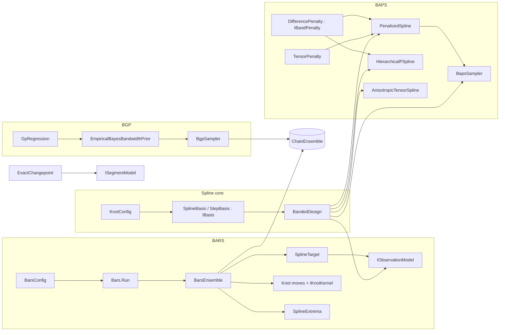

# Bayesian Regression

> Four Bayesian smoothing families that share one strategy: exploit Gaussian conjugacy in the regression coefficients (integrating them out, or drawing them from closed-form conditionals), then sample or select the remaining hyperparameters. **BARS** fits free-knot splines by reversible-jump MCMC. **BAPS** fits penalized splines (P-splines), including hierarchical and bivariate variants. The **Bayesian GP (BGP)** samples a kernel bandwidth under an empirical-Bayes prior. The **exact changepoint** model computes a piecewise-constant regression by dynamic programming. · **Project:** `Maths.Regression` (areas `spline/`, `spline/bars/`, `spline/baps/`, `bgp/`, `changepoint/`) · **Maturity:** core (see [Status](#status-and-caveats))

## Overview

`Maths.Regression` sits in layer 3 of the [architecture](./Architecture.md). It builds on:

- [Samplers](./Samplers.md): the reversible-jump engine and the ensemble shell;
- [LinearAlgebra](./LinearAlgebra.md): banded LDLᵀ and dense Cholesky;
- [ProbabilityAndInformation](./ProbabilityAndInformation.md): generators, the Gamma and Beta distributions, log-gamma.

The domain use visible in the code is **locating transitions in a curve over a thermal grid**: where it peaks, how many peaks it has, and where it changes level. BARS, for example, reduces each posterior curve to its exact peak and to significant-peak spans.

## Key concepts

- **Marginalize, then sample.**
  - BARS integrates out the spline coefficients (and, for the Normal model, the noise scale) and samples the *number and positions* of knots.
  - BAPS integrates the coefficients out in `MarginalEvidence` mode and in REML selection, and samples or selects the smoothing strength λ. Its `Gibbs`/`AdaptiveGibbs` modes and `HierarchicalPSpline` instead draw β from closed-form Gaussian conditionals, jointly with the variance components.
  - BGP integrates out the regression function and samples the bandwidth t.
- **Knot configuration.** The pair $(k,\xi)$: k interior knots $\xi_1<\dots<\xi_k$ in the open interval $(0,1)$. The domain is fixed to $[0,1]$, so inputs and evaluation grids must be pre-scaled.
- **Basis, design and band storage.** A basis turns a knot configuration into an $m\times\nu$ design matrix Z. Every model forms $Z^\top WZ$ in LAPACK lower-band storage (`band[d, j] = A(j+d, j)`) and factors it with band LDLᵀ. The dense $\nu\times\nu$ matrix is never formed.
- **Readouts.** Per-draw summaries pooled across draws and chains: fitted grid values, knot count, the exact argmax, **peak intensity** λ(T) (expected significant peaks per grid cell) and **span coverage** π(T) (the posterior probability that T lies in some significant peak's span; a draw counts T once even where nested spans overlap).

## Design

**BARS is a declarative config plus a strict core.** `BarsConfig` is an immutable record whose defaults are component instances. `Bars.Run(config, x, y, grid)` maps it onto a `BarsEnsemble`. The components plug in through interfaces:

| Seam | Implementations |
|---|---|
| `IBasis` | `SplineBasis` (clamped B-splines), `StepBasis` (piecewise constant) |
| `IObservationModel` | `WeightedNormalModel` (default), `PoissonModel`, `WhittleModel`, `GibbsLossModel` |
| `IComplexityPrior` | `UniformPrior`, `PoissonPrior` (default λ = 5), `ConwayMaxwellPoissonPrior`, `EbicPrior` |
| `IKnotKernel` | `UniformKernel`, `LocalBetaKernel` (default τ = 50); immutable, because one instance is shared by every chain. Adaptive τ is requested with `adaptKernelTau` / `BarsConfig.AdaptKernelTau`, which builds an internal `AdaptiveLocalBetaKernel` per chain. |
| `IWeightResampler` (optional) | `StudentTWeights`, `ContaminatedNormalWeights` |

`Bars.Run` passes only basis, model, prior, kernel and robustness settings. The DMGK move schedule and parallel tempering are reachable only by constructing `BarsEnsemble` directly. Per-chain adaptive τ (`adaptKernelTau`) is also a constructor option; see [Status](#status-and-caveats) for the other route.

**Three orchestration styles coexist.**

- `BarsEnsemble` and `BgpSampler` are clients of the ensemble shell `ChainEnsemble` (parallel replicas, R̂ and ESS on functionals).
- `BapsSampler` runs its own `Parallel.For` over seed-tree seeds and calls `ChainDiagnostics.RHat` on ln λ. It computes no ESS.
- `HierarchicalPSpline` runs a single chain with no diagnostics.

**Precompute invariants.**

- `GpRegression` caches pairwise squared distances.
- `BapsSampler` (Gibbs modes), `HierarchicalPSpline` and `AnisotropicTensorSpline` cache $Z^\top Z$ and $Z^\top y$. `PenalizedSpline`, and hence `BapsSampler`'s `MarginalEvidence` mode, re-assembles and refactors on every call (three solves per recorded step).
- `PenalizedSpline` re-assembles and refactors on every call.

**Extension points.**

- New bases, observation models, priors, kernels and resamplers for BARS (the interfaces above).
- `IBandPenalty` for new banded penalties in `PenalizedSpline` (REML evaluation; `BapsSampler` and `HierarchicalPSpline` accept only `DifferencePenalty`).
- `IGpKernel` for new radial GP kernels.
- `ISegmentModel` for new changepoint noise and level models.

## API at a glance

| Family | Entry points |
|---|---|
| Spline core | `KnotConfig`; `IBasis`; `SplineBasis(degree = 3)`; `StepBasis`; `BSpline.EvaluateBasis`, `BSpline.MakeClampedKnots`; `BandedDesign` (`Accumulate`, `AccumulateRhs`) |
| BARS | `BarsConfig`; `Bars.Run(config, x, y, grid)` → `BarsResult`; `BarsEnsemble(basis, model, prior, kernel, resampler?, dmgkConstant?, adaptKernelTau?, temperLevels?, temperBetaMin = 0.05, temperPath = Likelihood, temperSchedule = DeterministicEvenOdd, temperAdaptLadder = true)`; `PeakPosterior`, `PeakMode`, `PeakSpan`; `SplineExtrema` (`Argmax`, `SignificantPeaks`, `SignificantPeakSpans`) |
| BAPS | `DifferencePenalty(order = 2)`; `PenalizedSpline(design, y, IBandPenalty)` (`Coefficients`, `ProfiledVariance`, `RemlLogEvidence`, `EffectiveDegreesOfFreedom`, `EdfSlope`); `BapsSampler(...).Run(BapsLambdaUpdate, …)` → `BapsResult`; `HierarchicalPSpline(...).Run` → `HierarchicalResult`; `TensorProductDesign.Build` → `TensorDesign`; `TensorPenalty`; `AnisotropicTensorSpline` (`Coefficients`, `RemlLogEvidence`) |
| BGP | `SquaredExponentialKernel : IGpKernel`; `GpRegression(x, y, sigma2, kernel, scaling = Similarity)` (`Fit(t)` → `GpFit`, `PredictMean`, `KernelAffinity`, `Transform` → `GpTransform`); `EmpiricalBayesBandwidthPrior(gp, …)`; `BgpSampler(gp, prior).Run(...)` → `BgpResult` |
| Changepoint | `ExactChangepoint.Infer(y, σ², ν, ρ², maxSegments)` or `Infer(y, ISegmentModel, maxSegments)` → `ChangepointResult`; `DefaultHyperparameters(y)`; `GaussianSegmentModel`, `CauchySegmentModel` |

## Algorithms

### Spline core

- **Knot vector.** `MakeClampedKnots` builds $[0^{\times(p+1)},\xi_1..\xi_k,1^{\times(p+1)}]$, so a degree-p basis has $\nu=k+p+1$ functions. The default is cubic ($p=3$).
- **Basis evaluation.** `EvaluateBasis` finds the knot span by a linear search clamped to $[p,\nu-1]$, so $t=1$ falls in the last span. It then applies the Cox–de Boor recurrence (Piegl–Tiller A2.2) with zero-denominator guards and returns a dense row of length ν.
- **`StepBasis`.** An indicator design with $\nu=k+1$, used for changepoint-style carriers.
- **`BandedDesign`.** Scans each row for its first and last non-zero entry. Its bandwidth is the data-derived maximum span, which is at most p, not the spline degree itself. It accumulates $Z^\top WZ$ into band storage and $Z^\top Wr$ into a vector.

### BARS: target and moves

**Target.** $\log p(y\mid Z(\xi),W)+\log p(k)$. It includes no density term for ξ given k.

**Moves.** The default constant selection weights are birth 0.4, death 0.4 and relocate 0.2. The birth density is $q(x\mid\xi)=\varepsilon\,b(x)+(1-\varepsilon)\,\bar q(x\mid\xi)$, with $\bar q(x\mid\xi)=\frac1k\sum_ih(x\mid\xi_i)$ and $q=b$ when $k=0$ (`KnotBirthDensity`, below):

| Move | Proposal | $\log$ auxiliary ratio |
|---|---|---|
| Birth (`KnotBirthMove`) | $\xi^*\sim q(\cdot\mid\xi)$: from the base $b$ with probability ε (always when $k=0$), otherwise $h(\cdot\mid\xi_c)$ around a uniformly chosen knot | $-\log(k+1)-\log q(\xi^*\mid\xi)$ |
| Death (`KnotDeathMove`) | remove a uniformly chosen knot (unavailable at $k=0$) | $+\log k+\log q(\xi_d\mid\xi\setminus\xi_d)$ |
| Relocate (`KnotRelocateMove`) | perturb one uniformly chosen knot and re-sort | $\log h(\xi_{\text{old}}\mid\xi_{\text{new}})-\log h(\xi_{\text{new}}\mid\xi_{\text{old}})$ |

All Jacobians are 0.

**Relocation kernel** (measured 2026-10-22, `MixingBenchmark`, `RELOC_BENCH`). With births from the uniform base, the local kernel drives relocations only. Ten seeds per arm on `BirthBenchmark`'s seven fits, 4 chains × 10,000 draws. Peak-location ESS relative to the default local Beta kernel (τ = 50), medians:

| Arm | Narrow peak | Jump | Skewed design | Sine | Sine with outliers | Oscillation |
|---|---|---|---|---|---|---|
| Fixed τ = 10 (step SD about 0.15) | 0.72 | 0.38 | 0.93 | 1.22 | 0.97 | 0.52 |
| Fixed τ = 500 (about 0.02) | 1.01 | 2.45 | 1.35 | 0.58 | 0.65 | 0.94 |
| Adaptive from τ = 50 (`adaptKernelTau`) | 0.87 | 2.70 | 1.27 | 1.20 | 0.98 | 0.98 |
| Uniform, a global relocation | 0.42 | 0.13 | 0.55 | 1.12 | 0.72 | 0.53 |
| Even mixture of uniform and τ = 50 | 0.84 | 0.53 | 1.14 | 1.06 | 0.87 | 0.62 |

- **The adaptive kernel is the robust choice.** Its knot-count ESS was 0.98–1.09× of the default's on every fit, and its peak-location ESS 0.87–2.70×. Each fixed spread wins on some fits and loses badly on others.
- **Global relocation hurts every fit with several knots** (0.13–0.55×), because a uniform draw rarely improves a fitted arrangement. ABMRS's global relocations work over a discrete candidate grid instead.
- **No arm fixes the narrow peak's location** (τ ≈ 330), so its slow mixing is not a matter of relocation reach.
- **The data gap** is indifferent to the kernel.
- **Confirmed** with two Poisson fits added (`CONFIRM_BENCH=10`, nine fits). Knot-count ESS ranged over 0.98–1.19× with a geometric mean of 1.05, and peak-location ESS over 0.87–2.70× with a geometric mean of 1.15. Mean knots stayed within 1% and MSE within 4%. It passed the criterion set before the run: both geometric means above 1, no fit below 0.8× on either readout, and the posterior unmoved. It is a candidate default, not yet the default.

**Birth density (step 3.9, OQ11).** Birth and death share one `KnotBirthDensity`, so the reverse density always matches.
- **The default:** ε = 1 with the uniform base, so every birth is uniform on (0, 1). This is the birth of Denison et al. (1998), and the global birth that ABMRS uses over its candidates and BASS over observed values. Locality stays in the relocation move.
- **The settings:** `BarsConfig.BirthExploration`, or `birthExploration`. Below 1 it restores DMGK's local births in part, and at 0 entirely. `BirthBase.Design` draws from a histogram of the inputs mixed with the uniform at weight 0.1 (`DesignHistogramBase`).
- **Why.** A death's acceptance carries the reverse birth's density at the removed knot. Under local births, a knot far from the others is almost never removed: from knots at 0.39 and 0.96 that density is $e^{-37}$ or $e^{-61}$. Any ε > 0 bounds it below by ε·b(t).
- **What was measured** (`BirthBenchmark`, 10 seeds per arm, 4 chains × 10,000 draws; ESS relative to ε = 0):

  | Fit | Knot-count ESS at ε = 0.1 / 0.5 / 1 | Peak-location ESS at ε = 1 | Knot autocorrelation time, ε = 0 → 1 |
  |---|---|---|---|
  | Sine, n = 100 (the adaptive-stop fit) | 10× / 24× / 27× | 3.7× | 388 → 14 |
  | Sine with outliers, n = 120 | 23× / 54× / 76× | 31× | 3,377 → 45 |
  | Data gap, n = 120 | 23× / 38× / 38× | 1.2× | 265 → 7 |
  | Jump, n = 150 | 12× / 12× / 13× | 0.9× | 390 → 31 |
  | Skewed design, n = 150 | 3.5× / 5.0× / 5.5× | 1.0× | 249 → 45 |
  | Narrow peak, n = 150 | 1.6× / 1.8× / 2.1× | 1.0× | 121 → 59 |
  | Oscillation with about 13 knots, n = 200 | 0.9× / 0.9× / 0.9× | 0.95× | — |

  - **Unchanged:** mean knot counts and fit MSE at every ε, and the cost per step.
  - **The design base was never better than uniform:** 27× against 38× on the gap at ε = 1, and about equal on the skewed design.
  - **Densely packed knots** gain nothing (the 0.9× is within noise). Every knot has neighbors there, so the trap does not arise.
- **Trade-offs.**
  - **Wasted births.** Uniform births are mostly refused where the data do not want a knot. Those landing in data gaps are refused cheaply by the support gate, before any factorization (refusals as `ThinSupport` stayed at 2–7% of evaluations).
  - **Possible regimes outside the benchmark.** Local births could still help fits it does not cover, which is why ε stays a setting.
- **Alternatives considered.**
  - **A separate global birth/death pair:** it escapes the trap only at the global death's selection rate.
  - **The design base:** measured, no advantage.
  - **DMGK's local births (ε = 0):** they strand knots, as above.

**Kernels.**

- `LocalBetaKernel` proposes $\mathrm{Beta}(c\tau,(1-c)\tau)$ around center c, which concentrates new knots near existing ones.
- `AdaptiveLocalBetaKernel` tunes $\log\tau$ toward 0.44 relocate acceptance during burn-in (Robbins–Monro), with $\tau\in[1,10^5]$. It then freezes. Adaptation reads the chain's cumulative relocate counters in 200-step windows. A robustness resampler hands the chain its new target in place (`ReversibleJumpChain.ReplaceTarget`) every `WeightEvery` steps, so the counters, and the adaptation, carry across resamples.

**DMGK schedule.** $b_k=c\min\{1,p(k+1)/p(k)\}$, $d_k=c\min\{1,p(k-1)/p(k)\}$ and $r_k=1-b_k-d_k$, with $c\in(0,1]$ (default 0.4); the weights sum to one while $b_k+d_k\le1$. `DmgkSchedule.GreenConstant(prior, maxKnots, budget)` gives Green's own choice, the largest $c$ with $b_k+d_k\le0.9$. The schedule is Green's (1995, §4.1); Denison et al. (1998) and DMGK (2001) use it with $c=0.4$. It makes $b_kp(k)=d_{k+1}p(k+1)$, so the selection ratio cancels the prior ratio exactly. It is off by default (constant weights 0.4/0.4/0.2).

- **Effect on mixing.** Write $\pi(x)=p(k)L(x)$ and let $\tilde A=L\,q$ be a birth or death proposal's flow with the prior factored out. The stationary flow between $x\in\mathcal M_k$ and $x'\in\mathcal M_{k+1}$ is
  $$F_{\text{DMGK}}=c\min(p_k,p_{k+1})\min(\tilde A_f,\tilde A_r),\qquad F_{\text{const}}=c\min(p_k\tilde A_f,\,p_{k+1}\tilde A_r).$$
  Under the prior alone, Green's motivating case, the two agree, and DMGK turns the constant schedule's rejections into relocations. With a likelihood, $F_{\text{DMGK}}\le F_{\text{const}}$ at equal $c$: the prior moves from the acceptance into the proposal rate, and the acceptance cap means the lost proposals are not recovered. So the lag-1 autocorrelation and the expected squared jump of $k$ favor constant weights exactly. ESS(k) is not ordered, because the extra relocations interact with later dimension moves.
- **Normalization.** Equal $c$ gives DMGK a smaller dimension budget: under Poisson(4) at $c=0.4$, $\max_k(b_k+d_k)=0.72$, against 0.8. Green instead takes the largest $c$ with $b_k+d_k\le0.9$: 0.6 under Poisson(1), 0.5 under Poisson(4), 0.45 at a cap of 5. At equal budget neither schedule dominates. DMGK leads where the posterior sits on a flat prior top, and loses about a factor $p(k+1)/p(k)$ where prior and likelihood conflict.
- **Hard caps.** Birth weight vanishes where $p(k+1)=0$, so a cap costs no rejected proposals.
- **Measured.** On `DmgkScheduleTests`' problem (posterior at the Poisson(4) mode, equal $c$, before the knot-measure fix), 12 seeds showed no ESS(k) difference.
- **The schedule comparison** (2026-10-22, `MixingBenchmark`, `SCHEDULE_BENCH`). Uniform births throughout. 20 seeds per arm and regime, each pooling 4 chains × 10,000 steps after 2,000. The data: the sine (n = 100) under Poisson(2), with the posterior at the prior's mode; sin 7πx (n = 150), which wants about 8 knots, under Poisson(1), a conflict; and the same data under a uniform prior capped at 8. Medians, as ratios to the default constant 0.4/0.4/0.2, per step:

  | Regime | Arm | Knot count | Energy | Fit at 0.5 | Peak location |
  |---|---|---|---|---|---|
  | At the prior's mode | DMGK, c = 0.4 | 1.14 | 1.41 | 1.16 | 1.58 |
  | | Constant 0.3/0.3/0.4 | 0.90 | 1.23 | 0.93 | 1.39 |
  | | DMGK at Green's c (0.54) | 1.25 | 1.06 | 1.20 | 1.06 |
  | Prior–likelihood conflict | DMGK, c = 0.4 | 1.63 | 2.30 | 1.95 | 2.56 |
  | | Constant 0.3/0.3/0.4 | 1.44 | 2.07 | 1.40 | 1.97 |
  | | DMGK at Green's c (0.6) | 1.63 | 1.33 | 1.47 | 1.63 |
  | Active cap at 8 | DMGK, c = 0.4 | 1.06 | 1.15 | 1.25 | 1.22 |
  | | Constant 0.3/0.3/0.4 | 1.18 | 1.53 | 1.61 | 1.53 |
  | | DMGK at Green's c (0.45) | 0.92 | 0.94 | 0.99 | 0.96 |

  - **The default schedule is the worst, or nearly, everywhere.** DMGK at c = 0.4 beat it on every regime and readout, and was the best arm at the mode and under conflict. Under the cap the relocation-heavier constant schedule led. Per second the gains were as large or larger.
  - **Why.** At the posterior's k, DMGK spends about a third of its proposals on relocations, against the default's fifth, and it also scales the dimension moves by the prior. A constant schedule masked at DMGK's budget (b = d = 1/3 at the mode) recovered only part of the gain (1.19–1.27× on energy and peak location), so the prior-awareness counts beyond the relocation share.
  - **The theory holds.** ESJD(k) was equal at the mode (0.177 both) and favored the constant schedule under conflict (0.024 against 0.020), as derived above, while ESS(k) favored DMGK.
  - **Reversals** (a dimension change undone by the next one) ran at 72–86% in every arm, so no schedule moves k with persistence.
  - **The masked arm** equals the 0.3/0.3/0.4 schedule under Poisson(1), and their results agreed within seed noise, a check on the harness.
  - **Scope.** Normal fits only, with uniform births.
  - **The other conflict** (the confirmation run, `CONFIRM_BENCH=10`: `BirthBenchmark`'s seven fits and two Poisson fits under a Poisson(5) prior). Where the prior wants more knots than the data, on the gap and the counts (mean k 0.67), DMGK at c = 0.4 cut knot-count ESS to 0.29–0.33×. A death from k = 1 is proposed at 0.4·p(0)/p(1) = 0.08, the factor p(k+1)/p(k) the flow identity predicts. Over the nine fits its knot-count ESS averaged 0.73× (geometric mean), against 1.08× for the peak location.
  - **So no schedule dominates, and the default stays constant.** The schedule study's conflict ran the other way, a prior wanting fewer knots than the data, which is where DMGK wins. The relocation-heavier constant schedule, 0.3/0.3/0.4, never lost badly there (0.90× at worst), but it is untested on the other conflict.

**Priors.**

- `UniformPrior`: flat on $0..\text{max}$.
- `PoissonPrior`: $k\log\lambda-\lambda-\log k!$.
- `ConwayMaxwellPoissonPrior(lambda, nu)`: $k\log\lambda-\nu\log k!$, unnormalized (Conway and Maxwell 1962; Shmueli et al. 2005). ν = 1 is Poisson(λ); ν = 2 is the effective prior BARS ran under before the knot-measure fix; ν < 1 has heavier tails. With ν = 0 it is geometric and needs λ < 1.
- `EbicPrior(gamma, candidateCount)`: $(1-\gamma)\log\binom{C}{k}$ with $C$ = `candidateCount` and $\gamma\ge0$, He, Yang and Kang's convention (step 3.8); −∞ for $k>C$.

**Knot measure.** Given $k$, the knot locations are the order statistics of $k$ independent uniforms on $(0,1)$: density $k!$ on the ordered simplex $0<\xi_1<\dots<\xi_k<1$. The target's log prior is $\log p(k)+\log k!$, so $p(k)$ is exactly the knot-count prior. Off the open simplex, or where $p(k)=0$, the evaluation builds no design. Birth's $-\log(k+1)$ is the Hastings factor for that ordered representation, and the target is −∞ off the open simplex.

- **Checked.** Under a constant likelihood, `CountLawTests` recovers $p(k)$ bin by bin for Poisson, capped-uniform and Conway–Maxwell–Poisson priors, under both move schedules. The check is generic over the target and the move set, so BASS's term-measure check reuses it.
- **Before the fix** (until 2026-10-20), the target lacked $\log k!$, so the effective count prior was $p(k)/k!$. For `PoissonPrior(λ)` that is $\lambda^k/(k!)^2$, which `ConwayMaxwellPoissonPrior(λ, 2)` reproduces exactly. Runs with `PoissonPrior` now carry a weaker penalty and use more knots. `UniformPrior(max)` is now flat; it used to act as $1/k!$.
- **Choosing ν.** On the three `DmgkValidationTests` fits (smooth, sharp peak, jump; 8 seeds each):
  - ν = 1 used about half a knot more than ν = 2: mean $\bar k$ of 2.36, 4.70 and 4.78, against 1.82, 4.12 and 4.09.
  - Its mean fit-to-data MSE ratio was slightly lower: 0.077, 0.078 and 0.103, against 0.086, 0.096 and 0.110. The differences lie mostly within seed noise; ν = 1 won 6, 5 and 4 of the 8 paired seeds.
  - Both pass the same thresholds.

  At these sample sizes the marginal's Occam factor, about $\tfrac12\log(m+1)$ per basis function, matters more than the count prior. ν = 2 suits fits where over-knotting is costly, such as readouts that count peaks; ν = 1 lets the data decide. The default stays `PoissonPrior(5)`, which is ν = 1.
- **Support.** `Beta.Sample` can underflow to exactly 0 or 1, where `LocalBetaKernel`'s density is 0, so a birth or relocation there carried a Hastings term of +∞. Under a flat likelihood such knots were accepted and never removed, and the chain ran away; with data, design admission rejected them. The support rule now rejects them, and the engine rejects any candidate whose log target is −∞ or NaN, whatever its proposal ratio.
- **`EbicPrior`** (step 3.8). Its count law is He, Yang and Kang's: $\binom{C}{k}^{1-\gamma}$, the knot-count marginal of their joint prior $\tau(\mathcal M_k)^{-\gamma}$, where $\tau(\mathcal M_k)=\binom{C}{k}$ counts the k-knot models over C candidates (ABMRS Web Appendix A).
  - **The three regimes.** γ = 0 is BIC's uniform prior over models, which favors k near C/2. Between 0 and 1 it is EBIC's interpolation toward flat. γ = 1 is flat in k. Above 1 it penalizes.
  - **The range.** The authors recommend γ ∈ [0.5, 2] with default 1, and run 0.8, 1.0 and 1.2. Any γ ≥ 0 is accepted, since the recommendation is calibration, not a constraint of the law.
  - **The support** is [0, C], as theirs. For γ > 1 the law is symmetric in $k\leftrightarrow C-k$: it falls until C/2 and rises after, back to its starting value at k = C (`CountLawTests` reproduces that U shape). So choose C at least twice the largest knot count the data can support. Their package sets C = 3m. Data and the support gate keep chains far below C/2 in practice.
  - **Alternative considered:** truncating at ⌊C/2⌋, a declared extension of their law. It was not taken, because they do not truncate and the guidance suffices; it would remain available as a separate support rule.
  - **Only the count law is theirs.** BARS keeps its continuous ordered-uniform knot measure, so C is a complexity parameter rather than a grid, and nothing samples candidate positions.
  - **Mapping from the earlier convention.** Before step 3.8, `EbicPrior(γ)` was $-\gamma\log\binom{C}{k}$, which is this law at $\gamma_{\text{HYK}}=\gamma+1$. Callers add 1.
  - **How the pieces map.** Their EBIC posterior is a BIC-type marginal plus this count law. In BARS, the Normal model's g-prior marginal is their Lemma 1, so `WeightedNormalModel` with `EbicPrior` is ABMRS's Normal model on continuous knots. Their released code uses the BIC-type ratio instead (preparation brief, step 3.8). For non-normal responses, the Poisson model's BIC pathway, kept as a setting in preparation step 3.10, is the EBIC route.

### The collapsed g-prior block

`CollapsedGPrior` (namespace `Maths.Regression.GPrior`) holds the closed forms shared by the free-knot engines, BARS now and BASS next. The model is

$$y\sim N(Z\beta,\sigma^2W^{-1}),\qquad \beta\mid\sigma^2\sim N(\mu_0,\sigma^2(\tau G)^{-1}),\qquad G=Z^\top Z,$$

with the likelihood raised to an inverse temperature $b$ (1 is untempered).

- **Prior mean.** $\mu_0$ is zero unless the design layer centres it (`GPriorCentre`). The block's statistics are then those of the centred response $\tilde y=y-Z\mu_0$, and $\mu_0$ is added back to every mean and draw; below, $y$ stands for $\tilde y$. `BandedGPrior.Fit(…, centre)` builds the null-fit centre, $\mu_0=\bar y\,G^{-1}Z^\top\mathbf 1$, from the plain mean, even when weights enter.

- **Unweighted, W = I.**
  - The block caches the statistics that depend on neither τ nor $b$: the factor of $G$, $\hat\beta_{\text{OLS}}$, $\lVert r\rVert^2=\lVert y-Z\hat\beta\rVert^2$ and $Q=\lVert Z\hat\beta\rVert^2$.
  - `At(τ, b)` then costs O(1), plus the mean vector: $S=b\,(\lVert r\rVert^2+\tfrac{\tau}{\tau+b}Q)$, the determinant term $\tfrac p2\ln\tfrac{\tau}{\tau+b}$, mean $\tfrac{b}{\tau+b}\hat\beta$, and $\operatorname{Cov}(\beta\mid\sigma^2)=\sigma^2G^{-1}/(\tau+b)$.
  - Because $S$ is a sum of non-negative terms from the explicit residual, a small τ on a close fit keeps its digits. The subtracted form $b\,y^\top y-b^2Q/(\tau+b)$ loses about $\log_{10}((1+\tau)/\tau)$ of them.
- **Weighted (the robust path, Q2).** The posterior precision $P_a=Z^\top(W+\tau I)Z$ depends on τ, so this form is built at one τ and $b=1$. Its scale is $S=\lVert y-Z\tilde\beta\rVert_W^2+\tau\lVert Z\tilde\beta\rVert^2$.
- **σ².** The prior is IG($g_1, g_2$), or the improper $1/\sigma^2$ that BARS uses. The posterior is $\sigma^2\mid y\sim\mathrm{IG}(g_1+mb/2,\ g_2+S/2)$.
  - `LogMarginal` is the complete $\ln p_b(y\mid Z,\tau)$ (derivations review §3), comparable across τ and $b$. Under the improper prior it is defined up to that prior's constant.
  - `Sample` is a composition draw: σ² first, then β through the factor's precision draw.
  - `ConditionalVariance` returns $E[\sigma^2\mid y]\,z^\top\operatorname{Cov}z$.
- **Seams.** The factor is any `ISpdFactor`. `BandedGPrior` builds the block from a banded spline design; BASS's dense or incremental design layer will build it through `FromLeastSquares`. The block does not decide admission (it reports the factors' statuses) and knows nothing about the basis.
- **Admission comes before the fit.** `BandedGPrior.Fit` takes the caller's admission rule and applies it to each factor as soon as it exists, before anything is solved with it; a refused factor gives no block. A factor that breaks down can solve to NaN, from which no least-squares statistic may be formed. Until 2026-10-21 the Normal model judged the factor after building the block, so such a design threw instead of scoring −∞ (register R17; a likelihood-tempered hot rung found it).
- **Checks** (`CollapsedGPriorTests`):
  - scale, mean and determinant term against dense algebra at four (τ, $b$) settings;
  - the complete log marginal against quadrature over σ², under improper and proper priors and at tempered rungs;
  - draw moments at a tempered rung;
  - conditional variances;
  - a constructed near-interpolating fit, where the subtracted form loses its digits and the block keeps them;
  - the null-fit block against the zero-centred block on $y-\bar y$, at offsets 0, 5 and −300, with and without weights.

### BARS: observation models

**`WeightedNormalModel`** (default) is the exact unit-information (Zellner $g=m$) marginal, with the coefficients and σ integrated out, under the prior $\beta\sim N(\mu_0, m\sigma^2G^{-1})$:

$$\log p(y\mid Z)=-\tfrac{\nu}{2}\log(m+1)-\tfrac m2\log a,\qquad a=\tilde y^\top\tilde y-\tfrac{m}{m+1}\,b^\top G^{-1}b,$$

where $G=Z^\top Z$, $\tilde y=y-Z\mu_0$ and $b=Z^\top\tilde y$. By default the prior is centred on the null fit (`GPriorCentre.NullFit`, $Z\mu_0=\bar y\mathbf 1$ for B-splines); `GPriorCentre.Zero` is DMGK's original, $\tilde y=y$ (below). It returns −∞ when $m\le\nu$, when the design fails admission (below), or when $a\le0$. Because $a=\lVert \tilde y-Z\hat\beta\rVert^2+b^\top G^{-1}b/(m+1)$, the last case occurs only when $\tilde y$ is identically zero: a zero response, or under the null-fit centre any constant one. An interpolating fit with $m>\nu$ stays finite. It is computed through the collapsed g-prior block at τ = 1/m, from the explicit residual, $a=\lVert y-Z\hat\beta\rVert^2+\lVert Z\hat\beta\rVert^2/(m+1)$. At BARS's τ the subtracted form would lose at most $\log_{10}(m+1)$ digits; the explicit form loses none. The posterior mean is $\mu_0+\frac{m}{m+1}G^{-1}b$.

With per-point weights $W$ (robust runs, $y\sim N(Z\beta,\sigma^2W^{-1})$), the coefficient prior stays the **unweighted** g-prior $\beta\sim N(\mu_0, m\sigma^2G^{-1})$, centred with the plain mean, so the prior on the curve does not depend on the weights. The marginal is

$$\log p(y\mid Z,W)=\tfrac12\log\lvert G/m\rvert-\tfrac12\log\lvert P_a\rvert+\tfrac12\textstyle\sum_i\log w_i-\tfrac m2\log S,$$

with $P_a=Z^\top(W+I/m)Z$, $h=Z^\top W\tilde y$ and $S=\tilde y^\top W\tilde y-h^\top P_a^{-1}h=\lVert \tilde y-Z\tilde\beta\rVert_W^2+\tilde\beta^\top(G/m)\tilde\beta$. The posterior mean is $\mu_0+\tilde\beta$ with $\tilde\beta=P_a^{-1}h$, and the covariance given σ² is $\sigma^2P_a^{-1}$. At unit weights this reduces to the form above. Admission reads $G$ alone (see the numerical gate).

**Centring the Normal prior (2026-10-22, after step 3.10).**
- **The defect.** DMGK's prior is centred at zero, so it shrinks the whole fit toward zero, level included, by $m/(m+1)$, and the level's energy enters the scale, $a=\lVert y-Z\hat\beta\rVert^2+\lVert Z\hat\beta\rVert^2/(m+1)$. For a response far from zero against its noise, that term swamps the residual, so a knot barely moves the marginal.
  - **Measured** on a sine with noise 0.15 (n = 100, 4 chains × 3,000 draws), shifted by a constant:

    | Offset | Mean knots | Fit MSE | Mean pointwise SD | Level error |
    |---|---|---|---|---|
    | 0 | 1.80 | 0.004 | 0.046 | −0.01 |
    | 3 | 0.82 | 0.006 | 0.083 | −0.04 |
    | 10 | 0.42 | 0.018 | 0.21 | −0.11 |
    | 300 | 0.40 | 8.9 | 6.2 | −2.99 |

  - **Unseen until now** because every test curve sat near zero, and BARS did not centre the response.
- **The fix.** The prior is centred on the null fit, $\mu_0=\bar y\,G^{-1}Z^\top\mathbf 1$, the projection of the response's mean level onto the basis. The prior then shrinks the fit's shape toward flat, and leaves its level where the data put it.
  - **Location-invariant.** A constant shift of the response moves only the fit's level. On the sine above, every offset from 0 to 300 gives 1.80 knots, MSE 0.0040 and mean SD 0.046 (`NormalCentreTests`).
  - **Robust runs.** The centre uses the plain mean. A centre that depended on the weights would put the prior into the weights' conditional and break the exact Gamma or Bernoulli draw.
- **Trade-offs.**
  - **The prior reads the data,** through ȳ, the null model's estimate. Every configuration contains the constant, so the level contributes the same factor to every configuration's marginal, as a flat intercept's would.
  - **A constant response** has nothing left once centred, so it is refused as `ZeroResponse`. Under DMGK's centre only an identically zero one was. The centre keeps the constant exactly. A constant response takes its value as ȳ, and a basis that sums to one holds μ₀ = ȳ·1 with no solve. Another basis whose span holds the constant sets a constant response's centred value to zero. Before this, a projected constant left roundoff of about 1e-16, which the improper σ² prior admitted as a near-perfect fit (second external review).
  - **An outlier still moves the prior's centre** (open, OQ15). The plain mean ignores the robust weights, which keeps the weights' conditional exact. But as an outlier's weight goes to zero it still shifts the centre, and the fit by about R/m², where R is its size. In the review's intercept-only case with m = 40, that is 625 for R = 10⁶: negligible for ordinary outliers, large for a gross glitch. A median centre, which also depends only on the data, or a flat intercept would remove it.
  - **σ² gets m, not m − 1, degrees of freedom.** The level is centred on the data's own mean at no charge, where a flat intercept would spend one. Bayes factors differ from the flat-intercept form only as m does from m − 1 in one exponent.
- **Alternatives considered.**
  - **Zero, DMGK's original:** kept as `GPriorCentre.Zero`, with the defect above.
  - **A flat intercept with a centred design** (Liang et al. 2008): the same comparisons up to the m − 1 above. It needs the constant split out of the basis, which B-splines do not do.
  - **Centring the response outside the model:** equivalent for B-splines, but every caller would have to remember it, and a basis that does not sum to one would then need the projection anyway.
- **Effect on step 3.7's fits,** whose response averages about 0.6 against noise 0.1, an offset of 6σ:
  - knot counts rose 3–20% (dense 5.61 → 5.78, gap 0.72 → 0.79, sparse gap 0.85 → 0.96, robust gap 0.66 → 0.79);
  - pointwise SDs fell by up to 14%;
  - MSE moved both ways, within single-seed noise.
  - Knot-count ESS fell on two fits (dense 495 → 188, robust gap 1,809 → 939), on one seed; the mixing studies remeasure it.
  - Fits near zero mean moved by about 0.1%, the level's old shrinkage.

**Tempered marginal (step 3.1).** `IObservationModel.TemperedMarginal(design, y, weights)` builds one design's marginal as a function of the likelihood's inverse temperature $b$, with β and σ² integrated against $p(y\mid\beta,\sigma^2)^b$. `SplineTarget` hands it to the samplers as the likelihood half of a configuration's evaluation ([Samplers](./Samplers.md)). For the unweighted Normal model, from the block at τ = 1/m:

$$\ell_b(Z)=\tfrac{\nu}{2}\log\tfrac{\tau}{\tau+b}-\tfrac{mb}{2}\log S_b,\qquad S_b=b\big(\lVert \tilde y-Z\hat\beta\rVert^2+\tfrac{\tau}{\tau+b}\lVert Z\hat\beta\rVert^2\big).$$

- **The omitted constant.** $\ell_b$ is the complete improper-prior marginal less $\log\Gamma(mb/2)-\tfrac{mb}{2}\log\pi$, which depends on m and b only. It cancels in Metropolis ratios, in swaps between rungs and in normalized SMC weights; an evidence estimate must restore it. `TemperedMarginalTests` checks that the difference is the same across designs of different sizes.
- **At b = 1** it is exactly `LogMarginalLikelihood`, computed once per design, since every chain and swap reads it.
- **b = 0 is refused.** Under the improper 1/σ² prior, σ² has no posterior at $b=0$. The block's `LogMarginal` takes a proper inverse-gamma prior, which would allow it; BARS keeps the improper prior, so a likelihood-tempered ladder's hottest rung needs $b>0$ (step 3.2).
- **The weighted marginal serves b = 1 only**, because $P_a$ depends on b. Tempering therefore stays incompatible with the robust resampler, which `BarsEnsemble` already enforces.
- **Poisson, Whittle and Gibbs-loss temper linearly,** $\ell_b=b\,\ell_1$: their Laplace (or pseudo-) marginal raised to $b$, with the knot prior untempered. Integrating β against the tempered likelihood would need an IRLS fit at every rung and at every swap. The linear form also runs to the posterior from $b=0$, where it is 0. A marginal of −∞ stays −∞ at every $b$, $b=0$ included, so that endpoint is the prior restricted to the configurations the model admits, not the prior itself (OQ2 splits the refusal reasons an exact reference must treat).
  - **Two forms, one path.** Both are likelihood-tempered: the prior is whole and the hot measure is the same in every representation. They differ in how hard a hot rung charges for dimension. The integrated form's Occam factor per basis function is $(1+mb)^{-1/2}$, about 0.97 nats at $b=0.05$, $m=120$; the linear form charges $b$ times its untempered penalty, $b\cdot\tfrac12\log m$ for the BIC term, about 0.12 nats there.
  - **Measured** (ladder 1 → 0.05, Poisson(5) count prior, 20,000 sweeps): the Normal model's rungs average 3.10, 1.68, 1.51 and 1.97 knots; Poisson's, on count data, 0.58, 2.19, 3.66 and 4.37, close to the prior mean. On the powered path both head for Poisson(5^β) ≈ 1.08 knots at $β=0.05$ (1.03 and 1.10).
  - **The interface default** still serves $b=1$ only, so a custom model must opt in (`TemperedMarginal`, `CanTemperLikelihood`).
- **m ≤ ν, an inadmissible design or a zero response** is −∞ at every b, so admission does not depend on the temperature.

**Laplace/BIC-type models.** `WhittleModel` and `GibbsLossModel` return (log-likelihood at the estimate) $-\tfrac\nu2\log m$. So does `PoissonModel` on its BIC pathway, while its default is the Laplace marginal under a g-prior:

- **`PoissonModel`** (counts): log link, IRLS fit, η clamped to ±30. Weights are ignored. The knot marginal is a setting, `PoissonMarginal` (step 3.10, OQ12):
  - **`GPrior`, the default.** The prior is the unit-information g-prior $\beta\sim N(\beta_0,\Lambda^{-1})$ with $\Lambda=\tfrac{\bar y}{m}B^\top B$. That is $g\,(B^\top W_0B)^{-1}$, with $g=m$ and $W_0=\bar yI$ the Fisher weight of the null fit $\mu=\bar y$. The mean $\beta_0$ projects the null fit's log-intensity $\log\bar y$ onto the basis ($\beta_0=\log\bar y\cdot\mathbf 1$ for B-splines, which sum to one).
    - **The fit.** The mode comes from penalized IRLS started at $\beta_0$: $(B^\top\hat WB+\Lambda)\beta^+=B^\top\hat Wz+\Lambda\beta_0$.
    - **The marginal** is its Laplace approximation, $\ell(\hat\beta)-\tfrac12(\hat\beta-\beta_0)^\top\Lambda(\hat\beta-\beta_0)+\tfrac12\log|\Lambda|-\tfrac12\log|H|$, with $H=B^\top\hat WB+\Lambda$ (the $2\pi$ terms cancel).
    - **Its rules.** A zero response, $\bar y=0$, is refused as `ZeroResponse`. The numerical gate applies to both factored matrices, $B^\top B$ and $H$.
  - **`Bic`.** DiMatteo, Genovese and Kass's original: the MLE, with $\ell(\hat\beta)-\tfrac\nu2\log m$. It is the base He, Yang and Kang's EBIC builds on, and it keeps OQ12's separation behavior (see the limitations).
  - **The coefficient draw** corrects the Laplace proposal by independence Metropolis–Hastings, against the likelihood times the coefficient prior. That prior is the g-prior itself, or under BIC an N(0, 100) ridge on each coefficient, which enters only the draw's correction.
- **`WhittleModel`** (periodograms): $\ell=\sum(-\eta_i-I_ie^{-\eta_i})$, fitted by IRLS with unit weights.
- **`GibbsLossModel`**: a Tukey-bisquare pseudo-likelihood with $c=4.685$ and a difference-based MAD scale.

The three IRLS fits (Poisson, Whittle and GibbsLoss's Tukey reweighting) return −∞ when the iteration cap (100, 100 and 50) is reached before the step settles (squared step < 1e-9).

**The Poisson g-prior (step 3.10, OQ12).**
- **The defect it fixes.** Over a run of zero counts the Poisson MLE lies at −∞. IRLS stopped at a fixed point of the η clamp and the μ floor, and the BIC marginal still gave those configurations real mass. Behind that were two coefficient priors: the draw targeted the likelihood times the N(0, 100) ridge, while BIC approximates the Bayes factor under a unit-information prior (Kass and Wasserman 1995).
- **Why this prior.**
  - **It makes BIC's prior explicit and proper.** The g-prior with g = m is the GLM analogue of the Normal model's Zellner prior at g = m (Sabanés Bové and Held 2011; Li and Clyde 2018). Its mode stays finite in a separated direction, so the clamp and the floor go back to being overflow guards.
  - **Its Occam factor.** It is $\tfrac12\log|I+\Lambda^{-1}B^\top\hat WB|$, about $\tfrac12\log(1+m\,\mu_j/\bar y)$ per basis function, where $\mu_j$ is the fitted rate under it. At a flat fit that is $\tfrac12\log(1+m)$, BIC's charge. Where the rate is low a knot costs less, because the data there carry less information.
- **Why the null fit's information.** At the MLE the information in a separated direction is near zero, so a prior scaled by it, as in Li and Clyde's $J(\hat\beta)$ form, would be infinitely wide there and keep the separation. The null fit's $\bar yI$ is positive wherever there are any counts.
- **Why the null fit's mean.** The preparation brief wrote the prior at mean 0, the form of the Normal model's Zellner prior. On the log-intensity, mean 0 puts the prior's one pseudo-observation at one count per bin. That pulls the log-rate toward 0 by about $\log\bar y/(m+1)$, about 4% of the rate at $\bar y=50$, $m=100$. Its penalty on the fit's shape also scales with $1-\log\bar y$, so it changes sign above $\bar y=e$. Centring at the null fit removes both. It is a proper counterpart of Sabanés Bové and Held's flat intercept, and needs neither an intercept column nor the constant in the basis's span.
- **Trade-offs.**
  - **More work per IRLS fit.** Each evaluation also factors $B^\top B$ and $H$, and solves once for $\beta_0$. It is still faster than BIC's (measured below).
  - **The prior reads the data,** through $\bar y$ in its scale and mean, as the null-information choice requires. Both are the same for every knot configuration.
  - **It is a Laplace approximation.** Against importance sampling at m = 40 and ν = 5 or 6, its error is −0.017 and −0.024 nats, and −0.008 for their ratio (`PoissonGPriorTests`). That is about 1% of the Occam factor per basis function.
  - **It is not fixed-scale shrinkage.** The prior's scale follows $B^\top B$, so a basis function with little data under it gets a wide prior there. The support gate refuses the worst of those, and the question stays parked with BASS's coefficient-prior decisions (D03).
- **Alternatives considered.**
  - **A penalized mode with a fixed ridge** (OQ12's remedy a). Its Occam factor, about $\tfrac12\log(1+100\,J_{jj})$, depends on the ridge's arbitrary scale and makes knots cheap where μ is small.
  - **A count gate** (remedy b), refusing configurations with a basis function that sees no counts. It is a support restriction that depends on the response, and it leaves the two priors mismatched.
  - **The MLE's information,** $J(\hat\beta)$: it fails under separation, as above.
  - **A flat intercept** (Sabanés Bové and Held): improper in the constant direction. It needs the constant to be in the basis's span, and it differs from the null-centred prior by $O(1/m)$.
  - **Mean 0:** it biases the level, as above.
- **Measured** (4 chains × 3,000 draws after 1,500, Poisson(6) count prior).
  - **Step 3.7's low-rate fit** (rate $e^{1.5-5x}$, from 4.5 counts per bin to 0.03, n = 150), g-prior against BIC:
    - the log-intensity's MSE over the data fell from 163,982 to 0.16, and beyond x = 0.6 from 412,006 to 0.33;
    - its largest posterior SD fell from 199 to 0.54;
    - R̂(k) went from 1.058 to 1.002, and knot-count ESS from 119 to 638;
    - the 14 inadmissible or non-converged evaluations went to none.
  - **Five count fits**, 5 data seeds each, g-prior / BIC, medians:

    | Fit | Mean knots | Log-intensity MSE |
    |---|---|---|
    | Peak (`PoissonTests`), 3.3 to 12 counts, n = 150 | 3.29 / 3.26 | 0.011 / 0.011 |
    | Spike histogram, baseline 0.5 and peak 8.5 counts, n = 120 | 4.84 / 4.61 | 0.168 / 0.170 |
    | Sine, 1.6 to 12 counts, n = 150 | 1.43 / 1.23 | 0.009 / 0.008 |
    | Sine, 20 to 55 counts, n = 150 | 3.93 / 3.81 | 0.003 / 0.003 |
    | Low rate (above) | 1.26 / 0.68 | 0.17 / 12,948 |

  - **Away from separation the fits agree** within seed noise, and the g-prior carries 0.03–0.23 more knots, because its Occam factor is lighter where the rate is low. Its bias in the level stays under 0.01 on the log scale at every count level.
  - **Speed.** On the peak fit (ν = 6 and 9), an evaluation took 52–59 µs against BIC's 76–99 µs. IRLS starts at the null fit and needs fewer steps, which more than pays for the extra factorizations.

**Design admission (Q6, step 3.7).** A knot configuration is scored only if it passes two gates, which answer different questions. Otherwise its score is −∞, and `BarsResult.Evaluations` counts the refusal by reason.
- **Support gate** (`SplineTarget.MinColumnMass`, `BarsConfig.MinColumnMass`, default 1). Every basis function needs column mass $\sum_i B_j(x_i)\ge1$, one data point's worth. It is checked before anything is factored, and a refusal is counted as `ThinSupport`.
  - **What it means.** It reads only the inputs and the knots, so it is a declared restriction of the knot prior's support. The effective knot prior is $p(k)\,k!\,\mathbf 1\{\text{supported}\}$ on the ordered simplex, so the knot count's prior law becomes $p(k)\,s(k)/Z$, where $s(k)$ is the chance that k uniform knots pass (`CountLawTests` checks this against direct sampling).
  - **Its resolution limit.** For uniformly spread data an interior basis function's mass is about the number of points per knot interval, and the first one's is about $n\xi_1/4$. So the gate needs about four points before the first interior knot.
  - **Why mass.** In a data gap, a basis function whose data sit only in its cubic tail gets a coefficient of about $r/B_j(x_i)$. The fit spikes inside the gap, and coefficient draws, whose variance grows like $1/B^2$, swing further. The g-prior's shrinkage is isotropic, so it adds nothing there. Of the statistics tried on such designs (preparation brief, admission evidence), mass ≥ 1 alone refused every wild configuration and no sane one on dense data.
  - **Alternatives considered.**
    - A data count per basis function: BASS's `npart`, the right statistic for half-space hinges. It counts tail points fully and passes wild configurations.
    - The Kish effective size, which ignores a common scale.
    - Mass ≥ 2.5, which also refuses sane boundary configurations.
    - Leverage, which measures the instability exactly but flags every fit across a real gap; it belongs among the readouts.
- **Numerical gate** (`DesignAdmission`). The model's strict factor, with no pivot floor, must be positive definite, with `MinRelativePivot` ≥ 1e-10 and an estimated equilibrated condition number of at most 1e10 (`MaxCondition`, added in the review follow-up). Inside an IRLS fit each step checks the pivots (`PivotsAdmit`), and the final system gets the full gate. A refusal is counted as `Inadmissible`.
  - **Why the equilibrated matrix.** The condition number of $D^{-1/2}AD^{-1/2}$, $D=\operatorname{diag}A$, governs Cholesky's accuracy (van der Sluis 1969; Demmel 1989). Above 10¹⁰ a solve may lose ten of its sixteen digits.
  - **Why both checks.** 1/`MinRelativePivot` only bounds that condition number from below. A small pivot proves a bad matrix, but a healthy one proves nothing: a matrix with every relative pivot at 0.2 can have a condition number near 10¹⁵ (`DesignAdmissionTests`). The condition estimate ([Linear Algebra](./LinearAlgebra.md)) measures it, and the pivots stay as the free first test.
  - **Measured on spline Grams.** Over about 17,000 configurations that pass the support gate (40 points; even, gapped and clustered designs; cubic splines), the worst equilibrated condition number was 537, and 1/`MinRelativePivot` came within 60× of it. The step probes were byte-identical once the estimate was added, so it refused nothing that real fits proposed. It guards designs outside that range, such as BASS's dense ones.
  - **Scale-free.** Neither check changes when a column is rescaled (`DesignAdmissionTests`).
  - **What it means.** For the Normal and Whittle models the factored matrix depends only on the inputs, so the gate restricts the prior support further, to designs that are not nearly collinear.
    - **Robust runs.** The weighted block admits on $G=Z^\top Z$ alone, so a weight update cannot move the current knots out of the support, and robust and plain fits share one knot support. $P_a=Z^\top(W+\tau I)Z\succeq\tau G$ is then positive definite whenever G is, and its conditioning is within $(w_{\max}+\tau)/(w_{\min}+\tau)$ of G's. A $P_a$ that still fails to factor throws.
    - **Poisson and GibbsLoss.** Their matrix is weighted by the fit, so the gate depends on the response and truncates the posterior numerically. The same holds for the IRLS non-convergence rule. That weighting is a function of the knots and the data, not a sampled state, so no conditional has to respect it.
  - **Alternatives considered.**
    - *Joint knot/weight admission,* gating $P_a$ too, as before the review follow-up. It is exact only with a weight update that rejects draws refusing the current knots, and it makes the knot support depend on latent outlier weights.
    - *Model-specific admission:* a proper coefficient prior could admit rank-deficient designs. Rejected, because coefficients of data-free basis functions would then be set by the prior alone.
    - *The pivot ratio,* used before step 3.7: scale-dependent, and in effect a threshold on column energy against the largest pivot, so it mixed thin support with conditioning.
    - *The absolute pivot floor alone:* it misreads scale.
- **Effect on results** (step 3.7's probe, 4 chains × 3,000 draws):
  - **Across a data gap,** the fit's MSE fell 29× (0.0060 → 0.0002) and its largest posterior SD in the gap 11× (0.37 → 0.03).
  - **Beside a sharp transient at x = 0.03,** the MSE on [0, 0.1] fell 25× and the posterior SD there 68× (5.1 → 0.075), with the transient still located at 0.0309 [0.0289, 0.0329].
  - **Dense data** were unchanged.
  - **How often each gate refuses.** The support gate refused 0.6–10% of evaluations. The numerical gate alone changed only the few configurations the pivot ratio had misjudged.
  - **Poisson's BIC pathway** is the exception (OQ12; see the limitations). Its g-prior pathway, the default since step 3.10, is not.

**Robust weights.** `StudentTWeights` ($\nu=4$) and `ContaminatedNormalWeights` ($\pi=0.05$, $\kappa=10$) are scale mixtures of normals. Every `WeightEvery` steps (default 25), the weight block runs an exact Gibbs sweep:

1. Draw $(\sigma^2,\beta)$ from their conditional given the knots and the current weights: $\sigma^2\sim\mathrm{IG}(m/2,S/2)$, then $\beta\sim N(\tilde\beta,\sigma^2P_a^{-1})$.
2. Draw each weight from its full conditional given the residual $r_i=y_i-z_i\beta$ and $\sigma^2$:
   - Student-t: $w_i\sim\mathrm{Gamma}\big((\nu+1)/2,\ \text{rate } (\nu+r_i^2/\sigma^2)/2\big)$;
   - contaminated normal: $w_i=1/\kappa^2$ with the posterior probability that $r_i$ came from the inflated component, and 1 otherwise.
3. Hand the chain the target given the new weights (`ReplaceTarget`).

The knot moves integrate β and σ² out given the weights, so the sweep is a valid collapse-then-redraw scan. The block draws from its own stream. Each chain seed fans out into three child seeds, one each for the start and untempered chain, the tempering ladder, and the weight block, so no two generators share a stream.

- **Gross outliers.** The contaminated-normal responsibility comes from its log odds, $\log\frac{\pi}{(1-\pi)\kappa}+\tfrac12\frac{r^2}{\sigma^2}(1-\kappa^{-2})$. As a ratio of the two densities it was 0/0 past about 386σ, which gave the grossest outliers full weight (fixed in the review follow-up).
- **Model requirement.** Robust weights require `WeightedNormalModel`, the only model that conditions on weights and draws σ². The ensemble rejects a resampler paired with any other model.
- **Trade-offs.** The unweighted prior makes the weight update an exact Gamma (or Bernoulli) draw, at the cost of two banded factorizations per proposal in robust runs ($G$ and $P_a$) instead of one. The alternative, a g-prior on the weighted Gram $Z^\top WZ$, keeps one factorization. But its prior on the curve shifts with the outlier weights, and the weights' conditional gains a $\lvert Z^\top WZ\rvert^{1/2}$ factor that needs a Metropolis correction.
- **Effect.** The exact block is justified by targeting the right posterior, not by a measured gain. On the robustness test problem, MSE to the truth is 110× (Student-t) and 144× (contaminated normal) lower than least squares. These single-seed ratios move by tens of percent when only the seeds change, so they do not separate the exact block from the plug-in one it replaced.

### BARS: orchestration and readouts

**Chain start.** Each chain starts overdispersed: $k\sim U\{0..4\}$ with sorted uniform knots. With `temperLevels` set, each chain is a parallel-tempering ladder, which cannot be combined with the resampler or with `adaptKernelTau`.

**Readouts, admission outcomes and checkpoints (step 3.4).**
- **Readouts.** Each chain's readout statistics (`BarsReadout`) merge across chains once ([Samplers](./Samplers.md), "Readouts, traces and checkpoints"):
  - the conditional-variance field behind `FitSd`;
  - the λ and π fields;
  - the peak location, height and count;
  - the peak sample for the credible interval;
  - an admission tally.

  The peak location's ordered draws are a separate trace, which `Peak.LocationConvergence` reads.
- **Admission outcomes.** `BarsResult.Evaluations` counts every evaluated knot configuration, burn-in and every ladder rung included, by why it was refused, so the truncation the support rules and admission impose stays visible. The reasons (`DesignRejection`) are: outside the open simplex; a zero count prior; thin support (the support gate, step 3.7); m ≤ ν; an inadmissible factor; an IRLS fit that did not settle; a zero response. The observation models report them through `ITemperedMarginal.Rejection`.
- **Checkpoints.** `BarsEnsemble.Run(…, checkpoint: true)` returns the run's restart state in `BarsResult.Checkpoint`. `Run(…, resumeFrom: c, samples: n)` continues it for n more draws, exactly as the uninterrupted run would have, and reports every draw since burn-in. Each chain's state holds:
  - its knot configuration, robust weights and their cadence;
  - every RNG stream's words;
  - the adaptive kernel's log τ, saved exactly rather than as τ, since rebuilding from τ = e^{log τ} could move it by an ulp;
  - the chain's or ladder's snapshot;
  - the ladder's burn-in counts;
  - copies of its readout and peak trace.

  The fingerprint covers the data, the run settings and each component's type; the components' internal parameters (a prior's mean, a kernel's spread) are the caller's to keep the same.

**Tempering path (Q5, step 3.2).** `temperPath` declares the ladder's path ([Samplers](./Samplers.md)).
- **Default: likelihood-tempered** (Q5, decided per engine 2026-10-21). Rung $b$ samples $p(k)\,k!\,e^{\ell_b}$ with $\ell_b$ the tempered marginal above. The knot prior stays whole, so the hottest rungs approach the prior itself, and they do so in any representation of the knots ([Samplers](./Samplers.md), "What separates them"). This is BARS's own principled default. Other engines choose their own path, and both paths stay selectable here. Whether BARS should default to the powered path is an open question (the preparation brief's OQ1), settled by comparing ladders tuned on their own terms.
- **Alternative: `TemperingPath.Powered`,** $(p(k)\,k!\,e^{\ell_1})^b$. Its hot rungs leave the prior in the direction the ordered-simplex measure sets: under a constant likelihood and a Poisson(λ) prior, rung $b$'s knot count is Poisson(λ^b), so hot rungs carry fewer knots than the prior. `CountLawTests` checks both laws rung by rung.
- **The same cold chain.** Both paths' cold rung is the posterior. On the probe data, a 4-rung ladder on each path agrees with untempered chains 15 times longer on mean knot count, fitted values, pointwise SD and peak count (8 seeds each, all |z| ≤ 1.6). Short untempered runs did not: one of 12 seeds sat at a mean of 1.6 knots against about 3.0, the slow knot-count mixing noted under caveats.
- **Requirements.** The likelihood path needs a model with a tempered marginal at every rung, `CanTemperLikelihood`. Every built-in model has one at unit weights: the Normal model's integrated marginal, and the linear form for Poisson, Whittle and Gibbs-loss. A custom model without one must use the powered path; the constructor rejects the combination. `temperBetaMin` must lie in (0, 1), because the Normal model's improper σ² prior refuses $b=0$.
- **Poisson on the likelihood path.** A 4-rung ladder agrees with untempered chains 15 times longer, and with a powered ladder, on mean knots, fitted values, pointwise SD and peak count (8 seeds each, all |z| ≤ 1.66).
- **Trade-off.** Likelihood-path hot rungs hold about as many knots as the prior (λ = 5 by default), where powered hot rungs hold fewer, and each proposal's cost grows with the knot count. The likelihood rungs also query $\ell_b$ at $b<1$, an O(p) step on top of the cached $b=1$ value.

**Swap schedule and ladder adaptation (step 3.3).** `temperSchedule` defaults to deterministic even-odd, and `temperAdaptLadder` to true ([Samplers](./Samplers.md)).
- **Adaptation in burn-in.** Burn-in runs Syed et al.'s Algorithm 4: rounds of 1, 2, 4, … scans, each followed by a re-spacing of the interior rungs to equal rejection rates. Sampling keeps the last ladder. The geometric ladder from `temperBetaMin` is the start, and both ends stay put.
- **Measured** (`TemperingBenchmark`, 3 seeds × 20,000 scans per configuration).
  - Adaptation raised DEO's round trips on the sine fit by about 1.3× at 4 rungs and 1.2× at 8, and was neutral on the peak and count fits.
  - An adapted 8-rung likelihood ladder on the sine fit: 1, 0.864, 0.711, 0.562, 0.433, 0.309, 0.157, 0.05.
- **The cold chain's law is unchanged.** Mean knots agree across every schedule, path and adaptation setting: sine 2.96–3.16, peak 5.58–5.65, counts 0.56–0.65.
- **Comparing paths.** Round trips cannot compare the likelihood and powered ladders, because their hot ends differ ([Samplers](./Samplers.md), "What round trips do not measure"). The neutral measure is the cold chain's ESS at equal work.
  - **Measured** (step 3.4: 8 chains per estimate, two replicate groups, 20,000 scans, adapted 8-rung ladders, hot end β = 0.05). The table gives knot-count bulk ESS.

    | Fit | Likelihood ladder | Powered ladder | Untempered, equal work |
    |---|---|---|---|
    | counts | 17,300–17,800 | 86,100–88,100 | 7,500 |
    | peak | 4,700–5,000 | 7,800 | 6,600 |
    | sine | 1,200–1,400 | 1,400 | 240 (R̂ 1.18) |

  - **The shared hot end favours the powered ladder.** The ESS ordering follows each ladder's barrier: on counts Λ̂ is 0.24 for the powered ladder and 1.4 for the likelihood ladder. At β = 0.05 the likelihood rung is nearly the knot prior, a reach a unimodal posterior does not need, while the powered rung stays near the posterior.
  - **These runs used local births** (ε = 0), the trapped kernel of OQ11. The measurement below replaces them.
- **Measured on the default kernel** (2026-10-22, OQ1 and OQ4). `TemperingBenchmark` with births from the uniform base, adapted DEO ladders, 8 ladders per estimate in two replicate groups, 20,000 scans each. The reference is untempered chains of equal work (8 × L chains, each as long), and the table gives cold-chain ESS per replica-step relative to it. The two groups agree to about 10%, and 4 rungs tell the same story.

    | Fit, 8 rungs | Knot count: β_min 0.05 / 0.2 / 0.35 / 0.5 / powered 0.05 | Peak location: the same arms |
    |---|---|---|
    | Narrow peak, n = 150 | 0.51 / 0.78 / 1.00 / 1.18 / 0.65 | 1.03 / 1.40 / 1.63 / 1.65 / 1.37 |
    | Sine with outliers, n = 120 | 0.65 / 0.73 / 0.85 / 0.96 / 0.70 | 0.65 / 0.71 / 0.75 / 0.91 / 0.65 |
    | Counts, n = 120 | 0.34 / 0.37 / 0.38 / 0.40 / 0.46 | 0.36 / 0.37 / 0.38 / 0.41 / 0.42 |
    | Oscillation, about 13 knots, n = 200 | 0.31 / 0.58 / 0.73 / 0.96 / 0.33 | 0.37 / 0.65 / 0.64 / 1.10 / 0.37 |

  - **Tempering rarely pays.** On the knot count no arm beat untempered chains, apart from the shallowest on the narrow peak (1.18×). The one real gain is the narrow peak's location, its slow readout (τ ≈ 330): 1.4–1.65× with β_min from 0.2 to 0.5.
  - **A deeper hot end is worse.** Efficiency rose with β_min on every fit and readout, and 0.05, the default, was the worst likelihood arm everywhere. The powered path at 0.05 never beat the likelihood path at 0.35–0.5 on the Normal fits. On counts both lost to untempered chains (0.46× and 0.40×).
  - **Step 3.4's lead was the trapped kernel's.** Under local births, tempering escaped the stranded-knot trap; uniform births escape it directly.
  - **No multimodal fit was found.** On six two-bump designs (n = 150, noise 0.15–0.2, Poisson(1)–(5) priors), untempered chains crossed between the bumps freely: R̂ of the peak location stayed at or below 1.011. Switching which feature a small model fits passes through fitting neither. That costs at most one feature's evidence, which is comparable to its Occam cost when only one can be afforded, so the barrier stays low.
- **When to temper** (OQ4). Run untempered first and read `BarsResult.Knots` and `Peak.LocationConvergence`. On the measured fits untempered chains matched or beat every ladder, except for a sharp peak's location, where a shallow likelihood ladder (β_min 0.35–0.5) gained up to 1.65×. A deep ladder is for a posterior with real barriers, which none of these fits had. The default hot end stays at 0.05 (OQ3): tempering is for suspected barriers, which a shallow ladder cannot cross, and on a unimodal fit the deep end costs efficiency, not correctness.
- **Readouts** (step 3.4). `BarsResult.Tempering`, null for an untempered run, reports the sampling phase averaged over chains: round-trip and annealed-restart rates per scan, each pair's mean rejection rate, the barrier, Theorem 1's ideal rate (NaN for the sweep), and each chain's final rungs.

**Functionals.** Index 0 is the knot count. Indices $1..g$ are the fitted grid values. Among the shell functionals, ESS is computed for the knot count only; `PeakPosterior` computes its own R̂ and ESS on the argmax draws.

**What one draw represents.** Each posterior draw is a knot configuration, and each readout uses whichever of two curves its form allows:

- **Readouts affine in the curve** — the fitted values (`Fit`, `RHatFit`), and by extension derivatives and integrals — use the *conditional mean* given the knots. Averaging conditional means is exact for these and has lower Monte Carlo variance than averaging coefficient draws (Rao–Blackwell).
- **Readouts nonlinear in the curve** — the argmax (`Peak`), significant peaks, their spans and counts (λ, π, `PeakCountMean`, `PeakModes`) — use a *coefficient draw* from the conditional posterior, so they include coefficient uncertainty as well as knot uncertainty. The conditional mean would understate their spread (Jensen).
- **`FitSd`** is the pointwise posterior sd by the law of total variance: $\mathrm{Var}[f(T)] = \mathrm{Var}_{\text{draws}}[m(T)] + \mathrm{E}_{\text{draws}}[v(T)]$, with $m$ the conditional mean and $v$ the model's conditional variance. It is exact, with no extra sampling.

How exact the draws and $v$ are depends on the model (`BarsResult.Uncertainty`, `CoefficientUncertainty`):

| Model | Label | Draw | Conditional variance $v(T)$ |
|---|---|---|---|
| `WeightedNormalModel` | `Exact` | $\sigma^2\sim\mathrm{IG}(m/2, a/2)$, then $\beta\sim N(\mu_0+\tfrac{m}{m+1}A^{-1}b,\ \sigma^2\tfrac{m}{m+1}A^{-1})$ | $\tfrac{a}{m-2}\cdot\tfrac{m}{m+1}\,z(T)^\top A^{-1}z(T)$ (σ integrated out) |
| `WhittleModel` | `Approximate` | Laplace: $N(\hat\beta, (B^\top B)^{-1})$ | $z(T)^\top(B^\top B)^{-1}z(T)$, on the log-spectrum |
| `PoissonModel` | `Approximate` | Independence Metropolis–Hastings: starts from a Laplace draw $N(\hat\beta, H^{-1})$, $H=B^\top\hat WB+\Lambda$ at the mode, and runs 5 accept/reject steps against the likelihood times the g-prior. Under BIC, $\Lambda=0$ at the MLE and the prior is N(0, 100) on each coefficient | Laplace: $z(T)^\top H^{-1}z(T)$, on the log-intensity |
| `GibbsLossModel` | `KnotOnly` | The M-estimate, with no coefficient uncertainty | None, so `FitSd` is the knot spread only |

**Trade-offs and implications.**

- **Alternatives considered:**
  - *Draws for every readout:* simpler, but adds avoidable Monte Carlo noise to the fitted curve and to R̂.
  - *Conditional means for every readout* (the previous behavior): intervals and counts omit coefficient uncertainty.
- **How much it matters.** On the test problems, at high signal-to-noise, nonlinear readouts barely move: the single-bump peak interval stays [0.394, 0.404]. Knot uncertainty dominates there. Expect larger changes where the noise is comparable to the features.
- **Peak counts and spans.** These now see each draw's coefficient wiggle, so `PeakProminence` is a threshold against posterior noise as well as structure.
- **Autocorrelation.** The argmax sequence carries independent coefficient noise, so its ESS rises (652 → 1620 in the tempering test) while the quantity it measures becomes noisier per draw.
- **The readout seed** (`BarsChainRun.ReadoutRng`, decoupled from the chain) now matters for every model except GibbsLoss.
- **The design is not final.** The BARS-for-SPC application is not deployed, so these readouts follow a general rule rather than a fixed peak and elbow contract.

**Exact extrema.** `SplineExtrema` builds a candidate set: the domain endpoints, knot breaks, and the real derivative roots within each span. The spline is monotone between consecutive candidates. For degree ≤ 3, each span's polynomial is recovered from four evaluations and its critical points are found in closed form. Higher degrees use Vandermonde interpolation and Durand–Kerner root finding with tolerances.

**Significant peaks and spans.** A local maximum is kept when its prominence is at least `PeakProminence` × (max − min). Its span is the level crossing at $f_i-\delta\cdot\text{prominence}$, with $\delta$ = `SpanDropFraction`.

**Pooled outputs.**

- `Fit`: the grid posterior means, with a per-grid R̂ consensus map (`RHatFit`, each reading with its state) and its worst reading (`RHatFitMax`).
- `FitSd`: the pointwise posterior sd (above), and `Uncertainty`: the model's `CoefficientUncertainty` label.
- `PeakPosterior`: the mean argmax location and height, a 95% interval from type-7 quantiles, and R̂/ESS.
- λ(T) and π(T).
- `PeakModes`: interior local maxima of λ. Each has a λ-weighted location, a span equal to the contiguous region with π ≥ 0.5 (a fixed coverage cutoff), and a mass. Modes are sorted by mass.
- **Span coverage under nesting.** A lower peak joined to a higher one by a col above the higher peak's half-prominence level has its span inside the higher peak's span. π(T) counts T once per draw (the union of the draw's spans), so it stays a probability and the ½ cutoff in `PeakModes` is a probability threshold. Counting each covering span instead gave π ≈ 1.93 on such a curve, an expected coverage count rather than a probability. A count readout would be a separate accumulator, added only if nesting depth turns out to matter.
- **Consequence for `PeakModes`.** It reads only the pooled π, so nested modes share one span: the region covered by either. On the nested test curve, both modes report [0.307, 0.573], the higher peak's span. A nested peak's own, narrower span would need its spans matched across draws.

### BAPS: penalized splines

**Penalty.** The order-r difference operator has coefficients $c_l=(-1)^l\binom rl$ and penalty $P=D^\top D$, which has half-bandwidth r and null space of dimension r. The default is $r=2$. `AccumulateStrided` writes the penalty at a stride, which lets two 1-D penalties compose a Kronecker penalty.

**Solve and REML (`PenalizedSpline`).**

$$A=Z^\top Z+\lambda P,\quad\hat\beta=A^{-1}Z^\top y,\quad \hat\sigma^2=\mathrm{RSS}_{\text{pen}}/(n-r),\quad \ell_p(\lambda)=-\tfrac12\big[(n-r)\ln\mathrm{RSS}_{\text{pen}}-(\nu-r)\ln\lambda+\ln|A|\big].$$

$\ell_p$ equals, up to a constant, the log evidence with σ² integrated out under $p(\sigma^2)\propto1/\sigma^2$.

**`BapsSampler` λ-update modes.**

- **`Gibbs`** uses the priors $\sigma^2,\tau^2\sim IG(a,b)$ (default $10^{-3}$). Each sweep:
  1. Draw $\beta=A^{-1}Z^\top y+\sigma v$, with $v\sim N(0,A^{-1})$ from the band factor and $\lambda=\sigma^2/\tau^2$.
  2. Draw $\sigma^2\sim IG(a+\tfrac n2,\,b+\tfrac12\|y-Z\beta\|^2)$.
  3. Draw $\tau^2\sim IG(a+\tfrac{\nu-r}2,\,b+\tfrac12\|D\beta\|^2)$.
- **`MarginalEvidence`** runs a random walk on $u=\ln\lambda$ (step 0.6) with target $\ell_p(e^u)+\ln|d\,\mathrm{edf}/du|$. This is exact Metropolis–Hastings for $p(u\mid y)$ under a Jeffreys prior on σ² and a uniform prior on the effective degrees of freedom $\mathrm{edf}(\lambda)=\operatorname{tr}[(Z^\top Z+\lambda P)^{-1}Z^\top Z]\in(r,\nu)$ (Hodges & Sargent 2001; a uniform shrinkage prior in the sense of Natarajan & Kass 2000). That prior induces the density $|d\,\mathrm{edf}/du|=\sum_j\lambda\mu_j(1-\mu_j)/(1-\mu_j+\lambda\mu_j)^2$ on u, where $\mu_j\in[0,1]$ are the generalized eigenvalues of P relative to $Z^\top Z+P$, computed once from the band factor and a dense eigensolve. $\ell_p$ levels off as λ → ∞, so a flat prior on u would be improper; the edf prior decays like 1/λ, which makes the target proper. It has no hyperparameter and is unchanged by rescaling Z, y or P. It records the Rao–Blackwellized $\hat\beta(\lambda)$. Its `SigmaMean` averages the plug-in $\hat\sigma(\lambda)$; it is not a posterior mean of σ.
- **`AdaptiveGibbs`** gives each difference a local multiplier $\eta_i\sim\mathrm{Gamma}(\phi,\text{rate }\phi)$ ($\phi=1$), so $A=Z^\top Z+D^\top\operatorname{diag}(\lambda\eta)D$. It updates τ² and η by conjugate Gibbs.

`BapsResult` summarizes λ by quantiles of the pooled draws: `LambdaMedian`, `LambdaLo` (2.5%) and `LambdaHi` (97.5%). It reports a median, not a mean, because λ can be heavy-tailed enough that its posterior mean does not exist. The λ modes use **different priors**, so their λ posteriors, and hence these summaries, are not the same quantity.

**Hierarchical P-spline** (Behseta–Kass–Wallstrom). Replicate curves $\beta_r\sim N(\beta_0,\tau_u^2I)$ share a penalized population curve $\beta_0$. It uses conjugate banded Gibbs updates for $\beta_r$, $\beta_0$, σ², $\tau_u^2$ and $\tau_0^2$, in that order, in a single chain. Each draw conditions on the current values of the others; in particular, the $\tau_u^2$ statistic $\sum_r\|\beta_r-\beta_0\|^2$ uses the $\beta_0$ drawn in the same sweep.

**Bivariate smoothing.**

- **Design.** `TensorProductDesign` builds the dense row-wise Kronecker design, with columns indexed $j\nu_y+k$.
- **Isotropic.** $P=P_x\otimes I+I\otimes P_y$ with one λ, via `PenalizedSpline` + `TensorPenalty`.
- **Anisotropic.** $A=Z^\top Z+\lambda_x(P_x\otimes I)+\lambda_y(I\otimes P_y)$. It evaluates REML from the 1-D penalty spectra: the combined penalty's eigenvalues are the pairwise sums $\lambda_xa_i+\lambda_yb_j$, so its pseudo-determinant is their product over the non-zero pairs.
- **Cost.** The factor's half-bandwidth is $\max(\approx\deg_x\nu_y+\deg_y,\ r_x\nu_y,\ r_y)$, and the design term dominates for cubic bases. Each evaluation costs $O(\nu_x\nu_y\cdot\text{bw}^2)$.

**Factor checks (step 3.6).** BAPS's and BGP's systems are positive definite whenever their designs identify the penalty's null space: at least r distinct inputs for a difference penalty of order r. The hierarchical blocks' identity terms and BGP's nugget σ²I make theirs so unconditionally.
- **The rule.** A factor that is not finite, not positive definite, or clamped a pivot at the 1e-12 floor means degenerate input. The call throws `InvalidOperationException`, naming the matrix and its `FactorStatus`, because the floored solves would describe a different matrix.
- **Where it applies:**
  - `PenalizedSpline`'s solve and penalty spectrum;
  - both `BapsSampler` Gibbs modes;
  - both `HierarchicalPSpline` blocks;
  - `AnisotropicTensorSpline`'s REML factor;
  - `GpRegression.Fit`.
- **Why BARS differs.** BARS treats an inadmissible factor as outside the model's support (design admission, above), since a knot configuration is a proposal its chain can refuse.

### Bayesian GP bandwidth (BGP)

**Input units and the fitted transform.** `GpRegression` fits one `GpTransform` on the training inputs, and training and prediction share it:

- **Inputs.** The default, `GpInputScaling.Similarity`, is the isotropic map $\phi(x)=(x-\mathrm{lo})/s$. Here lo is the per-coordinate training minimum and s the largest coordinate span, so the data fill the unit cube with their shape preserved. A constant coordinate maps to 0. `GpInputScaling.None` uses the inputs as given, for callers whose coordinates already have squared distances of order 1.
- **Units.** The sampler, the prior's support and $T_n$ work in the mapped frame. A bandwidth t there is $s^2t$ in the original units. `BgpResult` reports the bandwidth posterior mean and its 2.5% and 97.5% quantiles in both frames, as `Bandwidth` and `BandwidthOriginal` (both `BandwidthSummary`), together with s as `InputScale`.
- **Validation.** Non-finite inputs or responses are rejected, and so are all-identical inputs under `Similarity`.

The response is not rescaled, so σ² stays in response units.

**GP model.** $y=m\mathbf1+g+\varepsilon$, where g is a zero-mean GP with squared-exponential kernel $k_t(d^2)=\exp(-d^2/2t)$ on mapped distances, the noise σ² is known, and the constant mean m has a flat prior and is integrated out. With $K=K_t+\sigma^2I$, the evidence is

$$\log\int p(y\mid m,t)\,dm=-\tfrac12\Big[y^\top K^{-1}y-\frac{(\mathbf1^\top K^{-1}y)^2}{\mathbf1^\top K^{-1}\mathbf1}\Big]-\tfrac12\log|K|-\tfrac12\log\mathbf1^\top K^{-1}\mathbf1-\tfrac{n-1}2\log2\pi.$$

The term $-\tfrac12\log\mathbf1^\top K^{-1}\mathbf1$ depends on t, so it is kept. The GLS mean $\hat m=\mathbf1^\top K^{-1}y/\mathbf1^\top K^{-1}\mathbf1$ is the posterior mean of m. With $\alpha=K^{-1}(y-\hat m\mathbf1)$, predictions return the mean only, $\hat f(x_*)=\hat m+\sum_jk_t(\|\phi(x_*)-\phi(x_j)\|^2)\alpha_j$, and revert to $\hat m$ away from the data. A constant shift of y moves $\hat m$ and the predictions by the same amount and leaves the evidence unchanged. Each fit makes one extra solve, for $K^{-1}\mathbf1$, on the same factor. Internally, the training mean ȳ is subtracted before the solves for numerical conditioning only; the results do not depend on it.

**Empirical-Bayes prior** (Tang, Wu, Cheng & Dunson 2025):

$$\log p(t)=-a_0\ln t-\frac{b_0}{\hat v_n(t)},\qquad t\in(\gamma_1T_n^2,\,1],$$

- $\hat v_n(t)$ is the mean off-diagonal kernel value.
- $T_n$ is the mean distance to the K-th nearest neighbor, where the neighbor list counts the point itself first. So $K=2$ means the nearest *other* point.
- $K=2$ for $n<200$, and $\lceil\gamma_2(\ln n)^2\rceil$ otherwise.
- The defaults are $a_0=b_0=1$ and $\gamma_1=\gamma_2=0.25$.
- The upper bound 1 is fixed, which assumes squared distances of order 1 in the mapped frame; TWCD2025 take the domain to be $[0,1]^D$. The default similarity map provides that, but very few points in four or more dimensions can still give $\gamma_1T_n^2\ge1$.
- The support must be nonempty and finite in $\ln t$. Construction rejects fewer than two inputs, non-finite inputs or $T_n$, $\gamma_1T_n^2\ge1$ (empty support), and $T_n=0$ (every point's nearest others are duplicates, so $\ln t$ is unbounded below).

**Coordinate scaling and the theory.** A fixed nonsingular affine map of the inputs, including per-coordinate (anisotropic) scales, keeps the TWCD2025 rates, which depend only on the intrinsic dimension and the smoothness. This is a deduction from the theorem's hypotheses applied to the transformed manifold, not a new proof. The map changes only the constants: the curvature, reach, volume and diameter of the transformed manifold. An empirical transform fitted on the sample, such as the default similarity map or a per-coordinate min–max, depends on n, and a degenerating span needs further control; neither the paper nor a proof here covers that case. See BGP-2 in [the BGP lemma notes](../../lean/Protolemmata/BARS/bgp-twcd-lemmas.md).

**Sampler.** A random-walk Metropolis–Hastings on $u=\ln t$ with target $\log p(y\mid e^u)+\log p(e^u)+u$. The last term is the Jacobian of $t=e^u$.

- The default proposal standard deviation is 0.4, with 2 chains, 200 burn-in steps and 600 draws.
- The chains start at the geometric midpoint $\sqrt{\gamma_1T_n^2}$ of the support; an explicit start outside the support is rejected.
- A proposal outside the prior's support is rejected without fitting.
- The posterior mean prediction averages $\hat f_t$ over all pooled draws.
- The bandwidth interval uses the type-7 2.5% and 97.5% quantiles of the pooled draws.
- Each step costs $O(n^3)$.

### Exact changepoint regression

**Model and prior.** The number of segments is uniform on $1..K$, and segmentations are uniform given the count. The segment model fills tables of per-segment log evidence $\log D(a,b)$ and level moments.

**Forward and backward recursions.**

$$F_s(b)=\operatorname*{LSE}_{a}\big[F_{s-1}(a)+\log D(a+1,b)\big],\qquad B_s(a)=\operatorname*{LSE}_{c}\big[\log D(a+1,c)+B_{s-1}(c)\big].$$

**Outputs.**

- The segment-count posterior and its MAP; ties go to the smaller count.
- The log evidence, which includes the $-\ln K$ prior term.
- Per-position break probabilities: $n-1$ values, where entry $i-1$ is "break after position i".
- A posterior-mean regression curve with its standard deviation.

**Segment models.**

- **Gaussian:** closed form for $\log N(y_{a..b};\nu\mathbf1,\sigma^2I+\rho^2\mathbf1\mathbf1^\top)$.
- **Cauchy (outlier-robust):** grid quadrature over $\nu\pm6\rho$ with 512 nodes. Posterior mass beyond that range is truncated.

**Default hyperparameters.**

- $\nu=\bar y$.
- $\sigma^2=\max\big(\operatorname{med}_i[(y_{i+1}-y_i)^2]/0.9098,\ 10^{-6}\big)$, the lower median of the squared first differences ($\sigma^2=10^{-6}$ when $n=1$).
- $\rho^2=\max(\text{var}-\sigma^2,\ 0.1\,\text{var}+10^{-9})$. The doc comment says "data variance", but the code uses this formula.

**Complexity.** Filling the segment tables costs $O(n^2)$ for the Gaussian model and $O(n^2G)$ for the Cauchy model ($G$ = `gridPoints`, default 512). The dynamic programs cost $O(Kn^2)$ and the regression curve $O(n^2K^2)$, where $K=\min(\text{maxSegments},n)$. With the Cauchy model the table fill dominates unless $K^2>G$.

## Configuration

| Setting | Default | Meaning |
|---|---|---|
| `BarsConfig` Degree / Model / Prior / Kernel | 3 / `WeightedNormalModel` / `PoissonPrior(5)` / `LocalBetaKernel(50)` | Components |
| `BarsConfig` AdaptKernelTau | null | Fixed kernel; a value tunes a private local-Beta kernel per chain from that initial τ |
| `BarsConfig` Chains / MasterSeed / BurnIn / MaxSamples | 4 / 0 / 2000 / 2000 | Ensemble |
| `BarsConfig` StartDispersion / WeightEvery | 4 / 25 | Start $k\sim U\{0..4\}$; resampler period |
| `BarsConfig` RHatTarget / BatchSize / MinEssPerChain | 0 / 0 / 100 | No early stop; single round; an R̂ stop waits for 100 effective knot-count draws per chain |
| `BarsConfig` PeakProminence / SpanDropFraction | 0.1 / 0.5 | Peak significance; span level |
| `BarsConfig` MinColumnMass | 1 | Support gate: every basis function needs column mass $\sum_i B_j(x_i)\ge1$; 0 turns it off |
| `BarsConfig` BirthExploration / BirthBase | 1 / `Uniform` | Births from the base: uniform on (0, 1); below 1 mixes in DMGK's local births |
| `WeightedNormalModel` centre | `NullFit` | The g-prior centred on the null fit, so a shifted response fits the same; `Zero` is DMGK's original |
| `PoissonModel` marginal | `GPrior` | The unit-information g-prior's Laplace marginal, centred on the null fit; `Bic` is DMGK's BIC at the MLE |
| `BarsEnsemble` dmgkConstant / adaptKernelTau / temperLevels / temperBetaMin / temperPath / temperSchedule / temperAdaptLadder | null / null / null / 0.05 / Likelihood / DeterministicEvenOdd / true | Constant weights 0.4/0.4/0.2; fixed kernel; no tempering; a tempered ladder keeps the knot prior whole, swaps even-odd and equalizes its rungs in burn-in |
| `BapsSampler` priorShape / priorScale / mhLogStep / phi | 1e-3 / 1e-3 / 0.6 / 1.0 | IG hyperprior; random-walk step on ln λ; adaptivity |
| `BapsSampler.Run` chains / masterSeed / burn / samples | 4 / 1 / 500 / 1500 | — |
| `HierarchicalPSpline.Run` burn / samples / seed | 1000 / 2000 / 1 | Single chain |
| `GpRegression` scaling | `Similarity` | Inputs mapped by $(x-\mathrm{lo})/s$; constant mean integrated out |
| `EmpiricalBayesBandwidthPrior` a0 / b0 / gamma1 / gamma2 | 1 / 1 / 0.25 / 0.25 | Support $(\gamma_1T_n^2,1]$ in the mapped frame |
| `BgpSampler.Run` draws / burn / proposalSd / chains / seed | 600 / 200 / 0.4 / 2 / 0 | — |
| `CauchySegmentModel` gridPoints | 512 (minimum 8) | Quadrature nodes on $\nu\pm6\rho$ |

## Status and caveats

- **`EbicPrior` reproduces He, Yang and Kang's count law, not their location measure.** Their knots are subsets of a discrete candidate grid, while BARS's are continuous, so a fit with the same γ and C is the same prior on k, not the same model. For γ > 1 the law rises again past C/2: keep C ≥ 2·k_max.
- **Poisson's BIC pathway is unreliable over runs of zero counts** (OQ12). The default g-prior pathway is not (step 3.10, above).
  - **The cause.** Where every count under a basis function is zero, the Poisson MLE lies at −∞. IRLS stops at a fixed point set by the η clamp (±30) and the μ floor (1e-10), with coefficients in the thousands. Meanwhile the BIC-type marginal stays near the knot-free one: −75.8 against −73.5 in step 3.7's probe.
  - **The consequence.** Such configurations take real posterior mass, and the posterior-mean log-intensity there runs to −10³.
  - **What the gates do.** The pivot ratio that admission used before step 3.7 happened to refuse many of them: 1,590 of 11,969 evaluations, against 76 under the scale-free gate, which correctly does not.
  - **Why the pathway stays.** It is DMGK's original, and EBIC's base for non-normal responses.
- **The BAPS `MarginalEvidence` posterior of λ is heavy-tailed.** Under the uniform-edf prior the density of ln λ decays like $e^{-u}$, so $E[\lambda]$ is infinite; `BapsResult` therefore reports the median. $\ell_p$ is computed as $y^\top y-\hat\beta^\top Z^\top y$ and loses precision above about λ = 10¹⁰ (NaN near 10¹⁴), but the prior keeps the chain far below that range. The λ modes target different posteriors.
- **The efficiency defaults are provisional** (preparation brief, OQ14). The move schedule (constant 0.4/0.4/0.2), the relocation kernel (fixed local Beta, τ = 50), the hot end (0.05) and the run length (2,000 draws per chain) are as they were. The measurements below found regime-dependent winners, so the defaults wait for one designed pass that covers both directions of prior–likelihood conflict, with a criterion fixed beforehand. The adaptive relocation kernel (`adaptKernelTau`) passed the confirmation and is available as a setting.
- **Knot count and peak location mix slowly** (OQ8). Measured at the defaults, with the centred Normal model (`BirthBenchmark`, 10 seeds × 4 chains × 10,000 draws, 2026-10-22):

  | Fit | Knot-count τ (median, range) | Peak-location τ | Draws per chain for 100 effective knot counts |
  |---|---|---|---|
  | Data gap, n = 120 | 8 (7–9) | 1 | 770 |
  | Sine, n = 100 | 14 (12–16) | 19 | 1,440 |
  | Jump, n = 150 | 35 (33–43) | 55 | 3,530 |
  | Sine with outliers, n = 120 | 46 (39–52) | 39 | 4,600 |
  | Skewed design, n = 150 | 55 (42–79) | 248 | 5,520 |
  | Narrow peak, n = 150 | 61 (39–160) | 333 | 6,150 |
  | Oscillation, about 13 knots, n = 200 | 298 (174–776) | 32 | 29,850 |

  - **At the defaults** (2,000 draws per chain, no early stop) a run gets 7–260 effective knot counts per chain, and on peaked fits 6–8 effective peak locations per chain.
  - **Judge a run by ESS,** not by draw count: `BarsResult.Knots` and `Peak.LocationConvergence` report it. An R̂ stop's ESS gate waits on the knot count only (OQ7), which on peaked fits is several times faster than the peak location.
  - **Before step 3.9,** under local births, the sine fit's knot-count τ was about 450.
- **Local births strand isolated knots** (OQ11). This applies when ε < 1 and births are local.
  - **The mechanism.** A death's acceptance carries the reverse birth's density at the removed knot. Under local births, a knot far from every other is almost never removed: from knots at 0.39 and 0.96 that density is $e^{-37}$ or $e^{-61}$, against a posterior gain of $e^{3.8}$ to $e^{5.3}$.
  - **Seen in practice.** In `EbicTests`' runs, chains started that way held their knots for about 1,500 steps.
  - **The default avoids it.** Since step 3.9, births come from the uniform base (ε = 1, above). The knot count's autocorrelation time on the adaptive-stop fit fell from about 390 to 14, so an R̂ stop's ESS gate needs about 1,400 draws per chain there, not 45,000.
- **Reporting limits.**
  - `AnisotropicTensorSpline` evaluates REML but provides no optimizer; callers must search $(\lambda_x,\lambda_y)$ themselves.
  - Acceptance rates count the sampling phase only, since step 3.4; BGP's included burn-in before.
  - A single chain gets the monitored functionals' rank-normalized R̂ and ESS from its two halves; the classic R̂ of the other functionals, such as the fit map, needs two chains and is unavailable.

## Source map

| Role | Files (`ThermoMapper/src/maths/regression/`) |
|---|---|
| Spline core | `spline/KnotConfig.cs`, `IBasis.cs`, `SplineBasis.cs`, `BSpline.cs`, `BandedDesign.cs` |
| BARS | `spline/bars/Bars.cs`, `BarsEnsemble.cs`, `SplineTarget.cs`, `KnotMoves.cs`, `KnotKernels.cs`, `AdaptiveLocalBetaKernel.cs`, `DmgkSchedule.cs`, `ComplexityPriors.cs`, `WeightedNormalModel.cs`, `PoissonModel.cs`, `WhittleModel.cs`, `GibbsLossModel.cs`, `WeightResampling.cs`, `StepBasis.cs`, `SplineExtrema.cs`, `IObservationModel.cs`, `IKnotKernel.cs` |
| BAPS | `spline/baps/DifferencePenalty.cs`, `IBandPenalty.cs`, `PenalizedSpline.cs`, `BapsSampler.cs`, `HierarchicalPSpline.cs`, `TensorProductDesign.cs`, `TensorPenalty.cs`, `AnisotropicTensorSpline.cs` |
| BGP | `bgp/GpKernel.cs`, `GpTransform.cs`, `GpRegression.cs`, `EmpiricalBayesBandwidthPrior.cs`, `BgpSampler.cs` |
| Changepoint | `changepoint/ExactChangepoint.cs`, `SegmentModels.cs` |

**See also:** [Samplers](./Samplers.md) · [LinearAlgebra](./LinearAlgebra.md#band-cholesky--ldlᵀ-bandcholesky) · [ProbabilityAndInformation](./ProbabilityAndInformation.md)
