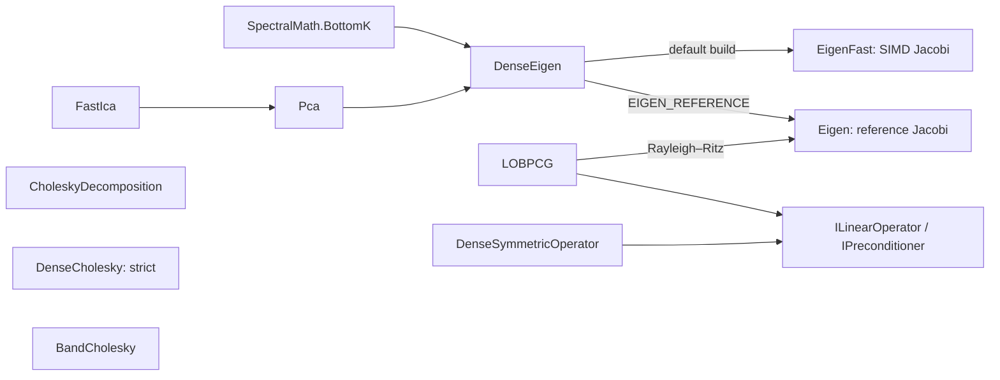

# Linear Algebra

> The numerical foundation of ThermoMapper: symmetric eigensolvers (dense Jacobi and iterative LOBPCG), dense and banded Cholesky factorizations built for Gaussian statistics, an FFT, PCA, FastICA, a streaming diagonal Mahalanobis estimator and SIMD vector kernels. · **Project:** `Maths.LinAlg` (namespace `Maths.LinAlg`) · **Maturity:** core, except FastICA, which is partial (see [Status](#status-and-caveats))

## Overview

`Maths.LinAlg` sits in layer 1 of the [architecture](./Architecture.md). Its only dependency is `Maths.Rng`. Almost every numerical module above it uses it:

| Consumer | Uses |
|---|---|
| Spectral graph analysis ([SpectralGraphs](./SpectralGraphs.md)) | dense eigen routes, LOBPCG |
| Gaussian mixtures ([GaussianMixtures](./GaussianMixtures.md)) | `CholeskyDecomposition` |
| Spline regression ([BayesianRegression](./BayesianRegression.md)) | `BandCholesky` in LDLᵀ mode |
| Dense Gram reference (BASS, planned) | `DenseCholesky` |
| Riemannian statistics ([RiemannianGeometry](./RiemannianGeometry.md)) | `DenseEigen`, `Pca`, `MatrixOps` |
| Colored-noise synthesis ([Samplers](./Samplers.md)) | `Fft` |

## Key concepts

- **Dense eigen route.** A full eigendecomposition $A=V\Lambda V^\top$ of a symmetric matrix by cyclic Jacobi rotations. There are two implementations, and one is chosen **at compile time**.
- **Iterative eigen route.** LOBPCG finds only the k extremal eigenpairs of a *matrix-free* symmetric operator. It sees the matrix only through `ILinearOperator.Apply`.
- **Bottom-k.** The k smallest eigenpairs in ascending order. Spectral graph code uses this constantly.
- **Constraint block (hard deflation).** A block Y that LOBPCG projects out of the initial block once and out of the preconditioned search directions on every iteration, so the iterates stay orthogonal to Y up to rounding. Graph code uses it to project out a Laplacian's null vector.
- **Gaussian toolkit.** The factorizations are designed around what Gaussian models need: $\ln|\Sigma|$, solves, inverses and sampling. The *innovation* $v\sim N(0,A^{-1})$ is drawn directly from a banded factor.

## Design

**Two dense routes, one compile-time switch.** `DenseEigen` dispatches with `#if EIGEN_REFERENCE`:

- **`EigenFast`** (default): an optimized cyclic Jacobi. It uses algebraic rotations with no trigonometric calls, keeps only the upper triangle in a column-major working copy, and uses AVX/FMA with `unsafe` pointers.
- **`Eigen`** (reference): classical cyclic Jacobi with trigonometric rotations on a mirrored `double[,]`.

The reference build is selected with `-p:ExtraDefineConstants=EIGEN_REFERENCE`, which `Directory.Build.props` appends to `DefineConstants`. `DenseEigenOptions.FastVariant` (`Default` / `Fma`) is honored only by `EigenFast`. The exception behavior therefore differs by build:

- In the default build, an undefined variant throws `ArgumentOutOfRangeException`.
- In the reference build, any non-default variant throws `NotSupportedException`.

**A pure primitive behind an operator seam.** `LOBPCG` knows nothing about graphs. Its only view of the problem is:

- `ILinearOperator.Apply(block, result, columns)` over flat column-major blocks (column j at offset `j*n`; input and output must not alias);
- an optional `IPreconditioner`;
- an optional constraint block.

Concrete operators live beside the structures they wrap: `DenseSymmetricOperator` here, and the graph and magnetic Laplacian operators in [SpectralGraphs](./SpectralGraphs.md). This interface is the extension point for new operators.

**Shared outputs.**

- `EigenResult` is the dense route's output: eigenvalues **descending**, `Eigenvectors[i]` a unit vector for `Eigenvalues[i]`, signs arbitrary.
- `EigenPair` is the output of both routes. Its `Vector` is always a fresh copy. Lists are ascending for bottom-k and descending for top-k.

**Allocate once, decompose many.** `CholeskyDecomposition`, `DenseCholesky` (allocated for a capacity) and `BandCholesky` own their factor storage and are meant to be re-decomposed in inner loops: EM iterations in mixtures, MCMC steps in splines. Instances are stateful and not thread-safe.

**Which triangle each routine reads.** This matters when an input is not exactly symmetric:

| Routine | Reads |
|---|---|
| `EigenFast` (and `DenseEigen` in the default build) | upper triangle + diagonal (for `double[,]` input, the entries `matrix[r, c]` with r ≤ c, after a copy into column-major layout) |
| `Eigen` | both triangles (mirrors them) |
| `CholeskyDecomposition` | lower triangle |
| `DenseCholesky` | lower triangle |
| `BandCholesky` | lower band |

For a slightly asymmetric input, the two dense eigen routes therefore decompose *different* matrices.

## API at a glance

| Area | Entry points |
|---|---|
| Dense eigen | `DenseEigen.DecomposeSymmetric` (`double[,]` or column-major span) → `EigenResult`; `EigenFast.DecomposeSymmetricInPlace` (allocation-free core); `Eigen.DecomposeSymmetric`; `SpectralMath.BottomK`, `SpectralMath.SelectBottomK` → `IReadOnlyList<EigenPair>` |
| Iterative eigen | `LOBPCG.Solve(op, k, Options?)` → `Result(Eigenpairs, Iterations, ResidualNorm, Converged)`; `LOBPCG.BottomK` / `TopK` (dense convenience); `DenseSymmetricOperator`; `ILinearOperator`, `IPreconditioner` |
| Factorizations | `CholeskyDecomposition` (`Decompose`, `LogDet`, `Status`, `Solve`, `WriteInverseTo`, `WriteLTo`, `Sample`); `BandCholesky` (`Decompose`, `DecomposeBanded`, `Solve`, `SolveInPlace`, `SampleInnovation`, `LogDet`, `HitFloor`, `Status`, `Dimension`, `Bandwidth`, `Factorization`); `BandFactorization` (`Cholesky`, `Ldlt`); `DenseCholesky` (`Decompose`, `Status`, `FailedAt`, `LogDet`, `Solve`, `SolveInPlace`, `ForwardSolveInPlace`, `BackSolveInPlace`, `InverseQuadraticForm`, `SampleInnovation`, `Factor`, `RelativePivot`, `Dimension`, `Capacity`); `ISpdFactor` (`Dimension`, `Status`, `LogDet`, `Solve`, `SolveInPlace`, `SampleInnovation`; implemented by `BandCholesky` and `DenseCholesky`), `SpdFactorExtensions.InverseQuadraticForms`; `FactorStatus` |
| Transforms and statistics | `Fft` (1-D, 3-D, N-D; `IsPowerOfTwo`); `Pca.Compute` → `PcaResult`; `FastIca.Compute` → `IcaResult`; `OnlineMahalanobis` (`Update`, `Distance` to the mean or between two points, `IsReady`, `GetMean`, `GetVariances`, `Reset`) |
| Kernels | `MatrixOps` (`Dot`, `ScaledSubtract`, `Orthonormalize`, `RandomOrthonormal`, `ColumnGramMatrix`, `ColumnGramMatrixFromRowMajor`, `TransposeToColumnMajor`) |

## Algorithms

### Cyclic Jacobi (`EigenFast`, `Eigen`)

Both routes sweep the pairs $p<q$ in row order and apply plane rotations that zero $a_{pq}$.

**`EigenFast`** uses the algebraic form:

$$\theta=\frac{a_{qq}-a_{pp}}{2a_{pq}},\qquad t=\frac{\operatorname{sgn}\theta}{|\theta|+\sqrt{1+\theta^2}}\ \ (|\theta|<10^{12}),\quad t=\frac{1}{2\theta}\ \text{otherwise},\qquad c=\frac{1}{\sqrt{1+t^2}},\ s=tc.$$

- The pivots update in closed form: $a'_{pp}=a_{pp}-t\,a_{pq}$, $a'_{qq}=a_{qq}+t\,a_{pq}$, $a'_{pq}=0$.
- The eigenvector columns update as $v'_p=c\,v_p-s\,v_q$ and $v'_q=s\,v_p+c\,v_q$.
- Only the strict upper triangle and diagonal of the column-major copy are maintained. The off-pivot update is split into three segments. The $r<p$ segment, where columns p and q are contiguous, is vectorized with `Vector256` (optionally FMA). The $p<r<q$ and $r>q$ segments are strided scalar loops.
- A rotation is skipped when $|a_{pq}|<\text{tol}$. The solver stops after a sweep when $\big(\sum_{p<q}a_{pq}^2\big)^{1/2}<\text{tol}$.
- Defaults: `tol` = 1e-12 (absolute), `maxSweeps` = 256.
- Eigenvalues are read from the diagonal and exchange-sorted descending. No sign normalization is applied.

**`Eigen`** uses $\theta=\tfrac12\operatorname{atan2}(2a_{pq},\,a_{qq}-a_{pp})$ with `Cos`/`Sin`, updates both triangles, skips a rotation when $|a_{pq}|\le\text{tol}$, and stops after a sweep whose largest visited $|a_{pq}|$ is below tol. Output is sorted descending. Two further notes:

- The type's summary mentions "refinement via Cholesky", but no such step exists.
- `Eigen` is always the small-matrix solver inside LOBPCG's Rayleigh–Ritz step, whichever dense route the build selects.

**Cost.** Each sweep is $n(n-1)/2$ rotations at $O(n)$ each, so $O(n^3)$ per sweep. `EigenFast` rents its $n^2$ working copy from `ArrayPool`.

**Selecting the bottom-k.** `SpectralMath.SelectBottomK` walks the descending result from the tail, copies up to k vectors, and returns min(k, n) pairs in ascending order. `BottomK` computes the full decomposition and then selects.

### LOBPCG

`LOBPCG.Solve` finds the k algebraically smallest eigenpairs (or the largest, with `WantLargest`) of a symmetric operator A.

**Setup.**

1. $k\leftarrow\min(k,n-1)$. An empty, converged result is returned for $n=0$, $k\le 0$ or $n=1$.
2. $X_0$ comes from `MatrixOps.RandomOrthonormal(n, k, Seed)`: uniform $[-1,1)$ entries drawn from `System.Random(Seed)` (not `Maths.Rng`), then orthonormalization. A seed of 0 is rejected with `InvalidOperationException`.
3. If constraints are supplied (`Constraints` non-null and `ConstraintColumns` > 0), Y is compacted and orthonormalized once, and X is projected off Y.

**Each iteration** (at most `MaxIterations`):

1. $AX\leftarrow A\,X$. Rayleigh–Ritz on span(X): $G=X^\top AX$ is decomposed with `Eigen`, then $X\leftarrow XC$ and $\Theta$ is updated.
2. Residual $R=AX-X\Theta$. The solver has converged when $\max_j\|r_j\|_2<\texttt{Tolerance}$ (an absolute test).
3. $W=T\,R$, where T is the preconditioner, or the identity if none is given.
4. W is projected off Y, then X, then P.
5. The trial block $S=[X,\,W,\,P]$ (up to 3k columns) is orthonormalized. Columns with norm below 1e-12 are dropped, giving Q.
6. Rayleigh–Ritz on span(Q) gives $X_{\text{new}}$.
7. $P=\operatorname{orth}\big((I-X_{\text{new}}X_{\text{new}}^\top)(X_{\text{new}}-X_{\text{old}})\big)$.

All projections are two passes of **modified** Gram–Schmidt (MGS with re-orthogonalization). Constraints are handled by **hard deflation**: Y is projected out explicitly on every iteration, because a non-constant preconditioner such as the Jacobi diagonal re-injects Y components. There is no locking of converged columns and no explicit restart. If every P column is dropped, the next step implicitly restarts from span{X, W}.

**Result.** Eigenpairs are sorted ascending (or descending with `WantLargest`). `ResidualNorm` is the residual measured at the top of the last iteration. When `Converged` is false, it describes the iterate *before* the final Rayleigh–Ritz update, not the returned vectors.

**Cost per iteration.** Two operator applications (k columns, then up to 3k), $O(nm^2)$ Gram–Schmidt with $m\le 3k$, and a small $O(m^3)$ Jacobi. About $16nk$ doubles are preallocated. `LOBPCG.BottomK` and `TopK` wrap a copied `DenseSymmetricOperator` and return at most n−1 pairs.

### Dense Cholesky (`CholeskyDecomposition`)

`Decompose` always builds two factors, each costing about $n^3/6$ multiply–adds (≈ $n^3/3$ flops):

- **$L$**, by Cholesky–Banachiewicz, reading only the lower triangle. Each pivot is floored: $\ell_{ii}=\sqrt{\max(s,10^{-12})}$. The factor keeps the floored pivot; `Status` reports it (see [Factor status](#factor-status-factorstatus)).
- **$L^{-1}$**, by forward substitution: $(L^{-1})_{ii}=1/\ell_{ii}$ and $(L^{-1})_{ij}=-\big(\sum_{k=j}^{i-1}\ell_{ik}(L^{-1})_{kj}\big)/\ell_{ii}$.

Derived quantities:

| Member | Computes | Cost |
|---|---|---|
| `LogDet` | $2\sum_i\ln\ell_{ii}$, using the floored pivots | — |
| `WriteInverseTo` | $\Sigma^{-1}=(L^{-1})^\top L^{-1}$ | $O(n^3)$ |
| `Solve` | $Ly=b$, then $L^\top x=y$, on $L$ only | $O(n^2)$ |
| `Sample` | $x=\mu+Lz$, with $z\sim N(0,I)$ from Box–Muller over `System.Random` | $O(n^2)$ |

`Sample` produces exactly $N(\mu, LL^\top)$, which is $\Sigma$ unless a pivot was floored.

### Strict dense Cholesky (`DenseCholesky`)

The reference factor for dense Gram matrices: BASS's active-term Gram, and the full rebuild that the incremental border and Givens updates (port stage 2) are checked against.

- **Strict.** There is no pivot floor. The first pivot that is not finite and positive stops the factorization:
  - `FailedAt` gives its row;
  - `Status` covers the pivots up to and including it, and `FlooredPivots` is always 0;
  - `LogDet` is NaN, and every solve throws.

  A singular or indefinite input is reported, not repaired. Whether a rank-deficient design is admissible under some proper prior is the caller's decision.
- **Solve-oriented.** It never forms $A^{-1}$:

  | Member | Computes | Via |
  |---|---|---|
  | `Solve`, `SolveInPlace` | $A^{-1}b$ | forward, then back substitution |
  | `ForwardSolveInPlace`, `BackSolveInPlace` | $L^{-1}b$, $L^{-\top}y$ | one triangular solve |
  | `InverseQuadraticForm` | $b^\top A^{-1}b$ | $\lVert L^{-1}b\rVert^2$, a sum of squares |
  | `SampleInnovation` | $v=L^{-\top}z\sim N(0,A^{-1})$ | back substitution |
  | `LogDet` | $\ln|A|=2\sum_i\ln\ell_{ii}$ | — |
  | `RelativePivot(j)` | $d_j/a_{jj}$ | stored per row |
- **Row at a time.** Rows are factored in order (Cholesky–Banachiewicz) into packed row-major storage, with $L(i,j)$ at $i(i+1)/2+j$. Each row is the bordered extension of the factor above it, the step a birth reuses. Both triangular solves read rows contiguously.
- **Agreement.** The loop order is `CholeskyDecomposition`'s. With no pivot at or below 1e-12, the factor, `LogDet` and `Status` are bit-identical.

**Cost.** Factorization is about $n^3/6$ multiply-adds; solves and draws are $O(n^2)$; storage is $n(n+1)/2$.

### Band Cholesky / LDLᵀ (`BandCholesky`)

**Storage** is the LAPACK lower-band layout `_l[d, j] = L(j+d, j)` for $d=0..p$. The diagonal slot holds $\ell_{jj}$ (Cholesky) or $D_j$ (LDLᵀ, where L has a unit diagonal). `Decompose(double[,])` reads only the lower band and does not check that entries outside it are zero. `DecomposeBanded` accepts band storage directly.

**Factorizations.** Both are left-looking, restricted to the band:

$$\text{Cholesky:}\quad \ell_{jj}=\sqrt{a_{jj}-\textstyle\sum_k\ell_{jk}^2},\qquad \ell_{ij}=\Big(a_{ij}-\textstyle\sum_{k=\max(0,i-p)}^{j-1}\ell_{ik}\ell_{jk}\Big)\Big/\ell_{jj}$$

$$\text{LDL}^\top:\quad D_j=a_{jj}-\textstyle\sum_k\ell_{jk}^2D_k,\qquad \ell_{ij}=\Big(a_{ij}-\textstyle\sum_k\ell_{ik}\ell_{jk}D_k\Big)\Big/D_j$$

**Pivot floor.** A pivot ($\ell_{jj}^2$ or $D_j$) at or below 1e-12 is clamped to 1e-12, and `HitFloor` is set. `HitFloor` is reset at the start of every factorization. `Status` gives the fuller report.

**Log-determinant.** $2\sum_j\ln\ell_{jj}$ for Cholesky, $\sum_j\ln D_j$ for LDLᵀ.

### Factor status (`FactorStatus`)

After each factorization, all three classes set `Status`. It reports what the factorization found and leaves the decision to the caller. The pivots are the Schur-complement diagonals $d_j$ before flooring: $\ell_{jj}^2$ or $D_j$.

| Member | Meaning |
|---|---|
| `Finite` | Every pivot was finite. A NaN or infinite entry in the lower triangle or band makes a later pivot non-finite. |
| `FlooredPivots` | How many pivots were at or below 1e-12 and were clamped. |
| `MinPivot`, `MaxPivot` | The pivot range before flooring. `MinPivot` ≤ 0 means the input is not numerically positive definite. |
| `PivotRatio` | `MinPivot / MaxPivot`. For a positive-definite matrix every $d_j$ lies in $[\lambda_{\min},\lambda_{\max}]$, so the ratio is at least $1/\kappa$: a small ratio proves ill-conditioning, but a ratio near 1 does not prove good conditioning. |
| `MinRelativePivot` | The smallest $d_j/a_{jj}$: the pivots of the equilibrated matrix $D^{-1/2}AD^{-1/2}$, with $D=\operatorname{diag}A$. For a Gram matrix it is the squared sine of the angle between column j and the span of the earlier columns. It is at least $\lambda_{\min}$ of the equilibrated matrix, whose $\lambda_{\max}\ge1$, so its reciprocal is a lower bound on that matrix's condition number. Unlike `PivotRatio`, it does not change when columns are rescaled; it does depend on column order. A value ≤ 0 means not positive definite. |
| `PositiveDefinite` | `Finite` and `MinPivot` > 0. |

Because the floor is absolute, a well-conditioned matrix with a small scale, such as $10^{-20}I$, is floored: `FlooredPivots` is positive while `PivotRatio` is 1. A rank problem shows a small `PivotRatio` or a non-positive `MinPivot` instead. `MinRelativePivot` is the scale-aware check: 1 for $10^{-20}I$, and small for a column nearly in the span of the others, whatever the columns' scales. `DenseCholesky` has no floor, so it factors $10^{-20}I$ exactly.

**Innovation sampling.** `SampleInnovation` requires LDLᵀ mode. It computes $v=L^{-\top}D^{-1/2}z$. Since $\operatorname{Cov}(v)=(LDL^\top)^{-1}$, this gives $v\sim N(0,A^{-1})$ exactly, which is the draw a conjugate posterior $\beta=\mu+v$ needs.

**Cost.** Factorization is $O(np^2)$; solve and sampling are $O(np)$; storage is $O((p+1)n)$.

**As an `ISpdFactor`.** `Solve`, `SolveInPlace` and `SampleInnovation` take spans, so the collapsed g-prior block can hold a banded factor (BARS) or a dense one (BASS) behind one interface. `SpdFactorExtensions.InverseQuadraticForms` gives $s\,z_t^\top A^{-1}z_t$ for each row through either.

### FFT

`Fft` is an iterative in-place radix-2 Cooley–Tukey transform. It applies a bit-reversal permutation, then butterflies with twiddle $e^{\mp 2\pi i/\text{len}}$:

$$X_k=\sum_j x_je^{-2\pi ijk/n},\qquad x_j=\frac1n\sum_kX_ke^{+2\pi ijk/n}.$$

- Each length must be a power of two; otherwise `ArgumentException` is thrown.
- The N-D transform works on a row-major grid and runs one 1-D pass per axis, innermost first. The inverse normalizes per pass, for a total factor of $1/\prod d$.
- Cost is $O(N\log N)$.

### PCA and FastICA

**`Pca.Compute`** centers the data by default. With `center=false` it analyses the raw second moment instead. It then chooses a route:

- **Primal** ($d\le n$): the biased covariance $\frac1nX_c^\top X_c$.
- **Dual** ($d>n$): the Gram matrix $\frac1nX_cX_c^\top$, with components $v_i=X_c^\top u_i/\sqrt{n\lambda_i}$ (zero if $\lambda_i\le10^{-12}$).

Outputs:

- `ExplainedVarianceRatio` is $\lambda_i/\sum_{\lambda>0}\lambda$ over the full spectrum.
- Whitening scales the components in place by $1/\sqrt{\lambda_i+10^{-8}}$.
- Component signs are arbitrary.

**`FastIca`** runs on PCA-whitened data with the logcosh contrast ($g=\tanh$) and the one-unit update $w^+=\overline{z\,g(w^\top z)}-\overline{g'(w^\top z)}\,w$. It supports `Deflation` and `Symmetric` modes. See [Status](#status-and-caveats).

### Online diagonal Mahalanobis

`OnlineMahalanobis` maintains the Welford updates $\delta=x-\mu$, $\mu\mathrel{+}=\delta/n$ and $M_2\mathrel{+}=\delta\,(x-\mu_{\text{new}})$, and returns

$$d(x)=\sqrt{\textstyle\sum_i (x_i-\mu_i)^2/s_i^2},\qquad s_i^2=M_{2,i}/(n-1).$$

Dimensions with zero variance are skipped, which makes this a *pseudometric* (a standardized Euclidean distance). Correlations are ignored. The result is 0 until $n\ge2$.

### Performance notes

- **SIMD.** `MatrixOps.Dot` and `ScaledSubtract` take the `Vector512` path when it is accelerated (length ≥ 8), otherwise `Vector256`, then a scalar tail. They underlie every LOBPCG projection and norm and PCA's Gram matrix. `EigenFast` uses `Vector256`, with optional FMA.
- **`unsafe`.** `EigenFast` is the only `unsafe` code. It uses `fixed` pointers over the input, the pooled working copy and the output span.
- **Pooling and allocation.** `EigenFast` and its wrappers use `ArrayPool<double>`. LOBPCG preallocates its $O(nk)$ blocks. Operators precompute their arrays so that `Apply` allocates nothing.
- **Reproducibility.** Dot-product summation order depends on the SIMD width, so the last bits of results can differ between CPUs.
- There is no multithreading in this module.

## Configuration

| Setting | Default | Meaning |
|---|---|---|
| Jacobi `maxSweeps` / `tol` | 256 / 1e-12 | Sweep cap; absolute off-diagonal threshold (Frobenius in `EigenFast`, max in `Eigen`) |
| `DenseEigenOptions.FastVariant` | `Default` | `Fma` enables FMA in `EigenFast` when the CPU supports it |
| `LOBPCG.Options.MaxIterations` / `Tolerance` | 300 / 1e-9 | Iteration cap; max column residual norm (absolute) |
| `LOBPCG.Options.WantLargest` | false | Largest vs smallest, by algebraic value |
| `LOBPCG.Options.Seed` | 12345 | Seed for the initial block; **0 is rejected** |
| `LOBPCG.Options.Constraints` / `Preconditioner` | null / null | Deflation block Y; identity preconditioner |
| `LOBPCG.Options.ConstraintColumns` | 0 | Column count of `Constraints` (flat column-major, length n × columns); `Constraints` is ignored unless this is > 0 |
| Column-drop / degeneracy tolerance | 1e-12 | Gram–Schmidt in LOBPCG and `MatrixOps` |
| Cholesky pivot floor | 1e-12 | On $\ell^2$ or $D$; `CholeskyDecomposition` and `BandCholesky` only (`DenseCholesky` has none) |
| `BandCholesky` factorization | `Cholesky` | `Ldlt` is required for `SampleInnovation` |
| `Pca.Compute` numComponents / center / whiten | 1 / true / false | — |
| `FastIca.Compute` mode / maxIter / tol / seed | `Deflation` / 200 / 1e-6 / 42 | — |

## Status and caveats

- **FastICA is partial.** It contains drafting remnants, and three formulas look suspect:
  - In `Deflation` mode, a converged row keeps its raw update: it is not re-orthogonalized or normalized.
  - The symmetric decorrelation step appears to use the eigenvector matrix transposed.
  - `IcaResult.MixingMatrix` is computed from only the first k feature columns (k×k).

  Treat `FastIca` as experimental.
- **`EigenFast` can exhaust its sweeps silently.** Its skip test is per element ($|a_{pq}|<\text{tol}$) but its stop test uses the Frobenius norm. If many sub-tolerance entries accumulate, no rotation fires and the loop runs all 256 sweeps without reporting it. There is no convergence flag. The reference `Eigen` pairs its per-element skip test with a max-norm stop test; the two agree, so it does not have this problem.
- **Tolerances are absolute** in the Jacobi and LOBPCG routines (and in the graph smoother's conjugate-gradient solve; see [SpectralGraphs](./SpectralGraphs.md)), so results depend on the scale of the input. Rescale badly scaled problems.
- **Pivot floors are absolute and never raise.** Both factorizations clamp pivots at 1e-12 and carry on, so `LogDet` and the solves of a floored factor describe the clamped matrix, not the input. A small-scale input such as $10^{-20}I$ is floored even though it is perfectly conditioned. Read `Status` before trusting a factor. `DenseCholesky` is the strict, solve-oriented dense path without flooring; existing callers keep the floored factors.
- **LOBPCG rejects seed 0.** Callers that pass seed 0 through to LOBPCG fail. This affects the defaults of several spectral entry points (see [SpectralGraphs](./SpectralGraphs.md#status-and-caveats)).

## Source map

| Role | Files (`ThermoMapper/src/maths/linalg/`) |
|---|---|
| Dense eigen | `DenseEigen.cs`, `EigenFast.cs`, `Eigen.cs`, `SpectralMath.cs` |
| Iterative eigen | `Lobpcg.cs`, `DenseSymmetricOperator.cs` |
| Factorizations | `Cholesky.cs`, `DenseCholesky.cs`, `BandCholesky.cs`, `FactorStatus.cs`, `ISpdFactor.cs` |
| Transforms and statistics | `Fft.cs`, `PCA.cs` (`Pca`), `ICA.cs` (`FastIca`), `WelfordMahal.cs` (`OnlineMahalanobis`) |
| Kernels | `MatrixOps.cs` |

**See also:** [SpectralGraphs](./SpectralGraphs.md) · [DesignPrinciples](./DesignPrinciples.md) · [BayesianRegression](./BayesianRegression.md) (band LDLᵀ in use) · [GaussianMixtures](./GaussianMixtures.md) (Cholesky in use)
