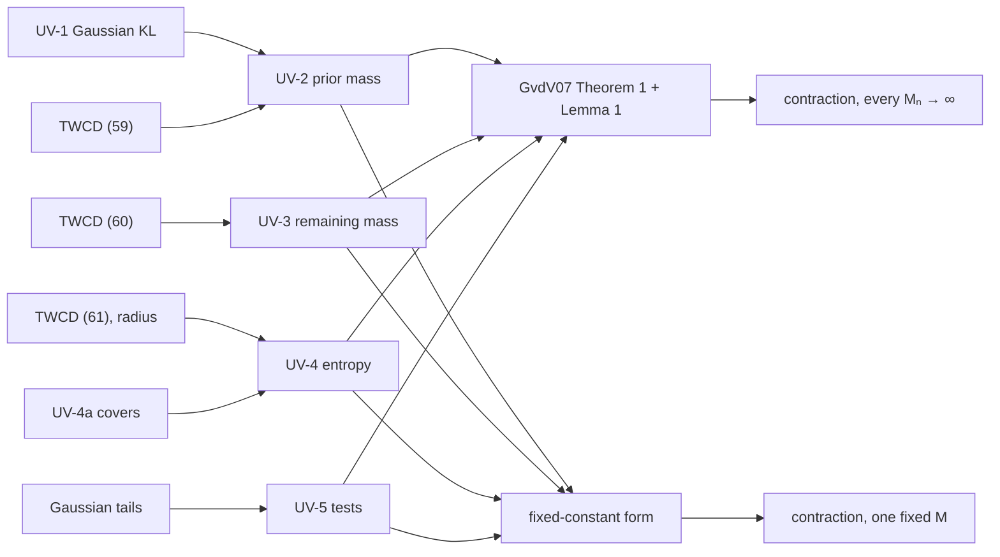

# Posterior Contraction with an Unknown Noise Scale

> The theory behind the Bayesian GP's unknown-scale model. In fixed-design Gaussian regression under TWCD2025's hierarchical GP prior, with an amplitude prior and a noise prior on compact ranges, the posterior contracts around the true regression function and the true noise standard deviation jointly, at the known-σ rate. The derivations below are checked in Lean 4, conditional on the cited general contraction theorem and on TWCD2025's framework inequalities. · **Lean:** `lean/Enthymemata/` modules `BgpUnknownVariance`, `BgpGaussianKL`, `BgpCovering`, `BgpGaussianTails`, `BgpUnknownVarianceTheorem` (namespace `BGP`) · **Maturity:** proof-closed enthymemata, awaiting semantic review for promotion

## Overview

TWCD2025 (Tang, Wu, Cheng & Dunson, *Adaptive Bayesian Regression on Data with Low Intrinsic Dimensionality*) prove posterior contraction rates for GP regression with an empirical-Bayes bandwidth prior (their Theorems 3.1–3.3). They assume the noise standard deviation σ is known. Their §6 names the unknown-σ extension and leaves it. The implementation goes further: `GpNoiseModel.UnknownScale` infers a signal amplitude s and a noise ratio η, with σ² = s²η (see [BayesianRegression](./BayesianRegression.md#bayesian-gp-bandwidth-bgp)).

This document states the extension, derives it, and records what Lean checks. It formalizes the protolemma [`bgp-unknown-variance-lemmas.md`](../../lean/Protolemmata/BARS/bgp-unknown-variance-lemmas.md) (BGP-4), whose pieces UV-1 to UV-8 label the sections below. The protolemma keeps the working history: the checks against the papers, the corrections, and the review record.

**What Lean checks, and what it takes as given.**

| Piece | Status | Lean module |
|---|---|---|
| UV-1: Gaussian KL and log-ratio variance, local bounds, the slab inclusion | proved, standard axioms only | `BgpUnknownVariance`, `BgpGaussianKL` |
| UV-2: prior mass of the KL neighbourhood under [P1] | proved from TWCD2025's (59) | `BgpUnknownVariance`, `BgpUnknownVarianceTheorem` |
| UV-3: the sieve's remaining mass | proved from (60) | `BgpUnknownVarianceTheorem` |
| UV-4: covering numbers and the sieve's cover | proved from (61) and the sieve's polynomial radius | `BgpCovering`, `BgpUnknownVarianceTheorem` |
| UV-5: tests for ‖f − f′‖ₙ + \|σ − σ′\| and their Gaussian tails | proved, standard axioms only | `BgpGaussianTails`, `BgpUnknownVarianceTheorem` |
| The general contraction theorem | cited, as axioms | `BgpUnknownVarianceTheorem` |
| TWCD2025's (59)–(61) and the sieve's radius | hypotheses, checked against the paper by reading | `BgpUnknownVarianceTheorem` |

## The setting

**Data.** A fixed design x₁, …, xₙ and Yᵢ = f*(xᵢ) + wᵢ, with wᵢ ~ N(0, σ₀²) independent and σ₀ > 0 unknown. In Lean the regression function lives in a normed space E, and evaluation at the i-th design point is a continuous linear functional `ev n i` of norm at most 1, so the sup norm dominates the empirical norm (`empiricalNorm_le_norm`). The data law at θ = (f, σ) is the product $\bigotimes_i N(f(x_i), \sigma^2)$ (`dataLaw`), with the product of the Gaussian densities as its likelihood (`likelihood`).

**The metric.** Contraction is reported in

$$d_n(\theta,\theta') = \|f-f'\|_n + |\sigma-\sigma'|, \qquad \|g\|_n^2 = \frac1n\sum_{i=1}^n g(x_i)^2$$

(`paramDist`), a semimetric on E × ℝ. Both ‖f − f*‖ₙ and |σ − σ₀| are bounded by it, so both contract.

**The prior [P1].** f = s·W and σ = s√η, with s, W and η independent:
- W ~ μ_W is TWCD2025's unit-amplitude GP Wᵗ, with the empirical-Bayes bandwidth t integrated out. Their Proposition 4.4 gives the bandwidth prior's condition (A3).
- s ~ π_s lives on [s_min, s_max] ⊂ (0, ∞) and gives positive mass to every subinterval, as a positive density does.
- η ~ π_η is log-uniform on [η_lo, η_hi]. The proof uses only that every subinterval [a, b] gets mass at least log(b/a)/log(η_hi/η_lo).

So σ lies in [σ_min, σ_max] = [s_min√η_lo, s_max√η_hi]. In Lean the prior is the image of π_s ⊗ (μ_W ⊗ π_η) under (s, w, η) ↦ (s·w, s√η) (`amplitudeNoisePrior`). **The one requirement on the truth is σ₀ ∈ (σ_min, σ_max).** There is no true amplitude: s scales the prior on f, and any interior value serves.

**From the implementation's prior.** The implementation puts the improper prior 1/s² on s². Restricted to a box and renormalized, it is an instance of [P1], and its posterior is the implementation's posterior restricted to the box and renormalized. A run's own draws therefore measure the gap: the posterior mass of s² outside the box (UV-8).

**Why compact ranges.** The sieve argument needs them. A heavy-tailed amplitude would need a cutoff sₙ with Π(s > sₙ) ≤ e^{−Cnεₙ²}. For polynomial tails sₙ grows exponentially in nεₙ², and the entropy bound then fails, because f's entropy is counted in sup norm, where s multiplies. The noise alone could take inverse-gamma tails, since its entropy can be counted on a log scale.

**Rates.** Both rates have the shape of TWCD2025's (62) (`priorMassRadius`):

$$\varepsilon_n = C_0\, n^{-a}(\log n)^{k}, \qquad \bar\varepsilon_n = \bar C\, n^{-a}(\log n)^{\bar k}, \qquad 0<a<\tfrac12,\quad 0\le k\le\bar k.$$

εₙ is the prior-mass rate and ε̄ₙ the entropy rate, which is the reported rate. In the paper a = s/(2s + ϱ), where s is the smoothness, not the amplitude, and k₁ = (1 + D)/(2 + ϱ/s) ≤ D + 1. Eventually εₙ ≤ (C₀/C̄) ε̄ₙ (`priorMassRadius_le_mul`).

## The theorem

**Theorem (UV-6).** Assume [P1] with σ₀ ∈ (σ_min, σ_max), design functionals of norm at most 1, and TWCD2025's framework inequalities for the GP law μ_W and a sieve (Bₙ) in E:
- **(59), uniform over the amplitude box** (`h59`): eventually, for every s ∈ [s_min, s_max], $\mu_W\big(\|w - f^*/s\|_\infty \le \varepsilon_n/s\big) \ge e^{-C_1 n\varepsilon_n^2}$;
- **(60)** (`h60`): eventually $\mu_W(B_n^c) \le e^{-C_2 n\varepsilon_n^2}$;
- **(61)** (`h61`): for every c > 0 there is K₀ with $\log N(c\bar\varepsilon_n, B_n, \|\cdot\|_\infty) \le K_0\, n\bar\varepsilon_n^2$ eventually, for external covering numbers;
- **the radius** (`hRadius`): for some p, eventually $\|g\|_\infty \le n^p$ for every g ∈ Bₙ.

Then, with θ₀ = (f*, σ₀) and E₀ the expectation under the truth:
1. **One fixed constant** (`posterior_contraction_unknown_variance`). If $C_2 > C_1 + 144/\sigma_0^2$, there is an M with
   $$\mathbb E_0\, \Pi\big(d_n(\theta,\theta_0) \ge M\bar\varepsilon_n \,\big|\, Y\big) \to 0.$$
2. **Every Mₙ → ∞** (`posterior_contraction_unknown_variance_gvdv07`). If $C_2 > C_1 + 72/\sigma_0^2$, then $\mathbb E_0\, \Pi(d_n(\theta,\theta_0) \ge M_n\bar\varepsilon_n \mid Y) \to 0$ for every Mₙ → ∞.
3. **The tunable sieve** (`posterior_contraction_unknown_variance_of_tunable_sieve`). If for every C₂ some sieve satisfies (60) at exponent C₂, (61) and the radius bound, as TWCD2025's construction gives, form 1 holds with no margin to check.

A posterior mass lies in [0, 1], so its expectation tending to 0 is the same as its tending to 0 in probability.

**Reading it.** The joint rate for f and σ is the known-σ rate ε̄ₙ. The constant depends on σ₀, on the amplitude and noise ranges, and, through (59) for f*/s, on ‖f*‖/s. The σ part contracts at ε̄ₙ, slower than 1/√n. A Bernstein–von Mises statement for σ is a separate question (UV-7).

## The general contraction theorem

The proof is an instance of the general rate theorem for independent, non-identically distributed observations. It asks for four things: a KL neighbourhood of the truth with enough prior mass, a sieve that carries almost all of the prior, an entropy bound on the sieve, and exponentially powerful tests.

**The KL neighbourhood** (`klBall`). With Kᵢ(θ) the KL divergence between the i-th observation's laws under θ₀ and θ, and Vᵢ(θ) the variance of its log ratio under θ₀,

$$B_n^*(\theta_0,\varepsilon;2) = \Big\{\theta : \sum_i K_i(\theta) \le n\varepsilon^2,\ \sum_i V_i(\theta) \le n\varepsilon^2\Big\}.$$

Both sums are taken in ℝ≥0∞, so a parameter with an infinite divergence is excluded rather than counted as 0.

**Theorem 1 of Ghosal & van der Vaart (2007), as cited** (`gvdv07_theorem1`). Let S carry the whole prior and the tests, and let Θₙ ⊆ S. Suppose εₙ → 0, nεₙ² is bounded below, and:
- **(2.2), tests:** for every r > 0 and θ₁ ∈ S with d_n(θ₁, θ₀) > r there is a test φ with $P_0\varphi \le e^{-Knr^2}$ and $P_\theta(1-\varphi) \le e^{-Knr^2}$ for every θ ∈ S with d_n(θ, θ₁) ≤ ξr;
- **(2.4), local entropy:** for every r > εₙ, the set {θ ∈ Θₙ : d_n(θ, θ₀) < r} is covered by at most $e^{n\varepsilon_n^2}$ closed balls of radius ξr/4;
- **(2.5), shells:** for every large j, $\Pi(\theta\in\Theta_n : j\varepsilon_n < d_n(\theta,\theta_0) \le 2j\varepsilon_n) \le e^{Kn\varepsilon_n^2j^2/2}\,\Pi(B_n^*(\theta_0,\varepsilon_n;2))$.

Then $\mathbb E_0\,\Pi(\theta\in\Theta_n : d_n(\theta,\theta_0) \ge M_n\varepsilon_n \mid Y) \to 0$ for every Mₙ → ∞.

**Lemma 1 of Ghosal & van der Vaart (2007), as cited** (`gvdv07_lemma1`). If $\Pi(\Theta_n^c)/\Pi(B_n^*(\theta_0,\varepsilon_n;2)) = o(e^{-2n\varepsilon_n^2})$, then $\mathbb E_0\,\Pi(\Theta_n^c \mid Y) \to 0$.

**The fixed-constant form, as cited** (`fixed_constant_contraction`). Two rates εₙ ≤ ε̄ₙ with nεₙ² → ∞; tests as in (2.2) on the sieve; a cover of the sieve by at most $e^{n\bar\varepsilon_n^2}$ balls of radius ξε̄ₙ/2; prior mass $\Pi(B_n^*(\theta_0,\varepsilon_n;2)) \ge e^{-Cn\varepsilon_n^2}$; and remaining mass $\Pi(\Theta_n^c) \le e^{-(C+4)n\varepsilon_n^2}$. Then for some M, $\mathbb E_0\,\Pi(d_n(\theta,\theta_0) \ge M\bar\varepsilon_n \mid Y) \to 0$. This is Ghosal & van der Vaart (2001, Theorem 2.1), the two-rate version of Ghosal, Ghosh & van der Vaart (2000, Theorem 2.1). TWCD2025's Theorem 3.1 and van der Vaart & van Zanten (2008, Theorem 3.3; 2009, §3) use it.

**Why two routes.** TWCD2025 cite Theorem 4 of Ghosal & van der Vaart (2007) for independent observations. As printed, it has a single rate and concludes for every Mₙ → ∞, not for a fixed M. For independent, non-identically distributed observations the fixed-M form is not printed as a theorem. So the Lean module proves the result both ways: once on Theorem 1 and Lemma 1 as printed, once on the fixed-M form under its corrected citation. Each theorem's `#print axioms` names only its own route's axioms.

**How the axioms are stated.** Each axiom is specialized to this model (`dataLaw`, `posterior`), with hypotheses on the strong side of the printed ones, so that it stays a consequence of the printed theorem:
- the tests hold at every radius and for every n;
- Theorem 1's covers use closed balls of half the printed radius. A cover with arbitrary centres then converts to one with centres in the covered set at the printed radius, where the tests apply.
- the sieves are measurable, and the KL neighbourhood enters through a measurable part of it with positive mass, which only weakens the prior-mass side;
- Θₙ ⊆ S, as printed. This was added on 2026-10-26, after an outside review found that the proof of it went unused.

**The posterior in ℝ≥0∞.** Lean's posterior is Bayes' formula in the extended nonnegative reals (`posterior`),

$$\Pi(A \mid y) = \frac{\int_A L(\theta; y)\, d\Pi(\theta)}{\int L(\theta; y)\, d\Pi(\theta)},$$

with ℝ≥0∞'s conventions for dividing by 0 and by ∞. Those conventions never apply on a set the conclusions can see. This is an argument about the encoding, not a Lean proof:
- The marginal ∫L dΠ is finite for Lebesgue-almost every y, since by Tonelli it integrates over y to at most 1. The truth's law is absolutely continuous, so the marginal is finite P₀-almost surely.
- The marginal is positive wherever the prior sits on σ > 0, since every density is positive there.
- The conclusions integrate the posterior against P₀, which ignores null sets.
- L is the density of the data law with respect to Lebesgue measure wherever σ ≠ 0, which the prior guarantees almost surely.

## Derivations

### UV-1 — one Gaussian observation

For one observation with laws P₀ = N(μ₀, σ₀²) and P = N(μ, σ²), write δ = μ − μ₀ and r = σ₀/σ. Then

$$K = \mathrm{KL}(P_0\,\|\,P) = -\log r + \frac{r^2-1}{2} + \frac{\delta^2 r^2}{2\sigma_0^2}, \qquad V = \mathrm{Var}_{P_0}\Big[\log\frac{dP_0}{dP}\Big] = \frac{(r^2-1)^2}{2} + \frac{\delta^2 r^4}{\sigma_0^2}.$$

**Derivation.** Put y = μ₀ + σ₀z with z ~ N(0, 1). The log ratio is

$$\log\frac{dP_0}{dP}(y) = -\log r + \frac{r^2-1}{2}\,z^2 - \frac{r^2\delta}{\sigma_0}\,z + \frac{r^2\delta^2}{2\sigma_0^2}.$$

Its mean uses E z = 0 and E z² = 1. Its variance uses Var z² = 2 and Cov(z², z) = E z³ = 0.

In Lean these are identities against Mathlib's `klDiv` and the variance of `llr` (`klDiv_gaussianReal`, `variance_llr_gaussianReal`, `evariance_llr_gaussianReal`). The pinned Mathlib has no Gaussian fourth moment, so `moments_gaussianReal_zero` reads the first four moments of N(0, v), namely 0, v, 0 and 3v², off the moment-generating function exp(vt²/2).

**Local bounds.**
- $-\log r + (r^2-1)/2 \le \tfrac52(r-1)^2$ for r ≥ 1/2 (`gaussian_kl_scale_part_le`). From 1 − 1/r ≤ log r, the gap is at least (r − 1)²(2r − 1)/r ≥ 0. No Taylor remainder is needed.
- $(r^2-1)^2/2 \le \tfrac92(r-1)^2$ on [1/2, 2], since (r + 1)² ≤ 9 there (`gaussian_v_scale_part_le`).
- |σ − σ₀| ≤ σ₀/2 puts r in [1/2, 2], with (r − 1)² ≤ 4(σ − σ₀)²/σ₀² (`scale_ratio_bridge`).

**The slab inclusion** (`klDiv_le_and_evariance_le_of_slab`). Let |μ − μ₀| ≤ σ₀ε/6 and |σ − σ₀| ≤ σ₀ε/6 with ε ≤ 3. Write D = (σ − σ₀)²/σ₀² and Δ = δ²/σ₀², both at most ε²/36, and use r² ≤ 4 and r⁴ ≤ 16. Then

$$K \le \tfrac52\cdot 4D + 2\Delta = 10D + 2\Delta \le \tfrac{12}{36}\,\varepsilon^2, \qquad V \le \tfrac92\cdot 4D + 16\Delta = 18D + 16\Delta \le \tfrac{34}{36}\,\varepsilon^2.$$

Summed over the n observations, a slab of radius ρ in sup norm and in |σ − σ₀| lies in the KL neighbourhood of radius ρ/c, with c = σ₀/6 (`slab_subset_klBall`). The variance side binds, using 34 of 36, so √34 in place of 6 would also do. Every downstream constant follows from c.

### UV-2 — prior mass

**Claim** (`eventually_prior_mass`). For every δ > 0, eventually

$$\Pi\big(\|f-f^*\|_\infty \le \varepsilon_n,\ |\sigma-\sigma_0| \le \varepsilon_n\big) \ge e^{-(C_1+\delta)\,n\varepsilon_n^2},$$

and this slab lies in $B_n^*(\theta_0, 6\varepsilon_n/\sigma_0; 2)$.

1. **The amplitude window** (`exists_amplitude_window`). σ₀ ∈ (σ_min, σ_max) gives a nondegenerate window [s₁, s₂] ⊆ [s_min, s_max] with $s_2\sqrt{\eta_{lo}} \le \sigma_0 < s_1\sqrt{\eta_{hi}}$. On it σ₀/s stays in [√η_lo, √η_hi), with room above.
2. **Rescaling** (`map_smul_closedBall`; TWCD2025's Remark A.1). Given s, f = s·W lies within ε of f* exactly when W lies within ε/s of f*/s, since the preimage of a ball under w ↦ s·w is a ball.
3. **(59), uniform over the box** (`h59`; checked against TWCD2025 Appendix A.1, Part I, eqs. 64–74).
   - Part I uses f* only through (A2): for each t, some q_t in the RKHS with ‖q_t − f*‖∞ ≤ ν₁t^{s/2} and ‖q_t‖² ≤ ν₂t^{−ϱ/2}.
   - (A2) is monotone in (ν₁, ν₂). f*/s satisfies it with (ν₁/s, ν₂/s²) through q_t/s, so it satisfies it with the single pair (ν₁/s_min, ν₂/s_min²) for every s in the box.
   - Part I run with that pair gives (59) for every f*/s, with one rate constant and one threshold in n.
4. **The noise slab** (`noise_slab_mass`). Given s in the window, the event |s√η − σ₀| ≤ ρ contains the η-interval [(σ₀/s)², ((σ₀ + ρ)/s)²]. That interval lies in [η_lo, η_hi] and has log-length 2 log(1 + ρ/σ₀) ≥ ρ/σ₀ for ρ ≤ σ₀, so its mass is at least ρ/(σ₀ log(η_hi/η_lo)).
5. **Independence** (`prior_slab_mass`). The slab's section at each s is a rectangle, so its prior mass is at least

   $$\pi_s([s_1,s_2]) \cdot e^{-C_1 n\varepsilon_n^2} \cdot \frac{\varepsilon_n}{\sigma_0\log(\eta_{hi}/\eta_{lo})}.$$
6. **Absorbing the slab factor** (`log_inv_mul_radius_le` and its companions). log(1/εₙ) = O(log n) = o(nεₙ²), so the factors π_s([s₁, s₂]) and a multiple of εₙ cost at most δnεₙ², for any δ > 0.
   - The Lean proof is elementary: log n ≤ nᵇ/b from log y ≤ y − 1, with an explicit threshold in n.
   - Real.log is 0 at nonpositive arguments, so log(1/εₙ) ≤ nεₙ² alone says nothing about the sign of εₙ. The companions state εₙ > 0 and e^{−nεₙ²} ≤ εₙ eventually (`eventually_priorMassRadius_pos`, `exp_neg_n_radius_sq_le_radius`).

**In KL units.** The slab of radius εₙ is the KL neighbourhood of radius ε′ₙ = 6εₙ/σ₀. In those units the prior-mass exponent is

$$e^{-(C_1+\delta)\,n\varepsilon_n^2} = e^{-C\, n\varepsilon_n'^2}, \qquad C = (C_1+\delta)\,(\sigma_0/6)^2.$$

### UV-3 — the sieve and its remaining mass

**The sieve** (`sieve`). $B_n' = \{s\cdot g : s\in[s_{min},s_{max}],\ g\in B_n\} \times [\sigma_{min},\sigma_{max}]$. The theorem uses its closure, which is closed and so measurable.

**Remaining mass** (`prior_compl_sieve_le`). f = s·W lies in s·Bₙ whenever W ∈ Bₙ, and s and σ stay in their ranges almost surely, so

$$\Pi\big((\overline{B_n'})^c\big) \le \mu_W(B_n^c) \le e^{-C_2 n\varepsilon_n^2}.$$

**The margin.** The general theorem counts prior mass and remaining mass in the same units, those of the KL radius ε′ₙ = 6εₙ/σ₀, where the prior-mass exponent is C = (C₁ + δ)(σ₀/6)².
- **The fixed-constant form** asks $\Pi(\Theta_n^c) \le e^{-(C+4)n\varepsilon_n'^2} = e^{-(C_1+\delta+144/\sigma_0^2)\,n\varepsilon_n^2}$, since 4 · 36/σ₀² = 144/σ₀². So C₂ > C₁ + 144/σ₀², with δ taken inside the gap.
- **Lemma 1** asks that $\Pi(\Theta_n^c)\, e^{2n\varepsilon_n'^2}/\Pi(B_n^*) \le e^{-(C_2 - C_1 - \delta - 72/\sigma_0^2)\, n\varepsilon_n^2}$ tend to 0, since 2 · 36/σ₀² = 72/σ₀² (`div_mul_ofReal_exp_le`). So C₂ > C₁ + 72/σ₀², with nεₙ² → ∞.

The margin depends on σ₀ through the conversion between the slab and the KL neighbourhood. A sharper UV-1 constant lowers it, but some σ₀-dependent margin is inherent. TWCD2025 state (60) at exponent 4, which suffices only if the margin happens to hold, so the theorem takes C₂ as a hypothesis.

**Tunability** (checked against TWCD2025 Appendix A.1, Parts II–III).
- The exponent 4 comes only from the free constants in eq. (80), which set r_n^ϱ and Nₙ² in proportion to nεₙ².
- Bound (81) on the GP mass outside Bₙ gives $e^{-C_2 n\varepsilon_n^2}$ once both are scaled up by C₂/4.
- Part III's entropy bound (86) then grows only through the constant of ε̄ₙ, so (61) keeps its order.

van der Vaart & van Zanten (2008, Theorem 2.1) state the same tunability for their sieves. Form 3 of the theorem takes the sieve in this form.

### UV-4 — entropy

**Covering a scaled family** (`isCover_image2_smul`). From s·g − s′·g′ = s(g − g′) + (s − s′)g′: a cover N₁ of B at radius ε₁, with points bounded by R, and a cover N₂ of [a, b] at radius ε₂, with 0 ≤ a, give a cover of {s·g} at radius bε₁ + Rε₂ with |N₁||N₂| points. The covering-number forms follow (`coveringNumber_image2_smul_le`, `coveringNumber_image2_smul_le_half`, and the external `externalCoveringNumber_image2_smul_le`).

**Covering an interval** (`exists_isCover_Icc`, `coveringNumber_Icc_le`). N(ε, [a, b]) ≤ ⌈(b − a)/(2ε)⌉ + 1 for ε > 0.

**The sieve's cover** (`closure_sieve_subset_cover`, `eventually_sieve_cover`).
- d_n is dominated by ‖f − f′‖∞ + |σ − σ′| (`paramDist_le`), so the closed sieve is covered in d_n by covering its three parts. The function cover, the amplitude cover and the noise cover each contribute at most a third of the target radius.
- (61) at radius ξε̄ₙ/(12 s_max) counts an external cover, whose centres may lie outside Bₙ. Mathlib's coveringNumber(2δ) ≤ externalCoveringNumber(δ) turns it into a cover with centres in Bₙ at twice the radius, so the centres obey the radius bound n^p.
- The count is $e^{K_0 n\bar\varepsilon_n^2}$ times two interval counts, of order n^p/ε̄ₙ and 1/ε̄ₙ. Their logarithms are O(log n) = o(nε̄ₙ²).
- Altogether, eventually, the closed sieve is covered by at most $e^{n(L\bar\varepsilon_n)^2}$ balls of radius ξLε̄ₙ/2, for any L ≥ 1 + |K₀| (`card_le_exp_of_slack`).

**The polynomial radius** (`hRadius`; checked against TWCD2025's eq. (75)). The kernel has h_t(x, x) = h(0) = 1, so the RKHS unit balls have sup norm at most 1, and the paper's sieve has radius at most Nₙ(rₙ/δₙ)^{D/2} + εₙ, polynomial in n by eq. (80). It stays a hypothesis because Lean does not construct the paper's sieve, and for an arbitrary sieve it is false.

### UV-5 — the tests

**Claim** (`exists_tests`). On S = E × [σ_min, σ_max], for every n, every r > 0 and every θ₁ = (f₁, σ₁) ∈ S with d_n(θ₁, θ₀) > r, there is a test φ with

$$P_0\varphi \le e^{-Knr^2}, \qquad P_\theta(1-\varphi) \le e^{-Knr^2} \text{ for every } \theta\in S \text{ with } d_n(\theta,\theta_1)\le r/8, \qquad K = \frac{\sigma_{min}^2}{1024\,\sigma_{max}^4}$$

(`testConst`; so ξ = 1/8). The condition d_n(θ₁, θ₀) > r forces ‖f₁ − f*‖ₙ > r/2 or |σ₁ − σ₀| > r/2, and φ is the indicator of the rejection set for the case that applies. An alternative within r/8 of θ₁ has ‖f − f₁‖ₙ ≤ r/8 and |σ − σ₁| ≤ r/8. Write $S_c(Y) = \sum_i (Y_i - c(x_i))^2$ and ‖δ‖² = Σᵢδᵢ².

1. **The mean case, ‖f₁ − f*‖ₙ > r/2** (`tests_mean_case`). With δᵢ = f₁(xᵢ) − f*(xᵢ), so that ‖δ‖² > nr²/4, reject when $T = \sum_i \delta_i\,(Y_i - f^*(x_i)) \ge \|\delta\|^2/2$.
   - Under the truth T ~ N(0, σ₀²‖δ‖²), and the linear tail gives $P_0(T \ge \|\delta\|^2/2) \le e^{-\|\delta\|^2/(8\sigma_0^2)}$.
   - Under an alternative, Cauchy–Schwarz puts the mean of T at least 3‖δ‖²/4, since $|\sum_i \delta_i\,(f - f_1)(x_i)| \le \|\delta\|\sqrt n\, r/8 < \|\delta\|^2/4$. The linear tail then bounds the miss by $e^{-\|\delta\|^2/(32\sigma^2)}$.
2. **Scale up, σ₁ > σ₀ + r/2** (`tests_scale_up_case`). Reject when $S_{f^*}(Y) \ge n\tau$, with τ = σ₀² + 3σ₀r/8.
   - Under the truth $S_{f^*}$ is a central sum, and the upper tail applies with A = nσ₀².
   - An alternative has σ ≥ σ₀ + 3r/8, so σ² − τ ≥ 3σ₀r/8. Only the lower tail is needed, and it ignores the means, so the alternative's f is unrestricted.
3. **Scale down, σ₁ < σ₀ − r/2** (`tests_scale_down_case`). Here r < 2σ₀. Reject when $S_{f_1}(Y) \le n\tau$, with τ = σ₀² − σ₀r/8.
   - Under the truth only the lower tail is needed, so the mean shift f* − f₁ drops out.
   - An alternative has σ ≤ σ₀ − 3r/8 and means within r/8 of f₁ in ‖·‖ₙ, so A = nσ² + Σᵢ(f − f₁)²(xᵢ) stays below nτ by a margin linear in r, and the upper tail applies.

**The centring is the point.** Each scale test is centred where its means do the least harm: at f* when the truth has to sit in the upper tail, and at f₁ when the alternatives do. Centring both at f₁ would leave a mean shift of order r under the truth, which can cancel the scale gap when r is comparable to σ₀. The protolemma's first sketch did that, and the Lean proof corrected it.

**The constant.** K is a common lower bound for the six exponents, using σ_min ≤ σ, σ₀ ≤ σ_max and, in the scale cases, r < 2σ_max. Its form σ_min²/σ_max⁴ comes from the scale tests: their gap is linear in σ₀r, while the χ² tails divide by σ⁴.

### The Gaussian tails

For independent Yᵢ ~ N(mᵢ, v), under Mathlib's `Measure.pi`, each tail comes from Chernoff's bound $P(X \ge t) \le e^{-\kappa t}\,\mathbb E\, e^{\kappa X}$ for κ ≥ 0 (`measure_ge_le_exp_mul_lintegral`, Markov's inequality in ℝ≥0∞). Working with lower Lebesgue integrals in ℝ≥0∞ removes every integrability side condition.

**Completing the square** (`lintegral_exp_quadratic_gaussianReal`). For 2av < 1 and Y ~ N(m, v),

$$\mathbb E\, e^{a(Y-c)^2 + b(Y-c)} = \frac{1}{\sqrt{1-2av}}\,\exp\Big(\frac{a(m-c)^2 + b(m-c) + b^2v/2}{1-2av}\Big).$$

The tilted density is a constant times another Gaussian density (`gaussianPDFReal_mul_exp_quadratic`), which integrates to 1. Under the product measure, the moment-generating function of a coordinate-wise sum factors (`lintegral_pi_exp_sum`, from `iIndepFun_pi`).

**The linear tail** (`pi_gaussian_linear_tail`). With Q = Σᵢcᵢ² > 0 and t ≥ 0, $\mathbb E\, e^{\kappa\sum_i c_i(Y_i-m_i)} = e^{\kappa^2 vQ/2}$, and κ = t/(vQ) gives

$$P\Big(\sum_i c_i(Y_i-m_i) \ge t\Big) \le e^{-t^2/(2vQ)}.$$

**The upper χ² tail** (`pi_gaussian_sq_upper_tail`). Let A = nv + Σᵢ(mᵢ − cᵢ)², D = nτ > A and x = 2κv < 1. Then

$$\mathbb E\, e^{\kappa\sum_i (Y_i-c_i)^2} = (1-x)^{-n/2}\exp\Big(\frac{\kappa\sum_i(m_i-c_i)^2}{1-x}\Big) \le \exp\Big(\frac{\kappa A}{1-x}\Big).$$

The inequality is $(1-x)^{-1/2} \le e^{(x/2)/(1-x)}$ (`one_div_sqrt_one_sub_le_exp`), which puts the determinant factor on the same denominator as the non-centrality. Then 1/(1 − x) ≤ 1 + 2x on [0, 1/2]. With G = D − A and κ = G/(8vD), so that x = G/(4D) ≤ 1/4, and since A ≤ D,

$$-\kappa D + \kappa A(1+2x) = -\frac{G^2}{8vD} + \frac{G^2A}{16vD^2} \le -\frac{G^2}{16vD}, \qquad P\Big(\sum_i (Y_i-c_i)^2 \ge n\tau\Big) \le \exp\Big(-\frac{(n\tau - A)^2}{16v\, n\tau}\Big).$$

**The lower χ² tail** (`pi_gaussian_sq_lower_tail`). For τ < v, apply Chernoff to −Σᵢ(Yᵢ − cᵢ)². Dropping the means, which only shift the sum up,

$$\mathbb E\, e^{-\kappa (Y-c)^2} \le (1+2\kappa v)^{-1/2} \le e^{-(\kappa v - 2\kappa^2v^2)},$$

by $(1+x)^{-1/2} \le e^{-(x/2 - x^2/2)}$ (`one_div_sqrt_one_add_le_exp`). Then κ = (v − τ)/(4v²) gives

$$P\Big(\sum_i (Y_i-c_i)^2 \le n\tau\Big) \le e^{-n(v-\tau)^2/(8v^2)}.$$

### UV-6 — the assembly

**Route 1: Ghosal & van der Vaart (2007) as printed** (`posterior_contraction_unknown_variance_gvdv07`). Split the posterior mass of {d_n ≥ Mₙε̄ₙ} into its part on the closed sieve and its part off it (`posterior_le_add`).
- **On the sieve:** Theorem 1 with S = E × [σ_min, σ_max], Θₙ the closed sieve, and the rate Lε̄ₙ.
  - The tests are UV-5's.
  - The local entropy is UV-4's cover at radius ξLε̄ₙ/4, which serves every r > Lε̄ₙ.
  - The shells follow from the prior mass alone. With the prior mass $e^{-Cn\varepsilon_n'^2}$ and ε′ₙ ≤ Lε̄ₙ, every j ≥ ⌈2|C|/K⌉ + 1 gives $e^{Kn(L\bar\varepsilon_n)^2j^2/2}\,e^{-Cn\varepsilon_n'^2} \ge 1$, which bounds any probability (`measure_le_exp_mul_of_mass`).
- **Off the sieve:** Lemma 1 at the prior-mass rate ε′ₙ = 6εₙ/σ₀, with the margin C₂ > C₁ + 72/σ₀².
- **The sum.** Each part tends to 0 in P₀-mean, so their sum does too. Theorem 1 runs at Lε̄ₙ, so the conclusion at Mₙε̄ₙ applies it with Mₙ/L → ∞.

**Route 2: the fixed constant** (`posterior_contraction_unknown_variance`). The same pieces feed `fixed_constant_contraction` directly:
- the rates ε′ₙ ≤ Lε̄ₙ;
- UV-5's tests, restricted to the sieve;
- UV-4's cover;
- UV-2's prior mass;
- UV-3's remaining mass with the margin C₂ > C₁ + 144/σ₀².

## Scope

**Covered:** fixed design, the proper prior [P1], the joint metric ‖f − f*‖ₙ + |σ − σ₀|, and both forms of the conclusion.

**Not covered** (protolemma UV-6 to UV-8):
- **Random design**, the analogue of TWCD2025's Theorem 3.3, follows by the paper's own truncation argument (its Lemma A.1). It is not formalized.
- **The posterior mean**, the analogue of Theorem 3.2, needs the paper's moment argument redone with σ integrated out. Open.
- **A Bernstein–von Mises result for σ** (de Jonge & van Zanten 2013): whether its conditions hold for the empirical-Bayes bandwidth prior with an amplitude is open. A cheap numerical check comes first: the coverage of `BgpResult.NoiseVarianceInterval` over replicated data sets.
- **Heavy-tailed amplitude priors:** the sieve and entropy steps fail as stated. Open.
- **The flat prior on the constant mean**, which the implementation integrates out, is a separate delta, a candidate BGP-5.
- **An empirical-Bayes σ** would fall under Rousseau & Szabó (2017), not under this argument.

**Prior art.** van der Vaart & van Zanten (2008, Theorem 3.3) prove the unknown-σ result for a single GP prior with a σ prior on [a, b] whose density is bounded below. Their proof says only that the known-σ argument extends. The result here extends it to TWCD2025's hierarchical bandwidth prior and to the implementation's amplitude and noise-ratio parameterization, with the tests written out. Ghosal & van der Vaart (2017) treat Gaussian regression with an unknown variance in the textbook setting.

**Status of the Lean.**
- All five modules are proof-closed enthymemata: every proof is complete, and meta-CI's ledger reads PROOF-CLOSED.
- `BgpUnknownVariance`, `BgpGaussianKL`, `BgpCovering` and `BgpGaussianTails` use only Lean's standard axioms, and so do the theorem module's lemmas, the tests among them.
- The three composed theorems are conditional on their route's cited axioms, which `#print axioms` names.
- None is promoted to `lean/Lemmas/` yet. Promotion follows semantic review.

## References

- Ghosal, S., Ghosh, J. K. & van der Vaart, A. W. (2000). Convergence rates of posterior distributions. *Annals of Statistics* 28.
- Ghosal, S. & van der Vaart, A. W. (2001). Entropies and rates of convergence for maximum likelihood and Bayes estimation for mixtures of normal densities. *Annals of Statistics* 29.
- Ghosal, S. & van der Vaart, A. W. (2007). Convergence rates of posterior distributions for noniid observations. *Annals of Statistics* 35.
- Ghosal, S. & van der Vaart, A. W. (2017). *Fundamentals of Nonparametric Bayesian Inference.* Cambridge University Press.
- de Jonge, R. & van Zanten, J. H. (2013). Semiparametric Bernstein–von Mises for the error standard deviation. *Electronic Journal of Statistics* 7.
- Rousseau, J. & Szabó, B. (2017). Asymptotic behaviour of the empirical Bayes posteriors associated to maximum marginal likelihood estimator. *Annals of Statistics* 45.
- Tang, Wu, Cheng & Dunson (2025). Adaptive Bayesian regression on data with low intrinsic dimensionality (TWCD2025).
- van der Vaart, A. W. & van Zanten, J. H. (2008). Rates of contraction of posterior distributions based on Gaussian process priors. *Annals of Statistics* 36.
- van der Vaart, A. W. & van Zanten, J. H. (2009). Adaptive Bayesian estimation using a Gaussian random field with inverse Gamma bandwidth. *Annals of Statistics* 37.
