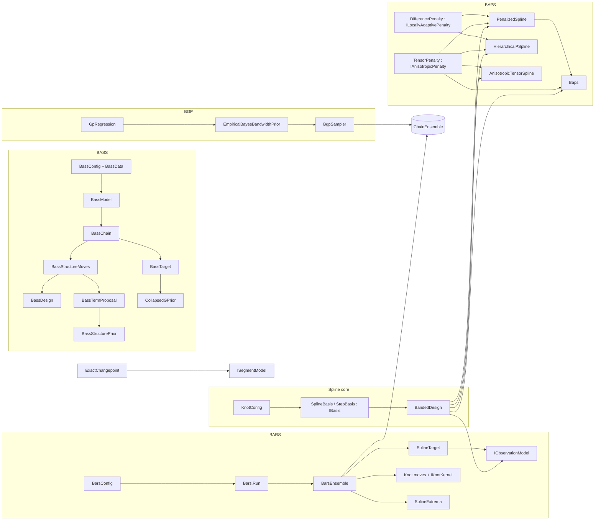

# Bayesian Regression

> Six Bayesian smoothing families that share one strategy: exploit Gaussian conjugacy in the regression coefficients (integrating them out, or drawing them from closed-form conditionals), then sample or select the remaining hyperparameters. **BARS** fits free-knot splines by reversible-jump MCMC. **BAPS** fits penalized splines (P-splines), including hierarchical and bivariate variants. The **Bayesian GP (BGP)** samples a kernel bandwidth under an empirical-Bayes prior. The **exact changepoint (BECP)** model computes a piecewise-constant regression by dynamic programming. **BASS** fits adaptive spline surfaces over any number of continuous and categorical predictors, with scalar or direct functional responses, by reversible jump over products of hinges. **BAMRS** extends the spline core to adaptive multiresolution bases. · **Project:** `Maths.Regression` (areas `spline/`, `spline/bars/`, `spline/bass/`, `spline/baps/`, `bgp/`, `changepoint/`)

## Topic Index

| Family | Name | Topic Document | Description |
|---|---|---|---|
| **BARS** | Bayesian Adaptive Regression Splines | [BARS.md](./BARS.md) | Free-knot splines via reversible-jump MCMC (1D curves, peak analysis) |
| **BASS** | Bayesian Adaptive Spline Surfaces | [BASS.md](./BASS.md) | High-dimensional surfaces, continuous/categorical/functional hinges |
| **BAPS** | Bayesian Adaptive Penalized Splines | [BAPS.md](./BAPS.md) | Penalized splines (P-splines), difference penalties, hierarchical & anisotropic |
| **BAMRS** | Bayesian Adaptive Multiresolution Splines | [BAMRS.md](./BAMRS.md) | Multiresolution spline expansions under EBIC priors |
| **BECP** | Bayesian Exact Change Point | [BECP.md](./BECP.md) | Piecewise-constant regression via dynamic programming |
| **BGP** | Bayesian Gaussian Process Bandwidth | [BGP.md](./BGP.md) | Radial GP bandwidth sampling under empirical-Bayes prior |

## Overview

`Maths.Regression` sits in layer 3 of the [architecture](../Architecture.md). It builds on:

- [Samplers](../Samplers.md): the reversible-jump engine, block scans and slice steps, and the ensemble shell;
- [LinearAlgebra](../LinearAlgebra.md): banded LDLᵀ and dense Cholesky, and for BASS the bordered Cholesky, the Khatri–Rao contractions and pairwise sums;
- [ProbabilityAndInformation](../ProbabilityAndInformation.md): generators, the Gamma and Beta distributions, log-gamma and digamma, and for BASS Wallenius' noncentral hypergeometric.

The domain use visible in the code is **locating transitions in a curve over a thermal grid**: where it peaks, how many peaks it has, and where it changes level. BARS, for example, reduces each posterior curve to its exact peak and to significant-peak spans.

BASS, ported from R BASS 1.3.1, serves surfaces over many inputs, such as emulators of computer simulations: scalar responses, mixed continuous and categorical predictors, and direct functional responses whose cases share one set of output locations. Prediction, sensitivity analysis and calibration follow its fitting engine ([the port hub](../../../issues/regression/bass-full-port-brief.md)).

## Key concepts

- **Marginalize, then sample.**
  - BARS integrates out the spline coefficients (and, for the Normal model, the noise scale) and samples the *number and positions* of knots.
  - BAPS integrates the coefficients out in `Collapsed` scheme and in REML selection, and samples or selects the smoothing strength λ. Its `Gibbs`/`LocallyAdaptiveGibbs` schemes and `HierarchicalPSpline` instead draw β from closed-form Gaussian conditionals, jointly with the variance components.
  - BGP integrates out the regression function and samples the bandwidth t.
  - BASS integrates out the coefficients and σ² and samples the structure, the collection of terms, and τ, the g-prior's precision multiplier, through the same collapsed g-prior block as BARS.
- **Knot configuration.** The pair $(k,\xi)$: k interior knots $\xi_1<\dots<\xi_k$ in the open interval $(0,1)$. The domain is fixed to $[0,1]$, so inputs and evaluation grids must be pre-scaled.
- **Terms and structures (BASS).** A term is a product of hinges $(s(x-t))_+^q$ on distinct continuous predictors, indicators of level subsets on distinct categorical predictors and, for a direct functional response, hinges on the output variables. A structure is an unordered collection of M distinct terms beside the intercept. Its support F is the set of structures within the basis cap whose terms have enough nonzero values and whose columns pass the numerical gate ([BASS: the design and admission](#bass-the-design-and-admission)), and which, under the Jeffreys σ² option, do not fit y exactly.
- **Basis, design and band storage.** A basis turns a knot configuration into an $m\times\nu$ design matrix Z. Every model forms $Z^\top WZ$ in LAPACK lower-band storage (`band[d, j] = A(j+d, j)`) and factors it with band LDLᵀ. The dense $\nu\times\nu$ matrix is never formed.
- **Readouts.** Per-draw summaries pooled across draws and chains: fitted grid values, knot count, the exact argmax, **peak intensity** λ(T) (expected significant peaks per grid cell) and **span coverage** π(T) (the posterior probability that T lies in some significant peak's span; a draw counts T once even where nested spans overlap).

## Design

**BARS is a declarative config plus a strict core.** `BarsConfig` is an immutable record whose defaults are component instances. `Bars.Run(config, x, y, grid)` maps it onto a `BarsEnsemble`. The components plug in through interfaces:

| Seam | Implementations |
|---|---|
| `IBasis` | `SplineBasis` (clamped B-splines), `StepBasis` (piecewise constant) |
| `IObservationModel` | `WeightedNormalModel` (default), `PoissonModel`, `WhittleModel`, `GibbsLossModel` |
| `IComplexityPrior` | `UniformPrior`, `PoissonPrior` (default λ = 5), `ConwayMaxwellPoissonPrior`, `EbicPrior` |
| `IKnotKernel` | `UniformKernel`, `LocalBetaKernel` (default τ = 50); immutable, because one instance is shared by every chain. Adaptive τ is requested with `adaptKernelTau` / `BarsConfig.AdaptKernelTau`, which builds an internal `AdaptiveLocalBetaKernel` per chain. |
| `IWeightResampler` (optional) | `StudentTWeights`, `ContaminatedNormalWeights` |

`Bars.Run` passes only basis, model, prior, kernel and robustness settings. The DMGK move schedule and parallel tempering are reachable only by constructing `BarsEnsemble` directly. Per-chain adaptive τ (`adaptKernelTau`) is also a constructor option; see [Status](#status-and-caveats) for the other route.

**BASS is a config of values plus a strict core** (the [contract shapes](../../../issues/regression/bass/port-fitting-brief.md#contract-shapes-decided-2026-10-28), decided 2026-10-28).
- **Values throughout.** `BassConfig` holds values only. The decisions' closed sets are records with a `Kind` discriminator (`GForm` or `RidgeForm`; `EqualOverAvailable` or `PriorCancelling`), and σ²'s and τ's priors and the intercept are the shared g-prior namespace's `Sigma2Prior`, `TauPrior` and `GPriorCentre`. So the record serializes to canonical JSON whole (`ToJson`, and `FromJson`, which refuses an unknown field) and is its own manifest, and `Bass.Fingerprint` hashes that JSON with the data's exact bits. `BarsConfig` holds component instances instead, so its checkpoint identity covers their types and not their parameters (OQ10).
- **The trade-off is extension.** A new prior or kernel joins its closed set with its decision, rather than plugging in as an instance.
- **Auto-picks** are resolved once at entry into `BassResolved`, with the automation log (below, under Configuration).
- **Shared parts and per-chain state.** `BassModel` assembles one fit's immutable parts once (the resolution, the input transform and inputs, the basis, the admission rules, the structure prior, the proposals and the target) and every chain shares them; each chain adds only its own mutable design.

**Two orchestration styles coexist.**

- **`BarsEnsemble`, `BgpSampler` and `Baps` are clients of the ensemble shell `ChainEnsemble`:** parallel replicas, with R̂ and ESS on functionals, an optional early stop and checkpoints.
  - **BAPS monitors ln λ and ln σ².** It joined the shell on 2026-10-23 with its draws unchanged: the shell derives the same kernel and readout seeds BAPS used, and each chain keeps its step order.
- **`HierarchicalPSpline`'s τ_u² mixes slowly** under the centred parameterization: about 2% of draws effective on a 6-replicate test fit, against 15–20% for σ² and τ₀². The shell's diagnostics show it, and an early stop waits for it.

**Precompute invariants.**

- `GpRegression` caches pairwise squared distances.
- `Baps`, `PenalizedSpline`, `HierarchicalPSpline` and `AnisotropicTensorSpline` cache $Z^\top Z$ and $Z^\top y$.
- `PenalizedSpline` factors A once per λ it is asked about. `Baps`'s `Collapsed` scheme keeps the accepted proposal's factor for the draw, so it factors once per proposal and never for a draw.
  - Until `7d90e2e` each evaluation also re-assembled $Z^\top Z$, and each draw factored A again.
  - Single-chain collapsed runs (ν = 44, 2,500 sweeps) went from 59 to 24 ms at n = 200 and from 314 to 20 ms at n = 2,000. The cost no longer grows with n.

**Extension points.**

- New bases, observation models, priors, kernels and resamplers for BARS (the interfaces above).
- `IBandPenalty` for new banded penalties in `PenalizedSpline` (REML evaluation), `Baps` and `HierarchicalPSpline` (their Gibbs conditionals). `ILocallyAdaptivePenalty` adds the per-difference terms that `BapsScheme.LocallyAdaptiveGibbs` needs; only a penalty whose difference matrix has full row rank can implement it.
- `IObservationModel.FitConditional` for a model that can serve the conditional mean, variance and draw from one fit.
- `IAnisotropicPenalty` for a penalty whose components are smoothed separately, $P(\lambda)=\sum_j\lambda_jP_j$, with their joint spectrum (`PenaltySpectrum`). It serves `AnisotropicTensorSpline`'s REML, `BapsScheme.AnisotropicGibbs` and `HierarchicalPSpline`'s anisotropic smoothing.
- `ISmoothingVariancePrior` for a new prior on the anisotropic smoothing variances: the log density of ln τ² with its first and second derivatives.
- `IGpKernel` for new radial GP kernels.
- `ISegmentModel` for new changepoint noise and level models.
- BASS's seams, which an extension fills: `IBassObservationModel`, `IDesignKernel<TPoints>` and `IInnerProduct` ([the extension seams](#bass-the-extension-seams)).

## API at a glance

| Family | Entry points |
|---|---|
| Spline core | `KnotConfig`; `IBasis`; `SplineBasis(degree = 3)`; `StepBasis`; `BSpline.EvaluateBasis`, `BSpline.MakeClampedKnots`; `BandedDesign` (`Accumulate`, `AccumulateRhs`) |
| BARS | `BarsConfig`; `Bars.Run(config, x, y, grid)` → `BarsResult`; `BarsEnsemble(basis, model, prior, kernel, resampler?, dmgkConstant?, adaptKernelTau?, temperLevels?, temperHotEnd = 0.05, temperPath = Likelihood, temperSchedule = DeterministicEvenOdd, temperAdaptLadder = true, …, temperReferenceRung = false, evidence = true)` with `ReportsEvidence`; `BarsResult.Evidence` → `BarsEvidence` (`SteppingStone`, `PathSampling`, `Priors`, `LogEvidence`, `MonteCarloError`), `BarsEvidenceEstimate`, `BarsEvidencePriors`; `WeightedNormalModel.HasCompleteMarginal`, `ResolvedPriors`; `ITemperedMarginal.LogMarginalLikelihoodSlope`; `PeakPosterior`, `PeakMode`, `PeakSpan`; `SplineExtrema` (`Argmax`, `SignificantPeaks`, `SignificantPeakSpans`) |
| BASS (stage 4) | `BassConfig` (`ToJson`, `FromJson`, `Validate`) with `BassStructureSpec`, `SupportRule` (`SupportKind`), `CategoricalSubsetMeasure`, `BassCountPrior`, `BassCoefficientPrior`, `BassSampling`, `EqualOverAvailable` / `PriorCancelling`; `BassData(predictors, response)` with `ContinuousPredictor`, `CategoricalPredictor`, `ScalarResponse`, `FunctionalResponse`; `BassResolved.Resolve(config, data)` (`AutoPicks`); `Bass.Fingerprint(config, data)`; `BassModel.Create(config, data, form)`; `BassInputTransform.Fit`, `BassInputs.Prepare`; `BassTerm`, `HingeFactor`, `CategoricalFactor`, `BassTermTable`; `BassBasis` (`CaseColumn`, `OutputColumn`, `Support`); `BassStructurePrior` (`LogPrior`, `LogCollectionWeight`, `LogCountRatio`) and `BassTermCounts`; `BassTermProposal` (`DrawBirth`, `DrawChange`, `LogBirth`, `LogBirthRatio`, `LogDeathRatio`); `BassDesign` (`ProposeBirth`, `ProposeDeath`, `ProposeChange`, `Accept`, `Load`, `Rebuild`, `Angle`, `MinAngle`) → `DesignProposal`, with `BassAdmission` and `BassRefusal`; `BassTarget` (`Evaluate`, `Defines`, `Marginal`, `LogTauDensity`, `Refusal`) → `BassEvaluation`, `BassStructureFit`; `BassChain` (`Step`, `Compose`), `BassStructureMoves` (`Refusals`, `EmptyBirths`), `BassTauBlock`; `BassState`, `BassDraw`, `BassStructure`; `Bass.Fit(config, data, run)` and `Bass.Resume(checkpoint, config, data, run)` → `BassFit` (`PointwiseLogDensity(data, units, content)`, `CandidateLogDensity(data, cases, grids, strata, unseenLevels)`, `ResidualDependenceFor(data, index)`), with `BassRunOptions`, `BassDiagnostics` (`BassMonitoredPoint`), `BassPriorSampler`; `TemperingSpec`, `BassLadder`, `BassTemperingReadout`, `BassEvidence` (`BassEvidenceEstimate`, `BassEvidencePriors`); `BassPointwise` (`LogDensity`, `DefaultUnits`); `BassResidualDependence.Of`, `ResidualDependence` (`LagOne`, `MoransI`), `ResidualIndex` (`AlongVariable`, `AlongOrder`, `NearestNeighbours`), `ResidualStatistic` |
| BASS (stage 5) | `BassDecomposition.FromPca(y, BassPcaSpec)`, `FromBasis(K, W, offsets, scales, …)` with `TruncationResiduals` (`TruncationResidual.LeaveOneCaseOut` / `InSample`) and `ReconstructionMap` / `LinearReconstruction`; `BassComponents.Fit(decomposition, predictors, config)`, and `Assemble(decomposition, predictors, components, masterSeed)` from fitted or resumed components, → `BassBasisFit` (`Decomposition`, `Components`, `JointDraws`, `Predict` → `BassBasisPrediction` (`Parts`), `PointwiseLogDensity(units, BasisDensitySpace)`); `BassJointDraws.Pair`; `BassFit.Predict(data, PredictionCases, BassPredictOptions)` → `BassPrediction` (`Latent`, `Predictive`, `MeanSurface`, the range flags); `BassFit.Gradient(data, PredictionCases, draws)` → `BassGradient` (`Partials`, pointwise, in each predictor's units); `PredictionCases`, `ContinuousColumn`, `CategoricalColumn`, `UnseenLevel`, `BasisPredictiveParts`; `PredictiveMixture.Quantile` |
| BASS (stage 6) | `BassFit.Sensitivity(data, SensitivitySpec)` → `SobolAnalysis` (`CoordinateVariables`) of `SobolDecomposition` (`MainIndex`, `TotalIndex`, `MeanMainIndices`, `MeanTotalIndices`, `OtherVariance`, `OtherIndex`, `MeanOtherIndex`, `Status`); `BassFit.Effects(data, spec, EffectSpec)` → `EffectAnalysis` (`CoordinateVariables`); `BassBasisFit.Sensitivity(spec)` → `BasisSobolAnalysis` (`AtLocation`, `PerLocation`, `Integrated`, `ComponentCovariance`, `ComponentMainCovariance`, `ComponentTotalCovariance`, `ComponentMeans`); measures `UniformMeasure`, `MixtureMeasure` (`NormalComponent`, `StudentComponent`, `MixtureWeighting`), `EmpiricalMeasure`, `CategoricalMeasure`; `FunctionalForm`; `BassMoments.On(inputs, degree, measure)` (`Mean`, `Cross`, `Pair` → `TermPairMoments`); `PiecewisePolynomial`; a Legendre fit's `BassSensitivity.FromCoefficients(fit, data)` → `PolynomialChaosSensitivity` (`Sobol`, `Jacobi`), under the uniform law alone |
| BASS (stage 9) | `BassFit.Traces()`, `TrainingFit(data, probabilities)`, `Metadata()`, `Summary(probabilities)`, `SensitivitySummary(data, spec, probabilities)`; the same on `BassBasisFit`, with `Effects(spec, effects)` → `BasisEffectAnalysis`; records `BassTraces`, `BassChainTrace`, `BassTrainingFit`, `BassMetadata`, `BassBasisMetadata`, `BassSummary`, `BassBasisSummary`, `BassPosteriorSummary`, `PosteriorSummary`, `SobolSummary`, `SobolAnalysisSummary`, `BasisSobolSummary` |
| BASS (F-M2 Phase 1) | `BassSampling.LocalSteps` (`LocalSteps`, `Window(n)`), `BassSampling.FactorMoves` (`FactorMoves`), `TemperingSpec.Split` (`SplitRule`); `BassResolved` (`StepWindows`, `FactorShares`, `SplitThreshold`); `BassTermProposal` (`ProposeChange`, `ProposePrune`, `ProposeGrow`, `ProposeVariableChange`, `Window`) → `BassTermMove`, `BassMoveKind`; `BassStructureMoves.Kinds`, `BassDiagnostics.MoveKinds` (`BassMoveTally`, `BassKindCount`); `TemperingLadder.Split` |
| BASS (E4, the residual birth) | `BirthMixture.Residual` (`ResidualBirth`); `BassResolved.Births`, `BassResolved.DefaultResidualBirth`; F-X4's `BassBirthContext` and the kernels' context overloads; `BassStructureMoves.InverseTemperature` |
| BASS (E4, the history birth) | `BassSampling.Births` (`BirthMixture`, `HistoryBirth`); `BassInclusionHistory` (`Learn`, `Record`, `Freeze`, `SetFromPopulation`, `Frequencies`, `Reading`); `BassStructureMoves.History`, `BassSmcKernel.History`; `BassChainAccount.Inclusion` (`BassInclusionReading`) |
| Verdicts (D10, N14) | `BassSampling.StoppingScope` (`BassStoppingScope`), `BassResolved.StoppingGroups`; `BassDiagnostics` (`LogPosterior`, `Verdict`, `ModeSeparation` → `BassModeSeparation`, `PredictiveGroup`, `LevelGroup`, `StructuralGroup`); `BarsResult.Verdict`, `BgpResult.Verdict`, `BapsResult.Verdict`, `HierarchicalResult.Verdict` |
| BASS calibration (stage 7) | `ICalibrationEmulator`, `BassBasisEmulator`, `BassFitEmulator`, `EmulatorNoise` (`ComponentNoise`, `IndependentNoise`); `ContinuousParameter`, `CategoricalParameter`, `ParameterLayout`; `GaussianMeasurement`, `VarianceGroup`, `InverseGammaVariance`, `HalfCauchyDeviation`, `MeasurementModel`; `FunctionalFormulation` (`TruncationTerm`, `FunctionalDiscrepancy`), `MultivariateFormulation`, `CalibrationCovariance` (`Create`, `Factor`) → `CovarianceFactor`; `CalibrationModel` (`Target`, `Physical`, `Delta`), `CalibrationTarget`, `CalibrationState`; `CalibrationSampler.Run` → `ConditionalRun` of `CalibrationDraw`; `NestedCalibrationSampler.Run` → `NestedCalibration` (`Runs`, `NotConverged`, `Pooled`); `CalibrationConfig` (`ToJson`, `FromJson`, `Validate`) |
| BASS SMC (stage 8) | `BassSampling.Smc` (`SmcSpec`; `SmcSpec.StepCap`, `BassSmcReplicate.CappedSteps`), `BassParticle`, `BassParticles`, `BassParticleTarget`, `BassSmcKernel`, `BassSmcFit`; `BassDiagnostics.Smc` (`BassSmcReadout`, `BassSmcReplicate`, `ReachedPosterior`, `Spread`; the flags `JumpedOverACollapse`, `Overdispersed`, `Flags`), `BassEvidence.OfSmc` (`Overdispersed`); `PointwiseLogDensity.Weights`; `BassRunLengths.Smc`; calibration: `CalibrationConfig.Smc` (`CutSmcSpec`), `CalibrationBridge`, `BridgeEvaluation`, `CutSmcKernel`, `CutSmcParticles`, `CutSmcOrdering` (`Tour`, `Random`), `CutSmcSampler.Run` → `CutSmcCalibration` (`Populations`, `CutSmcPopulation`, `CutSmcLeg`, `Pooled`) |
| BASS coefficient prior (D03's two axes) | `BassCoefficientPrior(Form, Scale)` (`G(scale)`, `Ridge(scale)`, `RawRidge(scale)`, `ModifiedG(scale, ζ)`, `UnitObservations`), `GForm`, `RidgeForm`, `RawRidgeForm`, `ModifiedGForm`; `BassPriorPrecision`, the design's prior-precision builder (E21); `TauPrior` (`UnitInformationGamma`, `HyperG`, `HyperGOverN`, `Held`, `Gamma(a, b)` on τ itself, `For(n₀)`, `IsProper`) → `ResolvedTauPrior` (`LogDensity`, `SampleLogTau`, `HeldTau`); `RidgeSpectrum.Of` (`Birth`, `Death`, `Change`), `RidgeColumns.At` → `RidgeTerms`, `CollapsedGPrior.CentredRidgeMarginalAt`, `CollapsedRidgePrior` (`FromCentred`, `MarginalAt`, `At`); `BassTarget` (`Scale`, `HeldTau`, `CoefficientForm`, `CoefficientBlock`), `BassDesign.Spectrum`, `DesignProposal.Ridge`, `BassStructureFit.Ridge`, `BassEvidencePriors(Coefficients, Scale, …)` |
| BASS flat histogram (N17 Phase 2) | `BassSampling.FlatHistogram` (`BassFlatHistogramSpec`: `Run`, `Pilot`, `MaxIterations`), `BassFlatHistogramPilot`; `BassDiagnostics.FlatHistogram` → `BassFlatHistogramReadout` (`Evidence` → `BassFlatHistogramEvidence`, `Pilot` → `BassFlatHistogramPilotReadout`, with `TiedNodes`); `BassEvidence.FlatHistogram`; `BassRunLengths.FlatHistogram` |
| BASS extension seams | `IBassObservationModel` (`Working`, `Blocks`) → `WorkingResponse` (`Values`, `Offset`, `Weights`, `IsUnweighted`, `Meaning`, `PriorGram`, `Weighting`, `ResponseMean`, `Output`), `WeightMeaning`, `WeightedPriorGram`, `GaussianObservation`; `BassModel.Create(config, data, observation, form)` (`Observation`, `Working`); `BassSweepSlot`, `BassSweepSlots` (`Order`, `Blocks`); `IDesignKernel<TPoints>` (`Reads`, `Differentiable`, `Validate`, `Multiply`, `MultiplyDerivative`, `Scale`, `Factors`), `DesignKernels` (`Case`, `Output`), `DesignFactor` (`Value`, `Derivative`, `Mean`, `Pair`), `HingeDesignFactor`, `SubsetDesignFactor`; `BassBasis` (`Kernels`, `CaseDerivative`, `OutputDerivative`), `BassMoments.FactorDerivative`; in [LinearAlgebra](../LinearAlgebra.md): `IInnerProduct`, `IdentityInnerProduct`, `KhatriRao`'s `FaceSplittingGram`, `FaceSplittingCrossProducts`, `FaceSplittingHalfBandwidth` and `KroneckerGram`, `WideBandCholesky`, `SpdFactors`; in [Samplers](../Samplers.md): `GigParameters`, the GIG forms of `ConjugateUpdates` |
| BAPS | `IBandPenalty` (`Bandwidth`, `Nullity`, `AccumulateInto`, `Roughness`), `ILocallyAdaptivePenalty` and `IAnisotropicPenalty` (`Components`, `AccumulateComponents`, `ComponentRoughness`, `SamplePrior`, `Spectrum` → `PenaltySpectrum`: `LogPseudoDeterminant`, with its gradient and Hessian in ln λ); `ISmoothingVariancePrior` (`LogDensityOfLog`) and `ISmoothingVariancePriorChoice` (`Resolve`): `ScaledWeibullPrior(tailProbability = 0.05)`, `InverseGammaVariancePrior(shape, scale)`, `WeibullVariancePrior(scale, shape = ½)` (`Rate`), `WeibullVariancePrior.ScaledTo(design, penalty, bound, tailProbability = 0.05)` and `ScaledToResponse(design, penalty, y)`; `SmoothingVarianceUpdate` (`Slice`, `Newton`); `NoiseVariancePrior` (`InverseGamma`, `Jeffreys`); `DifferencePenalty(order = 2)`; `PenalizedSpline(design, y, IBandPenalty)` (`Coefficients`, `ProfiledVariance`, `RemlLogEvidence`, `EffectiveDegreesOfFreedom`, `EdfSlope`); `Baps(..., componentPrior, componentUpdate, noisePrior).Run(BapsScheme, …)` (`ComponentPrior`) with `BapsScheme` (`Gibbs`, `Collapsed`, `LocallyAdaptiveGibbs`, `AnisotropicGibbs`) → `BapsResult` (`PosteriorDraws`, `FitBand(design)` → `PointwiseBand`, `Sigma2Interval`, `Tau2Interval`, `ComponentLambdaInterval(j)` → `PosteriorInterval`, `ComponentLogLambdaConvergence`); `HierarchicalPSpline(..., anisotropicSmoothing = false, componentPrior, componentUpdate, noisePrior).Run` (`ComponentPrior`) → `HierarchicalResult` (`PosteriorDraws` per chain, Rao–Blackwellized means, `PopulationBand`, `ReplicateBand`, three variance intervals, `ComponentSmoothingVarianceInterval(j)`, three convergence diagnostics, `ComponentSmoothingVarianceConvergence`, `RHatPopulation`, `Checkpoint`); `HierarchicalStart` (`Overdispersed`, `Fixed`); `HierarchicalScheme` (`Centred`, `CollapsedPopulation`, `Interweaved`, `CollapsedInterweaved`, `ParameterExpanded`); `HalfTDeviationPrior(Degrees, Scale)`; `TensorProductDesign.Build` → `TensorDesign`; `TensorPenalty`; `AnisotropicTensorSpline` (`Coefficients`, `RemlLogEvidence`, `RemlOptimum` → `AnisotropicReml`, `Penalty`) |
| BGP | `SquaredExponentialKernel : IGpKernel`; `GpRegression(x, y, sigma2, kernel, scaling = Similarity)` or `GpRegression.WithUnknownScale(x, y, kernel, scaling)` (`NoiseModel`, `Fit(t, η)` for an unknown scale; `Fit(t)` → `GpFit`, `PredictMean`, `PredictVariance`, `KernelAffinity`, `Transform` → `GpTransform`); `EmpiricalBayesBandwidthPrior(gp, …)`; `BgpSampler(gp, prior).Run(...)` → `BgpResult` (`PosteriorMean`, `PosteriorSd`, `BandwidthDraws`) |
| Changepoint | `ExactChangepoint.Infer(y, σ², ν, ρ², maxSegments)` or `Infer(y, ISegmentModel, maxSegments)` → `ChangepointResult`; `DefaultHyperparameters(y)`; `GaussianSegmentModel`, `CauchySegmentModel`; `ChangepointResult.Posterior.Sample(draws, seed)` → `ChangepointDraw` |
| Pointwise and predictive checks | `UnitPartition(unitOf, stratumOf)`, `UnitPartition.EachObservation(n)`, `ConsecutiveBlocks(blocks, size)`; `PointwiseLogDensity` (`Values`, `Units`, `Latents`, `ChainLengths`, `LeavesUnitsOut`); `LatentReport`, `LatentScope`, `LatentTreatment`; `PointwiseContent`; `BarsEnsemble.PointwiseLogDensity(result, x, y, units, content)`, `IConditionalFit.LeaveOutLogDensities(units)`, `GPriorConditional.LeaveOutLogDensity(sigmaPrior, design, y, weights, unit)` and, with the unit's τ-free quadratic forms taken once (`LeaveOutQuadratics(design, unit)`), `LeaveOutLogDensity(sigmaPrior, design, y, weights, quadratics)`, `Baps.PointwiseLogDensity(result, units)`, `BgpSampler.PointwiseLogDensity(result, units)`, `GpRegression.LeaveOutLogDensities(fit, units)`, `HierarchicalPSpline.PointwiseLogDensity(result, units)`, `ChangepointPosterior.PointwiseLogDensity(draws, units)`; `PredictiveChecks.Waic`, `PsisLoo` → `PredictiveCheck` (`MonteCarloError`, `JointMonteCarloError`, `MonteCarloErrors`, `RelativeEfficiency`), `ParetoKThreshold`, `FitGeneralizedPareto`; `IWeightResampler.MarginalLogDensity`, `ISegmentModel.LogLikelihood` |
| Conformal layer ([ConformalPrediction](../ConformalPrediction.md)) | `CandidateLogDensity(values, grids, latents, stratumOf, chainLengths)` (`Weights`, `Offset`); `ConformalBayes.FullStep(training, candidates, ConformalOptions)` → `ConformalPrediction` of `ConformalSet`s; `ConformalBayes.Scores` → `ConformalScores` |
| The other engines' candidate densities ([ConformalPrediction](../ConformalPrediction.md#the-other-engines-candidate-densities-slice-5), slice 5) | `Baps.CandidateLogDensity(result, design, grids, strata, cdf)` and `BarsEnsemble.CandidateLogDensity(result, x, grids, strata, quadrature, cdf)`, which both forms take, with `cdf` on their `PointwiseLogDensity`; `HierarchicalPSpline.CandidateLogDensity(result, design, replicates, grids, strata, cdf)` and `BgpSampler.CandidateLogDensity(result, xCases, grids, strata, cdf)` (`GpRegression.PredictiveLogDensities`), which the split form takes; none for the changepoint posterior |

## Pointwise densities and predictive checks (OQ17)

**The contract** (`Pointwise.cs`). A `PointwiseLogDensity` is the draws × units matrix of log p(y_unit | draw), with the `UnitPartition` it was computed for, a `LatentReport` per latent and, for Markov chains, the draws per chain (`ChainLengths`; null for independent draws).
- **The unit map** sends each observation to a unit: what a leave-one-out or add-one-in step removes or adds. The default is each observation its own unit (`UnitPartition.EachObservation`); `ConsecutiveBlocks` makes curves.
- **The stratum map** sends each unit to an exchangeability stratum, which only consumers read (stratified, Mondrian, coverage).
- **The caller chooses both;** the engine serves no one application. SPC × BARS starts with a replicate's observation at a temperature as the unit and the temperature as the stratum.
- **The rule.** A latent is integrated out of a unit's term when everything that depends on it lies inside the unit, and conditioned on otherwise, so the unit chooses the predictive question. Each latent is reported as `Integrated`, `Conditioned`, `Mixed` or `IntegratedGivenOthers`, with its scope (`Observation`, `Group`, `Global`), so a consumer can check the question it answers.
- **Two draw contents** (`PointwiseContent`, OQ17's two options).
  - `RetainedParameters`, the default where an engine has both: the plain likelihood given the draw.
  - `CollapsedPredictive` keeps the draw's structure and integrates its coefficients and noise scale against their posterior given the observations outside the unit. Each term is then the leave-unit-out predictive log p(y_U | y_rest, structure). Those latents are reported `IntegratedGivenOthers`, which `LeavesUnitsOut` reads.
  - **The shared arithmetic** (`LeaveOutPredictive`). Take y | σ² ~ N(·, σ²Q⁻¹), with Q a precision into which any location parameters are already integrated. With r the residual, S = rᵀQr, ẽ = Q_UU⁻¹(Qr)_U and S₋U = S − (Qr)_Uᵀẽ, a known scale gives a Gaussian and σ² ~ IG(a, b) a Student t.

**Each engine's terms.**
- **BARS** (`BarsEnsemble.PointwiseLogDensity(result, x, y, units)`). Knots, β and σ² are global and conditioned on.
  - Normal model: N(yᵢ; zᵢβ, σ²).
  - With robust weights, each weight belongs to one observation and is integrated out under its prior: the resampler's `MarginalLogDensity`, Student t_ν(0, σ) or the mixture (1 − π)N(0, σ²) + πN(0, κ²σ²).
  - Poisson: the Poisson log mass at exp(zᵢβ).
  - Whittle: the exponential density of a periodogram ordinate with mean exp(zᵢβ), under Whittle's approximation of independent ordinates.
  - Gibbs loss declines, since its likelihood is a pseudo-likelihood.
  - **The collapsed content** (`content: PointwiseContent.CollapsedPredictive`) is the Normal model's alone. Per draw it is the g-prior's leave-unit-out Student t at the draw's knots, with the prior held at the full data's (`IConditionalFit.LeaveOutLogDensities`, through `GPriorConditional.LeaveOutLogDensity`). Robust weights decline, since the term would condition on the unit's own fitted weights; so do Poisson, Whittle and Gibbs loss, which have no closed form.
- **BAPS** (`Baps.PointwiseLogDensity(result, units)`). The retained content for every scheme: N(yᵢ; zᵢβ, σ²), with β and σ² global and conditioned on.
- **BGP** (`BgpSampler.PointwiseLogDensity(result, units)`). The collapsed content only, since f is integrated and never drawn.
  - Per draw, log p(y_U | y_rest, t, η) with f, the constant mean and, for an unknown scale, s² integrated out (`GpRegression.LeaveOutLogDensities(fit, units)`).
  - The flat mean leaves the projected precision P = R⁻¹ − R⁻¹11ᵀR⁻¹/1ᵀR⁻¹1, with PY = α and YᵀPY = Q. A known σ² gives a Gaussian; an unknown scale under 1/s² gives a Student t over n − 1 effective observations.
  - A draw that repeats its predecessor's (t, η) reuses its row, so a run costs one O(n³) refit per accepted move.
- **`HierarchicalPSpline`** (`PointwiseLogDensity(result, units)`; observation o = r·n + i).
  - A unit holding all of replicate r integrates β_r out: N(y_r; Zβ₀, σ²I + τ_u²ZZᵀ), formed through ZᵀZ = V diag(λ) Vᵀ.
  - A unit holding part of it conditions on β_r, which needs the retained replicate draws.
  - Curve units therefore work without replicate draws; split units refuse.
- **The changepoint draws** (`ChangepointPosterior.PointwiseLogDensity(draws, units)`). The segmentation is conditioned on. A unit holding a whole segment integrates its level, its term the segment's evidence D(a, b) from the tables; otherwise the segment model's `LogLikelihood` is taken at the drawn level.

**Consumers** (`PredictiveChecks`), which read the matrix and know no model:
- **`Waic`** (Watanabe 2010): per unit, lppd − Var_s log p. It refuses leave-out terms, whose units are not conditioned on their own data.
- **`PsisLoo`:** leave-one-unit-out by Pareto-smoothed importance sampling (Vehtari, Gelman & Gabry 2017; Vehtari et al. 2024), following the loo package. The largest M = ⌈min(S/5, 3√(S/r_eff))⌉ log ratios are smoothed by a generalized Pareto fit (Zhang & Stephens 2009, with loo's weakly informative shape adjustment) and truncated at the raw maximum. Each unit's k̂ flags an unreliable estimate above `ParetoKThreshold(S)` = min(1 − 1/log₁₀S, 0.7), loo's `ps_khat_threshold`.
  - On leave-out terms it is the non-factorized model's PSIS-LOO (Bürkner, Gabry & Vehtari 2021). The effective number of parameters, lppd − elpd, has no in-sample lppd there and is NaN.
  - **How each tail was treated** is reported per unit (`PredictiveCheck.ParetoTails`, a `ParetoTail`), so a k̂ of ±∞ says why:
    - `Fitted`: k̂ is the fit's shape.
    - `TooShort`: too few draws for a tail of five. k̂ = +∞, as in loo.
    - `NoFit`: the tail's first quartile is its smallest value, posterior's `gpdfit` guard (`FitGeneralizedPareto` returns NaN there, as `gpdfit` returns NA), or the fit gives no number. k̂ = +∞, unsmoothed, as in loo.
    - `Tied`: the tail's largest ratios tie to rounding. k̂ = −∞ and the tail is left unsmoothed.
  - **The tied tail is where this differs from loo, on purpose.** loo cannot fit it, warns, calls it +∞ and withholds the total's Monte Carlo error.
    - *Why it is kept.* A tied tail means at least M draws hold the largest ratio, so the sample's tail is bounded and no draw dominates, which is what k̂ exists to detect. Ties are the norm for the collapsed content, whose ratios repeat with the structure. Under loo's reading every such unit would withhold the total's error. In the test case of three structures holding 1/2, 1/4 and 1/4 of 400 draws, the unsmoothed estimate is the exact harmonic mean, and loo would refuse it.
    - *What it cannot see.* Like any k̂, it cannot see structures the chain never visited. Stuck chains are R̂'s and r_eff's to catch.
    - The parity tests assert the divergence (`DiagnosticsParityTests`, the `tied` fixture).
- **k̂ runs pessimistic on the collapsed content.** Its ratios vary only with the chain's slow part, since the fast parts are integrated, so they clump. BARS's discrete knots are revisited; BGP's bandwidth walk repeats its state on rejection and drifts slowly. The Pareto fit reads the clumps as a heavy tail while the estimate holds. The relative efficiency does not repair it. Against brute-force leave-one-out its flags were false alarms, and its one genuine failure carried a large reported error, so on the collapsed content read the Monte Carlo errors, not k̂ (Checks).
- **The relative efficiency** r_eff (loo's `relative_eff`). Per unit it is the ESS of the unit's likelihoods within the chains, over S. The ESS is `ChainDiagnostics.MeanEss`: Stan's estimator on split chains, not rank-normalized, the posterior package's `ess_mean`. Independent draws, and an ESS that cannot be estimated, take 1; chains of unequal length are cut to the shortest. A slowly mixing unit gets a longer tail and a larger error.
- **The Monte Carlo error** (loo's `mcse_elpd_loo`). Per unit it is √log(1 + Σ_s w̃_s²(p_s/p̂ − 1)²/r_eff): the self-normalized estimator's relative variance (Vehtari et al. 2024, eq. 6), moved to the log scale by a log-normal's moments. The total is √Σ of the units' squares, NaN when any k̂ exceeds the threshold, as in loo. It treats the units' errors as independent, though they share the draws. `JointMonteCarloError` keeps their correlation to first order: each draw's influence on the total, Ψ_s = Σ_u w̃_us(p_us/p̂_u − 1), gives the total's variance Σ_s Ψ_s²/r_eff, with r_eff the ESS/S of Ψ along the chains (`MeanEss`). It is NaN under the same rule, and both totals are reported.
- WAIC treats the draws as independent and reports no Monte Carlo error.
- *Weighted draws* (SMC, stage 8; `PointwiseLogDensity.Weights`).
  - WAIC's lppd is log Σ W p, and p_WAIC is Σ W(ℓ − ℓ̄)²/(1 − Σ W²).
  - PSIS-LOO's log ratios are log W − ℓ, with zero-weight draws dropped.
  - Equal weights reproduce the unweighted forms.
  - A population refuses chain lengths, since it has no order for r_eff.
- Conformal Bayes (Fong & Holmes 2021) reads this matrix beside a candidate density at new cases: the conformal layer, engine-free, in [ConformalPrediction](../ConformalPrediction.md). It refuses the collapsed content and an observation-level latent conditioned on.

**Checks.**
- The Pareto fit recovers shapes 0, 0.3 and 0.7. A tail whose first quartile is its minimum gets no fit. Each `ParetoTail` state appears where it should.
- **Against R `loo` 2.10.1** (`DiagnosticsParityTests`, opt-in R; N13). Per-unit elpd, k̂, Monte Carlo error and r_eff, and the total's elpd, SE, p_loo and Monte Carlo error, agree to 10⁻⁹ relative. The fixtures are independent draws, four AR(1) chains (r_eff below 1), an influential unit (k̂ 1.45), a `NoFit` tail (+∞ on both sides) and a `Tied` tail, where the documented divergence is asserted.
- PSIS-LOO matches exact leave-one-out within 0.03 per observation on a conjugate Gaussian linear model, and flags its outlier with the heaviest tail.
- WAIC follows its definition and agrees with exact leave-one-out to O(1/n).
- The Student-t marginal matches numerical integration over the weight's Gamma prior; the contaminated mixture integrates to 1.
- Curve units match an explicit dense multivariate normal; observation units match the conditional terms.
- Whole-segment units sum the draw's segment evidences.
- On data with outliers, the Student-t error model's PSIS-LOO beats the Normal model's by more than 5 nats.
- BAPS's terms follow their definition for each scheme; WAIC and PSIS-LOO agree within 1 nat on a smooth fit.
- **The collapsed terms are exact.**
  - BARS's match the joint marginal's conditional, a dense multivariate t, to 1e-9: zero and median centres, with weights, and under a proper σ² prior.
  - BGP's equal the evidence difference log p(Y | t, η) − log p(Y_rest | t, η) to 1e-8, for both noise models and single, block and interleaved units.
- **The collapsed estimate holds where k̂ flags it.**
  - On a BARS fit the collapsed and retained PSIS-LOO agree: elpd 38.62 against 38.73, 0.006 nats per unit, with 56 units above k̂ = 0.5 against 3 (30 against 5 before the relative efficiency).
  - With a known σ², BGP's exact LOO is a quadrature over t alone: log ∫p(Y | t)p(t)dt − log ∫p(Y₋ᵢ | t)p(t)dt. On n = 40, PSIS-LOO matched it to 0.02 nats in every unit and 0.012 in total. The five units above k̂ = 0.7 were within 0.002. In a probe the total's error fell from 0.043 to 0.005 nats as t's ESS rose from 100 to 970, and lowering the walk's step raised the worst k̂ to 6.7.
- **The relative efficiency and the Monte Carlo error.**
  - `MeanEss` is within 2% of the AR(1) value S(1 − φ)/(1 + φ) and ignores an affine map. For eˣ of a standard AR(1), whose lag-k correlation is (e^{φᵏ} − 1)/(e − 1), it is within 2% of S/τ, while the bulk ESS does not change.
  - On a normal-mean model y_i ~ N(θ, 1) with exact AR(1) chains, each unit's r_eff has a closed form. At ρ = 0.8 it runs from 0.11, the AR(1) value, for units far from ȳ, where exp(ll) is nearly linear in θ, to 0.21 for units near ȳ, where it is quadratic. The estimates are within 6% of it.
  - On the same model, each unit's Monte Carlo error is 0.99–1.12 of the spread of its estimates across 200 independent runs. Read as independent draws, it is √r_eff of that. For the total, the joint error was 0.090 against an actual spread of 0.084, and loo's √Σ 0.095. The units' linear parts cancel there (Σ(yᵢ − ȳ) = 0) while their common part adds, and the two nearly offset. Under an informative prior, N(ȳ − 2, 1/20), the units' errors share a sign: the joint error was 0.320 against an actual 0.319, and loo's √Σ 0.097, 3.3 times too small.
  - On BGP with a known σ², the rms of the errors against exact LOO was 0.5–1.3 reported errors over five runs, and 1.3–3.2 read as independent.
- **The relative efficiency does not repair collapsed k̂.** The pre-registered test failed on every seed: no more units above the threshold than the retained content's on BARS, and none on BGP with a known σ², in at least 3 of 4 seeds.
  - Over four BARS seeds the collapsed content kept 53, 3, 43 and 3 units above it, against 1, 0, 0 and 0 retained.
  - Against the independent reading the count fell on two seeds (11 → 3, 12 → 3) and rose on two (29 → 53, 38 → 43).
  - BGP with a known σ² kept 2–7 units above it.
  - Where the longer tail reaches tied values at its cutoff, the fit's first quartile is 0 and k̂ is +∞ (`NoFit`), as in loo. That came from NaN arithmetic until 2026-10-27, and since then from posterior's explicit guard.
- **Against brute-force leave-one-out** (`LooBenchmark`, `LOO_BENCH`; n = 30, three data sets × two seeds, 180 units). The reference samples BARS's knot posterior without unit i under the full data's prior, the target both contents estimate, and averages the exact leave-out predictive.
  - **The collapsed k̂ is pessimistic.** Pre-registered: at least 90% of its flagged units within 3 Monte Carlo errors. All 78 were, and 65 were within 0.02 nats. The exceptions above 0.05 were on one bump data set, where the reference itself carried errors of 0.07–0.22. One was a genuine failure: the bump's peak without its own observation, 1.5 nats low, whose reported Monte Carlo error (0.94) flagged it.
  - **The retained k̂ is not a false negative by the pre-registered rule:** 3 of its 169 passed units were beyond 3 errors (the rule's bar was 10%), with no optimism on the units only the collapsed content flags (0.0003 ± 0.004). But all three were endpoints, with k̂ 0.54–0.58, optimistic by 0.06–0.15 nats. Over the endpoints the retained content was optimistic by up to 0.41 nats and the collapsed within 0.06. A retained ratio's tail index is the unit's leverage, and leverage is highest at the boundary.
  - **The collapsed content was the more accurate:** rms z 1.00 against 1.23, and no unit beyond 3 errors against 4.
  - **A rerun is the wrong reference.** Rerunning BARS on y₋ᵢ rebuilds the data-dependent g-prior; the first design's control measured up to 0.43 nats of difference at the endpoints, and it was replaced.

**Not built yet:** the collapsed content for BAPS, `HierarchicalPSpline` and the changepoint draws; a k̂ that reads clumped ratios correctly. BGP has no retained content, since it never draws f.

## Configuration

| Setting | Default | Meaning |
|---|---|---|
| `BarsConfig` Degree / Model / Prior / Kernel | 3 / `WeightedNormalModel` / `PoissonPrior(5)` / `LocalBetaKernel(50)` | Components |
| `BarsConfig` AdaptKernelTau | null | Fixed kernel; a value tunes a private local-Beta kernel per chain from that initial τ |
| `BarsConfig` Chains / MasterSeed / BurnIn / MaxSamples | 4 / 0 / 2000 / 2000 | Ensemble |
| `BarsConfig` StartDispersion / WeightEvery | 4 / 25 | Start $k\sim U\{0..4\}$; resampler period |
| `BarsConfig` RHatTarget / BatchSize / MinEssPerChain | 0 / 0 / 100 | No early stop; single round; an R̂ stop waits for 100 effective knot-count draws per chain |
| `BarsConfig` PeakProminence / SpanDropFraction | 0.1 / 0.5 | Peak significance; span level |
| `BarsConfig` MinColumnMass | 1 | Support gate: every basis function needs column mass $\sum_i B_j(x_i)\ge1$; 0 turns it off |
| `BarsConfig` BirthExploration / BirthBase | 1 / `Uniform` | Births from the base: uniform on (0, 1); below 1 mixes in DMGK's local births |
| `WeightedNormalModel` centre | `Median` | The g-prior centred on the response's median: a shifted response fits the same, and an outlier the robust weights discount cannot move it. `Mean` centres it on the mean; `Zero` is DMGK's original |
| `BarsEnsemble` dmgkConstant / adaptKernelTau / temperLevels / temperHotEnd / temperPath / temperSchedule / temperAdaptLadder | null / null / null / 0.05 / Likelihood / DeterministicEvenOdd / true | Constant weights 0.4/0.4/0.2; fixed kernel; no tempering; a tempered ladder keeps the knot prior whole, swaps even-odd and equalizes its rungs in burn-in |
| `BassStructureSpec` Degree / MaxInteraction / MaxCategoricalInteraction / MaxFunctionalInteraction | 1 / 3 / 3 / 3 | The hinges' power q; each part's interaction cap, resolved to at most that part's variables |
| `BassStructureSpec` MaxBasis | null: min(1000, N − 1) | The cap on M. The intercept counts toward the dimension bound, where R's min(1000, n) allows one column too many |
| `BassStructureSpec` Support | `SupportRule(Count)`: min(20, 0.1·n) per part | Nonzero values per term, n = n_x for the case side and n_r for the output side; `ColumnMass` the option |
| `BassStructureSpec` AngleFloor / MaxVarianceInflation | 10⁻¹⁰ / null | D06's s_min; no variance-inflation cap |
| `BassStructureSpec` CategoricalSubsets / OrderWeight / VariableWeight | `SizeUniform` / 5 / 5 | R's subset measure (`Uniform` is the paper's); w₁ and w₂, validated positive |
| `BassConfig` Count / Coefficients | `BassCountPrior(10, 10)` / `BassCoefficientPrior.G()` | λ ~ Gamma(h₁, rate h₂), integrated out; the g-form with τ ~ Gamma(½, rate N/2), Zellner–Siow. `G(TauPrior.Held())` holds τ at 1/N; hyper-g and hyper-g/n are selectable; `Ridge(scale)` is the normalized ridge, its held τ declared |
| `BassConfig` Sigma2 / Intercept | `Sigma2Prior.ScaledToResponse(1e-3)` / `GPriorCentre.Mean` | IG(c, c·s²) and level centring; Jeffreys, a declared inverse gamma, a held σ², `Flat` and `Zero` selectable, `Median` refused |
| `BassConfig` RandomIntercepts | null | Named random-effect intercept blocks ([E21](../RandomEffects.md)): `BassRandomIntercept("site", s)`, s the effects' sd over σ, held or drawn; observation-centred or centred within a named parent |
| `BassSampling` Chains / MasterSeed / BurnIn / Samples / Thin | 4 / 0 / 9000 / 1000 / 1 | R's split of 10,000, provisional; read by the run (S7) |
| `BassSampling` RHatTarget / BatchSize / MinEssPerChain / ReportEvidence | 0 / 0 / 100 / true | No early stop; read by the run (S7) and the ladder (S8) |
| `BassSampling` StoppingScope | `All` | The groups an R̂ target gates: every group, or `Predictive` alone (D10, decided 2026-10-29) |
| `BassSampling` Smc | null: MCMC | `SmcSpec`: `Particles` 1,000, `Replicates` 4, `TargetConditionalEss` 0.99, `MutationSteps` 5, `ResampleBelow` 0.5, multinomial, `Form` integrated, `MaxStages` 1,000, `TraceStages` false, `AdaptiveMutation` null, `StepCap` null (opt-in, r > 1: each step from b > 0 at most r·b) (stage 8; provisional) |
| `CalibrationConfig` Parameters / Measurement / Covariance | required | The calibration inputs, the variance groups with their priors, and the declared formulation (D09) |
| `CalibrationConfig` EnumerationCap | 1,024 | Categorical combinations enumerated whole; single-site steps above |
| `CalibrationConfig` Sampling | `BurnIn` 2,000, `Samples` 2,000, `Thin` 1, `DecorrelationEvery` 100, `Tempering` null | The conditional sampler; no default ladder |
| `CalibrationConfig` Reference | `OuterDraws` null (every draw), `Chains` 4, `MaxSamples` 4,000, `BatchSize` 250, `RHatTarget` 1.01, `MinEssPerChain` 100 | The nested reference sampler, gated by N14's verdict |
| `CalibrationConfig` Smc | null: C3's nested sampler | `CutSmcSpec`: `Particles` 1,000, `TargetConditionalEss` 0.99, `MutationSteps` 5, `ResampleBelow` 0.5, multinomial, `OuterDraws` as C3's, `Order` Tour, `MaxStagesPerLeg` 1,000 (stage 8; provisional) |
| `BassSampling` Moves | `EqualOverAvailable` | D01's schedule; `PriorCancelling(C = 0.4)`, C ∈ (0, ½], the option |
| `BassSampling` LocalSteps | null: off | `LocalSteps(Probability = 0.5, WindowFraction = 0.02)`: local knot steps and level toggles inside a change (F-M2; the pass made it no default, 2026-10-29) |
| `BassSampling` Births | null: the fit's default, E4's residual birth (ω_R ¼) for KHAOS's raw-ridge fits of a scalar response (since 2026-11-09, an auto-pick), the fit's own birth otherwise; `new BirthMixture()` the fit's own birth alone | `BirthMixture { History = HistoryBirth(Share = 0.25, Floor = 0.01, Refresh = 100), Residual = ResidualBirth(Share = 0.25) }`, either or both: E4's history birth ([its section](#bass-the-birth-mixture-and-the-history-birth-e4)) and residual birth ([its section](#bass-the-residual-birth-e4)) beside the fit's own; no default without its measurement and the user's decision |
| `BassSampling` FactorMoves | null: off | `FactorMoves(Change = 1, PruneOrGrow = 1, VariableChange = 1)`: the fixed-M family in the change's slot, by these shares (F-M2; the pass made it no default, 2026-10-29) |
| `BassSampling` MonitoredPoints | null: up to three cases at the quartiles, a direct response's at its middle location | The fitted values R̂ and ESS monitor; declared points are checked against the data (decided 2026-10-28) |
| `BassSampling` FlatHistogram | null: MCMC | `BassFlatHistogramSpec`: the engine's `FlatHistogramSpec` (`Run`), the WHAM pilot (`Pilot`: the linear form with the reference rung, self-sizing, 4 ladders; `BurnIn` and `TracedScans` required) and `MaxIterations`; an iteration is `Thin` sweeps (N17 Phase 2) |
| `BassSampling` Tempering | null: untempered | `TemperingSpec`: the likelihood path, the integrated form, `Levels` null (self-sizing from `InitialLevels` 8 within `MaxLevels` 64), `HotEnd` null (1/N; 2/N under the flat intercept's integrated form; min(τ, ·) under fixed g), adaptive, DEO, no reference rung (decided 2026-10-28); `InverseTemperatures` null, R's `temp.ladder`: the rungs themselves, in place of `Levels` and `HotEnd`, run as given unless `Adaptive` is set true |
| `TemperingSpec` Split | null: off | `SplitRule(Threshold = 0.9)`, a self-sizing ladder only: steep pairs split at their barrier midpoints (F-M2's 4b; the pass made it no default, 2026-10-29) |
| `BassPcaSpec` VarianceShare / ScaleByColumnSd / Residual | 0.99 / false / `LeaveOneCaseOut` | The rank's variance share (reached, ≥), capped at the numerical rank; y_s = 1 or the column sds; the truncation residual (D07, decided 2026-10-29) |
| `BassPredictOptions` Draws / Predictive / BasisParts / Seed / UnseenLevels / OutputLocations / MeanSurface | all / true / `NoiseAndTruncation` / 0 / `Refuse` / null / false | The draws in their order; noise added; a basis fit's predictive draw adds both sources (`Noise`, R's defaults, or `Truncation` alone the options); the call's seed; an unseen level refused (`OutsideEverySubset` the option); a direct functional fit's training locations; no Rao–Blackwellized mean |
| `SensitivitySpec` Measures / OutputMeasures / MaxOrder / SubsetBudget | null / null / null / 10,000 | Uniform over each box (the declared domain, else the training range) and uniform level probabilities; uniform output ranges; the posterior's largest term; refused beyond the budget |
| `SensitivitySpec` Surface / Functional / Coordinates / RoundingTolerance | `Mean` / `Integrate` / null / 10⁻¹⁰ | The decomposed surface; output variables integrated as inputs (`Condition` the option); the held variables' distinct training values when conditioned; zero-variance and clamping tolerance |
| `SensitivitySpec` ConditionOn / Draws | null / null | When conditioned, every output variable held (naming some holds those, the others integrated as inputs, R's `func.var`); every draw in order (R's `mcmc.use`) |
| `EffectSpec` GridPoints / CellBudget | 100 / 10⁷ | Points per continuous effect grid; refused beyond the budget |
| `Baps` priorShape / priorScale / mhLogStep / phi | 1e-3 / 1e-3 / 0.6 / 1.0 | IG hyperprior; random-walk step on ln λ; adaptivity |
| `Baps.Run` chains / masterSeed / burn / samples / rHatTarget / batchSize | 4 / 1 / 500 / 1500 / 0 / 0 | No early stop unless an R̂ target is set; it then waits on ln λ and ln σ² (split R̂ and 100 bulk and tail ESS per chain) |
| `HierarchicalPSpline.Run` chains / masterSeed / burn / samples / start / scheme / rHatTarget / batchSize | 4 / 1 / 1000 / 2000 / `Overdispersed` / the prior's own / 0 / 0 | No early stop unless an R̂ target is set; it then waits on the three log variances (split R̂ and 100 bulk and tail ESS per chain) and on the population coefficients' classic R̂ |
| `GpRegression` scaling | `Similarity` | Inputs mapped by $(x-\mathrm{lo})/s$; constant mean integrated out |
| `EmpiricalBayesBandwidthPrior` a0 / b0 / gamma1 / gamma2 | 1 / 1 / 0.25 / 0.25 | Support $(\gamma_1T_n^2,1]$ in the mapped frame |
| `BgpSampler.Run` draws / burn / proposalSd / chains / seed | 600 / 200 / 0.4 / 2 / 0 | — |
| `BgpSampler` noise-ratio prior; `Run` noiseRatioProposalSd / proposal | 10⁻⁶ to 10²; 0.4 / `Adaptive` | Unknown scale only; the adaptive step is learned in burn-in and frozen |
| `CauchySegmentModel` gridPoints | null: automatic, at least 512 (a value: minimum 8) | Quadrature nodes on $[\min(\nu,y_{\min})-6\rho,\ \max(\nu,y_{\max})+6\rho]$ |

**`BassResolved`** is what a config resolves to on its data, with every auto-pick and its reason (`AutoPicks`):
- n_x, n_r and N = n_x·n_r;
- the basis cap, and each interaction cap cut to the predictors of its kind (the functional cap is 0 for a scalar response);
- the support thresholds per part;
- the centre's level (ȳ, or 0 under the zero centre), ȳ itself, and s², the mean square about that level;
- σ²'s prior as resolved (null for Jeffreys), and τ's Gamma(a, rate a·N) or the fixed τ.

It refuses a response the intercept convention cannot fit (D03, under [the collapsed target](#bass-the-collapsed-target)) and a declared support threshold above its part's size, which no term could meet. `BassConfig.Validate` checks each field's range first and names the field in its refusal.

## Corrections to the sources

Every source is checked, papers and their code included (the user's decision, 2026-10-27; the criteria are in the BASS port hub's [validation section](../../../issues/regression/bass-full-port-brief.md#validation-and-performance-qualification)). Where a source's design is shown flawed, the engine does the thing right, and the table records each correction with its evidence. Most of the BASS preparation's repairs fixed this repository's own code; those are in the preparation brief's step reports, not here. BASS's lineage keeps its full register in the port hub. The rows for R BASS and its papers below are the corrections BASS's fitting engine carries, decided in D01–D06 and built in S1–S6 unless the row says otherwise.

| Source | Its design | What our check found | The correction | Still selectable |
|---|---|---|---|---|
| DiMatteo, Genovese and Kass 2001 | The g-prior centred at zero, the level included | The fit depends on the response's origin. On a sine with noise 0.15, an offset of 3 halved the knot count (1.80 → 0.82); at 300 the fit kept 0.40 knots, with MSE 8.9 | The median centre, translation equivariant (OQ15; `3ac0755`, `c2eb203`, `73ed8c0`) | `GPriorCentre.Zero`, on its own terms: a response whose level is known to be zero |
| DiMatteo, Genovese and Kass 2001 | Births local to the existing knots | A death carries the reverse birth's density, so an isolated knot is all but never removed (e⁻³⁷). Locality did not pay even on the clustered knots it was designed for: the jump's knot-count ESS rose 13× under uniform births | Births from the uniform base, ε = 1 (step 3.9, `62e8d6e`) | ε < 1, a measured dial, ε = 0 included (the user's call, 2026-10-27). The trap lives only at that end, and any ε > 0 removes it; ε = 0 restores DMGK's moves exactly, which the adaptive-kernel test uses to measure the kernel alone |
| DiMatteo, Genovese and Kass 2001 | Poisson responses scored by a BIC-type marginal at the MLE | Over runs of zero counts the MLE lies at −∞ while the BIC term stays near the knot-free one, so such configurations take real mass, with posterior-mean log-intensity down to −10³ | The unit-information g-prior's Laplace marginal, centred on the null fit (step 3.10, `1e6aec2`) | None: `PoissonMarginal.Bic` was kept only as DMGK's original, and is retired (the user's call, 2026-10-27) |
| He, Yang and Kang 2026 (ABMRS): their code against their paper | (1) A BIC-type Normal marginal, where their Lemma 1 is exact; (2) thin basis columns dropped silently, with a 10⁻⁸ ridge; (3) coefficients drawn at the OLS σ̂; (4) at k = 0, a forced birth carries b₀ while the reverse death omits 1/b₀ | (1) An approximation where the exact form is cheap; (2) a silent model change, which breaks the partition of unity; (3) σ's uncertainty dropped; (4) k = 0 undersampled whenever one knot is favoured (our reading; their code not run) | BARS keeps the exact marginal, refuses unsupported configurations (step 3.7), draws σ² and then β (step 0.5c), and keeps the count law at every k (`CountLawTests`) | None. `EbicPrior` reproduces their count law, which paper and code share (step 3.8) |
| loo (Vehtari et al.) | A tail whose largest ratios tie gets k̂ = +∞, a warning, and no Monte Carlo error for the total | A tied tail is bounded, so no draw dominates, which is what k̂ exists to detect. Ties are the norm for collapsed content: on three structures holding ½, ¼ and ¼ of 400 draws, the unsmoothed estimate is the exact harmonic mean | `ParetoTail.Tied`: k̂ = −∞, unsmoothed, with the total's error kept (OQ17; `DiagnosticsParityTests` asserts the divergence) | None |
| R BASS 1.3.1 | Move probabilities set per state for selection, fixed thirds in the acceptance ratios | Under a constant likelihood π(1)/π(0) comes out 3× the target's and π(M_max)/π(M_max − 1) ⅔ of it (F-O4). R's chain sits 0.020 off its posterior in total variation on F-O6's enumerable space, 0.100 at three predictors | Nott, Kuk and Duc's state-dependent probabilities, the selection ratio owned by the chain (D01; S6 recovers π(1)/π(0) within 5%) | None. The prior-cancelling schedule is an option on its own terms (F-M1) |
| R BASS 1.3.1 | τ ~ Gamma(1/2, rate 2/n) | It contradicts every stated intent, R's documentation included ("centers … on the unit information prior"): E[τ] = n/4, where unit information is 1/n | The unit-information family Gamma(a, rate a·N), a = ½ (Zellner–Siow) by default (D03) | Any declared shape a; not R's rate |
| R BASS 1.3.1 | `beta.prior = "jeffreys"`: τ held at 0, a flat coefficient prior | Its moves and its σ² draw imply two different coefficient priors, σ^{−2k}\|G\|^{3/4} and σ^{−(k−1)}, so it has no single target (F-O6) | Fixed g at unit information, which keeps its practical intent coherently (D03) | None |
| R BASS 1.3.1 | Each part's order sampled on {0, …, cap} and scored by `logProbChangeMod` | Order 0 is scored by its proposal weight, which moves with the counts, and each order J ≥ 1 at 1/cap, so the orders' masses sum past one | Each part's order uniform on {0, …, cap}, the all-empty term the intercept outside F (decided 2026-10-28; S5 matches the oracle's enumeration to 9·10⁻¹⁴) | None |
| R BASS 1.3.1 | `dmwnchBass`: Wallenius' probability by inclusion–exclusion | The alternating sum loses digits under skewed weights: up to 2.8·10⁴ relative at K = 5, with w₂ = 0.01 and counts in the hundreds (2.2·10⁻⁹ at w₂ = 5) | The sum over draw orders by a recursion of positive terms up to K = 10, quadrature above, within 1.1·10⁻¹⁴ of brute force (`Wallenius`, `a2034ea`) | None; R's values remain the parity reference where they are right (K = 2 and 3 at R's weights) |
| R BASS 1.3.1 | `getQf`: a design refused when the uncentred factor's pivot ratio max_{j≥2} r_jj / min_j r_jj exceeds 10³ | It depends on column norms, so it refuses well-conditioned local terms, more often as n grows: at n = 40,000 a 20-point term with values 0.01 is refused (ratio 1291), though the design's smallest leave-one-out angle is 0.25 | The order-free angle gate on the centred Gram, s_min = 10⁻¹⁰, with a strict rebuild near it (D06) | None. `MaxVarianceInflation` is a declared statistical cap, not R's rule |
| R BASS 1.3.1 | Tempering: birth's and death's prior and proposal factors multiplied by the inverse temperature, and a swap density (`lp`) without the term-prior blocks | No single target. At b = 0.5 and 0.2 its kernel is 0.086 and 0.145 in total variation from the likelihood path, its swap misses balance against its own rung laws, and at three predictors its tempered moves balance against no law at all (F-O6) | D05's likelihood path: untempered prior factors, and swaps on ℓ_b alone. The target's forms are built (S5); the ladder lands with S8 | None |
| Francom et al. 2018 | τ ~ Gamma(1/N, 1), "centered over the unit information prior" | Centred in its mean only: E[ln τ] ≈ −N and sd(ln τ) ≈ N. Leaving the intercept-only structure costs 1.4–5.1 nats more than under Zellner–Siow, growing with N (F-O8) | The same family with a fixed shape, a = ½ by default (D03) | Any fixed shape; none that shrinks with N |
| GBASS 2.0.1 (Rumsey, Francom and Shen), its code | `mu_gig` and `var_gig` at a = 0 return −b/(2(p + 1)) and −b²/(4(p + 1)²(p + 2)) for every p < 0, and `gbass` reports s2 = scale·w·E[v] + w·β²·Var[v] from them | Where the moments are infinite these are negative or undefined: `tbass` reports s2 = −w at ν = 1, −3w at ν = 1.5 and NaN at ν = 2 (`GbassDefectParityTests`, E1's slice 0) | The noise's variance is +∞ there and the training fit states no noise sd (`StudentTMixing.Mean`, `Variance`; E1's slice 1) | None |
| Rumsey, Francom et al. (KHAOS) | A birth ratio carrying both the death's 1/(M + 1) and the labelled prior's | An extra 1/M! on the count law: 0.229 in total variation from the stated law at two predictors, 0.149 at three (F-O6) | Nott, Kuk and Duc's unordered measure, with one factor of M + 1 (D01) | None |
| Rumsey et al., arXiv 2307.11241, and its code (coactivity 35e4573, `XI_FUNC_TNORM_SVW`) | The truncated normal's second moment with Z₂ = Δ₁ − Aφ(A) − Bφ(B), A and B the standardized ends (the paper's ξ_TNorm) | The lower end's term has the wrong sign: ∫_A^B z²φ(z)dz = Δ₁ + Aφ(A) − Bφ(B). ξ(2) is off by up to 59% (0.139 against 0.088 for N(0.2, 0.3²) on [0, 0.6]), and every entry of C whose term pairs share a hinged normal input outside the entry's own inputs carries it (`ActiveSubspaceDefectParityTests`, E8's slice 0) | The engine's interval moments of the truncated normal (`Truncated`), checked against quadrature (`BassSensitivityMomentTests`); E8's derivative moments take them (slice 1) | None |
| coactivity 35e4573, `C_bass` | A normal mixture's weights set to w/cc, cc = Σ w_l z_l with z_l a component's mass on the truncation, "to keep the same prior shape"; each component's truncated moment then divides by z_l again | Each component is normalized twice: the law read is Σ (w_l/cc)φ_l/z_l, of mass Σ w_l/(cc z_l). One component per input inflates C by Π 1/z_k; a mixture reweights its components by 1/z_l. With the second moment patched, `C_bass` meets that law to 10⁻¹⁵, and with weights w z/cc as well, the stated law (E8's slice 0) | `MixtureMeasure` under `BeforeTruncation`: the mixture renormalized once on the interval | `ConditionalOnTruncation`, the components' shares on the interval, a declared convention |
| coactivity 35e4573, `C_bass` | Degree one's integrals I₁, I₂, I₃ and hinge scale 1/((s + 1)/2 − st) | No degree is read, so a fit of degree q is integrated as degree one: on a degree-two draw `C_bass` returns the degree-one C, 13% from the reference (E8's slice 0) | The design kernels' factor moments and derivatives at the fit's degree (O-X4); E8's derivative moments at every degree (slice 1) | None |
| coactivity 35e4573, `C_bass` | Only the continuous parts are read: `signs.des`, `vars.des`, the knots and the coefficients | A fit's categorical factors are never read, so a term's level indicator counts as one and C overstates every term that holds one (our reading; not run) | Categorical inputs take no part in C, and a term's level indicators enter through the levels' probabilities (E8's decision 3, slice 1) | None |
| coactivity 35e4573, its gamma prior | `build_prior` writes a shape and a scale; `C_bass` reads `scale` as the shape and `rate` as the rate, the rate times the scaled truncation's upper end, and does not renormalize on the box | `build_prior`'s gamma reaches `C_bass` as NA; a hand-set Gamma(2, 3) gives C equal to its mass on [0, 1], 0.80, where the renormalized law gives 1 (E8's slice 0) | No counterpart: the engine's input measures are uniform, normal and Student mixtures, empirical and categorical | None |
| Rumsey, Hardy, Ahrens and Vander Wiel, arXiv 2311.18146 v2, §3.1.1 | The simple example's quoted readings: conc(f₁, f₂) = −0.131 at β = −12; at β = ½, the first co-active direction (0.907, 0.422) and the contributions (0.9518, −0.0077) | Against its own definitions: −0.131 is the concordance at β = −15 (−0.1095 at −12); the direction is V's at β = 0.4 ((0.8971, 0.4418) at ½); the contributions are the unsymmetrized C₁₂'s eigenvalues over √(t₁t₂), where V's, which its eq. (contrib) defines, give (0.9684, −0.0242) (E8's slice 3) | The definitions' values, each quoted one pinned to what it reads (`CoActiveSubspaceTests`) |
| coactivity 35e4573, `Cfg_bass` | `Cfg_bass_univariate` shares `C_bass_univariate`'s integrals and prior handling | Its pairs carry the second moment's and the weights' defects above and read degree one only; with both patched in, it meets the engine's C_fg on engine draw pairs (E8's slice 3) | Co-active pairs through the moment service at every degree (`BassMoments.GradientCross`) |
| coactivity 35e4573, `bassPCA2bass_fixed_t`, `get_u`, `C_bass_pca_v2` | A basis fit read at an output value t by interpolating y.m, y.s, the basis and y against seq(0, 1, length.out = nt); `func.true`, documented as the output locations, never read; by default, read at nt points strictly between that grid's; `pca_method = 1` returns TRUE | The output locations are taken as equispaced on [0, 1] whatever they are, and the default C is read between the training locations, where the basis was never decomposed (E8's slice 3, counted in the pinned bodies; the stubs run) | A basis fit read at its training output locations, under a declared output metric W_y (`BassBasisFit.ActiveSubspace`) |
| coactivity 35e4573, `bassfunc2bass_fixed_t` | A functional model read at t by folding the hinges of variable pdes + pfunc into the coefficients, then trimming beta to max(nbasis) + 1 columns and testing column max(nbasis after merging) + 2 | Only the last functional variable is folded; the converter stops (subscript out of bounds) when the largest model loses no term at t, and on a one-draw model, where beta drops to a vector (E8's slice 3, run) | Every output variable's factors at each training output location (E8's direct functional readout) |

**Changed, but not corrections.** These moved a default or the scope, and none shows a flaw in its source:
- **DMGK's Jeffreys σ² prior** gave way to `Sigma2Prior.ScaledToResponse()` as the Normal default (2026-10-27), for an evidence, an exact reference rung and propriety at exact fits. Jeffreys is coherent for the posterior over knots and stays selectable.
- **TWCD2025's known σ.** The unknown-scale model is an extension beyond the paper's theory (BGP, above); known σ stays the default.
- **Friel, Hurn and Wyse's discretization diagnostic** assumes ln q_b is linear in b. A collapsed likelihood adds E_b[∂²ℓ_b], which it cannot see ([Samplers](../Samplers.md)). That is outside its assumptions, not a flaw; the missing term needs a seam, which is open.
- **Bach and Klein's priors.** The anisotropic defaults now follow their own, the scaled Weibull. The raw-unit IG(10⁻³, 10⁻³) left in the isotropic schemes departs from their standardized response; that departure is this engine's, not theirs (OQ19).
- **The count prior's truncation** (JSS 2020, Francom et al. 2018). The papers write the Poisson truncated and renormalized for each λ; BASS states as its prior the global truncation that R and GBMARS sample, with λ integrated out (D02). Its λ draw stays closed-form once support and admission join the cap, where the per-λ form's update needs the truncation's normalizer, which is then intractable. It changes the model the papers state.
- **R's intercept and σ² defaults** gave way to level centring and the scaled σ² prior, for propriety (D03). Level centring is R's own convention applied to y − ȳ, as R's code advises, so the register records it as adopted, not corrected; the zero centre and Jeffreys stay selectable.
- **The categorical subset measure.** Francom et al. 2019 state the uniform over proper subsets and R samples its size first. Both are coherent, so R's stays the default and the paper's is selectable (D01).

## Status and caveats

- **Against the completion contract** (2026-11-01; [the completion report](../../../issues/regression/bass-completion-report.md), an audit from R's source up, checked by the main session). Every capability P01–P15 exists and its central behaviour is verified, and the audit found no wrong number. Every item of R's surface is now built or left out by a recorded decision (2026-11-02). Two benchmark measures stand between it and the contract: statistical error per unit time and the sensitivity moment work alone, both in the statistical half, not run.
- **This section describes BASS through stage 4** (S1–S10, 2026-10-28), **with stages 5 and 6** (2026-10-29). Calibration (stage 7) is built to D09, decided on 2026-10-29, and SMC (stage 8) is built for fitting (C4) and cut calibration (C5). The flat-histogram sampler is built for fitting (N17 Phase 2, 2026-10-30). Stage 9 builds the presentation data; rendering and text formatting wait for a consumer above maths.
  - *Stage 5 and 6's choices left as reversible defaults* are listed in their chips' reports (`issues/regression/bass/stage5-outputs-brief.md`, `stage6-sensitivity-brief.md`). Among them: basis sensitivity's integrated form includes the mean curve y_m in the location's effect (confirmed by the user on 2026-10-29; the centred anomaly y − y_m would be a later option); `Predict`, `Sensitivity` and `Effects` take the training data, since the fit keeps neither its knots nor its inputs; a basis fit's intervals are weighted quantiles of its draws.
  - *Open from the qualification:* the defaults mix slowly between structures. R̂ of M read 1.5–2.5 on the recovery surfaces at 5,000 + 2,000 sweeps, as R BASS's chains do, with births and deaths accepting about 1.5%; tempering lowers it, but the local moves bound it. Friedman's σ reads high untempered for that reason and for the fit's bias.
  - *Built:* the contracts and their refusals, the terms and the basis, the structure prior and the proposals, the design and admission, the collapsed target, the sweep, the run with its diagnostics and checkpoints, the self-sizing tempered ladder and the evidence, the pointwise density and the residual check, the qualification runs, and F-M2's local-move options (Phase 1).
  - *Built since:* stages 5–8 as above, and the coefficient prior's two axes, with the normalized ridge and τ's shared family (2026-10-29). The extension seams are built as contracts that no extension fills yet (2026-10-31; [above](#bass-the-extension-seams)).
  - *Not yet built:* the robust coefficient prior, KHAOS's modified g-prior, and BARS on τ's shared family.
  - *Meanwhile,* the decisions and their evidence are in the [fitting segment](../../../issues/regression/bass/port-fitting-brief.md) and its [checklist's reports](../../../issues/regression/bass/port-fitting-checklist.md#reports), and the scope and the lineage register in the [port hub](../../../issues/regression/bass-full-port-brief.md).
- **BASS's efficiency defaults wait on measurement.** The sampling lengths (R's 9,000 burn-in sweeps and 1,000 kept draws) are provisional (the contract choices), as BARS's are (OQ14). The equal move schedule and the untempered default stand until BASS's own pre-registered comparisons say otherwise (F-M1; D05); S10's cost baseline and recovery runs (the qualification section) are where those comparisons start. They found the local moves bound the defaults' mixing (births and deaths accept about 1.5%), so that is the next design item, F-M2, decided 2026-10-28; the run lengths and the ladder's sizing, its censored steep band included, follow it. The deterministic-simulator profile (a wider λ prior, the ridge as the alternative coefficient prior, the residual-dependence check read before intervals) is a proposal, F-R1; the ridge it would compare against the g-form is built (2026-10-29).
- **`EbicPrior` reproduces He, Yang and Kang's count law, not their location measure.** Their knots are subsets of a discrete candidate grid, while BARS's are continuous, so a fit with the same γ and C is the same prior on k, not the same model. For γ > 1 the law rises again past C/2: keep C ≥ 2·k_max.
- **The BAPS `Collapsed` scheme's posterior of λ is heavy-tailed.** Under the uniform-edf prior the density of ln λ decays like $e^{-u}$, so $E[\lambda]$ is infinite; `BapsResult` therefore reports the median. $\ell_p$ is computed as $y^\top y-\hat\beta^\top Z^\top y$ and loses precision above about λ = 10¹⁰ (NaN near 10¹⁴), but the prior keeps the chain far below that range. The λ modes target different posteriors.
- **The efficiency defaults are provisional** (preparation brief, OQ14). The move schedule (constant 0.4/0.4/0.2), the relocation kernel (fixed local Beta, τ = 50), the hot end (0.05) and the run length (2,000 draws per chain) are as they were. The measurements below found regime-dependent winners, so the defaults wait for one designed pass that covers both directions of prior–likelihood conflict, with a criterion fixed beforehand. The adaptive relocation kernel (`adaptKernelTau`) passed the confirmation and is available as a setting.
- **Knot count and peak location mix slowly** (OQ8). Measured at the defaults, with the centred Normal model (`BirthBenchmark`, 10 seeds × 4 chains × 10,000 draws, 2026-10-22):

  | Fit | Knot-count τ (median, range) | Peak-location τ | Draws per chain for 100 effective knot counts |
  |---|---|---|---|
  | Data gap, n = 120 | 8 (7–9) | 1 | 770 |
  | Sine, n = 100 | 14 (12–16) | 19 | 1,440 |
  | Jump, n = 150 | 35 (33–43) | 55 | 3,530 |
  | Sine with outliers, n = 120 | 46 (39–52) | 39 | 4,600 |
  | Skewed design, n = 150 | 55 (42–79) | 248 | 5,520 |
  | Narrow peak, n = 150 | 61 (39–160) | 333 | 6,150 |
  | Oscillation, about 13 knots, n = 200 | 298 (174–776) | 32 | 29,850 |

  - **At the defaults** (2,000 draws per chain, no early stop) a run gets 7–260 effective knot counts per chain, and on peaked fits 6–8 effective peak locations per chain.
  - **Judge a run by ESS,** not by draw count: `BarsResult.Knots` and `Peak.LocationConvergence` report it. An R̂ stop's ESS gate waits on the knot count only (OQ7), which on peaked fits is several times faster than the peak location.
  - **Before step 3.9,** under local births, the sine fit's knot-count τ was about 450.
- **Local births strand isolated knots** (OQ11). This applies when ε < 1 and births are local.
  - **The mechanism.** A death's acceptance carries the reverse birth's density at the removed knot. Under local births, a knot far from every other is almost never removed: from knots at 0.39 and 0.96 that density is $e^{-37}$ or $e^{-61}$, against a posterior gain of $e^{3.8}$ to $e^{5.3}$.
  - **Seen in practice.** In `EbicTests`' runs, chains started that way held their knots for about 1,500 steps.
  - **The default avoids it.** Since step 3.9, births come from the uniform base (ε = 1, above). The knot count's autocorrelation time on the adaptive-stop fit fell from about 390 to 14, so an R̂ stop's ESS gate needs about 1,400 draws per chain there, not 45,000.
- **Units** (preparation brief, OQ19). The variance priors behave differently by engine.
  - **Raw-unit:** BAPS's isotropic Gibbs schemes and `HierarchicalPSpline` apply IG(10⁻³, 10⁻³) to their variances in the response's own units, so a fit can depend on them. Bach & Klein's reference code standardizes y first.
  - **Scale-free:** BAPS's anisotropic scheme (above) and the collapsed scheme.
  - **Until OQ19 is settled,** fit those engines on a response of order 1, or pass `noisePrior: Jeffreys` and scaled smoothing priors.
- **Reporting limits.**
  - Acceptance rates count the sampling phase only, since step 3.4; BGP's included burn-in before.
  - A single chain gets the monitored functionals' rank-normalized R̂ and ESS from its two halves; the classic R̂ of the other functionals, such as the fit map, needs two chains and is unavailable.

## Source map

| Role | Files (`ThermoMapper/src/maths/regression/`) |
|---|---|
| Spline core | `spline/KnotConfig.cs`, `IBasis.cs`, `SplineBasis.cs`, `BSpline.cs`, `BandedDesign.cs` |
| BARS | `spline/bars/Bars.cs`, `BarsEnsemble.cs`, `SplineTarget.cs`, `KnotMoves.cs`, `KnotKernels.cs`, `AdaptiveLocalBetaKernel.cs`, `DmgkSchedule.cs`, `ComplexityPriors.cs`, `WeightedNormalModel.cs`, `PoissonModel.cs`, `WhittleModel.cs`, `GibbsLossModel.cs`, `WeightResampling.cs`, `StepBasis.cs`, `SplineExtrema.cs`, `IObservationModel.cs`, `IConditionalFit.cs`, `IKnotKernel.cs` |
| BASS | `spline/bass/Bass.cs` (the fit, resume and the fingerprint), `BassRun.cs`, `BassRunOptions.cs`, `BassFit.cs`, `BassDiagnostics.cs`, `BassPriorSampler.cs`, `BassLadder.cs`, `BassEvidence.cs`, `BassPointwise.cs`, `BassResidualDependence.cs`, `BassConfig.cs`, `BassData.cs`, `BassResolved.cs`, `BassInputTransform.cs`, `BassInputs.cs`, `BassTerm.cs`, `BassBasis.cs`, `DesignKernel.cs`, `DesignKernels.cs`, `BassObservationModel.cs`, `BassNoise.cs` (E1's noise and its blocks; [its page](../VarianceMeanMixtures.md)), `BassRandomIntercepts.cs` (E21's random-effect intercepts), `BassStructurePrior.cs`, `BassTermProposal.cs`, `BassBirthMixture.cs` (E4's birth mixture and history birth), `BassResidualBirth.cs` (E4's residual birth), `BassDesign.cs`, `BassTarget.cs`, `BassModel.cs`, `BassState.cs`, `BassSweep.cs`; stage 5: `spline/bass/output/` (`BassDecomposition.cs`, `BassComponents.cs`) and `spline/bass/posterior/` (`BassPrediction.cs`, `BassPredictionInputs.cs`, `BassSurface.cs`, `BassGradient.cs`, `PredictiveMixture.cs`, `BassJointDraws.cs`, `BassBasisPrediction.cs`, `BassBasisDensity.cs`); stage 6: `spline/bass/sensitivity/` (`BassSensitivity.cs`, `BassBasisSensitivity.cs`, `BassBasisEffects.cs`, `SobolDecomposition.cs`, `PolynomialChaosSensitivity.cs`, `EffectFunctions.cs`, `BassMoments.cs`, `PiecewisePolynomial.cs`, `InputMeasures.cs`); stage 9: `spline/bass/presentation/` (`BassSummary.cs`, `BassTraces.cs`, `BassTrainingFit.cs`, `PosteriorSummary.cs`, `SobolSummary.cs`); stage 7: `spline/bass/calibration/` (`BassEmulators.cs`, `CalibrationBlocks.cs`, `CalibrationConfig.cs`, `CalibrationCovariance.cs`, `CalibrationEmulator.cs`, `CalibrationModel.cs`, `CalibrationParameter.cs`, `CalibrationSampler.cs`, `MeasurementModel.cs`, `NestedCalibration.cs`); stage 8: `spline/bass/BassSmc.cs`, `BassSmcRun.cs`, and `calibration/CalibrationBridge.cs`, `CutSmcKernel.cs`, `CutSmcOrdering.cs`, `CutSmc.cs`; N17: `spline/bass/BassMulticanonical.cs`, `BassFlatHistogramRun.cs` |
| BASS's shared pieces | `gprior/PriorPencil.cs` (`PriorPencil`, `CollapsedPencilPrior`), `gprior/CollapsedGPrior.cs` (`GPriorWeights`, `FromCentredLeastSquares`, `CentredMarginalAt`, `CentredPencilMarginalAt`, `GPriorMarginal.LogMarginalSlope`, `LogMarginalGiven`, `LogMarginalGivenSlope`, `GPriorConditional.SampleGiven`, `LeaveOutLogDensityGiven`, `CentredRidgeMarginalAt`, `RidgeSpectrum`, `CollapsedRidgePrior`), `gprior/Sigma2Prior.cs`, `gprior/TauPrior.cs`; under `src/maths/`: `distributions/Wallenius.cs`, `distributions/SpecialFunctions.cs` (`Digamma`), `linalg/BorderedCholesky.cs`, `linalg/DenseEigen.cs` (the ridge's spectrum), `linalg/KhatriRao.cs`, `linalg/InnerProduct.cs`, `linalg/WideBandCholesky.cs`, `linalg/PairwiseSum.cs`, `linalg/ThinSvd.cs`, `linalg/DiagonalPlusLowRank.cs`, `samplers/rjmcmc/ReversibleJumpChain.cs`, `samplers/rjmcmc/ParallelTempering.cs` (the per-replica blocks, for S8), `samplers/blocks/BlockScan.cs`, `samplers/blocks/SliceSampler.cs`, `samplers/blocks/ConjugateUpdates.cs`, `samplers/blocks/GigParameters.cs`; for stage 6, `distributions/IIntervalMoments.cs` with `Uniform.cs`, `Mixture.cs`, `Empirical.cs`, `GaussLegendre.cs` and the interval moments of `Normal`, `StudentT` and `Truncated<T>` |
| BAPS | `spline/baps/DifferencePenalty.cs`, `IBandPenalty.cs`, `PenalizedSpline.cs`, `Baps.cs`, `HierarchicalPSpline.cs`, `TensorProductDesign.cs`, `TensorPenalty.cs`, `PenaltySpectrum.cs`, `ComponentSmoothing.cs`, `SmoothingVariancePriors.cs`, `AnisotropicTensorSpline.cs`; `NelderMead.cs` (the REML optimum's search) |
| BGP | `bgp/GpKernel.cs`, `GpTransform.cs`, `GpRegression.cs`, `EmpiricalBayesBandwidthPrior.cs`, `BgpSampler.cs` |
| Changepoint | `changepoint/ExactChangepoint.cs`, `SegmentModels.cs`, `ChangepointPosterior.cs` |
| Pointwise and predictive checks | `Pointwise.cs`, `PredictiveChecks.cs` |
| Conformal layer | `CandidateLogDensity.cs`, `conformal/ConformalBayes.cs` |
| Mixing laws of normal variance-mean mixtures (E1; BASS, and BARS at slice 6) | `MixingLaw.cs` |

**See also:** [Samplers](../Samplers.md) · [LinearAlgebra](../LinearAlgebra.md#band-cholesky--ldlᵀ-bandcholesky) · [ProbabilityAndInformation](../ProbabilityAndInformation.md)
