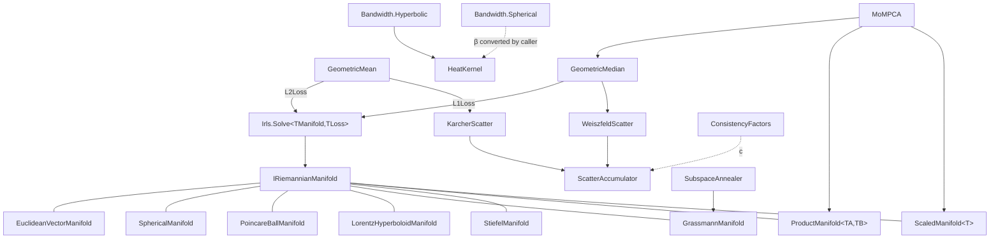
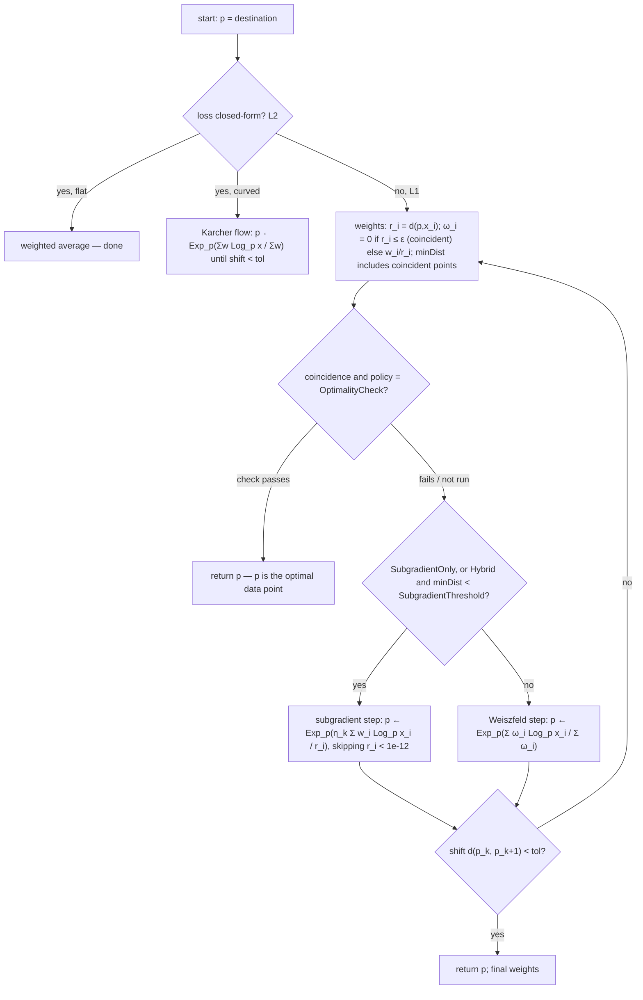

# Riemannian Geometry

> ThermoMapper's statistics on curved spaces. One manifold contract covers the sphere, two hyperbolic models, the Grassmannian and Stiefel manifolds, and product and scaled composites. On top of that contract a single IRLS engine computes Fréchet means, geometric medians and scatter matrices on any of these spaces. The project also provides heat-kernel bandwidth calibration on hyperbolic and spherical space, robust median-of-means PCA, simulated annealing over subspaces (the engine behind SPRED), and a two-sample test. · **Project:** `Maths.Geometry` · **Maturity:** core; `StiefelManifold` and `MxPbf` are partial

## Overview

`Maths.Geometry` sits in layer 3 of the [architecture](./Architecture.md). Its dependencies:

- the geodesic distance kernels in [`Maths.Distance`](./DistanceMetrics.md);
- [`Maths.LinAlg`](./LinearAlgebra.md) for eigen, PCA and Gram–Schmidt;
- `Maths.Distributions` for log-gamma;
- `Maths.Rng`;
- `System.Numerics.Tensors`.

Its consumers:

| Consumer | Uses |
|---|---|
| [GraphConstruction](./GraphConstruction.md) | manifolds and bandwidth calibrators |
| [Spred](./Spred.md) | `SubspaceAnnealer`, `GrassmannManifold`, `GeometricMedian` |
| [GaussianMixtures](./GaussianMixtures.md) | `EuclideanMedian` for robust initialization |
| [SyntheticDatasets](./SyntheticDatasets.md) | `PoincareBallManifold` |

**Namespaces.**

| Namespace | Contents |
|---|---|
| `Maths.Geometry` | manifolds and the contract |
| `Maths.Geometry.Solver` | IRLS, losses, options |
| `Maths.Geometry.Bandwidth` | heat-kernel calibration |
| `Maths.Geometry.Estimators.Intrinsic` / `.Ambient` / `.Calibration` | location and scatter estimators |
| `Maths.Geometry.DimReduction` | MoMPCA, SubspaceAnnealer |
| `Maths.Geometry.Inference` | mxPBF |

## Key concepts

- **Log and Exp maps.** $\mathrm{Log}_p(q)$ is the tangent vector at p pointing along the geodesic to q, with length $d(p,q)$. $\mathrm{Exp}_p(v)$ is the point reached by following v from p.
- **`Dimension` vs `IntrinsicDimension`.** `Dimension` is the **buffer length**, meaning the number of ambient coordinates: n for the sphere and hyperboloid, n·r for Grassmann and Stiefel. `IntrinsicDimension` is the manifold dimension: n−1, r(n−r), and nr − r(r+1)/2. For embedded manifolds, `Dimension` is larger than the tangent-space dimension. The code refers to keeping the two apart as an "off-by-one ward".
- **"Intrinsic" and "ambient" estimators.** These names mean *computed through Log/Exp* versus *computed in plain ℝᴰ coordinates*. They do not refer to intrinsic-dimension estimation; this module has no intrinsic-dimension estimators.
- **IRLS weight.** For a loss ρ with $\psi=\rho'$, the weight is $w(r)=\psi(r)/r$. That is 1 for the L2 loss and $1/r$ for the L1 loss.
- **Warm start in `destination`.** Every iterative location estimator (`GeometricMedian`, `GeometricMean` on curved manifolds, `EuclideanMedian`) uses the `destination` buffer as both its initial iterate and its output. `EuclideanMean` and the flat-space `GeometricMean` simply overwrite it.

## Design

**Compile-time dispatch through generic struct parameters.** The manifold and loss contracts use C# static abstract members: `IsFlat` on manifolds, and `IsClosedForm`, `IsSingularAtZero` and `Weight` on losses. Consumers constrain `TManifold : struct, IRiemannianManifold` and `TLoss : struct, IRobustLoss`. The JIT therefore specializes each value-type instantiation, and checks such as `if (TManifold.IsFlat)` become constants. The code calls this "three-axis dispatch": manifold × loss × options.

**Composable manifolds.** `ProductManifold<TA,TB>` and `ScaledManifold<TInner>` are themselves struct manifolds, so they nest. MoMPCA, for example, runs the whole solver on `ProductManifold<ScaledManifold<EuclideanVectorManifold>, ScaledManifold<GrassmannManifold>>`.

**Spans as currency.**

- Points and tangents are `ReadOnlySpan<double>` / `Span<double>` of length `Dimension`.
- Solver scratch comes from `ArrayPool<double>.Shared`.
- The sphere and the Poincaré ball use `stackalloc` for D ≤ 256.
- Grassmann and Stiefel operations allocate small matrices on each call.

**Declarative options with pure engines.** `IrlsOptions` is a readonly struct with a `Default`, and `Irls` is a static engine. `SubspaceAnnealerOptions` is a data record whose `Validate()` is shared by every consumer.

**One scatter primitive.** Karcher (L2) and Weiszfeld (L1) scatter differ only in the weights they pass to the internal `ScatterAccumulator`.

**Extension points.**

- New manifold: implement `IRiemannianManifold` as a struct.
- New robust loss: implement `IRobustLoss`. Only `L1Loss` and `L2Loss` exist today.
- New subspace objective: pass a `SubspaceObjectiveFunction` delegate.

## API at a glance

| Entry point | Essentials |
|---|---|
| `IRiemannianManifold` | `static abstract bool IsFlat`; `Dimension`; `Distance(p, q)`; `LogMap(p, q, dst)`; `ExpMap(p, v, dst)`; `AddScaled(dst, v, s)`; `Norm(p, v)` |
| Manifolds | `EuclideanVectorManifold(d)`, `SphericalManifold(n ≥ 2)`, `PoincareBallManifold(d ≥ 1)`, `LorentzHyperboloidManifold(n ≥ 2)`, `GrassmannManifold(n, r)`, `StiefelManifold(n, r)`, `ProductManifold<TA,TB>(a, b)`, `ScaledManifold<T>(inner, scale > 0)` |
| Solver | `Irls.Solve<TManifold,TLoss>(manifold, data, weights, destination, IrlsOptions, finalIrlsWeights = default)`; `IrlsOptions`; `HybridMode`, `SingularityPolicy`, `ConvergenceCriterion`; `L1Loss`, `L2Loss` |
| Intrinsic estimators | `GeometricMean.Compute` / `ComputeWithScatter`; `GeometricMedian.Compute` / `ComputeWithScatter` / `MedoidIndex`; `KarcherScatter.Compute`; `WeiszfeldScatter.Compute` |
| Ambient estimators | `EuclideanMean`, `EuclideanMedian` (over an index subset of `double[][]`); `ConsistencyFactors.Gaussian(D)`, `ConsistencyFactors.Laplace(D)` |
| Bandwidth | `Bandwidth.Hyperbolic.MatchBeta(m̂₂, d)` / `SecondMoment`; `Bandwidth.Spherical.MatchBeta(m̂₂, m)` / `SecondMoment`; `HeatKernel.BandwidthFromBeta(β)` |
| Subspaces | `MoMPCA.ComputeMoM(data, kBlocks, numComponents)` → `PcaResult`; `SubspaceAnnealer.Compute(data, targetDim, objective, maxIters, seed, options, ct)` → `SubspaceAnnealerResult(Projection, Objective)` |
| Inference | `MxPbf.TwoSampleMean(x, y, alpha)`, `MxPbf.TwoSampleCovariance(x, y, alpha, a0, b0)` → log mxPBF |

## Algorithms

### Manifold catalog

In the table, $\hat p=p/\|p\|$, and $\langle a,b\rangle_L$ is the Lorentz product with the time-like coordinate **last**. No small-angle series are used; every guard is a hard threshold or a clamp.

| Manifold | Points / tangents | Distance | Log | Exp | Guards |
|---|---|---|---|---|---|
| Euclidean | ℝᵈ | $\Vert q-p\Vert$ | $q-p$ | $p+v$ | none |
| Sphere $S^{n-1}$ | any nonzero vector, normalized internally / vectors ⟂ p̂ (not enforced) | $\arccos\langle\hat p,\hat q\rangle$ | $\frac{\theta}{\sin\theta}(\hat q-\langle\hat p,\hat q\rangle\hat p)$ | $\mathrm{normalize}(\cos\Vert v\Vert\,\hat p+\frac{\sin\Vert v\Vert}{\Vert v\Vert}v)$ | Log returns **0** for $\theta<10^{-12}$ or near-antipodal $\sin\theta<10^{-12}$; Log/Exp normalize a zero vector to $e_0$, but `Distance` returns π/2 for a zero vector |
| Poincaré ball $H^d$ | $\Vert p\Vert<1$ | $\operatorname{arcosh}\!\big(1+\frac{2\Vert a-b\Vert^2}{(1-\Vert a\Vert^2)(1-\Vert b\Vert^2)}\big)$ | $\frac{2}{\lambda_p}\operatorname{artanh}\Vert\delta\Vert\frac{\delta}{\Vert\delta\Vert}$, $\delta=(-p)\oplus q$ | $p\oplus\tanh(\tfrac{\lambda_p\Vert v\Vert}{2})\frac{v}{\Vert v\Vert}$, then clamped to the ball | inputs clamped to radius $1-10^{-5}$; $\lambda_p=2/\max(10^{-12},1-\Vert p\Vert^2)$ |
| Lorentz hyperboloid $H^d$ | $\langle p,p\rangle_L=-1$ | $\operatorname{arcosh}(-\langle p,q\rangle_L)$ | $\frac{\operatorname{arcosh}\alpha}{\sqrt{\alpha^2-1}}(q-\alpha p)$ | $\cosh\Vert v\Vert_L\,p+\frac{\sinh\Vert v\Vert_L}{\Vert v\Vert_L}v$, time coordinate re-projected | Log returns 0 for $\alpha\le1+10^{-12}$ |
| Grassmann $Gr(r,n)$ | n×r orthonormal (column-major) / horizontal ($Y^\top\Delta=0$, not enforced) | $\big(\sum_i\arccos^2\sigma_i(Y^\top Z)\big)^{1/2}$ | $(U_2\Theta)\,U_1^\top$, where $Y^\top Z=U_1\cos\Theta\,V_1^\top$ and column i of $U_2\Theta$ is $\frac{\theta_i}{\sin\theta_i}\big((ZV_1)_i-c_i(YU_1)_i\big)$ | $\mathrm{MGS}\big((YV\cos\Sigma+U\sin\Sigma)V^\top\big)$ | a principal angle near π/2 ($\sigma_i=\cos\theta_i<10^{-12}$) leaves a zero column in $U_1$, so that direction is **dropped from Log**, giving a shortened tangent, not a zero vector; angles with $\sin\theta_i<10^{-12}$ ($\theta_i\approx0$) contribute nothing |
| Product | [A-part \| B-part] | $\sqrt{d_A^2+d_B^2}$ | factor-wise | factor-wise | `IsFlat` = both factors flat |
| Scaled | as inner | $\sqrt s\,d$ | unchanged | unchanged | $s$ finite and $>0$ |

**Grassmann SVD.** Grassmann and Stiefel compute a thin SVD from the eigendecomposition of the r×r Gram matrix: $\sigma_i=\sqrt{\max(\lambda_i,0)}$ and $U=AV\Sigma^{-1}$. The Grassmann Log matches Bendokat–Zimmermann–Absil and the Exp matches Edelman–Arias–Smith.

**Cost.** Sphere, ball and hyperboloid operations are $O(D)$. Grassmann operations are $O(nr^2)$ plus a small Jacobi eigensolve.

**Stiefel (partial).** The type's doc comments promise orientation-sensitive canonical (Edelman–Arias–Smith) geometry. The code does something different:

- **Distance** depends only on the column spans, so $d(Y,YQ)=0$ for any orthogonal Q.
- **Log** is an approximation.
- **Exp** is a Gram–Schmidt retraction $\mathrm{MGS}(Y+\Delta)$.

### The IRLS engine (`Irls.Solve`)

`Irls.Solve` minimizes $F(p)=\sum_iw_i\rho(d(p,x_i))$. With L2 the minimizer is the Fréchet/Karcher mean. With L1 it is the geometric median. The manifold enters only through `Distance`, `LogMap`, `ExpMap`, `AddScaled`, `Norm` and `IsFlat`.

**How each step works.**

- **Optimality check.** This is the Weiszfeld / Vardi–Zhang condition at a coincident data point c: $\big\|\sum_{j\ne c}\omega_j\mathrm{Log}_px_j\big\|\le w_c$. If it holds, p is optimal and the solver returns.
- **Coincident points always trigger the subgradient step under `Hybrid`.** A coincident point counts toward `minDist`, which is then at most ε. That is below `SubgradientThreshold` whenever ε < threshold, as in `Default` (1e-10 < 1e-4). `WeiszfeldOnly` never takes a subgradient step; `SubgradientOnly` takes only subgradient steps and skips the optimality check. So whenever the optimality check does not return, the next step is a subgradient step.
- **The subgradient step's skip radius is a fixed $10^{-12}$, not ε.** A point with $10^{-12}\le r\le\varepsilon$ is excluded from the Weiszfeld weights but receives weight $w/r$ in the subgradient direction. The step size is $\eta_k=\eta_0/\sqrt{k+1}$, where k is the global iteration count, and the step is not normalized by $\sum w$ or by the data scale.
- **Convergence.** `Absolute` stops when shift < tol. `RelativeToNorm` stops when shift < tol·(1+‖p‖₂), using the ambient norm.

**Final weights** (`finalIrlsWeights`) depend on how the solver exits:

| Exit | Final weights |
|---|---|
| L1, normal exit | recomputed at the returned point |
| L1, optimality-check exit | that iteration's weights, with $\omega_c=0$ |
| L2 | the outer weights |

**Cost per L1 iteration.** n distances, n Log maps and one Exp. When the optimality check runs, up to $2n-1$ Log maps. Subgradient steps add n norms.

### Location, scatter and consistency

- **`GeometricMean`** runs IRLS with `L2Loss`, and **`GeometricMedian`** runs it with `L1Loss`. `GeometricMean` is the Fréchet mean, not $\exp\circ\text{mean}\circ\log$. `MedoidIndex` returns $\arg\min_i\sum_jd(x_i,x_j)$ as a robust warm start.
- **Scatter.** $\hat\Sigma=\frac{c}{\sum_i\omega_i}\sum_i\omega_iv_iv_i^\top$ with $v_i=\mathrm{Log}_\mu x_i$, as a row-major D×D matrix. On embedded manifolds this matrix is ambient-sized and rank-deficient.
- **Consistency factors.** These make the 1/r-weighted (Weiszfeld) scatter consistent for the identity ($\hat\Sigma\to I$ as $n\to\infty$) under a reference distribution: $c_D=D\,\mathbb E[1/r]/\mathbb E[r]$. They require D ≥ 2.
  - Gaussian reference: $c_D=D/(D-1)$.
  - Spherical Laplace reference: $c_D=1/(D-1)$.
  - Both apply to **L1 (Weiszfeld)** scatter.
- **Ambient estimators.** `EuclideanMean` and `EuclideanMedian` take an index subset of a `double[][]`, so they are not drop-in replacements for the intrinsic estimators. `EuclideanMedian` also takes explicit `maxIterations`/`tolerance`/`epsilon`.
  - `EuclideanMedian` is a regularized Weiszfeld, $\omega_i=w_i/\max(r_i,\varepsilon)$. It has no optimality check.
  - Unlike `IrlsOptions`, both validate finite, non-negative weights. `EuclideanMedian` also requires `maxIterations` ≥ 1 and a finite, positive tolerance and ε.

### Heat-kernel bandwidth calibration

The goal is a Gaussian heat-kernel parameter β, with bandwidth $\delta=1/\sqrt{2\beta}$ (`HeatKernel.BandwidthFromBeta`), such that the model's nearest-neighbor second moment matches an observed value $\hat m_2$.

**Radial model** (Van Vleck-corrected short-time heat kernel times the polar volume element):

$$H^d:\ w(r)=e^{-\beta r^2}(r\sinh r)^{(d-1)/2},\qquad S^m:\ w(r)=e^{-\beta r^2}(r\sin r)^{(m-1)/2},\ 0<r<\pi.$$

**Nearest-neighbor reference.** A Poisson(λ = 32) population is drawn from $w/W$. Conditioned on at least one point, the nearest distance has density

$$f_{NN}(r)=\frac{\lambda}{W}w(r)e^{-\lambda C(r)/W}\Big/(1-e^{-\lambda}),\qquad C(r)=\int_0^rw.$$

`SecondMoment` evaluates $M_2(\beta)=\int r^2f_{NN}$ by trapezoidal quadrature with 1,024 intervals on $[0,r_{\max}]$, where $r_{\max}=\max\big(8,\tfrac{(d-1)\delta^2}{2}+12\delta+d\big)$ on $H^d$ and $\pi-10^{-9}$ on $S^m$.

**Root finding (`MatchBeta`).**

1. Initial guess: $d/(2\hat m_2)$, the Euclidean identity.
2. Expand the bracket geometrically.
3. Bisect 48 times.

On $S^m$ the result saturates at `BetaFloor` = 1e-6 when $\hat m_2$ exceeds what the sphere can produce. If the bracket cannot be established, the solver returns silently.

**Dimension arguments.** Pass the **intrinsic** dimension: `SphericalManifold.IntrinsicDimension` for $S^{n-1}\subset\mathbb R^n$, and d for $H^d$. The hyperbolic parameter is named `ambientDimension` but is used as d, so a Lorentz caller must pass n−1.

### Median-of-means PCA (`MoMPCA`)

"MoM" is median-of-means: block estimates aggregated by a geometric median.

1. Split the data into K **contiguous** blocks (no shuffling) and run a local PCA on each, giving a mean $\mu_k$ and a frame $U_k$.
2. Compute preliminary medians: a Euclidean median of the $\mu_k$ and a Grassmann median of the $U_k$, the latter warm-started at the medoid.
3. Calibrate scales from the **square of the median** distances: $\hat\tau_\mu=(\mathrm{med}_k\|\mu_k-\tilde\mu\|)^2/p$ and $\hat\tau_U=(\mathrm{med}_kd_{Gr}(U_k,\tilde U))^2/[r(p-r)]$. Then set $\hat\alpha=\mathrm{clamp}(2\hat\tau_U/(\hat\tau_\mu+\hat\tau_U),10^{-6},2-10^{-6})$.
4. Compute a joint geometric median on $\mathrm{Scaled}(\mathbb R^p,\alpha)\times\mathrm{Scaled}(Gr,2-\alpha)$. α scales every distance and norm, including the solver's convergence and switching thresholds. Only the *direction* of a Weiszfeld update depends on α through the weights alone.

**Output (`PcaResult`).**

| Field | Contents |
|---|---|
| `Mean` | the robust mean |
| `Components` | the r median-frame columns: an arbitrary orthonormal basis of the median subspace |
| `Eigenvalues` | per-column variances over the full data (not eigenvalues, and possibly unsorted) |
| `ExplainedVarianceRatio` | relative to the sum of those variances |
| `Whitened` | false |

### Subspace annealing (`SubspaceAnnealer`)

`SubspaceAnnealer` minimizes a black-box objective $f(P)$ over k-dimensional subspaces, where $P$ is a k×d orthonormal projection with **row** vectors.

- **Start.** The PCA subspace.
- **Temperature.** Cooling is geometric: $T=T_0c^{\,\text{iter}}$.
- **Moves.** Each iteration draws one move type:
  - **Isotropic** (Grassmann Exp of a horizontal tangent with an isotropic Gaussian direction and Frobenius length exactly s);
  - **Paired** (a random in-span mixture $m=\cos\varphi\,y_a+\sin\varphi\,y_{a+1}$ of two eigen-adjacent columns is rotated toward a random direction orthogonal to the span, while the partner $-\sin\varphi\,y_a+\cos\varphi\,y_{a+1}$ stays fixed; requires $k\ge2$);
  - **Single-column Givens rotation** by angle $\theta=s\,\mathcal N(0,1)$ (otherwise). This equals the Grassmann Exp of a rank-1 horizontal tangent.
- **Acceptance.** Metropolis: $f'<f$ or $U<e^{(f-f')/T}$. The best accepted value is tracked.
- **Step control.** Each move coordinate has its own acceptance-adaptive step size (one per retained column for single-column Givens moves, one for isotropic moves and one for paired moves, $k+2$ in all, each clamped to [`StepFloor`, `StepCeiling`]): $s\leftarrow s\,e^{g(1-p^*)}$ on acceptance and $s\,e^{-gp^*}$ on rejection, with $g=0.1$ and target acceptance $p^*=0.25$.

SPRED plugs a persistent-homology objective into this engine; see [Spred](./Spred.md).

### mxPBF two-sample tests (partial)

These compute the log of the **maximum pairwise Bayes factor** (Lee, You & Lin) for mean differences, per coordinate, or for covariance differences, per ordered coordinate pair. The multiplicity is absorbed by a prior $\gamma=\max(n,p)^{-\alpha}$. They return only the statistic, with no threshold or decision. The covariance prior constants are marked provisional in the code.

## Configuration

| Setting | Default | Meaning |
|---|---|---|
| `IrlsOptions.MaxIterations` | 200 | Iteration cap. **0 is a sentinel** that replaces the whole struct with `Default` |
| `IrlsOptions.Tolerance` / `Epsilon` | 1e-8 / 1e-10 | Geodesic shift tolerance; coincidence radius |
| `IrlsOptions.HybridMode` / `SubgradientThreshold` / `Eta0` | `Hybrid` / 1e-4 / 1.0 | Switch to subgradient near data |
| `IrlsOptions.SingularityPolicy` / `ConvergenceCriterion` | `OptimalityCheck` / `Absolute` | In `Default`. The enum's zero value is `Regularise` |
| `EuclideanMedian` maxIterations / tolerance / epsilon | 200 / 1e-8 / 1e-10 | — |
| `consistencyFactor` | 1.0 | Scatter multiplier |
| Bandwidth reference population / grid / bisections | 32 / 1024 / 48 | — |
| `SubspaceAnnealer` maxIters / seed | 1000 / null | A null seed uses OS entropy |
| `SubspaceAnnealerOptions` IsotropicFraction / PairedFraction / TargetAcceptance | 0.1 / 0.0 / 0.25 | Move mixture; step-controller target |
| `SubspaceAnnealerOptions` InitialStep / StepFloor / StepCeiling | 0.1 / 1e-3 / π/2 | Geodesic step |
| `SubspaceAnnealerOptions` InitialTemperature / CoolingRate | 1.0 / 0.99 | Geometric cooling |
| `MxPbf` alpha / a0 / b0 | 2 / 1 / 1 | a0 and b0 are provisional |

## Status and caveats

- **`SingularityPolicy.Regularise` does not do what its documentation says.** It is documented as flooring distances at ε. In practice, coincident points already get weight 0, so the floor never applies, and Regularise effectively means "drop coincident points".
- **Partially set `IrlsOptions`.** If you set only some fields and leave `MaxIterations` nonzero, the others stay at zero. With `Tolerance = 0`, `Absolute` convergence never triggers. Start from `IrlsOptions.Default` instead.
- **`StiefelManifold` is partial.** Its geometry depends only on the column span, not on orientation, and its Exp is a retraction.
- **`MxPbf` is provisional.** The covariance test's prior constants `a0`/`b0` are provisional. Its pooled Gram is also centered incorrectly: it subtracts $n\bar z\bar z^\top$ from already group-centered Grams instead of adding the between-group terms $n_1(\bar x-\bar z)(\bar x-\bar z)^\top+n_2(\bar y-\bar z)(\bar y-\bar z)^\top$, so `TwoSampleCovariance` is biased unless both group means are zero.
- **Precision near zero distance.** Sphere and Grassmann distances use arccos, which resolves only about 1e-8 near zero. That is also the default IRLS tolerance, so convergence on these manifolds sits at that noise floor.

## Source map

| Role | Files (`ThermoMapper/src/maths/geometry/`) |
|---|---|
| Contract and manifolds | `IRiemannianManifold.cs`, `manifolds/EuclideanVectorManifold.cs`, `SphericalManifold.cs`, `PoincareBallManifold.cs`, `LorentzHyperboloidManifold.cs`, `GrassmannManifold.cs`, `StiefelManifold.cs`, `RiemannianProductManifold.cs`, `ScaledManifold.cs` |
| Solver | `solver/irls.cs`, `irls-options.cs`, `IRobustLoss.cs` |
| Estimators | `estimators/intrinsic/ManifoldMean.cs`, `ManifoldMedian.cs`, `KarcherScatter.cs`, `WeiszfeldScatter.cs`, `ScatterAccumulator.cs`; `estimators/ambient/EuclideanMean.cs`, `EuclideanMedian.cs`; `estimators/calibration/ConsistencyFactors.cs` |
| Bandwidth | `bandwidth/HeatKernel.cs`, `Hyperbolic.cs`, `Spherical.cs` |
| Subspaces | `dim-reduction/MoMPCA.cs`, `SubspaceAnnealer.cs`, `SubspaceAnnealerOptions.cs` |
| Inference | `inference/MxPbf.cs` |

**See also:** [DistanceMetrics](./DistanceMetrics.md) (geodesic kernels) · [GraphConstruction](./GraphConstruction.md#bandwidth-estimation) · [Spred](./Spred.md) · [DesignPrinciples](./DesignPrinciples.md)
