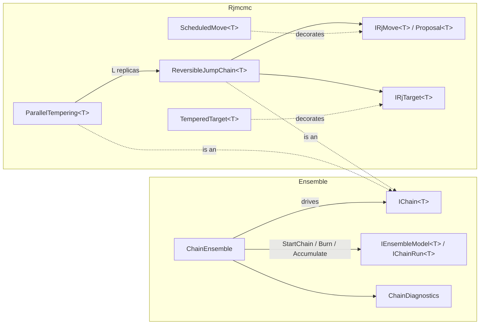

# Samplers

> A model-agnostic Markov chain Monte Carlo (MCMC) toolkit covering reversible-jump MCMC with pluggable moves, tempering decorators, parallel tempering, and a replica-ensemble shell that runs independent chains in parallel and diagnoses convergence on scalar functionals. The project also contains inverse-transform sampling and a power-law Gaussian noise-field generator. · **Project:** `Maths.Samplers` (namespaces `Maths.Samplers.Rjmcmc`, `Maths.Samplers.Ensemble`, and others) · **Maturity:** core

## Overview

The samplers sit in layer 2 of the [architecture](./Architecture.md). They depend on `Maths.Rng`, and on `Maths.LinAlg` for the FFT. Their consumers are:

- [BayesianRegression](./BayesianRegression.md). BARS drives the reversible-jump engine and the ensemble shell. The Bayesian GP bandwidth sampler (BGP) also uses the ensemble shell. BAPS uses only the R̂ diagnostic.
- `InverseTransform`, which an SPC demonstration (`WangMonteCarloDemo`) uses for exponential energy draws. The Potts bond kernel `FkKernel` evaluates the matching CDF $1-e^{-x}$ but does not call the sampler.
- `SpectralNoiseField`, which [synthetic datasets](./SyntheticDatasets.md) use for colored-noise backgrounds.

## Key concepts

- **Carrier.** The state a chain walks. For BARS this is a knot configuration of varying dimension.
- **Move and palette.** A move is one proposal type, such as birth, death or relocate. The palette is the set of moves a chain chooses from. Each move names its **reverse** move by key.
- **Target.** An unnormalized log density over carriers. Returning −∞ rejects a state.
- **Kernel vs shell.** The *kernel* (`IChain<T>`) advances one replica. The *shell* (`ChainEnsemble`) fans out replicas, runs rounds and pools diagnostics.
- **Functional.** A fixed-width scalar reduction of each draw, such as the knot count or fitted grid values. Convergence diagnostics are computed on functionals, not on raw states. R̂ is meaningless on a state whose dimension varies or whose labels are symmetric.

## Design

**Green's acceptance ratio, split by responsibility.** Only the engine sees the whole palette and each state's total move weight, so it owns two factors: the **target ratio** and the **move-selection ratio**. Only a move knows its bijection, so it owns the other two: its **auxiliary-density ratio** and its **Jacobian**. `Proposal<T>` carries exactly those two move-side terms. This split has two consequences:

- State-dependent selection weights can be a pure decorator (`ScheduledMove`, used by the DMGK schedule in BARS).
- Tempering can be a decorator on the target alone (`TemperedTarget`). Tempering then leaves the Hastings terms untempered, as it should.

**Conventions.**

- A `null` proposal means the move is unavailable here. The chain stays and does not count an attempt.
- A non-positive weight removes a move from the palette at that state.
- Infeasible states return a log target of −∞.
- Log densities are defined only up to state-independent constants.

**Kernel/shell split.**

- `IChain<T>` is the kernel seam.
- `IEnsembleModel<T>` and `IChainRun<T>` form the client seam: the start policy, the burn hook, and the reduction from draw to functional.
- `ChainEnsemble` owns seeding, the parallel fan-out, rounds, early stopping and pooled diagnostics.
- Parallelism is across replicas only (`Parallel.For` over chains).

**Reproducible seeding.** One master seed is expanded once by `SeedTree.Derive` into 2C seeds: C *kernel* streams and C separate *readout* streams (see [ProbabilityAndInformation](./ProbabilityAndInformation.md)). A tempered chain re-derives L+1 sub-streams from its own chain seed.

## API at a glance

| Area | Entry points |
|---|---|
| Reversible jump | `ReversibleJumpChain<T>(moves, target, start, rng)` with `Step()`, `Current`, `CurrentLogTarget`, `Attempts`, `Accepted`, `MoveStats()`, `SetState`; `IRjMove<T>` (`Key`, `ReverseKey`, `Weight`, `Propose`); `IRjTarget<T>`; `Proposal<T>`; `MoveStat`; `ScheduledMove<T>` |
| Tempering | `TemperedTarget<T>`; `ParallelTempering<T>(movesForReplica, baseTarget, start, betas, masterSeed)` with `Step()`, `Cold`, `SwapAttempts`, `SwapAccepts`, and static `GeometricLadder(levels, betaMin)` |
| Ensemble | `new ChainEnsemble().Run<T>(model, chains, masterSeed, burn, samples, rHatTarget = 0, batchSize = 0)` (an instance method on a stateless class) → `(EnsembleRun, chain runs)`; `ChainDiagnostics.RHat`, `ChainDiagnostics.Ess`; `RunningMoments` (`Add`, `Merge`, `Of`); `IChain<T>`, `IEnsembleModel<T>`, `IChainRun<T>`, `EnsembleRun` |
| i.i.d. and fields | `InverseTransform.Sample(rng, quantile, count)`, `InverseTransform.Exponential(rng, scale, count)`; `SpectralNoiseField.Generate(rng, gridSize, beta, boxMin, boxMax)` with `Sample`, `Min`, `Max` and presets `White` / `Pink` / `Brown` |

## Algorithms

### Reversible-jump step

At state $x$, let $w_i(x)$ be the move weights and $W(x)=\sum_{i:\,w_i(x)>0}w_i(x)$.

1. If $W(x)\le0$, stay. Otherwise select move m with probability $w_m(x)/W(x)$.
2. If `Propose` returns null, stay. This is not counted as an attempt. Otherwise count an attempt.
3. If the reverse move's weight at $x'$ is non-positive, or $W(x')\le0$, reject.
4. Otherwise accept with

$$\log\alpha=\big[\log\pi(x')-\log\pi(x)\big]+\underbrace{\log\tfrac{q_{m'}(u')}{q_m(u)}}_{\texttt{LogProposalRatio}}+\underbrace{\log|J|}_{\texttt{LogJacobian}}+\log\frac{w_{m'}(x')/W(x')}{w_m(x)/W(x)}.$$

The chain accepts if $\log\alpha\ge0$ or $U<e^{\log\alpha}$. A NaN value, for example from $-\infty+\infty$, is rejected. The current $\log\pi$ is cached, so each step makes at most one target evaluation (none when the move is unavailable or the reverse move is blocked).

**What the constructor checks.** There must be at least one move, the keys must be unique, and every `ReverseKey` must exist in the palette.

**What guarantees detailed balance.** The engine does not check that a move's reverse points back to it. Detailed balance relies on three things:

- the moves being paired symmetrically;
- each move reporting correct auxiliary ratios and Jacobians;
- the selection ratio, which the engine computes.

**Cost.** Each step costs $O(M)$ weight evaluations for M moves, plus at most one proposal and one target evaluation.

### Tempering

**Tempered target.** `TemperedTarget` returns $\log\pi_\beta=\beta\log\pi$ and requires $\beta>0$.

**The ladder.** In `ParallelTempering`, every replica starts from the same state, and each builds its own move palette from the `movesForReplica` factory, so mutable move state stays private to one replica. Each replica has its own RNG, and one further RNG drives swaps. `GeometricLadder` gives $\beta_i=\beta_{\min}^{\,i/(L-1)}$.

**One step.**

1. Every replica steps once.
2. A deterministic sweep from cold to hot attempts a swap for each adjacent pair $(i,i+1)$, with

$$\log A=(\beta_i-\beta_{i+1})(L_{i+1}-L_i),\qquad L_i=\texttt{CurrentLogTarget}_i/\beta_i.$$

Later pairs in the same sweep see earlier swaps. The chain interface reports the cold replica's move acceptance. Swaps are counted separately.

### Ensemble shell

`ChainEnsemble.Run`:

1. Validate the arguments, then derive 2C seeds: kernel seeds are children $[0,C)$ and readout seeds are children $[C,2C)$.
2. In parallel, start each chain and run its burn-in.
3. Run sampling rounds of `batchSize` steps. The default is a single round of `samples` steps. Each draw is reduced to a functional vector, whose streaming moments (Welford's update) are accumulated per chain. Full sequences are kept for the leading `EssDim` functionals.
4. If `rHatTarget > 0`, stop once every functional's R̂ meets the target (`RHatDiagnostic.MeetsTarget`). The check runs at round boundaries once each chain holds at least `ChainEnsemble.MinDrawsForStop` (100) draws. An R̂ target with a single chain is rejected.
5. Pool the results:
   - means over $C\cdot n$ draws;
   - population variances over all $C\cdot n$ draws (`FunctionalVariance`), from the per-chain streaming moments merged by Chan's parallel update (`RunningMoments.Merge`, which is associative and commutative);
   - a typed R̂ (`RHatDiagnostic`) per functional;
   - ESS on the leading functionals;
   - acceptance $\sum\text{Accepted}/\sum\text{Attempts}$ from the chains' cumulative counters. These counters include burn-in.

### Convergence diagnostics

**R̂.** The classic Gelman–Rubin statistic, computed from per-chain means and sample variances. It is **not** split and **not** rank-normalized.

$$W=\tfrac1C\sum_i s_i^2,\quad B=\tfrac{n}{C-1}\sum_i(\bar x_i-\bar x)^2,\quad \hat V=\tfrac{n-1}{n}W+\tfrac{B}{n},\quad \hat R=\sqrt{\hat V/W}.$$

Each reading carries a state (`RHatState`):

| State | When | Meets a stopping target |
|---|---|---|
| `Estimated` | $W>0$ | When $\hat R\le$ target |
| `Constant` | $W=0$ and every chain mean is equal | Yes, since there is nothing to converge; but an early stop also needs at least one `Estimated` functional, so an all-constant set runs to the end |
| `Frozen` | $W=0$ and the chain means differ ($\hat R=+\infty$) | Never |
| `Unavailable` | $C<2$, $n<2$, or a non-finite draw | Never |

Streaming moments keep $W$ exactly zero for constant chains; running sums and sums of squares cancel to rounding noise and turn a constant functional into a spurious estimate. `RHatDiagnostic.Worst` summarizes a set in the order constant, estimates by value, frozen, unavailable.

**ESS.** The BDA3 variogram estimator:

$$V_t=\tfrac{1}{C(n-t)}\sum_j\sum_{i\ge t}(x_{j,i}-x_{j,i-t})^2,\qquad \hat\rho_t=1-\frac{V_t}{2\hat V}.$$

- The estimator sums the lag pairs $(\hat\rho_1+\hat\rho_2),(\hat\rho_3+\hat\rho_4),\dots$ and stops at the first *negative* pair. This pairing is offset by one lag from Geyer's $\hat\rho_{2m}+\hat\rho_{2m+1}$, and there is no monotone-sequence step.
- The result is $\tau=1+2\sum$ and $\text{ESS}=\min(Cn/\max(\tau,10^{-6}),\,Cn)$.
- It is NaN for $n<4$ and for a single chain ($C=1$).
- All lags are computed before truncation, so the cost is $O(C n^2)$.

### Inverse transform and spectral noise fields

**`InverseTransform.Sample`** returns $Q(U_i)$ with $U_i\in[0,1)$. `Exponential(scale)` uses $Q(u)=-\text{scale}\cdot\ln(1-u)$.

**`SpectralNoiseField.Generate`** builds a Gaussian random field on a cubic $N^d$ grid, where N must be a power of two:

1. Fill the grid with i.i.d. $N(0,1)$ values.
2. Apply the forward N-D FFT.
3. Scale each frequency bin by $|k|^{-\beta/2}$ (integer frequencies folded about N/2; DC set to 0).
4. Apply the inverse FFT, keep the real part, and standardize to mean 0 and population standard deviation 1.

The power spectrum is $\propto|k|^{-\beta}$ in **grid-index** units: $\beta=0$ is white noise, 1 is pink and 2 is brown.

**`SpectralNoiseField.Sample`** maps the query box onto grid nodes $0..N-1$ and interpolates multilinearly over the $2^d$ corners of the enclosing cell. The field is therefore **not periodic over the box**, even though the grid is periodic.

## Configuration

| Setting | Default | Meaning |
|---|---|---|
| `ChainEnsemble.Run` rHatTarget / batchSize | 0 / 0 | No early stop / one round of `samples` steps |
| `ChainEnsemble.MinDrawsForStop` | 100 | Draws per chain before an R̂ target may stop sampling |
| `GeometricLadder` levels / betaMin | (required) | L ≥ 2; $\beta_{\min}\in(0,1)$ |
| `SpectralNoiseField` presets | White 0 / Pink 1 / Brown 2 | Spectral exponent β |

## Status and caveats

- **ESS of a constant functional depends on rounding.** It comes out as about $C/2$ or as $Cn$ depending on whether the chain means round exactly to the constant. Rank-normalized bulk and tail ESS are planned.
- **Acceptance rates include burn-in.** The counters are never reset.
- **The ESS pairing is non-standard.** Treat ESS as indicative when you compare it with other libraries. It is NaN for single-chain runs.
- **Ladder validation is minimal.** `ParallelTempering` does not check that the β ladder is descending or that $\beta_0=1$.
- **`SpectralNoiseField` is not periodic.** Its documentation describes the grid as periodic, but queries map the box to nodes 0..N−1, so the sampled field is not periodic over the box.

## Source map

| Role | Files (`ThermoMapper/src/maths/samplers/`) |
|---|---|
| Reversible jump | `rjmcmc/ReversibleJumpChain.cs`, `IRjMove.cs`, `IRjTarget.cs`, `Proposal.cs`, `MoveStat.cs`, `ScheduledMove.cs`, `TemperedTarget.cs`, `ParallelTempering.cs` |
| Ensemble | `ensemble/ChainEnsemble.cs`, `ChainDiagnostics.cs`, `EnsembleRun.cs`, `IChain.cs`, `IEnsembleModel.cs` |
| i.i.d. and fields | `iid/InverseTransform.cs`; `SpectralNoiseField.cs` (at the `samplers/` root) |

**See also:** [BayesianRegression](./BayesianRegression.md) (BARS, BGP) · [ProbabilityAndInformation](./ProbabilityAndInformation.md) · [DesignPrinciples](./DesignPrinciples.md)
