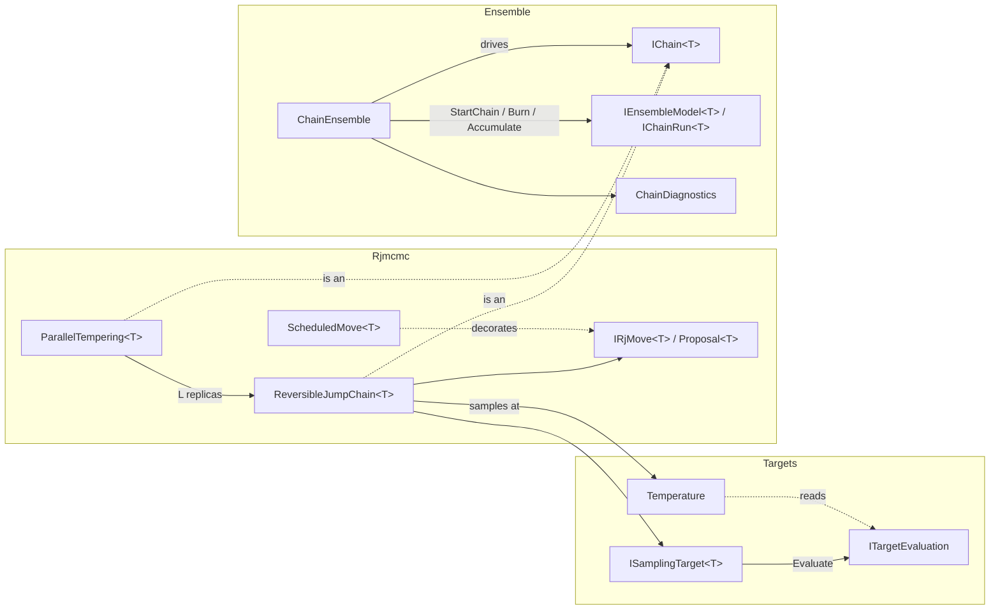

# Samplers

> A model-agnostic Markov chain Monte Carlo (MCMC) toolkit covering a model-neutral target contract with declared tempering paths, reversible-jump MCMC with pluggable moves, parallel tempering, and a replica-ensemble shell that runs independent chains in parallel and diagnoses convergence on scalar functionals. The project also contains inverse-transform sampling and a power-law Gaussian noise-field generator. · **Project:** `Maths.Samplers` (namespaces `Maths.Samplers`, `Maths.Samplers.Rjmcmc`, `Maths.Samplers.Ensemble`, and others) · **Maturity:** core

## Overview

The samplers sit in layer 2 of the [architecture](./Architecture.md). They depend on `Maths.Rng`, and on `Maths.LinAlg` for the FFT. Their consumers are:

- [BayesianRegression](./BayesianRegression.md). BARS drives the reversible-jump engine and the ensemble shell. The Bayesian GP bandwidth sampler (BGP) also uses the ensemble shell. BAPS uses only the R̂ diagnostic.
- `InverseTransform`, which a cumulative-field demonstration (`MonteCarloAffinityDemo`) uses for exponential energy draws. The Potts bond kernel `FkKernel` evaluates the matching CDF $1-e^{-x}$ but does not call the sampler.
- `SpectralNoiseField`, which [synthetic datasets](./SyntheticDatasets.md) use for colored-noise backgrounds.

## Key concepts

- **Carrier.** The state a chain walks. For BARS this is a knot configuration of varying dimension.
- **Move and palette.** A move is one proposal type, such as birth, death or relocate. The palette is the set of moves a chain chooses from. Each move names its **reverse** move by key.
- **Target and evaluation.** A target evaluates a carrier state once into an `ITargetEvaluation`: an untempered log prior and a log likelihood $\ell_b$ at any inverse temperature $b\in[0,1]$. A log prior of −∞ rejects a state without any likelihood work.
- **Temperature.** An inverse temperature and the path it is taken along: the **powered** posterior $b(\log p+\ell_1)$ or the **likelihood-tempered** path $\log p+\ell_b$. Both are the log posterior at $b=1$. A chain samples its target at one temperature.
- **Kernel vs shell.** The *kernel* (`IChain<T>`) advances one replica. The *shell* (`ChainEnsemble`) fans out replicas, runs rounds and pools diagnostics.
- **Functional.** A fixed-width scalar reduction of each draw, such as the knot count or fitted grid values. Convergence diagnostics are computed on functionals, not on raw states. R̂ is meaningless on a state whose dimension varies or whose labels are symmetric.

## Design

**Green's acceptance ratio, split by responsibility.** Only the engine sees the whole palette and each state's total move weight, so it owns two factors: the **target ratio** and the **move-selection ratio**. Only a move knows its bijection, so it owns the other two: its **auxiliary-density ratio** and its **Jacobian**. `Proposal<T>` carries exactly those two move-side terms. This split has two consequences:

- State-dependent selection weights can be a pure decorator (`ScheduledMove`, used by the DMGK schedule in BARS).
- Tempering acts on the target term alone: the chain's `Temperature` turns each evaluation into a log density. Tempering then leaves the Hastings terms untempered, as it should.

**The target contract (step 3.1).** A target returns an evaluation object, not a number.
- **Why the split.** The likelihood-tempered path keeps the prior whole, so it needs the prior and the likelihood apart. A collapsed model, such as BARS's Normal marginal with β and σ² integrated out, has an $\ell_b$ that is not $b\,\ell_1$, so "b times the log posterior" cannot express it.
- **Why an object.** The state's expensive work (for BARS, the design and its factorization) happens once, in `Evaluate`. Another temperature is then a query on the result, which is what a swap between rungs on the likelihood path, an SMC reweighting or a thermodynamic-integration estimate needs. A swap hands each replica the other's evaluation, and nothing is re-evaluated.
- **Constants.** Values are needed only up to an additive constant that may depend on $b$ and the data but never on the state. It cancels in Metropolis ratios, in swaps (each rung's constant enters once with each sign) and in normalized SMC weights. An evidence estimate needs complete values.
- **Refusals.** A model may refuse $b\ne1$ (`NotSupportedException`); the powered path asks only for $\ell_1$. A model may refuse $b=0$ when a nuisance prior is improper (`ArgumentOutOfRangeException`).
- **Alternatives set aside.**
  - A target that returns $\log\pi$ alone, with tempering as a decorator ($b\log\pi$, the `IRjTarget`/`TemperedTarget` pair it replaced, deleted in step 3.6): it cannot express the likelihood path or a nonlinear $\ell_b$.
  - Methods `LogPrior(state)` and `LogLikelihood(state, b)` on the target: each temperature would re-evaluate the state.
  - A closed-form tempered density only, `LogDensity(state, b)`: it hides the prior/likelihood split that SMC and evidence estimates read.
- **Costs.** One evaluation object per proposal, and each chain keeps its current state's evaluation alive (for BARS, the factor of $G$). Both are small beside the design and factor the model already builds per proposal.

**Conventions.**

- A `null` proposal means the move is unavailable here. The chain stays and does not count an attempt.
- A non-positive weight removes a move from the palette at that state.
- An infeasible state has a log prior of −∞ (no likelihood work is done) or a log likelihood of −∞ at every temperature.
- Log densities are defined only up to constants that do not depend on the state; a likelihood's may depend on $b$ and the data.

**Kernel/shell split.**

- `IChain<T>` is the kernel seam.
- `IEnsembleModel<T>` and `IChainRun<T>` form the client seam: the start policy, the burn hook, and the reduction from draw to functional.
- `ChainEnsemble` owns seeding, the parallel fan-out, rounds, early stopping and pooled diagnostics.
- Parallelism is across replicas only (`Parallel.For` over chains).

**Reproducible seeding.** One master seed is expanded once by `SeedTree.Derive` into 2C seeds: C *kernel* streams and C separate *readout* streams (see [ProbabilityAndInformation](./ProbabilityAndInformation.md)). A tempered chain re-derives L+1 sub-streams from its own chain seed.

## API at a glance

| Area | Entry points |
|---|---|
| Targets | `ISamplingTarget<T>` (`Evaluate`); `ITargetEvaluation` (`LogPrior`, `LogLikelihood(b)`, `LogLikelihoodSlope(b)`, which by default refuses); `Temperature(b, path)` with `LogDensity(evaluation)`, `LogDensitySlope(evaluation)`, static `Posterior` and `LogPosterior(evaluation)`; `TemperingPath` (`Powered`, `Likelihood`); `SamplingTarget.FromLogDensity`, `SamplingTarget.Separable`, and the extension `target.LogPosterior(state)`; `SeparableEvaluation` |
| Reversible jump | `ReversibleJumpChain<T>(moves, target, start, rng, temperature = null)` with `Step()`, `Current`, `Temperature`, `CurrentEvaluation`, `CurrentLogDensity`, `Attempts`, `Accepted`, `MoveStats()`, `SetState(state, evaluation)`, `ReplaceTarget(target)`; `IRjMove<T>` (`Key`, `ReverseKey`, `Weight`, `Propose`); `Proposal<T>`; `MoveStat`; `ScheduledMove<T>`; `MoveStep<T>`, the chain's own step as an `IBlock` over the chain |
| Tempering | `ParallelTempering<T>(movesForReplica, target, start, inverseTemperatures, path, masterSeed, schedule = DeterministicEvenOdd, reference = null, blocksForReplica = null)` with `Step()`, `HasBlocks`, `BlockStats(replica)`, `Path`, `Schedule`, `InverseTemperatures`, `Cold`, `ColdChain`, `Replicas`, `Scans`, `RoundTrips`, `AnnealedRestarts`, `PairStats`, `SwapAttempts`, `SwapAccepts`, `AdaptLadder()`, `Resize(inverseTemperatures, sources, fork, movesForReplica, blocksForReplica)`, `RoundRejection`, `PairScans`, `TraceRungs(traceSlopes = true)`, `RungTraces`, `TracesSlopes`, and static `GeometricLadder(levels, hotEnd)`, `ReferenceLadder(levels, hotEnd)`; `RungFunctional` (`Slope`, `LogRatio`); `SwapSchedule` (`DeterministicEvenOdd`, `StochasticEvenOdd`, `Sequential`); `SwapPairStat`; `TemperingLadder` (`Barrier`, `IdealRoundTripRate`, `Equalize`, `Place`, `Split`, `Sources`, `RecommendedLevels`, `Size`, `ShrinkDeadband`) |
| Ensemble | `new ChainEnsemble().Run<T>(model, chains, masterSeed, burn, samples, rHatTarget = 0, batchSize = 0, minEssPerChain = 100, checkpoint = false, resumeFrom = null, parallel = null, stoppingScope = null)` (an instance method on a stateless class) → `(EnsembleRun, chain runs)`, with `ReferenceRHatTarget`; `ConvergenceVerdict` (`Outcome`, `Target`, `MinEssPerChain`, `Groups`, `Group(name)`), `ConvergenceOutcome`, `GroupVerdict` (`Name`, `Outcome`, `GatesStop`, `Failing`), `FunctionalReading`, `FunctionalGroup` (`All`, `AllName`); `ChainDiagnostics.Diagnose` → `ConvergenceDiagnostic` (`RHat`, `BulkRHat`, `TailRHat`, `BulkEss`, `TailEss`, `Ess`); `ChainDiagnostics.MeanEss` → `EssDiagnostic`; `ChainDiagnostics.RHat`; `RHatDiagnostic`, `EssDiagnostic`, `DiagnosticState`; `IChain<T>`, `IEnsembleModel<T>` (`FunctionalDim`, `MonitoredDim`, `FunctionalNames`, `Groups`, `Fingerprint`, `RestoreChain`), `IChainRun<T>`, `EnsembleRun` (`Verdict`) |
| Readouts, traces, checkpoints | `IMergeable<T>`; `RunningMoments` (`Add(x, weight)`, `Merge`, `Of`), `WeightedSums` (`Add`, `AddSparse`, `Mean`), `DrawSample` (`Add`, `Quantile`), `Tally<TEnum>`; `ChainTrace` (`Add`, `Draws`, `Copy`); `DrawStore<T>(every = 1)` (`Add`, `AppendFrom`, `Copy`, `Every`, `Offered`), each engine's retained draws; `EnsembleCheckpoint`, `ChainCheckpoint`, `RunIdentity`, `IChainState`, `IResumableChainRun<T>`, `RunFingerprint`; `ReversibleJumpChain.Snapshot`/`Restore` (`ChainSnapshot<T>`), `ParallelTempering.Snapshot`/`Restore` (`LadderSnapshot<T>`) |
| Blocks | `BlockScan<T>(blocks, state, rng, copy)` with `Step()`, `State`, `Steps`, `Attempts`, `Accepted`, `BlockStats()`, `Snapshot()` and static `Restore(blocks, snapshot, copy)` (`BlockScanSnapshot<T>`); `IBlock<T>` (`Name`, `Every`, `Update`); `GaussianConditional(dimension)` with `Draw(factor, rhs, rng, result, scale = 1)` and `Perturb(factor, mean, rng, result, scale = 1)`, and static `GaussianConditional.Perturb(factor, mean, rng, result, scale, z, innovation)` on the caller's scratch; `ConjugateUpdates.NormalVariance`, `ConjugateUpdates.NormalPrecision`; `RandomWalkMetropolis.Step(ref x, ref logTarget, step, logDensity, rng)`; `NewtonMetropolis(dimension, delta = 1/π)` with `Step(x, logDensity, rng)` and the `LogDensity(x, gradient, hessian)` delegate; `SliceSampler.Step(ref x, ref logTarget, width, maxSteps, logDensity, rng)` → evaluations |
| Evidence | `LadderEvidence.SteppingStone(b, logRatios)`, `LadderEvidence.PathSampling(b, slopes)`, `LadderEvidence.FromLadders(ladders, method = DefaultEstimator)`, `LadderEvidence.FromSmc(result, method = DefaultEstimator)` with `SmcOptions.TraceStages` and `SmcStageTrace` (`Temperature`, `NewTarget`, `Weights`, `Slopes`, `LogRatios`) → `LadderEstimate` (`Method`, `LogRatio`, `MonteCarloError`, `DiscretizationError`, `Rungs` of `RungEstimate`); `LadderEvidence.Pool(chains)` → `PooledLadderEstimate` (the mean, `WithinChainError`, `BetweenChainError`, the larger reported, `BetweenToWithin`); `RungDraws.FromChains(chains)`, `RungDraws.FromPopulation(values, weights = null)`; `LadderEstimator` (`SteppingStone`, `PathSampling`) |
| Flat histogram (N17) | `MulticanonicalWeights(low, high, lowSlope, logWeights)` (`LogWeight`, `TryLocate`, `FlatOccupancy`, `Flat`, `WithLogWeights`); `MulticanonicalTarget<T>(inner, weights)` → `MulticanonicalEvaluation` (`UntemperedLogLikelihood`, `LogWeight`, `Reweighed`); `SamcLearning(start, gainScale, gainStart)` (`Update`, `Gain`, `Save`, `FixedPoint`); `IMulticanonicalModel<T>`, `IMulticanonicalChain<T>`, `MulticanonicalChain<T>`; `MulticanonicalRun.Run(spec, target, model, masterSeed, pilot?, resumeFrom?, …)` → `MulticanonicalResult<T>`; `FlatHistogramSpec`; `FlatHistogramDiagnostics`; `Reweighting` (`Weigh`, `Expectation`, `LogEvidence` → `LogEvidenceCurve`); `TemperingPilot(b, levels, inefficiencies?)`, `TemperingPilot.FromLadders`; `Wham` (`Estimate` → `WhamEstimate`, `WarmStart`, `Window`, `Nodes`) |
| i.i.d. and fields | `InverseTransform.Sample(rng, quantile, count)`, `InverseTransform.Exponential(rng, scale, count)`; `SpectralNoiseField.Generate(rng, gridSize, beta, boxMin, boxMax)` with `Sample`, `Min`, `Max` and presets `White` / `Pink` / `Brown` |

## Algorithms

### Reversible-jump step

At state $x$, let $w_i(x)$ be the move weights and $W(x)=\sum_{i:\,w_i(x)>0}w_i(x)$.

1. If $W(x)\le0$, stay. Otherwise select move m with probability $w_m(x)/W(x)$.
2. If `Propose` returns null, stay. This is not counted as an attempt. Otherwise count an attempt.
3. If the reverse move's weight at $x'$ is non-positive, or $W(x')\le0$, reject.
4. Otherwise accept with

$$\log\alpha=\big[\log\pi_b(x')-\log\pi_b(x)\big]+\underbrace{\log\tfrac{q_{m'}(u')}{q_m(u)}}_{\texttt{LogProposalRatio}}+\underbrace{\log|J|}_{\texttt{LogJacobian}}+\log\frac{w_{m'}(x')/W(x')}{w_m(x)/W(x)}.$$

Here $\log\pi_b$ is the chain's `Temperature.LogDensity` of a state's evaluation: $b(\log p+\ell_1)$ on the powered path and $\log p+\ell_b$ on the likelihood path, the log posterior at $b=1$, the default.

The chain accepts if $\log\alpha\ge0$ or $U<e^{\log\alpha}$. A candidate whose density is −∞ or NaN is rejected whatever its proposal ratio, so $-\infty+\infty$ cannot decide a move. The current evaluation and its density are cached, so each step makes at most one evaluation (none when the move is unavailable or the reverse move is blocked).

**What the constructor checks.** There must be at least one move, the keys must be unique, and every `ReverseKey` must exist in the palette.

**What guarantees detailed balance.** The engine does not check that a move's reverse points back to it. Detailed balance relies on three things:

- the moves being paired symmetrically;
- each move reporting correct auxiliary ratios and Jacobians;
- the selection ratio, which the engine computes.

**Cost.** Each step costs $O(M)$ weight evaluations for M moves, plus at most one proposal and one target evaluation.

### Tempering

**Paths (step 3.2).** A ladder declares one `TemperingPath` for all its replicas, and replica $i$ samples `Temperature(b_i, path)`.
- **Powered:** $b_i(\log p+\ell_1)$. Prior and likelihood are flattened together.
- **Likelihood-tempered:** $\log p+\ell_{b_i}$, the power posterior of Friel and Pettitt (2008). The prior stays whole, and $b=0$ is the prior itself.
- **What separates them.** A chain targets a measure, not a density. Powering a density $f=d\Pi/d\mu$ gives the hot measure $f^b\,d\mu$, which depends on the reference measure μ. Two representations of one model whose densities differ by a state-dependent factor $g$ give hot measures that differ by $g^{b-1}$; only a representation change with unit density ratio leaves them alone. On a space of varying dimension each subspace has its own reference, so the powered path's hot rungs leave the prior in a direction the bookkeeping sets, not the model.
  - **BARS's knots.** Sorting labeled knots onto the ordered simplex is $k!$-to-one, so the ordered density carries an extra $k!$, and the two representations' powered rungs differ by $(k!)^{b-1}$. Under a constant likelihood and a Poisson(λ) count prior, the powered rung b samples Poisson(λ^b) knots in ordered coordinates (`CountLawTests`, per rung) and a Conway–Maxwell–Poisson(λ^b, ν = b) count in labeled ones. At λ = 5 and b = 0.05 that is 1.08 knots against 14.17, for the same posterior.
  - **The likelihood path** defines the hot measure against the prior measure itself, $d\Pi_b/d\Pi_0=L^b$, so every representation gives the same rungs; every BARS likelihood-path rung samples the prior's count law. The likelihood path needs $\ell_b$ at every rung; the powered path needs only $\ell_1$, so it serves every target.
- **Choice.** The caller declares the path; no default lives in the sampler. BARS takes the likelihood path ([BayesianRegression](./BayesianRegression.md), Q5).

**The ladder.** In `ParallelTempering`, every replica starts from the same state, and each builds its own move palette from the `movesForReplica` factory, so mutable move state stays private to one replica. Each replica has its own RNG, and one further RNG drives swaps. `GeometricLadder` gives $b_i=b_{\min}^{\,i/(L-1)}$. `Replicas` exposes every rung, cold first, for per-rung diagnostics.

**Per-replica blocks (stage 4, BASS's τ under tempering).** A replica's state can hold a coordinate that no reversible-jump move updates, such as BASS's τ beside its structure (D04). `blocksForReplica` builds each replica's blocks, `IBlock<ReversibleJumpChain<T>>`s run in order after the replica's moves and before the swaps, each on its cadence.
- **The contract.** A block reads the replica's state, cached evaluation and `Temperature` (its current rung, after any adaptation), updates the state leaving that rung's tempered target invariant, and hands back the new state with its evaluation through `SetState`, so the swaps read a current evaluation.
- **Streams.** Each replica's blocks draw from a stream of their own, after the replica, swap and reference streams in the `SeedTree`, so a ladder without blocks keeps every stream, and a block that draws nothing leaves the ladder's trajectory bit for bit. The reference rung's exact draw runs none.
- **Restart.** `LadderSnapshot` carries each replica's block stream and counters; `Restore` takes the same `blocksForReplica`, and refuses a mismatch.
- **The untempered case.** The contract is `IBlock` itself, over the chain: a lone chain runs the same blocks in a `BlockScan<ReversibleJumpChain<T>>` beside `MoveStep<T>`, the chain's own step, so one block serves the lone chain and every replica. `IBlock` over a mutable model state (BAPS, HPS) stays as it is; a reversible-jump state is immutable and shared by swaps, and its evaluation is cached by the chain, so the block works through the chain rather than on the state.
- **Checks** (`ParallelTemperingBlockTests`). On a target with a discrete index moved by reversible-jump moves and a continuous coordinate moved by a slice block, each rung's index law and the coordinate's conditional means match enumeration and quadrature on both paths; each pair's swap rejection matches its expectation under the product of the rung laws; resume is bit-identical; an idle block leaves the trajectory exactly and keeps its cadence; the lone chain through a `BlockScan` samples the posterior.

**Ladder validation.** At least two rungs, strictly descending, cold rung exactly $b_0=1$. The hot end must be positive on the powered path, where $b=0$ would be the bare reference measure. It may be 0 on the likelihood path, where $b=0$ is the prior; a target whose nuisance prior is improper refuses that rung when it is evaluated (BARS does).

**One step.**

1. Every replica steps once (local exploration), then runs its blocks, if any.
2. The swap schedule picks adjacent pairs $(i,i+1)$ to attempt, each with

$$\log A=d_i(x_{i+1})+d_{i+1}(x_i)-d_i(x_i)-d_{i+1}(x_{i+1}),$$

where $d_i$ is replica $i$'s log density, its `Temperature.LogDensity`. The two current densities are cached, and the two cross terms query the other replica's evaluation at this replica's temperature, so a swap evaluates no state. An accepted swap hands each replica the other's state and evaluation, and each recomputes its density at its own b.
- **On the powered path** this is $(b_i-b_{i+1})(L_{i+1}-L_i)$ with $L=\log p+\ell_1$, the formula used until step 3.2; BARS's powered runs are bit-identical across the change.
- **On the likelihood path** the prior cancels, leaving $\ell_{b_i}(x_{i+1})+\ell_{b_{i+1}}(x_i)-\ell_{b_i}(x_i)-\ell_{b_{i+1}}(x_{i+1})$. The b-linear shortcut is wrong here, because $\ell_b$ need not be linear in b. On a six-state test with a nonlinear $\ell_b$, the shortcut biases even the cold rung (a state's frequency 0.0114 against the exact 0.0223). The general form matches every rung's law on both paths to total variation ≤ 0.005.

Every pair's rejection probability $1-\alpha$ is recorded on every scan, attempted or not (Rao–Blackwellized: computed from the cached evaluations, not the 0/1 outcomes). The chain interface reports the cold replica's move acceptance. Swaps are counted separately.

### Swap schedules, round trips and ladder adaptation (step 3.3)

Following Syed, Bouchard-Côté, Deligiannidis and Doucet (2022).

**Schedules** (`SwapSchedule`).
- **Deterministic even-odd** (DEO, the default): pairs (0,1), (2,3), … on even scans and (1,2), (3,4), … on odd ones. Each pair is attempted every other scan, and a state that was just swapped is offered the next rung in the same direction on the next scan, so it keeps moving until a swap is rejected. The scheme is non-reversible.
- **Stochastic even-odd** (SEO): the even or the odd pairs by a fair coin each scan. Reversible: states random-walk along the ladder.
- **Sequential:** every pair each scan, cold to hot, later pairs seeing earlier swaps; this engine's schedule until step 3.3. It stays a selectable schedule (OQ5, decided in step 3.6): a valid kernel, being a composition of reversible pair swaps, for comparison and for reproducing earlier runs, but not the default. Within one swap phase a state can cascade up several rungs with no local step between; it descends one rung a scan.
- The even and the odd pairs are disjoint, so an even-odd scan takes all its ratios before any swap.

**Round trips.** A state that leaves the hot end, reaches the cold end and returns completes a round trip; its arrival at the cold end is an *annealed restart*, carrying what the hot rungs explored down to the posterior. `RoundTrips / Scans`, summed over states, is the round-trip rate τ, the measure a ladder is judged by. Swap acceptance is not: a ladder of nearly equal rungs accepts almost every swap and moves nothing anywhere.

**What theory predicts.** With $r_i$ pair $i$'s rejection rate, $N$ the number of pairs and $E=\sum_i r_i/(1-r_i)$, under *efficient local exploration* (each rung's local move an exact independent draw), Theorem 1 of Syed et al. gives

$$\tau_{\text{DEO}}=\frac{1}{2+2E},\qquad \tau_{\text{SEO}}=\frac{1}{2N+2E}.$$

`TemperingLadder.IdealRoundTripRate` computes these from observed rates. Real local moves fall short of exact draws, so the gap between the observed and the ideal rate measures local exploration.
- **Rung count.** The barrier $\Lambda\approx\sum_i r_i$ (`Barrier`) is nearly the same for every ladder of the same endpoints (their Corollary 2). For an equalized ladder $E\approx\Lambda/(1-\Lambda/N)$, so DEO's τ rises toward $1/(2+2\Lambda)$ as rungs are added while SEO's decays like $1/(2N)$. About $N\approx2\Lambda$ pairs, rejection rate near ½, uses the rungs best (`RecommendedLevels`).
- **Checked** (`SwapScheduleTests`, exact Gaussian draws on the likelihood path): observed against Theorem 1, DEO 0.1366 against 0.1369 and SEO 0.0516 against 0.0518; without rejections, DEO 0.4999 (theory ½) and SEO 0.1007 (theory 1/10, five pairs); from 5 to 17 rungs on equalized ladders, DEO 0.120 → 0.160 (bound 0.178) and SEO 0.070 → 0.027.

**Ladder adaptation** (`AdaptLadder`).
- **Rule.** For a fixed number of rungs, equal rejection rates minimise $E$. The cumulative barrier $\Lambda(b)$, the running sum of the observed rates from the hot end, is interpolated by a monotone cubic (Fritsch and Carlson 1980) and inverted at equal steps, which places the new interior rungs (their Algorithms 2 and 3). The cold rung (exactly 1) and the hot end never move.
- **Retempering is free.** Each replica moves to its new rung by `SetTemperature`, a query on its cached evaluation; nothing is re-evaluated.
- **Statistics** come from the scans since the previous adaptation; a ladder with no rejections, or no interior rung, is left alone.
- **Adapt during burn-in only.** A ladder that keeps changing does not leave the posterior invariant. Syed et al.'s Algorithm 4 tunes in rounds of 1, 2, 4, … scans, adapting after each, and BARS follows it.
- **Checked:** from a uniform ladder whose rejection rates spread 6.8-fold, adaptation equalizes them to within 4% and leaves the barrier where it was (Λ̂ 1.79 → 1.84).

**Resizing the ladder** (`Resize`, burn-in only; BASS's self-sizing ladder, 2026-10-28). A fixed count cannot follow a barrier that grows with the data, so the ladder can change its count between adaptation rounds. The caller places the rungs and names each new rung's source; the placement policy is the caller's, so a consumer that places rungs for a readout's resolution (SPC's temperature grid, say) uses the same primitive.
- **Policy helpers** (`TemperingLadder`). `Place(inverseTemperatures, rejection, K)` puts K rungs on the cumulative barrier, `Equalize`'s monotone cubic inverted at K equal steps (`Equalize` is `Place` at the current count, bit for bit). `Sources` names each placed rung's nearest current rung on the barrier. `Size(Λ̂, current, minimum, maximum)` grows at once to `RecommendedLevels(Λ̂)`, since a saturated ladder reads Λ̂ at most its pairs, and shrinks only when the reading asks for at least `ShrinkDeadband` + 1 fewer rungs, since early rounds over-read. `Split(inverseTemperatures, rejection, threshold, maximum)` adds a rung halfway along the barrier of each pair rejecting past the threshold, on the same cubic, steepest first within the maximum, every current rung kept; a pair's rejection is censored at 1, so a split reads a steep band where re-placing would spread an under-read barrier (BASS's split rule, F-M2's 4b, 2026-10-29).
- **Replicas.** A named replica is kept, with its state, streams, moves, blocks and counters, at the naming rung nearest its own b. Each further rung starts a new replica from the caller's `fork` of its source's state, an independent copy, evaluated once against the target. Its streams take the next draws of a growth stream, the seed tree's last child, so a ladder that never resizes keeps every stream it had.
- **Statistics.** The pairs' statistics, the round-trip labels and the adaptation round restart on the new ladder, since the old pairs do not map onto the new ones; the totals carry on. `PairStats` averages over `PairScans`, the scans since the count was set, which is `Scans` for a ladder that never resizes. A refused resize leaves the ladder as it was.
- **Checked** (`ParallelTemperingResizeTests`, `TemperingLadderTests`): never-resized ladders pinned bit for bit, with and without blocks and the reference rung; every rung's law after a resize against quadrature on both paths; snapshots across resizes; placement on a known barrier at 5–33 rungs within 0.6%; the split at exact midpoints on a linear barrier, steepest first within the maximum (the colder on a tie), a ladder with no steep pair returned bit for bit, and a synthetic steep band (a step of 6 in Λ) resolved in 4 rounds.

**What round trips do not measure.**
- **Round trips compare like with like only between schedules in which a state takes at most one swap per local step, on one path.** Theorem 1 and the adaptation rule rest on that structure: each swap a state takes is separated from its next by local exploration.
- **The sweep breaks it.** Without rejections it completes one round trip per scan against DEO's ½ (`SwapScheduleTests`). A state cascades from the cold to the hot end within one swap phase, with no local step at the rungs between; it gets one local step at the hot end, where DEO gives two; and it descends a rung a scan. Both schedules spend the same local steps per scan, so the sweep's extra trips each carry less exploration.
  - Only when every local move is an exact draw is a trip's value independent of the steps in it. There the sweep's advantage is real: about 1.7× DEO's round trips at 5 and 17 rungs, on exact Gaussian draws. It is worth less as local moves weaken.
  - On BARS fits (`TemperingBenchmark`) the sweep completes 1.4–2.0× DEO's round trips on equalized ladders. Yet the cold chain's ESS per second does not separate the two: 0.97–1.33× across fits on the likelihood path (0.87–1.39× counting the powered path), within the noise of 3-chain estimates.
- **Paths have different hot ends,** so their round trips are journeys to different places. On Poisson counts the powered ladder makes about 5× the likelihood ladder's round trips, because its hot end barely differs from the posterior (barrier Λ̂ ≈ 0.24 against 1.4; hot rung 1.0 knots against the prior's 4.4). The cold chain's ESS per second does not follow (0.85×, within noise).
- **The neutral measure is the cold chain's ESS per unit work.** At this budget it is noisy: single 3-chain estimates swing 2–8×. Step 3.4's rank-normalized ESS is the instrument for the next comparison.
- **Default: deterministic even-odd.** Round trips and Theorem 1 apply to it, the adaptation rule is derived for it, and its swaps within a scan are independent, so a parallel or distributed ladder can run them at once. SEO is the reversible baseline.

**The swap uniform is drawn on every attempt**, accepted or not.
- Between two states whose $L$ agree to rounding, $\log A$ is of rounding size and its sign is rounding noise. Until step 3.1, $L_i$ was recovered as `CurrentLogTarget`$/b_i$ after an earlier swap stored $b_i L$, so replicas holding the same state produced such ties routinely. $L_i$ is now read from the evaluation, so the same state gives the same $L$ exactly, but distinct states can still tie. The regression test builds two targets that break such a tie in opposite directions.
- Drawing every time keeps the swap stream independent of it, so a last-bit change in the target cannot shift later swaps.
- Before 2026-10-20 the draw was skipped when $\log A\ge0$, and step 2.3's cancellation-free scale moved a tempered BARS run through exactly this tie.
- The within-replica Metropolis step still skips the draw when $\log\alpha\ge0$. A tie there needs a candidate whose target equals the current one to rounding, which continuous knots do not produce.

### Evidence over a ladder (N11, 2026-10-27)

`LadderEvidence` estimates $\ln Z(b_{\max})-\ln Z(b_{\min})$ from per-rung draws on a ladder, in either order. It is an evidence when the lowest rung is a normalized reference (b = 0 under a proper prior on the likelihood path) and the target's values are complete. It knows nothing about models: it reduces per-rung scalar draws, `RungDraws`, which come in two kinds.
- **Ordered chains** (`RungDraws.FromChains`), one array per chain, whose effective sample size is `ChainDiagnostics.MeanEss`'s.
- **A weighted population** (`RungDraws.FromPopulation`), as an SMC stage leaves it, whose effective sample size is the weights' (`SmcWeights.EffectiveSampleSize`). Resampled offspring share ancestors, which the weights do not see, so that ESS is an upper bound.

**Per-rung traces.** `ParallelTempering.TraceRungs()` is opt-in, called after burn-in. From the next scan on, every `Step` records at each rung, on the state it holds after the scan's swaps, two `RungFunctional`s read from the evaluations the rungs already hold:
- `Slope`: $\partial_b\ln q_b$ at the rung's own b (`Temperature.LogDensitySlope`). On the powered path that is $\ln p+\ell_1$. On the likelihood path it is the target's `ITargetEvaluation.LogLikelihoodSlope(b)`: $\ell_1$ for a separable model, a closed form for a collapsed one. The interface's default refuses, and the ladder then records NaN, probed once.
- `LogRatio`: $\ln q_c-\ln q_b$, with c the next colder rung's b. It is NaN at the cold rung.

While traced, the ladder is fixed (`AdaptLadder` refuses). `LadderSnapshot` carries copies of the traces, so a resumed ladder continues them. `LadderEvidence.FromLadders(ladders, method)` takes one or more ladders on the same rungs, each one chain per rung. Chains that each adapt their own ladder give one estimate each, and `LadderEvidence.Pool` combines them: the mean, with the larger of the within-chain error √Σs_c²/C and the between-chain error, the standard error of the chains' mean. The chains are independent replicates, so their spread catches rungs that do not communicate, which each chain's own error cannot see. With four chains spreading with sd 1 while each reports 0.1, the within-chain error covered 16% of the time and the pooled one 85% (a t on 3 degrees of freedom gives 86%).

**Per-stage traces (SMC, 2026-10-27).** `SmcOptions.TraceStages` is opt-in. Each stage records an `SmcStageTrace` as the stage leaves it, after its mutation:
- its temperature, and whether its target is new;
- the population's normalized weights;
- each particle's slope (NaN throughout when the target supplies none, probed per stage);
- each particle's log ratio to the next stage, the increments the next reweighting reads, filled in when the run advances.

They ride in `SmcResult.StageTraces`, `SmcRun.StageTraces` and the checkpoint, and a resumed run continues them exactly. `LadderEvidence.FromSmc(result, method)` reads each stage as a weighted rung (`RungDraws.FromPopulation`) and needs a run on one target and path.
- **Stepping-stone reproduces the run's own `LogNormalizerRatio`,** term for term (to 10⁻¹⁰ in the test), with the run's genealogy error (below).
- **Path sampling** over the same adaptive stages leans on its diagnostic. On the conjugate Normal at a conditional ESS of 0.9 (11 stages), the trapezoid was −2.273 against a truth of −2.145, and the diagnostic, +0.149, brought it to −2.124.
- **The normalizer's error comes from the genealogy** (Lee and Whiteley 2018). Particles that share an initial ancestor are correlated through it, which each stage's weights do not see. Each stage reports, after its reweighting and before any resampling, `SmcStageReport.NormalizerRelativeVariance`:

  $$\widehat{\operatorname{Var}}(\hat Z)/\hat Z^2=1-\Big(\tfrac{N}{N-1}\Big)^{R+1}\sum_{i,j:\,E_i\ne E_j}W_iW_j,$$

  with $E_i$ particle i's initial ancestor (its Eve index, the `Families` count's lineage), $W$ the normalized weights and R the resamplings so far (`SmcWeights.GenealogyRelativeVariance`). Between resamplings the weights carry the accumulated potentials, so the stages between two resamplings are one step of their particle system. `SmcResult.LogNormalizerError` turns it into an error on $\ln\hat Z$, $\sqrt{\ln(1+v)}$, the log-normal reading (Bérard, Del Moral and Doucet 2014), which is the delta method's $\sqrt v$ for small v. `FromSmc`'s stepping-stone takes that error; its rungs keep their own weights' errors.
  - **Where it holds.** Times $\hat Z^2$ it is unbiased for $\operatorname{Var}(\hat Z)$ under multinomial resampling at fixed times with kernels that do not read the population; Du and Guyader (2021) carry its consistency to adaptive schedules. Its $N/(N-1)$ factors are multinomial resampling's. The lower-variance schemes merge lineages more slowly, and it reads too small under them, so it is NaN from the stage after the first resampling by another scheme, and a resumed run keeps it so (`SmcCheckpoint.GenealogyHolds`). Without resampling it is importance sampling's $(N\sum W^2-1)/(N-1)$.
  - **Its blind spots.** A kernel tuned from the population, as `RandomWalkKernel` is, links the particles beyond their ancestry: at N = 16 the estimate ran 5% low (1.032 against 1.088), and at N = 1000 nothing was visible. When every lineage has collapsed into one it reads 1, whatever the run; `Families` says when.
  - **Path sampling** over SMC stages keeps the stages' own errors, which ignore shared ancestry: the genealogy covers the normalizer, not a sum of stage means.
  - **Evidence.** Conjugate Normal, adaptive at a conditional ESS of 0.9, 1000 particles, resampling below half the population, 200 seeds; coverage of ±1.96 errors and mean z²:

| Resampling, moves per stage | Genealogy | Each stage's weights (Kish) |
|---|---|---|
| Multinomial, 1 | 0.950, 0.98 | 0.790, 2.37 |
| Multinomial, 5 | 0.965, 0.85 | 0.950, 0.97 |
| Systematic, 1 | 0.905, 1.38 | 0.795, 2.26 |
| Systematic, 5 | 0.795, 2.07 | 0.950, 1.00 |
| Stratified, 1 | 0.905, 1.44 | 0.780, 2.46 |
| Residual, 1 | 0.900, 1.37 | 0.795, 2.47 |

  On this target the lower-variance schemes did not lower the actual spread of $\ln\hat Z$: at one move, 0.055 under systematic against 0.057 under multinomial; at five, 0.036 under both. So multinomial is `SmcOptions`' default (the user's call, 2026-10-27): every default run then reports its normalizer's error, at no measured cost in precision and none in time, since the sorted uniforms come from exponential spacings in O(N). Systematic, stratified and residual stay selectable for runs that need only posterior expectations, where their lower resampling noise can pay; such a run reports no normalizer error. Unbiasedness itself is checked against 20,000 replicates at N = 16 with a fixed-step kernel: $E[\hat Z^2\hat V-(\hat Z-1)^2]=0.020\pm0.013$, while the exponent R in place of R + 1 gives $0.081\pm0.012$.

**Stepping-stone** (Xie, Lewis, Fan, Kuo and Chen 2011). With $d=\ln q_{k+1}(x)-\ln q_k(x)$ for $x\sim q_k$,

$$\ln\frac{Z_{k+1}}{Z_k}\approx c_k+\ln\overline{e^{d-c_k}},\qquad c_k=\max d.$$

Each ratio's estimate is unbiased for $Z_{k+1}/Z_k$ at any spacing. The log adds a Jensen bias of order $\operatorname{Var}_k/(2\,\mathrm{ESS}_k)$, and its error is the delta method's, $\operatorname{Var}(w)/(\mathrm{ESS}\cdot\bar w^2)$ with $w=e^{d-c_k}$.

**Path sampling** (Gelman and Meng 1998; Friel and Pettitt 2008). The trapezoid over the rungs of each rung's mean slope $\bar U_k$:

$$\ln\frac{Z_K}{Z_0}\approx\sum_k\tfrac{\Delta_k}{2}(\bar U_k+\bar U_{k+1}),\qquad \Delta_k=b_{k+1}-b_k.$$

Its discretization diagnostic (`DiscretizationError`) is Friel, Hurn and Wyse's (2014) correction, $-\sum_k\tfrac{\Delta_k^2}{12}(V_{k+1}-V_k)$, with $V_k$ the slope's variance at rung k. It estimates the truth minus the trapezoid, and adding it gives their corrected trapezoid.
- **What it assumes.** It reads $V_k$ as the mean slope's derivative in b. That holds where $\ln q_b$ is linear in b: the powered path, or a separable likelihood. A collapsed likelihood adds $E_b[\partial_b^2\ell_b]$, which it does not see.
- **What the checks show.** On a b-linear path it tracks the error closely from 8 intervals of Friel and Pettitt's $(k/K)^5$ schedule (table below). At 4 intervals it overshoots (2.53 against an error of 1.44). On the test's enumerable target, whose $\ell_b$ is not linear in b, the trapezoid's bias is +0.669 while the diagnostic reads 0.094.

| Intervals | Trapezoid error | Diagnostic | Corrected error |
|---|---|---|---|
| 4 | −1.439 | 2.528 | 1.089 |
| 8 | −0.341 | 0.403 | 0.062 |
| 16 | −0.0839 | 0.0875 | 0.0037 |
| 32 | −0.0209 | 0.0211 | 0.00023 |
| 64 | −0.0052 | 0.0052 | 0.000014 |

(Conjugate Normal, x ~ N(0, 3²) and one observation 1.5 ~ N(x, 0.25²), each rung's exact law as a three-point Gauss–Hermite population.)

**The Monte Carlo error** is read two ways, and the larger is reported.
- **Rungs taken as independent.** Each rung's variance enters over its own effective sample size. This misses the covariance that swaps leave between rungs.
- **The joint reading,** for draws that are chains of one shape, as a ladder's traces are. Scan t's contributions are summed across rungs, and the error is that sum's mean's. This counts the covariance, but one autocorrelation truncation over a sum of fast and slow rungs can stop short of the slow rung's tail.
- **Evidence.** On the enumerable target, 400 replicates of two traced ladders (`ReferenceLadder(8, 0.01)`, 3000 scans, slope ESS down to 1% of the draws), coverage of ±1.96 errors and mean z²:

| Reading | Stepping-stone | Path sampling |
|---|---|---|
| Rungs taken as independent | 0.955, 0.96 | 0.935, 1.23 |
| Joint | 0.917, 1.22 | 0.950, 1.09 |
| The larger (shipped) | 0.960, 0.95 | 0.953, 1.06 |

Path sampling's rungs are positively correlated through swaps, which only the joint reading sees. Stepping-stone's joint reading under-reads.

**Default: stepping-stone** (`LadderEvidence.DefaultEstimator`, what `FromLadders` uses unless told otherwise). Path sampling stays selectable (`LadderEstimator.PathSampling`).
1. **It reads only $\ell_b$ at the rungs,** which every `ITargetEvaluation` supplies. Path sampling on the likelihood path needs $\partial_b\ell_b$, which only a target that implements `LogLikelihoodSlope` supplies; BARS's evaluations do not today.
2. **It has no discretization bias.** The trapezoid's bias is O(Δ²), and on a path not linear in b its diagnostic does not see it. In the tests:
   - conjugate Normal, 16 intervals of $(k/K)^5$, 1000 exact draws per rung, 400 replicates: stepping-stone's bias was −0.0023 against a mean error of 0.030, and the trapezoid's −0.084 against 0.036;
   - the enumerable target: stepping-stone's bias was −0.004 against 0.035, and the trapezoid's +0.669 against 0.036.
   This agrees with Xie et al., who found stepping-stone less biased than thermodynamic integration on the same rungs, and with Friel, Hurn and Wyse, whose correction closes much of the gap on b-linear paths.
3. **It is the SMC normalizer's estimator.** Each increment is SMC's reweighting step, so a ladder evidence and an SMC evidence compare term by term.

**Trade-offs.**
- **Stepping-stone's weak point.** Its importance weights $q_{k+1}/q_k$ grow heavy-tailed when adjacent rungs are far apart. Its variance can then be large or infinite, and the delta-method error understates it. Each rung's `RungEstimate` (its value, error and ESS) shows where.
- **Path sampling's strengths.** Its integrand has finite variance wherever the slope does, and its diagnostic says where rungs are missing on a b-linear path. Its error was slightly larger at equal draws in the tests.

**Checks** (`LadderEvidenceTests`):
- the discretization table above, with the error falling at every doubling and the corrected error below 0.2× the trapezoid's from 8 intervals on;
- exact draws on the conjugate Normal, 400 replicates: coverage 0.963 and 0.953, mean z² 0.98 and 0.96, path sampling against the exact trapezoid of its rungs;
- traced ladders on the enumerable target, 200 replicates, both estimators calibrated as above;
- the traces' values against the rungs' states every scan, AdaptLadder's refusal, resumption with the traces, a target without a slope (NaN slopes, path sampling refused, stepping-stone served; the powered path always has a slope), input validation, and a ladder given in either order.

### Flat-histogram sampling (N17 Phase 1, 2026-10-29)

`Maths.Samplers.FlatHistogram` samples a multicanonical target over the untempered log likelihood ℓ₁, with the prior as base measure. It learns the weights by SAMC during burn-in, then runs independent chains on the frozen weights, and reweighs their draws to any b on the linear path. The design was decided on 2026-10-29 ([flat-histogram-design.md](../../issues/regression/bass/flat-histogram-design.md)); Phase 1 is the engine and its toys, and BASS's and SPC's adapters are Phases 2 and 3.

**The target.** π_w(x) ∝ p(x)·w(ℓ₁(x)), with w ≈ 1/g over a window [ℓ_lo, ℓ_hi], g the prior's density of states in ℓ₁, so that ℓ₁'s histogram under π_w is flat there.
- *The weights* (`MulticanonicalWeights`): ln w at K equally spaced nodes, piecewise linear between them. It continues with slope b_lo below the window and slope 1 above, continuous at both edges, so the chain neither wanders into the prior's far tail nor past the posterior.
- *The wrapper* (`MulticanonicalTarget`). It keeps the inner target's `LogPrior` and gives ln w(ℓ₁) as its `LogLikelihood(1)`, refusing every other b. So π_w is an ordinary target at `Temperature.Posterior`, and any kernel that runs on a target runs on it.
  - The alternative was to generalize `Temperature` into a stage density shared with tempering and SMC. It was not taken, so tempering, SMC and every path through `Temperature` stay as they were. It stays possible if a later engine needs it.
  - The evaluation exposes ℓ₁, and `Reweighed` re-reads ln w from the cached ℓ₁ when the learning installs new weights.

**The learning** (`SamcLearning`; Liang, Liu and Carroll 2007).
- With θ = −ln w, a visit at ℓ inside the window, in segment j at fraction u, spreads SAMC's indicator over its two nodes by their hat functions, φ_j = 1 − u and φ_{j+1} = u. Over C chains the update is

$$\theta_k\leftarrow\theta_k+\gamma_t\,\frac1C\sum_c\mathbf 1_{\rm in}(\ell_c)\,\big(\varphi_k(\ell_c)-\pi_k\big),\qquad \gamma_t=\frac{t_0}{\max(t_0,t)},$$

  with π the flat occupancy: 1/(K − 1) at an interior node and half that at the edges.
- *Its limit.* The mean field is P_in(θ)·(E_θ[φ | in] − π) = −P_in·∇G for the convex G(θ) = ln ∫_in p·e^{−θ·φ(ℓ)} + π·θ. So the limit θ* is the unique (to a constant) solution of E_θ*[φ_k | in] = π_k: a function of g over the window alone, whatever the extensions. When ln g is piecewise linear on the nodes, θ* = ln g up to a constant.
- *Visits outside the window* do not update, and an update conserves Σθ. A node whose hat sees no mass falls without bound, and the others take π_k + d, their equal share of the empty nodes' π (Liang et al.'s theorem).
- *Shared across chains* (Bornn, Jacob, Del Moral and Doucet 2013, PAWL). Each iteration averages the chains' visits, summed in chain order, so the learned weights do not depend on scheduling: bit for bit under any parallelism bound.
- *Not adopted:*
  - the original Wang–Landau, which halves its modification factor on a flatness check: its error saturates and it has no convergence theorem. Belardinelli and Pereyra's 1/t form is this schedule with t₀ = K.
  - counting outside visits on the edge nodes, whose limit would depend on the extensions.
- *SAMC's limit for a known density of states* (`FixedPoint`) minimizes G by Newton's method. It is what the toys check against and what the warm start installs.
  - Its start is fitted log-linearly per node cell, summed in logs, so a density of states spanning more than a double's 745 nats, or steep against the spacing, keeps its slope.
  - A solve that cannot bring every node's occupancy within 10⁻³ of flat is refused.
  - The first start, summed in linear space, lost ln g's slope on such a density and stalled. A mean-field reading exposed it, and it is fixed (`9f561d0`); it would have mis-set Friedman's warm start.

**The run** (`MulticanonicalRun`, `FlatHistogramSpec`). Learning steps every chain at the current weights, applies one update from their visits, and has every chain reweigh. Production then runs `ChainEnsemble` on the frozen weights, as D10's adaptation policy asks.
- The caller supplies the chain (`IMulticanonicalModel`, `IMulticanonicalChain`); `MulticanonicalChain` adapts a reversible-jump chain.
- The checkpoint carries both phases, and resume is bit for bit.
- D10's verdict reads π_w's own functionals. On the double well it reads `NotConverged`, since x mixes only by tunnelling, about 160 round trips per chain. The posterior's errors come instead from the chains' spread of the reweighted estimates.

**The reweighting** (`Reweighting`). A production draw weighs e^{b·ℓ₁}/w(ℓ₁), self-normalized, at any b in [b_lo, 1]. `Weigh` gives the weighted sample with its Kish ESS, and `Expectation` a reweighted mean with its error sd(chain estimates)/√C.
- *The evidence curve* is Z(b) = E_w[e^{b·ℓ₁}/w]/E_w[1/w] on a grid of b, with no rungs (`LogEvidence` → `LogEvidenceCurve`).
  - It needs the prior proper, not normalized: the denominator estimates the prior's mass, so any normalizer cancels and Z(b) is the evidence under the normalized prior. The design draft said otherwise and was corrected on 2026-10-30; a test with a prior of mass e³ checks it.
  - The denominator's variance is finite only if E_prior[e^{−b_lo·ℓ₁}] is finite over the low extension. `NormalizerEffectiveSampleSize` reads it, and b_lo = 0 removes the question.
- *The cost* is the window's width. Production spends equal time per bin, so the b = 1 weights' Kish ESS was 2.3% of production draws on the double well and 5.7% on the Potts toy.

**The warm start** (`Wham`, `TemperingPilot`). A short tempering pilot's rung draws combine by multiple-histogram reweighting into ln ĝ, and `FixedPoint` on ĝ gives the start, so learning corrects the pilot instead of discovering g from flat.
- *The estimate* is Ferrenberg and Swendsen 1989's equations (3)–(4) in binless form: ĝ_j ∝ (1/g_{i(j)})/Σ_k ñ_k·e^{b_k·ℓ_j − f_k}, with e^{f_i} = Σ_j ĝ_j·e^{b_i·ℓ_j}. It is the stationary point of the convex MBAR objective, solved by Newton from the path-sampling estimate.
- *Each rung enters by its effective draws* ñ_i = n_i/g_i, g_i = max(1, n/ESS) from its ℓ₁ chains (`4c34930`), Ferrenberg and Swendsen's error-minimizing combination. Any positive weights would be consistent; these lower the error where rungs mix at different rates.
- *The pilot must be on the linear path.* `TemperingPilot.FromLadders` refuses a ladder whose rungs' log ratios are not (b_c − b)·ℓ₁, such as a collapsed likelihood's integrated form. It also sets the window from the hottest rung's 1% quantile to the b = 1 rung's 99%, each with a margin of one sd, b_lo at the hottest rung, and K = ⌈width/sd₁⌉ + 1.
- *The gain's start* from a warm start is the pilot's draws over the chains. That is regime-dependent: it over-trusts the double well's pilot and under-trusts the Potts one.

**Diagnostics** (`FlatHistogramDiagnostics`): the occupancy against the flat target, with its flatness; each chain's round trips between the window's lowest and highest bins, and the chains that make none; the learning's trace of the weights.

**Checked** (`MulticanonicalWeightsTests`, `SamcLearningTests`, `ReweightingTests`, `PottsFlatHistogramTests`, `WhamTests`, `FlatHistogramSpecTests`, `MeanFieldPottsTests`). Toy 1 is a double well, x uniform on [−2, 2] with ℓ₁ = −10·(x² − 1)², against quadrature and the closed-form ln g. Toy 2 is 6-state Potts on a periodic 3 × 3 lattice, enumerated. Toy 3 is mean-field Potts, exact at any N.
- *The weights and the wrapper:* continuity at the nodes and edges, and the wrapper's density as the inner prior plus ln w(ℓ₁). A chain on it reproduces p·w(ℓ₁).
- *The learning:*
  - `FixedPoint` recovers a piecewise-linear ln g to 3·10⁻¹²;
  - on the double well the learned weights approach θ* as about 1/√L in the learning's length (0.170, 0.090, 0.043 RMS at 4k, 16k and 64k iterations);
  - toy 2's θ* is learned to 0.040 RMS;
  - the narrow and wide windows, one chain, and a chain that never tunnels, flagged.
- *The reweighting:* the double well's laws at b = 0.1, 0.5 and 1, and ln Z(b) on 51 b, against quadrature within 4.5 of the chains' errors, with no bias over a 12-seed calibration. Toy 2's ln Z(b) and its energy law at the transition match the enumeration.
- *The warm start:* WHAM on exact rung samples recovers ln Z(b_i) to 10⁻⁴. Over eight pilots its start meets θ* to 0.164 and 0.055 RMS on the two toys, with each rung at its effective draws, and warm learning at half the length beats flat learning at the full length.
- *Toy 3:*
  - the lumped occupation move's Hastings ratio equals the configuration chain's;
  - its density of states by partitions equals the brute-force sum to 10⁻¹³;
  - its finite-N transition approaches the derived limit β_cJ = 2(q − 1)·ln(q − 1)/(q − 2);
  - the engine's learned weights, reweighted laws and ln Z(b) match the exact ones at (q, N) = (3, 32), (3, 64) and (4, 32).
- *The spec and resume:* the spec's validation and JSON round trip, and resume across both phases, bit for bit.

**What the toys read** (exploration; one run, one seed per size, the learning's cost left out).
- *Toy 2 is too small to compare samplers.* Tempering made about twice the flat histogram's round trips there. Its transition is weak (peak to dip 2.4 at nine sites), so neither method's scaling shows.
- *Toy 3 reads crossing rates against N* (`MeanFieldTunnellingReading`, behind `FLAT_HISTOGRAM_MEANFIELD_READING`). It counts round trips of ℓ₁ between the exact law's two peaks at the transition b_t, at equal single-site proposals, from N = 64 to 2,048. The hypotheses were written into the test before the run.
  - *The flat histogram* follows a power law, rate ∝ N^(−α) with α 1.8–2.2, about N² proposals per round trip: a diffusion over the order parameter. A window reaching b = 1 costs a factor of 1–4 against one over the transition alone.
  - *Tempering's replicas* go as N^(−3.0) at q = 3, steeper. At q = 4 they stop crossing from N = 512, too few sizes to tell exponential from power law.
  - *A fixed-b chain* reads exponential at q = 4, where its power-law fit predicted round trips at N = 1,024 and 2,048 and none came.
  - At q = 4 and N = 2,048, where the exact law's ln(peak/dip) is 12.2, the flat histogram is the only sampler that crosses: 16 and 41 round trips in the two windows, in 4.2·10⁸ proposals.
  - Torpid mixing of tempering on mean-field Potts with q ≥ 3 is proven (Bhatnagar and Randall 2004; Woodard, Schmidler and Huber 2009); the reading agrees with it and claims nothing more.

### Ensemble shell

`ChainEnsemble.Run`:

1. Validate the arguments, then derive 2C seeds: kernel seeds are children $[0,C)$ and readout seeds are children $[C,2C)$.
2. In parallel, start each chain and run its burn-in.
3. Run sampling rounds of `batchSize` steps. The default is a single round of `samples` steps. Each draw is reduced to a functional vector, whose streaming moments (Welford's update) are accumulated per chain. The draws of the leading `MonitoredDim` functionals are kept.
4. If `rHatTarget > 0`, stop after the first round whose verdict over the gating groups (below) is converged: every functional's R̂ meets the target (rank-normalized for the monitored functionals, classic for the rest), at least one is an estimate, and every monitored functional's bulk and tail ESS reach `minEssPerChain` per chain (100 by default, Vehtari et al. 2021). An R̂ target needs at least two chains and a monitored functional in a gating group.
   - **The ESS gate replaced a 100-draw floor** (step 3.4). A draw count bounds the effective sample size only from above. BARS's knot count, for one, has an autocorrelation time of about 450 steps on a test fit (Stan's estimator and batch means agree), where an R̂ of 1.5 is met within 500 draws.
   - **A verdict on every run** (D10; built 2026-10-29, N14). `EnsembleRun.Verdict` applies the stop's rule at the end of every run, against the target, or `ChainEnsemble.ReferenceRHatTarget` = 1.01 (Vehtari et al. 2021) when none is set.
     - *One rule.* `ConvergenceVerdict.Of` serves both the stop between rounds and the verdict at the end. So a run that stops early always ends converged, and a run that spends its budget without meeting its target ends not converged, which `StoppedEarly` could not say.
     - *Groups.* A model names its functionals (`FunctionalNames`) and declares groups (`Groups`, each functional in exactly one). By default there is one group, "all", which is the old rule exactly.
       - The verdict reports every group as a `GroupVerdict`: its outcome, whether it gates the stop, and each failing functional's R̂ and ESS (`FunctionalReading`).
       - The run's outcome is the conjunction over the gating groups.
     - *Outcomes.*
       - A frozen or unavailable reading fails, and a constant functional passes but certifies nothing alone.
       - A group with no estimate is undetermined, and so is every group of a one-chain run.
       - Any failing gating group makes the run not converged; otherwise, if every gating group is undetermined, the run is undetermined; otherwise it is converged.
     - *The scope* (`stoppingScope`, null for every group) names the groups a target gates. A narrower scope stops sooner, but can end a run whose other groups disagree, so it is a declared choice, and the verdict still reports every group. BASS's three groups and its predictive-only scope are in [Bayesian regression](./BayesianRegression.md).
5. Pool the results:
   - means over $C\cdot n$ draws;
   - population variances over all $C\cdot n$ draws (`FunctionalVariance`), from the per-chain streaming moments merged by Chan's parallel update (`RunningMoments.Merge`, which is associative and commutative);
   - a typed classic R̂ (`RHatDiagnostic`) per functional;
   - the rank-normalized diagnostics of the monitored functionals (`EnsembleRun.Monitored`);
   - acceptance $\sum\text{Accepted}/\sum\text{Attempts}$ over the sampling phase: each chain's counts at the end of burn-in are subtracted, so tuning during burn-in does not colour it.

### Block scan and conjugate primitives (OQ18, 2026-10-24)

The regression engines hand-rolled the same conjugate steps at 21 sites. These are the shared versions: the generic parts live here, and each model's blocks stay in `Maths.Regression`, the same split as the reversible-jump chain and its targets.

- **`GaussianConditional`.** For $x\mid\cdot\sim N(Q^{-1}b,\ s^2Q^{-1})$ with Q factored (`ISpdFactor`, banded or dense), it solves $Q\mu=b$ and writes $\mu+s\,v$ with $v\sim N(0,Q^{-1})$ from the factor's innovation: `Dimension` standard normals in order, then `SampleInnovation`. It returns μ beside the draw, so Rao–Blackwellized means need no second solve. With a banded Q this is the block update of a Gaussian Markov random field (Rue 2001), as in Bayesian P-splines (Lang & Brezger 2004). An instance holds one dimension's scratch, so each chain owns its own.
- **`ConjugateUpdates`.** n zero-mean normal terms with sum of squares S take an inverse-gamma prior IG(a, b) on their variance to IG(a + n/2, b + S/2), and a gamma prior (rate b) on their precision to Gamma(a + n/2, b + S/2). The posterior comes back, not just a draw, so its moments are at hand.
- **`BlockScan<T>`.** A systematic-scan chain over a mutable state. Each step runs the blocks in order on one stream, each when its cadence (`IBlock.Every`, counted from step 1) falls due. All conditional draws make it Gibbs sampling; Metropolis blocks make it Metropolis-within-Gibbs; a collapsed block is just another block. As an `IChain<T>` the shell drives it like any kernel: `Accepted` and `Attempts` sum the blocks' counters, and `BlockStats()` keeps them apart. `Snapshot` copies the state (through the caller's `copy`) with the stream's words, the step count and the counters, and `Restore` resumes from a copy, so a snapshot stays usable.
- **Tempering stays with the model.** A likelihood-tempered block scales its own sufficient statistics by b. The primitives never see a temperature.
- **`RandomWalkMetropolis`** (phase D). One scalar step: propose x + s·z and accept with probability min(1, exp(f(x′) − f(x))) against the cached log target, drawing the uniform on every step as log(1 − U) < Δ, BAPS's form. BGP's bandwidth walk skips the uniform when the ratio is at least 1, which consumes the stream differently, so it keeps its own step.
- **`NewtonMetropolis`.** One Metropolis–Hastings step with a Newton (Taylored, IWLS) proposal (Geweke & Tanizaki 2003).
  - **The proposal.** At x, with the log target's gradient g and Hessian H, it proposes $x'\sim N(x+M^{-1}g,\,M^{-1})$, where M is −H after its eigenvalues are capped at −δ (Nocedal & Wright 2006, §3.4), so the proposal exists everywhere and its steps are bounded.
  - **The ratio.** The reverse proposal is built the same way at x′, and the step accepts on the target ratio times the reverse density over the forward one. The uniform is drawn on every step, and a non-finite target at x′ rejects.
  - **Use.** Bach & Klein (2025) use it for anisotropic smoothing variances, with δ = 1/π, the default. BAPS's `ComponentSmoothing` adds random-walk steps beside it, because on a target whose tail is heavier than the Gaussian proposal's, Newton steps alone visit the tail too rarely ([BayesianRegression](./BayesianRegression.md#anisotropic-smoothing)). There it is the alternative to the default slice update.
  - **Checks** (`NewtonMetropolisTests`). On a correlated Gaussian every step is accepted, with the target's moments. On a Student t₅ times a log-gamma, whose t tails are convex so the cap acts there, the chain has the target's moments.
- **`SliceSampler`.** One univariate slice-sampling update (Neal 2003, stepping out and shrinkage).
  - **The update.** It draws the level $\ln y=f(x)+\ln(1-U)$, places an interval of width w at a random offset around x, and steps each end out by w while it is above the level, at most m steps in all, split at random. It then draws uniformly from the interval, shrinking it towards x on each draw below the level.
  - **Its properties.** It needs values only, always moves within the slice, and leaves the target invariant. The width changes only the cost: stepping out costs about (slice length)/w evaluations, and shrinkage about log₂(w/slice length).
  - **Use.** It is the default update of BAPS's anisotropic smoothing variances, chosen by a pre-registered benchmark ([BayesianRegression](./BayesianRegression.md#anisotropic-smoothing)).
  - **Checks** (`SliceSamplerTests`). One update from exact log-gamma draws leaves the target in place. Chains have the moments at widths 0.01, 1 and 100. On a separated 0.3/0.7 mixture the chain splits its time by the weights.
- **Checks.** The Gaussian draw's mean and covariance match an explicitly inverted precision through both factors, and the conjugate posteriors match numerical integration. A two-block Gibbs scan samples a known bivariate normal, cadences and counters follow the schedule, and a restored scan continues exactly.
- **Clients** ([BayesianRegression](./BayesianRegression.md)), each bit-identical to its former loop when it moved:
  - `HierarchicalPSpline`, whose sweep is five blocks, with collapsed, interweaved and parameter-expanded schemes added since;
  - `Baps`: its Gibbs schemes as a block Gibbs scan, its collapsed scheme as a `RandomWalkMetropolis` block, its anisotropic scheme's smoothing variances by `SliceSampler`, or by `NewtonMetropolis` with `RandomWalkMetropolis` (as are `HierarchicalPSpline`'s, with anisotropic smoothing);
  - `BarsEnsemble`'s step: the knot step on every step and the robust weight block on its cadence (`IBlock.Every` = `weightEvery`), with the weight stream as the scan's own.
  - **The single draws, moved 2026-10-24.** Each matched byte for byte on a probe of every BARS draw (Normal, both robust resamplers, Poisson under both marginals, Whittle) and every BGP unknown-scale draw:
    - the g-prior block's σ² posterior (`ConjugateUpdates.NormalVariance`) and coefficient draw (static `GaussianConditional.Perturb`, keeping its stack scratch);
    - the Student-t robust weights (`ConjugateUpdates.NormalPrecision`);
    - BGP's unknown-scale s² draw (`NormalVariance` with a = b = 0);
    - the Whittle and Poisson Laplace coefficient draws (static `Perturb`; Poisson reads zᵀz back from its scratch for the independence proposal's density).
- **Hand-rolled on purpose:**
  - **BGP's bandwidth walk** skips the uniform when the ratio is at least 1, so `RandomWalkMetropolis` would change its stream and every output after it.
  - **Poisson's independence Metropolis–Hastings correction** and **`HierarchicalPSpline`'s interweaving step** have model-specific acceptance ratios (a Laplace proposal's density; a prior ratio on τ_u with a sign flip). No shared primitive takes them.
  - **The contaminated-normal weights** are Bernoulli draws, not a conjugate update.

### Readouts, traces and checkpoints (step 3.4)

A run's state comes in three kinds, which pool differently, so they are three components.
- **Readout statistics** pool by merging (`IMergeable<T>`): additive sufficient statistics whose merge is associative and commutative, so pooling across chains does not depend on order.
  - The primitives: `RunningMoments` (streaming moments), `WeightedSums` (a field or a few scalars, dense or sparse folds, with a total weight), `DrawSample` (a weighted multiset, for quantiles, by Akinshin's weighted type 7 (2023, §6; 2026-10-29): the weighted quantile function averaged over [(h − 1)/n*, h/n*], with n* Kish's effective size and h = (n* − 1)p + 1. Zero weights are dropped and tied values pooled, so it depends on the weighted multiset alone. It is exactly type 7 under equal weights at any scale, and continuous in the weights, a weight going to 0 included, so it is not anchored at the extremes under unequal weights. NaN with no mass) and `Tally<TEnum>` (outcome counts).
  - Each fold may carry a weight, so the same statistics pool weighted particles. Unit weights, the MCMC case, reproduce the unweighted arithmetic exactly: `RunningMoments` uses West's weighted update, arranged so that weight 1 is the same sequence of operations.
  - Nonlinear reductions (a standard deviation, a quantile, a mode) read the merged statistics once, where the estimand lives.
- **Diagnostic traces** (`ChainTrace`) are one chain's ordered draws of its monitored functionals. Rank-normalized R̂ and autocorrelation ESS need that order, so a trace never merges with another chain's: pooling keeps one per chain. Their ESS is autocorrelation ESS, a different quantity from a particle population's weight ESS, which belongs to the SMC module.
- **Execution checkpoints** (`EnsembleCheckpoint`) hold restart state, which does not pool.
  - **Components, kept apart:** the run's identity (master seed, chain count, and the model's `Fingerprint` of its configuration and data); the chain seeds; the draws per chain so far; and per chain the engine's restart state (`IChainState`), the shell's moments, its trace and its burn-in counters.
  - **Engine state:** every RNG stream's words, the sampler's state and counters, adaptation state, and replica assignments and swap-schedule state for a ladder. `ReversibleJumpChain.Snapshot`/`Restore` and `ParallelTempering.Snapshot`/`Restore` supply the generic parts. A restored chain or ladder recomputes its cached evaluations, since evaluation is deterministic.
  - **API:** `Run(…, checkpoint: true)` returns one in `EnsembleRun.Checkpoint`, and `Run(…, resumeFrom: c, samples: n)` continues that run for n more draws after checking its identity. A resumed run continues exactly as the uninterrupted one would have.
  - **Scope:** checkpoints are in-memory copies taken after burn-in, at a round boundary, so burn-in adaptation is never in flight; writing them to disk is not yet built. A model resumes only if it implements `RestoreChain`, and BARS does.
- **Checked** (`ReadoutTests`, `SnapshotTests`): merges in any order; unit-weight equality with the unweighted update; restored chains and ladders, mid-round adaptation statistics included, continue identically to the live ones; the shell refuses to checkpoint a chain run that cannot save its state, and to resume a model that cannot restore one or a run whose identity differs.

### Convergence diagnostics

**R̂.** The classic Gelman–Rubin statistic, computed from per-chain means and sample variances. It is **not** split and **not** rank-normalized.

$$W=\tfrac1C\sum_i s_i^2,\quad B=\tfrac{n}{C-1}\sum_i(\bar x_i-\bar x)^2,\quad \hat V=\tfrac{n-1}{n}W+\tfrac{B}{n},\quad \hat R=\sqrt{\hat V/W}.$$

Each reading carries a state (`DiagnosticState`):

| State | When | Meets a stopping target |
|---|---|---|
| `Estimated` | $W>0$ | When $\hat R\le$ target |
| `Constant` | $W=0$ and every chain mean is equal | Yes, since there is nothing to converge; but an early stop also needs at least one `Estimated` functional, so an all-constant set runs to the end |
| `Frozen` | $W=0$ and the chain means differ ($\hat R=+\infty$) | Never |
| `Unavailable` | $C<2$, $n<2$, or a non-finite draw | Never |

Streaming moments keep $W$ exactly zero for constant chains; running sums and sums of squares cancel to rounding noise and turn a constant functional into a spurious estimate. `RHatDiagnostic.Worst` summarizes a set in the order constant, estimates by value, frozen, unavailable.

**Rank-normalized diagnostics** (`ChainDiagnostics.Diagnose`; Vehtari, Gelman, Simpson, Carpenter and Bürkner 2021, step 3.4). These are what the shell reports for the monitored functionals.
- **Split chains.** Each chain's first and last ⌊n/2⌋ draws are two chains, so a trend within a chain shows as disagreement, and one chain can be diagnosed.
- **Rank normalization.** All draws are ranked together, ties averaged, and mapped to $z=\Phi^{-1}((r-3/8)/(S+1/4))$. This makes the diagnostics invariant to monotone transforms and defined for heavy tails: on Cauchy draws, which have no variance for classic R̂ to use, the bulk ESS is about S.
- **R̂.** `BulkRHat` is classic R̂ on the normalized split chains. `TailRHat` is the same on the folded draws $\lvert x-\operatorname{median}\rvert$, so it sees differences in scale. `RHat` is the less favourable of the two. Chains with one mean and different scales are invisible to classic and bulk R̂ (0.9998 and 0.9996 on a test with one chain three times wider), and the tail R̂ catches them (1.150).
- **ESS** follows Stan's estimator:
  - within-chain autocovariances by FFT (biased, as Geyer recommends);
  - combined across chains as $\hat\rho_t=1-(W-\overline{\gamma_t})/\hat V^+$;
  - Geyer's initial positive sequence of the pairs $\hat\rho_{2m}+\hat\rho_{2m+1}$, made monotone;
  - $\hat\tau=-1+2\sum\hat\rho_t$ plus the last positive even term, bounded below by $1/\log_{10}S$, so antithetic chains can exceed S (by at most a factor of $\log_{10}S$).
  - `BulkEss` is the ESS of the normalized draws. `TailEss` is the smaller of the ESS of the indicators $x\le q_{0.05}$ and $x\le q_{0.95}$.
  - The cost is $O(S\log S)$: 800,000 draws take about 2 s.
- **Checked** (`ConvergenceDiagnosticsTests`): bulk ESS within 6% of the AR(1) value $S(1-\phi)/(1+\phi)$ at φ = 0, 0.9 and −0.5 (above S for the last); tail ESS between the bulk and S for φ = 0.9, since a Gaussian process's exceedances decorrelate faster than the process; a shifted chain raises the bulk R̂; discrete draws with ties are diagnosed.
- **The failure policy is R̂'s.** Every draw one value is `Constant` (exempt from the ESS gate). Every split chain constant at different values is `Frozen`. Fewer than four draws per chain, or a non-finite draw, is `Unavailable`. `EssDiagnostic.Worst` orders readings as `RHatDiagnostic.Worst` does, smaller estimates worse.

**The mean ESS** (`ChainDiagnostics.MeanEss`): the same estimator on split chains without rank normalization, the posterior package's `ess_mean`. It measures how precisely the draws estimate a mean, so unlike the bulk ESS it changes under a nonlinear monotone map. PSIS-LOO's relative efficiency reads it, as loo's does. Its failure policy is the bulk ESS's, except that split chains each constant at different values give an estimate, about half their number.
- **Checked:** within 2% of the AR(1) value at φ = 0, 0.9 and −0.5; unchanged by an affine map; and for eˣ of a standard AR(1), whose lag-k correlation is (e^{φᵏ} − 1)/(e − 1), within 2% of S/τ, while the bulk ESS stays unchanged.

**External reference** (N13, OQ9, 2026-10-27). `DiagnosticsParityTests` (`tests/oracle`, opt-in R) run the same draws through R `posterior` 1.7.0 (`r/oracles/diagnostics_oracle.R`).
- **What agrees.** R̂, bulk and tail R̂, bulk and tail ESS and `ess_mean` agree to 10⁻⁹ relative on five fixtures of 4 × 1000 draws: AR(1) chains at φ = 0.9 and −0.3, a chain at three times the others' scale, one shifted by half a standard deviation, and Cauchy draws. The two implementations are one algorithm: the split, the rank normalization, the FFT autocovariance, Geyer's sequence and the τ bound match term for term.
- **At odd lengths too.** The tail R̂'s median and the tail ESS's 5% and 95% quantiles are taken over all draws, as posterior (`fold_draws`, `.ess_quantile`) and ArviZ take them. Until 2026-10-27 the C# took them over the split chains, which drop an odd middle draw: at 4 × 999 AR(1) draws, a tail R̂ of 1.0121491 against posterior's 1.0121767. Nothing favoured the split-chain version, so it was aligned, and the two now agree to rounding there as well.
- **Constant draws** are NA in posterior and `Constant` here.
- **PSIS-LOO** (`PredictiveChecks.PsisLoo`) is checked against R `loo` 2.10.1 in the same tests ([BayesianRegression](./BayesianRegression.md) documents it).

**Classic ESS** (`ChainDiagnostics.Ess`, the BDA3 variogram estimator with a non-standard pairing and $O(Cn^2)$ cost) was replaced in step 3.4 and deleted in step 3.6.

### Inverse transform and spectral noise fields

**`InverseTransform.Sample`** returns $Q(U_i)$ with $U_i\in[0,1)$. `Exponential(scale)` uses $Q(u)=-\text{scale}\cdot\ln(1-u)$.

**`SpectralNoiseField.Generate`** builds a Gaussian random field on a cubic $N^d$ grid, where N must be a power of two:

1. Fill the grid with i.i.d. $N(0,1)$ values.
2. Apply the forward N-D FFT.
3. Scale each frequency bin by $|k|^{-\beta/2}$ (integer frequencies folded about N/2; DC set to 0).
4. Apply the inverse FFT, keep the real part, and standardize to mean 0 and population standard deviation 1.

The power spectrum is $\propto|k|^{-\beta}$ in **grid-index** units: $\beta=0$ is white noise, 1 is pink and 2 is brown.

**`SpectralNoiseField.Sample`** maps the query box onto grid nodes $0..N-1$ and interpolates multilinearly over the $2^d$ corners of the enclosing cell. The field is therefore **not periodic over the box**, even though the grid is periodic.

## Configuration

| Setting | Default | Meaning |
|---|---|---|
| `ChainEnsemble.Run` rHatTarget / batchSize | 0 / 0 | No early stop / one round of `samples` steps |
| `ChainEnsemble.Run` minEssPerChain | `ChainEnsemble.MinEssPerChain` = 100 | Bulk and tail ESS per chain every monitored functional needs before an R̂ target may stop sampling |
| `GeometricLadder` levels / hotEnd | (required) | L ≥ 2; $b_{\min}\in(0,1)$ |
| `ParallelTempering` schedule | `DeterministicEvenOdd` | Non-reversible even-odd swaps |
| `LadderEvidence.FromLadders` method | `SteppingStone` (`LadderEvidence.DefaultEstimator`) | Reads $\ell_b$ at the rungs only, with no discretization bias; path sampling is selectable |
| `SpectralNoiseField` presets | White 0 / Pink 1 / Brown 2 | Spectral exponent β |
| `FlatHistogramSpec` Chains / LearningIterations / ProductionDraws | 4 / (required) / (required) | Totals; learning in burn-in only, production on the frozen weights |
| `FlatHistogramSpec` Start / Window / LowSlope / Nodes | `Flat` / null / null / null | `Wham` warm-starts from a pilot; null reads the window, b_lo (the hottest rung) and K = ⌈width/sd₁⌉ + 1 from it |
| `FlatHistogramSpec` GainScale / GainStart | null / null | t₀ = 10·K; the gain counts from 0 from flat, from the pilot's draws over the chains from WHAM |
| `FlatHistogramSpec` WindowQuantile / WindowMargin | 0.01 / 1 | The pilot window's quantiles and margin, in sd |

## Status and caveats

- **Only the monitored functionals get rank-normalized diagnostics.** The rest (BARS's per-grid fit) keep classic R̂ from streaming moments, which costs no stored draws but does not see differences in scale or behave for heavy tails.
- **The ladder evidence's limits.**
  - The discretization diagnostic misses a collapsed likelihood's curvature term, $E_b[\partial_b^2\ell_b]$.
  - A population's ESS ignores shared ancestry. The SMC normalizer's genealogy error sees it, under multinomial resampling only; path sampling over SMC stages does not.
- **The flat-histogram engine is Phase 1 only** (N17). BASS's adapter and the Friedman qualification are Phase 2, and SPC's adapter with the multibondic variant is Phase 3. Its readings are on toys, and its learning's cost was left out of the mean-field reading.
- **`SpectralNoiseField` is not periodic.** Its documentation describes the grid as periodic, but queries map the box to nodes 0..N−1, so the sampled field is not periodic over the box.

## Source map

| Role | Files (`ThermoMapper/src/maths/samplers/`) |
|---|---|
| Targets | `targets/SamplingTarget.cs` |
| Reversible jump | `rjmcmc/ReversibleJumpChain.cs`, `IRjMove.cs`, `Proposal.cs`, `MoveStat.cs`, `ScheduledMove.cs`, `MoveStep.cs`, `ParallelTempering.cs`, `TemperingLadder.cs` |
| Ensemble | `ensemble/ChainEnsemble.cs`, `ChainDiagnostics.cs`, `ConvergenceDiagnostics.cs`, `ConvergenceVerdict.cs`, `RHatDiagnostic.cs`, `RunningMoments.cs`, `Readouts.cs`, `ChainTrace.cs`, `DrawStore.cs`, `Checkpoint.cs`, `EnsembleRun.cs`, `IChain.cs`, `IEnsembleModel.cs` |
| Evidence | `evidence/LadderEvidence.cs` |
| Flat histogram | `flathistogram/MulticanonicalWeights.cs`, `MulticanonicalTarget.cs`, `SamcLearning.cs`, `MulticanonicalChain.cs`, `MulticanonicalRun.cs`, `MulticanonicalDraws.cs`, `Reweighting.cs`, `TemperingPilot.cs`, `Wham.cs`, `FlatHistogramDiagnostics.cs`, `FlatHistogramSpec.cs` |
| Blocks | `blocks/BlockScan.cs`, `GaussianConditional.cs`, `ConjugateUpdates.cs`, `RandomWalkMetropolis.cs`, `NewtonMetropolis.cs`, `SliceSampler.cs` |
| i.i.d. and fields | `iid/InverseTransform.cs`; `SpectralNoiseField.cs` (at the `samplers/` root) |

**Tests:** `tests/Maths.Samplers.Tests` (sources in `tests/samplers/`) owns the samplers' own checks, with targets built from `Maths.Samplers` alone: chain contracts, the reversible-jump generality check, the target contract, parallel tempering (each rung's law on both paths, ladder validation), swap schedules against Theorem 1, ladder adaptation, ladder evidence, the diagnostics policy, and the block primitives and scan.

**See also:** [BayesianRegression](./BayesianRegression.md) (BARS, BGP) · [ProbabilityAndInformation](./ProbabilityAndInformation.md) · [DesignPrinciples](./DesignPrinciples.md)
