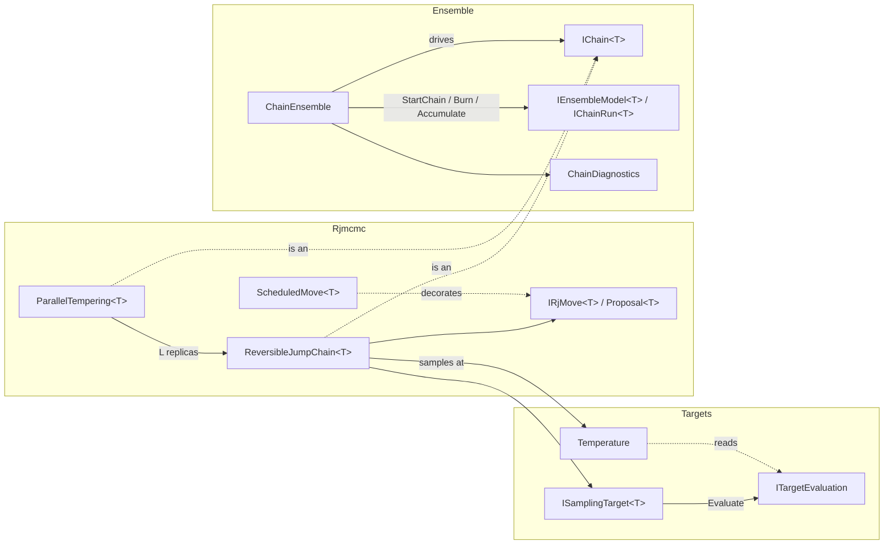

# Samplers

> A model-agnostic Markov chain Monte Carlo (MCMC) toolkit covering a model-neutral target contract with declared tempering paths, reversible-jump MCMC with pluggable moves, parallel tempering, and a replica-ensemble shell that runs independent chains in parallel and diagnoses convergence on scalar functionals. The project also contains inverse-transform sampling and a power-law Gaussian noise-field generator. · **Project:** `Maths.Samplers` (namespaces `Maths.Samplers`, `Maths.Samplers.Rjmcmc`, `Maths.Samplers.Ensemble`, and others) · **Maturity:** core

## Overview

The samplers sit in layer 2 of the [architecture](./Architecture.md). They depend on `Maths.Rng`, and on `Maths.LinAlg` for the FFT. Their consumers are:

- [BayesianRegression](./BayesianRegression.md). BARS drives the reversible-jump engine and the ensemble shell. The Bayesian GP bandwidth sampler (BGP) also uses the ensemble shell. BAPS uses only the R̂ diagnostic.
- `InverseTransform`, which an SPC demonstration (`WangMonteCarloDemo`) uses for exponential energy draws. The Potts bond kernel `FkKernel` evaluates the matching CDF $1-e^{-x}$ but does not call the sampler.
- `SpectralNoiseField`, which [synthetic datasets](./SyntheticDatasets.md) use for colored-noise backgrounds.

## Key concepts

- **Carrier.** The state a chain walks. For BARS this is a knot configuration of varying dimension.
- **Move and palette.** A move is one proposal type, such as birth, death or relocate. The palette is the set of moves a chain chooses from. Each move names its **reverse** move by key.
- **Target and evaluation.** A target evaluates a carrier state once into an `ITargetEvaluation`: an untempered log prior and a log likelihood $\ell_b$ at any inverse temperature $b\in[0,1]$. A log prior of −∞ rejects a state without any likelihood work.
- **Temperature.** An inverse temperature and the path it is taken along: the **powered** posterior $b(\log p+\ell_1)$ or the **likelihood-tempered** path $\log p+\ell_b$. Both are the log posterior at $b=1$. A chain samples its target at one temperature.
- **Kernel vs shell.** The *kernel* (`IChain<T>`) advances one replica. The *shell* (`ChainEnsemble`) fans out replicas, runs rounds and pools diagnostics.
- **Functional.** A fixed-width scalar reduction of each draw, such as the knot count or fitted grid values. Convergence diagnostics are computed on functionals, not on raw states. R̂ is meaningless on a state whose dimension varies or whose labels are symmetric.

## Design

**Green's acceptance ratio, split by responsibility.** Only the engine sees the whole palette and each state's total move weight, so it owns two factors: the **target ratio** and the **move-selection ratio**. Only a move knows its bijection, so it owns the other two: its **auxiliary-density ratio** and its **Jacobian**. `Proposal<T>` carries exactly those two move-side terms. This split has two consequences:

- State-dependent selection weights can be a pure decorator (`ScheduledMove`, used by the DMGK schedule in BARS).
- Tempering acts on the target term alone: the chain's `Temperature` turns each evaluation into a log density. Tempering then leaves the Hastings terms untempered, as it should.

**The target contract (step 3.1).** A target returns an evaluation object, not a number.
- **Why the split.** The likelihood-tempered path keeps the prior whole, so it needs the prior and the likelihood apart. A collapsed model, such as BARS's Normal marginal with β and σ² integrated out, has an $\ell_b$ that is not $b\,\ell_1$, so "β times the log posterior" cannot express it.
- **Why an object.** The state's expensive work (for BARS, the design and its factorization) happens once, in `Evaluate`. Another temperature is then a query on the result, which is what a swap between rungs on the likelihood path, an SMC reweighting or a thermodynamic-integration estimate needs. A swap hands each replica the other's evaluation, and nothing is re-evaluated.
- **Constants.** Values are needed only up to an additive constant that may depend on $b$ and the data but never on the state. It cancels in Metropolis ratios, in swaps (each rung's constant enters once with each sign) and in normalized SMC weights. An evidence estimate needs complete values.
- **Refusals.** A model may refuse $b\ne1$ (`NotSupportedException`); the powered path asks only for $\ell_1$. A model may refuse $b=0$ when a nuisance prior is improper (`ArgumentOutOfRangeException`).
- **Alternatives set aside.**
  - A target that returns $\log\pi$ alone, with tempering as a decorator ($\beta\log\pi$, the `IRjTarget`/`TemperedTarget` pair it replaces): it cannot express the likelihood path or a nonlinear $\ell_b$.
  - Methods `LogPrior(state)` and `LogLikelihood(state, b)` on the target: each temperature would re-evaluate the state.
  - A closed-form tempered density only, `LogDensity(state, b)`: it hides the prior/likelihood split that SMC and evidence estimates read.
- **Costs.** One evaluation object per proposal, and each chain keeps its current state's evaluation alive (for BARS, the factor of $G$). Both are small beside the design and factor the model already builds per proposal.

**Conventions.**

- A `null` proposal means the move is unavailable here. The chain stays and does not count an attempt.
- A non-positive weight removes a move from the palette at that state.
- An infeasible state has a log prior of −∞ (no likelihood work is done) or a log likelihood of −∞ at every temperature.
- Log densities are defined only up to constants that do not depend on the state; a likelihood's may depend on $b$ and the data.

**Kernel/shell split.**

- `IChain<T>` is the kernel seam.
- `IEnsembleModel<T>` and `IChainRun<T>` form the client seam: the start policy, the burn hook, and the reduction from draw to functional.
- `ChainEnsemble` owns seeding, the parallel fan-out, rounds, early stopping and pooled diagnostics.
- Parallelism is across replicas only (`Parallel.For` over chains).

**Reproducible seeding.** One master seed is expanded once by `SeedTree.Derive` into 2C seeds: C *kernel* streams and C separate *readout* streams (see [ProbabilityAndInformation](./ProbabilityAndInformation.md)). A tempered chain re-derives L+1 sub-streams from its own chain seed.

## API at a glance

| Area | Entry points |
|---|---|
| Targets | `ISamplingTarget<T>` (`Evaluate`); `ITargetEvaluation` (`LogPrior`, `LogLikelihood(b)`); `Temperature(b, path)` with `LogDensity(evaluation)`, static `Posterior` and `LogPosterior(evaluation)`; `TemperingPath` (`Powered`, `Likelihood`); `SamplingTarget.FromLogDensity`, `SamplingTarget.Separable`, and the extension `target.LogPosterior(state)`; `SeparableEvaluation` |
| Reversible jump | `ReversibleJumpChain<T>(moves, target, start, rng, temperature = null)` with `Step()`, `Current`, `Temperature`, `CurrentEvaluation`, `CurrentLogDensity`, `Attempts`, `Accepted`, `MoveStats()`, `SetState(state, evaluation)`, `ReplaceTarget(target)`; `IRjMove<T>` (`Key`, `ReverseKey`, `Weight`, `Propose`); `Proposal<T>`; `MoveStat`; `ScheduledMove<T>` |
| Tempering | `ParallelTempering<T>(movesForReplica, target, start, betas, path, masterSeed, schedule = DeterministicEvenOdd)` with `Step()`, `Path`, `Schedule`, `Betas`, `Cold`, `ColdChain`, `Replicas`, `Scans`, `RoundTrips`, `AnnealedRestarts`, `PairStats`, `SwapAttempts`, `SwapAccepts`, `AdaptLadder()`, and static `GeometricLadder(levels, betaMin)`; `SwapSchedule` (`DeterministicEvenOdd`, `StochasticEvenOdd`, `Sequential`); `SwapPairStat`; `TemperingLadder` (`Barrier`, `IdealRoundTripRate`, `Equalize`, `RecommendedLevels`) |
| Ensemble | `new ChainEnsemble().Run<T>(model, chains, masterSeed, burn, samples, rHatTarget = 0, batchSize = 0, minEssPerChain = 100, checkpoint = false, resumeFrom = null)` (an instance method on a stateless class) → `(EnsembleRun, chain runs)`; `ChainDiagnostics.Diagnose` → `ConvergenceDiagnostic` (`RHat`, `BulkRHat`, `TailRHat`, `BulkEss`, `TailEss`, `Ess`); `ChainDiagnostics.RHat`; `RHatDiagnostic`, `EssDiagnostic`, `DiagnosticState`; `IChain<T>`, `IEnsembleModel<T>` (`FunctionalDim`, `MonitoredDim`, `Fingerprint`, `RestoreChain`), `IChainRun<T>`, `EnsembleRun` |
| Readouts, traces, checkpoints | `IMergeable<T>`; `RunningMoments` (`Add(x, weight)`, `Merge`, `Of`), `WeightedSums` (`Add`, `AddSparse`, `Mean`), `DrawSample` (`Add`, `Quantile`), `Tally<TEnum>`; `ChainTrace` (`Add`, `Draws`, `Copy`); `EnsembleCheckpoint`, `ChainCheckpoint`, `RunIdentity`, `IChainState`, `IResumableChainRun<T>`, `RunFingerprint`; `ReversibleJumpChain.Snapshot`/`Restore` (`ChainSnapshot<T>`), `ParallelTempering.Snapshot`/`Restore` (`LadderSnapshot<T>`) |
| i.i.d. and fields | `InverseTransform.Sample(rng, quantile, count)`, `InverseTransform.Exponential(rng, scale, count)`; `SpectralNoiseField.Generate(rng, gridSize, beta, boxMin, boxMax)` with `Sample`, `Min`, `Max` and presets `White` / `Pink` / `Brown` |

## Algorithms

### Reversible-jump step

At state $x$, let $w_i(x)$ be the move weights and $W(x)=\sum_{i:\,w_i(x)>0}w_i(x)$.

1. If $W(x)\le0$, stay. Otherwise select move m with probability $w_m(x)/W(x)$.
2. If `Propose` returns null, stay. This is not counted as an attempt. Otherwise count an attempt.
3. If the reverse move's weight at $x'$ is non-positive, or $W(x')\le0$, reject.
4. Otherwise accept with

$$\log\alpha=\big[\log\pi_b(x')-\log\pi_b(x)\big]+\underbrace{\log\tfrac{q_{m'}(u')}{q_m(u)}}_{\texttt{LogProposalRatio}}+\underbrace{\log|J|}_{\texttt{LogJacobian}}+\log\frac{w_{m'}(x')/W(x')}{w_m(x)/W(x)}.$$

Here $\log\pi_b$ is the chain's `Temperature.LogDensity` of a state's evaluation: $b(\log p+\ell_1)$ on the powered path and $\log p+\ell_b$ on the likelihood path, the log posterior at $b=1$, the default.

The chain accepts if $\log\alpha\ge0$ or $U<e^{\log\alpha}$. A candidate whose density is −∞ or NaN is rejected whatever its proposal ratio, so $-\infty+\infty$ cannot decide a move. The current evaluation and its density are cached, so each step makes at most one evaluation (none when the move is unavailable or the reverse move is blocked).

**What the constructor checks.** There must be at least one move, the keys must be unique, and every `ReverseKey` must exist in the palette.

**What guarantees detailed balance.** The engine does not check that a move's reverse points back to it. Detailed balance relies on three things:

- the moves being paired symmetrically;
- each move reporting correct auxiliary ratios and Jacobians;
- the selection ratio, which the engine computes.

**Cost.** Each step costs $O(M)$ weight evaluations for M moves, plus at most one proposal and one target evaluation.

### Tempering

**Paths (step 3.2).** A ladder declares one `TemperingPath` for all its replicas, and replica $i$ samples `Temperature(β_i, path)`.
- **Powered:** $\beta_i(\log p+\ell_1)$. Prior and likelihood are flattened together.
- **Likelihood-tempered:** $\log p+\ell_{\beta_i}$, the power posterior of Friel and Pettitt (2008). The prior stays whole, and $\beta=0$ is the prior itself.
- **What separates them.** A chain targets a measure, not a density. Powering a density $f=d\Pi/d\mu$ gives the hot measure $f^\beta\,d\mu$, which depends on the reference measure μ. Two representations of one model whose densities differ by a state-dependent factor $g$ give hot measures that differ by $g^{\beta-1}$; only a representation change with unit density ratio leaves them alone. On a space of varying dimension each subspace has its own reference, so the powered path's hot rungs leave the prior in a direction the bookkeeping sets, not the model.
  - **BARS's knots.** Sorting labeled knots onto the ordered simplex is $k!$-to-one, so the ordered density carries an extra $k!$, and the two representations' powered rungs differ by $(k!)^{\beta-1}$. Under a constant likelihood and a Poisson(λ) count prior, the powered rung β samples Poisson(λ^β) knots in ordered coordinates (`CountLawTests`, per rung) and a Conway–Maxwell–Poisson(λ^β, ν = β) count in labeled ones. At λ = 5 and β = 0.05 that is 1.08 knots against 14.17, for the same posterior.
  - **The likelihood path** defines the hot measure against the prior measure itself, $d\Pi_b/d\Pi_0=L^b$, so every representation gives the same rungs; every BARS likelihood-path rung samples the prior's count law. The likelihood path needs $\ell_b$ at every rung; the powered path needs only $\ell_1$, so it serves every target.
- **Choice.** The caller declares the path; no default lives in the sampler. BARS takes the likelihood path ([BayesianRegression](./BayesianRegression.md), Q5).

**The ladder.** In `ParallelTempering`, every replica starts from the same state, and each builds its own move palette from the `movesForReplica` factory, so mutable move state stays private to one replica. Each replica has its own RNG, and one further RNG drives swaps. `GeometricLadder` gives $\beta_i=\beta_{\min}^{\,i/(L-1)}$. `Replicas` exposes every rung, cold first, for per-rung diagnostics.

**Ladder validation.** At least two rungs, strictly descending, cold rung exactly $\beta_0=1$. The hot end must be positive on the powered path, where $\beta=0$ would be the bare reference measure. It may be 0 on the likelihood path, where $\beta=0$ is the prior; a target whose nuisance prior is improper refuses that rung when it is evaluated (BARS does).

**One step.**

1. Every replica steps once (local exploration).
2. The swap schedule picks adjacent pairs $(i,i+1)$ to attempt, each with

$$\log A=d_i(x_{i+1})+d_{i+1}(x_i)-d_i(x_i)-d_{i+1}(x_{i+1}),$$

where $d_i$ is replica $i$'s log density, its `Temperature.LogDensity`. The two current densities are cached, and the two cross terms query the other replica's evaluation at this replica's temperature, so a swap evaluates no state. An accepted swap hands each replica the other's state and evaluation, and each recomputes its density at its own β.
- **On the powered path** this is $(\beta_i-\beta_{i+1})(L_{i+1}-L_i)$ with $L=\log p+\ell_1$, the formula used until step 3.2; BARS's powered runs are bit-identical across the change.
- **On the likelihood path** the prior cancels, leaving $\ell_{\beta_i}(x_{i+1})+\ell_{\beta_{i+1}}(x_i)-\ell_{\beta_i}(x_i)-\ell_{\beta_{i+1}}(x_{i+1})$. The β-linear shortcut is wrong here, because $\ell_\beta$ need not be linear in β. On a six-state test with a nonlinear $\ell_\beta$, the shortcut biases even the cold rung (a state's frequency 0.0114 against the exact 0.0223). The general form matches every rung's law on both paths to total variation ≤ 0.005.

Every pair's rejection probability $1-\alpha$ is recorded on every scan, attempted or not (Rao–Blackwellized: computed from the cached evaluations, not the 0/1 outcomes). The chain interface reports the cold replica's move acceptance. Swaps are counted separately.

### Swap schedules, round trips and ladder adaptation (step 3.3)

Following Syed, Bouchard-Côté, Deligiannidis and Doucet (2022).

**Schedules** (`SwapSchedule`).
- **Deterministic even-odd** (DEO, the default): pairs (0,1), (2,3), … on even scans and (1,2), (3,4), … on odd ones. Each pair is attempted every other scan, and a state that was just swapped is offered the next rung in the same direction on the next scan, so it keeps moving until a swap is rejected. The scheme is non-reversible.
- **Stochastic even-odd** (SEO): the even or the odd pairs by a fair coin each scan. Reversible: states random-walk along the ladder.
- **Sequential:** every pair each scan, cold to hot, later pairs seeing earlier swaps; this engine's schedule until step 3.3, kept for comparison and for reproducing earlier runs. Within one swap phase a state can cascade up several rungs with no local step between; it descends one rung a scan.
- The even and the odd pairs are disjoint, so an even-odd scan takes all its ratios before any swap.

**Round trips.** A state that leaves the hot end, reaches the cold end and returns completes a round trip; its arrival at the cold end is an *annealed restart*, carrying what the hot rungs explored down to the posterior. `RoundTrips / Scans`, summed over states, is the round-trip rate τ, the measure a ladder is judged by. Swap acceptance is not: a ladder of nearly equal rungs accepts almost every swap and moves nothing anywhere.

**What theory predicts.** With $r_i$ pair $i$'s rejection rate, $N$ the number of pairs and $E=\sum_i r_i/(1-r_i)$, under *efficient local exploration* (each rung's local move an exact independent draw), Theorem 1 of Syed et al. gives

$$\tau_{\text{DEO}}=\frac{1}{2+2E},\qquad \tau_{\text{SEO}}=\frac{1}{2N+2E}.$$

`TemperingLadder.IdealRoundTripRate` computes these from observed rates. Real local moves fall short of exact draws, so the gap between the observed and the ideal rate measures local exploration.
- **Rung count.** The barrier $\Lambda\approx\sum_i r_i$ (`Barrier`) is nearly the same for every ladder of the same endpoints (their Corollary 2). For an equalized ladder $E\approx\Lambda/(1-\Lambda/N)$, so DEO's τ rises toward $1/(2+2\Lambda)$ as rungs are added while SEO's decays like $1/(2N)$. About $N\approx2\Lambda$ pairs, rejection rate near ½, uses the rungs best (`RecommendedLevels`).
- **Checked** (`SwapScheduleTests`, exact Gaussian draws on the likelihood path): observed against Theorem 1, DEO 0.1366 against 0.1369 and SEO 0.0516 against 0.0518; without rejections, DEO 0.4999 (theory ½) and SEO 0.1007 (theory 1/10, five pairs); from 5 to 17 rungs on equalized ladders, DEO 0.120 → 0.160 (bound 0.178) and SEO 0.070 → 0.027.

**Ladder adaptation** (`AdaptLadder`).
- **Rule.** For a fixed number of rungs, equal rejection rates minimise $E$. The cumulative barrier $\Lambda(\beta)$, the running sum of the observed rates from the hot end, is interpolated by a monotone cubic (Fritsch and Carlson 1980) and inverted at equal steps, which places the new interior rungs (their Algorithms 2 and 3). The cold rung (exactly 1) and the hot end never move.
- **Retempering is free.** Each replica moves to its new rung by `SetTemperature`, a query on its cached evaluation; nothing is re-evaluated.
- **Statistics** come from the scans since the previous adaptation; a ladder with no rejections, or no interior rung, is left alone.
- **Adapt during burn-in only.** A ladder that keeps changing does not leave the posterior invariant. Syed et al.'s Algorithm 4 tunes in rounds of 1, 2, 4, … scans, adapting after each, and BARS follows it.
- **Checked:** from a uniform ladder whose rejection rates spread 6.8-fold, adaptation equalizes them to within 4% and leaves the barrier where it was (Λ̂ 1.79 → 1.84).

**What round trips do not measure.**
- **Round trips compare like with like only between schedules in which a state takes at most one swap per local step, on one path.** Theorem 1 and the adaptation rule rest on that structure: each swap a state takes is separated from its next by local exploration.
- **The sweep breaks it.** Without rejections it completes one round trip per scan against DEO's ½ (`SwapScheduleTests`). A state cascades from the cold to the hot end within one swap phase, with no local step at the rungs between; it gets one local step at the hot end, where DEO gives two; and it descends a rung a scan. Both schedules spend the same local steps per scan, so the sweep's extra trips each carry less exploration.
  - Only when every local move is an exact draw is a trip's value independent of the steps in it. There the sweep's advantage is real: about 1.7× DEO's round trips at 5 and 17 rungs, on exact Gaussian draws. It is worth less as local moves weaken.
  - On BARS fits (`TemperingBenchmark`) the sweep completes 1.4–2.0× DEO's round trips on equalized ladders. Yet the cold chain's ESS per second does not separate the two: 0.97–1.33× across fits on the likelihood path (0.87–1.39× counting the powered path), within the noise of 3-chain estimates.
- **Paths have different hot ends,** so their round trips are journeys to different places. On Poisson counts the powered ladder makes about 5× the likelihood ladder's round trips, because its hot end barely differs from the posterior (barrier Λ̂ ≈ 0.24 against 1.4; hot rung 1.0 knots against the prior's 4.4). The cold chain's ESS per second does not follow (0.85×, within noise).
- **The neutral measure is the cold chain's ESS per unit work.** At this budget it is noisy: single 3-chain estimates swing 2–8×. Step 3.4's rank-normalized ESS is the instrument for the next comparison.
- **Default: deterministic even-odd.** Round trips and Theorem 1 apply to it, the adaptation rule is derived for it, and its swaps within a scan are independent, so a parallel or distributed ladder can run them at once. SEO is the reversible baseline.

**The swap uniform is drawn on every attempt**, accepted or not.
- Between two states whose $L$ agree to rounding, $\log A$ is of rounding size and its sign is rounding noise. Until step 3.1, $L_i$ was recovered as `CurrentLogTarget`$/\beta_i$ after an earlier swap stored $\beta_i L$, so replicas holding the same state produced such ties routinely. $L_i$ is now read from the evaluation, so the same state gives the same $L$ exactly, but distinct states can still tie. The regression test builds two targets that break such a tie in opposite directions.
- Drawing every time keeps the swap stream independent of it, so a last-bit change in the target cannot shift later swaps.
- Before 2026-10-20 the draw was skipped when $\log A\ge0$, and step 2.3's cancellation-free scale moved a tempered BARS run through exactly this tie.
- The within-replica Metropolis step still skips the draw when $\log\alpha\ge0$. A tie there needs a candidate whose target equals the current one to rounding, which continuous knots do not produce.

### Ensemble shell

`ChainEnsemble.Run`:

1. Validate the arguments, then derive 2C seeds: kernel seeds are children $[0,C)$ and readout seeds are children $[C,2C)$.
2. In parallel, start each chain and run its burn-in.
3. Run sampling rounds of `batchSize` steps. The default is a single round of `samples` steps. Each draw is reduced to a functional vector, whose streaming moments (Welford's update) are accumulated per chain. The draws of the leading `MonitoredDim` functionals are kept.
4. If `rHatTarget > 0`, stop after the first round in which every functional's R̂ meets the target (rank-normalized for the monitored functionals, classic for the rest), at least one is an estimate, and every monitored functional's bulk and tail ESS reach `minEssPerChain` per chain (100 by default, Vehtari et al. 2021). An R̂ target needs at least two chains and one monitored functional.
   - **The ESS gate replaced a 100-draw floor** (step 3.4). A draw count bounds the effective sample size only from above. BARS's knot count, for one, has an autocorrelation time of about 450 steps on a test fit (Stan's estimator and batch means agree), where an R̂ of 1.5 is met within 500 draws.
5. Pool the results:
   - means over $C\cdot n$ draws;
   - population variances over all $C\cdot n$ draws (`FunctionalVariance`), from the per-chain streaming moments merged by Chan's parallel update (`RunningMoments.Merge`, which is associative and commutative);
   - a typed classic R̂ (`RHatDiagnostic`) per functional;
   - the rank-normalized diagnostics of the monitored functionals (`EnsembleRun.Monitored`);
   - acceptance $\sum\text{Accepted}/\sum\text{Attempts}$ over the sampling phase: each chain's counts at the end of burn-in are subtracted, so tuning during burn-in does not colour it.

### Readouts, traces and checkpoints (step 3.4)

A run's state comes in three kinds, which pool differently, so they are three components.
- **Readout statistics** pool by merging (`IMergeable<T>`): additive sufficient statistics whose merge is associative and commutative, so pooling across chains does not depend on order.
  - The primitives: `RunningMoments` (streaming moments), `WeightedSums` (a field or a few scalars, dense or sparse folds, with a total weight), `DrawSample` (a weighted multiset, for quantiles; type 7 under unit weights) and `Tally<TEnum>` (outcome counts).
  - Each fold may carry a weight, so the same statistics pool weighted particles. Unit weights, the MCMC case, reproduce the unweighted arithmetic exactly: `RunningMoments` uses West's weighted update, arranged so that weight 1 is the same sequence of operations.
  - Nonlinear reductions (a standard deviation, a quantile, a mode) read the merged statistics once, where the estimand lives.
- **Diagnostic traces** (`ChainTrace`) are one chain's ordered draws of its monitored functionals. Rank-normalized R̂ and autocorrelation ESS need that order, so a trace never merges with another chain's: pooling keeps one per chain. Their ESS is autocorrelation ESS, a different quantity from a particle population's weight ESS, which belongs to the SMC module.
- **Execution checkpoints** (`EnsembleCheckpoint`) hold restart state, which does not pool.
  - **Components, kept apart:** the run's identity (master seed, chain count, and the model's `Fingerprint` of its configuration and data); the chain seeds; the draws per chain so far; and per chain the engine's restart state (`IChainState`), the shell's moments, its trace and its burn-in counters.
  - **Engine state:** every RNG stream's words, the sampler's state and counters, adaptation state, and replica assignments and swap-schedule state for a ladder. `ReversibleJumpChain.Snapshot`/`Restore` and `ParallelTempering.Snapshot`/`Restore` supply the generic parts. A restored chain or ladder recomputes its cached evaluations, since evaluation is deterministic.
  - **API:** `Run(…, checkpoint: true)` returns one in `EnsembleRun.Checkpoint`, and `Run(…, resumeFrom: c, samples: n)` continues that run for n more draws after checking its identity. A resumed run continues exactly as the uninterrupted one would have.
  - **Scope:** checkpoints are in-memory copies taken after burn-in, at a round boundary, so burn-in adaptation is never in flight; writing them to disk is not yet built. A model resumes only if it implements `RestoreChain`, and BARS does.
- **Checked** (`ReadoutTests`, `SnapshotTests`): merges in any order; unit-weight equality with the unweighted update; restored chains and ladders, mid-round adaptation statistics included, continue identically to the live ones; the shell refuses to checkpoint a chain run that cannot save its state, and to resume a model that cannot restore one or a run whose identity differs.

### Convergence diagnostics

**R̂.** The classic Gelman–Rubin statistic, computed from per-chain means and sample variances. It is **not** split and **not** rank-normalized.

$$W=\tfrac1C\sum_i s_i^2,\quad B=\tfrac{n}{C-1}\sum_i(\bar x_i-\bar x)^2,\quad \hat V=\tfrac{n-1}{n}W+\tfrac{B}{n},\quad \hat R=\sqrt{\hat V/W}.$$

Each reading carries a state (`DiagnosticState`):

| State | When | Meets a stopping target |
|---|---|---|
| `Estimated` | $W>0$ | When $\hat R\le$ target |
| `Constant` | $W=0$ and every chain mean is equal | Yes, since there is nothing to converge; but an early stop also needs at least one `Estimated` functional, so an all-constant set runs to the end |
| `Frozen` | $W=0$ and the chain means differ ($\hat R=+\infty$) | Never |
| `Unavailable` | $C<2$, $n<2$, or a non-finite draw | Never |

Streaming moments keep $W$ exactly zero for constant chains; running sums and sums of squares cancel to rounding noise and turn a constant functional into a spurious estimate. `RHatDiagnostic.Worst` summarizes a set in the order constant, estimates by value, frozen, unavailable.

**Rank-normalized diagnostics** (`ChainDiagnostics.Diagnose`; Vehtari, Gelman, Simpson, Carpenter and Bürkner 2021, step 3.4). These are what the shell reports for the monitored functionals.
- **Split chains.** Each chain's first and last ⌊n/2⌋ draws are two chains, so a trend within a chain shows as disagreement, and one chain can be diagnosed.
- **Rank normalization.** All draws are ranked together, ties averaged, and mapped to $z=\Phi^{-1}((r-3/8)/(S+1/4))$. This makes the diagnostics invariant to monotone transforms and defined for heavy tails: on Cauchy draws, which have no variance for classic R̂ to use, the bulk ESS is about S.
- **R̂.** `BulkRHat` is classic R̂ on the normalized split chains. `TailRHat` is the same on the folded draws $\lvert x-\operatorname{median}\rvert$, so it sees differences in scale. `RHat` is the less favourable of the two. Chains with one mean and different scales are invisible to classic and bulk R̂ (0.9998 and 0.9996 on a test with one chain three times wider), and the tail R̂ catches them (1.150).
- **ESS** follows Stan's estimator:
  - within-chain autocovariances by FFT (biased, as Geyer recommends);
  - combined across chains as $\hat\rho_t=1-(W-\overline{\gamma_t})/\hat V^+$;
  - Geyer's initial positive sequence of the pairs $\hat\rho_{2m}+\hat\rho_{2m+1}$, made monotone;
  - $\hat\tau=-1+2\sum\hat\rho_t$ plus the last positive even term, bounded below by $1/\log_{10}S$, so antithetic chains can exceed S (by at most a factor of $\log_{10}S$).
  - `BulkEss` is the ESS of the normalized draws. `TailEss` is the smaller of the ESS of the indicators $x\le q_{0.05}$ and $x\le q_{0.95}$.
  - The cost is $O(S\log S)$: 800,000 draws take about 2 s.
- **Checked** (`ConvergenceDiagnosticsTests`): bulk ESS within 6% of the AR(1) value $S(1-\phi)/(1+\phi)$ at φ = 0, 0.9 and −0.5 (above S for the last); tail ESS between the bulk and S for φ = 0.9, since a Gaussian process's exceedances decorrelate faster than the process; a shifted chain raises the bulk R̂; discrete draws with ties are diagnosed.
- **The failure policy is R̂'s.** Every draw one value is `Constant` (exempt from the ESS gate). Every split chain constant at different values is `Frozen`. Fewer than four draws per chain, or a non-finite draw, is `Unavailable`. `EssDiagnostic.Worst` orders readings as `RHatDiagnostic.Worst` does, smaller estimates worse.

**Classic ESS** (`ChainDiagnostics.Ess`, the BDA3 variogram estimator with a non-standard pairing and $O(Cn^2)$ cost) is no longer used by the shell, BARS or BGP, and goes in step 3.6.

### Inverse transform and spectral noise fields

**`InverseTransform.Sample`** returns $Q(U_i)$ with $U_i\in[0,1)$. `Exponential(scale)` uses $Q(u)=-\text{scale}\cdot\ln(1-u)$.

**`SpectralNoiseField.Generate`** builds a Gaussian random field on a cubic $N^d$ grid, where N must be a power of two:

1. Fill the grid with i.i.d. $N(0,1)$ values.
2. Apply the forward N-D FFT.
3. Scale each frequency bin by $|k|^{-\beta/2}$ (integer frequencies folded about N/2; DC set to 0).
4. Apply the inverse FFT, keep the real part, and standardize to mean 0 and population standard deviation 1.

The power spectrum is $\propto|k|^{-\beta}$ in **grid-index** units: $\beta=0$ is white noise, 1 is pink and 2 is brown.

**`SpectralNoiseField.Sample`** maps the query box onto grid nodes $0..N-1$ and interpolates multilinearly over the $2^d$ corners of the enclosing cell. The field is therefore **not periodic over the box**, even though the grid is periodic.

## Configuration

| Setting | Default | Meaning |
|---|---|---|
| `ChainEnsemble.Run` rHatTarget / batchSize | 0 / 0 | No early stop / one round of `samples` steps |
| `ChainEnsemble.Run` minEssPerChain | `ChainEnsemble.MinEssPerChain` = 100 | Bulk and tail ESS per chain every monitored functional needs before an R̂ target may stop sampling |
| `GeometricLadder` levels / betaMin | (required) | L ≥ 2; $\beta_{\min}\in(0,1)$ |
| `ParallelTempering` schedule | `DeterministicEvenOdd` | Non-reversible even-odd swaps |
| `SpectralNoiseField` presets | White 0 / Pink 1 / Brown 2 | Spectral exponent β |

## Status and caveats

- **Only the monitored functionals get rank-normalized diagnostics.** The rest (BARS's per-grid fit) keep classic R̂ from streaming moments, which costs no stored draws but does not see differences in scale or behave for heavy tails.
- **`SpectralNoiseField` is not periodic.** Its documentation describes the grid as periodic, but queries map the box to nodes 0..N−1, so the sampled field is not periodic over the box.

## Source map

| Role | Files (`ThermoMapper/src/maths/samplers/`) |
|---|---|
| Targets | `targets/SamplingTarget.cs` |
| Reversible jump | `rjmcmc/ReversibleJumpChain.cs`, `IRjMove.cs`, `Proposal.cs`, `MoveStat.cs`, `ScheduledMove.cs`, `ParallelTempering.cs`, `TemperingLadder.cs`; `IRjTarget.cs` and `TemperedTarget.cs` are unused since step 3.1 and go in step 3.6 |
| Ensemble | `ensemble/ChainEnsemble.cs`, `ChainDiagnostics.cs`, `ConvergenceDiagnostics.cs`, `RHatDiagnostic.cs`, `RunningMoments.cs`, `Readouts.cs`, `ChainTrace.cs`, `Checkpoint.cs`, `EnsembleRun.cs`, `IChain.cs`, `IEnsembleModel.cs` |
| i.i.d. and fields | `iid/InverseTransform.cs`; `SpectralNoiseField.cs` (at the `samplers/` root) |

**Tests:** `tests/Maths.Samplers.Tests` (sources in `tests/samplers/`) owns the samplers' own checks, with targets built from `Maths.Samplers` alone: chain contracts, the reversible-jump generality check, the target contract, parallel tempering (each rung's law on both paths, ladder validation), swap schedules against Theorem 1, ladder adaptation, and the diagnostics policy.

**See also:** [BayesianRegression](./BayesianRegression.md) (BARS, BGP) · [ProbabilityAndInformation](./ProbabilityAndInformation.md) · [DesignPrinciples](./DesignPrinciples.md)
