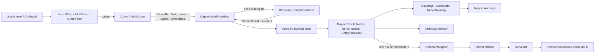

# Mapper

> Mapper builds a topological summary of a point cloud or a graph. It works in five stages:
>
> 1. Apply a lens.
> 2. Cover the lens range with overlapping bins.
> 3. Cluster each bin's preimage.
> 4. Join clusters that share points.
> 5. Report diagnostics on the resulting nerve.
>
> A parameter sweep turns a series of Mapper runs into an H0 component-tracking barcode.
>
> **Projects:** `TDA.Mapper` (namespaces `TDA.Mapper`, `.Filters`, `.Cover`, `.Clusterers`, `.Diagnostics`), and in `TDA.Ph` the nerve-filtration types (`TDA.Ph.Nerves`, `PersistenceBarcode`).
>
> **Maturity:** core throughout. The Poincaré density lens is a quadratic-time sketch.

## Overview

Mapper (Singh–Mémoli–Carlsson) summarizes data by its shape along a chosen lens. ThermoMapper implements three input modes on one scaffold:

- **1-D point cloud:** `IFilter` + `ICover` + `IClusterer`.
- **Multi-D point cloud:** `IMultiFilter` + `IMultiCover` (product cells) + `IClusterer`.
- **Graph Mapper** (Carrière–Michel–Oudot; Hajij–Rosen–Wang): a `CsrGraph` with an `IGraphFilter` and an `IGraphClusterer`. The clusterer sees the subgraph induced on each preimage, so two nodes share a cluster because they are *connected* through the preimage, not because they are metrically close.

`TDA.Mapper` sits above the graph, clustering and linear-algebra layers (see [Architecture](./Architecture.md)). The nerve it returns is an ordinary [`CsrGraph`](./GraphSubstrate.md), so every graph observable and visualization works on it unchanged. The filtration types (`NerveFiltration`, `NerveFiltrationFrame`, `NerveDiff`) live in `TDA.Ph.Nerves` and store only graphs and member arrays, never a `MapperResult`; the driver, `PersistentMapper`, lives in `TDA.Mapper`. As a result, `TDA.Ph` does not depend on `TDA.Mapper`.

## Key concepts

- **Lens (filter).** A map from points or graph nodes to $\mathbb R$ or $\mathbb R^D$. Points with non-finite lens values are dropped by every built-in cover, so they appear in no node.
- **Cover bin.** An interval, or a product cell, together with its **preimage**: the indices of the points whose lens value falls inside it.
- **Node.** A (bin, local cluster) pair. Its members are original row or node indices.
- **Nerve (1-skeleton).** Nodes $u,v$ are joined iff $M_u\cap M_v\neq\emptyset$, with edge weight $J_{uv}=|M_u\cap M_v|$, the overlap count.
  - No 2-simplices are formed.
  - Clusters within one bin partition the preimage, so edges only join nodes from different bins.
- **Frame.** One Mapper nerve at one parameter value t.
- **Component event.** One of Birth, Death, Continuation, Merge or Split, which relates connected components of consecutive frames.
- **Tracking barcode.** An H0 barcode read from the event stream using the elder rule. Frames are independent Mapper runs, **not nested complexes**, so this is a component-tracking summary rather than the persistence module of a filtration. Splits can occur, and no standard stability theorem applies.

## Design

- **One core, three front doors.** The three `Build` overloads differ only in how a bin is clustered. Each one wraps that difference in a `Func<CoverBin, ClusterResult>` and hands it to a single private `BuildFromBins`.
  - The point-cloud paths pass a subset array that copies row *references*, not rows.
  - The graph path passes the graph and the preimage index list.
- **Index conventions are the contract.**
  - `ClusterResult.Labels[i]` labels `bin.PointIndices[i]`.
  - Node members are original indices, so an adapter that works in a local index space must translate back. `MapperSpcClusterer` does this for its induced subgraph.
  - `ClusterResult.K` is advisory. Mapper uses it only as a capacity hint.
- **Factories over internal classes.** Lenses are `internal sealed` classes behind static factories (`Filters`, `GraphFilters`, `HyperbolicFilters`). A factory property returns a new instance on each access.
  - Covers are public classes with a `Cover` factory.
  - Clusterers are public classes with validated constructors.
  - Each component's `Name` is copied into `MapperResult` as provenance.
- **Lifting combinators.**
  - `CompositeFilter` and `ProductCover` lift 1-D lenses and covers to D dimensions.
  - `GraphFilters.FromPointFilter` lifts a point lens onto graph nodes through a node-feature matrix.
- **Diagnostics are small pure reducers.** `Coverage`, `NodeStats`, `NerveTopology` and `IntrinsicDimension` each expose a static `From(...)` that returns a `readonly record struct`. `MapperWarnings.From` composes three of them and returns `string[]`.
- **Naming collisions.** `TDA.Mapper.Cover.Cover` and `TDA.Mapper.Filters.Filters` share their namespace's name. Inside `TDA.Mapper.*` code outside those two namespaces, the simple names `Cover` and `Filters` bind to the namespace, so the factories must be qualified (for example `Cover.Cover.Uniform`). The name `Mapper` resolves to the class `TDA.Mapper.Mapper`, so `Mapper.Build` needs no qualification.
- **Clusterers delegate to the clustering stack.** The adapters are thin: [k-means++ and GMM](./GaussianMixtures.md), [HDBSCAN](./Hdbscan.md) and [SPC](./SpcEngine.md). Each adapter supplies only preimage handling and label mapping.

## API at a glance

| Area | Entry points |
|---|---|
| Build | `Mapper.Build(double[][], IFilter, ICover, IClusterer)`; `Mapper.Build(double[][], IMultiFilter, IMultiCover, IClusterer)`; `Mapper.Build(CsrGraph, double[][]? features, IGraphFilter, ICover, IGraphClusterer)` |
| Results | `MapperResult { Nodes, Nerve, FilterName, CoverName, ClustererName, EmptyBinCount }`; `MapperNode(BinId, LocalClusterId, MemberIndices, FilterValueMean/Min/Max)`; `ClusterResult(Labels, K)` |
| Lenses | `Filters.Identity`, `Filters.EuclideanNorm`, `Filters.Pca1D(data)`; `GraphFilters.Degree`, `.WeightedDegree`, `.GeodesicDistance(seed, maxDepth?)`, `.FiedlerVector`, `.FromPointFilter(IFilter)`; `HyperbolicFilters.PoincareRadial`, `.PoincareLocalDensity(k = 10)`; `new CompositeFilter(params IFilter[])` |
| Covers | `Cover.Uniform(n = 12, o = 0.4)`, `Cover.Balanced(n = 12, o = 0.4)`, `new ProductCover(params ICover[])`; `CoverResult`, `CoverBin` |
| Clusterers | point: `KMeansClusterer(k = 0, 100, 42)`, `HdbscanClusterer(5, null, true)`, `ModalGmmClusterer(12, NaN, 100, 42, 1e-6)`; graph: `ConnectedComponentsClusterer`, `MapperSpcClusterer(sampler?, cutTheta = 0.5, gridSteps = 12)` |
| Diagnostics | `Coverage.From(result, N)` → `CoverageReport`, `NodeStats.From(result)` → `MapperNodeReport`, `NerveTopology.From(result)` → `NerveTopologyReport`, `IntrinsicDimension.From(result, points, 1.2, 2.5)` → `IntrinsicDimensionReport`, `MapperWarnings.From(topo, nodes, coverage)` → `string[]` |
| Sweeps | `PersistentMapper.BuildFiltration(parameters, buildFrame, parameterLabel = "T")`, `PersistentMapper.SweepH0(…)`; `NerveFiltration(frames, parameterLabel = "T")` of `NerveFiltrationFrame(ParameterValue, Nerve, NodeMemberIndices, FrameIndex)`, `.ComputeDiffs()`; `NerveDiff` (`ParameterFrom/To`, `NodeMatches` of `NodeMatch`, `BornNodes`, `DiedNodes`, `BornEdges`, `DiedEdges`, `ComponentEvents` of `ComponentEvent(Kind, CcsFrom, CcsTo)`, `ComponentEventKind`); `PersistenceBarcode.ComputeH0(filtration)` |

## Algorithms

### Building the nerve

For each cover bin:

- Bins with no points increment `EmptyBinCount` and are skipped.
- The clusterer's labels are grouped by raw label value. `LocalClusterId` is therefore the clusterer's own label, not a dense index, and HDBSCAN's noise label −1 becomes a node of its own.
- Node lens statistics are the mean, minimum and maximum over the members. The multi-D path uses coordinate 0 only.

The nerve is built by an **inverted index**:

1. Map each point to the nodes that contain it.
2. For every point, increment a pair count for each pair of its nodes.
3. Emit the result as a symmetric `CsrGraph` with edge weight $J_{uv}$.

The cost is $O(N+\sum_v|M_v|+\sum_pk_p^2)$ expected, where $k_p$ is the number of nodes containing point p. Bins are processed sequentially. Empty input returns zero nodes and an empty nerve.

### Covers

**Uniform (`UniformCover`).** Only finite lens values are used. Let $R=\max-\min$, $w=R/n$ and step $s=w(1-o)$.

- For $i<n-1$, interval i is $[\min+is,\ \min+is+w]$.
- The last interval is $[\min+(n-1)s,\ \max+10^{-9}]$.
- Membership is closed at both ends. Adjacent intervals overlap by $o\,w$, so o is a fraction of the interval *width*.
- Because $w=R/n$, the first $n-1$ intervals reach only $\min+w(n-1-(n-2)o)$, which is $7w$ at the defaults. The **last interval is stretched** to width $w(1+(n-1)o)$: $5.4w$, or 45% of the range, at $n=12,o=0.4$.

  **Consequence:** the top of the lens range gets much coarser resolution than the rest.
- If $R<10^{-12}$, every finite point goes into bin 0.
- Empty bins are not emitted. The rest keep their original index, so `BinId`s can be non-contiguous.
- Cost: $O(nN)$.

**Balanced (`BalancedHistogramCover`, quantile).** This cover sorts the m finite values.

- Let $b=\max(1,\lfloor m/n\rfloor)$ and $c=\operatorname{round}(b\,o)$, with banker's rounding.
- Bin i holds the sorted positions $[\max(0,ib-c),\ \min(m,e_i+c))$, where $e_i=(i+1)b$ and the last bin ends at m.
- Interior neighbors therefore share $2c$ points, a fraction of about $2o/(1+2o)$ of a bin. This is not the "o of the population" that the doc comment describes.
- Tied values may land on both sides of a boundary. The last bin absorbs the remainder.

**Product.** Each lens column is covered by its own 1-D cover.

- An odometer walks every tuple of 1-D bins, with dimension 0 varying fastest. Each intersection is seeded from the smallest bin.
- Only non-empty intersections become bins, numbered sequentially.
- `Lower`/`Upper` are copied from the dimension-0 bin, and `FilterMin`/`FilterMax` pool every dimension, mixing units.
- Cost: $O(\prod_d|B_d|\cdot\sum_d|b_d|)$.

For 1-D covers, `FilterMin`/`FilterMax` are the finite range of the lens, or `(0, 0)` with no bins when there is no finite value.

### Lens catalog

| Lens | Definition |
|---|---|
| Identity (`IdentityFilter`) | $f(x)=x_0$ (0 for an empty row) |
| Euclidean norm (`EuclideanNormFilter`) | $\lVert x\rVert_2$ |
| PCA-1D (`Pca1DFilter`) | PC1 fitted at construction on the factory's data (needs ≥ 2 points); $f(x)=(x-\mu)\cdot v_1$ |
| Poincaré radial (`PoincareRadialFilter`) | $2\operatorname{artanh}\lVert x\rVert$ if $\lVert x\rVert<1-10^{-12}$, otherwise $+\infty$. This is the hyperbolic distance to the origin, so hierarchy depth maps to radius. |
| Poincaré local density (`PoincareLocalDensityFilter`) | $1/\bar d_k$, where $\bar d_k$ is the mean of the finite values among the k nearest hyperbolic distances, $d=\operatorname{arcosh}\big(1+\tfrac{2\lVert x-y\rVert^2}{(1-\lVert x\rVert^2)(1-\lVert y\rVert^2)}\big)$. The distance is $+\infty$ when the denominator is $\le10^{-12}$. The lens costs $O(N^2d+N^2\log N)$. If $\bar d_k=0$ (duplicate points), the value is $+\infty$ and covers drop the point; if no neighbor distance is finite, the value is 0. |
| Degree / weighted degree (`DegreeFilter`, `WeightedDegreeFilter`) | CSR row length / $\sum_jJ_{ij}$ |
| Geodesic distance (`GeodesicDistanceFilter`) | BFS hop count from a seed node, optionally capped. Unreached nodes get $+\infty$, so covers drop them. |
| Fiedler vector (`FiedlerVectorFilter`) | The second-smallest eigenvector of the combinatorial Laplacian, from [`Spectral.ComputeBottomK`](./SpectralGraphs.md). Throws on a disconnected graph; sign and scale are the solver's. It hard-codes seed 0 with `SolverKind.Auto`, so on connected graphs with $n\ge256$ (where `Auto` picks the iterative solver) it also throws, because LOBPCG rejects seed 0. |
| Point → graph (`PointFilterAdapter`) | Runs a point lens on a node-feature matrix of length `NodeCount` |
| Composite (`CompositeFilter`) | $F(x)_d=f_d(x)$ for ≥ 2 component lenses |

### Clusterer adapters

Every adapter returns `(empty, 0)` for an empty preimage and `([0], 1)` for a single point.

- **`ConnectedComponentsClusterer`** (graph; the canonical graph-Mapper choice). Union–find over CSR edges with both endpoints in the preimage. Labels are dense, in order of first occurrence.
- **`KMeansClusterer`.** Uses $k=\min(K,N)$ when $K>0$. Otherwise $k=\operatorname{clamp}(\lfloor\sqrt{N/3}\rfloor,2,\min(10,N))$. Reports k even if some clusters end up empty.
- **`HdbscanClusterer`.** Forwards `MinPts`, `MinClusterSize` and `AllowSingleCluster` to an HDBSCAN session with the Euclidean metric, and passes noise through.
- **`ModalGmmClusterer`.** Overspecifies a mixture with $k=\min(K_{\max},\max(2,\lfloor n/2\rfloor))$ and a fresh `Random(seed)` on each call. It fits, merges components by density mode, and labels points by their component's mode. The cluster count is the number of modes.
- **`MapperSpcClusterer`** (graph; thermodynamic). Takes the induced subgraph and runs an automatic fixed-grid SPC temperature sweep. It then cuts by spin agreement at `cutTheta` (see [SPC analysis](./SpcAnalysis.md)) and maps the labels back.
  - It falls back to singletons when the subgraph has fewer than 2 nodes or the sweep yields no affinities.
  - It keeps the latest `SweepSummary` in a mutable property, which is not safe under parallel use.

### Diagnostics

- **Coverage.** Let $c_p$ be the number of nodes containing point p. The report gives the covered count ($c_p\ge1$), the multiply covered count ($c_p>1$), the uncovered count, the covered fraction, and the mean multiplicity over covered points. Uncovered points include those with non-finite lens values.
- **NodeStats.** Minimum, maximum, median and mean node sizes, plus the percentiles [min, 25, 50, 75, max] of the per-node lens means, each read at sorted index $\operatorname{round}(p(m-1))$ (half away from zero, no interpolation).
- **NerveTopology.** Components, and the cyclomatic number $\text{LoopCount}=\max(0,|E|-|V|+C)$.
  - `IsTreeLike` means LoopCount = 0, which is also true for forests.
  - `TriangleCount` counts 3-cliques of the 1-skeleton, not triple overlaps.
  - On an acyclic nerve, `TriangleCount = 0` and `Girth = −1`. Both are −1 when the nerve has cycles and more than 5000 nodes.
- **IntrinsicDimension.** Runs PCA on the members of each node that has at least 2 members, and computes the participation ratio
  $$\mathrm{PR}=\frac{(\sum_{\lambda_i>0}\lambda_i)^2}{\sum_{\lambda_i>0}\lambda_i^2}\in[1,\operatorname{rank}],$$
  counting nodes as effectively 1-D below 1.2 and higher-dimensional above 2.5.
- **MapperWarnings.** An empty nerve gives a single warning. Otherwise up to four warnings are emitted, in this order:
  1. more than one component;
  2. a node with fewer than 3 members;
  3. empty bins;
  4. loops.

### Nerve filtrations and the tracking barcode

1. **`PersistentMapper.BuildFiltration`** calls `buildFrame(t)` for each parameter value in order and stores each frame's nerve and member arrays. `SweepH0` composes this with `ComputeH0`. `NerveFiltration` requires non-decreasing parameters, but checks this only after every frame has been built.
2. **Node matching (`NerveDiff`).** For each earlier-frame node i, and each of its member points, the diff finds the first later-frame node that contains the point, and keeps the later node j with the largest $|M_i\cap M'_j|$. The first candidate wins ties.
   - The mapping is many-to-one.
   - Later nodes that are no node's best match are *born*, and earlier nodes with no match *die*.
   - A later edge *continues* iff the first-matched predecessors of its two endpoints (for each later node, the lowest-indexed earlier node that maps to it) form an earlier edge. An earlier edge *dies* unless its endpoints' matches form a later edge.
3. **Component events.** Components are labeled by union–find in node order, and node matches are lifted to component pairs with multiplicities. Events are then assigned by priority:

   | Priority | Event | Condition |
   |---|---|---|
   | 1 | Merge | a later component with ≥ 2 source components |
   | 2 | Split | an earlier component not yet handled with ≥ 2 targets; targets ordered by number of node matches |
   | 3 | Death | an earlier component with no target |
   | 4 | Continuation | exactly one target, not yet handled |
   | 5 | Birth | every later component not yet claimed |

   "Birth" therefore means *not claimed by a merge, split or continuation*. It is not always "no predecessor".
4. **Barcode (`PersistenceBarcode.ComputeH0`).** Every frame-0 component opens a bar at $t_0$. Then, for each diff into t:
   - Birth opens a bar and Death closes one.
   - Continuation carries a bar forward.
   - Merge keeps the elder bar (smallest birth, then smallest id) and closes the others.
   - Split hands the bar to the target reached by the **most node matches**, and the other targets open new bars at t.

   Survivors get death $+\infty$. Every bar has dimension 0, and the returned `Barcode` carries the sweep's parameter label as `AxisLabel`.

## Configuration

| Setting | Default | Meaning |
|---|---|---|
| `Cover.Uniform` / `Cover.Balanced` (n, o) | 12, 0.4 | Interval count; overlap fraction (n ≥ 2, o ∈ [0, 1)) |
| Uniform degenerate range / last-bin pad | 1e-12 / 1e-9 | Single-bin threshold; upper padding |
| `PoincareLocalDensity(k)` / radial boundary ε | 10 / 1e-12 | k nearest neighbors; boundary guard |
| `GeodesicDistance(seed, maxDepth)` | —, null | BFS root; optional hop cap |
| `KMeansClusterer(k, maxIterations, seed)` | 0 (auto), 100, 42 | See the adapters |
| `HdbscanClusterer(minPts, minClusterSize, allowSingleCluster)` | 5, null (= minPts), true | — |
| `ModalGmmClusterer(kMax, modeTolerance, maxIterations, seed, regularization)` | 12, NaN (adaptive), 100, 42, 1e-6 | — |
| `MapperSpcClusterer(sampler, cutTheta, gridSteps)` | default Potts config, 0.5, 12 | Spin-agreement cut; log-spaced temperatures |
| `IntrinsicDimension` thresholds | 1.2 / 2.5 | Strict PR bounds |
| `MapperWarnings` minimum node size | 3 | — |
| Sweep parameter label | `"T"` | Barcode axis label |

## Status and caveats

- **The stretched last Uniform interval.** The source comment describes equal overlap throughout, but the construction concentrates 45% of the range into the last bin at the defaults. Prefer `Cover.Balanced`, or more intervals, when the top of the lens range matters.
- **Overlapping covers and node matching.** `NerveDiff` stops at the first later node containing each point. The comment justifying this assumes each point belongs to exactly one cluster, which overlapping covers violate, so the best match can be missed.
- **Reconnection transitions.** An earlier component that feeds more than one merge appears in each of those merge events, which can duplicate or conflict its bar. A later component whose only source was absorbed into a merge elsewhere is emitted as a Birth and gets a fresh bar. Treat sweep barcodes with frequent reconnection as heuristic.
- **Diagnostics edge cases.**
  - `EmptyBinCount` never increments with the built-in covers, since they do not emit empty bins, so the empty-bin warning cannot fire.
  - A zero-variance node's NaN participation ratio leaks into the intrinsic-dimension mean and median.
  - `ProductCover` throws, rather than returning no bins, when one lens column is entirely non-finite.
- **Hot spots.** Uniform covers rescan all points for each interval. The Poincaré density lens is quadratic, with a full sort per point. Node matching recomputes intersections for every member point. All of these are fine at exploratory scale.

## Source map

| Role | Files (`ThermoMapper/src/tda/`) |
|---|---|
| Orchestrator and DTOs | `mapper/Mapper.cs` |
| Lenses | `mapper/Filters/DefaultFilters.cs`, `PCAFilter.cs`, `GraphFilters.cs`, `FiedlerFilter.cs`, `HyperbolicFilters.cs` |
| Covers | `mapper/Cover/ICover.cs`, `mapper/Cover/MultiD.cs` (`CompositeFilter`, `ProductCover`) |
| Clusterers | `mapper/Clusterers/MapperConnectedComponents.cs`, `MapperKMeans.cs`, `MapperHdbScan.cs`, `MapperGMM.cs`, `MapperSpc.cs` |
| Diagnostics | `mapper/Diagnostics/Coverage.cs`, `NodeStats.cs`, `NerveTopology.cs`, `IntrinsicDimension.cs`, `MapperWarnings.cs` |
| Sweeps | `mapper/PersistentMapper.cs`, `ph/nerves/NerveFiltration.cs`, `ph/nerves/NerveDiff.cs`, `ph/PersistenceBarcode.cs` |

**See also:** [Spred](./Spred.md) · [PersistentHomology](./PersistentHomology.md) · [Hdbscan](./Hdbscan.md) · [Architecture](./Architecture.md#workflows)
