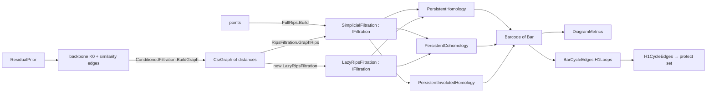

# Persistent Homology

> Standard persistence in ThermoMapper. It turns weighted graphs or point clouds into filtered simplicial complexes and computes their persistence barcodes over $\mathbb Z/2$ with three engines: standard reduction, cohomology with clearing, and involuted homology. It can attach cycle representatives and compare barcodes with Wasserstein-type distances. The module also provides the "conditioned persistence" builders and the combinatorial-topology helpers the engines rely on. · **Projects:** `TDA.Ph` (standard-persistence part), `Maths.Topology` · **Maturity:** core; `LazyRipsFiltration` is partial, `Z2LinearAlgebra` is oracle support, and `DiagramMetrics.Bottleneck` is a stub

## Overview

`TDA.Ph` sits in layer 5 of the [architecture](./Architecture.md). It depends on [`Graphs.Primitives`](./GraphSubstrate.md), on [`Graphs.Spectral`](./SpectralGraphs.md) for effective-resistance edge values, on `Maths.LinAlg`, and on `Maths.Topology` (documented here). It is used by:

- [SPRED](./Spred.md): barcodes and diagram distances as its objective;
- [graph construction](./GraphConstruction.md): H1 loop edges as a protect set;
- the [zigzag engines](./ZigzagPersistence.md), which share the `Bar`/`Barcode` output type; `FastZigzag` runs the standard engine on its coned filtration;
- [Mapper](./Mapper.md), for its nerve barcodes.

## Key concepts

- **Filtration.** A total order of simplices in which faces come before their cofaces and filtration values never decrease. Everything else is indexed by a simplex's position in this order (its **simplex index**): boundaries, cofacets, and the `Generator`, `Cycle` and `Cocycle` fields of a bar.
- **Graph-restricted Vietoris–Rips (flag) filtration.**
  - Vertices are born at 0.
  - An edge is born at its filtration value: under `FiltrationWeights.RawDistance` this is its CSR weight, which must be a **distance**, never a coupling; under `EffectiveResistanceWeights` it is the edge's effective resistance.
  - A triangle is born at the largest of its three edge values.
  - Only triangles of the input graph are used, and the complex stops at dimension 2.
- **Bar and barcode.** A bar is an interval from birth to death in homological dimension k; the standard engines leave `BirthEnd` and `DeathEnd` at their `Closed` defaults. `Death = +∞` marks an **essential** bar. `Barcode` is the output type that every engine returns, zigzag engines included.
- **Clearing.** H0 is computed with union–find over the edges sorted by value, following the elder rule: when two components merge, the older survives and the younger one's bar ends (see [Status](#status-and-caveats) for a deviation). Edges that merge components are H0 deaths and are never reduced in dimension 1. The same rule applies in each higher dimension to simplices that were pivots one dimension lower.
- **Conditioned persistence.** A **backbone prior** $K_0$, present from $\varepsilon_0$, is combined with **similarity edges** at their distances. An H1 bar then marks a similarity chord that closes a loop along the backbone. The code documents this as phases P0–P1 of a larger research program.

## Design

- **A seam between complexes and engines.** `IFiltration` exposes dimension, birth value, vertices, boundary and coboundary indices, and an `EmergentPairs` capability flag.
  - `PersistentHomology` and `PersistentCohomology` accept any `IFiltration`.
  - `PersistentInvolutedHomology` requires a concrete `SimplicialFiltration`, because it reconstructs cycles.
  - The implementations are `SimplicialFiltration`, `LazyRipsFiltration` and the zigzag module's `CellFiltration`.
- **A deterministic ordering contract.** Filtrations sort by (value, dimension, colex index). The result is a valid filtration and does not depend on input order, as long as colex indices are unique (see [Status](#status-and-caveats)).
- **Stateless engines.** The public engines are static functions. An internal `FiltrationCohomologyReducer` holds pivot and clearing state across dimensions for one run, and is shared by the cohomology and involuted engines.
- **Opt-in payloads.** A `representatives` flag controls whether cycle and "cocycle" arrays are attached. `Bar` carries every payload as a nullable field, so every engine returns the same type.
- **Strategy by record type.** `FiltrationWeights` is an abstract record with two subtypes, `RawDistanceWeights` (the singleton `FiltrationWeights.RawDistance`) and `EffectiveResistanceWeights(eigenpairs)`, dispatched by a type switch. A new edge-value source needs a new subtype *and* a change to both switch sites.
- **Composition over new code.**
  - `ConditionedFiltration` adds only its union rule and reuses graph Rips and the involuted engine.
  - `H1CycleEdges` chains graph Rips, the involuted engine and `BarCycleEdges`.

## API at a glance

| Area | Entry points |
|---|---|
| Filtrations | `RipsFiltration.GraphRips(graph, FiltrationWeights, maxDimension = 2, label)`; `FullRips.Build(points, maxDimension = 2, threshold = +∞)`; `new LazyRipsFiltration(graph, weights)`; `new SimplicialFiltration(simplices, label)`; `FlagComplex.Triangles(graph)`; `IFiltration` |
| Engines | `PersistentHomology.Compute(filtration, maxDimension, representatives)`; `PersistentCohomology.Compute(…, cutoff = 0, representatives)`; `PersistentInvolutedHomology.Compute(SimplicialFiltration, …, cutoff = 0, representatives)` |
| Output | `Bar(Birth, Death, Dimension, Generator?, Cocycle?, Cycle?, BirthEnd, DeathEnd)`, `Bar.Persistence`; `Barcode(bars, axisLabel)` |
| Distances | `DiagramMetrics.Wasserstein(a, b, dimension, p = 2, essential = default)`, `SlicedWasserstein(…, directions = 50)`, `SinkhornWasserstein(…, epsilon = 0.01, maxIters = 500)`; `Bottleneck(a, b, dimension, essential)` (not implemented); `DiagramMetrics.EssentialPolicy.InfiniteOnMismatch`, `DiagramMetrics.EssentialPolicy.FinitePenalty(perBar)`; `DiagramDistanceKind` |
| Cycles | `CycleReconstruction.ReconstructH1Cycle(filtration, birthEdgeIndex)`; `BarCycleEdges.GetEdgePairs`, `BarCycleEdges.H1Loops`; `H1CycleEdges.FromDistanceGraph(distanceGraph)` |
| Conditioned | `ConditionedFiltration.BuildGraph`, `ConditionedFiltration.ComputeBarcode`; `ResidualPrior.ResidualEdges`, `ResidualPrior.ReachSlices`; `ResidualSymmetry` |
| Topology helpers | `Maths.Topology.CombinatorialIndex` (`Index`, `Vertices`, `PackKey`, `Binomial`); `Maths.Topology.Simplex`; `Maths.Topology.Z2LinearAlgebra` (oracle support) |

## Algorithms

### Building filtrations

- **Colex index.** For a k-simplex with sorted vertices $v_0<\dots<v_k$, $\mathrm{idx}=\sum_{i=0}^k\binom{v_i}{i+1}$. The lookup key packs (dimension, idx) into 64 bits.
- **`SimplicialFiltration`.**
  1. Sort by (value, dimension, idx).
  2. Build a key → index map.
  3. Compute boundaries and reverse cofacet lists. A missing face surfaces here as a `KeyNotFoundException`.
  4. Validate that every face precedes its cofaces (`ArgumentException`). This check also catches non-monotone values.
- **`GraphRips`.** With `FiltrationWeights.RawDistance` it takes edge values from the CSR upper half and rejects negative values (NaN is not rejected); with `EffectiveResistanceWeights` the values come from `EffectiveResistance.BuildEdgeWeights`, which rejects NaN and negative resistances. With `maxDimension` ≥ 2 it adds triangles from `FlagComplex.Triangles`, which merge-walks sorted neighborhoods in $O\big(\sum_{(u,v)}(\deg u+\deg v)\big)$.
- **`FullRips.Build`.** Computes all $\binom n2$ Euclidean distances, keeps those at or below the threshold, and then calls `GraphRips`.
- **`LazyRipsFiltration`.** Same values and ordering, always the 2-skeleton, with triangles found per edge. Despite the name it builds every simplex up front. It also requires **sorted CSR rows** (see [Status](#status-and-caveats)).

### Engines

| Engine | Method | H0 | Cutoff | Representatives | Bar order |
|---|---|---|---|---|---|
| `PersistentHomology` (reference) | Standard $\mathbb Z/2$ column reduction, low = max | from the full reduction (standard elder rule) | none; zero-length pairs included | `Cycle` = reduced column $R_j$ on finite bars | finite bars of all dimensions interleaved in death order, then essential bars |
| `PersistentCohomology` (fast) | Coboundary reduction in descending column order with clearing | union–find | keep persistence ≥ cutoff (default 0) | `Cocycle` = reduced coboundary on bars of dimension ≥ 1 (see Status); H0 bars carry no `Generator` or payload | H0 first, then one dimension at a time |
| `PersistentInvolutedHomology` (Čufar–Virk) | Cohomology finds the death simplices; a boundary reduction restricted to those columns supplies homology cycles | union–find | as above; **use 0** | `Cycle` on finite and essential bars of dimension ≥ 1; H0 bars carry no `Generator` or payload | H0, then per dimension: finite bars, then essential bars |

**Standard reduction.** While an earlier column shares $\mathrm{low}(R_j)$, set $R_j\leftarrow R_j\oplus R_i$. A non-zero $R_j$ pairs $(\mathrm{low}(R_j),j)$, and every unpaired simplex becomes an essential bar. `maxDimension` filters only the output; the whole matrix is always reduced. The worst case is cubic in the number of simplices N, with a log factor from the set-based columns.

**Cohomology.**

- Columns are the d-simplices in *descending* index order.
- Each column starts from its cofacet set and pivots on its earliest cofacet (the anti-transpose convention).
- Pivots found while reducing the d-simplices are (d+1)-simplices; they become the cleared (skipped) columns of dimension d+1. For d = 1 the cleared columns come from the H0 union–find, so minimum-spanning-tree edges are never reduced.
- Pivots are registered whatever the cutoff, so the cutoff filters output only.
- Compared with Ripser, this engine precomputes cofacet lists instead of enumerating them implicitly, has no compressed reduction matrix, and applies no diameter threshold.

**Involuted homology.** Positive columns reduce to zero and never own a pivot. Reducing only the death columns therefore gives the same pairs as the full reduction, provided that *every* negative column is included. That is why the cutoff must stay at 0.

### Diagram distances

The finite bars of the requested dimension form $A$ (n bars) and $B$ (m bars); write $s=n+m$. Write $\|x-y\|_\infty=\max(|b_x-b_y|,|d_x-d_y|)$ and $\Delta(x)=(d_x-b_x)/2$ for the distance to the diagonal.

- **Exact $W_p$** (Kerber–Morozov–Nigmetov formulation). An $(n+m)$-square cost matrix pairs each point with points of the other diagram or with its own diagonal projection. Forbidden cells get a dominating sentinel. The assignment is solved by a Hungarian algorithm in $O(s^3)$.
- **Sliced $W_p$** (Carrière–Cuturi–Oudot). Uses L = 50 deterministic directions $\theta_l=\pi(l+\tfrac12)/L-\pi/2$. On each direction, the points and the other diagram's diagonal projections are projected, sorted and matched in order. Cost is $O(L\,s\log s)$.
- **Entropic $W_p$** (Sinkhorn). Log-domain iterations on the normalized cost matrix, with ε = 0.01 and at most 500 iterations. The transport cost is reported on the original scale. Non-convergence is not reported.
- **Essential bars** are matched separately, by birth, using a Hungarian solve on $|b-b'|^p$. When the counts differ:
  - `InfiniteOnMismatch` (the default) returns $+\infty$;
  - `FinitePenalty(ρ)` adds $\rho^p$ per surplus bar.
- `p` must be in $[1,\infty)$. `Bottleneck` ($p=\infty$) throws.

### Cycle representatives and the H1 protect set

- **`CycleReconstruction.ReconstructH1Cycle`** takes an essential H1 bar. It finds a shortest path, weighted by filtration value, between the birth edge's endpoints, using only edges with value up to that of the birth edge. It returns the birth edge together with that path.
  - When the birth edge's value is unique, the result is a representative in index order.
  - When several edges share that value, the path may use edges that come *later* in index order. The cycle is then a representative only at the level of filtration *values*.
- **`BarCycleEdges.H1Loops`** turns bar cycles into edge sets of `TDA.Ph.UndirectedEdge` pairs.
- **`H1CycleEdges.FromDistanceGraph`** is the *protect set* that [graph construction](./GraphConstruction.md) accepts as a `ProtectedEdgeSource`: it runs graph Rips → involuted engine → H1 loop edges. Local mutual-proximity rescaling then spares these load-bearing loop edges. With cutoff 0, zero-persistence H1 bars also contribute.

### Conditioned persistence

- **`ConditionedFiltration.BuildGraph`** sets each unordered pair's weight to the minimum of $\varepsilon_0$ (if the pair is a backbone edge) and its similarity distance. A backbone edge "wins" a coincident pair only when $\varepsilon_0\le d$.
- **`ConditionedFiltration.ComputeBarcode`** runs graph Rips and then involuted homology with representatives.
- **`ResidualPrior.ResidualEdges`** produces content edges as prediction residuals $r=\phi(|t_j-(t_i+\tau)|,|t_i-(t_j+\tau)|)$. The fold φ is the minimum by default, or the maximum or the mean. An optional reach bound $|\tau|\le\Delta$ applies.
- **`ReachSlices`** evaluates a grid of reach bounds in the order given.

The later phases the code describes (directed, gauge, sheaf and zigzag variants) are not implemented.

## Configuration

| Setting | Default | Meaning |
|---|---|---|
| Engine maxDimension / representatives / cutoff | `int.MaxValue` / false / 0 | Output filter for `PersistentHomology`; `PersistentCohomology` and `PersistentInvolutedHomology` also skip reducing dimensions above it; attach payloads; persistence floor |
| `GraphRips` maxDimension | 2 | ≥ 2 adds triangles; capped at 2 |
| `FullRips.Build` threshold | +∞ | Edge iff distance ≤ threshold |
| `EffectiveResistanceWeights.FromGraph` | tailEpsilon 1e-2, kMax 256, seed 0, `SolverKind.Auto` | Eigenpair budget. With the default seed 0, graphs with n ≥ 256 (where `Auto` picks the iterative solver) throw; pass a nonzero seed (see [SpectralGraphs](./SpectralGraphs.md#status-and-caveats)) |
| `DiagramMetrics` p / essential | 2.0 / `InfiniteOnMismatch` | — |
| `SlicedWasserstein` directions | 50 | — |
| `SinkhornWasserstein` epsilon / maxIters | 0.01 / 500 | Tolerance 1e-9 |
| `ConditionedFiltration` baseWeight / maxDimension | 0.0 / 2 | $\varepsilon_0$; skeleton dimension |
| `ResidualPrior` symmetry / reachBound | `Min` / +∞ | — |

**Truncation artifact.** On a 2-skeleton, any triangle left unpaired becomes an essential H2 bar when `maxDimension` is left at its default. `ConditionedFiltration.ComputeBarcode` always runs the involuted engine at that default, so its barcode contains these bars whenever its skeleton `maxDimension` is 2.

## Status and caveats

- **H0 elder rule is inverted in the union–find path.** The shared union–find computation used by the cohomology and involuted engines keeps the component with the *larger* birth. This makes no difference for Rips filtrations, where all vertices are born at 0. For general filtrations with distinct vertex births, their H0 bars disagree with `PersistentHomology`.
- **"Cocycle" payloads are reduced coboundaries.** The cohomology engine's `Cocycle` holds the reduced coboundary column, a set of (d+1)-simplices, or just $\{j\}$ for essential bars. It is not a d-cocycle.
- **Involuted engine with `cutoff > 0`.** Death columns that fail the cutoff are left out of the boundary reduction, so births and representatives can be wrong. Keep the default of 0. All callers in the repository do.
- **`LazyRipsFiltration` is partial.** It assumes sorted CSR rows, which `CsrGraph.FromEdges` does not produce. It takes no `maxDimension` (it always builds the 2-skeleton), and it builds every simplex up front despite the name. Prefer `RipsFiltration.GraphRips`.
- **Scale limits and inactive features.**
  - The 32-bit colex index overflows once a triangle's largest vertex id reaches 2345, which changes tie-break order but not correctness. Packed keys stay unique only for N ≤ 2954 vertices; beyond that, distinct triangles can share a key.
  - The emergent-pair shortcut is inactive, and enabling it would corrupt later reductions.
  - `Bottleneck` is not implemented.

## Source map

| Role | Files |
|---|---|
| Filtrations | `ThermoMapper/src/tda/ph/IFiltration.cs`, `SimplicialFiltration.cs`, `RipsFiltration.cs`, `LazyRipsFiltration.cs`, `FullRips.cs`, `FlagComplex.cs` |
| Engines | `PersistentHomology.cs`, `PersistentCohomology.cs`, `FiltrationCohomologyReducer.cs`, `PersistenceClearing.cs`, `PersistentInvolutedHomology.cs` |
| Output and distances | `Barcode.cs` (`Bar`, `Barcode`), `DiagramMetrics.cs` |
| Cycles | `CycleReconstruction.cs`, `BarCycleEdges.cs`, `H1CycleEdges.cs` |
| Conditioned persistence | `ConditionedFiltration.cs`, `ResidualPrior.cs` |
| Topology helpers | `ThermoMapper/src/maths/topology/CombinatorialIndex.cs`, `Simplex.cs`, `Z2LinearAlgebra.cs` |

**See also:** [ZigzagPersistence](./ZigzagPersistence.md) · [Spred](./Spred.md) · [GraphConstruction](./GraphConstruction.md) · [Concepts](./Concepts.md#barcodes)
