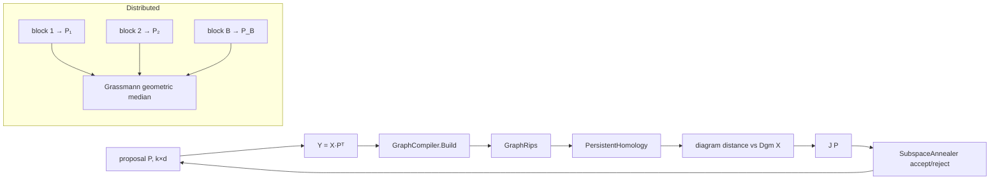

# SPRED

> SPRED (Yu & You, arXiv:2106.02096) is linear dimensionality reduction that tries to preserve persistent homology. It searches for a $k\times d$ projection whose image has a persistence barcode close to the data's own. A distributed variant solves the problem on row blocks and aggregates them by a geometric median on the Grassmannian. · **Project:** `TDA.DimReduction` · **Maturity:** core

## Overview

SPRED composes four modules and adds little machinery of its own:

| Role | Supplied by |
|---|---|
| Graph construction | [graph construction](./GraphConstruction.md) |
| Barcodes and diagram distances | [persistent homology](./PersistentHomology.md) |
| Stiefel/Grassmann annealing | [subspace annealer](./RiemannianGeometry.md#subspace-annealing-subspaceannealer) |
| Geometric median | [Riemannian IRLS](./RiemannianGeometry.md) |

`TDA.DimReduction` sits above `Maths.Geometry`, `TDA.Ph` and `Graphs.Proximity` (see [Architecture](./Architecture.md#workflows)).

## Key concepts

- **Projection frame.** P is $k\times d$ with orthonormal rows, and projected points are $y_i=Px_i$, without centering.
- **Objective.** For data $X\in\mathbb R^{n\times d}$:
  $$J(P)=\sum_{(h,w_h)}w_h\,\mathcal D_h\big(\mathrm{Dgm}_h(XP^\top),\mathrm{Dgm}_h(X)\big)\;+\;\rho\,\operatorname{tr}(P\Sigma_XP^\top),$$
  - $\mathcal D_h$ is a Wasserstein-type diagram distance of order p.
  - $\Sigma_X$ is the population covariance.
  - The variance term is present only if $\rho\neq0$. A negative ρ rewards retained variance.
- **Recompile per proposal.** The reference diagram $\mathrm{Dgm}(X)$ is built once. The projected cloud's graph, filtration and barcode are rebuilt from scratch for every evaluation.
- **Grassmann median.** For block solutions $Y_b$, the aggregate is
  $$\hat Y=\arg\min_{Y\in\mathrm{Gr}(k,d)}\sum_bd_{\mathrm{Gr}}(Y,Y_b).$$
  It depends only on the subspaces, not on the bases chosen for them, nor on the order of the blocks.

## Design

- **Declarative config and a pure engine.** `PersistenceObjectiveConfig` is an init-only record. Its documentation places any fluent builder at the command-line boundary. `PersistenceObjective` validates the config once at construction, so every entry point inherits the same guarantees.
  - `Evaluate` matches the annealer's `SubspaceObjectiveFunction` delegate and is passed as a method group.
- **The same pipeline on both sides.** The reference and projected barcodes use one recipe: `GraphMetric.FromFeatures` → `GraphCompiler.Build` → `RipsFiltration.GraphRips` → `PersistentHomology.Compute`.
  - An optional `ReferenceGraph` can give the ambient data its own graph recipe.
  - `ProjectedMetric` applies to *both* clouds, despite its name.
- **Pathologies become penalties.**
  - A `GraphPathologyException` makes the whole objective value `PathologyPenalty`.
  - A mismatch in the number of essential bars is charged a finite penalty: each surplus essential bar adds $(\mathrm{diam}/2)^p$ to the $p$-th-power matching sum (by default, with the data's Euclidean diameter).

  Both keep the annealer's landscape finite.
- **Reproducible parallelism.** Distributed SPRED derives each block's seed from one root seed with `SeedTree.Derive`. When a seed is given, each block's seed is fixed by its index, so a block's result does not depend on how the blocks are scheduled. With `seed = null`, every block draws OS entropy.

## API at a glance

| Entry point | Signature and notes |
|---|---|
| `Spred.Compute` | `(data, targetDim, objective, maxIters = 1000, seed = null, annealerOptions = null, cancellationToken)` → the k×d projection (k = `targetDim`). It checks cancellation, validates the annealer options, builds the objective and runs the annealer. It does not check `targetDim` itself: the annealer rejects k outside $[1,d]$, but only after the objective has built the reference barcode, so a bad k fails late. The objective validates the shape of the data. |
| `DistributedSpred.Compute` | `(data, targetDim, blockCount, objective, maxIters = 1000, seed = null, maxDegreeOfParallelism = 1, annealerOptions = null, cancellationToken)` → the aggregate projection. It validates non-empty rectangular data, $1\le$ `blockCount` $\le n$, $1\le$ `targetDim` $\le d$ and `maxDegreeOfParallelism` ≥ 1 before any block runs. |
| `DistributedSpred.ComputeWithDiagnostics` | Same inputs → `DistributedSpredResult(AmbientDimension, TargetDimension, Projection, FullDataObjective, Blocks)` with `BlockCount`; each block is a `DistributedSpredBlockResult(Index, Start, Count, Seed, Projection, LocalObjective, AggregateObjective)`, in partition order |
| `PersistenceObjective` | `(data, config)`; `.Evaluate(P)`; `.ReferenceBarcode` |
| `PersistenceObjectiveConfig` | See [Configuration](#configuration) |

## Algorithms

### Evaluating the objective

1. Form $Y=XP^\top$ (rows $y_i=Px_i$) in $O(nkd)$.
2. Build the graph, the Rips filtration and the barcode of Y.
3. When `MinPersistence` > 0, prune finite bars with persistence below it. The reference barcode was pruned the same way at construction. Essential bars are always kept.
4. For each configured homology dimension h, add $w_h\,\mathcal D_h$. The backend is the exact Hungarian Wasserstein distance, the sliced Wasserstein distance, or the entropic (Sinkhorn) distance, under the configured essential-bar policy. The exact normalization of the distance is defined by `DiagramMetrics`.
5. Add $\rho\sum_r\sum_{a,b}P_{ra}\Sigma_{ab}P_{rb}$ when $\rho\neq0$.

**Costs.**

- Construction: $O(n^2d)$ for the exact diameter (computed only when no essential policy is given), $O(nd^2)$ for the covariance when $\rho\ne0$, and one reference persistence run.
- Each evaluation: $O(nkd)$, plus one graph build, one filtration and one persistence run, plus one diagram distance per configured dimension.

**Validation at construction.**

- The data must be non-empty and not ragged.
- `MaxDimension` must be ≥ 1. `Dimensions` must contain at least one entry (a variance-only objective is rejected), and every configured $h$ must lie in $[0,\texttt{MaxDimension})$ with a finite positive weight.
- $p$ must be finite and ≥ 1.
- The distance-backend settings must be in range (see [Configuration](#configuration)).
- `MinPersistence` must be ≥ 0, and NaN is rejected.
- The pathology penalty must be finite and positive, and ρ must be finite.

### The search

`Spred.Compute` delegates the search to [`SubspaceAnnealer`](./RiemannianGeometry.md#subspace-annealing-subspaceannealer), which uses simulated annealing over k-frames. SPRED supplies the objective, the iteration budget and the seed. A null seed draws OS entropy, so pass a seed for reproducible runs.

### Distributed SPRED

1. **Split.** Block b holds rows $[\lfloor bn/B\rfloor,\lfloor(b+1)n/B\rfloor)$. Blocks are contiguous and non-overlapping, and their sizes differ by at most one. Rows are shared by reference, not copied.
2. **Seed.** Each block gets `SeedTree.Derive(seed, B)[b]`. With $B=1$, the call reduces to `Spred.Compute` with the base seed.
3. **Run.** Blocks run serially when `maxDegreeOfParallelism` or B is 1. Otherwise they run under `Parallel.For`.
   - Cancellation is checked around every phase.
   - With more than one block, a block failure other than cancellation is rethrown as an `InvalidOperationException` that names the block index and row count.
4. **Aggregate.** Each block projection becomes a $d\times k$ column-major Grassmann frame. `GeometricMedian.Compute` is warm-started at the medoid frame and run with unit weights and default IRLS options. The source motivates the medoid start by the Grassmann cut locus and by invariance to block order. The median is then converted back to k rows.
5. **Diagnostics.** `ComputeWithDiagnostics` reports, for each block, its own annealed objective (`LocalObjective`) and its objective evaluated at the aggregate (`AggregateObjective`). It also reports one run-level `FullDataObjective`: a fresh full-data objective evaluated at the aggregate, which rebuilds the full reference barcode and, when `Essential` is null, an $O(n^2d)$ diameter.

   With $B=1$, the local value is reused for all three.

## Configuration

| `PersistenceObjectiveConfig` member | Default | Meaning |
|---|---|---|
| `Graph` | required | Graph recipe for the projected cloud (and the reference, by default) |
| `ReferenceGraph` | null (= `Graph`) | Separate recipe for the ambient data |
| `Filtration` | `FiltrationWeights.RawDistance` | Rips edge values |
| `ProjectedMetric` | null (Euclidean) | Feature metric, applied to both clouds |
| `MaxDimension` | 2 | Simplex dimension of the Rips complex; matched h < MaxDimension |
| `Dimensions` | `[(0, 0.5), (1, 0.5)]` | $(h,w_h)$ terms |
| `WassersteinOrder` | 2.0 | p ≥ 1 |
| `DiagramDistance` | `Wasserstein` | `DiagramDistanceKind`: `Wasserstein` (exact Hungarian) / `SlicedWasserstein` / `SinkhornWasserstein` |
| `SlicedDirections` | 50 | ≥ 1 |
| `SinkhornEpsilon` / `SinkhornMaxIters` | 0.01 / 500 | Relative entropic scale (> 0) / iteration cap (≥ 1) |
| `Essential` | null → `FinitePenalty(diam/2)` | Essential-bar policy |
| `PathologyPenalty` | 1e6 | Value returned on a graph pathology |
| `VarianceRegularizer` | 0.0 | ρ |
| `MinPersistence` | 0.0 | Finite-bar pruning threshold |

Entry-point defaults: `maxIters = 1000`, `seed = null` (OS entropy), `maxDegreeOfParallelism = 1` (serial).

## Status and caveats

- **Diameter uses a different metric.** The default essential penalty always uses the Euclidean diameter, even when `ProjectedMetric` sets a different feature metric.
- **Integer overflow at very large scale.** The block boundary $bn$ is computed in 32-bit arithmetic, so it overflows once $n\cdot B>2^{31}$.
- **Concurrent evaluation.** Whether `Evaluate` is safe to call concurrently depends on the graph and persistence code. The distributed path avoids the question by giving each block its own objective and annealer.

## Source map

| Role | Files (`ThermoMapper/src/tda/dim-reduction/`) |
|---|---|
| Facade | `Spred.cs` |
| Objective | `PersistenceObjective.cs`, `PersistenceObjectiveConfig.cs` |
| Distributed runner and result records | `DistributedSpred.cs` |

**See also:** [Mapper](./Mapper.md) · [PersistentHomology](./PersistentHomology.md) · [RiemannianGeometry](./RiemannianGeometry.md) · [DesignPrinciples](./DesignPrinciples.md#6-reproducible-randomness)
