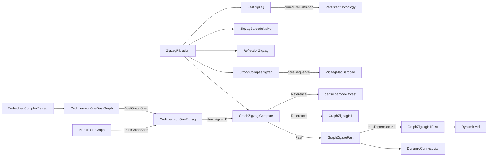

# Zigzag Persistence

> Persistence for sequences in which cells are both added *and* removed. ThermoMapper computes zigzag barcodes in two ways:
>
> - **general engines** for any cell complex, cross-checked by independent oracles;
> - **specialized engines** for graphs (H0, H1) and for codimension-one homology of embedded complexes via Alexander duality. These are backed by dynamic-connectivity data structures.
>
> **Project:** `TDA.Ph` (zigzag part, including the internal `TDA.Ph.Dynamic` namespace).
>
> **Maturity:**
>
> - Core: `FastZigzag`, the graph engines and the dual-graph builders.
> - Reference/oracle: `ZigzagBarcodeNaive`, `ZigzagMapBarcode`, `StrongCollapse`, `StrongCollapseZigzag`.
> - Partial: `ReflectionZigzag`.
> - Internal and not yet wired in: `RuVineyard`.
> - Unused scaffolding: `IAbstractCell`, `SimplicialCell`.

## Overview

A standard filtration only grows. A zigzag filtration may also shrink, as in a sliding window over a time series, a graph whose edges appear and disappear, or a complex that is built and then torn down. The input is a sequence of single-cell additions and deletions. The output is a barcode of intervals in *step* coordinates, where each end is marked as open or closed.

The zigzag code sits beside standard persistence in `TDA.Ph` (layer 5 of the [architecture](./Architecture.md)). It shares that module's output types, `Bar` and `Barcode` (see [Persistent Homology](./PersistentHomology.md)), and `FastZigzag` delegates the actual reduction to the standard engine.

The general engines `FastZigzag`, `ReflectionZigzag` and `StrongCollapseZigzag` are exercised only by tests.

## Key concepts

- **Zigzag filtration.** $K_0=\emptyset$ and $K_{s+1}=K_s\pm\sigma_s$ for steps $s=0,\dots,m-1$. Step $s$ is a forward arrow $K_s\hookrightarrow K_{s+1}$ (Add) or a backward arrow $K_s\hookleftarrow K_{s+1}$ (Delete).
- **Global cell ids.** Every cell has an integer id. An Add step lists its boundary as the **global ids** of its faces, not as positions.
  - An id may be deleted and added again. Each continuous presence of a cell is an **incarnation**.
  - A cell's dimension is **inferred**: 0 for an empty boundary, otherwise one more than the dimension of its first face.
- **Level interval.** A homology class alive in $K_b,\dots,K_d$ has level interval $[b,d]$.
- **Bar in step coordinates.** The level interval $[b,d]$ is reported as `Bar(Birth = b−1, Death = d)`: the step that created the class and the step that killed it.
  - A class still alive at the end is a **survivor**. It gets the finite `Death = m` with an open end and is *not* an infinite bar.
  - Birth and Death are step indices stored as `double`.
- **End types.** `IntervalEnd` is `Closed` or `Open`. The four combinations follow from which arrow created and which arrow killed the class:

  | Created by | Killed by | Birth end | Death end |
  |---|---|---|---|
  | Add (a new cycle appears) | Add (the cycle becomes a boundary) | Closed | Open |
  | Add | Delete (a cell of the cycle disappears) | Closed | Closed |
  | Delete (a boundary is released, e.g. a component splits) | Add | Open | Open |
  | Delete | Delete | Open | Closed |

  For graph H0 this means that an entrance has a closed birth, a split an open birth, a merge an open death, and a departure a closed death.
- **Alexander duality.** For a complex embedded in $\mathbb R^p$, $H_{p-1}$ of the complex corresponds to $\tilde H_0$ of a dual graph whose vertices are p-cells and voids. This reduces codimension-one zigzags to graph H0.

## Design

**A portfolio of engines and oracles.** Every fast path has an independent slow path to test it against. The graph engines' source comments name `FastZigzag` and `ZigzagBarcodeNaive` as their oracles, so `FastZigzag` is both the general engine and a cross-check.

| Component | Scope | Method | Role |
|---|---|---|---|
| `FastZigzag` | any cell complex, all dimensions | cone the zigzag, then one standard persistence run | general engine |
| `ZigzagBarcodeNaive` | any complex | homology bases, induced maps, generalized rank | ground-truth oracle |
| `ZigzagMapBarcode` | sequences of complexes joined by cell maps | naive oracle machinery with pushed-forward cycles | oracle |
| `StrongCollapse`, `StrongCollapseZigzag` | simplicial zigzags | collapse each complex to its core, then evaluate with the map oracle | reference implementation |
| `ReflectionZigzag` | forward arrows and deletion of the most recent cell only | streaming reduction with undo | partial third oracle |
| `GraphZigzag` Reference / `GraphZigzagH1` | graphs; H0 / H1 | dense barcode forest / Kruskal per edge step | slow-correct reference |
| `GraphZigzagFast` / `GraphZigzagH1Fast` | graphs; H0 / H1 | sparse forest + HDT / dynamic MSF | fast engines |
| `CodimensionOneZigzag`, `EmbeddedComplexZigzag` | complexes embedded in $\mathbb R^p$; $H_{p-1}$ | dual graph + graph H0 | specialized engine |

**Composition over new machinery.**

- `FastZigzag` builds a `CellFiltration` and hands it to `PersistentHomology`.
- `CodimensionOneZigzag` builds a dual zigzag and hands it to `GraphZigzag`.
- `StrongCollapseZigzag` hands its core sequence to `ZigzagMapBarcode`, which reuses the naive oracle's basis, induced-map and decomposition routines with a different map.

**Reference/Fast selection by enum.** `GraphZigzagAlgorithm { Reference, Fast }` selects the H0/H1 implementation; the graph front door defaults to `Fast`, the codimension-one engines to `Reference`.

**Stateless engines, mutable builders.**

- All engines are static functions with local state, so separate calls are re-entrant.
- `ZigzagFiltration` is an append-only builder. It is mutable, but no engine mutates it.
- Several types keep references to caller arrays without copying them: `ZigzagStep` stores the caller's boundary array, `CellFiltration` returns it, and `DualGraphSpec` holds the caller's collections behind get-only properties.
- The dynamic structures are mutable and single-threaded. Even link-cut-tree queries restructure the tree.

**Determinism.**

- Euler-tour-tree treap priorities come from a per-instance SplitMix64 stream that starts at state 0.
- Dual-graph vertex ids are allocated in a fixed order.
- One caveat: `StrongCollapse` deletes the first dominated vertex in first-appearance order, so the core's vertex labels depend on the order in which simplices are supplied (repeatably for a fixed input). The core is unique only up to isomorphism.

**Internal data structures.** The dynamic structures in `TDA.Ph.Dynamic` are internal and serve only the fast graph engines.

## API at a glance

| Area | Entry points |
|---|---|
| Data model | `ZigzagFiltration` (constructors `()` and `(IEnumerable<ZigzagStep>)`; `Add(ZigzagStep)`, `Add(int globalCellId, int[] boundaryAtAdd)`, `Delete(int globalCellId)`, indexer, `Count`); `ZigzagStep(GlobalCellId, Direction, BoundaryAtAdd)`; `ZigzagDirection { Add, Delete }`; `IntervalEnd { Closed, Open }` |
| General engines | `FastZigzag.Compute(f, maxDimension = int.MaxValue, representatives = false)`; `ReflectionZigzag.Compute(f, maxDimension)` |
| Oracles | `ZigzagBarcodeNaive.Compute(f, maxDimension)`; `ZigzagMapBarcode.Compute(complexes, dimOf, bndOf, N, steps, maxDimension)`, `ZigzagMapBarcode.ComputeFromZigzag(f, maxDimension)`, `ZigzagMapBarcode.Step(IsForward, CellMap)`; `StrongCollapse.Core`, `StrongCollapse.CoreWithRetraction`; `StrongCollapseZigzag.Compute(f, maxDimension)` |
| Graph engines | `GraphZigzag.Compute(f, maxDimension = 0, representatives = false, strictRepresentatives = false, algorithm = Fast)`; `GraphZigzagFast.Compute(…)`; `GraphZigzagH1.Compute(f, representatives)`; `GraphZigzagH1Fast.Compute(f, representatives)`; `GraphZigzagAlgorithm` |
| Codimension one | `DualGraphSpec(p, voidDualVertexIds, pSimplexDualVertex, pMinus1SimplexDualEdge)`; `PlanarDualGraph.Build(vertexCoords, edges, triangleVertices, firstDualVertexId = 0)`; `CodimensionOneDualGraph.Build(p, vertexCoords, pMinus1Simplices, pSimplices, firstDualVertexId = 0)`; `CodimensionOneZigzag.Compute(f, dual, algorithm = Reference)`; `EmbeddedComplexZigzag.Compute(p, vertexCoords, pMinus1Simplices, pSimplices, f, algorithm = Reference)` |
| Support | `CellFiltration` (an `IFiltration` over explicit boundaries); internal `RuVineyard`; unused `IAbstractCell`, `SimplicialCell.GetBoundaryIndices` |

Axis labels differ by engine (`"FastZigzag"`, `"Zigzag Step"`, `"ReflectionZigzag"`, `"ZigzagMap"`), so do not use them to identify the producer.

## Algorithms

### FastZigzag: coning to standard persistence

Following Dey–Hou (arXiv:2204.11080), `FastZigzag` answers the whole zigzag with **one** standard persistence run.

1. **Replay.** Walk the steps. Each Add creates a new incarnation, and its boundary is translated into the currently present incarnations of its faces. Each Delete records the deletion step of the current incarnation.
2. **Padding.** Incarnations that survive to the end get artificial deletions at steps $m, m+1, \dots$, in decreasing dimension so that cofaces go before faces. Every incarnation now has exactly one deletion.
3. **Coned filtration $\hat E$.** It is built from these columns:
   - column 0 is the apex ω;
   - then the A add columns, in incarnation order;
   - then one cone column per deletion, in **reverse** deletion order, with
     $$\partial(\omega\cdot v)=\{v,\omega\}\ (\dim v=0),\qquad \partial(\omega\cdot\sigma)=\{\sigma\}\cup\{\omega\cdot\tau:\tau\in\partial\sigma\}.$$

   In a valid zigzag a coface is deleted before its faces, so reversing the order puts each face's cone before its coface's cone. Column births are the column indices, which are all distinct, so $|\hat E|=2A+1$ and no zero-length pair is lost.
4. **Standard persistence.** Run `PersistentHomology.Compute` on a `CellFiltration` of $\hat E$ with `maxDimension + 1`, because coning raises dimension by one. The zigzag post-filter is still needed, because a pair whose pivot has dimension q yields a zigzag bar of dimension q or q−1.
5. **Mapping back.** Each finite pair's earlier event is the creator and its later event is the destroyer.
   - **Dimension:** $\dim$ of the creator if it is an Add, otherwise $\dim-1$.
   - **Birth end:** closed iff the creator is an Add.
   - **Death end:** closed iff the destroyer is a Delete.
   - **Padding:** a pair whose creator lies in the padding is discarded. A pair whose destroyer lies in the padding is a survivor, with `Death = m` and an open end.

**Why coning works.** $\hat E$ is a cone over every incarnation, including the padded survivors, so it is contractible. The only essential class is ω's, and every zigzag bar therefore comes from a *finite* standard pair. This is why padding is required. It also makes two of the code's guards, for ω and for a negative dimension, purely defensive: they cannot trigger on valid input.

**Representatives.** With `representatives = true`, bars created by an Add get `Cycle` set to the standard engine's reduced column mapped back to original cell ids, with cone columns and ω removed. Bars created by a Delete get `Cycle = null`.

- For $H_0$, a representative contains only cells present at the birth step, with distinct ids.
- For $p\ge1$, it has not been verified whether a representative can include incarnations deleted before the birth step.

**Cost.** Replay and construction take $O(m+U+\sum|\partial\sigma|)$, where $U$ is the size of the cell-id universe; the S padded survivors add a sort, $O(S\log S)$. The standard run then takes worst case $O(n^3\log n)$ on $n=2A+1$ columns.

### The naive oracle: generalized rank

`ZigzagBarcodeNaive` is the ground truth. It is dense and slow, and it computes directly from the definition.

1. **Materialize.** Keep a separate cell set for each $K_0,\dots,K_m$.
2. **Homology bases.** For each complex and dimension p:
   - compute cycles $Z=\ker\partial_p$ over $\mathbb Z/2$ (every vertex, for p = 0);
   - take boundaries B, the columns of $\partial_{p+1}$;
   - keep each $z\in Z$ that is nonzero modulo $\operatorname{span}(B\cup\text{kept})$.

   The result is a set of genuine cycles that represent a basis of $H_p$.
3. **Induced maps.** For each arrow, express every source representative v in the target basis by solving $[\,T\mid B_t\,]x=v$ with Gauss–Jordan elimination, and keep the T-coefficients. This is well defined because T is independent modulo $B_t$. Consistency of the system is assumed, not checked.
4. **Generalized rank.** For a window $[b,d]$, let $D=\bigoplus_{k=b}^dV_k$. The *limit* L is the set of tuples that satisfy one equation per arrow:
   - forward arrow: $M_kv_k+v_{k+1}=0$;
   - backward arrow: $M_kv_{k+1}+v_k=0$.

   The *colimit relations* R are $e_j+M_ke_j$. Then
   $$\operatorname{rk}(b,d)=\operatorname{rank}\begin{bmatrix}\pi_bL\\R\end{bmatrix}-\operatorname{rank}R .$$
5. **Möbius inversion.**
   $$\mu(b,d)=\operatorname{rk}(b,d)-\operatorname{rk}(b-1,d)-\operatorname{rk}(b,d+1)+\operatorname{rk}(b-1,d+1),$$
   with terms outside the table taken as 0. μ copies of `Bar(b−1, d, p)` are emitted.
   - BirthEnd is closed iff step $b-1$ is forward.
   - DeathEnd is closed iff $d<m$ and step d is backward.

**Cost.** With $\beta=\max_i\dim V_i$, the $O(m^2)$ generalized ranks dominate at $O(m^5\beta^3)$ per dimension. Computing the homology bases costs $O(|Z|(|B|+|Z|)^2N)$ per complex and dimension, because each candidate re-echelonizes the growing span. Vectors are byte-dense `bool[]` arrays over the whole id universe N, so sparse ids with a large maximum inflate every elimination.

### Cell maps and strong collapses

**`ZigzagMapBarcode`** generalizes the oracle from inclusions to sequences of complexes joined by **cell-to-cell maps**.

- Each step carries a `CellMap` array that sends a source cell to one target cell, or to 0 via the sentinel −1. This is the kind of map a simplicial map induces. A map that sends a cell to a *sum* of cells cannot be represented.
- Cycles are pushed forward by XOR over $\mathbb Z/2$ and then solved in the target basis. The maps are assumed to be chain maps, and this is not checked.
- `ComputeFromZigzag` rebuilds a zigzag with identity maps (an isolation test).
- The documented requirement `complexes.Count == steps.Count + 1` is not checked.

**`StrongCollapse`** (Boissonnat–Pritam) removes dominated vertices.

- A vertex v is **dominated** iff $\big(\bigcap_{\sigma\ni v}\sigma\big)\setminus\{v\}\neq\emptyset$, where σ ranges over the maximal simplices that contain v. Its dominator is the smallest vertex in that set.
- The method repeatedly deletes the first dominated vertex it finds and re-maximalizes, until none remain.
- `CoreWithRetraction` also returns the retraction, which follows dominator links to the core.
- The input may be any generating list of simplices; it is maximalized and deduplicated first.
- Each of up to $|V|$ deletions rescans the vertices against all $|M|$ maximal simplices (at most $s$ vertices each) and re-maximalizes, so the cost is $O(|V|^2|M|s+|V||M|^2s)$. The faster nerve-based algorithm is not implemented.

**`StrongCollapseZigzag`** implements the core-assembly theorem the source cites: replacing each $K_j$ by its core $K^c_j$ and each arrow by $f^c_j=r_{j+1}\circ f_j\circ i_j$ leaves the barcode unchanged. It works in four steps.

1. Recover vertex sets. This works for simplicial zigzags only.
2. Collapse each complex.
3. Intern every face of every core simplex.
4. Build the cell maps. A cell whose image loses a vertex maps to 0.

It evaluates through the map oracle, so it is a reference implementation of the theorem, not a fast engine. Face enumeration uses a 32-bit `1 << n`, so a simplex with 31 or more vertices silently gets a wrong face set (none at 31–32 vertices).

### Reflection zigzag and the vineyard (partial)

**`ReflectionZigzag`** is intended to become the Maria–Oudot "reflections and transpositions" algorithm. What exists is a streaming $\mathbb Z/2$ reduction:

- **Add.** The new column is reduced against the pivot table.
  - An empty result opens a class with a closed birth.
  - A pivot p closes p's class with an open death.
- **Delete.** Only the most recently added cell can be deleted; any other deletion throws `NotSupportedException`.
  - An unpaired cell's class dies with a closed end.
  - A paired cell releases its pivot, and that class is reborn with an open birth.

This covers stack-like build-then-teardown zigzags. Arbitrary deletion and full churn are not implemented. Survivors are emitted with the finite `Death = m` and an open end. That is the convention the cross-checks rely on, even though the code comment says "infinite bars".

**`RuVineyard`** is an internal port of GUDHI's RU vine-swap (Cohen-Steiner–Edelsbrunner–Morozov vineyards), with an attribution line but no license text. It stores R's columns and, in `_u[k]`, **row k of $V^{-1}$**. `VineSwap(i)` does a plain swap when the dimensions differ or $(V^{-1})_{i,i+1}=0$, except for two positive cells of the same dimension. Otherwise it follows the four standard vineyard cases. It is meant to enable arbitrary deletion in `ReflectionZigzag`, but no engine uses it yet.

### Graph H0: the barcode forest

The graph engines take a zigzag of vertices (empty boundary) and edges (boundary `[u, w]` of vertex ids). They track components in a **barcode forest** in which every node has a *level*, and levels strictly decrease toward the root.

| Event | Forest action | Interval emitted |
|---|---|---|
| Vertex entrance at step s | new root at level s+1 | none |
| Edge add joining two trees (roots $r_1,r_2$) | glue the two paths; the younger root is absorbed (elder rule) | $[\max(\ell(r_1),\ell(r_2)),\,s]$ |
| Edge add closing a split within one tree | glue down to the highest common ancestor v and retire its split | $[\ell(v)+1,\,s]$ |
| Edge delete that disconnects | the current leaf becomes a *splitting* node with two children | none (a class is born, open) |
| Vertex departure (isolated) | walk up to the first active splitting ancestor x; if there is none, the root dies | $[\ell(x)+1,\,s]$, or $[\ell(\text{root}),\,s]$ |
| End of input | each live root and active split closes | $[\ell,\,m]$, $[\ell+1,\,m]$ |

**Reference (`GraphZigzag`, Algorithm 1).**

- Keeps the forest **dense**: before each step, every uninvolved component gets a new node at the next level. Gluing can therefore always find an ancestor at any level.
- Parallel edges are counted by multiplicity. Connectivity after an edge deletion is a DFS.
- **Cost, worst case:** $O(m(n+E))$ for copy-up, relabelling and DFS, plus $O(\ell^2 g)$ gluing per merge, where ℓ is the glued span and g the uncompressed glue-chain length. Space is $O(m\cdot n)$ nodes.

**Fast (`GraphZigzagFast`).**

- Uses the same events and interval rules. It pre-maps vertices to dense ids and keeps connectivity in a `DynamicConnectivity` (HDT) structure. Only the first parallel copy of an edge and its last deletion reach the HDT.
- The forest is **sparse**, with O(m) nodes. A merge *zips* the two root-ward paths into one chain ordered by level and marks a closed split `Paired` instead of rewriting it.
- **Cost.** The source says "near-linear". HDT updates are $O(\log^2 n)$ amortized, but the forest walks are O(depth), and depth can grow to Θ(m). The honest worst case is $O(m\log^2 n + m\cdot\text{depth})=O(m^2)$.

**Representatives.** With `representatives = true`, each birth level keeps a 0-chain:

- $\{v\}$ for an entrance;
- for a split, either the smallest vertex id on each side (Reference) or the endpoints of the deleted edge (Fast). Both chains span the same class, but they are different chains.

A chain is emitted only if all its vertices are present throughout the bar. Otherwise `Cycle` is null, or `strictRepresentatives` makes the engine throw. Vertex presence is tracked as a *single* interval per id (see [Status](#status-and-caveats)).

### Graph H1: minimax pairing

An edge's **weight** is the step of its most recent addition, so each present edge has been continuously present since its weight.

- **Birth.** Adding an edge whose endpoints are already connected (self-loops included) is a birth at level $j=s+1$, and j joins the unpaired set U.
- **Death.** Deleting σ = (u, v) at step s:
  - If the deletion disconnects u from v, σ was a bridge and H1 does not change.
  - Otherwise, with $G_{s+1}$ the graph after the deletion,
    $$w^*=\min_{P:\,u\leadsto v\subseteq G_{s+1}}\ \max_{e\in P}w(e),\qquad j^*=\min\{\,j\in U:\ j>\max(w^*,w(\sigma))\,\},$$
    and the level interval $[j^*,s]$ is emitted. Birth $j^*$ is the oldest unpaired cycle that certainly survives until σ goes.
- Unpaired births close at m with an open end.

The two engines differ in how they find $w^*$ and in how representatives work:

- **Reference (`GraphZigzagH1`).** $w^*$ is the maximum on the u–v path of a minimum spanning forest. It is recomputed by Kruskal on every edge addition (the birth test) and deletion (union–find with path splitting and arbitrary union), for $O(m\cdot E\log E)$ in total; with representatives, each birth runs one more Kruskal. With `representatives = true`, each birth stores the cycle {new edge} △ MSF path. A death then pairs with the smallest unpaired j whose cycle contains σ, and every other cycle containing σ is updated by symmetric difference. The source cites Dey–Hou Prop 17 for this rule and Props 19–21 for the threshold rule and treats them as interchangeable; the equivalence is not checked in code.
- **Fast (`GraphZigzagH1Fast`).** $w^*$ comes from `DynamicMsf.PathMax` in $O(\log n)$ amortized. Representatives are read from the path's edge weights, which works because weights are unique add steps. Choosing $j^*$ scans U, and a tree-edge deletion in the MSF scans the non-tree edges incident to the smaller side. The worst case is $O(m(|U|+k\log n))$, not near-linear. With `representatives = true` it switches to the same cycle-containment pairing and does not consult `PathMax`.

### Dynamic connectivity structures

| Structure | Representation | Cost |
|---|---|---|
| `EulerTourTree` | one implicit treap per tree over its Euler tour; one vertex node per vertex, two arc nodes per tree edge; subtree aggregates for size and mark counts | `Link`/`Cut`/`Reroot` $O(\log N)$ expected; marked-element search by descent |
| `DynamicConnectivity` (Holm–de Lichtenberg–Thorup) | $\lceil\log_2 n\rceil+2$ levels (at least 3), each an ETT of the tree edges at that level or above, plus level-i non-tree adjacency; vertices marked when they hold level-i non-tree edges | $O(\log^2 n)$ amortized updates (expected, via treap priorities); `Connected` $O(\log n)$ expected |
| `LinkCutTree` | splay-based; each edge is its own node carrying its weight, so the path maximum is a subtree aggregate; lazy reversal for rerooting | $O(\log n)$ amortized; queries splay, so they mutate the tree |
| `DynamicMsf` | the forest held twice, in an ETT (connectivity, sizes, marks) and an LCT (path max); non-tree edges in per-vertex dictionaries; tree edges indexed by weight, so weights must be distinct | `Insert` $O(\log n)$; tree-edge `Delete` $O((1+k)\log n)$, with k the non-tree edges incident to the smaller side |

**HDT replacement.** After a tree-edge deletion, each level from the edge's own down to 0 is searched on the smaller side. Its tree edges are pushed up a level, and its non-tree edges are scanned until one reaches the other side; scanned internal edges are promoted. `DynamicMsf` has no level scheme. It restores the forest by taking the minimum-weight crossing edge (the cut property), so its deletion cost is not polylogarithmic in the worst case. With zigzag weights, which only increase, its cycle-swap branch on insertion never fires.

### Codimension-one persistence by Alexander duality

For a zigzag of a complex embedded in $\mathbb R^p$, restricted to dimensions p−1 and p, Dey–Hou §5 gives
$$\mathrm{Pers}\big(H_{p-1}(\mathcal F)\big)=\mathrm{Pers}\big(\tilde H_0(\mathcal E)\big),$$
where $\mathcal E$ is a zigzag on the **dual graph**:

- its vertices are the p-simplices and the *voids* (components of the complement);
- its edges are the (p−1)-simplices, each joining the two cells on its sides.

**Building the dual graph.**

- **`PlanarDualGraph.Build` (p = 2).**
  1. Sort the half-edges counter-clockwise around each vertex and trace the faces by next-pointers.
  2. A face is *filled* iff its signed area is positive, it has three half-edges and it matches a supplied triangle. Every other face, including the unbounded one, becomes a void.
  3. A dangling edge becomes a self-loop.

  Preconditions: a connected 1-skeleton and general position. A triangle that matches no face silently gets no dual vertex.
- **`CodimensionOneDualGraph.Build` (p ≥ 2).** For each (p−2)-face σ:
  1. Build the 2-plane transverse to σ by Gram–Schmidt.
  2. Order the incident (p−1)-simplices τ by angle in that plane.
  3. Identify which angular gaps are filled by p-simplices, using the bisector of each p-simplex's two facets through σ.
  4. For every unfilled gap, read which side of each bounding τ faces the void from the sign of a determinant in **global** coordinates, so that a physical side gets the same id from every σ. Those sides are unioned into void classes.

  A (p−1)-simplex with no p-coface whose two sides face the same void is dropped: it gets no dual edge, and its F steps become barcode-neutral no-ops (`PlanarDualGraph` keeps such self-loops). Dual ids are allocated deterministically: p-simplex duals first, then voids.

**Running the dual zigzag (`CodimensionOneZigzag`).**

1. Build E: a prefix that adds the whole dual graph, then every F step *reversed*, then a suffix that tears everything down. An F-Add of a p-simplex becomes an E-Delete of its dual vertex, and so on.
2. Run graph H0, with `Reference` as the default.
3. Keep only the bars born inside the real section, which drops the spanning component and the build-up. Map their steps back to F.
4. Set the dimension to p−1, **swap both end types**, because the arrows were reversed, and set `Cycle = null`.

**`EmbeddedComplexZigzag`** (Algorithm 3) is the coordinates-in front door.

1. Split the (p−1)-simplices into pieces that share (p−2)-faces, using union–find over sorted string keys at $O(M\log M+Mp^2)$.
2. Assign each p-simplex to the piece of its first supplied facet.
3. Build each piece's dual graph with disjoint id ranges, run the codimension-one engine on the **full** F for every piece, and concatenate the results (Prop 28).

Each piece scans the whole filtration.

### Input contracts and failure modes

- **Step validity.**
  - `ZigzagStep` checks only that an Add carries a boundary and a Delete does not.
  - Nothing checks that faces are present, that a deleted cell is present, or that cofaces are deleted before faces.
  - On invalid input, engines differ: the naive oracle ignores the deletion of an absent cell, while `FastZigzag` throws.
- **Cell-id identity.** The oracles and `StrongCollapseZigzag` store one boundary per id, the last one added. `FastZigzag` resolves boundaries per incarnation. Boundaries are read as *sets*, so a duplicated face collapses instead of cancelling. A positive-dimensional cell with an empty boundary is read as a vertex.
- **End state.** "Starts and ends empty" is documented but not enforced; survivors end at `Death = m`, open.
- **Graph engines.** The H0 engines assume a 1-complex: a higher cell's boundary is read as vertex ids and throws. The H1 engines skip non-edges. A departing vertex must be isolated. This is not checked, and a violation silently corrupts state.
- **Dual graphs.**
  - `DualGraphSpec` requires void ids and p-simplex dual ids to be disjoint. This is documented but not checked.
  - `CodimensionOneDualGraph.Build` throws on p < 2, on wrong vertex counts and on a (p−1)-simplex with more than two cofaces.
  - Both facets through σ of every p-simplex must be supplied, or the lookup throws `KeyNotFoundException`.
  - `Eps = 1e-9` is **absolute**, so the degeneracy checks depend on coordinate scale. Equal transverse angles are caught only indirectly, when the zero-width gap's probe trips the determinant guard, and rounding can defeat this at large scales.
  - `CodimensionOneZigzag` requires F to run ∅ → ∅ in dimensions {p−1, p} with faces before cofaces. Only a re-entering dual edge whose endpoint is missing is guarded.
- **Bar order.** Graph engines emit bars in event order, and the end pass iterates a hash set. Compare barcodes as multisets.

## Configuration

| Setting | Default | Meaning |
|---|---|---|
| `FastZigzag`, `ReflectionZigzag` `maxDimension` | `int.MaxValue` | All dimensions |
| `ZigzagBarcodeNaive`, `ZigzagMapBarcode`, `StrongCollapseZigzag` `maxDimension` | `int.MaxValue` | **Must be set explicitly** (see Status) |
| `FastZigzag` `representatives` | `false` | Cycles for Add-created bars |
| `GraphZigzag.Compute` maxDimension / representatives / strictRepresentatives / algorithm | 0 / false / false / `Fast` | H0 only (≥ 1 adds H1); attach chains; throw instead of null; engine |
| `GraphZigzagH1*` `representatives` | `false` | Also switches both H1 engines from the threshold rule to cycle-containment pairing |
| `CodimensionOneZigzag`, `EmbeddedComplexZigzag` `algorithm` | `Reference` | Inner H0 engine |
| `PlanarDualGraph` / `CodimensionOneDualGraph` `firstDualVertexId` | 0 | Base of the dual id range |
| `CodimensionOneDualGraph` `Eps` (private constant) | 1e-9 (absolute) | Rank and determinant threshold; not configurable |
| `ZigzagMapBarcode.Step.CellMap` entry −1 | sentinel | Cell maps to 0 |
| `CellFiltration` `label` | `"CellFiltration"` (`FastZigzag` passes `"FastZigzag-coned"`) | Axis label of a standard run over it; `EmergentPairs` is fixed at `false` |

## Status and caveats

- **The naive and map oracles loop forever at the default `maxDimension`.** `ZigzagBarcodeNaive`, `ZigzagMapBarcode` and `StrongCollapseZigzag` loop `p = 0..maxDimension` with no early exit. Each idle iteration still costs $O(m^3+mc)$, with $c$ the largest complex size, and at `int.MaxValue` the unchecked `p++` wraps around, so the loop never terminates. Always pass an explicit dimension. `FastZigzag` and `ReflectionZigzag` treat the default as "all dimensions".
- **Parallel edges in the fast H1 engine.** `DynamicMsf` keys edges by unordered vertex pair. Two live parallel edges, or two live self-loops at one vertex, collide, and the second deletion fails on a missing key. The H0 engines and the reference H1 engine handle multigraphs correctly.
- **H0 representatives assume a single presence per vertex.** Vertex presence is recorded as one interval per id. With `representatives = true`, a vertex that departs twice throws `ArgumentException`. After a re-entry, valid representatives can be nulled, or rejected under `strictRepresentatives`.
- **Higher-dimensional `FastZigzag` representatives** have not been verified to lie in the birth complex (see [above](#fastzigzag-coning-to-standard-persistence)).
- **Partial pieces.** `ReflectionZigzag` supports only last-in-first-out deletion. `RuVineyard` is not yet used by any engine. `IAbstractCell` and `SimplicialCell.GetBoundaryIndices` have no implementors or callers.

## Source map

| Role | Files (`ThermoMapper/src/tda/ph/`) |
|---|---|
| Data model | `ZigzagFiltration.cs`, `IntervalEnd.cs`, `CellFiltration.cs`, `AbstractCell.cs` |
| General engine and oracles | `FastZigzag.cs`, `ZigzagBarcodeNaive.cs`, `ZigzagMapBarcode.cs`, `StrongCollapse.cs`, `StrongCollapseZigzag.cs`, `ReflectionZigzag.cs`, `RuVineyard.cs` |
| Graph engines | `GraphZigzag.cs`, `GraphZigzagFast.cs`, `GraphZigzagH1.cs`, `GraphZigzagH1Fast.cs` |
| Dynamic structures | `dynamic/DynamicConnectivity.cs`, `dynamic/EulerTourTree.cs`, `dynamic/LinkCutTree.cs`, `dynamic/DynamicMsf.cs` |
| Codimension one | `PlanarDualGraph.cs`, `CodimensionOneDualGraph.cs`, `CodimensionOneZigzag.cs`, `EmbeddedComplexZigzag.cs` |

**See also:** [PersistentHomology](./PersistentHomology.md) · [Concepts](./Concepts.md#barcodes) · [Glossary](./Glossary.md)
