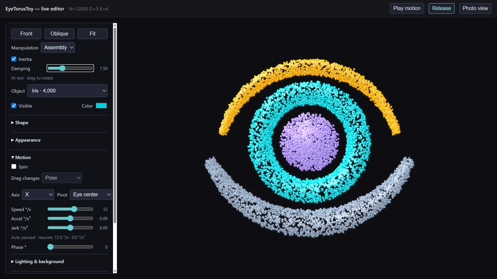
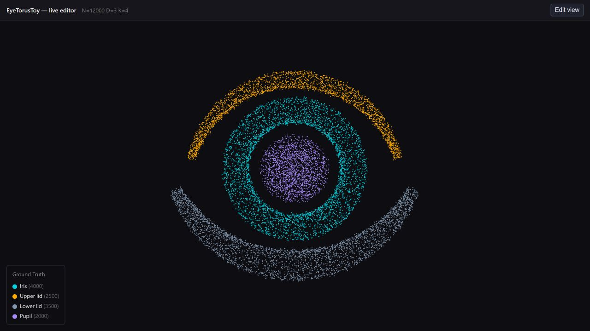
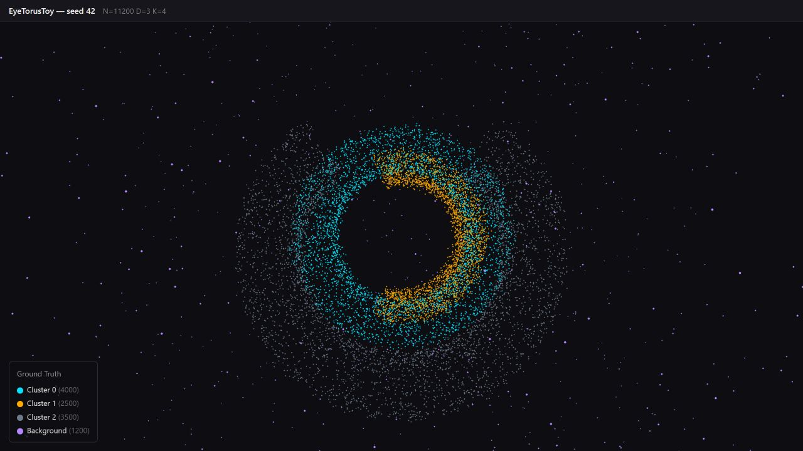
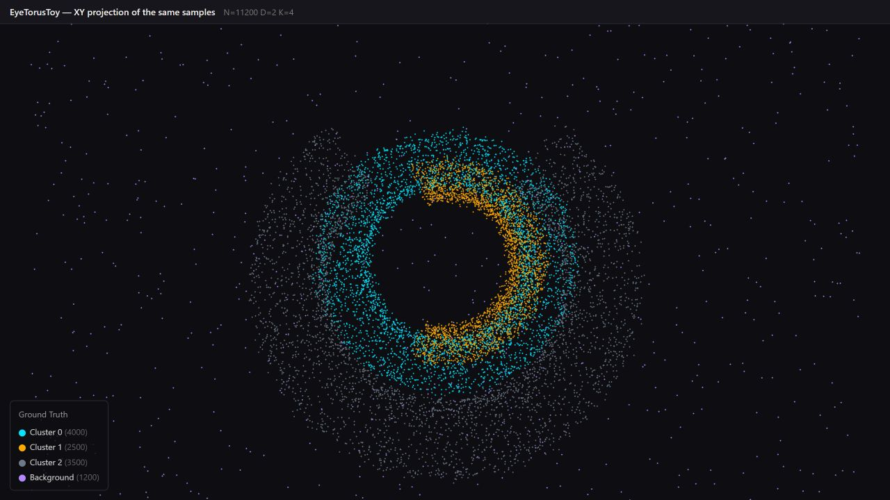
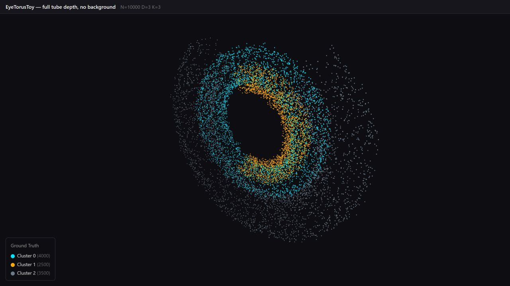
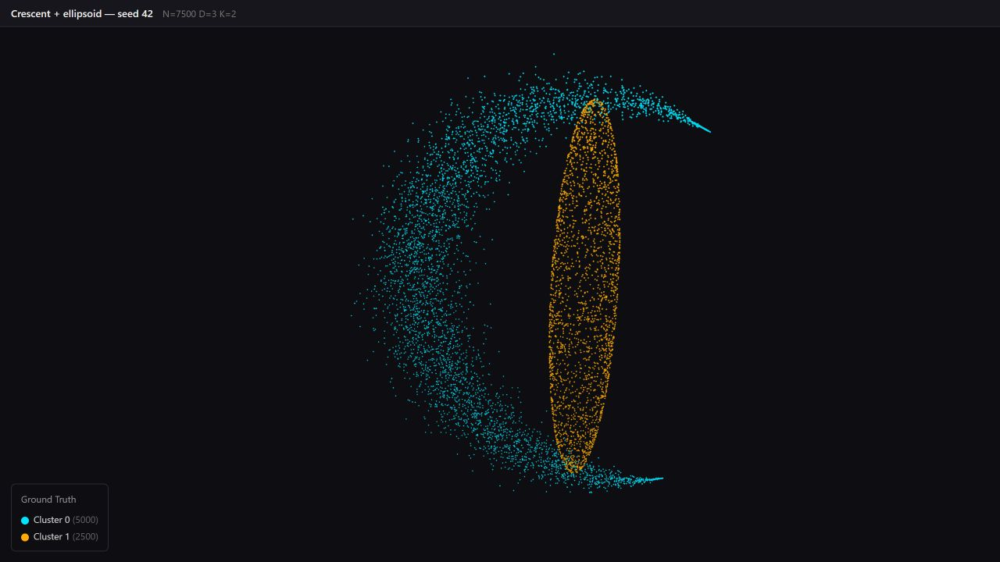
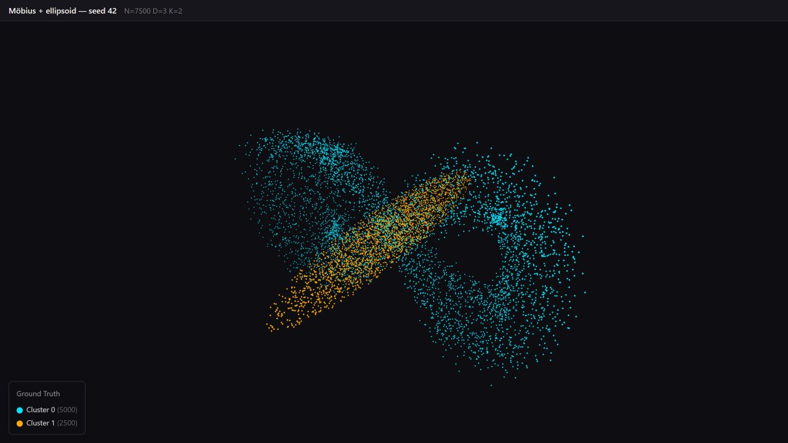

# Synthetic fixtures

Browser screenshots from `viz-core`, captured on 15–17 September 2026. All scenes
use seed 42. Colors show the generator's labels; no clustering is run for this
gallery.

## EyeTorusToy

### Live editor

```sh
dotnet run --project projects/VizApi/VizApi.csproj -c Release -- --urls http://127.0.0.1:8766
```

~~Open [localhost:8766/eye](http://127.0.0.1:8766/eye).~~



- Set ring radius, tube radius, XYZ position, and point count per component.
- Set the lids' center angles and arc spans in degrees; 90° faces up, 270° down.
- Set pupil size as a fraction of the iris bore (`ring radius − tube radius`).
- Choose an object to change its shape, color, visibility, point size, brightness,
  glow, and shine. Under **Sampling**, lid taper ranges from a uniform tube (0)
  to a pointed crescent (1).
- Each object can spin on its own axis and speed, about the eye or its own center.
  Signed **Accel** (°/s²) changes speed; **Jerk** (°/s³) changes acceleration.
  **Pose** dragging follows your hand. **Inertia** carries its angular velocity
  after release; **Damping** controls how quickly it settles (zero keeps coasting).
  A faster flick imparts more momentum. Holding still before release leaves it at
  rest. The drag readout estimates speed, acceleration, and jerk from mouse motion.
  Turn Inertia off to leave each manually adjusted pose exactly where you put it.
  These gestures work with automatic **Spin** off and never enable that setting.
  **Manipulation → Assembly**, above the Object selector, rotates the entire eye as one
  assembly when you drag any part. Individual poses and spin settings are retained;
  choose **Individual** to resume individual manipulation. Object settings still apply to
  the selected component. **Collect** resets both assembly and component rotations.
  While spinning, **Drag changes** also offers Speed, Acceleration, and Jerk:
  drag right/up to increase the value or left/down to decrease it.
  Dragging empty canvas still orbits the camera.
  The **Auto** readout shows both evolving values. Speed and acceleration sliders
  set their current values; setting jerk to zero holds the current acceleration.
  **Pause motion** stops automatic motion and manual momentum while keeping every
  pose. Unchecking **Spin** stops that object's automatic and manual rotation.
  The entered automatic speed and acceleration remain available for resuming.
  **Collect** resets rotation and pins the lids
  and pupil to the iris's center plane, retaining their thickness and XY positions.
  Collect also resets speed and acceleration to the entered slider values.
  **Release** restores their configured depths. Dragging after Collect leaves
  the alignment mode while keeping those depths and automatic playback paused.
  **Play motion** resumes from the held pose. Poses survive geometry edits and
  object selection changes for the current page session.
- **Lighting & background** sets the light direction, fill, and backdrop.
- Geometry edits regenerate the C# fixture and preserve the camera, appearance,
  and motion settings. Rotations and lighting affect the display only.
  **Photo view** pauses motion and hides the panels; **Reset eye** restores the
  starting geometry and component settings.

The editor starts with a gold upper lid, cyan iris, slate lower lid, and violet
solid pupil. The pupil contains 2,000 points; set **Pupil points** to zero to remove
it. The original generator defaults omit it (`PupilPoints = 0`).

This is a separate composition preset in
[EyeTorusScene.cs](../projects/VizApi/EyeTorusScene.cs). The screenshot below uses
its defaults with the earlier unlit renderer, the front view, and point size
0.055 at 1280 × 720. Edits last for
the current page session; reloading restores the preset.



### Generator defaults

The default generator produces 4,000 central-ring points, 2,500 points in the
inner arc, 3,500 in the outer arc, and 1,200 background points. Its tube depth
is scaled by `ZThickness = 0.3`; the background uses a pink-noise density field.



The same samples projected onto XY:



With `ZThickness = 1` and `BackgroundDensityRatio = 0`, an oblique view exposes
the tube cross-sections:



The reference is the toy problem in [Blatt, Wiseman & Domany, _Superparamagnetic
Clustering of Data_ (1996), Fig. 1](https://doi.org/10.1103/PhysRevLett.76.3251).
This generator is a toroidal interpretation. Its current arc angles are measured
from +X: the configuration's `UpperArcStart/End` span −0.6π to 0.6π, placing
that arc mainly on the right in the face-on view.

[Generator](../src/synthetic/euclidean/EyeTorusToy.cs) ·
[Geometry and sampling tests](../tests/synthetic/EyeTorusToyTests.cs)

## Crescent and ellipsoid

5,000 crescent points and 2,500 ellipsoid points, using the generator defaults.



[Generator](../src/synthetic/euclidean/CrescentEllipsoid.cs)

## Möbius and ellipsoid

5,000 tube points and 2,500 ellipsoid points in three dimensions, with
`MobiusPlacement.CenterCrossOrtho`.



[Generator](../src/synthetic/euclidean/MobiusEllipsoid.cs)

## Reproduce the scenes

From the repository root, with the .NET 10 SDK:

```sh
dotnet run --project tests/VizCoreSmoke/VizCoreSmoke.csproj -c Release -- --gallery artifacts/gallery
```

The [gallery runner](../tests/VizCoreSmoke/FixtureGallery.cs) writes five HTML
scenes, their JSON payloads, `summary.json`, and a runtime manifest. Omitting
the output directory creates a dated run under `artifacts/smoke-runs/`.

Open an HTML file in a browser. Three.js 0.160.0 loads from jsDelivr. The data
is embedded in the file; the gallery needs no dataset server. Its static
exports support orbit and zoom. Regeneration controls belong to the separate
VizApi host.

For portraits, append `?photo` to the file URL. This hides the control panels
and stops automatic rotation. Optional parameters set `yaw` and `pitch` in
degrees, `zoom` relative to the automatic fit, and `pointSize` in scene units.
Removing the query restores the normal viewer.

The fixture PNGs below predate the Eye lighting controls. They use a 1280 × 720
browser viewport and the following settings:

| HTML scene                | PNG                      | yaw | pitch | zoom | pointSize |
| ------------------------- | ------------------------ | --: | ----: | ---: | --------: |
| `eye-torus.html`          | `eye-torus-front.png`    |   0 |     0 |    3 |      0.07 |
| `eye-torus-xy.html`       | `eye-torus-xy.png`       |   0 |     0 |    3 |      0.07 |
| `eye-torus-depth.html`    | `eye-torus-depth.png`    |  38 |    28 | 1.12 |      0.07 |
| `crescent-ellipsoid.html` | `crescent-ellipsoid.png` |  25 |    20 | 1.12 |     0.045 |
| `mobius-ellipsoid.html`   | `mobius-ellipsoid.png`   |  35 |    32 | 1.12 |     0.045 |

For example:

```text
eye-torus-depth.html?photo&yaw=38&pitch=28&zoom=1.12&pointSize=0.07
```

Capture the browser viewport after the scene appears. The gallery disables
spine and tangent overlays. The tight Eye framing crops some background points
outside the viewport; the JSON payload retains all 11,200 samples. The header's
`K` counts displayed label IDs, including the background label when present.

The captures used .NET 10.0.5. Sampling currently uses `System.Random`; preserve
the runtime and generator source when comparing exact samples across runs.
