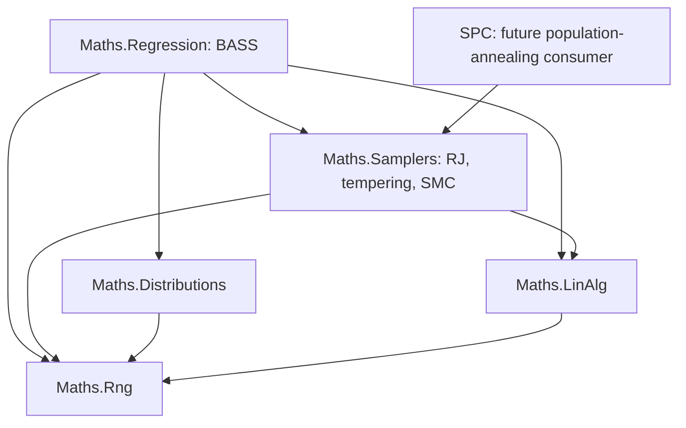

**The port should add BASS beside BARS and BAPS under `maths/regression/spline/bass`, supported by targeted improvements to the existing numerical and sampling layers.** SMC would be an optional inference backend shared through `maths/samplers`. BASS would retain ownership of its model, proposals, response representations, sensitivity analysis, and calibration.

This map covers the complete public functionality in the [BASS inventory](/D:/aghado01/ThermoMapper/issues/bass-public-inventory-and-backend-review.md:19). No implementation or file changes have been made.

The proposed paths below are relative to `src/maths`. They describe ownership; individual type names can be settled when writing the implementation brief.

The **new BASS subtree** would contain:

| Proposed owner | What gets added | Public functionality covered |
|---|---|---|
| `regression/spline/bass/` | Entry points, declarative configurations, validated input contracts, operation/result metadata | Overall fitting and inspection API |
| `bass/basis/` | Normalized powered hinges, categorical subset factors, product terms, term identity and encoding | Arbitrary numbers of continuous, categorical, and mixed predictors |
| `bass/design/` | Scalar design evaluation, separable functional design, sufficient statistics, candidate workspaces | Scalar and direct functional fitting |
| `bass/model/` | Structural state, coefficient-prior modes, noise/precision/intensity parameters, count and term priors, collapsed Gaussian target | Statistical definition behind `bass` |
| `bass/sampling/` | Birth/death/change proposals, hyperparameter updates, complete BASS sweeps, ensemble and SMC adapters | Ordinary MCMC, parallel tempering, optional SMC |
| `bass/posterior/` | Retained structures and draws, weights, prediction, summaries, diagnostic data, checkpoints | `predict`, `print`, `summary`, and data needed by plots |
| `bass/output/` | Supplied-basis and PCA setup, component fitting, reconstruction, scaling, truncation uncertainty | `bassBasis`, `bassPCA`, basis prediction |
| `bass/sensitivity/` | Hinge-product moments, ANOVA contractions, Sobol indices and effect functions | `sobol`, `sobolBasis` |
| `bass/calibration/` | Calibration targets, covariance assembly, discrepancy/noise models, parameter transforms, cut-posterior orchestration | `calibrate.bassBasis` |

Keeping the last three areas under BASS initially avoids inventing a universal functional-regression or calibration framework before another engine needs it. Their numerical operations can still use shared lower-level primitives.

Actual plotting and console presentation belong above maths. Regression should return the trace, prediction, residual, sensitivity, and summary data needed to reproduce all useful R displays.

The **data and result contracts** need to be designed for the complete model from the outset:

- **Scalar:** predictors \(X:n\times p\), response \(y:n\).
- **Direct functional:** predictors \(X:n\times p\), output coordinates \(T:m\times d\), responses \(Y:n\times m\). Support prediction at new predictor values and new output coordinates.
- **Output basis:** a supplied basis and coefficient responses, or a PCA-derived decomposition, followed by reconstruction into vector/curve/field output.

The direct functional model uses a common set of output locations across cases; those locations need not form a Cartesian grid. Ragged observations and missing-response imputation are separate extensions.

Configurations must retain the separate continuous, categorical, and functional interaction caps; polynomial degree; support constraints; basis-count cap; both coefficient-prior modes; hyperpriors; and sampling/storage controls. A single “maximum interaction order” replacing the three caps would lose functionality.

Prediction results should have explicit draw × case × output axes, preserved requested-draw order, and separate controls for latent uncertainty, observation noise, and truncation uncertainty. Posterior storage and restart checkpoints should be distinct: checkpoints additionally need RNG, adaptation, iteration, replica/population, and data/config identity.

The **shared reuse and renovation map** is:

| Existing area | Classification | Concrete change |
|---|---|---|
| [RJ proposal and acceptance machinery](/D:/aghado01/ThermoMapper/src/maths/samplers/rjmcmc/ReversibleJumpChain.cs:82) | **Reuse, with targeted expansion** | Retain proposal/Jacobian/reverse-selection accounting and telemetry. BASS supplies its own state and moves. Make state replacement and cached-density refresh safe after hyperparameter or target-stage changes. |
| [Target contract](/D:/aghado01/ThermoMapper/src/maths/samplers/rjmcmc/IRjTarget.cs:12) | **Generalize** | Its existing responsibility—evaluating a log density—is useful beyond RJMCMC. Move that responsibility into a neutral sampler target contract shared by RJ, tempering, and SMC; migrate callers without aliases. |
| [Parallel tempering](/D:/aghado01/ThermoMapper/src/maths/samplers/rjmcmc/ParallelTempering.cs:35) | **Expand and relocate** | Replace construction of concrete RJ chains with per-replica kernel factories and explicit state exchange. Put general replica exchange under `samplers/tempering`; keep RJ acceptance under `samplers/rjmcmc`. |
| `IChain`, `IEnsembleModel`, ensemble execution | **Reuse** | A complete BASS sweep can implement the existing chain interface. BASS supplies invariant readouts such as predictions, term count, noise, and variable inclusion. |
| [Chain diagnostics and stopping](/D:/aghado01/ThermoMapper/src/maths/samplers/ensemble/ChainEnsemble.cs:121) | **Fix and expand** | Undefined/infinite R-hat must not count as convergence. Add trace-based rank-normalized diagnostics and appropriate bulk/tail ESS. Keep particle diagnostics separate. |
| [Dense Cholesky](/D:/aghado01/ThermoMapper/src/maths/linalg/Cholesky.cs:58) | **Add a strict factorization path** | Explicit success/rank/conditioning status, allocation-controlled solves, bordered insertion, deletion, replacement, and rebuild checks. Existing silent pivot flooring cannot define BASS’s posterior factorization. |
| [Matrix operations](/D:/aghado01/ThermoMapper/src/maths/linalg/MatrixOps.cs:37) | **Reuse and expand** | Reuse dot products and column-oriented operations. Add general contractions where needed; hinge evaluation and term caching remain in BASS. |
| [PCA](/D:/aghado01/ThermoMapper/src/maths/linalg/PCA.cs:11) | **Expand** | Add a stable thin-SVD/rank-aware path in LinAlg. BASS owns the response scaling and decomposition adapter required to reproduce its coefficient convention. |
| Covariance solves | **Add in `linalg`** | A diagonal-plus-low-rank solve/log-determinant implementation for calibration, alongside the strict dense path. Calibration owns which covariance components are assembled. |
| `distributions` | **Reuse and expand** | Reuse Normal/Gamma/Beta and log-gamma. Add inverse-gamma/truncation support and stable normal/Student interval probabilities and moments. Hinge-specific integration stays in BASS. |
| `rng` | **Reuse and expand where needed** | Reuse Xoshiro state capture/restore and seed derivation. Add deterministic offspring-stream derivation for resampling; copying a particle must not duplicate its future RNG stream. |

The tempering renovation has a bounded effect on existing regression code: `BarsEnsemble`, `SplineTarget`, and the corresponding sampler tests would migrate to the generalized contracts. It does not require rewriting BARS’s statistical model.

Several existing components are useful references but **should not be reused unchanged**:

| Existing component | Boundary to preserve |
|---|---|
| [One-dimensional `IBasis`](/D:/aghado01/ThermoMapper/src/maths/regression/spline/IBasis.cs:10) and `KnotConfig` | Keep their ordered-knot meaning. BASS needs adaptive multivariate term sets. |
| [BAPS tensor design](/D:/aghado01/ThermoMapper/src/maths/regression/spline/baps/TensorProductDesign.cs:19) | This is a fixed bivariate B-spline construction, not BASS’s changing interaction basis. |
| `BandCholesky` | BASS’s active-term Gram matrix is generally dense. |
| BARS `WeightedNormalModel` | Its prior and marginal target differ from BASS’s. Reuse numerical operations, not the statistical formula unchanged. |
| BARS complexity priors | A fixed knot-count prior does not implement BASS’s sampled count-intensity hierarchy. |

For direct functional fitting, the important computational structure already exists in R and should survive the port:

\[
G=(A^\top A)\circ(H^\top H),
\qquad
h_j=A_j^\top YH_j.
\]

Here \(A\) contains predictor-side factors and \(H\) contains output-coordinate factors. BASS’s design layer should retain this separation instead of materializing the full case-by-location design.

For incremental factors, start with a strict full-factorization reference, then add bordered births and Givens-based deletions. Initially implement a changed term through staged deletion/insertion. The factor maintenance can be \(O(M^2)\); evaluating terms and computing data cross-products still have their own costs.

**SMC fits at three distinct points**, with different owners:

| Use | Generic work in `samplers/smc` | Work owned by the consumer |
|---|---|---|
| BASS posterior fitting | Weighted populations, resampling, stage advancement, mutation execution, ancestry and normalizer estimates | BASS target sequence, valid initial distribution, structural/hyperparameter moves, posterior readout |
| BASS cut calibration | Reuse the same population machinery for conditional distributions | Emulator-draw selection, conditional calibration targets, bridging between them, and correct outer averaging |
| Future SPC population annealing | Reuse population mechanics | Potts energy, SW updates, physical temperature selection, measurements, and SPC state transfer |

The new SMC module should contain only:

- A weighted population and log-weight normalization.
- Resampling algorithms and ancestry records.
- A driver over supplied target distributions, including optional adaptive intermediate stages.
- Mutation-kernel execution with independently owned workspaces.
- Particle diagnostics, normalizing-constant **ratios**, and checkpoint state.

Its boundary needs operations for evaluating stage densities, initializing particles, advancing a particle, and safely transferring/forking state. Implementations of those operations remain with BASS or SPC. No sampler code should inspect knots, categories, output bases, graph edges, or spin labels.

SMC should have its own result/diagnostic contract. It should not be presented to `ChainEnsemble` as if its related particles were independent chains. BASS prediction, posterior summaries, and Sobol calculations must honor particle weights. For independently fitted output components, reconstruction must also form valid joint draws from the component posteriors.

There are two important target constraints:

1. The current [TemperedTarget](/D:/aghado01/ThermoMapper/src/maths/samplers/rjmcmc/TemperedTarget.cs:26) powers the entire posterior. That differs from a prior-to-posterior likelihood bridge. Each BASS adapter must declare its actual path, with mutation updates and swaps derived from that same path.
2. BASS’s default improper variance prior cannot initialize prior-to-posterior SMC. We need either a proper-prior mode or a specified normalized reference distribution. Marginal-likelihood reporting additionally requires justified model normalizations.

Cut SMC is a later calibration backend, after establishing a conditional reference sampler. It must preserve the emulator posterior’s marginal distribution; ordinary joint SMC would target a different inference problem. [Cut-posterior SMC](https://arxiv.org/html/2406.07555v2)

The **production dependency boundaries** would remain:

Arrows mean “depends on.” The SPC-to-Samplers assembly reference already exists; its population-annealing implementation is a separate future consumer. No BASS work requires a Regression-to-SPC dependency, and no shared numerical layer imports regression or graph types.

Within regression, BASS’s calibration code consumes its emulator/prediction contract; fitting does not depend on calibration. Sensitivity consumes terms and posterior draws; fitting does not depend on sensitivity. Plot rendering consumes result data from above maths.

Before implementation, the **statistical specification** needs four concrete decisions recorded:

- **Model measure and priors:** ordered versus unordered term representation, proposal subset probabilities, count-cap normalization, and the precise meaning of both coefficient-prior modes.
- **Update ordering:** a justified collapsed/conditional sampling scheme. My preferred starting point is a coefficient-marginal target with valid hyperparameter updates, drawing coefficients conditionally for retained predictions. The R update sequence should not be copied without qualification.
- **Numerical admission:** finite/rank/conditioning rules, relative tolerances, and rebuild behavior. Adding ridge regularization would be an explicit prior option.
- **Calibration target:** define the modular cut target and both covariance formulations, including measurement groups, discrepancy, emulator residuals, truncation uncertainty, and physical units.

These are finite specification tasks, not reasons to reduce the feature set.

The functional, sensitivity, and calibration work also has several concrete requirements beyond constructing new types:

| Area | Required implementation detail |
|---|---|
| PCA/supplied basis | Preserve the R decomposition’s coefficient scaling, supplied nonorthogonal bases and prepared coefficients; handle rank, constant responses, and 100% variance retention explicitly. |
| Predictive uncertainty | Separate coefficient uncertainty, independent per-case noise, and correlated output truncation residuals; apply centering/scaling consistently. |
| Sobol analysis | Share tested moment calculations across direct and basis paths; support declared input measures, categorical probabilities, interaction/total indices and applicable effect functions. |
| Basis-output sensitivity | Retain cross-component terms. Independent coefficient fitting does not permit simply summing component Sobol indices. |
| Computational budgets | Make interaction enumeration, moment caching, retained draws, and component/particle parallelism explicit resource decisions. |
| Calibration | Use typed covariance formulations, fresh likelihood caches after state changes, and consistent physical-coordinate results and uncertainty units. |

From the modernization notes, I would include **buffer ownership, bounded allocation, column-oriented evaluation, hardware-dispatched SIMD with fallback, incremental factors, and category bitsets with support beyond 64 levels** in the engineering work.

Residual-informed proposals can be added as optional kernels after their forward/reverse probabilities are established. Sparse Dirichlet priors, intrinsic-dimension restrictions, and directional/projection splines belong to separately specified model extensions. They should not silently alter the baseline BASS model.

A concrete implementation sequence would be:

| Stage | Deliverable | Completion evidence |
|---|---|---|
| **1. Contracts and reference corpus** | Statistical specification; all three response shapes; posterior/prediction/checkpoint contracts; pinned BASS fixtures | Every public capability mapped; known R defects distinguished from intended behavior |
| **2. Shared numerical foundations** | Strict dense factors, incremental operations, distribution additions, low-rank covariance solves, SVD path | Dense/reference comparisons, rejection immutability, rank cases, precision-draw covariance checks |
| **3. General sampling foundations** | Neutral target contract, hybrid-capable replica exchange, safe cache/state transfer, diagnostic repair | Enumerable targets and analytic distributions; existing BARS sampler tests remain valid |
| **4. Complete BASS fitting** | Mixed factors, all interaction groups, scalar and direct functional designs, priors, hybrid MCMC/PT, retention and restart | Explicit tiny-design comparisons, transition checks, posterior recovery, checkpoint replay |
| **5. Output bases and prediction** | Supplied basis, PCA, component execution, reconstruction and all predictive uncertainty modes | Reconstruction/scaling identities, rank edge cases, per-case noise and fixed-axis tests |
| **6. Sensitivity** | Direct and reconstructed-output Sobol/effect calculations | Quadrature and category enumeration, variance identities, cross-component and zero-variance cases |
| **7. Calibration** | Both covariance formulations and an explicitly targeted reference sampler | Dense covariance comparisons, unit/cache checks, controlled calibration recovery |
| **8. SMC integration** | BASS fitting adapter, followed by cut-calibration adapter | Standalone SMC validation first; then agreement with reference posterior quantities and measured error versus runtime |
| **9. Presentation and documentation** | Summary/plot adapters above maths; updated regression and sampler documentation | Coverage of the R diagnostic purposes without rendering dependencies in maths |

The generic SMC core can be developed during stage 3 and validated independently. Its BASS adapters should wait until their targets and reference calculations are established. SPC integration is outside this port’s completion criteria.

Tests would follow ownership: numerical tests under the existing LinAlg/Distributions hosts, BASS tests under `tests/regression`, and a dedicated sampler test host for the new generic machinery. The existing [R oracle bridge](/D:/aghado01/ThermoMapper/tests/oracle/ROracle.cs) can support new pinned BASS fixtures and oracle scripts. R comparisons should use verified deterministic formulas and reference outputs; sampler correctness also needs independent analytic or enumerable checks.

Performance qualification should measure allocations, memory, factor work, data contractions, and statistical error per unit time. That will tell us where the C# implementation actually improves on R without making language choice or particle count stand in for demonstrated efficiency.