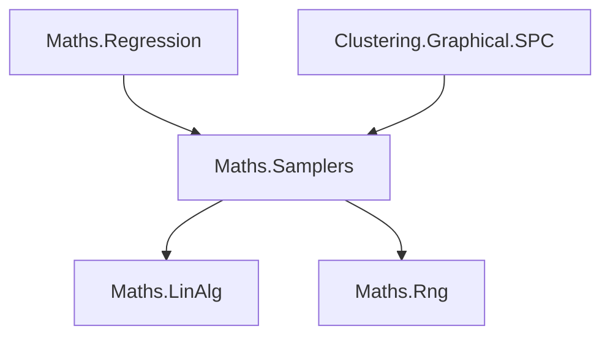

**Yes—SMC could be useful across the regression engines, and the connection to SW/SPC is particularly natural.** The two ideas address different questions: cut Bayes specifies which information should influence which parameters; SMC computes samples from the distribution you choose.

A **cut Bayesian analysis** deliberately blocks feedback between parts of a statistical model while preserving uncertainty flowing forward.

For BASS calibration, imagine two stages:

1. Fit a BASS emulator to simulator runs.
2. Use that emulator and experimental observations to infer physical parameters, measurement noise, and simulator discrepancy.

In a fully joint Bayesian analysis, experimental observations can also change the inferred emulator. That can be desirable—but if the discrepancy model is inadequate, the analysis can distort the emulator to compensate for missing physics. Cutting feedback protects the simulator-trained emulator from that influence. This is a longstanding motivation for modular Bayesian inference. [Liu, Bayarri and Berger](https://www2.stat.duke.edu/~berger/papers/modularization.pdf)

Writing \(e\) for the emulator and \(\theta\) for the calibration parameters, the cut target is:

\[
p_{\mathrm{cut}}(e,\theta\mid D_{\mathrm{sim}},y)
=
p(e\mid D_{\mathrm{sim}})
\,p(\theta\mid y,e).
\]

The emulator’s marginal distribution stays fixed at its simulator-trained posterior. Calibration still averages over uncertain emulators; it does **not** just substitute one fitted surface. The tradeoff is that cutting also discards potentially useful feedback. It should therefore be an explicit modeling option, justified by which modules you trust. Related *semi-modular* methods allow controlled partial feedback. [Cut-posterior definition](https://arxiv.org/html/2406.07555v2), [semi-modular inference](https://proceedings.mlr.press/v108/carmona20a.html)

The computational difficulty is that each emulator draw produces a differently normalized calibration posterior. Simply refreshing the emulator and taking a few calibration steps does not generally sample the intended cut distribution correctly.

The SMC paper I mentioned addresses this by drawing the upstream parameters, then moving a population of calibration particles through the resulting conditional posteriors, reusing previous computation. Its final averages preserve the upstream draw distribution. **Ordinary SMC over the full joint posterior would still allow feedback; cutting requires the appropriate target and construction.** [Mathews et al.](https://arxiv.org/html/2406.07555v2)

For the broader regression engine, SMC means maintaining a population of candidate states and moving them through a sequence of distributions. For example:

\[
\pi_\lambda(x)\propto p(x)\,p(y\mid x)^\lambda,
\qquad \lambda:0\rightarrow1.
\]

The sequence gradually introduces the likelihood. At each stage, the algorithm updates particle weights, resamples when necessary, and applies MCMC moves to diversify the population. “Sequential” can mean these artificial stages; it does not require streaming observations. Your existing MCMC machinery could supply those moves, adapted to each intermediate target. [An invitation to SMC samplers](https://arxiv.org/abs/2007.11936)

My assessment of the opportunities in your current engines is:

| Component | Potential value of SMC |
|---|---|
| **BASS** | Strong candidate for maintaining competing basis structures, interactions, and model sizes. Existing birth/death/change moves could provide particle updates. |
| **BARS** | Similar opportunity for competing knot configurations and knot counts. A useful existing consumer for developing the shared machinery. |
| **BAPS** | More selective benefit. Its existing conjugate and adaptive Gibbs updates already exploit considerable structure; SMC becomes more attractive for difficult hyperparameter distributions or sequential data updates. |
| **BGP** | The current sampler mainly samples one bandwidth after marginalization. Quadrature or its existing Metropolis sampler may remain simpler. SMC becomes more compelling with richer kernel choices and multiple interacting hyperparameters. |
| **Calibration** | Strong candidate when parameter posteriors are multimodal or many related conditional posteriors must be computed, including cut inference. |

Variable model dimension is compatible with SMC; it does not restrict BASS to a fixed basis or reduced version. But SMC still needs effective, correct moves: it cannot repair an incorrect RJ acceptance ratio, and resampling can eliminate modes that later become important. [Trans-dimensional SMC](https://www.ma.imperial.ac.uk/~das01/Papers/STRATSMC.PDF)

**For SW, this becomes population annealing.** Each particle is an entire Potts spin configuration on your graph.

With fixed graph, couplings, and \(q\),

\[
\pi_\beta(s)\propto e^{-\beta H(s)},\qquad \beta=1/T.
\]

Moving from \(\beta\) to \(\beta'\) gives the incremental weight

\[
\widetilde w_i
=
\exp\!\left[-(\beta'-\beta)H(s_i)\right].
\]

The procedure is:

**Reweight at the next temperature → resample configurations → run SW sweeps → measure observables.**

SW supplies the updates that preserve the new temperature’s equilibrium distribution. Population annealing supplies the population management across temperatures. Its objective is to estimate equilibrium behavior throughout the temperature range, which fits your earlier emphasis on SPC’s thermal observables. [Population annealing theory](https://arxiv.org/html/1508.05647v2)

Three benefits look relevant:

- **Reuse across temperatures.** A population already represents a nearby equilibrium distribution, potentially reducing repeated equilibration work.
- **Adaptive temperature spacing.** Weight concentration can signal that a temperature jump is too large. Additional intermediate temperatures can improve overlap where the distribution changes sharply.
- **Partition-function and free-energy estimates.** The weight normalizers estimate partition-function ratios. Starting from uniform spins at \(\beta=0\), where \(Z(0)=q^n\), provides an absolute reference. These would complement the existing thermal measurements. [Free-energy construction](https://arxiv.org/html/1508.05647v2)

The important qualification is that resampling creates related copies. A thousand particles are not necessarily a thousand independent configurations, and equal weights immediately after resampling do not demonstrate good exploration. We would need ancestry/diversity diagnostics and independent population runs alongside observable-specific uncertainty estimates. SW may already mix well on some graphs, so a speed advantage needs measurement. Population-annealing research explicitly discusses SW updates and these diagnostic limitations. [Understanding population annealing](https://www.physik.uni-leipzig.de/~janke/Paper/pre103_053301_2021.pdf)

There are concrete integration seams in your code:

- [FixedGridSweepStrategy.cs](/D:/aghado01/ThermoMapper/src/clustering/graphical/spc/runtime/scheduling/FixedGridSweepStrategy.cs:161) currently schedules separate temperature–replica jobs. Population annealing would introduce dependencies between temperature stages.
- [SwendsenWang.cs](/D:/aghado01/ThermoMapper/src/clustering/graphical/spc/runtime/core/sampler/SwendsenWang.cs:386) deliberately rejects checkpoint restoration at another temperature. We need a distinct operation for transferring spin state, assigning reproducible independent offspring RNG streams, and starting fresh measurement accumulators.
- Its [energy accumulation](/D:/aghado01/ThermoMapper/src/clustering/graphical/spc/runtime/core/sampler/SwendsenWang.cs:196) measures the configuration before recoloring. SMC weights must use the energy of the configuration actually being transferred, so that state/energy relationship needs an explicit contract.

Architecturally, I would place **weights, resampling, population scheduling, and diagnostics in `maths/samplers`**. Regression would supply its targets and RJ/Gibbs moves; SPC would supply Potts energy and SW updates. That preserves your dependency direction and makes SMC reusable without putting clustering concepts into maths.

A useful first validation would be population annealing on tiny Potts graphs whose equilibrium distributions can be enumerated exactly, followed by comparison with independent SW runs at equal computational cost. BARS would provide a complementary regression consumer. Cut calibration can then build on that infrastructure with its own explicitly defined target.

**It wouldn’t all go into `samplers`.** My wording blurred the SMC algorithm with the regression and SPC workflows that would use it.

The reason to put **the general SMC algorithm** there is the same reason your general RJMCMC machinery lives there: it operates on states, probabilities, and supplied transition rules without knowing what those states represent.

The ownership split should be:

| Responsibility | Owner |
|---|---|
| Importance-weight updates, particle resampling, ancestry bookkeeping, sampler-specific diagnostics | `maths/samplers/smc` |
| Matrix factorizations, solves, and numerical kernels | Existing `maths/linalg` owners |
| Random generators and seed derivation | `maths/rng` |
| BASS/BARS models, likelihoods, priors, spline proposals, prediction, calibration and cut-model semantics | `maths/regression` |
| SW updates, physical temperature schedules, SPC run orchestration and thermal observables | Existing SPC runtime, using its existing graph/Potts contracts |

In particular, **“population scheduling” was too broad a phrase**. Advancing particles through a supplied sequence of distributions is sampler machinery. Deciding which physical temperatures SPC explores, where it measures susceptibility, and how it selects thermal regimes belongs to SPC.

Likewise, particle-weight concentration and resampling ancestry are sampler diagnostics. Prediction uncertainty, knot summaries, susceptibility, and cluster persistence belong to their respective engines.

The dependency direction would remain:

Arrows mean **“depends on.”** These assembly references already exist in your [regression project](/D:/aghado01/ThermoMapper/projects/Maths.Regression/Maths.Regression.csproj), [SPC project](/D:/aghado01/ThermoMapper/projects/Clustering.Graphical.SPC/Clustering.Graphical.SPC.csproj), and [samplers project](/D:/aghado01/ThermoMapper/projects/Maths.Samplers/Maths.Samplers.csproj). The proposed SMC component would introduce no dependency from samplers back to regression, graphs, or clustering.

Your existing [IRjTarget<TState>](/D:/aghado01/ThermoMapper/src/maths/samplers/rjmcmc/IRjTarget.cs) illustrates the boundary: the sampler understands a generic state and its log density; regression supplies the implementation. Calling that implementation at runtime does not create a reverse assembly dependency. An SMC boundary would follow the same principle.

**Avoiding cycles is only one requirement; coherent ownership matters independently.** A class mentioning BASS knots, Potts spins, or SPC temperature selection would still be misplaced in the general sampler layer even if interfaces concealed those dependencies.

So the architectural recommendation is a bounded SMC sampling capability, with each engine retaining its own state, mathematics, transitions, and orchestration. The exact contracts still need analysis against your existing sampler interfaces; the fact that several engines could use SMC does not justify collecting all their surrounding functionality into one shared framework.