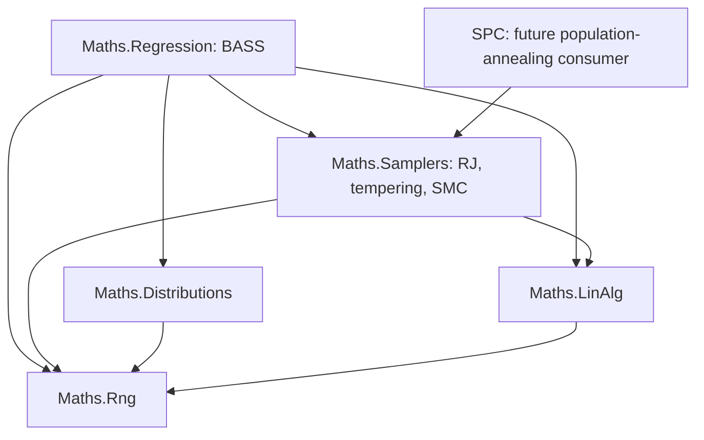

# Full BASS port brief

Date: 2026-10-18; updated 2026-10-27. Status: stage 0 is closed, and stages 2–3 have landed, the shared infrastructure included (N1–N13). Stage 1: the user decided D01–D06 in the design pass on 2026-10-27 and adopted D10's adaptation note; D07–D09 remain drafts, and D10's stopping semantics stays open. F-O3 and F-O4 landed, and the contract shapes were decided on 2026-10-28, so stage 1 is complete. The two shared-code changes the contracts need (the fitting checklist's F-C2) landed the same day, and the baseline was requalified at `cf37584`, so stage 4 is open; its plan was decided the same day (the fitting segment). S1–S7 and S9 landed the same day with the three shared additions and the stage-4 oracle modes, S7 and S9 by chips, with the docs section (the fitting checklist's reports); S8, tempering, runs as chip D, and S10 follows. Source-code implementation is not authorized by this document.

Add the complete BASS regression capability to `Maths.Regression`, alongside BARS, BAPS, and BGP. Preserve arbitrary predictor dimension, mixed continuous and categorical inputs, scalar and functional responses, posterior prediction, sensitivity analysis, and emulator calibration. Build the C# implementation around explicit statistical targets, owned numerical state, and the repository's existing dependency direction.

SMC is a planned optional inference backend. Its general sampling machinery belongs in `Maths.Samplers`; the BASS model, target sequence, moves, and calibration semantics remain in regression. A future SPC population-annealing consumer is a separate workstream.

The [public inventory and backend review](bass-public-inventory-and-backend-review.md) supplies the detailed source evidence, public capability IDs, reproduced helper defects, and unresolved sampling questions. This brief turns that analysis into scope, ownership, implementation stages, and decision gates.

The [adaptation prerequisites review](bass-adaptation-prerequisites-review.md) establishes the existing-engine repair and qualification work. Repair and independently test the current regression engine and reused infrastructure before integrating BASS. Existing-engine repairs remain separately scoped and evidenced; their completion supplies the baseline against which the new capability is developed and tested.

## Segments

The port is carried out in four segment briefs and one extensions brief, each with a checklist beside it where the reports go as work lands. This hub keeps what they share: the scope and completion contract, the baseline gate, the dependency boundaries, the decision register and its sources, the stage table, the validation policy and the modernization rules.

| Segment | Stages | Decisions | Brief | Checklist |
|---|---|---|---|---|
| Shared numerics and sampler contracts | 2–3 (BASS-specific parts) | D10 | [port-numerics-brief.md](bass/port-numerics-brief.md) | [checklist](bass/port-numerics-checklist.md) |
| Fitting | 4 | D01–D06 | [port-fitting-brief.md](bass/port-fitting-brief.md) | [checklist](bass/port-fitting-checklist.md) |
| Response bases, prediction and sensitivity | 5, 6, 9 | D07, D08 | [port-outputs-brief.md](bass/port-outputs-brief.md) | [checklist](bass/port-outputs-checklist.md) |
| Calibration and SMC backends | 7, 8 | D09 | [port-calibration-brief.md](bass/port-calibration-brief.md) | [checklist](bass/port-calibration-checklist.md) |
| Extensions, beyond the completion contract | none | none | [extensions-brief.md](bass/extensions-brief.md) | [checklist](bass/extensions-checklist.md) |

Two chip briefs run beside the segments (2026-10-27), for work that does not wait on the design pass: [reference-fixtures-brief.md](bass/reference-fixtures-brief.md) (the decision-independent stage-1 fixtures) and [shared-infrastructure-brief.md](bass/shared-infrastructure-brief.md) (N11–N13).

Each segment ends with "Room for extensions": the prep work it does now so that the extensions plug in later. Stage 1's specification work is spread across the segments' decision drafts and reference fixtures; the register below tracks it.

## Scope and completion contract

The baseline is BASS 1.3.1 at source commit `26710146c623a258854162367a939041efedd091`. The ThermoMapper analysis baseline is commit `c82c6368b151d28d14dfa1f2076de633efd125b1`, with working-tree documentation considered separately. The R checkout is `D:/aghado01/packages/BASS`.

Full coverage means the six exported functions and nine S3 methods in the inventory. C# need not reproduce R's object system, dimension dropping, accidental bugs, or unqualified stochastic transitions.

| Inventory IDs | R public surface | Required C# capability |
|---|---|---|
| P01 | `bass` | Scalar and direct functional fitting with continuous, categorical, or mixed predictors; hierarchical parameters; structural moves; tempering; posterior retention and restart. |
| P02 | `bassPCA` | Response decomposition, rank/variance selection, independent component fits, reconstruction, and response transformations. |
| P03 | `bassBasis` | Prepared coefficient responses under a supplied output basis, including nonorthogonal bases. |
| P04 | `sobol` | Direct-model sensitivity under declared independent input measures, including functional conditioning and applicable effect functions. |
| P05 | `sobolBasis` | Sensitivity of reconstructed output, retaining cross-component terms, interaction selection, and residual `other` contributions. |
| P06 | `calibrate.bassBasis` | Bounded numeric parameter calibration with both covariance formulations, noise groups, emulator and truncation uncertainty, discrepancy, and an explicit inference target. |
| P07, P08 | `predict.bass`, `predict.bassBasis` | Selected posterior draws, latent and predictive output, direct-functional prediction at new coordinates, basis reconstruction, and truncation uncertainty. |
| P09, P10, P11 | Three plot methods | Trace, fit/residual, interval, and sensitivity data from regression; rendering adapters above maths. |
| P12, P13, P14, P15 | Two print and two summary methods | Inspectable model metadata and posterior summaries, with formatting above the mathematical engine. |

Three response representations are required from the start of the contract design:

| Representation | Data shape | Meaning |
|---|---|---|
| Scalar | `X: n × p`, `y: n` | An adaptive surface over any supported number of predictors. |
| Direct functional | `X: n × p`, `T: m × d`, `Y: n × m` | Jointly learn `f(x,t)` and predict at new predictors and output coordinates. All cases share the same complete set of output locations; those locations need not form a Cartesian grid. |
| Supplied basis or PCA | `K: m × r`, coefficient responses `W: r × n`, offsets/scales | Fit coefficient surfaces and reconstruct vector, curve, or field output. The basis is fixed during fitting. |

The port is not restricted to two predictors, two response coordinates, or a scalar-only first release. Implementation stages may establish those cases as fixtures without redefining completion.

Preserve separate continuous, categorical, and functional interaction caps; positive integer hinge degree; support constraints; basis-count cap; both coefficient-prior modes; variance, precision, and count-intensity controls; and sampling/storage controls. Capacity limits and statistical priors are distinct. With a full-rank Gram design, the intercept counts toward the dimension bound.

Prepared output-basis input includes its coefficient responses and response transformations. Solving arbitrary coefficients from a supplied basis, evaluating a fixed basis at new output locations, ragged observations, missing-response imputation, classification, non-Gaussian fitting, correlated-input Sobol analysis, and learned projection directions are extensions beyond the active R baseline.

## Existing engine baseline before integration

The purpose of this gate is to prevent pre-existing defects from confounding BASS implementation or its evaluation. The reviewed current-engine problems must be addressed before BASS runtime integration; BASS must not become the first test of whether the existing infrastructure is correct. Independent specification and oracle design can proceed while that baseline work is planned.

The [review's remediation register](bass-adaptation-prerequisites-review.md#existing-engine-remediation-register) owns the detailed findings R01-R12, repair batches B01-B06 and closure criteria. All six batches are closed: B01–B03 and B06 in the preparation brief's Phase 0 (steps 0.1–0.6, 2026-10-19 and 10-20; baseline gate closed at `4c97de2`), and B04 and B05 under the chip brief (complete at `fbe6d0d`). Phase 3's baseline rerun requalified the engine at `2efa134` (step 3.5). Source confirmation is not a passing runtime test, and a historical repair is not a newly open code defect. The [preparation brief](bass-preparation-brief.md) sequences B01–B03 and B06 together with the existing-engine slice of stages 2–3; B04 and B05 run under a [separate chip brief](baps-bgp-baseline-repairs-brief.md).

| Baseline batch | Work before integration | Ownership and relationship to BASS |
|---|---|---|
| B01 Diagnostics | Correct the NaN/infinite R-hat stopping path, minimum-data policy and misleading BARS diagnostic display. | General diagnostic/stopping mechanics in Samplers; result presentation in Regression. Direct shared prerequisite. |
| B02 Mutable state and adaptation | Give adaptive kernels explicit private ownership; enforce the same tempering/adaptation rule on every construction path; preserve meaningful adaptation counters across chain rebuilds. | Regression constructs its model kernels; Samplers owns general execution/state contracts. Direct prerequisite for safe parallel chains and a pattern to qualify before particles. |
| B03 Existing BARS statistical contracts | Resolve the count/location prior measure, robust plug-in conditioning, singular-design policies and conditional-mean versus full-posterior uncertainty. | Separate BARS repairs in Regression. Qualify the existing engine and any comparisons against it; do not copy BARS's statistical target into BASS. |
| B04 Existing BAPS statistical repairs | Resolve the improper log-lambda tail in `MarginalEvidence` and the stale hierarchical deviation statistic. | Separate BAPS repairs in Regression. Close these baseline issues without making P-spline smoothing part of BASS. |
| B05 Existing BGP support and protection | Validate bandwidth support and coordinate assumptions; protect the already-local GP scratch storage; correct the unsupported scaling-theorem claim. | Separate BGP work in Regression. No speculative GP kernel redesign is required by the review. |
| B06 Existing numerical qualification | Inventory reused/affected factor paths and verify their solve, determinant, sampling and failure contracts; distinguish deliberate regularization from hidden numerical changes. | LinAlg reports status; Regression owns model admission. The strict/incremental backend added in stage 2 must be qualified separately before BASS uses it. |

Keeping these repairs separate is a scope and provenance boundary, not permission to postpone the reviewed defects until after integration. Close the baseline with independent reproductions or counterexamples, settled statistical specifications, separately attributable repairs, and affected-suite results at a recorded source revision. An approximation may remain only with an explicit supported contract; it cannot serve as an exact-posterior oracle. Additional unrelated subsystem fixes and hypothetical regression enhancements remain outside this gate.

The direct shared prerequisites are correct stopping, owned mutable state, coherent density-cache updates, reliable numerical status and valid coefficient uncertainty. Some require existing repairs; others require the additions in stages 2-3. Recheck the qualified existing-engine baseline after those shared contracts change and before the first BASS integration tests. The engine has changed since the `2efa134` requalification (draw retention, the shared blocks, the changepoint and hierarchical work of 2026-10-23 and 10-24, each checked bit-identical or against its own references), so rerun the qualified baseline before the first BASS integration tests. Rerun 2026-10-27 (N9): requalified at `3a04601`, with the suites, the drift record and a 50-seed sweep in the [numerics checklist's report](bass/port-numerics-checklist.md#baseline-requalified-n9--2026-10-27). Rerun 2026-10-28, after stage 1 and F-C2: requalified at `cf37584`, every sweep change traced to the default σ² prior ([report](bass/port-numerics-checklist.md#baseline-requalified-before-stage-4--2026-10-28)).

## Placement and dependency boundaries

Use the existing `Maths.Regression` assembly. Its compile inclusion already covers a new `src/maths/regression/spline/bass` subtree. The following folders describe responsibility; exact type names and file granularity remain implementation choices.

| Proposed owner under `src/maths` | Responsibility |
|---|---|
| `regression/spline/bass/` | Public operations, declarative configurations, validated data contracts, result metadata. |
| `bass/basis/` | Normalized powered hinges, categorical subsets, product terms, term identity and category encoding. |
| `bass/design/` | Scalar and separable functional design evaluation, sufficient statistics, accepted/candidate workspaces. |
| `bass/model/` | Structural and hyperparameter state, priors, coefficient marginalization, log targets. |
| `bass/sampling/` | BASS birth/death/change proposals, hyperparameter blocks, complete sweeps, ensemble and SMC adapters. |
| `bass/posterior/` | Retained structures and draws, weights, prediction, summaries, diagnostic data, checkpoints. |
| `bass/output/` | Supplied-basis/PCA preparation, component orchestration, reconstruction and truncation uncertainty. |
| `bass/sensitivity/` | Hinge moments and product-measure contractions, Sobol indices, effect functions. |
| `bass/calibration/` | Emulator-facing calibration contracts, covariance assembly, discrepancy/noise models, parameter transforms, cut-posterior orchestration. |

In the abbreviated rows, `bass/` means `regression/spline/bass/`. Keep BASS-specific output, sensitivity, and calibration facilities there initially. Extract broader regression contracts when another concrete engine needs them, rather than introducing a universal regression framework as a prerequisite.

Arrows below mean **depends on**:

The existing assembly references already permit these directions. SPC's existing reference to Samplers does not mean its runtime already implements population annealing.

Boundary rules:

- Samplers owns general acceptance, replica exchange, importance weighting, resampling, and population execution. It receives generic states and supplied density/transition operations. It does not inspect knots, category labels, response bases, graph edges, or spins.
- Regression owns model meaning: likelihoods, priors, term proposals, response units, the target sequence chosen for BASS, posterior readouts, and which statistical feedback calibration cuts.
- LinAlg owns factorization, solves, SVD, and general matrix contractions. It does not decide whether a BASS term is statistically admissible or whether a ridge prior should be introduced.
- Distributions owns general probability densities, CDFs, truncation, and interval moments. BASS owns integration of its hinge products and ANOVA structure.
- Fitting does not depend on sensitivity or calibration. Those operations consume model/posterior contracts. Rendering and command ergonomics consume results above maths.
- SPC retains its SW kernel, physical temperature policy, thermal observables, and run orchestration. Neither Regression nor Samplers acquires an SPC or Graphs dependency.

Generic contracts belong to the consuming lower-level algorithm. Upper-level implementations can be passed through them without a reverse assembly reference. Configs remain declarative and serializable; delegates, execution objects, and workspaces travel through calls. Follow [AGENTS.md](../../AGENTS.md) and [CONTRIBUTING.md](../../CONTRIBUTING.md).

## Statistical decisions to settle

These decisions remain open until their density, base measure, transitions, and validation references are recorded. The directions below are recommendations, not settled mathematical specifications.

| ID | Decision | Recommended direction and required evidence | Gate | Status (2026-10-27) |
|---|---|---|---|---|
| D01 | Term representation and prior measure | Specify ordered/unordered terms, repeated-term policy, support constraints, distinct variables within terms, and exact forward/reverse subset probabilities. Include boundary birth/death/change selection probabilities. Use tiny enumerable cases and count-law checks under a constant likelihood. Derive BASS's measure independently of the BARS correction in R01. | Before structural moves. | Decided 2026-10-27 in the [fitting segment](bass/port-fitting-brief.md). Constrained by Q6's support gate and the rule that chains start on the support. |
| D02 | Count prior at the capacity limit | Choose a conditionally normalized truncated Poisson with an independent intensity prior, or a globally truncated joint prior. Derive the intensity update; the first choice does not retain a simple Gamma conditional without its cap normalizer. | Before count/intensity updates. | Decided 2026-10-27 in the [fitting segment](bass/port-fitting-brief.md), from the derivations review §4. |
| D03 | Coefficient-prior modes and posterior propriety | Derive both `g` and `jeffreys` targets, including intercept treatment, dimension-dependent constants, and variance/precision parameterization. State where posterior sampling and evidence reporting are defined. | Before target and initialization APIs. | Decided 2026-10-27 in the [fitting segment](bass/port-fitting-brief.md), from the derivations review §6. Proper defaults: σ² scaled to the response, the intercept level-centred; OQ19 settled for BASS. |
| D04 | Collapsed and conditional update order | Prefer a coefficient-marginal target with valid hyperparameter transitions and conditional coefficient draws for retained predictions. If partial collapse is retained, justify the complete scan. State which current values each conditional uses and when cached statistics/densities refresh. Do not copy the stale-statistic or plug-in-conditioning patterns identified in R03-R04. | Before complete BASS sweeps. | Decided 2026-10-27 in the [fitting segment](bass/port-fitting-brief.md), from the derivations review §2, with λ integrated out (D02). Sets the pointwise-density default (OQ17). |
| D05 | Tempering and SMC target paths | Specify which density is powered, internal-coordinate Jacobians, a valid initial distribution, and cross-target swap/incremental-weight formulas. Marginalization and tempering must not be assumed to commute. | Before hot replicas or SMC. | Decided 2026-10-27 in the [fitting segment](bass/port-fitting-brief.md), from the derivations review §3. A declared path per engine, no house default (Q5, OQ6); the exact reference rung is OQ2. |
| D06 | Numerical model admission | Define the relationship between rank/support restrictions and the model space, relative tolerances, rebuild criteria, and rejection reasons. Ridge regularization must be an explicit prior choice. | Before optimized factor updates. | Decided 2026-10-27 in the [fitting segment](bass/port-fitting-brief.md), from the derivations review §5, in Q6's two-gate form. |
| D07 | Response units and uncertainty | Fix PCA/basis scaling, residual orientation, empirical truncation distribution, independence across cases, and covariance transformation into physical units. Include conditional coefficient uncertainty; a mixture of conditional means is not the full posterior distribution. Keep basis-estimation uncertainty outside the baseline unless explicitly modeled. | Before predictive uncertainty and calibration. | Drafted in the [outputs segment](bass/port-outputs-brief.md). Sets the pointwise-density default for supplied-basis fits (OQ17); robust bases are OQ16. |
| D08 | Sensitivity measures and moments | Specify independent input measures, category probabilities, mixture/truncation conventions, Student scale/degree edge cases, and zero-variance behavior. Qualify moments against quadrature/enumeration, including higher hinge degrees. | Before sensitivity release. | Drafted in the [outputs segment](bass/port-outputs-brief.md). |
| D09 | Calibration target and covariance formulations | Choose and document cut versus other inference semantics; use the cut formulation as the initial candidate matching the modular workflow. Make both covariance formulations and each variance-group prior explicit. Derive discrepancy/noise updates and enforce cache/unit consistency. | Before calibration reference and cut SMC. | Drafted in the [calibration segment](bass/port-calibration-brief.md). |
| D10 | Diagnostic and stopping semantics | Choose invariant functionals, minimum trace/population requirements, handling of undefined/infinite diagnostics and constant functionals, and method-appropriate uncertainty estimates. Carry the repaired stopping/display policy from B01 into new adapters. Distinguish posterior uncertainty, Monte Carlo error, and outer data/bootstrap uncertainty. | Before automatic stopping or performance claims. | Open for stopping semantics; B01's stopping policy carries over. The adaptation policy, the note in the [numerics segment](bass/port-numerics-brief.md), was adopted 2026-10-27. |

Each resolution should record the chosen specification, equations, rationale, scope of any approximation, and an independent check. Preserve rejected alternatives when they explain a consequential tradeoff. Update the relevant design notes before code relies on the decision.

### Draft resolutions and their sources

Draft resolutions for D01–D09 and a note for D10 (proposals, 2026-10-25) live in the segment briefs, beside the work that consumes them. The user decided D01–D06 and adopted D10's adaptation note on 2026-10-27; D07–D09 remain proposals. Each gives the specification, the rationale, the alternatives not adopted, any approximation, and an independent check. The derivations review's proposals were the starting point: global truncation (§4), the τ finding (§6), full collapse (§2) and admission by angle (§5).

**Sources checked.** Where they disagree, each draft says which one it follows.

| Source | What it settles here |
|---|---|
| Nott, Kuk and Duc (2005), *Statistics and Computing* 15, 93–101 | The term measure and its ordering factor, move probabilities at the boundaries, the variable proposals |
| Francom, Sansó, Kupresanin and Johannesson (2018), *Statistica Sinica* 28, 791–816 | The term prior over admissible terms and its proxy constant, the knot measure, τ's stated intent, support for functional responses |
| Francom, Sansó, Bulaevskaya, Lucas and Simpson (2019), *JASA*, doi 10.1080/01621459.2018.1562933 | Categorical terms and their support; categorical calibration parameters |
| Francom and Sansó (2020), *JSS* 94(8) | The count prior as stated, τ's prior as stated, the Wallenius implementation |
| Rumsey, Francom and Shen, GBMARS (arXiv 2306.01911) | The birth ratio's count factor, τ's stated intent, the ridge prior under weights |
| Rumsey, Francom et al., KHAOS (arXiv 2510.25036) | The collapsed count intensity; ridge against g-prior by regime |
| Andros, Guhaniyogi, Francom and Pasqualini, data sketching (arXiv 2406.18751) and functional GPs (arXiv 2602.09351) | Out-of-sample evidence on R BASS's predictive intervals; covariates at output locations; correlated residuals along the index; held-out scores |
| R BASS 1.3.1 at the pinned commit | What the implementation samples |

### What the lineage taught

Reading the lineage turned up places where a later or sibling paper does something better than R BASS, or where comparing papers exposed a slip. This register records each insight and where it landed, so that an insight parked as an extension or rejected stays visible with its reason. A **Corrected** entry is a source's design shown flawed by our own check (the rule under [validation](#validation-and-performance-qualification)): the implementation does the thing right, and the flawed version is not kept as an option.

| Insight | Source | What it improves on | Where it lands |
|---|---|---|---|
| Integrate the count intensity λ out: the count prior becomes negative binomial | KHAOS | R and GBMARS sample λ, with an update GBMARS calls approximate under truncation | **Adopted**, D02: exact under global truncation, λ drawn at retention |
| Move probabilities set per state, equal over the moves available | Nott, Kuk and Duc | R's fixed thirds in the ratios | **Corrected**, D01, by Nott, Kuk and Duc's form: R's thirds put its chain 0.020 off its target in total variation (F-O6) |
| Terms as an unordered set, with an explicit ordering factor, so a birth carries one (M+1) | Nott, Kuk and Duc | The KHAOS manuscript's double count | **Corrected**, D01, by Nott, Kuk and Duc's form; KHAOS's form is a defect fixture |
| Knots on distinct values, and the unconstrained "proxy" constant, which amounts to global truncation | Francom et al. 2018 | Nott, Kuk and Duc's ties; the continuous wording of JSS and GBMARS | **Adopted**, D01, D02 |
| τ's shape must not shrink with N: Gamma(1/N, 1) has mean 1/N but E[ln τ] ≈ −N and sd(ln τ) ≈ N, and penalizes leaving the intercept-only structure by 1.4–5.1 nats more than Zellner–Siow, growing with N | Our check, F-O8 (`bass_tau_prior_oracle.R`) | Francom et al. 2018's own prior, Gamma(1/N, 1), the unit-information Gamma family's member a = 1/N | **Corrected**, D03: the family Gamma(a, rate a·n) with a fixed shape, a = ½ (Zellner–Siow) by default |
| τ is meant to be Zellner–Siow, centred on unit information | Francom et al. 2018, R's documentation, JSS, GBMARS | R's rate 2/n | **Corrected**, D03: R's code rate contradicts the prior its own documentation states |
| Centre the intercept's prior on the response's level: R's convention on y − ȳ, proper and shift-invariant | R's own advice (a commented-out stop in its σ² update); BARS's centring (OQ15) | R's zero centre, under which τ's posterior and model size depend on where y sits; Liang's flat intercept, exact in the level but improper | **Adopted**, D03's default (2026-10-27); the Liang convention and the zero centre selectable; F-O9 |
| A proper, scale-free σ² prior, IG(c, c·s²) | BARS (2026-10-27); OQ19's route (b) | R's improper 1/σ² default, under which an exact fit makes the posterior improper | **Adopted**, D03's default; Jeffreys selectable |
| Categorical subsets uniform over the proper subsets, as the paper states | Francom et al. 2019 | R's measure, size uniform and then the subset; the two agree up to three levels | **Option**, D01: paper and code diverge and both are coherent; R's measure is the default, since it mirrors the continuous order-then-set rule |
| Ridge for noise-free simulators, g-prior with noise | KHAOS | One coefficient prior for every regime | **Adopted as options**, D03; with GBMARS's λ advice and D03's propriety result it forms the deterministic-simulator profile (fitting segment) |
| A weight-dependent g-prior complicates the latent scales' conditionals | GBMARS | Q2's open question for a sampled τ | **Adopted**, D03's robust row |
| Categorical calibration parameters from an enumerated discrete conditional | Francom et al. 2019 | R's calibration, which has no categorical proposal | **Adopted**, D09 |
| Cut posteriors computed by SMC over ordered draws | Mathews et al. | R's emulator refresh each iteration | **Adopted**, D09, with induced-density bridges for discrete draws |
| Validity conditions for adaptive proposals | Nott and Kohn 2005 | KHAOS's open-ended adaptation, stated without them | **Adopted**, D10 |
| A schedule that cancels the count prior from births and deaths | Green 1995, as used by BARS and by He, Yang and Kang | Fixed or equal move probabilities | **Option**, D01, to be measured: BARS found the winner depends on the regime (OQ14) |
| Bernoulli-inclusion variable proposal, with exact product probabilities | KHAOS | Wallenius' cost at high interaction orders | **Extension**. R's Wallenius formula is exact and cheap up to K = 3 (D01), so the gain is at higher orders |
| A variable-swap mutation | KHAOS | Changing a term's variables only by a death and a birth | **Extension** |
| Normal variance-mean mixtures with coefficients still collapsed | GBMARS | Gaussian-only noise | **Extension**, GBMARS |
| Phase and amplitude emulated separately for misaligned functional outputs | Francom, Tucker et al. (arXiv 2305.08834) | PCA on curves whose features move | **Extension**, elastic emulation; prep in the outputs segment |
| Response-sensitive input directions from the fitted surface | arXiv 2307.11241 | Sobol indices alone | **Extension**, active subspaces |
| Complexity penalized in the coefficient prior, with a uniform prior over basis functions | KHAOS | A penalty carried by the count prior and the Occam factor | **Extension** (modified g-prior). BASS's uniform prior per order already corrects for how many terms each order has |
| Delayed rejection of structurally invalid births | KHAOS | Wasted iterations on invalid proposals | **Not adopted.** KHAOS can condition on its rejected set because its probability (Poisson-binomial) is computable; BASS's births fail on data-dependent support, whose probability is not, so a failed birth counts as a rejection |
| Refuse a configuration whose basis columns have too little support, rather than drop the columns | Our check, the preparation brief's step 3.8 | He, Yang and Kang's code, which drops them silently, with a 10⁻⁸ ridge | **Corrected**, Q6, D06: dropping breaks the partition of unity and changes the model silently; support refuses |
| A new run's error outside the basis, estimated from cases held out of the basis | Andros et al. 2024's SLOSH comparison (R BASS's 95% intervals covered 0.59, fitted on five runs), read against R's `predict.bassBasis` | R's in-sample truncation residual, which understates that error and is zero at full retention, and which R's prediction omits by default | **Adopted** in the D07 draft: leave-one-case-out by default, R's as an option, their ratio as a basis-stability diagnostic; fixture O-O4 |
| Covariates known at the output locations and shared by every case (elevation) | Andros et al. 2024, 2026 | Their statement that BASS cannot use them, true of the PCA mode only | **Adopted**, already in scope: further columns of T in direct fits (fitting segment); the outputs segment's reconstruction map declares where it can be evaluated |
| Residuals correlated along the output index | Andros et al. 2024, 2026 (a Gaussian-process residual per run) | Direct BASS's noise independent across output locations, which over-counts a dense grid when the misfit is smooth | **Extension**; the port reports a residual-dependence check and declares the output-side inner product as prep |
| Proper scores on held-out runs: the energy score over whole-output draws, the interval score | Andros et al. 2024, after Gneiting and Raftery 2007 | Comparison by RMSE and marginal coverage; evidence as the only comparison across engines | **Extension**, the held-out route in cross-engine evidence; it reads D07's joint draws |
| A fixed basis in the inputs with Gaussian-process coefficient functions over the output domain (functional GP) | Andros et al. 2026 | Spatially varying linear coefficients | **Not adopted.** It is BASS-PCA's factorization the other way round, and its marginal likelihood is a GP over all n·m outputs; kept as a comparison point for SPC families |
| Random sketches fitted in parallel and combined by a Wasserstein barycentre | Andros et al. 2024 | Data shards chosen by hand | **Not adopted.** The likelihood is raised to n/m, a pseudo-posterior; length-scales are fixed per sketch; only marginals are combined, which loses joint draws. Direct BASS's separable contractions already avoid forming the full design |

## Implementation stages

Repair and verify the existing engine first, then qualify shared additions, then integrate BASS. Engine correctness is established with analytic, enumerated, numerical, and oracle references before application integration. Specification and reference design can proceed independently of stage 0. The generic SMC core may be developed during stage 3; its BASS adapters wait for the baseline, their target and reference calculations.

| Stage | Deliverable | Completion evidence |
|---|---|---|
| 0 | Existing-engine remediation and baseline qualification, separately scoped as B01-B06 in the review | Independent defect fixtures/counterexamples, resolved statistical contracts, attributable repairs, historical-fix protection, and passing affected suites at a recorded revision. No BASS integration is used to establish this baseline. |
| 1 | Statistical specification, all response/data/result contracts, pinned reference corpus, decision register | All P01-P15 capabilities assigned; initial decisions resolved for the first kernels; known R defects distinguished from intended behavior. |
| 2 | Strict dense factors, incremental operations, distribution additions, low-rank covariance solves, SVD path | Full/dense reference comparisons, randomized update sequences, rejection immutability, rank cases, precision-draw covariance checks. |
| 3 | Neutral sampler targets, hybrid-capable replica exchange, safe cache/state transfer, diagnostic expansion; standalone SMC core if undertaken | Analytic/enumerable targets and independent sampler tests. Re-run the qualified existing-engine checks after migration and preserve the corrected statistical contracts. |
| 4 | Complete mixed-predictor scalar/direct-functional BASS fitting, prior modes, hybrid MCMC/PT, retention and restart | Stage 0 and the consumed stage 2-3 facilities are qualified first. Explicit tiny functional designs match contractions; transition/conditional checks; controlled posterior recovery; restart/replay tests. |
| 5 | Supplied basis, PCA, component execution, prediction and uncertainty | Reconstruction/scaling identities, rank edge cases, per-case noise, truncation residual tests, singleton/order checks. |
| 6 | Direct and reconstructed-output sensitivity and effects | Quadrature and category enumeration, variance identities, cross-component moments, posterior-draw ordering, zero-variance handling. |
| 7 | Both calibration covariance formulations and an explicitly targeted reference sampler | Dense covariance comparisons, units/cache tests, controlled recovery, and quantified conditional-reference error. |
| 8 | BASS fitting SMC adapter, then cut-calibration SMC adapter | Agreement on reference posterior quantities; proper initialization and weight checks; diversity diagnostics; statistical error versus runtime. |
| 9 | Summary/plot presentation above maths and updated documentation | Useful R diagnostic purposes covered; no rendering dependency enters maths; documented capabilities and limitations match implemented contracts. |

Stages 4-7 cover full BASS functionality rather than an optional expansion from a scalar prototype. Presentation is sequenced after engine correctness. The reviewed BARS/BAPS/BGP repairs are separate upstream work whose qualification is required by stage 0. Additional unrelated regression enhancements, SPC population annealing and application wiring remain separate and do not expand the BASS completion contract.

Track full BASS capability completion separately from availability of each optional SMC backend. A scalar fit alone is not a completed BASS port; a general SMC core alone is not completed BASS SMC support.

## Validation and performance qualification

Record existing-engine checks and BASS checks separately. Before integration, reproduce the current defects independently and close the review's B01-B06 register. After each shared-infrastructure change, rerun the affected qualified baseline checks before attributing any new discrepancy to BASS. Known incorrect historical outputs are defect fixtures, not gold standards to preserve.

Tests follow ownership:

- Add BASS coverage under `tests/regression`, using the existing Regression test host.
- Extend existing LinAlg and Distributions tests for their new primitives.
- Add a dedicated Samplers test host for new general sampling machinery, using targets that do not depend on Regression or SPC. Migrate existing generic tests only as an explicit part of that ownership cleanup.
- Reuse the [R oracle bridge](../../tests/oracle/ROracle.cs) and add pinned BASS scripts/fixtures under `r/oracles` and the oracle test infrastructure. Pin the reference package/source and required test dependencies; production C# must not require R.

Use deterministic R comparisons for basis evaluation, sufficient statistics, prediction, reconstruction, and sensitivity formulas where the R result is qualified. Where the inventory identifies an R defect, use corrected mathematical expectations and retain a regression fixture for the defect. Do not require identical random trajectories across languages.

**The parity rule** (the user's decision, 2026-10-27). The C# implements coherent specifications only, and preserves no R defect to align with a fixture.
- **Parity where R is right.** C# is compared with R only where R's result is qualified: basis evaluation, sufficient statistics, the qualified moments, `dmwnchBass` at R's weights, the Woodbury solves, the truncation residuals.
- **The corrected reference where R is wrong.** The C# test asserts the corrected value alone. The R oracle keeps R's value beside it and checks that the two differ as predicted, which shows that the fixture's case would expose the defect.
- **No option exists to match R.** An alternative stays selectable only on its own statistical merits. So R's τ rate (D03) and its `getQf` admission (D06) are not ported, and R's zero-centred intercept is selectable as DiMatteo, Genovese and Kass's prior, not for parity. R's tempering and Jeffreys mode were already defect fixtures (D05, D03).
- **Comparisons with R's posteriors at scale are exploration.** R's own chain is off its target (F-O6: the fixed ⅓ move probabilities alone, 0.020 in total variation), so agreement with it is agreement within its defect. Posterior correctness rests on enumerable spaces and controlled recovery.

**Every source is checked, papers included** (the user's decision, 2026-10-27). A design from a paper or from its code is adopted only when it survives our checks. Where one is shown flawed, the implementation does the thing right, and the flawed version is not kept beside it.
- **What establishes a flaw:** incoherence (no single target, impropriety, failed detailed balance); failing the source's own stated intent; a silent model change, such as ABMRS's dropped columns (the preparation brief's step 3.8); or being dominated in a pre-registered comparison across the regimes the design is meant for.
- **What does not:** a regime-dependent trade-off. It stays an option with a measured per-engine default, and one data set's result is calibration, not a flaw.
- **The evidence:** closed forms and exact numerics (quadrature, enumeration) by default; Lean for the derivations a decision rests on, where a long argument could hide a slip; a pre-registered comparison for a claim that one design is inferior.
- **The check decides, not the artifact.** Where code improves on its paper, the better one is followed: Francom et al. 2018's distinct knots over Nott, Kuk and Duc's ties; R's global truncation over GBMARS's stated prior.
- **Before overruling a hard-coded detail,** find what it repairs, and repair that properly: ABMRS's 10⁻⁸ ridge stands in for D06's refusal.
- **The record.** Each correction lands in the register as **Corrected**, with its evidence. The other regression engines' corrections (BARS, the predictive checks) are in [BayesianRegression.md](../../docs/Maths/BayesianRegression.md#corrections-to-the-sources). A correction costs comparability with published numbers, so where that matters the paper's headline result is reproduced with its own design, as an exploration.

Independent checks must cover boundary proposal ratios, enumerable model spaces, Gaussian conditionals, precision sampling, empirical covariance, functional contractions, sensitivity identities, and calibration targets. SMC tests include a known initial distribution, incremental weights, normalizer ratios, resampling, state ownership, and populations whose modes are known. Numerical agreement with a fresh factorization is necessary but not sufficient for a correct statistical target.

Essential edge cases include intercept-only models; one predictor, response component, case, or draw; constant columns/responses; nearly dependent terms; more than 64 category levels; category probabilities of zero; bounded/truncated input measures; full PCA rank; and rejected proposals that leave the current state untouched.

Benchmark by case count, predictor count, active terms, interaction order, response size/rank, and category cardinality. Measure allocation and peak memory, factor work, basis/cross-product scans, sensitivity moment work, and statistical error per unit time. Use method-appropriate diagnostics: particle weight ESS and autocorrelation ESS are not interchangeable performance currencies. Do not assume a speedup from changing languages; R already delegates substantial dense algebra to compiled routines.

## Modernization choices and deferred extensions

| Category | Scope |
|---|---|
| Engineering work preserving a specified model | Private reusable buffers, bounded allocation, column-oriented evaluation, hardware-dispatched SIMD with scalar fallback, incremental factor maintenance, category bitsets with a representation above 64 levels, stable moments and explicit error status. |
| Additional kernels preserving the target when correctly derived | Variable-replacement/coordinated moves and residual-informed proposal mixtures with exact forward/reverse probabilities and exploratory support. Validate before making them defaults. |
| Distinct statistical model or representation extensions | Sparse Dirichlet priors, learned projections/directional hinges, intrinsic-dimension restrictions, new likelihoods, dependent-input sensitivity, or basis-estimation uncertainty. Give each its own specification and acceptance criteria. |

The deferred, parked and candidate extensions are in the [extensions brief](bass/extensions-brief.md).

Do not make AVX2 mandatory, equate a single `ulong` with complete categorical support, use marginal residual correlations to exclude interaction-only signals, or silently bound interaction order by an intrinsic-dimension estimate. A new prior is not merely a faster proposal. The [prerequisites review](bass-adaptation-prerequisites-review.md#corrections-to-bass-modernization-claims) supersedes unsupported fixed speedup, acceptance-rate, and branch-misprediction assumptions in the earlier notes: R's positive-part helper already uses `(abs(x)+x)/2`, and BASS already weights interaction orders and multi-variable proposals. Neither a 50% branch-misprediction rate nor a universal acceptance threshold at 20 predictors is established. Locally balanced proposal normalizers and sparse subset priors need their own derivations.

## References and documentation updates

- [BASS public inventory and backend review](bass-public-inventory-and-backend-review.md): source evidence and P01-P15 coverage.
- [BASS adaptation prerequisites review](bass-adaptation-prerequisites-review.md): verified current behavior, corrections to the digest, and the separate B01-B06 existing-engine repair/qualification register.
- [BASS derivations and integration review](bass-derivations-and-integration-review.md): proposed resolutions for D02, D04, D05 and D06, a D03 finding on R's τ hyperprior, the collapsed g-prior target shared with BARS, and ranked integration opportunities.
- [SMC and architecture discussion](astra-smc-in-thermomapper.md): distinction between inference targets, sampling mechanics, and SPC consumers.
- The draft resolutions' table of sources: the BASS lineage's papers and the R code, as checked on 2026-10-25.
- [Initial adaptation notes](discussion/gemini-bass-adaptation-notes.md) and [BASS 2.0 ideas](discussion/gemini-bass-2.0.md): proposals reconciled with source evidence and the decision register; preserve as discussion inputs.
- [Regression issue digest](discussion/gemini-regression-bugs-digest.md): background concerns assessed by the prerequisites review; its historical and theoretical claims must retain the review's qualifications.
- [Bayesian Regression documentation](../../docs/Maths/BayesianRegression.md) and [Samplers documentation](../../docs/Maths/Samplers.md): update when the corresponding contracts and implementations land.
- [An invitation to sequential Monte Carlo samplers](https://arxiv.org/abs/2007.11936) and [Sequential Monte Carlo for Cut-Bayesian Posterior Computation](https://arxiv.org/abs/2406.07555): methodological references for the optional sampling backends.

The implementation completion report should identify the qualified existing-engine revision and B01-B06 closure evidence, then list fulfilled capability IDs, resolved BASS statistical decisions, verification results, remaining optional backends/extensions, and measured limitations. Keep baseline repairs distinguishable from port changes. The report should sit beside this brief and link back to it.
