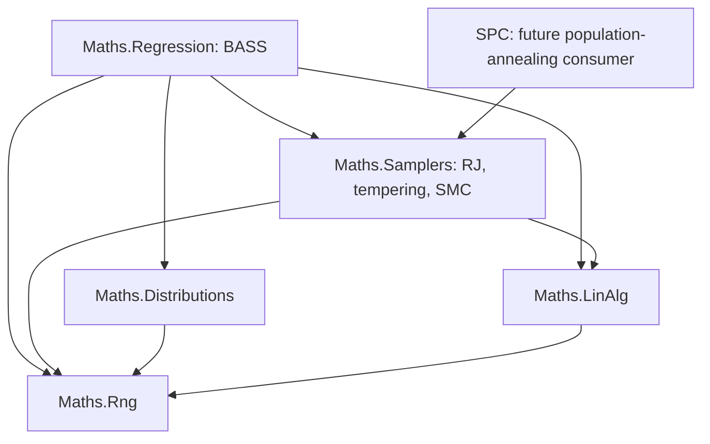

# Full BASS port brief

Date: 2026-10-18. Status: planning brief. Source-code implementation is not authorized by this document.

Add the complete BASS regression capability to `Maths.Regression`, alongside BARS, BAPS, and BGP. Preserve arbitrary predictor dimension, mixed continuous and categorical inputs, scalar and functional responses, posterior prediction, sensitivity analysis, and emulator calibration. Build the C# implementation around explicit statistical targets, owned numerical state, and the repository's existing dependency direction.

SMC is a planned optional inference backend. Its general sampling machinery belongs in `Maths.Samplers`; the BASS model, target sequence, moves, and calibration semantics remain in regression. A future SPC population-annealing consumer is a separate workstream.

The [public inventory and backend review](bass-public-inventory-and-backend-review.md) supplies the detailed source evidence, public capability IDs, reproduced helper defects, and unresolved sampling questions. This brief turns that analysis into scope, ownership, implementation stages, and decision gates.

The [adaptation prerequisites review](bass-adaptation-prerequisites-review.md) establishes the existing-engine repair and qualification work. Repair and independently test the current regression engine and reused infrastructure before integrating BASS. Existing-engine repairs remain separately scoped and evidenced; their completion supplies the baseline against which the new capability is developed and tested.

## Scope and completion contract

The baseline is BASS 1.3.1 at source commit `26710146c623a258854162367a939041efedd091`. The ThermoMapper analysis baseline is commit `c82c6368b151d28d14dfa1f2076de633efd125b1`, with working-tree documentation considered separately. The R checkout is `D:/aghado01/packages/BASS`.

Full coverage means the six exported functions and nine S3 methods in the inventory. C# need not reproduce R's object system, dimension dropping, accidental bugs, or unqualified stochastic transitions.

| Inventory IDs | R public surface | Required C# capability |
|---|---|---|
| P01 | `bass` | Scalar and direct functional fitting with continuous, categorical, or mixed predictors; hierarchical parameters; structural moves; tempering; posterior retention and restart. |
| P02 | `bassPCA` | Response decomposition, rank/variance selection, independent component fits, reconstruction, and response transformations. |
| P03 | `bassBasis` | Prepared coefficient responses under a supplied output basis, including nonorthogonal bases. |
| P04 | `sobol` | Direct-model sensitivity under declared independent input measures, including functional conditioning and applicable effect functions. |
| P05 | `sobolBasis` | Sensitivity of reconstructed output, retaining cross-component terms, interaction selection, and residual `other` contributions. |
| P06 | `calibrate.bassBasis` | Bounded numeric parameter calibration with both covariance formulations, noise groups, emulator and truncation uncertainty, discrepancy, and an explicit inference target. |
| P07, P08 | `predict.bass`, `predict.bassBasis` | Selected posterior draws, latent and predictive output, direct-functional prediction at new coordinates, basis reconstruction, and truncation uncertainty. |
| P09, P10, P11 | Three plot methods | Trace, fit/residual, interval, and sensitivity data from regression; rendering adapters above maths. |
| P12, P13, P14, P15 | Two print and two summary methods | Inspectable model metadata and posterior summaries, with formatting above the mathematical engine. |

Three response representations are required from the start of the contract design:

| Representation | Data shape | Meaning |
|---|---|---|
| Scalar | `X: n × p`, `y: n` | An adaptive surface over any supported number of predictors. |
| Direct functional | `X: n × p`, `T: m × d`, `Y: n × m` | Jointly learn `f(x,t)` and predict at new predictors and output coordinates. All cases share the same complete set of output locations; those locations need not form a Cartesian grid. |
| Supplied basis or PCA | `K: m × r`, coefficient responses `W: r × n`, offsets/scales | Fit coefficient surfaces and reconstruct vector, curve, or field output. The basis is fixed during fitting. |

The port is not restricted to two predictors, two response coordinates, or a scalar-only first release. Implementation stages may establish those cases as fixtures without redefining completion.

Preserve separate continuous, categorical, and functional interaction caps; positive integer hinge degree; support constraints; basis-count cap; both coefficient-prior modes; variance, precision, and count-intensity controls; and sampling/storage controls. Capacity limits and statistical priors are distinct. With a full-rank Gram design, the intercept counts toward the dimension bound.

Prepared output-basis input includes its coefficient responses and response transformations. Solving arbitrary coefficients from a supplied basis, evaluating a fixed basis at new output locations, ragged observations, missing-response imputation, classification, non-Gaussian fitting, correlated-input Sobol analysis, and learned projection directions are extensions beyond the active R baseline.

## Existing engine baseline before integration

The purpose of this gate is to prevent pre-existing defects from confounding BASS implementation or its evaluation. The reviewed current-engine problems must be addressed before BASS runtime integration; BASS must not become the first test of whether the existing infrastructure is correct. Independent specification and oracle design can proceed while that baseline work is planned.

The [review's remediation register](bass-adaptation-prerequisites-review.md#existing-engine-remediation-register) owns the detailed findings R01-R12, repair batches B01-B06 and closure criteria. All repair/qualification batches are pending. Source confirmation is not a passing runtime test, and a historical repair is not a newly open code defect. The [preparation brief](bass-preparation-brief.md) sequences B01–B03 and B06 together with the existing-engine slice of stages 2–3; B04 and B05 run under a [separate chip brief](baps-bgp-baseline-repairs-brief.md).

| Baseline batch | Work before integration | Ownership and relationship to BASS |
|---|---|---|
| B01 Diagnostics | Correct the NaN/infinite R-hat stopping path, minimum-data policy and misleading BARS diagnostic display. | General diagnostic/stopping mechanics in Samplers; result presentation in Regression. Direct shared prerequisite. |
| B02 Mutable state and adaptation | Give adaptive kernels explicit private ownership; enforce the same tempering/adaptation rule on every construction path; preserve meaningful adaptation counters across chain rebuilds. | Regression constructs its model kernels; Samplers owns general execution/state contracts. Direct prerequisite for safe parallel chains and a pattern to qualify before particles. |
| B03 Existing BARS statistical contracts | Resolve the count/location prior measure, robust plug-in conditioning, singular-design policies and conditional-mean versus full-posterior uncertainty. | Separate BARS repairs in Regression. Qualify the existing engine and any comparisons against it; do not copy BARS's statistical target into BASS. |
| B04 Existing BAPS statistical repairs | Resolve the improper log-lambda tail in `MarginalEvidence` and the stale hierarchical deviation statistic. | Separate BAPS repairs in Regression. Close these baseline issues without making P-spline smoothing part of BASS. |
| B05 Existing BGP support and protection | Validate bandwidth support and coordinate assumptions; protect the already-local GP scratch storage; correct the unsupported scaling-theorem claim. | Separate BGP work in Regression. No speculative GP kernel redesign is required by the review. |
| B06 Existing numerical qualification | Inventory reused/affected factor paths and verify their solve, determinant, sampling and failure contracts; distinguish deliberate regularization from hidden numerical changes. | LinAlg reports status; Regression owns model admission. The strict/incremental backend added in stage 2 must be qualified separately before BASS uses it. |

Keeping these repairs separate is a scope and provenance boundary, not permission to postpone the reviewed defects until after integration. Close the baseline with independent reproductions or counterexamples, settled statistical specifications, separately attributable repairs, and affected-suite results at a recorded source revision. An approximation may remain only with an explicit supported contract; it cannot serve as an exact-posterior oracle. Additional unrelated subsystem fixes and hypothetical regression enhancements remain outside this gate.

The direct shared prerequisites are correct stopping, owned mutable state, coherent density-cache updates, reliable numerical status and valid coefficient uncertainty. Some require existing repairs; others require the additions in stages 2-3. Recheck the qualified existing-engine baseline after those shared contracts change and before the first BASS integration tests. The current source revision is an analysis baseline, not yet a qualified integration baseline.

## Placement and dependency boundaries

Use the existing `Maths.Regression` assembly. Its compile inclusion already covers a new `src/maths/regression/spline/bass` subtree. The following folders describe responsibility; exact type names and file granularity remain implementation choices.

| Proposed owner under `src/maths` | Responsibility |
|---|---|
| `regression/spline/bass/` | Public operations, declarative configurations, validated data contracts, result metadata. |
| `bass/basis/` | Normalized powered hinges, categorical subsets, product terms, term identity and category encoding. |
| `bass/design/` | Scalar and separable functional design evaluation, sufficient statistics, accepted/candidate workspaces. |
| `bass/model/` | Structural and hyperparameter state, priors, coefficient marginalization, log targets. |
| `bass/sampling/` | BASS birth/death/change proposals, hyperparameter blocks, complete sweeps, ensemble and SMC adapters. |
| `bass/posterior/` | Retained structures and draws, weights, prediction, summaries, diagnostic data, checkpoints. |
| `bass/output/` | Supplied-basis/PCA preparation, component orchestration, reconstruction and truncation uncertainty. |
| `bass/sensitivity/` | Hinge moments and product-measure contractions, Sobol indices, effect functions. |
| `bass/calibration/` | Emulator-facing calibration contracts, covariance assembly, discrepancy/noise models, parameter transforms, cut-posterior orchestration. |

In the abbreviated rows, `bass/` means `regression/spline/bass/`. Keep BASS-specific output, sensitivity, and calibration facilities there initially. Extract broader regression contracts when another concrete engine needs them, rather than introducing a universal regression framework as a prerequisite.

Arrows below mean **depends on**:

The existing assembly references already permit these directions. SPC's existing reference to Samplers does not mean its runtime already implements population annealing.

Boundary rules:

- Samplers owns general acceptance, replica exchange, importance weighting, resampling, and population execution. It receives generic states and supplied density/transition operations. It does not inspect knots, category labels, response bases, graph edges, or spins.
- Regression owns model meaning: likelihoods, priors, term proposals, response units, the target sequence chosen for BASS, posterior readouts, and which statistical feedback calibration cuts.
- LinAlg owns factorization, solves, SVD, and general matrix contractions. It does not decide whether a BASS term is statistically admissible or whether a ridge prior should be introduced.
- Distributions owns general probability densities, CDFs, truncation, and interval moments. BASS owns integration of its hinge products and ANOVA structure.
- Fitting does not depend on sensitivity or calibration. Those operations consume model/posterior contracts. Rendering and command ergonomics consume results above maths.
- SPC retains its SW kernel, physical temperature policy, thermal observables, and run orchestration. Neither Regression nor Samplers acquires an SPC or Graphs dependency.

Generic contracts belong to the consuming lower-level algorithm. Upper-level implementations can be passed through them without a reverse assembly reference. Configs remain declarative and serializable; delegates, execution objects, and workspaces travel through calls. Follow [AGENTS.md](../../AGENTS.md) and [CONTRIBUTING.md](../../CONTRIBUTING.md).

## Reuse and shared renovations

| Existing surface | Treatment | Concrete work |
|---|---|---|
| [ReversibleJumpChain and proposal machinery](../../src/maths/samplers/rjmcmc/ReversibleJumpChain.cs) | Reuse with targeted expansion | Preserve proposal/Jacobian/reverse-selection accounting and telemetry. BASS supplies its own state/moves. Make cache refresh and state replacement safe after hyperparameter or target-stage changes. |
| [IRjTarget](../../src/maths/samplers/rjmcmc/IRjTarget.cs) | Generalize | Move its model-neutral log-density responsibility into a neutral sampler target contract usable by RJ, tempering, and SMC. Migrate callers cleanly. |
| [ParallelTempering](../../src/maths/samplers/rjmcmc/ParallelTempering.cs) | Expand and relocate | Replace concrete RJ-chain construction with per-replica kernel factories and explicit state exchange. Put general replica exchange in `samplers/tempering`; retain RJ mechanics in `samplers/rjmcmc`. |
| [IChain](../../src/maths/samplers/ensemble/IChain.cs), [IEnsembleModel](../../src/maths/samplers/ensemble/IEnsembleModel.cs), ensemble execution | Reuse after qualification | A complete BASS sweep presents as a chain. BASS supplies invariant readouts and its rich posterior accumulators. Construct private mutable kernels/workspaces and preserve cumulative statistics across state or target replacement. |
| [ChainEnsemble](../../src/maths/samplers/ensemble/ChainEnsemble.cs), [ChainDiagnostics](../../src/maths/samplers/ensemble/ChainDiagnostics.cs) | Repair in stage 0, then expand | Undefined/infinite R-hat must not count as convergence or be displayed as zero. Qualify minimum-data and constant-functional policies first. Add trace-based rank-normalized split/folded diagnostics and appropriate bulk/tail ESS in the shared renovation stage. Particle diagnostics remain separate. |
| [CholeskyDecomposition](../../src/maths/linalg/Cholesky.cs) | Add a strict factorization path | Explicit status, rank/conditioning information, solves into buffers, bordered insertion, deletion/replacement, and rebuild checks. Do not silently inherit pivot flooring or eager inverse construction. |
| [MatrixOps](../../src/maths/linalg/MatrixOps.cs) | Reuse and expand | Reuse dot products and column-oriented Gram operations; add general contractions as needed. Term evaluation and cache semantics stay in BASS. |
| [PCA](../../src/maths/linalg/PCA.cs) | Expand | Add stable thin SVD and numerical-rank handling in LinAlg. BASS owns response scaling and its coefficient convention. SVD implementation/provider selection is a numerical design task. |
| Covariance solve/log-determinant operations | Add in LinAlg | Diagonal-plus-low-rank operations for functional calibration, plus the strict dense path for full covariance. Calibration supplies the covariance components. |
| [Normal](../../src/maths/distributions/Normal.cs), [Gamma](../../src/maths/distributions/Gamma.cs), [Beta](../../src/maths/distributions/Beta.cs), [SpecialFunctions](../../src/maths/distributions/SpecialFunctions.cs) | Reuse and expand | Add inverse-gamma/truncation support and stable normal/Student interval probabilities and moments. Make rate versus scale explicit. |
| [Xoshiro256PlusPlus](../../src/maths/rng/Xoshiro256PlusPlus.cs), [SeedTree](../../src/maths/rng/SeedTree.cs) | Reuse and expand where needed | Preserve RNG capture/restore. Supply reproducible independent offspring streams for resampling and stable component/replica identities. |

The generalized sampling contracts affect existing `SplineTarget`, `BarsEnsemble`, and sampler tests. First record the intended statistical corrections in the existing-engine repair track. Then migrate callers against that qualified baseline without further incidental model changes. Do not preserve a known incorrect distribution merely to keep old expectations green. During refactoring, follow the repository's staged replacement and final cleanup discipline; the end state has no compatibility aliases.

Several existing components provide useful patterns but cannot be substituted unchanged:

- [IBasis](../../src/maths/regression/spline/IBasis.cs) and `KnotConfig` describe one-dimensional ordered knots. Preserve that meaning; BASS needs multivariate product terms.
- [BAPS TensorProductDesign](../../src/maths/regression/spline/baps/TensorProductDesign.cs) constructs a fixed bivariate B-spline basis. It is not BASS's changing interaction basis.
- [BandCholesky](../../src/maths/linalg/BandCholesky.cs) provides sampling/factorization patterns, but BASS's active-term Gram is generally dense.
- [WeightedNormalModel](../../src/maths/regression/spline/bars/WeightedNormalModel.cs) has a different coefficient prior and marginal target. Its numerical operations are reusable; its statistical formula is not the BASS formula.
- [IObservationModel.SampleCoefficients](../../src/maths/regression/spline/bars/IObservationModel.cs) defaults to a conditional mean. Weighted Normal inherits that behavior. Do not treat this as a full posterior draw or reuse its extrema intervals as a complete uncertainty reference.
- BARS's fixed complexity-prior helpers do not implement BASS's sampled count-intensity hierarchy.

Existing covariance callers may legitimately require regularization or inverse output. A new strict factor path must not silently change their semantics. No blanket conversion of the existing engines from one dimension to two dimensions is required.

## Numerical and operation contracts

### Dense factor maintenance

Establish a strict full-factorization implementation as the reference. Then add bordered births, Givens-based deletions, and initially a staged delete/insert for a changed term. A border extension changes dimension; it is not a same-size rank-one update. A replaced Gram row and column has a symmetric change of rank at most two.

Use relative finite/rank/conditioning checks and periodic or triggered full rebuilds. A fixed absolute `1e-12` threshold alone is not a scale-aware admission policy. When an incremental update fails because of accumulated numerical error, check a strict rebuild before deciding that the candidate is inadmissible. Singular g-prior designs cannot be made mathematically defined merely by hiding a ridge inside the factorization. A different proper coefficient prior may admit a rank-deficient design; LinAlg must not impose a universal statistical rejection policy.

Candidate numerical work remains private until acceptance. Rejection leaves the accepted state unchanged. Coefficients are drawn using precision-factor triangular solves, not a materialized inverse. Factor maintenance can cost `O(M²)` while term evaluation and data cross-products retain separate data-dependent costs.

### Direct functional algebra

Let `A` contain case-side factors and `H` output-location factors. Preserve the R implementation's separability:

\[
G=(A^\top A)\circ(H^\top H),\qquad h_j=A_j^\top YH_j.
\]

The BASS design layer owns construction and caching of `A` and `H`. General numerical contractions may live in LinAlg. Avoid materializing the full `nm × (M+1)` design. Dense contraction with `Y` still depends on the response-grid size.

### Response basis conventions

R's PCA construction uses `Y_scaledᵀ = U D Vᵀ`, basis `K = U_r D_r`, and coefficient responses `W = V_rᵀ`. Passing ordinary PCA scores directly into the component regressions would change response scale, priors, and residual-noise interpretation.

Handle rank, constant output columns, full variance retention, component signs, and repeated singular values explicitly. Compare reconstructions or subspaces when individual components are not identifiable. Supplied bases can be nonorthogonal. Independent coefficient fits still require cross-component terms when sensitivity is reconstructed under the input measure.

### Posterior ownership and prediction

- Keep immutable retained structures/draws separate from mutable per-chain or per-particle workspaces. Pooled buffers must never back retained samples after reuse.
- Store optional training predictions separately from posterior state. Intern repeated structures where useful without introducing mutable aliases.
- Preserve requested draw order and explicit draw × case × output axes, including singleton cases.
- Separate conditional-mean estimation from full latent-function draws. Retained uncertainty and nonlinear functionals must include conditional coefficient variation, using valid conditional draws or an independently justified integration method.
- Separate latent function draws, per-case observation noise, and empirical truncation residual vectors. Preserve within-output correlation and apply response scale and residual orientation consistently.
- Fit one input transform and reuse it everywhere. Specify behavior for constant columns, unseen categories, and extrapolation.
- Keep posterior storage separate from checkpoints. Checkpoints include actual RNG state, iteration/stage, adaptation state, replica/particle mapping, and data/config identity.
- Bound component, chain, replica, particle, and numerical-worker parallelism together. Read-only training data may be shared; mutable scratch and RNG streams may not.

Prediction, sensitivity, and summary operations must support weighted posterior draws. Reconstructed output from independent component posteriors must form valid joint draws rather than assuming incompatible component weights align by index.

## SMC integration

Sequential Monte Carlo belongs beside existing general sampling algorithms. It is not a replacement for required BASS MCMC/tempering capability, and it does not define the statistical model.

The existing-engine baseline and the shared primitives used by its adapter must pass their qualification gates first. SMC does not repair an improper final target, a missing prior-density factor or an invalid conditional mutation. Reuse the ownership and cache-consistency checks for particle cloning and target-stage changes, with independent offspring RNG streams and workspaces.

| Consumer | General machinery in `samplers/smc` | Consumer-owned work |
|---|---|---|
| BASS fitting | Weighted population, resampling, stage advancement, mutation execution, ancestry and normalizer-ratio estimates | Initial distribution, target sequence, structural/hyperparameter moves, posterior readout. |
| BASS cut calibration | Reuse the population machinery across conditional distributions | Emulator-draw selection, conditional calibration targets, bridges, and outer averaging. |
| Future SPC population annealing | Reuse population mechanics | Potts energy, SW updates, physical temperature selection, state transfer, and thermal measurements. |

The generic module needs log-weight normalization; resampling methods; a population driver over supplied target distributions; optional adaptive intermediate stages; mutation execution with private workspaces; particle diagnostics; and checkpoint state. Its contracts must support density evaluation, initialization, advancing a particle, and safe state transfer/forking. Exact type names should be chosen after mapping these operations to existing contracts.

Keep weight ESS, ancestry/family diversity, and population diagnostics separate from independent-chain R-hat and autocorrelation ESS. Equal weights after resampling do not establish independent particles. A normalizer ratio becomes Bayesian model evidence only when the model and starting normalization justify that interpretation.

The current [TemperedTarget](../../src/maths/samplers/rjmcmc/TemperedTarget.cs) powers the whole log posterior. A likelihood bridge, a powered collapsed posterior, and a marginalized powered joint model are different paths. BASS must declare its path; replica swaps and all mutation blocks must preserve the corresponding stage target. A general replica-exchange implementation should evaluate the required cross-target densities rather than assume every path has the current simple power form.

**Exact reference rung (tracked as OQ2 in the preparation brief).** The same machinery gives parallel tempering a β = 0 rung drawn exactly from a normalized reference, which turns each annealed restart into an independent draw, the setting of Syed et al.'s round-trip analysis. BARS has one on both paths: the knot prior on the likelihood path (with a proper variance prior for the Normal model), and k ~ Poisson(1) with uniform ordered locations on the powered path. Build it here, then rerun the preparation brief's OQ1 tempering comparison.

BASS's default improper variance prior cannot initialize a prior-to-posterior SMC run. Select a proper-prior mode or a specified normalized reference distribution with appropriate support. A proper final posterior alone does not make the prior a valid initial particle distribution or establish a marginal likelihood.

For cut calibration, the intended form to investigate is

\[
p_{\mathrm{cut}}(e,\theta\mid D_{\mathrm{sim}},y)
=p(e\mid D_{\mathrm{sim}})\,p(\theta\mid y,e),
\]

where `theta` includes calibration, noise, and discrepancy parameters as applicable. Establish a nested conditional reference first, with finite inner-sampling error assessed. Then use SMC to transport conditional populations while preserving the upstream emulator-draw distribution. Ordinary joint SMC reweights the emulator and therefore solves a different problem. Variable-dimensional emulator draws should be handled through their induced conditional densities, not by blindly interpolating incompatible term arrays. See [Mathews et al.](https://arxiv.org/html/2406.07555v2).

## Statistical decisions to settle

These decisions remain open until their density, base measure, transitions, and validation references are recorded. The directions below are recommendations, not settled mathematical specifications.

| ID | Decision | Recommended direction and required evidence | Gate |
|---|---|---|---|
| D01 | Term representation and prior measure | Specify ordered/unordered terms, repeated-term policy, support constraints, distinct variables within terms, and exact forward/reverse subset probabilities. Include boundary birth/death/change selection probabilities. Use tiny enumerable cases and count-law checks under a constant likelihood. Derive BASS's measure independently of the BARS correction in R01. | Before structural moves. |
| D02 | Count prior at the capacity limit | Choose a conditionally normalized truncated Poisson with an independent intensity prior, or a globally truncated joint prior. Derive the intensity update; the first choice does not retain a simple Gamma conditional without its cap normalizer. | Before count/intensity updates. |
| D03 | Coefficient-prior modes and posterior propriety | Derive both `g` and `jeffreys` targets, including intercept treatment, dimension-dependent constants, and variance/precision parameterization. State where posterior sampling and evidence reporting are defined. | Before target and initialization APIs. |
| D04 | Collapsed and conditional update order | Prefer a coefficient-marginal target with valid hyperparameter transitions and conditional coefficient draws for retained predictions. If partial collapse is retained, justify the complete scan. State which current values each conditional uses and when cached statistics/densities refresh. Do not copy the stale-statistic or plug-in-conditioning patterns identified in R03-R04. | Before complete BASS sweeps. |
| D05 | Tempering and SMC target paths | Specify which density is powered, internal-coordinate Jacobians, a valid initial distribution, and cross-target swap/incremental-weight formulas. Marginalization and tempering must not be assumed to commute. | Before hot replicas or SMC. |
| D06 | Numerical model admission | Define the relationship between rank/support restrictions and the model space, relative tolerances, rebuild criteria, and rejection reasons. Ridge regularization must be an explicit prior choice. | Before optimized factor updates. |
| D07 | Response units and uncertainty | Fix PCA/basis scaling, residual orientation, empirical truncation distribution, independence across cases, and covariance transformation into physical units. Include conditional coefficient uncertainty; a mixture of conditional means is not the full posterior distribution. Keep basis-estimation uncertainty outside the baseline unless explicitly modeled. | Before predictive uncertainty and calibration. |
| D08 | Sensitivity measures and moments | Specify independent input measures, category probabilities, mixture/truncation conventions, Student scale/degree edge cases, and zero-variance behavior. Qualify moments against quadrature/enumeration, including higher hinge degrees. | Before sensitivity release. |
| D09 | Calibration target and covariance formulations | Choose and document cut versus other inference semantics; use the cut formulation as the initial candidate matching the modular workflow. Make both covariance formulations and each variance-group prior explicit. Derive discrepancy/noise updates and enforce cache/unit consistency. | Before calibration reference and cut SMC. |
| D10 | Diagnostic and stopping semantics | Choose invariant functionals, minimum trace/population requirements, handling of undefined/infinite diagnostics and constant functionals, and method-appropriate uncertainty estimates. Carry the repaired stopping/display policy from B01 into new adapters. Distinguish posterior uncertainty, Monte Carlo error, and outer data/bootstrap uncertainty. | Before automatic stopping or performance claims. |

Each resolution should record the chosen specification, equations, rationale, scope of any approximation, and an independent check. Preserve rejected alternatives when they explain a consequential tradeoff. Update the relevant design notes before code relies on the decision.

## Implementation stages

Repair and verify the existing engine first, then qualify shared additions, then integrate BASS. Engine correctness is established with analytic, enumerated, numerical, and oracle references before application integration. Specification and reference design can proceed independently of stage 0. The generic SMC core may be developed during stage 3; its BASS adapters wait for the baseline, their target and reference calculations.

| Stage | Deliverable | Completion evidence |
|---|---|---|
| 0 | Existing-engine remediation and baseline qualification, separately scoped as B01-B06 in the review | Independent defect fixtures/counterexamples, resolved statistical contracts, attributable repairs, historical-fix protection, and passing affected suites at a recorded revision. No BASS integration is used to establish this baseline. |
| 1 | Statistical specification, all response/data/result contracts, pinned reference corpus, decision register | All P01-P15 capabilities assigned; initial decisions resolved for the first kernels; known R defects distinguished from intended behavior. |
| 2 | Strict dense factors, incremental operations, distribution additions, low-rank covariance solves, SVD path | Full/dense reference comparisons, randomized update sequences, rejection immutability, rank cases, precision-draw covariance checks. |
| 3 | Neutral sampler targets, hybrid-capable replica exchange, safe cache/state transfer, diagnostic expansion; standalone SMC core if undertaken | Analytic/enumerable targets and independent sampler tests. Re-run the qualified existing-engine checks after migration and preserve the corrected statistical contracts. |
| 4 | Complete mixed-predictor scalar/direct-functional BASS fitting, prior modes, hybrid MCMC/PT, retention and restart | Stage 0 and the consumed stage 2-3 facilities are qualified first. Explicit tiny functional designs match contractions; transition/conditional checks; controlled posterior recovery; restart/replay tests. |
| 5 | Supplied basis, PCA, component execution, prediction and uncertainty | Reconstruction/scaling identities, rank edge cases, per-case noise, truncation residual tests, singleton/order checks. |
| 6 | Direct and reconstructed-output sensitivity and effects | Quadrature and category enumeration, variance identities, cross-component moments, posterior-draw ordering, zero-variance handling. |
| 7 | Both calibration covariance formulations and an explicitly targeted reference sampler | Dense covariance comparisons, units/cache tests, controlled recovery, and quantified conditional-reference error. |
| 8 | BASS fitting SMC adapter, then cut-calibration SMC adapter | Agreement on reference posterior quantities; proper initialization and weight checks; diversity diagnostics; statistical error versus runtime. |
| 9 | Summary/plot presentation above maths and updated documentation | Useful R diagnostic purposes covered; no rendering dependency enters maths; documented capabilities and limitations match implemented contracts. |

Stages 4-7 cover full BASS functionality rather than an optional expansion from a scalar prototype. Presentation is sequenced after engine correctness. The reviewed BARS/BAPS/BGP repairs are separate upstream work whose qualification is required by stage 0. Additional unrelated regression enhancements, SPC population annealing and application wiring remain separate and do not expand the BASS completion contract.

Track full BASS capability completion separately from availability of each optional SMC backend. A scalar fit alone is not a completed BASS port; a general SMC core alone is not completed BASS SMC support.

## Validation and performance qualification

Record existing-engine checks and BASS checks separately. Before integration, reproduce the current defects independently and close the review's B01-B06 register. After each shared-infrastructure change, rerun the affected qualified baseline checks before attributing any new discrepancy to BASS. Known incorrect historical outputs are defect fixtures, not gold standards to preserve.

Tests follow ownership:

- Add BASS coverage under `tests/regression`, using the existing Regression test host.
- Extend existing LinAlg and Distributions tests for their new primitives.
- Add a dedicated Samplers test host for new general sampling machinery, using targets that do not depend on Regression or SPC. Migrate existing generic tests only as an explicit part of that ownership cleanup.
- Reuse the [R oracle bridge](../../tests/oracle/ROracle.cs) and add pinned BASS scripts/fixtures under `r/oracles` and the oracle test infrastructure. Pin the reference package/source and required test dependencies; production C# must not require R.

Use deterministic R comparisons for basis evaluation, sufficient statistics, prediction, reconstruction, and sensitivity formulas where the R result is qualified. Where the inventory identifies an R defect, use corrected mathematical expectations and retain a regression fixture for the defect. Do not require identical random trajectories across languages.

Independent checks must cover boundary proposal ratios, enumerable model spaces, Gaussian conditionals, precision sampling, empirical covariance, functional contractions, sensitivity identities, and calibration targets. SMC tests include a known initial distribution, incremental weights, normalizer ratios, resampling, state ownership, and populations whose modes are known. Numerical agreement with a fresh factorization is necessary but not sufficient for a correct statistical target.

Essential edge cases include intercept-only models; one predictor, response component, case, or draw; constant columns/responses; nearly dependent terms; more than 64 category levels; category probabilities of zero; bounded/truncated input measures; full PCA rank; and rejected proposals that leave the current state untouched.

Benchmark by case count, predictor count, active terms, interaction order, response size/rank, and category cardinality. Measure allocation and peak memory, factor work, basis/cross-product scans, sensitivity moment work, and statistical error per unit time. Use method-appropriate diagnostics: particle weight ESS and autocorrelation ESS are not interchangeable performance currencies. Do not assume a speedup from changing languages; R already delegates substantial dense algebra to compiled routines.

## Modernization choices and deferred extensions

| Category | Scope |
|---|---|
| Engineering work preserving a specified model | Private reusable buffers, bounded allocation, column-oriented evaluation, hardware-dispatched SIMD with scalar fallback, incremental factor maintenance, category bitsets with a representation above 64 levels, stable moments and explicit error status. |
| Additional kernels preserving the target when correctly derived | Variable-replacement/coordinated moves and residual-informed proposal mixtures with exact forward/reverse probabilities and exploratory support. Validate before making them defaults. |
| Distinct statistical model or representation extensions | Sparse Dirichlet priors, learned projections/directional hinges, intrinsic-dimension restrictions, new likelihoods, dependent-input sensitivity, or basis-estimation uncertainty. Give each its own specification and acceptance criteria. |

**Exploratory support in BASS's own births** (added 2026-10-21).
- **What BASS does.** Its births draw knots from observed values. They choose interaction orders and variables with weights `w1` and `w2` (both 5) added to the current model's counts.
- **Why the pseudo-counts matter.** A death's acceptance carries the reverse birth's probability of the removed term, given the reduced model. With `w1` or `w2` at 0, a variable used only by the removed term would have proposal probability 0 there, so its death could never be accepted.
- **What the port does.** It keeps both weights positive and validates them as such, never offering 0.
- **The evidence.** BARS lacked such a component: its births were local only. A 10% uniform component cut its knot count's autocorrelation time 12× and about 20× on two fits (preparation brief, OQ11 and step 3.9).

**Parked extension (2026-10-20): free-knot tensor-product surfaces.**
- **What.** An expensive variant that carries BARS's continuous knot moves (birth, death and relocation per input dimension) to tensor-product spline surfaces, reserved for low-dimensional problems where its cost is tractable.
- **Pieces it would reuse,** once the BASS upgrades are done: the shared g-prior block, the `IBasis` carrier seam, the reversible-jump engine and the ensemble shell.
- **Cost.** For scattered data the Gram matrix is block-banded rather than a Kronecker product, so factor cost grows quickly with the per-dimension basis sizes.
- **Before designing it,** survey prior work on Bayesian free-knot surface splines. This is outside the completion contract.
- **Prior work found (2026-10-20).** He, Yang and Kang's EBARS (arXiv 2405.13353, 2024), published in *Biometrics* (2026) as ABMRS. The published details are still to be verified, against the preparation brief's step 3.8 checklist. It is the multivariate BARS this extension describes:
  - a discrete candidate grid on each axis, with tensor-product B-splines;
  - the same collapsed g-prior marginal (their Lemma 1);
  - Green's prior-aware schedule on the EBIC count law;
  - EBIC plug-ins for non-normal responses.

  The rest of the survey stays open.
- **Design notes from reviewing it:**
  - **Support.** Step 3.7's column-mass support gate carries over unchanged, as Σᵢ Πₐ Bⱼₐ(xᵢₐ) over tensor columns. Near-empty corner cells are common there.
  - **Diagnostics.** Track knot counts per axis separately from the basis-column count. A birth on axis j adds Πₐ≠ⱼ(kₐ + pₐ + 1) columns at once, though the move itself is one-dimensional.
  - **Assembly.** Z's rows are row-wise Kronecker (Khatri–Rao) products with (p+1)^d nonzeros each. Accumulate G sparsely, at O(n·(p+1)^(2d)) rather than O(nν²); a move changes only its axis's one-dimensional basis matrix.
  - **Factor.** In lexicographic order the Gram is block-banded with half-bandwidth about p·ν₂ + p. Use a wide-band factor or step 2.2's `DenseCholesky`, chosen by size.

Do not make AVX2 mandatory, equate a single `ulong` with complete categorical support, use marginal residual correlations to exclude interaction-only signals, or silently bound interaction order by an intrinsic-dimension estimate. A new prior is not merely a faster proposal. The [prerequisites review](bass-adaptation-prerequisites-review.md#corrections-to-bass-modernization-claims) supersedes unsupported fixed speedup, acceptance-rate, and branch-misprediction assumptions in the earlier notes: R's positive-part helper already uses `(abs(x)+x)/2`, and BASS already weights interaction orders and multi-variable proposals. Neither a 50% branch-misprediction rate nor a universal acceptance threshold at 20 predictors is established. Locally balanced proposal normalizers and sparse subset priors need their own derivations.

## References and documentation updates

- [BASS public inventory and backend review](bass-public-inventory-and-backend-review.md): source evidence and P01-P15 coverage.
- [BASS adaptation prerequisites review](bass-adaptation-prerequisites-review.md): verified current behavior, corrections to the digest, and the separate B01-B06 existing-engine repair/qualification register.
- [BASS derivations and integration review](bass-derivations-and-integration-review.md): proposed resolutions for D02, D04, D05 and D06, a D03 finding on R's τ hyperprior, the collapsed g-prior target shared with BARS, and ranked integration opportunities.
- [SMC and architecture discussion](astra-smc-in-thermomapper.md): distinction between inference targets, sampling mechanics, and SPC consumers.
- [Initial adaptation notes](discussion/gemini-bass-adaptation-notes.md) and [BASS 2.0 ideas](discussion/gemini-bass-2.0.md): proposals reconciled with source evidence and the decision register; preserve as discussion inputs.
- [Regression issue digest](discussion/gemini-regression-bugs-digest.md): background concerns assessed by the prerequisites review; its historical and theoretical claims must retain the review's qualifications.
- [Bayesian Regression documentation](../../docs/Maths/BayesianRegression.md) and [Samplers documentation](../../docs/Maths/Samplers.md): update when the corresponding contracts and implementations land.
- [An invitation to sequential Monte Carlo samplers](https://arxiv.org/abs/2007.11936) and [Sequential Monte Carlo for Cut-Bayesian Posterior Computation](https://arxiv.org/abs/2406.07555): methodological references for the optional sampling backends.

The implementation completion report should identify the qualified existing-engine revision and B01-B06 closure evidence, then list fulfilled capability IDs, resolved BASS statistical decisions, verification results, remaining optional backends/extensions, and measured limitations. Keep baseline repairs distinguishable from port changes. The report should sit beside this brief and link back to it.
