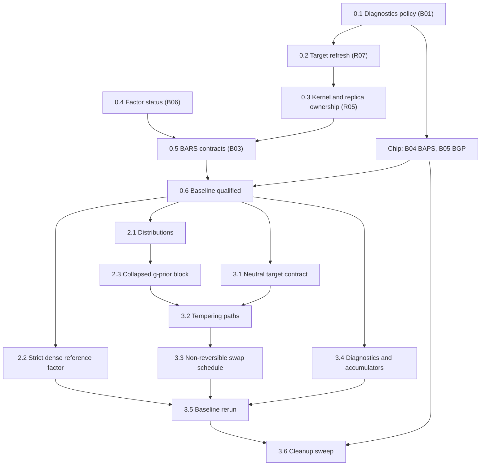

# BASS preparation brief

Date: 2026-10-19. Status: brief, not started. Each phase begins on the user's go-ahead; this document changes no source.

Prepare the existing regression and sampler engines for BASS. The work has two kinds of change: repairs of the reviewed defects, and renovations of shared contracts that BASS will consume. Each repair lands in the form BASS will reuse, so nothing is fixed twice. Repairs and refactors stay in separate commits, so every change in statistical behavior traces to a recorded repair.

Sources:

- [Full port brief](bass-full-port-brief.md): stages 0–9 and the completion contract.
- [Adaptation prerequisites review](bass-adaptation-prerequisites-review.md): findings R01–R13, batches B01–B06, closure evidence, and the baseline gate.
- [Derivations and integration review](bass-derivations-and-integration-review.md): the shared g-prior block, the tempering closed forms, and the residual and admission rules.

B04 (BAPS) and B05 (BGP) have no code path into BASS. They run in parallel under the [BAPS and BGP chip brief](baps-bgp-baseline-repairs-brief.md).

## How this brief maps onto the port stages

| Port stage | This brief | Stays in the port brief |
|---|---|---|
| 0, baseline | Phase 0: B01, B02, B03, B06 and the baseline qualification | B04 and B05 go to the chip |
| 1, specification | Nothing; it runs in parallel and takes the derivations review as input | All of stage 1 |
| 2, shared numerics | Phase 2: distributions, the strict dense reference factor, the g-prior block | Bordered and Givens updates, thin SVD, low-rank covariance solves |
| 3, sampler contracts | Phase 3: neutral targets, tempering paths, swap schedule, diagnostics expansion | The SMC core |

BASS implementation begins at port stage 4, after Phase 3 and the BASS-specific parts of stages 1–3.

## Sequence

Arrows mean **must land before**.

Steps 0.1, 0.2, 0.3 and 0.5 all touch `BarsEnsemble`, so they run in that order. Step 0.4 touches only LinAlg and can run alongside them.

## Phase 0: existing-engine baseline

### 0.1 Diagnostics failure policy (B01: R09)

Files: [ChainEnsemble](../../src/maths/samplers/ensemble/ChainEnsemble.cs#L131), [ChainDiagnostics](../../src/maths/samplers/ensemble/ChainDiagnostics.cs), the [BARS readout](../../src/maths/regression/spline/bars/BarsEnsemble.cs#L206).

- Every R̂ carries a state (estimated, constant, frozen, unavailable), and only an estimate at or below the target, or a constant functional, satisfies a stopping rule. Stopping and display report the same reading.
- Declare a minimum number of draws for stopping, and an explicit policy for a constant functional, distinct from chains frozen at different values.

This step lands first because BAPS and BGP consume these diagnostics; the chip starts after it.

### 0.2 Refresh a chain's target in place (B02: R07)

Files: [ReversibleJumpChain](../../src/maths/samplers/rjmcmc/ReversibleJumpChain.cs), [BarsEnsemble](../../src/maths/regression/spline/bars/BarsEnsemble.cs#L295).

- `ReversibleJumpChain` gains an operation that replaces or refreshes its target, recomputes the cached log target, and keeps the cumulative move counters.
- Weight resampling uses it instead of rebuilding the chain every `WeightEvery` steps. Adaptation reads the cumulative counters.
- Checks: complete and partial adaptation windows, with resampling periods that do and do not divide the window, including the default 25/200.

The same operation is what BASS needs after every τ or λ update, and what SMC needs at every stage change.

In its own commit, the same step adds a construction-time check that move pairings are reciprocal: each move's reverse must name the move back. Today the chain checks only that the reverse exists ([ReversibleJumpChain.cs:62](../../src/maths/samplers/rjmcmc/ReversibleJumpChain.cs#L62)), and a non-reciprocal palette would compute inconsistent acceptance ratios.

### 0.3 Kernel and replica ownership (B02: R05)

Files: [BarsEnsemble](../../src/maths/regression/spline/bars/BarsEnsemble.cs#L146), [ParallelTempering](../../src/maths/samplers/rjmcmc/ParallelTempering.cs#L48).

- Kernel tuning lives in the declarative config. Each chain and each tempering replica constructs its own mutable kernel and moves at the execution boundary.
- `ParallelTempering` takes a per-replica factory for moves; today it hands one instance to every replica.
- The adaptive-tempering exclusion holds on every construction path, including a supplied kernel.
- Checks: seeded serial-versus-concurrent runs agree.

This is the minimal tempering change needed for the repair; step 3.2 generalizes it.

### 0.4 Factor status (B06: R11 and the LinAlg side of R08)

Files: [BandCholesky](../../src/maths/linalg/BandCholesky.cs), [CholeskyDecomposition](../../src/maths/linalg/Cholesky.cs#L58).

- Add a status-reporting API beside the existing methods: finite values, floor hit, and a relative conditioning indicator. Existing methods keep their behavior.
- Inventory every caller and record which ones rely on intentional regularization or inverse output.
- Verify SPD solves, log determinants and precision-draw covariance against independent references.

BAPS and BGP call sites keep their current behavior until the chip completes; they migrate in the cleanup sweep (3.6).

### 0.5 BARS statistical contracts (B03: R13, R08, R12, R04, R01, R14)

Run these in order. Decisions Q1–Q4 are listed below.

**a. R13: the marginal's guard.** In [WeightedNormalModel](../../src/maths/regression/spline/bars/WeightedNormalModel.cs#L74), `a ≥ Q/(m+1)`, so the `a ≤ 0` guard rejects only an identically zero response; over-knotting is caught earlier by the `m ≤ ν` rule. Correct the guard's documentation, and pin its behavior with a check. Any near-interpolation restriction becomes an explicit admission rule under step b.

Revised 2026-10-19. The first version of this step computed `a` from an explicit residual. Re-checked before coding: for BARS's τ = 1/m the subtraction loses at most log₁₀(m+1) digits, so that change waits for step 2.3, where a sampled small τ makes it matter.

**b. R08: rank policy per model (Q4 decided 2026-10-20: reject).** Normal, Poisson, Whittle and GibbsLoss models decide admission from the step 0.4 status, under the Q4 policy. None of them scores a floored factor.
- Poisson and Whittle also need a policy for IRLS non-convergence: reject with a recorded reason.
- `PoissonModel`'s N(0, 100) coefficient ridge ([PoissonModel.cs:141](../../src/maths/regression/spline/bars/PoissonModel.cs#L141)) is intentional regularization; record it in the step 0.4 inventory and in the docs. (Done: it enters only the draw's MH correction, not the marginal or any factored matrix.)

**c. R12: full posterior coefficient draws (Q1 decided 2026-10-20: option B).** `WeightedNormalModel.SampleCoefficients` draws σ² from `IG(m/2, a/2)`, then β from `N((m/(m+1))A⁻¹b, σ²(m/(m+1))A⁻¹)`, using BandCholesky's existing precision-draw path.
- **Rule for which readouts may use the conditional mean.** A readout may use the conditional (Rao-Blackwellized) mean only if it is affine in f: the mean fitted curve, derivatives, integrals. Argmax, peak counts, spans and quantile intervals use full draws. This is the SW side's "affine, so pooling commutes" rule (`SweepEdgeCurves`), applied one level down.
- **Pointwise posterior variance** (the adaptive sweep's σ_curve) comes from the law of total variance: Var[f(T)] = E_knots[v(T)] + Var_knots[m(T)].
  - m(T) is the conditional mean, and v(T) = (a/(m−2))·(m/(m+1))·z(T)ᵀA⁻¹z(T) is the closed-form conditional variance given the knots, with σ integrated out.
  - Accumulate Σm, Σm² and Σv additively and reduce once. The result is exact, with lower Monte Carlo variance than drawing.
- **Non-Normal models.** Whittle draws from its Laplace approximation, labeled as approximate. GibbsLoss labels its nonlinear readouts as reflecting knot uncertainty only, since its posterior is already a generalized one.
- **Scope note.** The BARS-for-SPC application is not deployed, and its design is still in progress; the peak and elbow readouts penciled in so far may change. Keep the readout contract general (the rule above) rather than tailored to the current peak and elbow plan.
- Draw σ² as the reciprocal of the existing scale-parameterized Gamma, with a unit check; the explicit rate/scale API arrives in step 2.1.
- Correct the [IObservationModel](../../src/maths/regression/spline/bars/IObservationModel.cs#L35) docstring's claim that mean-based intervals are already integrated.
- Expect wider intervals for peaks, extrema and peak counts, and record that change against R12.
- `PoissonModel`'s draw heuristics (keep the first Laplace draw when the log MH ratio exceeds −10, otherwise at most five independence MH steps, then β̂) get a specification under the same rule, or are replaced.

**d. R04: exact robust weights (Q2 decided 2026-10-20: unweighted g-prior).** Student-t and contaminated-normal weights use residuals from a drawn β and the scale from a drawn σ², replacing the conditional mean and the MAD scale.
- Sweep order: structure given weights, with β and σ² integrated out; then β and σ² given structure and weights; then weights given β and σ². That order is a valid collapse-then-redraw scan.
- If an approximation is kept anywhere, it carries an explicit name and stays out of exact comparisons.

**e. R01: knot measure (Q3 decided 2026-10-20: ordered uniform plus a Conway–Maxwell–Poisson count prior).** Add `log k!` to the target. Add `ConwayMaxwellPoissonPrior(λ, ν)`; its prior ratio is λ/(k+1)^ν, so no normalizer is needed. Run the validation fits at ν = 1 and ν = 2 and record the comparison in the docs. Build the constant-likelihood count-law check generically over any reversible-jump target and move set, so BASS's D01 check reuses it. Run both move schedules (constant and DMGK) through it: that checks exactly that they sample the same posterior, replacing `DmgkScheduleTests`' |Δk̄| < 0.6.

**f. R14: span coverage as a probability.** Each covering span adds 1 to a grid point (the span-coverage loop in [BarsEnsemble](../../src/maths/regression/spline/bars/BarsEnsemble.cs)), so overlapping spans of nested peaks push π(T) above 1, and `PeakModes`' 0.5 cutoff is then not a probability threshold. Count each grid point at most once per draw (the union of spans), or rename π(T) as an expected coverage count. This is a BARS readout repair that does not gate BASS.
- **Framing.** Choose the estimand, then accumulate its sufficient statistic per draw. P(T lies inside some significant span) needs the per-draw indicator of the union. The expected number of covering spans needs the per-draw count. The union has to happen per draw, because it is part of the per-function functional.
- **Default:** the union, so π(T) means what its documentation and `PeakModes`' ½ cutoff assume. Add the count as a separate accumulator only if nesting depth turns out to matter. Confirm this when the step starts.

### 0.6 Baseline qualification

After 0.1–0.5 and the chip report:

- Run the affected suites with `scripts/fact-harness.ps1 -Project` for `tests/Maths.Regression.Tests`, `tests/Maths.LinAlg.Tests` and `tests/Maths.Distributions.Tests`, plus the new checks.
- Record the qualified revision, toolchain and results in the report section of this brief.

This closes the baseline gate in the prerequisites review.

## Phase 2: shared numerics and the g-prior block

### 2.1 Distributions

- Add inverse gamma, truncated forms, and stable normal and Student interval probabilities.
- Make rate versus scale explicit in parameter names and factories. R's τ prior (derivations review §6) is the cautionary case.
- Step 0.5c's σ² draw switches to the new API.

### 2.2 Strict dense reference factor

A solve-oriented dense Cholesky with explicit status, no pivot flooring and no eager inverse. Existing callers keep their current path. Bordered and Givens updates build on it in the port's stage 2.

### 2.3 Collapsed g-prior block

Extract the block from the repaired `WeightedNormalModel` (derivations review §1.3). It holds:

- the sufficient statistics and the explicit residual;
- the τ setting (fixed at `1/m` for BARS) and the σ² setting (integrated out for BARS);
- composition draws;
- the likelihood-tempered closed forms from review §3, behind a banded backend first.

This step is a pure refactor. BARS outputs match the step 0.6 baseline to rounding. Build it beside the existing class, switch callers, and leave deletion to step 3.6.

## Phase 3: sampler contracts

### 3.1 Neutral target contract

- Generalize [IRjTarget](../../src/maths/samplers/rjmcmc/IRjTarget.cs) into a model-neutral log-density contract that can expose log-prior and log-likelihood separately, or a closed-form tempered density.
- Migrate `SplineTarget` and the other reversible-jump callers.
- Create a dedicated `Maths.Samplers` test host whose targets depend on neither Regression nor SPC. Move the generic sampler tests there as an explicit ownership change.

### 3.2 Tempering paths

- `ParallelTempering` evaluates each swap from each replica's own target at the other replica's state, rather than the β-linear shortcut at [ParallelTempering.cs:71](../../src/maths/samplers/rjmcmc/ParallelTempering.cs#L71).
- The tempering path is declared: the powered posterior (today's `TemperedTarget`) or the likelihood-tempered path from step 2.3.
- Validate the ladder: finite, ordered, cold value 1. Q5 sets BARS's path.
- The cold-chain target is unchanged, so BARS posteriors agree in distribution with the baseline.

### 3.3 Non-reversible swap schedule

Deterministic even/odd swaps and ladder adaptation (Syed et al. 2022). Measure them by full round trips across the ladder, not by swap acceptance.

### 3.4 Shell readouts: diagnostics and accumulators

**Diagnostics.** Rank-normalized split and folded R̂, and bulk and tail ESS, built on the step 0.1 failure policy. Give ESS the same exact constant-functional handling: today a constant functional's ESS reads about C/2 or Cn depending on rounding. Then replace the 100-draw stopping floor with an ESS gate: stop only when R̂ meets the target and the per-chain ESS of the monitored functionals is at least 100.

Two clear-cut additions:
- **ESS cost.** ESS computes every lag before truncating, at O(Cn²) ([ChainDiagnostics.Ess](../../src/maths/samplers/ensemble/ChainDiagnostics.cs)). Compute lags until truncation, or use FFT autocovariances.
- **Acceptance rate.** Report it from post-burn counters; today the shell's rate includes burn-in, and BGP inherits that.

**Accumulator contract** (added 2026-10-20). Give the ensemble shell one accumulator contract that every engine's readouts use, following the SW sampler's `Accumulator`:
- additive sufficient statistics with an associative, commutative merge, so pooling across chains does not depend on order;
- an optional weight on each fold, so the same accumulator pools weighted SMC particles;
- resume state (RNG words, iteration, adaptation state) beside the statistics, so the accumulator doubles as the checkpoint the port brief requires;
- nonlinear reductions in a separate tier that reads only pooled statistics, applied once, at the level where the estimand lives.

Keep per-chain accumulators beside the merged one, because R̂ needs the chains separately. Include counts of admission rejections by reason (rank or conditioning; IRLS non-convergence; the m ≤ ν rule), so the truncation that step 0.5b introduces stays visible. The streaming moments from step 0.1 already merge this way (Chan's parallel formula). BARS's readouts move onto the contract: the step 0.5c moments, λ, π and the peak sample. BASS and the SMC backend consume it.

### 3.5 Baseline rerun

Rerun the step 0.6 checks after the migrations. Every difference must trace to a recorded repair or to a declared path change.

### 3.6 Cleanup sweep

Delete the superseded surfaces in their own commit: the old target contract, the duplicated model math, the status-less factor calls (including BAPS and BGP once the chip has closed), and the sums-based `ChainDiagnostics.RHat` overload once BAPS has moved to the moments form.

## After Phase 3: BARS mixing

Added 2026-10-19. This section sits outside the baseline gate: nothing in it is required before BASS integration, apart from the step 3.4 items already listed there. Measured on existing regression tests (Release build):

| Test | Readout | Draws (4 chains) | ESS | ESS per draw |
|---|---|---|---|---|
| `EnsembleTests.Ensemble_Converges_RHatNearOne_ConsensusSized_AndDenoises` (sine, n = 100) | Knot count | 6000 | 105 | 1.75% |
| `PeakTests.PeakPosterior_RecoversKnownPeak_WithBracketingInterval` (bump, n = 150) | Peak location | 8000 | 11 | 0.14% |
| `TemperingTests.TemperedEnsemble_RecoversPeak_ViaColdReplica` (bump, n = 150, 5-rung ladder) | Peak location | 8000 | 652 | 8.2% |

The last two runs differ in kernel and noise seed, so the tempering gain is a lead, not a result. Even after paying for five replicas per chain, it works out to about ten times more effective peak-location draws per unit of compute.

The slow mixing is mostly structural:

- **One knot per step.** Each move changes one knot, so moving between substantially different curves is a random walk through model space.
- **Near-equivalent arrangements.** Different knot arrangements that fit about equally well form separate modes.
- **A sharp target.** With β and σ integrated out, most proposals are rejected; cold acceptance was 0.088 in the tempered run.
- **Readouts differ.** Knot count and peak location mix slowest; fitted grid values mix faster.

**Clear-cut wins.** Each of these preserves the model, rests on established results, and does not depend on the dataset:

- The ESS stopping gate in step 3.4.
- ESS reported per functional and per second, with readout time separated from kernel time. Every candidate below is judged by this measure.
- After R12 adds full draws, keep the conditional-mean (Rao-Blackwellized) curve for linear readouts; its variance is never higher.
- No thinning of chains for statistical reasons: thinning loses information per unit of compute (MacEachern and Berliner 1994; Link and Eaton 2012).

**To consider when we get there.** Each needs a measurement, a derivation, or both:

| Candidate | Why | Before adopting |
|---|---|---|
| Move schedule: Green's prior-aware weights (used by DMGK) or constant weights | Neither Green nor DMGK claims faster mixing; the schedule cancels the prior from the acceptance. At equal c it never raises a birth/death flow, and at equal budget the winner depends on the regime | The comparison under **Move schedule** below |
| Tempering as the default for slow readouts | The lead above | A controlled comparison: same data, seed and kernel, with and without the ladder, at equal compute |
| Delayed rejection on relocations (Green and Mira 2001) | Never worse in asymptotic variance than the single-stage kernel | Gain per second, since each rejection costs another target evaluation |
| Informed births scored by fitted gain (ΔQ, derivations review §5) | Proposes knots where the residual says they help | Exact reverse probabilities and a full-support exploratory component; uses step 2.3's explicit residual |
| Multi-knot or split/merge moves | Larger jumps between knot arrangements | Dimension-matching and reverse-move accounting |
| Guided walk on knot count (Gustafson 1998) | Keeps a birth/death direction, damping the random walk in k | Its own derivation for the variable-dimension case |
| Readout thinning (Owen 2017) | Pays only if processing a draw costs more than producing it | The readout-versus-kernel timing above |
| SMC for BARS | Independence comes from a population rather than one time series; BARS's likelihood-tempered weights are O(1) in closed form (derivations review §3) | The port's SMC core |
| Many short chains with nested R̂ (Margossian et al.) | Uses parallel hardware without long per-chain runs | Burn-in cost per chain, and the nested-R̂ diagnostic |

**Move schedule** (added 2026-10-20). Green (1995, §4.1) chose b_k = c·min{1, p(k+1)/p(k)} so that b_k·p(k) = d_{k+1}·p(k+1), which would make a sampler over k alone accept every move. He took c as large as possible subject to b_k + d_k ≤ 0.9. DMGK (2001) use "the general scheme used by Green (1995) and Denison et al. (1998)", with c = 0.4 as in Denison et al. Neither paper claims a mixing gain; the claim in this repository was folklore. The analysis is in `BayesianRegression.md` and in [dmgk-interpretation.md](dmgk-interpretation.md), an external review of the step 0.5d discussion:
- **Flow identity.** With the prior factored out of each proposal's flow (Ã = likelihood × proposal density), F_DMGK = c·min(p_k, p_{k+1})·min(Ã_f, Ã_r), against F_const = c·min(p_k·Ã_f, p_{k+1}·Ã_r). The two agree under the prior alone.
- **At equal c,** ESJD(k) and the lag-1 autocorrelation of k are exactly ordered in favor of constant weights: relocations do not change k, so only the dimension flows enter. ESS(k) is not ordered, because DMGK's extra relocations interact with later dimension moves.
- **At equal budget** max_k(b_k + d_k), DMGK leads near a flat prior top and loses about a factor p(k+1)/p(k) where prior and likelihood conflict. At c = 0.4 under Poisson(4), DMGK's budget is 0.72 against constant weights' 0.8, so the step 0.5d sweep compared unequal budgets.
- **Measured so far.** The step 0.5d sweep used equal c on a posterior at the Poisson(4) mode, where the schedules coincide on the 3↔4 bridge. It found no ESS(k) difference.

The comparison, after the step 3.4 ESS fixes:
- **Arms:** constant weights; DMGK at c = 0.4 and at Green's budget-scaled c, which needs the 0.5 cap in `DmgkSchedule.Wrap` relaxed; a masked constant schedule at equal budget (constant weights, with zero mass on moves into zero-prior states, reassigned to relocation).
- **Regimes:** the posterior at the prior mode; prior–likelihood conflict (a Poisson(1) prior and a truth that needs about 8 knots); an active hard cap.
- **Readouts:** ESJD(k); the immediate-reversal rate, since a birth undone by the next dimension move inflates ESJD without decorrelating anything; and ESS of knot count, fit and peak location, per second. ESJD is a sum and a count, so it fits the step 3.4 accumulator contract.
- **Seeds:** at least 20 per arm and regime.

## Addendum: triage of the additional-bugs review

Added 2026-10-19. [gemini-additional-bugs.md](gemini-additional-bugs.md) compares the briefs with external deliverable reviews and lists issues they did not cover. Each claim below was checked against the source; this table records where it went.

| Finding | Checked | Destination |
|---|---|---|
| Whittle and GibbsLoss return the conditional mean | Confirmed: no `SampleCoefficients` override | Step 0.5c, decision Q1 |
| PoissonModel draw heuristics and N(0, 100) ridge | Confirmed | Steps 0.5b and 0.5c |
| No IRLS non-convergence policy | Not checked separately | Step 0.5b |
| Span coverage π(T) exceeds 1 under nested peaks | Confirmed in the coverage loop | New R14, step 0.5f |
| Move pairings not checked for reciprocity | Confirmed: only existence is checked | Step 0.2, own commit |
| ESS computes every lag, O(Cn²) | Confirmed | Step 3.4 |
| Acceptance rates include burn-in | Confirmed and already documented | Step 3.4 |
| BGP fits a zero-mean GP to the raw response | Confirmed: `GpRegression.Fit` uses the response as given | The chip, item 2 (the R10 transform policy) |
| BAPS items: single-chain hierarchical sampler, `IBandPenalty` seam, no anisotropic λ optimizer, repeated factorization in `MarginalEvidence` | The first and third already documented | The chip brief's addendum |
| `SplineExtrema` switches root finders above degree 3 | Documented design, not a defect | No action |
| `SpectralNoiseField` is not periodic over the box | Already documented | No action |
| `ExactChangepoint`: σ² documentation mismatch, Cauchy quadrature cost and truncation | Not checked | Outside this brief: no BASS path and not in the reviewed register; needs its own review |

## Decisions

| ID | Decision | Needed before | Recommendation |
|---|---|---|---|
| Q1 | What BARS's readouts mean once full draws exist | 0.5c | **Decided 2026-10-20: option B.** The conditional mean serves readouts that are affine in f; full draws serve the rest; pointwise variance comes from conditional moments (step 0.5c). Whittle draws from its Laplace approximation; GibbsLoss is labeled knot-uncertainty only. The BARS-for-SPC application is not deployed, so readouts stay general. |
| Q2 | Whether the coefficient prior uses the weighted Gram matrix | 0.5d | **Decided 2026-10-20: unweighted** for BARS. The weight update stays the exact Gamma draw. The marginal becomes `|G/m|^½ · |Zᵀ(W + I/m)Z|^−½ · ∏ w_i^½ · S^−m/2` with `S = ‖y − Zβ̂‖²_W + β̂ᵀ(G/m)β̂`, which reduces to today's form at unit weights and needs one extra banded factorization per proposal. The weighted alternative keeps one factorization but needs a Metropolis correction by `|ZᵀWZ|^½` on every weight sweep. BASS's robust mode decides separately, because a sampled τ changes this tradeoff. |
| Q3 | BARS knot location measure | 0.5e | **Decided 2026-10-20: ordered uniform locations,** with `log k!` added to the target, so that `p(k)` is the actual count prior. The complexity penalty stays configurable through the count prior: a new `ConwayMaxwellPoissonPrior(λ, ν)`, with ν = 1 plain Poisson and ν = 2 reproducing today's effective prior, λᵏ/(k!)². The marginal's Occam factor of about ½·log(m+1) per basis function remains either way. Compare ν = 1 and ν = 2 on the existing validation fits and document the result, rather than choosing ν from one dataset. |
| Q4 | Rank and admission policy per model | 0.5b | **Decided 2026-10-20: reject** rank-deficient designs in all four models, using the step 0.4 status with a relative criterion (`PositiveDefinite` and `PivotRatio` ≥ r_min, with r_min recorded with its rationale). This is a declared prior support restriction: every basis function must be supported by data. Declare any near-interpolation limit for the Normal model as part of its prior. |
| Q5 | BARS tempering path | 3.2 | Likelihood-tempered: hot replicas approach the prior, and the swap is O(1) from the block's statistics. |

## Working rules

- **Check first.** Each repair begins with an independent check or derivation counterexample. The report records it failing at the parent revision, and the check and the fix land in the same commit.
- **One concern per commit,** on `main`. Repairs and refactors never share a commit. Stage files by explicit path, because the chip works in the same checkout.
- **Settle semantics before tests.** Statistical semantics are decided before any test expectation changes. A known-incorrect output becomes a defect fixture, never a gold standard.
- **Build beside, delete last.** New surfaces land beside old ones, and deletions wait for step 3.6. The end state has no compatibility aliases.
- **File ownership.**

  | Owner | Files |
  |---|---|
  | This brief | `src/maths/samplers/**`, `linalg/**`, `distributions/**`, `rng/**`, `regression/spline/bars/**`, the shared spline files, `docs/Maths/Samplers.md`, and the BARS sections of `docs/Maths/BayesianRegression.md` |
  | The chip | The BAPS and BGP sources, their tests, and their documentation sections |

- **Evidence per item:** the reproduction, the chosen specification, affected paths, commits, independent checks and remaining limitations, as the prerequisites review requires.
- **Document every statistical choice.** When a decision lands, its `docs/Maths` page states the choice, the alternatives considered, the trade-offs and the implications for users: `BayesianRegression.md` for BARS, `Samplers.md` for the shell. The brief's record is the provenance, and the docs are the user-facing statement.

## Out of scope

BASS code, the BASS-only numerics of port stage 2, the SMC core, B04 and B05 (the chip), and unrelated subsystem work.

## Report

Append one section per completed step: date, commits, checks with results, and anything deferred.

### 0.1 Diagnostics failure policy — done 2026-10-19

Commit `2824bf9`.

**Failing checks at the parent revision `c0cfe7a`:**
- Chains frozen at different values stopped after 10 of 200 draws.
- A chain emitting NaN stopped after 10 of 200 draws.
- With a batch size of 1, the run stopped after 1 draw.
- A single chain was accepted with an R̂ target.
- Four constant chains of 0.1 read R̂ = 0.9995 instead of the constant policy.

The last check exposed a defect beyond R09: running Σ and Σ² cancel to rounding noise for a constant value that isn't exactly representable, so a constant functional produced a spurious estimate.

**Specification:**
- `RHatState` has four values: estimated, constant, frozen, unavailable.
- `RHatDiagnostic.MeetsTarget` holds for an estimate at or below the target, or for a constant functional.
- `RHatDiagnostic.Worst` orders readings as constant, then estimates by value, then frozen, then unavailable.
- R̂ is computed from streaming (Welford) moments.
- `ChainEnsemble.MinDrawsForStop = 100` draws per chain. Vehtari et al. (2021) ask for an effective sample size of 100 per chain before trusting R̂.
- An R̂ target with a single chain is rejected.

**Changed:**
- `ChainDiagnostics`, `ChainEnsemble` and `EnsembleRun`, plus the new `RunningMoments` and `RHatDiagnostic`.
- `BarsEnsemble`:
  - the consensus map is reported unclamped, and `RHatFitMax` is its worst reading;
  - the peak and mode R̂ are typed;
  - the mode R̂ uses two-pass variances and the shared core.
- `BgpResult.BandwidthRHat` is typed.
- `docs/Maths/Samplers.md` and `docs/Maths/BayesianRegression.md`.

**Results:**
- The 11 checks in `DiagnosticsPolicyTests` pass.
- `Maths.Regression.Tests` passes 87 of 87 under `scripts/fact-harness.ps1` (run `20261019_155925675`).
- `Clustering.Graphical.SPC`, `Synthetic` and `Synthetic.Tests` build.

**Deferred:**
- The ESS of a constant functional reads about C/2 or Cn depending on rounding; this goes to step 3.4.
- BAPS stays on the sums-based overload until chip item 6.
- That overload is deleted in step 3.6.

**Confirmed by the user, 2026-10-19:**
- The 100-draw floor stays as a fixed constant; step 3.4 replaces it with an ESS gate.
- A constant functional doesn't block a stop but can't certify one alone: an early stop needs at least one estimated functional, so an all-constant set runs to the end. Commit `5f8826e`; `Maths.Regression.Tests` passes 88 of 88 (run `20261019_175042153`).

**Correction, 2026-10-19.** The fact-harness counts above (87 and 88) overstate coverage: before `1f96cb4`, the harness never ran theory cases, and counted them as passing. Four theories existed then (in `BandCholeskyTests`, `BapsTests`, `BgpTests` and `PeakTests`). The step 0.1 code is confirmed by a full `dotnet test` run at `fbe6d0d`, which runs every theory case: 121 of 121 pass.

### 0.2 Target refresh and move-pair reciprocity — done 2026-10-19

Commits: `c7035d5` (reciprocity), `201b2c2` (target refresh), `d10d676` (cleanup).

**Failing checks at the parent revision `5d706a2`:**
- A palette in which "up" names "down" as its reverse, but "down" names itself, was accepted.
- Under adaptive τ, a resampler that keeps unit weights changed the result. Mean knot count compared with the run without a resampler:

  | Period | Burn-in | With resampler | Without |
  |---|---|---|---|
  | 25 | 1000 | 2.30 | 1.60 |
  | 30 | 1000 | 1.28 | 1.60 |
  | 25 | 950 | 2.38 | 1.45 |
  | 30 | 950 | 1.30 | 1.45 |

  At period 25 every 200-step window saw no relocate attempts, so τ never moved. At period 30 the counters were differenced across rebuilt chain segments.

**Specification:**
- The chain constructor requires each move pair to name each other, or a move to name itself.
- `ReversibleJumpChain.ReplaceTarget` swaps the target, keeps the state and the cumulative counters, and re-evaluates the cached log target.
- BARS weight resampling uses `ReplaceTarget` instead of rebuilding the chain.
- The per-rebuild counter banking is removed, since the chain now lives for the whole run.

**Results:**
- The checks in `ChainContractTests` and `AdaptationAcrossResamplingTests` pass. With a weight-keeping resampler, every schedule now reproduces the run without a resampler exactly.
- `Maths.Regression.Tests` passes 128 of 128 under the fixed harness (run `20261019_212345405`, and again after the cleanup).

**Deferred:** none. The chain-rebuild deletion that step 3.6 listed is done here, and that item is removed from 3.6.

### 0.3 Kernel and replica ownership — done 2026-10-19

Commit `a566f53`.

**Failing checks at the parent revision `e62a038`:**
- A supplied `AdaptiveLocalBetaKernel` was accepted, and was accepted alongside tempering, which bypassed the exclusion.
- With one adaptive kernel shared by 4 parallel chains, the mean knot count was 2.14, against 2.19 with per-chain kernels from `adaptKernelTau`, at the same seed. This was a temporary check, removed once the shared path no longer existed.
- `ParallelTempering` handed one move list to every replica.

**Specification:**
- `AdaptiveLocalBetaKernel` is internal. `BarsEnsemble` builds one per chain from `adaptKernelTau` and rejects a supplied adaptive kernel.
- `BarsConfig.AdaptKernelTau` requests per-chain τ tuning declaratively.
- A supplied `IKnotKernel` instance is documented as shared, and therefore immutable.
- `ParallelTempering` takes a `movesForReplica` factory, called once per replica.

**Results:**
- The checks in `KernelOwnershipTests` and `ChainContractTests` pass. These cover: a supplied adaptive kernel rejected, alone and with tempering; adaptive τ rejected with tempering; repeated 4-chain concurrent runs that agree exactly; and each replica getting its own moves.
- `Maths.Regression.Tests` passes 133 of 133 under the harness. `Clustering.Graphical.SPC` builds.

**Deferred:** none.

### 0.4 Factor status — done 2026-10-19

Commit `92c0db6`.

**Behavior at the parent revision `a51fd33`:**
- Dense `CholeskyDecomposition` on the singular `[[1,1],[1,1]]`: log-determinant −27.6 and a solve of ±10¹², with no signal of any kind.
- `BandCholesky` on the perfectly conditioned 10⁻²⁰·I: `HitFloor` set (read as singular), and log-determinant −55.3 for a true −92.1.
- `BandCholesky` with a NaN entry: `HitFloor` false, log-determinant NaN, no signal.

**Specification:**
- Both classes set a `FactorStatus` after each factorization: `Finite`, `FlooredPivots`, `MinPivot` and `MaxPivot` (the Schur pivots before flooring), `PivotRatio` (at least 1/κ for a positive-definite matrix), and `PositiveDefinite`.
- The factor, `LogDet`, the solves and `HitFloor` are unchanged. Callers keep their behavior; LinAlg reports, and the model decides admission.

**Results:**
- `FactorReferenceTests` (19 cases, in `Maths.LinAlg.Tests`) checks against references that share no code with the factorizations:
  - LU-with-pivoting solves and log-determinants;
  - A·A⁻¹ = I and L·Lᵀ = A;
  - the innovation map's M·Mᵀ = A⁻¹, exactly, from unit vectors;
  - the pivot-ratio bound on a matrix with known eigenvalues;
  - the status on singular, tiny-scale, ill-conditioned and non-finite input, for all three factorizations.
- `Maths.Regression.Tests` passes 133 of 133 under the harness.
- `Maths.LinAlg.Tests` passes 23 of 24 under the harness. The one failure is a wall-clock benchmark, below.

**Caller inventory.** "Floor" says what each caller relies on when a pivot is clamped; "Reg." names explicit regularization that keeps the matrix positive definite.

| Caller | Factor and use | Floor | Reg. | Inverse or draw |
|---|---|---|---|---|
| `GaussianComponent.UpdateCache` (GMM) | Dense; `LogDet` for the PDF | Silent backstop for collapsing components | M-step adds `regularization` to the diagonal | `WriteInverseTo` for the PDF; `Sample` |
| `BhattacharyyaCoefficient` (two overloads) | Dense; `LogDet` of the averaged and individual covariances | Silent backstop | Inherits the components' regularization | `WriteInverseTo` |
| `serializer.ComputeCholeskiFactors` (viz-core) | Dense, 3×3; `WriteLTo` for ellipsoid rendering | Keeps degenerate covariances renderable | Pads missing dimensions with 1e-8 | Factor only |
| `GpRegression.Fit` (BGP) | Dense; two `Solve`s and `LogDet` | Should never trigger | Nugget σ²I | None |
| `WeightedNormalModel.LogMarginalLikelihood` (BARS) | Band LDLᵀ; `Solve` | `HitFloor` → −∞ (admission) | None | None |
| `WeightedNormalModel.PosteriorMeanCoefficients` (BARS) | Band LDLᵀ; `Solve` | Ignored | None | None |
| `PoissonModel` (BARS, two sites) | Band LDLᵀ; IRLS solve and Laplace factor | Ignored (R08) | None in the factored matrices. The N(0, 100) ridge enters only the draw's MH correction (corrected in step 0.5b) | `SampleInnovation` |
| `WhittleModel` (BARS) | Band LDLᵀ; IRLS solve | Ignored (R08) | None | None |
| `GibbsLossModel` (BARS) | Band LDLᵀ; solve | Ignored (R08) | None | None |
| `PenalizedSpline.Solve` (BAPS) | Band LDLᵀ; `Solve` and `LogDet` for the evidence | Ignored | Penalty λP | None |
| `PenalizedSpline` posterior columns (BAPS) | Band LDLᵀ | `HitFloor` → throws | Penalty P | `SampleInnovation` on unit vectors |
| `BapsSampler` (BAPS, two sites) | Band LDLᵀ | Ignored | Penalty λP | `SampleInnovation` |
| `HierarchicalPSpline` (BAPS, two sites) | Band LDLᵀ | Ignored | Penalty | `SampleInnovation` |
| `AnisotropicTensorSpline.Factor` (BAPS) | Band LDLᵀ; `LogDet` for REML | Ignored | Penalties λₓPₓ + λᵧPᵧ | None |

Steps 0.5b (R08, the BARS rows) and 3.6 (the BAPS and BGP rows, after the chip) move callers onto `Status`. The GMM, Bhattacharyya and viz-core callers are outside this brief; their reliance on the silent floor is recorded here for the clustering and viz owners.

**Found outside this step:** `GramMatrixBenchmarks.GramMatrixVsNaive_HeadToHead(n: 500, p: 100)` asserts that SIMD beats the naive Gram computation by wall-clock time. It passes alone (4× faster, three runs). It fails under the harness's full load (0.47×): 18 workers, one per logical processor of this 14-core Core Ultra 5 125H (4 P-cores with Hyper-Threading, 8 E-cores, 2 LP-E cores). Each worker is a whole `dotnet test` process, so runnable threads exceed the logical processors. An earlier version of this note said 24-way, confusing the suite's 24 cases with the worker count. Before `1f96cb4`, the harness never ran this theory case.

**Parked, 2026-10-20: a core-type and load ramp.** The user expects the SIMD-versus-naive crossover somewhere between 14- and 18-way concurrency on this hybrid chip. A competing explanation for the failure: the SIMD timing of 15 ms matches one Windows scheduler quantum (about 15.6 ms), which points to a single preemption during a 1 ms measurement rather than slower vector units.

To tell the two apart:
- time SIMD and naive pinned to P-, E- and LP-E cores, taking the minimum of N runs at tick resolution;
- ramp the harness from 1 to 18 workers, recording the spread of the speedup and the suite's wall time.

The second also informs the harness's default worker count.

**Resolved after the step:** the benchmark now logs the speedup and asserts only element-wise agreement. `Maths.LinAlg.Tests` passes 24 of 24 under the harness. No other test asserts on wall-clock time.

### 0.5a The marginal's guard (R13) — done 2026-10-19

Commits: `4d2564d` (comment and check), `b1f4744` (analysis correction).

**Re-check before coding.** `a = ‖r‖²_W + Q/(m+1) ≥ Q/(m+1)`, so the `a ≤ 0` guard fires only for an identically zero response, and over-knotting is the separate `m ≤ ν` rule. Computing `S = yᵀy − Q/(1+τ)` loses at most `log₁₀((1+τ)/τ)` digits, which for BARS's τ = 1/m is at most log₁₀(m+1). The original R13 overstated the BARS case. R13, the derivations review §5 and this step are corrected. The cancellation-free form stays with step 2.3, where a sampled small τ makes it matter.

**Change.** The guard's comment states what it rejects and the bound on the digits lost. A new check, `Marginal_ZeroResponse_IsRejected_WhileAnInterpolatingFitIsNot`, pins the behavior, which is unchanged.

**Results:** `Maths.Regression.Tests` passes 134 of 134 under the harness.

**Next:** steps 0.5b–0.5f wait on decisions Q1–Q4 and the R14 choice.

### 0.5b Rank and admission policy (R08) — done 2026-10-20

Commit `594c19f`.

**Failing checks at the parent revision `9968e40`** (7 of 12):
- Poisson, Whittle and GibbsLoss scored a design whose B-splines had no data under them finitely. Normal already rejected it, through the absolute floor.
- All four models scored a nearly collinear design (pivot ratio about 3e-11, no pivot floored) finitely.
- The IRLS fits returned their last iterate when the iteration cap was hit. This is a source fact; the cap was not adjustable at the parent.

**Specification (Q4):**
- `DesignAdmission.Admits` requires `PositiveDefinite`, no floored pivot, and `PivotRatio` ≥ 1e-10. A smaller ratio proves κ > 1e10.
- All four models apply it to every factored Gram or Hessian.
- Poisson, Whittle and GibbsLoss also reject when IRLS hits its cap (100, 100 and 50 iterations) before the squared step drops below 1e-9.
- For Normal and Whittle this is a declared prior-support restriction: every basis function needs data under it. For Poisson and GibbsLoss, whose factored matrix is weighted by the fit, admission depends on the response, so it is a numerical truncation of the posterior.

**Also corrected:** the step 0.4 inventory said the Poisson ridge regularized a factored matrix. It enters only the draw's MH correction.

**Docs:** `BayesianRegression.md` states the rule, the threshold's rationale, the alternatives considered (model-specific admission; the absolute floor alone), what the rule means for each model, and the Poisson ridge's scope.

**Results:**
- `DesignAdmissionTests`: 15 cases. They cover unsupported basis functions, a nearly collinear design and well-posed designs across the four models, plus IRLS non-convergence for the three IRLS models.
- `Maths.Regression.Tests` passes 149 of 149 under the harness.

**Deferred:** counting rejections by reason, added to the step 3.4 accumulator contract.

### 0.5c Full coefficient draws (R12) — done 2026-10-20

Commits: `7971749` (shell: mergeable moments, pooled variance), `3bd4fcf` (BARS readouts).

**Failing check at the parent revision `e6fb5dd`:** `WeightedNormalModel`'s draws had covariance 0 against a true 0.034, because they returned the conditional mean.

**Specification (Q1, option B):**
- Readouts affine in the curve (`Fit`, `RHatFit`) use the conditional mean. Nonlinear readouts (`Peak`, λ, π, `PeakCountMean`, `PeakModes`) use a coefficient draw.
- `BarsResult.FitSd` is the pointwise posterior sd by the law of total variance. The shell pools the variance of the conditional means (`EnsembleRun.FunctionalVariance`, via `RunningMoments.Merge`), and BARS accumulates the models' conditional variances.
- `BarsResult.Uncertainty` carries the model's `CoefficientUncertainty` label:
  - **Normal:** `Exact`. Draws σ² ~ IG(m/2, a/2), then β, with the exact conditional variance.
  - **Whittle:** `Approximate`. Laplace draws and variance.
  - **Poisson:** `Approximate`. Independence MH started from a Laplace draw, with standard accept/reject, replacing the early-return heuristic; Laplace variance.
  - **GibbsLoss:** `KnotOnly`.

**Results:**
- `CoefficientDrawTests`:
  - the Normal draw mean and covariance against a dense Gauss–Jordan reference (40,000 draws);
  - Normal, Whittle and Poisson conditional variances against dense references, to 10–12 digits;
  - the labels, and BARS `FitSd` being finite, positive and plausible.
- The moments merge has its own check. `SkewedPoissonTests` passes with the proper MH.
- `Maths.Regression.Tests` passes 155 of 155.
- On the test problems the single-bump peak interval is unchanged at [0.394, 0.404]: knot uncertainty dominates at that signal-to-noise. The tempered argmax ESS rose from 652 to 1620, because of the independent coefficient noise.

**Docs:** `BayesianRegression.md` gives the rule, the per-model table, the alternatives considered, and the implications for counts, ESS and the readout seed. `Samplers.md` covers the pooled variance and the merge.

**Deferred:** none.

### 0.5d Exact robust weights (R04) — done 2026-10-20

Commits: `a8c61eb` (the exact weight block), `1b8572c` (dead plug-in helpers removed), `16b50e6` (seed fan-out, and the seed-fragile tests it exposed).

**Failing checks at the parent revision `4731486`:**
- The weighted marginal read −7.69 against the unweighted-g-prior reference −16.75, because it put the g-prior on the weighted Gram ZᵀWZ.
- The weighted draw mean was −0.1607 against −0.1655.
- A resampler paired with the Poisson model was accepted, although Poisson ignores the weights.

**Specification (Q2, unweighted g-prior):**
- **Prior.** β ~ N(0, mσ²(ZᵀZ)⁻¹), whatever the weights.
- **Marginal.** ½log|G/m| − ½log|Pa| + ½Σlog wᵢ − (m/2)·log S, with Pa = Zᵀ(W + I/m)Z, h = ZᵀWy and S = yᵀWy − hᵀPa⁻¹h.
- **Posterior.** β ~ N(Pa⁻¹h, σ²Pa⁻¹) and σ² ~ IG(m/2, S/2).
- **Sweep.** Knots given w (β and σ² integrated out); then (σ², β) given knots and w (`WeightedNormalModel.SampleConditional`); then w given β and σ².
- **Weight conditionals.**
  - Student-t: Gamma((ν+1)/2, scale 2/(ν + r²/σ²)).
  - Contaminated normal: a Bernoulli responsibility between 1 and 1/κ².
- **Model requirement.** A resampler requires `WeightedNormalModel`, and the ensemble constructor rejects any other model.
- **Null weights.** The null-weights path is unchanged bit for bit. Unit weights take the weighted path and agree to about 5e-16.

**Seed hygiene, found while wiring the weight stream:**
- **Pre-existing overlap.** `StartChain` used the chain seed twice. `Xoshiro256PlusPlus(chainSeed)` takes SplitMix64 outputs 1–4 as its state, and the tempering ladder's `SeedTree.Derive(chainSeed, L+1)` reads outputs 1…L+1 of the same sequence. The streams did not coincide, because each replica re-expands its seed, but the derivation was not separated.
- **Collision in `a8c61eb`.** My first wiring (output 5) collided exactly with the ladder at L ≥ 4: it took the swap generator's seed at L = 4, and replica 4's at L ≥ 5. `TemperingTests`' robust five-level run was such a case.
- **Fix.** The chain seed now fans out into three child seeds: the start and untempered chain, the ladder, and the weights. Every BARS trajectory changed.
- **Rule for the deferred RNG audit:** a seed either seeds one generator or fans out, never both. In `src/maths/regression` and `src/maths/samplers`, `StartChain` was the only violation found by a search of `SeedTree.Derive` and `new Xoshiro256PlusPlus(`.

**Seed-fragile tests exposed by the new trajectories:**
- **`AdaptationAcrossResamplingTests`** compared `Fit` by rounding to 12 places. That fails when a 4e-16 difference straddles a rounding boundary. It now uses an absolute tolerance of 1e-12; knots and acceptance stay exact.
- **`DmgkScheduleTests`** asserted that DMGK gives a higher knot-count ESS than equal weights. A 12-seed sweep found that it does in 5 of 12: the median was 40 against 44.5, and single-seed ESS(k) ranged from 6 to 223. The test now checks only the shared posterior and logs ESS, and the docstrings no longer assert the gain. A first rewording credited the gain to DMGK, who make no such claim; the follow-up docs commit corrects that (see **Move schedule** under BARS mixing). The open question is a new row in the BARS-mixing table.

**Results:**
- **`RobustWeightTests`:**
  - the marginal against a dense LU reference, to 9 digits;
  - the draw mean and covariance against Pa⁻¹h and E[σ²]·Pa⁻¹ (40,000 draws);
  - both weight conditionals against their closed forms (40,000 draws each);
  - the Poisson rejection.
- **`Maths.Regression.Tests`** passes 160 of 160.
- **Robust MSE to the truth** is 110× (Student-t) and 144× (contaminated normal) lower than least squares. Before the seed fan-out the same code gave 146× and 159×, so single-seed ratios carry tens of percent of seed noise and do not measure the exact block's gain. Its justification is that it targets the right posterior.

**Cost:** two banded factorizations per proposal in robust runs (G and Pa) instead of one. Not timed.

**Docs:** `BayesianRegression.md` gives:
- the weighted marginal and posterior, and the sweep and its conditionals;
- the model requirement and the seed fan-out;
- the trade-off against a weighted g-prior: one factorization, but a curve prior that moves with the outlier weights, and a |ZᵀWZ|^½ factor in the weights' conditional that needs a Metropolis correction;
- the caveat on the measured effect.

**Deferred:**
- The DMGK mixing question: a multi-seed comparison at equal compute after the step 3.4 ESS fixes (BARS-mixing table).
- The repository-wide RNG audit, under the rule above.

### 0.5e Knot measure (R01) — done 2026-10-20

Commit: `98aa181`.

**Failing checks at the parent revision `b884dbc`:** under a constant likelihood, the knot count did not follow p(k).
- **First, a runaway.** Under Poisson(4), about 95% of the mass sat above k = 10, and one case ran for 9.5 minutes as k grew; a capped uniform prior jammed at its cap. That was the boundary bug below.
- **With the support rule alone,** the law was p(k)/k!. For Poisson(4) that is λᵏ/(k!)², normalized (0.089, 0.354, 0.354, 0.157, 0.039, 0.006). Both schedules matched it to within about 1σ.

**Specification (Q3):**
- **Measure.** Given k, the knot locations are the order statistics of k uniforms, with density k! on the open ordered simplex. `SplineTarget` adds log k! and returns −∞ off the simplex.
- **Count prior.** `ConwayMaxwellPoissonPrior(λ, ν)`: log p(k) = k·log λ − ν·log k!, unnormalized. ν = 0 requires λ < 1.
- **Default unchanged:** `PoissonPrior(5)`, which is ν = 1. Runs with `PoissonPrior` now carry a weaker penalty, and `UniformPrior` is now flat; `ConwayMaxwellPoissonPrior(λ, 2)` reproduces the old Poisson law exactly.

**Boundary bug, found by the oracle:**
- **Mechanism.** `Beta.Sample` can underflow to exactly 0 or 1, where `Beta.LogPdf` is −∞. A birth or relocation there got a Hastings term of +∞, so it was accepted. Its death needs the reverse density at the boundary, which is 0, so it was never removed. The boundary knot's clamped kernel shape then kept proposing more knots at the boundary.
- **Reach.** With data, design admission (step 0.5b) rejected such configurations. The sum −∞ + ∞ is NaN, and NaN fails both acceptance comparisons. Before step 0.5b the non-Normal models continued through floored factors, so they may have been exposed; not checked.
- **Fix.** The substantive fix is the target's support rule. The engine now sets the log acceptance to −∞ for a −∞ or NaN candidate before adding the proposal ratio. That formalizes what the NaN comparisons already did, and the uniform is still drawn, so no trajectory changes.

**Count-law oracle:**
- **Design.** `CountLaw.Sample` is generic over the target, the move set and the carrier. It uses batch-means standard errors, and the tests require |observed − expected| ≤ 5·SE + 0.002 in every bin.
- **Cases:**
  - Poisson(4) under both schedules, with `UniformKernel` and with `LocalBetaKernel(5)`;
  - capped uniform (6) under both schedules;
  - CMP(4, 2) under both schedules;
  - CMP(1.5, 0.5).
- **Kernel choice.** Under a flat target, `LocalBetaKernel(50)` wanders slowly, and 40 batches understate its error.
  - A 2M-step uniform-prior run put P(k ≤ 1) 2.9σ low by batch SE.
  - Four runs of 10M steps gave 0.2837 ± 0.0016 against 0.2857 (1.3σ, seed sd 0.0032).
  - τ = 5 gave 0.28561, and `UniformKernel` was exact to ±0.001.
  - So there is no bias, and the tests use kernels that mix within their batches.
- **`DmgkScheduleTests`.** Its |Δk̄| < 0.6 check is gone; the test checks curve recovery and logs mixing.

**ν comparison** on the `DmgkValidationTests` fits, 8 paired seeds per case:

| Case | Mean fit/data MSE ratio, ν = 1 / ν = 2 | Mean k̄, ν = 1 / ν = 2 | ν = 1 better |
|---|---|---|---|
| Smooth | 0.077 / 0.086 | 2.36 / 1.82 | 6 of 8 |
| Sharp peak | 0.078 / 0.096 | 4.70 / 4.12 | 5 of 8 |
| Jump | 0.103 / 0.110 | 4.78 / 4.09 | 4 of 8 |

ν = 1 adds about half a knot and is slightly better on average, mostly within seed noise. Both ν pass the existing thresholds, which the tests now run at both. As Q3 asked, the docs state the trade-off and do not pick ν from these data.

**Results:** `Maths.Regression.Tests` passes 176 of 176. The 16 new tests are 12 count-law, CMP and support tests, three ν = 2 validation cases and one engine contract test.

**Docs:** `BayesianRegression.md` covers the knot measure, the oracle, the behavior change for existing priors, the ν trade-off, the support rule and `EbicPrior`'s law. The p(k)/k! caveat in Status is replaced by the open `EbicPrior` question.

**Open, for decision:** `EbicPrior`'s count law. Its law is now exactly C(n_c, k)^(−γ), which is symmetric in k ↔ n_c − k, so it penalizes only below n_c/2. He, Yang and Kang's prior gives each of the C(n, k) models the mass C(n, k)^(−γ), so their count law is C(n, k)^(1−γ): flat at γ = 1 and peaked at n/2 below it. Which law is intended is undecided. `EbicTests` uses n_c = 200, so only the falling half is reached there.

**Deferred:** none beyond the `EbicPrior` decision.

### 0.5f Span coverage as a probability (R14) — done 2026-10-20

Commit: `5a42bcd`.

**Failing check at the parent revision `f3632f1`:** on a nested-peak curve, π(0.40) was 1.933 and π(0.54) was 1.067. The curve is N(0.40, 0.08) plus 0.8·N(0.54, 0.03), n = 200, noise sd 0.02, with 2.01 significant peaks per draw.

**Specification (the default the plan named, confirmed when the step started):**
- **Estimand.** π(T) is P(T lies in some significant span). Each draw therefore adds 1 to a grid point at most once: `BarsEnsemble.AddSpanCoverage` counts the union of the draw's spans.
- **λ(T) unchanged.** It stays an intensity, one count per span, with sum `PeakCountMean`.
- **No count readout.** There is no separate expected-coverage-count accumulator; add one only if nesting depth turns out to matter.

**When nesting happens:** a lower peak joined to a higher one by a col above the higher peak's half-prominence level. The higher span then runs over the col and contains the lower peak's span.

**Consequence for `PeakModes`:** its ½ cutoff is now a probability threshold. It reads only the pooled π, so nested modes share one span: on the test curve both report [0.307, 0.573], the higher peak's span. A nested peak's own span would need spans matched across draws. On this curve the π ≥ ½ regions are the same before and after the fix, so the modes there did not change.

**Results:**
- `SpanCoverageTests` adds the union on explicit nested and disjoint spans, and the nested-peak ensemble check: π = 1.000 at both peaks, with max π = 1.000.
- `Maths.Regression.Tests` passes 178 of 178.

**Docs:** `BayesianRegression.md` defines π as the union probability and states when nesting occurs and what it means for `PeakModes`.

**Step 0.5 is complete.** The next step is 0.6, baseline qualification.

**Deferred:** none.
