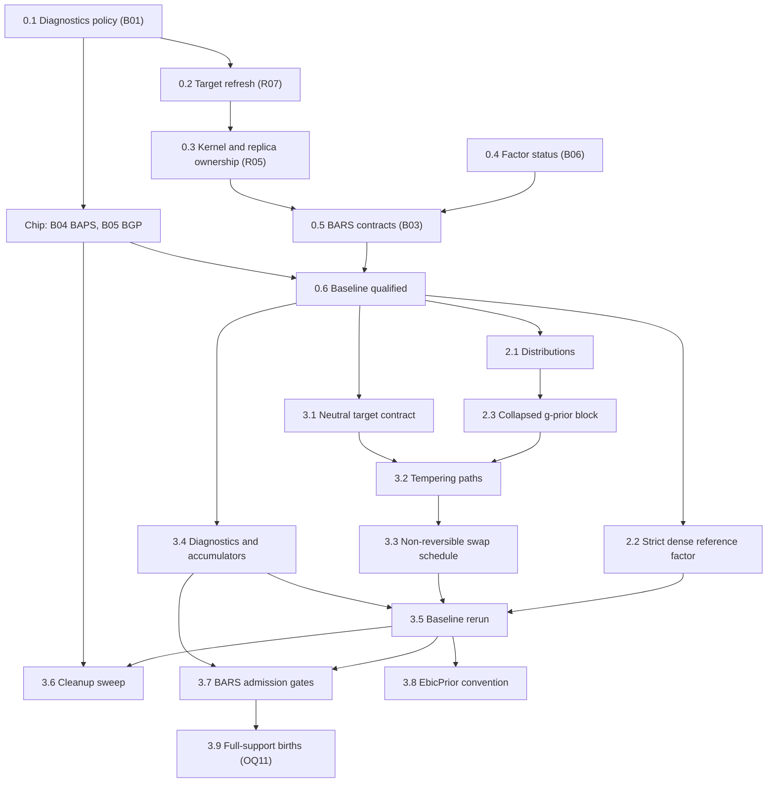

# BASS preparation brief

Date: 2026-10-19. Status: brief, not started. Each phase begins on the user's go-ahead; this document changes no source.

Prepare the existing regression and sampler engines for BASS. The work has two kinds of change: repairs of the reviewed defects, and renovations of shared contracts that BASS will consume. Each repair lands in the form BASS will reuse, so nothing is fixed twice. Repairs and refactors stay in separate commits, so every change in statistical behavior traces to a recorded repair.

Sources:

- [Full port brief](bass-full-port-brief.md): stages 0–9 and the completion contract.
- [Adaptation prerequisites review](bass-adaptation-prerequisites-review.md): findings R01–R13, batches B01–B06, closure evidence, and the baseline gate.
- [Derivations and integration review](bass-derivations-and-integration-review.md): the shared g-prior block, the tempering closed forms, and the residual and admission rules.

B04 (BAPS) and B05 (BGP) have no code path into BASS. They run in parallel under the [BAPS and BGP chip brief](baps-bgp-baseline-repairs-brief.md).

## How this brief maps onto the port stages

| Port stage | This brief | Stays in the port brief |
|---|---|---|
| 0, baseline | Phase 0: B01, B02, B03, B06 and the baseline qualification | B04 and B05 go to the chip |
| 1, specification | Nothing; it runs in parallel and takes the derivations review as input | All of stage 1 |
| 2, shared numerics | Phase 2: distributions, the strict dense reference factor, the g-prior block | Bordered and Givens updates, thin SVD, low-rank covariance solves |
| 3, sampler contracts | Phase 3: neutral targets, tempering paths, swap schedule, diagnostics expansion | The SMC core |

BASS implementation begins at port stage 4, after Phase 3 and the BASS-specific parts of stages 1–3.

## Sequence

Arrows mean **must land before**.

Steps 0.1, 0.2, 0.3 and 0.5 all touch `BarsEnsemble`, so they run in that order. Step 0.4 touches only LinAlg and can run alongside them.

## Phase 0: existing-engine baseline

### 0.1 Diagnostics failure policy (B01: R09)

Files: [ChainEnsemble](../../src/maths/samplers/ensemble/ChainEnsemble.cs#L131), [ChainDiagnostics](../../src/maths/samplers/ensemble/ChainDiagnostics.cs), the [BARS readout](../../src/maths/regression/spline/bars/BarsEnsemble.cs#L206).

- Every R̂ carries a state (estimated, constant, frozen, unavailable), and only an estimate at or below the target, or a constant functional, satisfies a stopping rule. Stopping and display report the same reading.
- Declare a minimum number of draws for stopping, and an explicit policy for a constant functional, distinct from chains frozen at different values.

This step lands first because BAPS and BGP consume these diagnostics; the chip starts after it.

### 0.2 Refresh a chain's target in place (B02: R07)

Files: [ReversibleJumpChain](../../src/maths/samplers/rjmcmc/ReversibleJumpChain.cs), [BarsEnsemble](../../src/maths/regression/spline/bars/BarsEnsemble.cs#L295).

- `ReversibleJumpChain` gains an operation that replaces or refreshes its target, recomputes the cached log target, and keeps the cumulative move counters.
- Weight resampling uses it instead of rebuilding the chain every `WeightEvery` steps. Adaptation reads the cumulative counters.
- Checks: complete and partial adaptation windows, with resampling periods that do and do not divide the window, including the default 25/200.

The same operation is what BASS needs after every τ or λ update, and what SMC needs at every stage change.

In its own commit, the same step adds a construction-time check that move pairings are reciprocal: each move's reverse must name the move back. Today the chain checks only that the reverse exists ([ReversibleJumpChain.cs:62](../../src/maths/samplers/rjmcmc/ReversibleJumpChain.cs#L62)), and a non-reciprocal palette would compute inconsistent acceptance ratios.

### 0.3 Kernel and replica ownership (B02: R05)

Files: [BarsEnsemble](../../src/maths/regression/spline/bars/BarsEnsemble.cs#L146), [ParallelTempering](../../src/maths/samplers/rjmcmc/ParallelTempering.cs#L48).

- Kernel tuning lives in the declarative config. Each chain and each tempering replica constructs its own mutable kernel and moves at the execution boundary.
- `ParallelTempering` takes a per-replica factory for moves; today it hands one instance to every replica.
- The adaptive-tempering exclusion holds on every construction path, including a supplied kernel.
- Checks: seeded serial-versus-concurrent runs agree.

This is the minimal tempering change needed for the repair; step 3.2 generalizes it.

### 0.4 Factor status (B06: R11 and the LinAlg side of R08)

Files: [BandCholesky](../../src/maths/linalg/BandCholesky.cs), [CholeskyDecomposition](../../src/maths/linalg/Cholesky.cs#L58).

- Add a status-reporting API beside the existing methods: finite values, floor hit, and a relative conditioning indicator. Existing methods keep their behavior.
- Inventory every caller and record which ones rely on intentional regularization or inverse output.
- Verify SPD solves, log determinants and precision-draw covariance against independent references.

BAPS and BGP call sites keep their current behavior until the chip completes; they migrate in the cleanup sweep (3.6).

### 0.5 BARS statistical contracts (B03: R13, R08, R12, R04, R01, R14)

Run these in order. Decisions Q1–Q4 are listed below.

**a. R13: the marginal's guard.** In [WeightedNormalModel](../../src/maths/regression/spline/bars/WeightedNormalModel.cs#L74), `a ≥ Q/(m+1)`, so the `a ≤ 0` guard rejects only an identically zero response; over-knotting is caught earlier by the `m ≤ ν` rule. Correct the guard's documentation, and pin its behavior with a check. Any near-interpolation restriction becomes an explicit admission rule under step b.

Revised 2026-10-19. The first version of this step computed `a` from an explicit residual. Re-checked before coding: for BARS's τ = 1/m the subtraction loses at most log₁₀(m+1) digits, so that change waits for step 2.3, where a sampled small τ makes it matter.

**b. R08: rank policy per model (Q4 decided 2026-10-20: reject).** Normal, Poisson, Whittle and GibbsLoss models decide admission from the step 0.4 status, under the Q4 policy. None of them scores a floored factor.
- Poisson and Whittle also need a policy for IRLS non-convergence: reject with a recorded reason.
- `PoissonModel`'s N(0, 100) coefficient ridge ([PoissonModel.cs:141](../../src/maths/regression/spline/bars/PoissonModel.cs#L141)) is intentional regularization; record it in the step 0.4 inventory and in the docs. (Done: it enters only the draw's MH correction, not the marginal or any factored matrix.)

**c. R12: full posterior coefficient draws (Q1 decided 2026-10-20: option B).** `WeightedNormalModel.SampleCoefficients` draws σ² from `IG(m/2, a/2)`, then β from `N((m/(m+1))A⁻¹b, σ²(m/(m+1))A⁻¹)`, using BandCholesky's existing precision-draw path.
- **Rule for which readouts may use the conditional mean.** A readout may use the conditional (Rao-Blackwellized) mean only if it is affine in f: the mean fitted curve, derivatives, integrals. Argmax, peak counts, spans and quantile intervals use full draws. This is the SW side's "affine, so pooling commutes" rule (`SweepEdgeCurves`), applied one level down.
- **Pointwise posterior variance** (the adaptive sweep's σ_curve) comes from the law of total variance: Var[f(T)] = E_knots[v(T)] + Var_knots[m(T)].
  - m(T) is the conditional mean, and v(T) = (a/(m−2))·(m/(m+1))·z(T)ᵀA⁻¹z(T) is the closed-form conditional variance given the knots, with σ integrated out.
  - Accumulate Σm, Σm² and Σv additively and reduce once. The result is exact, with lower Monte Carlo variance than drawing.
- **Non-Normal models.** Whittle draws from its Laplace approximation, labeled as approximate. GibbsLoss labels its nonlinear readouts as reflecting knot uncertainty only, since its posterior is already a generalized one.
- **Scope note.** The BARS-for-SPC application is not deployed, and its design is still in progress; the peak and elbow readouts penciled in so far may change. Keep the readout contract general (the rule above) rather than tailored to the current peak and elbow plan.
- Draw σ² as the reciprocal of the existing scale-parameterized Gamma, with a unit check; the explicit rate/scale API arrives in step 2.1.
- Correct the [IObservationModel](../../src/maths/regression/spline/bars/IObservationModel.cs#L35) docstring's claim that mean-based intervals are already integrated.
- Expect wider intervals for peaks, extrema and peak counts, and record that change against R12.
- `PoissonModel`'s draw heuristics (keep the first Laplace draw when the log MH ratio exceeds −10, otherwise at most five independence MH steps, then β̂) get a specification under the same rule, or are replaced.

**d. R04: exact robust weights (Q2 decided 2026-10-20: unweighted g-prior).** Student-t and contaminated-normal weights use residuals from a drawn β and the scale from a drawn σ², replacing the conditional mean and the MAD scale.
- Sweep order: structure given weights, with β and σ² integrated out; then β and σ² given structure and weights; then weights given β and σ². That order is a valid collapse-then-redraw scan.
- If an approximation is kept anywhere, it carries an explicit name and stays out of exact comparisons.

**e. R01: knot measure (Q3 decided 2026-10-20: ordered uniform plus a Conway–Maxwell–Poisson count prior).** Add `log k!` to the target. Add `ConwayMaxwellPoissonPrior(λ, ν)`; its prior ratio is λ/(k+1)^ν, so no normalizer is needed. Run the validation fits at ν = 1 and ν = 2 and record the comparison in the docs. Build the constant-likelihood count-law check generically over any reversible-jump target and move set, so BASS's D01 check reuses it. Run both move schedules (constant and DMGK) through it: that checks exactly that they sample the same posterior, replacing `DmgkScheduleTests`' |Δk̄| < 0.6.

**f. R14: span coverage as a probability.** Each covering span adds 1 to a grid point (the span-coverage loop in [BarsEnsemble](../../src/maths/regression/spline/bars/BarsEnsemble.cs)), so overlapping spans of nested peaks push π(T) above 1, and `PeakModes`' 0.5 cutoff is then not a probability threshold. Count each grid point at most once per draw (the union of spans), or rename π(T) as an expected coverage count. This is a BARS readout repair that does not gate BASS.
- **Framing.** Choose the estimand, then accumulate its sufficient statistic per draw. P(T lies inside some significant span) needs the per-draw indicator of the union. The expected number of covering spans needs the per-draw count. The union has to happen per draw, because it is part of the per-function functional.
- **Default:** the union, so π(T) means what its documentation and `PeakModes`' ½ cutoff assume. Add the count as a separate accumulator only if nesting depth turns out to matter. Confirm this when the step starts.

### 0.6 Baseline qualification

After 0.1–0.5 and the chip report:

- Run the affected suites with `scripts/fact-harness.ps1 -Project` for `tests/Maths.Regression.Tests`, `tests/Maths.LinAlg.Tests` and `tests/Maths.Distributions.Tests`, plus the new checks.
- Record the qualified revision, toolchain and results in the report section of this brief.

This closes the baseline gate in the prerequisites review.

## Phase 2: shared numerics and the g-prior block

### 2.1 Distributions

- Add inverse gamma, truncated forms, and stable normal and Student interval probabilities.
- Make rate versus scale explicit in parameter names and factories. R's τ prior (derivations review §6) is the cautionary case.
- Step 0.5c's σ² draw switches to the new API.

### 2.2 Strict dense reference factor

A solve-oriented dense Cholesky with explicit status, no pivot flooring and no eager inverse. Existing callers keep their current path. Bordered and Givens updates build on it in the port's stage 2.

### 2.3 Collapsed g-prior block

Extract the block from the repaired `WeightedNormalModel` (derivations review §1.3). It holds:

- the sufficient statistics and the explicit residual;
- the τ setting (fixed at `1/m` for BARS) and the σ² setting (integrated out for BARS);
- composition draws;
- the likelihood-tempered closed forms from review §3, behind a banded backend first.

This step is a pure refactor. BARS outputs match the step 0.6 baseline to rounding. Build it beside the existing class, switch callers, and leave deletion to step 3.6.

Design notes (added 2026-10-20, from the admission discussion and its [evidence](#addendum-admission-evidence-2026-10-20)):

- **Cache the statistics that depend on neither τ nor temperature.** These are ‖r_OLS‖² (from the explicit residual), Q = ‖L⁻¹Zᵀy‖² and the dimension p.
  - With likelihood inverse-temperature β, S = β·yᵀy − β²Q/(β + τ) = β·(‖r_OLS‖² + τ/(β + τ)·Q). At β = 1 and τ = 1/m this is today's yᵀy − m/(m+1)·Q in its cancellation-free form (R13; derivations review §5).
  - At W = I the log-determinant term is (τ/(β + τ))^(p/2), and log|G| cancels.
  - So S and the marginal cost O(1) for any τ or temperature. BASS's τ updates and step 3.2's tempered swaps then need no refactorization.
- **Two paths.** At W = I, one factor G. On the robust path (step 0.5d), G and P_a are both factored and both log-determinants enter.
- **What the block does not own.** Rules about data under each basis function belong to the basis and target layer, checked before any factorization; BASS likewise checks `npart` when it proposes. Numerical admission reads the factor's status. The block takes an admitted factored system and returns marginals, residuals, tempered densities and (σ², β) draws.
- **The coefficient prior is a parameter, not an interface.** The g-prior, with τ fixed or sampled, is the only coefficient prior. An interface waits for a second one; see the [seam map](#seam-map-admission-prior-and-schedule).
- **No per-proposal allocation** beyond the factor's own storage: scratch is owned by the caller.
- **`DesignAdmission` is not touched** in steps 2.3–3.5 (Q6).

## Phase 3: sampler contracts

### 3.1 Neutral target contract

- Generalize [IRjTarget](../../src/maths/samplers/rjmcmc/IRjTarget.cs) into a model-neutral log-density contract that can expose log-prior and log-likelihood separately, or a closed-form tempered density.
- Migrate `SplineTarget` and the other reversible-jump callers.
- Create a dedicated `Maths.Samplers` test host whose targets depend on neither Regression nor SPC. Move the generic sampler tests there as an explicit ownership change.

### 3.2 Tempering paths

- `ParallelTempering` evaluates each swap from each replica's own target at the other replica's state, rather than the β-linear shortcut at [ParallelTempering.cs:71](../../src/maths/samplers/rjmcmc/ParallelTempering.cs#L71).
- The tempering path is declared: the powered posterior (today's `TemperedTarget`) or the likelihood-tempered path from step 2.3.
- Validate the ladder: finite, ordered, cold value 1. Q5 sets BARS's path.
- The cold-chain target is unchanged, so BARS posteriors agree in distribution with the baseline.

### 3.3 Non-reversible swap schedule

Deterministic even/odd swaps and ladder adaptation (Syed et al. 2022). Measure them by full round trips across the ladder, not by swap acceptance.

- **Q5's revisit trigger.** Measure round trips per unit work on the validation fits for both paths. Reopen BARS's default if the powered ladder is clearly ahead.
- **The hot end on the likelihood path.** The Normal marginal's Occam factor per basis function at rung b is (1 + mb)^(−1/2) with τ = 1/m. It is about 0.38 (≈ 0.97 nats) at b = 0.05 and m = 120, and it vanishes as b → 0. So b_min ≈ 1/m marks where the hot rungs' dimension stops being held down and they approach a diffuse count prior's spread. Ladder adaptation should watch that regime.

### 3.4 Shell readouts: diagnostics and accumulators

**Diagnostics.** Rank-normalized split and folded R̂, and bulk and tail ESS, built on the step 0.1 failure policy. Give ESS the same exact constant-functional handling: today a constant functional's ESS reads about C/2 or Cn depending on rounding. Then replace the 100-draw stopping floor with an ESS gate: stop only when R̂ meets the target and the per-chain ESS of the monitored functionals is at least 100.

Two clear-cut additions:
- **ESS cost.** ESS computes every lag before truncating, at O(Cn²) ([ChainDiagnostics.Ess](../../src/maths/samplers/ensemble/ChainDiagnostics.cs)). Compute lags until truncation, or use FFT autocovariances.
- **Acceptance rate.** Report it from post-burn counters; today the shell's rate includes burn-in, and BGP inherits that.

**Readouts, traces and checkpoints** (revised 2026-10-21; supersedes the single "accumulator contract" of 2026-10-20). The first version combined three things that pool differently: commutative statistics, ordered chain information, and restart state. A review pointed out that the port brief already separates them ("Keep posterior storage separate from checkpoints"; weight ESS separate from chain R̂ and autocorrelation ESS). They are three components:
- **Readout accumulators: mergeable statistics,** the shared infrastructure.
  - Additive sufficient statistics with an associative, commutative merge, so pooling across chains does not depend on order. The step 0.1 streaming moments already merge this way (Chan's parallel formula).
  - An optional weight on each fold, so the same statistics pool weighted particles.
  - Nonlinear reductions in a separate tier that reads only pooled statistics, applied once, at the level where the estimand lives.
  - Counts of admission rejections by reason (rank or conditioning; IRLS non-convergence; the m ≤ ν rule; and, from step 3.7, the support gate), so the truncation step 0.5b introduced stays visible.
  - BARS's readouts move onto it: the step 0.5c moments, λ, π and the peak sample.
- **Diagnostic traces: ordered per-chain draws** of the monitored functionals.
  - Rank-normalized split R̂ and autocorrelation ESS need the order of each chain's draws. Per-chain moments are not enough, and a trace does not merge like a statistic: pooling keeps the chains apart.
  - These are MCMC diagnostics. `EssDiagnostic` is autocorrelation ESS, distinct from a particle population's weight ESS (Kish), ancestry diversity and population diagnostics, which belong to the SMC module and are never reported as the same quantity.
- **Execution checkpoints: restart state,** which cannot be pooled.
  - Sampler configuration and data identity, every RNG stream's state, the iteration or stage, adaptation state, replica assignments, swap-schedule state (scan parity, the stochastic schedule's stream), and BARS's robust weights.
  - A checkpoint container owns these together with the accumulators and traces it resumes. It holds them as separate components, never as one merged structure.
- **Dependency boundaries** (the port brief's). Maths.Samplers owns the generic contracts: the statistic primitives, the trace, and the checkpoint container. Each engine in Maths.Regression supplies its own components. Neither project acquires an SPC or Graphs dependency; the SW sampler's `Accumulator` is the pattern, not a shared type.
- BASS and the SMC backend consume all three.

**Extrapolation readout** (added 2026-10-20). Report the prediction leverage h(T) = z(T)ᵀ(ZᵀZ)⁻¹z(T) beside `FitSd`: its posterior mean, or the fraction of draws with h > 1.
- A grid point with h ≫ 1 is extrapolated from the data. The g-prior adds no shrinkage there, so the fit is the least-squares extrapolation, and coefficient draws swing with it.
- Leverage flags every fit across a real data gap, so it belongs in the readouts rather than in admission ([evidence](#addendum-admission-evidence-2026-10-20)).
- It is the conditional-variance quadratic that `ReadoutQuadratics` already computes, without the σ² scale, so it adds no solves.

### 3.5 Baseline rerun

Rerun the step 0.6 checks after the migrations. Every difference must trace to a recorded repair or to a declared path change.

### 3.6 Cleanup sweep

Delete the superseded surfaces in their own commit: the old target contract, the duplicated model math, the status-less factor calls (including BAPS and BGP once the chip has closed), and the sums-based `ChainDiagnostics.RHat` overload once BAPS has moved to the moments form.

### 3.7 BARS admission: numerical and support gates (Q6)

Added 2026-10-20. This lands after step 3.5's zero-drift rerun as its own change, measured with step 3.4's rejection counts by reason. It splits today's admission rule into its two jobs ([evidence](#addendum-admission-evidence-2026-10-20)):

- **Numerical gate.** The model's factor runs without a pivot floor (a strict `BandCholesky` mode, following step 2.2's `DenseCholesky`), must be positive definite, and needs `MinRelativePivot` ≥ 1e-10. This keeps Q4's six-digit rationale, now on the equilibrated condition number that governs Cholesky accuracy (van der Sluis 1969; Demmel 1989). It replaces `PivotRatio` ≥ 1e-10 and `FlooredPivots` == 0, both of which depend on column scaling.
- **Support gate.** Every basis function needs column mass Σᵢ Bⱼ(xᵢ) ≥ w_min, with default 1 (one data point's worth) and configurable. `SplineTarget` checks it before any factorization, beside the open-simplex rule, as a declared prior-support restriction.
- **Checks, before and after:**
  - the validation fits;
  - a sharp transient near a domain boundary;
  - fits across a data gap, both the posterior mean and the coefficient draws in the gap;
  - robust runs;
  - a low-rate Poisson case, to test the unmeasured prediction that `PivotRatio` rejects knots in low-count regions because μ̂ shrinks those columns;
  - rejection counts by reason.
- **Docs.** `BayesianRegression.md`'s admission section states the two gates, the alternatives (count, mass, Kish size, leverage) and the trade-offs.

### 3.8 `EbicPrior` in He, Yang and Kang's convention (Q7)

Added 2026-10-20. This lands after step 3.5, beside 3.7, once the checklist below has been verified against the *Biometrics* text.

- **Law.** log p(k) = (1 − γ)·log C(C, k), with γ ≥ 0 and C the candidate count:
  - γ < 1 favors larger k: this is EBIC's interpolation from BIC's uniform-over-models prior at γ = 0;
  - γ = 1 is flat;
  - γ > 1 penalizes.

  Today's `EbicPrior(γ)` is this law at γ_HYK = γ + 1.
- **Support.** HYK's support, [0, C]. For γ > 1 the law rises again past C/2, so the docs advise C ≥ 2·k_max, which keeps that half out of reach. Truncating at ⌊C/2⌋ is the alternative, as a declared extension; choose between them on item 3 below.
- **Tests.** `EbicTests` moves from γ = 0 to 1 (flat) and from γ = 1 to 2 (penalized). `CountLawTests` gains an EBIC case.
- **Docs.** `BayesianRegression.md` states the three regimes, the mapping from the old γ, the support guidance and the citation.

**Verify in the *Biometrics* text first.** The paper is not yet in the compendium; the preprint is, as `HYK2024.md`. The external summary of the differences was wrong on one checkable point: it said the death formula changed, but the preprint already has the same formula. So check each item against the paper:

| # | What to verify | Where it matters |
|---|---|---|
| 1 | Whether the prior keeps the preprint's form: π(k) ∝ C(C,k)^(1−γ) with π(ξ \| k) = 1/C(C,k) (equation 3) | The γ_HYK = 1 + γ mapping, and so this step |
| 2 | γ's range (γ ≥ 0?), the three regimes and the recommended [0.5, 2] | Whether γ > 1 is their convention, to cite, or our extension, to label; constructor bounds; docs |
| 3 | Guidance on C ("typically > m"), or anything on k past C/2 | Support [0, C] with guidance, or truncation |
| 4 | The b_k and d_k formulas; c = 0.3 and any stated reason or mixing claim | The mixing benchmark's arms ([BARS mixing](#after-phase-3-bars-mixing)) |
| 5 | Coincident knots (multiplicity above 1) | The tensor-product extension's handling of jumps (port brief) |
| 6 | The non-normal treatment (still an EBIC plug-in?) | The docs' comparison with our Laplace marginals |
| 7 | How peak inference is defined and computed (draws or a plug-in) | The readout contract for the tensor-product extension |
| 8 | Whether the γ comparison still favors γ = 1, and whether it separates the prior from mixing | The confound noted under BARS mixing |
| 9 | Title, method name (ABMRS?), volume, issue, article ID, DOI | The citation |

### 3.9 Full-support births (OQ11)

Added 2026-10-21.
- **Order.** It lands after step 3.7, whose support gate it is designed against. It is independent of step 3.8, and does not gate BASS.
- **Before the studies.** It comes before every BARS mixing or tempering study: OQ1, OQ3, OQ4, OQ8 and the move-schedule comparison. Those have so far measured the trapped kernel.

**The trap,** found by the step 3.5 seed sweep:
- Births are proposed near an existing knot.
- A death's acceptance carries the reverse birth's density at the removed knot.
- So a knot far from the rest is almost never removed (OQ11; `BayesianRegression.md`, known limitations).

**Probe** (scratch code, 2026-10-21):
- **Births:** ε·uniform + (1 − ε)·the local kernel's mixture, with deaths carrying the same density in reverse; ε = 0 runs the engine's own moves.
- **Chains:** untempered, `LocalBetaKernel(50)`, 8 chains of 100,000 steps after 5,000 burn-in per arm, with both arms on the same chain seeds.

| Fit | τ(k), ε = 0 | τ(k), ε = 0.1 | Batch-means τ, ε = 0 → 0.1 | Knot ESS per second, ε = 0 → 0.1 | Mean knots, ε = 0 / 0.1 |
|---|---|---|---|---|---|
| `EnsembleTests`' adaptive stop (sine, n = 100, Poisson(4)) | 485 | 40 | 376 → 38 | 12 → 149 | 1.856 ± 0.020 / 1.871 ± 0.006 |
| `TemperingBenchmark`'s sine with outliers (n = 120, Poisson(5)) | 2,160 | 110 | 848 → 102 | 2.3 → 47 | 2.98 ± 0.06 / 3.05 ± 0.01 |
| `TemperingBenchmark`'s peak (n = 150, Poisson(5)) | 166 | 77 | 163 → 68 | 24 → 53 | 5.614 ± 0.012 / 5.609 ± 0.008 |

- **Correct.** Under a constant likelihood, the knot count follows the Poisson(4) prior in every bin, at kernel τ = 5 and 50 (`CountLaw`, z ≤ 5).
- **The same posterior.** The arms' mean knot counts agree within their errors (|z| ≤ 1.2), at the same CPU time per arm.
- **A conservative ε = 0 figure on the sine.** Its batches of 2,000 are shorter than its τ, so batch means understate that arm's τ. Its tail ESS was 155 from 800,000 draws.
- **Smaller gain on the peak.** Its knots cluster around the bump, where local births belong; the broad fits spread theirs out.

**Plan:**
- **Base measure** for the exploratory component, designed against step 3.7's column-mass gate. Measure the choice on an uneven design.
  - Uniform on (0, 1): exact, and the same as today's k = 0 birth, but on uneven designs it wastes births in data gaps.
  - A histogram density of x: the continuous analogue of BASS's observed-value knots.
- **ε.** A study over ε ∈ {0.05, 0.1, 0.2, 0.3}, on the three probe fits and an uneven design, reading knot-count and peak-location ESS per second.
  - ε becomes a `BarsConfig` setting.
  - Its default comes from that study, set per engine, not from these three fits.
- **One move pair.** The mixture enters the existing birth density, so every death's reverse density is at least ε. `DmgkSchedule.Wrap` and the adaptive kernel compose with it unchanged. A separate global birth/death pair is the alternative; it escapes the trap only at the global death's selection rate.
- **Checks.**
  - `CountLawTests` gains mixture cases.
  - The seed sweep reruns (`SEED_SWEEP=50`).
  - `EbicTests`' burn-in may return to 800.
  - The step 3.5 probe records the trajectory change.
- **Docs.** `BayesianRegression.md`'s trap entry becomes the birth density's specification: ε, the base measure, and the trade-off of wasted exploratory births against deaths bounded below.
- **Then** the BARS-mixing table, OQ1, OQ4 and OQ8 are measured again on the new kernel.
- **BASS.** BASS already has this component. Its births draw knots from observed values, and choose interaction orders and variables with `w1` and `w2` (both 5) added to the current model's counts. The port keeps them positive (full-port brief, "Modernization choices").

## After Phase 3: BARS mixing

Added 2026-10-19. This section sits outside the baseline gate: nothing in it is required before BASS integration, apart from the step 3.4 items already listed there. Measured on existing regression tests (Release build):

| Test | Readout | Draws (4 chains) | ESS | ESS per draw |
|---|---|---|---|---|
| `EnsembleTests.Ensemble_Converges_RHatNearOne_ConsensusSized_AndDenoises` (sine, n = 100) | Knot count | 6000 | 105 | 1.75% |
| `PeakTests.PeakPosterior_RecoversKnownPeak_WithBracketingInterval` (bump, n = 150) | Peak location | 8000 | 11 | 0.14% |
| `TemperingTests.TemperedEnsemble_RecoversPeak_ViaColdReplica` (bump, n = 150, 5-rung ladder) | Peak location | 8000 | 652 | 8.2% |

The last two runs differ in kernel and noise seed, so the tempering gain is a lead, not a result. Even after paying for five replicas per chain, it works out to about ten times more effective peak-location draws per unit of compute.

The slow mixing is mostly structural:

- **One knot per step.** Each move changes one knot, so moving between substantially different curves is a random walk through model space.
- **Near-equivalent arrangements.** Different knot arrangements that fit about equally well form separate modes.
- **A sharp target.** With β and σ integrated out, most proposals are rejected; cold acceptance was 0.088 in the tempered run.
- **Readouts differ.** Knot count and peak location mix slowest; fitted grid values mix faster.

**Clear-cut wins.** Each of these preserves the model, rests on established results, and does not depend on the dataset:

- The ESS stopping gate in step 3.4.
- ESS reported per functional and per second, with readout time separated from kernel time. Every candidate below is judged by this measure.
- After R12 adds full draws, keep the conditional-mean (Rao-Blackwellized) curve for linear readouts; its variance is never higher.
- No thinning of chains for statistical reasons: thinning loses information per unit of compute (MacEachern and Berliner 1994; Link and Eaton 2012).

**To consider when we get there.** Each needs a measurement, a derivation, or both:

| Candidate | Why | Before adopting |
|---|---|---|
| Move schedule: Green's prior-aware weights (used by DMGK) or constant weights | Neither Green nor DMGK claims faster mixing; the schedule cancels the prior from the acceptance. At equal c it never raises a birth/death flow, and at equal budget the winner depends on the regime | The comparison under **Move schedule** below |
| Tempering as the default for slow readouts | The lead above | A controlled comparison: same data, seed and kernel, with and without the ladder, at equal compute |
| Delayed rejection on relocations (Green and Mira 2001) | Never worse in asymptotic variance than the single-stage kernel | Gain per second, since each rejection costs another target evaluation |
| A uniform component in births | Local births strand a knot far from the rest, since its death needs the reverse birth near the knots that remain (OQ11) | Now step 3.9: a probe measured 2–20× the knot-count ESS per second at ε = 0.1 |
| Informed births scored by fitted gain (ΔQ, derivations review §5) | Proposes knots where the residual says they help | Exact reverse probabilities and a full-support exploratory component; uses step 2.3's explicit residual |
| Multi-knot or split/merge moves | Larger jumps between knot arrangements | Dimension-matching and reverse-move accounting |
| Guided walk on knot count (Gustafson 1998) | Keeps a birth/death direction, damping the random walk in k | Its own derivation for the variable-dimension case |
| Readout thinning (Owen 2017) | Pays only if processing a draw costs more than producing it | The readout-versus-kernel timing above |
| SMC for BARS | Independence comes from a population rather than one time series; BARS's likelihood-tempered weights are O(1) in closed form (derivations review §3) | The port's SMC core |
| Many short chains with nested R̂ (Margossian et al.) | Uses parallel hardware without long per-chain runs | Burn-in cost per chain, and the nested-R̂ diagnostic |

**Move schedule** (added 2026-10-20). Green (1995, §4.1) chose b_k = c·min{1, p(k+1)/p(k)} so that b_k·p(k) = d_{k+1}·p(k+1), which would make a sampler over k alone accept every move. He took c as large as possible subject to b_k + d_k ≤ 0.9. DMGK (2001) use "the general scheme used by Green (1995) and Denison et al. (1998)", with c = 0.4 as in Denison et al. Neither paper claims a mixing gain; the claim in this repository was folklore. The analysis is in `BayesianRegression.md` and in [dmgk-interpretation.md](dmgk-interpretation.md), an external review of the step 0.5d discussion:
- **Flow identity.** With the prior factored out of each proposal's flow (Ã = likelihood × proposal density), F_DMGK = c·min(p_k, p_{k+1})·min(Ã_f, Ã_r), against F_const = c·min(p_k·Ã_f, p_{k+1}·Ã_r). The two agree under the prior alone.
- **At equal c,** ESJD(k) and the lag-1 autocorrelation of k are exactly ordered in favor of constant weights: relocations do not change k, so only the dimension flows enter. ESS(k) is not ordered, because DMGK's extra relocations interact with later dimension moves.
- **At equal budget** max_k(b_k + d_k), DMGK leads near a flat prior top and loses about a factor p(k+1)/p(k) where prior and likelihood conflict. At c = 0.4 under Poisson(4), DMGK's budget is 0.72 against constant weights' 0.8, so the step 0.5d sweep compared unequal budgets.
- **Measured so far.** The step 0.5d sweep used equal c on a posterior at the Poisson(4) mode, where the schedules coincide on the 3↔4 bridge. It found no ESS(k) difference.

**He, Yang and Kang's schedule is this one, applied to their count law** (added 2026-10-20).
- Their b_k = c·min(1, {(C−k)/(k+1)}^(1−γ)) and d_k = c·min(1, {k/(C−k+1)}^(1−γ)) (preprint §3) are Green's schedule for π(k) ∝ C(C,k)^(1−γ). At γ = 1 it is the constant schedule, which at equal c has the largest birth/death flows.
- So their finding that γ = 1 gives the best MSE changes the prior and the mixing together. At γ = 0, with k ≈ 5 and C large, d_k ≈ c·k/C is about 1%, so deaths are almost never proposed, and part of that γ's overfitting may be finite-chain mixing.
- Our engine keeps the schedule and the count prior separate ([seam map](#seam-map-admission-prior-and-schedule), gates 1 and 4), so γ here is purely a prior parameter.
- Their *Biometrics* version reportedly fixes c = 0.3, which puts relocation at 0.4 or more (step 3.8's checklist, item 4).

The comparison, after the step 3.4 ESS fixes:
- **Arms:** constant weights; DMGK at c = 0.4 and at Green's budget-scaled c, which needs the 0.5 cap in `DmgkSchedule.Wrap` relaxed; a masked constant schedule at equal budget (constant weights, with zero mass on moves into zero-prior states, reassigned to relocation); and the constant schedule at HYK's c = 0.3 (0.3/0.3/0.4).
- **Regimes:** the posterior at the prior mode; prior–likelihood conflict (a Poisson(1) prior and a truth that needs about 8 knots); an active hard cap.
- **Readouts:** ESJD(k); the immediate-reversal rate, since a birth undone by the next dimension move inflates ESJD without decorrelating anything; and ESS of knot count, fit and peak location, per second. ESJD is a sum and a count, so it fits the step 3.4 accumulator contract.
- **Seeds:** at least 20 per arm and regime.

## Addendum: triage of the additional-bugs review

Added 2026-10-19. [gemini-additional-bugs.md](gemini-additional-bugs.md) compares the briefs with external deliverable reviews and lists issues they did not cover. Each claim below was checked against the source; this table records where it went.

| Finding | Checked | Destination |
|---|---|---|
| Whittle and GibbsLoss return the conditional mean | Confirmed: no `SampleCoefficients` override | Step 0.5c, decision Q1 |
| PoissonModel draw heuristics and N(0, 100) ridge | Confirmed | Steps 0.5b and 0.5c |
| No IRLS non-convergence policy | Not checked separately | Step 0.5b |
| Span coverage π(T) exceeds 1 under nested peaks | Confirmed in the coverage loop | New R14, step 0.5f |
| Move pairings not checked for reciprocity | Confirmed: only existence is checked | Step 0.2, own commit |
| ESS computes every lag, O(Cn²) | Confirmed | Step 3.4 |
| Acceptance rates include burn-in | Confirmed and already documented | Step 3.4 |
| BGP fits a zero-mean GP to the raw response | Confirmed: `GpRegression.Fit` uses the response as given | The chip, item 2 (the R10 transform policy) |
| BAPS items: single-chain hierarchical sampler, `IBandPenalty` seam, no anisotropic λ optimizer, repeated factorization in `MarginalEvidence` | The first and third already documented | The chip brief's addendum |
| `SplineExtrema` switches root finders above degree 3 | Documented design, not a defect | No action |
| `SpectralNoiseField` is not periodic over the box | Already documented | No action |
| `ExactChangepoint`: σ² documentation mismatch, Cauchy quadrature cost and truncation | Not checked | Outside this brief: no BASS path and not in the reviewed register; needs its own review |

## Seam map: admission, prior and schedule

Added 2026-10-20, adapted from an external review of the admission discussion (`aghado01-issues/argon-bars-bass-discussion.md`). Each concern lives in one place. An interface exists only where two implementations do.

| Gate | Concern | Lives in | Implementations |
|---|---|---|---|
| 1. Support | Does each basis function have data under it? | Basis and target layer, before factorization | BARS: column mass (step 3.7). BASS: `npart` count over half-space hinges. An interface once BASS lands. |
| 2. Numerical | Can the factored system be trusted? | `DesignAdmission`, reading `FactorStatus` | Strict factor with `MinRelativePivot` (step 3.7) |
| 3. Coefficient prior | β's prior given the basis | The g-prior block (step 2.3) | g-prior with τ fixed (BARS) or sampled (BASS). A parameter until a second prior exists. |
| 4. Move schedule | Birth/death/relocate selection | The reversible-jump move set | Constant weights, Green's prior-aware schedule, masked constant ([BARS mixing](#after-phase-3-bars-mixing)) |

## Addendum: admission evidence (2026-10-20)

Probes on the Grams a BARS chain evaluates: 6,000 steps per dataset, Normal model, Poisson(5–8) count prior, cubic basis. The curve was a bump plus sin(3x) with noise 0.1, on four designs: dense x (n = 150), x with a gap (0.35, 0.65) (n = 120), a sparser gap design (n = 60), and small n = 40. The probes were temporary and are not in the tree.

**Disagreements between the rules are rare, and run one way.**

| Data | Not positive definite | Rejected by `PivotRatio` only | By `MinRelativePivot` only | By both |
|---|---|---|---|---|
| dense, n = 150 | 0 | 0 | 0 | 0 |
| gap, n = 120 | 83 | 3 | 0 | 0 |
| small, n = 40 | 21 | 2 | 0 | 1 |

**What `PivotRatio` alone rejects is thin support, not ill-conditioning.** Those configurations have relative pivots of 0.1–0.2. A basis function whose data sit only in its cubic tail gets βⱼ ≈ r/Bⱼ(xᵢ) and spikes inside the gap. The g-prior's shrinkage m/(m+1) is isotropic, so it adds nothing in data-free directions. On data ranging 0–2, the conditional-mean fit in the gap reached 290–1,310, on both sides of the 1e-10 cut. `PivotRatio` was in effect thresholding column energy against the largest pivot.

**Which support statistic separates the wild fits** (wild: max |fit| in the gap > 10):

| Rule | gap (38 wild) | gap-sparse (26 wild) | dense (0 wild) |
|---|---|---|---|
| count ≥ 12 (about BASS's `npart`) | 5 wild pass; 335 sane fail | 0 pass; 1,416 sane fail | 33 sane fail |
| Kish size (ΣB)²/ΣB² ≥ 6 | 5 wild pass; 422 sane fail | 0 pass; 1,869 sane fail | 32 sane fail |
| mass ΣB ≥ 2.5 | 0 pass; 896 sane fail | 0 pass; 1,720 sane fail | 20 sane fail, 18 at a boundary basis function |
| mass ΣB ≥ 1 | 0 pass; 403 sane fail | 0 pass; 728 sane fail | 0 |
| leverage ≤ 30 across the gap | 0 pass; 824 sane fail | 0 pass; 452 sane fail | 0 |

- **Count fails** because tail points count fully. **Kish fails** because it ignores a common scale.
- **Mass works.** The largest wild mass was 0.19 (gap) and 0.015 (gap-sparse).
- **What mass means.** For uniformly spread data, an interior basis function's mass is about the number of data points per knot interval, and the first basis function's is about n·ξ₁/4. So a threshold sets resolution: mass ≥ 2.5 needs about 10 points before the first interior knot. BASS's `npart` = min(20, 0.1·n) (`bass.R:23`, `bass.R:259–261`, enforced in `rjmcmc_des_*.R`) is a count over half-space hinges, which is the right statistic for that basis and the wrong one for local B-splines.
- **"Sane" low-mass configurations are sane only in their mean.** Since step 0.5c, nonlinear readouts use coefficient draws, whose variance grows like 1/B². So these configurations are wild in draws, and rejecting them loses nothing.
- **Leverage is the exact measure of the instability**, but it flags every fit across a real gap. Hence step 3.4's extrapolation readout, not an admission rule.
- **Root cause, parked.** The g-prior has no fixed-scale shrinkage in data-free directions. A proper coefficient prior with a fixed-scale component would fix that, but it would break the BARS ≡ BASS(τ = 1/m) identity unless BASS changes too. It belongs with BASS's coefficient-prior decisions.

## Decisions

| ID | Decision | Needed before | Recommendation |
|---|---|---|---|
| Q1 | What BARS's readouts mean once full draws exist | 0.5c | **Decided 2026-10-20: option B.** The conditional mean serves readouts that are affine in f; full draws serve the rest; pointwise variance comes from conditional moments (step 0.5c). Whittle draws from its Laplace approximation; GibbsLoss is labeled knot-uncertainty only. The BARS-for-SPC application is not deployed, so readouts stay general. |
| Q2 | Whether the coefficient prior uses the weighted Gram matrix | 0.5d | **Decided 2026-10-20: unweighted** for BARS. The weight update stays the exact Gamma draw. The marginal becomes `|G/m|^½ · |Zᵀ(W + I/m)Z|^−½ · ∏ w_i^½ · S^−m/2` with `S = ‖y − Zβ̂‖²_W + β̂ᵀ(G/m)β̂`, which reduces to today's form at unit weights and needs one extra banded factorization per proposal. The weighted alternative keeps one factorization but needs a Metropolis correction by `|ZᵀWZ|^½` on every weight sweep. BASS's robust mode decides separately, because a sampled τ changes this tradeoff. |
| Q3 | BARS knot location measure | 0.5e | **Decided 2026-10-20: ordered uniform locations,** with `log k!` added to the target, so that `p(k)` is the actual count prior. The complexity penalty stays configurable through the count prior: a new `ConwayMaxwellPoissonPrior(λ, ν)`, with ν = 1 plain Poisson and ν = 2 reproducing today's effective prior, λᵏ/(k!)². The marginal's Occam factor of about ½·log(m+1) per basis function remains either way. Compare ν = 1 and ν = 2 on the existing validation fits and document the result, rather than choosing ν from one dataset. |
| Q4 | Rank and admission policy per model | 0.5b | (Its `PivotRatio` criterion is superseded by Q6 at step 3.7.) **Decided 2026-10-20: reject** rank-deficient designs in all four models, using the step 0.4 status with a relative criterion (`PositiveDefinite` and `PivotRatio` ≥ r_min, with r_min recorded with its rationale). This is a declared prior support restriction: every basis function must be supported by data. Declare any near-interpolation limit for the Normal model as part of its prior. |
| Q5 | Tempering path, per engine | 3.2 | **Decided per engine (2026-10-21, revised).** There is no house default: `ParallelTempering` requires a declared path, and each engine sets and documents its own default, with every path selectable. **BARS** defaults to the likelihood-tempered path (`c510876`), the principled choice: a chain targets a measure, and powering a density f = dΠ/dμ gives a hot measure f^β·dμ that depends on the reference μ. Ordered and labeled knots give powered hot rungs of 1.08 and 14.17 mean knots for one posterior at λ = 5, β = 0.05, while the likelihood path, dΠ_b/dΠ₀ = L^b, is the same in every representation. **Measured since** (step 3.4, cold-chain ESS at equal work): at a shared hot end β = 0.05 the powered ladder led on counts (about 5×) and peak (about 1.6×) and tied on sine, tracking each ladder's barrier; that comparison favours the path whose hot end stays near the posterior. [OQ1](#open-questions) settles BARS's default by comparing tuned ladders. **Other engines** choose their own path when they land ([OQ6](#open-questions)); nothing is inherited from BARS. |
| Q6 | BARS admission policy | 3.7 | **Decided 2026-10-20: split the rule into its two jobs** (step 3.7). Numerical: a strict factor, positive definite, `MinRelativePivot` ≥ 1e-10. Support: column mass Σᵢ Bⱼ(xᵢ) ≥ 1 per basis function, configurable. It lands after step 3.5, so steps 2.3–3.5 stay a zero-drift refactor. BASS's count-based `npart` default is rejected for BARS. Basis for the decision: the [evidence](#addendum-admission-evidence-2026-10-20). |
| Q7 | `EbicPrior`'s count law | 3.8 | **Decided 2026-10-20: adopt He, Yang and Kang's convention** (step 3.8): log p(k) = (1 − γ)·log C(C, k) with γ ≥ 0, so γ < 1 favors more knots, γ = 1 is flat and γ > 1 penalizes. Today's law C(n_c, k)^(−γ) is that law at γ_HYK = 1 + γ, inside the range [0.5, 2] their *Biometrics* version (2026) reportedly recommends. Support stays [0, C], with guidance C ≥ 2·k_max. The citation waits on verifying the published text against step 3.8's checklist; the preprint (arXiv 2405.13353) already states the law for γ ≤ 1. |

## Open questions

Tracked so that they are not lost between sessions. Each entry says what is known, what would settle it, and where it belongs. Close an entry by moving its outcome into the decision table or a step report, and leave a one-line pointer here.

| ID | Question | Known so far | What would settle it | Belongs with |
|---|---|---|---|---|
| OQ1 | BARS's tempering default: likelihood or powered, each tuned on its own terms | Step 3.4: at a shared hot end β = 0.05 the powered ladder led on cold-chain ESS at equal work (counts: knot ESS about 87,000 against 17,500 at 8 rungs; peak: about 1.6×; sine: a tie), following the barriers (counts 0.24 against 1.4). Both ladders beat untempered chains of equal work on counts (11× and 2.3×) and sine (6× and 5×); on peak the likelihood ladder fell below them (0.73×). The likelihood ladder's hot end at β = 0.05 is nearly the knot prior, so it pays for reach a unimodal posterior does not need. These gains were measured on the trapped birth kernel (OQ11). There, an untempered chain with ε = 0.1 births gained 12–20× in knot-count ESS per second on two fits at no extra cost, so part of tempering's gain was probably trap escape. | After step 3.9, the `TemperingBenchmark` decision study (`TEMPER_BENCH_ESS`, `TEMPER_BENCH_BASE`) with the likelihood ladder's hot end tuned (β_min 0.2, 0.35, 0.5) and, once OQ2 exists, both paths with an exact reference rung; then a multimodal fit, the case tempering is for. Decide on cold-chain ESS at equal work. | After step 3.9; with OQ2 at the SMC stage |
| OQ2 | An exact reference rung: β = 0 drawn exactly, so each annealed restart is an independent draw (the setting of Syed et al.'s round trips) | Both BARS paths have an exactly drawable β = 0. Powered: on ordered knots the reference measure is k ~ Poisson(1) with uniform locations, defined even for the Normal model's improper σ² prior, because powering never re-integrates σ². Likelihood: the knot prior itself, which needs a marginal defined at b = 0 (the linear-form models now; the Normal model only with a proper σ² prior). `CollapsedGPrior.At(τ, b)` still refuses b = 0 (step 3.2's report). | Build it with the SMC module, which needs the same machinery (exact draws from a normalized reference, a proper-prior mode); then rerun OQ1. | SMC stage (full-port brief, "SMC integration") |
| OQ3 | Placing the hot end and choosing the rung count | `AdaptLadder` keeps both ends fixed. The integrated Normal marginal's Occam factor holds hot rungs' knots down until b ≈ 1/m, while the linear form's hot rungs approach the prior (step 3.2 addendum). `TemperingLadder.RecommendedLevels` gives N ≈ 2Λ but nothing applies it. | A rule for β_min per model and path, measured by cold-chain ESS, and whether to adapt the rung count. | With OQ1 |
| OQ4 | When BARS should temper at all | At equal work, tempering helped where untempered chains were stuck (sine, R̂ 1.18) or slow (counts), and did not help on peak. Measured on the trapped birth kernel (OQ11). | User guidance now: diagnose an untempered run first (`BarsResult.Knots`), and temper when R̂ or ESS says the target is hard. Later: a measured rule, or a trial run that chooses, measured after step 3.9. | BARS docs; after step 3.9 and OQ1 |
| OQ5 | Keep or delete the sequential sweep | Its round-trip lead is a cascade effect (step 3.3), and its cold-chain ESS was indistinguishable from DEO's (step 3.4). | Decide in step 3.6: keep for reproducing pre-3.3 runs and as a comparison, or delete. | Step 3.6 |
| OQ6 | Each engine's own tempering path | BASS's conjugate blocks keep closed-form conditionals on either path (a powered Gamma(a, b) block is Gamma(β(a+M−1)+1, β(b+1))); the likelihood path leaves them unchanged across rungs, which is simpler. SMC and path-sampling evidence start from a normalized endpoint, which the likelihood path's prior is. | Each engine decides at its port with its own measurements; no default is inherited. | BASS port; SMC stage |
| OQ7 | Which readouts gate an R̂ stop | BARS monitors the knot count only. The peak location is diagnosed (`Peak.LocationConvergence`) but does not gate the stop, and its ESS has been about 0.14% of draws. | Let callers choose the monitored readouts, and measure what gating on the peak costs. | After step 3.4 |
| OQ8 | BARS's knot-count mixing and default run lengths | On the adaptive-stop fit the knot count's autocorrelation time is about 450 steps (Stan's estimator and batch means agree), so the default gate of 100 effective draws per chain needs about 45,000 draws per chain. The earlier 1.75% figure came from the classic variogram estimator. Most of it is the local-birth trap (OQ11). With ε = 0.1 uniform births, the autocorrelation time on this fit falls to about 40, so the gate needs about 4,000 draws per chain. | After step 3.9, re-measure the "After Phase 3: BARS mixing" table with the new ESS; then revisit the default sample sizes and the move schedule. | After step 3.9 |
| OQ9 | An external reference for the rank-normalized diagnostics | Checked against theory only (AR(1) ESS, scale mismatch, Cauchy draws). R is installed, but the `posterior` package is not, and installing it means a download. | Add `posterior` to the `r/` oracles' environment (with approval for the download) and compare R̂, bulk ESS and tail ESS on shared fixtures. | Any time |
| OQ10 | Checkpoint scope | Step 3.4 checkpoints are in-memory copies, taken after burn-in at a round boundary. The run fingerprint covers data, settings and component types, not components' internal parameters. Only BARS implements `RestoreChain`; BGP and BAPS do not resume. | Persist checkpoints to disk through Archivory (format, versioning, data identity); decide whether mid-burn checkpoints are needed (adaptation state in flight); fingerprint component parameters (value records, or a component fingerprint member); resume for BGP and BASS. | With the BASS port's posterior storage, and Archivory |
| OQ11 | Local births strand isolated knots | Births are proposed near an existing knot (`LocalBetaKernel`, τ = 50, an SD of about 0.07; uniformly only at k = 0). A death's acceptance carries the reverse birth's density at the removed knot, so a knot far from the rest is almost never removed: from knots at 0.39 and 0.96 that density is e⁻³⁷ or e⁻⁶¹, against a posterior gain of e^3.8 to e^5.3, so a death is accepted with probability e⁻³¹ at best. In `EbicTests`' γ = 1 runs, overdispersed starts held such knots for about 1,500 steps (the 3.5 seed sweep). A probe settled the mechanism: ε = 0.1 uniform births in the birth density cut the knot count's autocorrelation time 12× (adaptive-stop fit, 485 → 40), about 20× (outlier sine, 2,160 → 110) and 2× (peak, 166 → 77), at the same cost per step, on the same posterior, with the count law intact. BASS's `w1` and `w2` pseudo-counts are its own exploratory component. | Step 3.9: the base measure, against step 3.7's support gate; an ε study with peak-location ESS; ε as a setting with a measured default. Until then, burn-ins that outlast overdispersed starts. | Step 3.9, after 3.7 |

Tracked elsewhere: the `EbicPrior` text check (step 3.8, waiting on the *Biometrics* PDF), BARS admission (step 3.7), the b = 0 guard (step 3.2's report), and the linear form's weaker hot-rung Occam penalty (step 3.2 addendum).

## Working rules

- **Check first.** Each repair begins with an independent check or derivation counterexample. The report records it failing at the parent revision, and the check and the fix land in the same commit.
- **One concern per commit,** on `main`. Repairs and refactors never share a commit. Stage files by explicit path, because the chip works in the same checkout.
- **Settle semantics before tests.** Statistical semantics are decided before any test expectation changes. A known-incorrect output becomes a defect fixture, never a gold standard.
- **Build beside, delete last.** New surfaces land beside old ones, and deletions wait for step 3.6. The end state has no compatibility aliases.
- **File ownership.**

  | Owner | Files |
  |---|---|
  | This brief | `src/maths/samplers/**`, `linalg/**`, `distributions/**`, `rng/**`, `regression/spline/bars/**`, the shared spline files, `docs/Maths/Samplers.md`, and the BARS sections of `docs/Maths/BayesianRegression.md` |
  | The chip | The BAPS and BGP sources, their tests, and their documentation sections |

- **Evidence per item:** the reproduction, the chosen specification, affected paths, commits, independent checks and remaining limitations, as the prerequisites review requires.
- **Document every statistical choice.** When a decision lands, its `docs/Maths` page states the choice, the alternatives considered, the trade-offs and the implications for users: `BayesianRegression.md` for BARS, `Samplers.md` for the shell. The brief's record is the provenance, and the docs are the user-facing statement.

## Out of scope

BASS code, the BASS-only numerics of port stage 2, the SMC core, B04 and B05 (the chip), and unrelated subsystem work.

## Report

Append one section per completed step: date, commits, checks with results, and anything deferred.

### 0.1 Diagnostics failure policy — done 2026-10-19

Commit `2824bf9`.

**Failing checks at the parent revision `c0cfe7a`:**
- Chains frozen at different values stopped after 10 of 200 draws.
- A chain emitting NaN stopped after 10 of 200 draws.
- With a batch size of 1, the run stopped after 1 draw.
- A single chain was accepted with an R̂ target.
- Four constant chains of 0.1 read R̂ = 0.9995 instead of the constant policy.

The last check exposed a defect beyond R09: running Σ and Σ² cancel to rounding noise for a constant value that isn't exactly representable, so a constant functional produced a spurious estimate.

**Specification:**
- `RHatState` has four values: estimated, constant, frozen, unavailable.
- `RHatDiagnostic.MeetsTarget` holds for an estimate at or below the target, or for a constant functional.
- `RHatDiagnostic.Worst` orders readings as constant, then estimates by value, then frozen, then unavailable.
- R̂ is computed from streaming (Welford) moments.
- `ChainEnsemble.MinDrawsForStop = 100` draws per chain. Vehtari et al. (2021) ask for an effective sample size of 100 per chain before trusting R̂.
- An R̂ target with a single chain is rejected.

**Changed:**
- `ChainDiagnostics`, `ChainEnsemble` and `EnsembleRun`, plus the new `RunningMoments` and `RHatDiagnostic`.
- `BarsEnsemble`:
  - the consensus map is reported unclamped, and `RHatFitMax` is its worst reading;
  - the peak and mode R̂ are typed;
  - the mode R̂ uses two-pass variances and the shared core.
- `BgpResult.BandwidthRHat` is typed.
- `docs/Maths/Samplers.md` and `docs/Maths/BayesianRegression.md`.

**Results:**
- The 11 checks in `DiagnosticsPolicyTests` pass.
- `Maths.Regression.Tests` passes 87 of 87 under `scripts/fact-harness.ps1` (run `20261019_155925675`).
- `Clustering.Graphical.SPC`, `Synthetic` and `Synthetic.Tests` build.

**Deferred:**
- The ESS of a constant functional reads about C/2 or Cn depending on rounding; this goes to step 3.4.
- BAPS stays on the sums-based overload until chip item 6.
- That overload is deleted in step 3.6.

**Confirmed by the user, 2026-10-19:**
- The 100-draw floor stays as a fixed constant; step 3.4 replaces it with an ESS gate.
- A constant functional doesn't block a stop but can't certify one alone: an early stop needs at least one estimated functional, so an all-constant set runs to the end. Commit `5f8826e`; `Maths.Regression.Tests` passes 88 of 88 (run `20261019_175042153`).

**Correction, 2026-10-19.** The fact-harness counts above (87 and 88) overstate coverage: before `1f96cb4`, the harness never ran theory cases, and counted them as passing. Four theories existed then (in `BandCholeskyTests`, `BapsTests`, `BgpTests` and `PeakTests`). The step 0.1 code is confirmed by a full `dotnet test` run at `fbe6d0d`, which runs every theory case: 121 of 121 pass.

### 0.2 Target refresh and move-pair reciprocity — done 2026-10-19

Commits: `c7035d5` (reciprocity), `201b2c2` (target refresh), `d10d676` (cleanup).

**Failing checks at the parent revision `5d706a2`:**
- A palette in which "up" names "down" as its reverse, but "down" names itself, was accepted.
- Under adaptive τ, a resampler that keeps unit weights changed the result. Mean knot count compared with the run without a resampler:

  | Period | Burn-in | With resampler | Without |
  |---|---|---|---|
  | 25 | 1000 | 2.30 | 1.60 |
  | 30 | 1000 | 1.28 | 1.60 |
  | 25 | 950 | 2.38 | 1.45 |
  | 30 | 950 | 1.30 | 1.45 |

  At period 25 every 200-step window saw no relocate attempts, so τ never moved. At period 30 the counters were differenced across rebuilt chain segments.

**Specification:**
- The chain constructor requires each move pair to name each other, or a move to name itself.
- `ReversibleJumpChain.ReplaceTarget` swaps the target, keeps the state and the cumulative counters, and re-evaluates the cached log target.
- BARS weight resampling uses `ReplaceTarget` instead of rebuilding the chain.
- The per-rebuild counter banking is removed, since the chain now lives for the whole run.

**Results:**
- The checks in `ChainContractTests` and `AdaptationAcrossResamplingTests` pass. With a weight-keeping resampler, every schedule now reproduces the run without a resampler exactly.
- `Maths.Regression.Tests` passes 128 of 128 under the fixed harness (run `20261019_212345405`, and again after the cleanup).

**Deferred:** none. The chain-rebuild deletion that step 3.6 listed is done here, and that item is removed from 3.6.

### 0.3 Kernel and replica ownership — done 2026-10-19

Commit `a566f53`.

**Failing checks at the parent revision `e62a038`:**
- A supplied `AdaptiveLocalBetaKernel` was accepted, and was accepted alongside tempering, which bypassed the exclusion.
- With one adaptive kernel shared by 4 parallel chains, the mean knot count was 2.14, against 2.19 with per-chain kernels from `adaptKernelTau`, at the same seed. This was a temporary check, removed once the shared path no longer existed.
- `ParallelTempering` handed one move list to every replica.

**Specification:**
- `AdaptiveLocalBetaKernel` is internal. `BarsEnsemble` builds one per chain from `adaptKernelTau` and rejects a supplied adaptive kernel.
- `BarsConfig.AdaptKernelTau` requests per-chain τ tuning declaratively.
- A supplied `IKnotKernel` instance is documented as shared, and therefore immutable.
- `ParallelTempering` takes a `movesForReplica` factory, called once per replica.

**Results:**
- The checks in `KernelOwnershipTests` and `ChainContractTests` pass. These cover: a supplied adaptive kernel rejected, alone and with tempering; adaptive τ rejected with tempering; repeated 4-chain concurrent runs that agree exactly; and each replica getting its own moves.
- `Maths.Regression.Tests` passes 133 of 133 under the harness. `Clustering.Graphical.SPC` builds.

**Deferred:** none.

### 0.4 Factor status — done 2026-10-19

Commit `92c0db6`.

**Behavior at the parent revision `a51fd33`:**
- Dense `CholeskyDecomposition` on the singular `[[1,1],[1,1]]`: log-determinant −27.6 and a solve of ±10¹², with no signal of any kind.
- `BandCholesky` on the perfectly conditioned 10⁻²⁰·I: `HitFloor` set (read as singular), and log-determinant −55.3 for a true −92.1.
- `BandCholesky` with a NaN entry: `HitFloor` false, log-determinant NaN, no signal.

**Specification:**
- Both classes set a `FactorStatus` after each factorization: `Finite`, `FlooredPivots`, `MinPivot` and `MaxPivot` (the Schur pivots before flooring), `PivotRatio` (at least 1/κ for a positive-definite matrix), and `PositiveDefinite`.
- The factor, `LogDet`, the solves and `HitFloor` are unchanged. Callers keep their behavior; LinAlg reports, and the model decides admission.

**Results:**
- `FactorReferenceTests` (19 cases, in `Maths.LinAlg.Tests`) checks against references that share no code with the factorizations:
  - LU-with-pivoting solves and log-determinants;
  - A·A⁻¹ = I and L·Lᵀ = A;
  - the innovation map's M·Mᵀ = A⁻¹, exactly, from unit vectors;
  - the pivot-ratio bound on a matrix with known eigenvalues;
  - the status on singular, tiny-scale, ill-conditioned and non-finite input, for all three factorizations.
- `Maths.Regression.Tests` passes 133 of 133 under the harness.
- `Maths.LinAlg.Tests` passes 23 of 24 under the harness. The one failure is a wall-clock benchmark, below.

**Caller inventory.** "Floor" says what each caller relies on when a pivot is clamped; "Reg." names explicit regularization that keeps the matrix positive definite.

| Caller | Factor and use | Floor | Reg. | Inverse or draw |
|---|---|---|---|---|
| `GaussianComponent.UpdateCache` (GMM) | Dense; `LogDet` for the PDF | Silent backstop for collapsing components | M-step adds `regularization` to the diagonal | `WriteInverseTo` for the PDF; `Sample` |
| `BhattacharyyaCoefficient` (two overloads) | Dense; `LogDet` of the averaged and individual covariances | Silent backstop | Inherits the components' regularization | `WriteInverseTo` |
| `serializer.ComputeCholeskiFactors` (viz-core) | Dense, 3×3; `WriteLTo` for ellipsoid rendering | Keeps degenerate covariances renderable | Pads missing dimensions with 1e-8 | Factor only |
| `GpRegression.Fit` (BGP) | Dense; two `Solve`s and `LogDet` | Should never trigger | Nugget σ²I | None |
| `WeightedNormalModel.LogMarginalLikelihood` (BARS) | Band LDLᵀ; `Solve` | `HitFloor` → −∞ (admission) | None | None |
| `WeightedNormalModel.PosteriorMeanCoefficients` (BARS) | Band LDLᵀ; `Solve` | Ignored | None | None |
| `PoissonModel` (BARS, two sites) | Band LDLᵀ; IRLS solve and Laplace factor | Ignored (R08) | None in the factored matrices. The N(0, 100) ridge enters only the draw's MH correction (corrected in step 0.5b) | `SampleInnovation` |
| `WhittleModel` (BARS) | Band LDLᵀ; IRLS solve | Ignored (R08) | None | None |
| `GibbsLossModel` (BARS) | Band LDLᵀ; solve | Ignored (R08) | None | None |
| `PenalizedSpline.Solve` (BAPS) | Band LDLᵀ; `Solve` and `LogDet` for the evidence | Ignored | Penalty λP | None |
| `PenalizedSpline` posterior columns (BAPS) | Band LDLᵀ | `HitFloor` → throws | Penalty P | `SampleInnovation` on unit vectors |
| `BapsSampler` (BAPS, two sites) | Band LDLᵀ | Ignored | Penalty λP | `SampleInnovation` |
| `HierarchicalPSpline` (BAPS, two sites) | Band LDLᵀ | Ignored | Penalty | `SampleInnovation` |
| `AnisotropicTensorSpline.Factor` (BAPS) | Band LDLᵀ; `LogDet` for REML | Ignored | Penalties λₓPₓ + λᵧPᵧ | None |

Steps 0.5b (R08, the BARS rows) and 3.6 (the BAPS and BGP rows, after the chip) move callers onto `Status`. The GMM, Bhattacharyya and viz-core callers are outside this brief; their reliance on the silent floor is recorded here for the clustering and viz owners.

**Found outside this step:** `GramMatrixBenchmarks.GramMatrixVsNaive_HeadToHead(n: 500, p: 100)` asserts that SIMD beats the naive Gram computation by wall-clock time. It passes alone (4× faster, three runs). It fails under the harness's full load (0.47×): 18 workers, one per logical processor of this 14-core Core Ultra 5 125H (4 P-cores with Hyper-Threading, 8 E-cores, 2 LP-E cores). Each worker is a whole `dotnet test` process, so runnable threads exceed the logical processors. An earlier version of this note said 24-way, confusing the suite's 24 cases with the worker count. Before `1f96cb4`, the harness never ran this theory case.

**Parked, 2026-10-20: a core-type and load ramp.** The user expects the SIMD-versus-naive crossover somewhere between 14- and 18-way concurrency on this hybrid chip. A competing explanation for the failure: the SIMD timing of 15 ms matches one Windows scheduler quantum (about 15.6 ms), which points to a single preemption during a 1 ms measurement rather than slower vector units.

To tell the two apart:
- time SIMD and naive pinned to P-, E- and LP-E cores, taking the minimum of N runs at tick resolution;
- ramp the harness from 1 to 18 workers, recording the spread of the speedup and the suite's wall time.

The second also informs the harness's default worker count.

**Resolved after the step:** the benchmark now logs the speedup and asserts only element-wise agreement. `Maths.LinAlg.Tests` passes 24 of 24 under the harness. No other test asserts on wall-clock time.

### 0.5a The marginal's guard (R13) — done 2026-10-19

Commits: `4d2564d` (comment and check), `b1f4744` (analysis correction).

**Re-check before coding.** `a = ‖r‖²_W + Q/(m+1) ≥ Q/(m+1)`, so the `a ≤ 0` guard fires only for an identically zero response, and over-knotting is the separate `m ≤ ν` rule. Computing `S = yᵀy − Q/(1+τ)` loses at most `log₁₀((1+τ)/τ)` digits, which for BARS's τ = 1/m is at most log₁₀(m+1). The original R13 overstated the BARS case. R13, the derivations review §5 and this step are corrected. The cancellation-free form stays with step 2.3, where a sampled small τ makes it matter.

**Change.** The guard's comment states what it rejects and the bound on the digits lost. A new check, `Marginal_ZeroResponse_IsRejected_WhileAnInterpolatingFitIsNot`, pins the behavior, which is unchanged.

**Results:** `Maths.Regression.Tests` passes 134 of 134 under the harness.

**Next:** steps 0.5b–0.5f wait on decisions Q1–Q4 and the R14 choice.

### 0.5b Rank and admission policy (R08) — done 2026-10-20

Commit `594c19f`.

**Failing checks at the parent revision `9968e40`** (7 of 12):
- Poisson, Whittle and GibbsLoss scored a design whose B-splines had no data under them finitely. Normal already rejected it, through the absolute floor.
- All four models scored a nearly collinear design (pivot ratio about 3e-11, no pivot floored) finitely.
- The IRLS fits returned their last iterate when the iteration cap was hit. This is a source fact; the cap was not adjustable at the parent.

**Specification (Q4):**
- `DesignAdmission.Admits` requires `PositiveDefinite`, no floored pivot, and `PivotRatio` ≥ 1e-10. A smaller ratio proves κ > 1e10.
- All four models apply it to every factored Gram or Hessian.
- Poisson, Whittle and GibbsLoss also reject when IRLS hits its cap (100, 100 and 50 iterations) before the squared step drops below 1e-9.
- For Normal and Whittle this is a declared prior-support restriction: every basis function needs data under it. For Poisson and GibbsLoss, whose factored matrix is weighted by the fit, admission depends on the response, so it is a numerical truncation of the posterior.

**Also corrected:** the step 0.4 inventory said the Poisson ridge regularized a factored matrix. It enters only the draw's MH correction.

**Docs:** `BayesianRegression.md` states the rule, the threshold's rationale, the alternatives considered (model-specific admission; the absolute floor alone), what the rule means for each model, and the Poisson ridge's scope.

**Results:**
- `DesignAdmissionTests`: 15 cases. They cover unsupported basis functions, a nearly collinear design and well-posed designs across the four models, plus IRLS non-convergence for the three IRLS models.
- `Maths.Regression.Tests` passes 149 of 149 under the harness.

**Deferred:** counting rejections by reason, added to the step 3.4 accumulator contract.

### 0.5c Full coefficient draws (R12) — done 2026-10-20

Commits: `7971749` (shell: mergeable moments, pooled variance), `3bd4fcf` (BARS readouts).

**Failing check at the parent revision `e6fb5dd`:** `WeightedNormalModel`'s draws had covariance 0 against a true 0.034, because they returned the conditional mean.

**Specification (Q1, option B):**
- Readouts affine in the curve (`Fit`, `RHatFit`) use the conditional mean. Nonlinear readouts (`Peak`, λ, π, `PeakCountMean`, `PeakModes`) use a coefficient draw.
- `BarsResult.FitSd` is the pointwise posterior sd by the law of total variance. The shell pools the variance of the conditional means (`EnsembleRun.FunctionalVariance`, via `RunningMoments.Merge`), and BARS accumulates the models' conditional variances.
- `BarsResult.Uncertainty` carries the model's `CoefficientUncertainty` label:
  - **Normal:** `Exact`. Draws σ² ~ IG(m/2, a/2), then β, with the exact conditional variance.
  - **Whittle:** `Approximate`. Laplace draws and variance.
  - **Poisson:** `Approximate`. Independence MH started from a Laplace draw, with standard accept/reject, replacing the early-return heuristic; Laplace variance.
  - **GibbsLoss:** `KnotOnly`.

**Results:**
- `CoefficientDrawTests`:
  - the Normal draw mean and covariance against a dense Gauss–Jordan reference (40,000 draws);
  - Normal, Whittle and Poisson conditional variances against dense references, to 10–12 digits;
  - the labels, and BARS `FitSd` being finite, positive and plausible.
- The moments merge has its own check. `SkewedPoissonTests` passes with the proper MH.
- `Maths.Regression.Tests` passes 155 of 155.
- On the test problems the single-bump peak interval is unchanged at [0.394, 0.404]: knot uncertainty dominates at that signal-to-noise. The tempered argmax ESS rose from 652 to 1620, because of the independent coefficient noise.

**Docs:** `BayesianRegression.md` gives the rule, the per-model table, the alternatives considered, and the implications for counts, ESS and the readout seed. `Samplers.md` covers the pooled variance and the merge.

**Deferred:** none.

### 0.5d Exact robust weights (R04) — done 2026-10-20

Commits: `a8c61eb` (the exact weight block), `1b8572c` (dead plug-in helpers removed), `16b50e6` (seed fan-out, and the seed-fragile tests it exposed).

**Failing checks at the parent revision `4731486`:**
- The weighted marginal read −7.69 against the unweighted-g-prior reference −16.75, because it put the g-prior on the weighted Gram ZᵀWZ.
- The weighted draw mean was −0.1607 against −0.1655.
- A resampler paired with the Poisson model was accepted, although Poisson ignores the weights.

**Specification (Q2, unweighted g-prior):**
- **Prior.** β ~ N(0, mσ²(ZᵀZ)⁻¹), whatever the weights.
- **Marginal.** ½log|G/m| − ½log|Pa| + ½Σlog wᵢ − (m/2)·log S, with Pa = Zᵀ(W + I/m)Z, h = ZᵀWy and S = yᵀWy − hᵀPa⁻¹h.
- **Posterior.** β ~ N(Pa⁻¹h, σ²Pa⁻¹) and σ² ~ IG(m/2, S/2).
- **Sweep.** Knots given w (β and σ² integrated out); then (σ², β) given knots and w (`WeightedNormalModel.SampleConditional`); then w given β and σ².
- **Weight conditionals.**
  - Student-t: Gamma((ν+1)/2, scale 2/(ν + r²/σ²)).
  - Contaminated normal: a Bernoulli responsibility between 1 and 1/κ².
- **Model requirement.** A resampler requires `WeightedNormalModel`, and the ensemble constructor rejects any other model.
- **Null weights.** The null-weights path is unchanged bit for bit. Unit weights take the weighted path and agree to about 5e-16.

**Seed hygiene, found while wiring the weight stream:**
- **Pre-existing overlap.** `StartChain` used the chain seed twice. `Xoshiro256PlusPlus(chainSeed)` takes SplitMix64 outputs 1–4 as its state, and the tempering ladder's `SeedTree.Derive(chainSeed, L+1)` reads outputs 1…L+1 of the same sequence. The streams did not coincide, because each replica re-expands its seed, but the derivation was not separated.
- **Collision in `a8c61eb`.** My first wiring (output 5) collided exactly with the ladder at L ≥ 4: it took the swap generator's seed at L = 4, and replica 4's at L ≥ 5. `TemperingTests`' robust five-level run was such a case.
- **Fix.** The chain seed now fans out into three child seeds: the start and untempered chain, the ladder, and the weights. Every BARS trajectory changed.
- **Rule for the deferred RNG audit:** a seed either seeds one generator or fans out, never both. In `src/maths/regression` and `src/maths/samplers`, `StartChain` was the only violation found by a search of `SeedTree.Derive` and `new Xoshiro256PlusPlus(`.

**Seed-fragile tests exposed by the new trajectories:**
- **`AdaptationAcrossResamplingTests`** compared `Fit` by rounding to 12 places. That fails when a 4e-16 difference straddles a rounding boundary. It now uses an absolute tolerance of 1e-12; knots and acceptance stay exact.
- **`DmgkScheduleTests`** asserted that DMGK gives a higher knot-count ESS than equal weights. A 12-seed sweep found that it does in 5 of 12: the median was 40 against 44.5, and single-seed ESS(k) ranged from 6 to 223. The test now checks only the shared posterior and logs ESS, and the docstrings no longer assert the gain. A first rewording credited the gain to DMGK, who make no such claim; the follow-up docs commit corrects that (see **Move schedule** under BARS mixing). The open question is a new row in the BARS-mixing table.

**Results:**
- **`RobustWeightTests`:**
  - the marginal against a dense LU reference, to 9 digits;
  - the draw mean and covariance against Pa⁻¹h and E[σ²]·Pa⁻¹ (40,000 draws);
  - both weight conditionals against their closed forms (40,000 draws each);
  - the Poisson rejection.
- **`Maths.Regression.Tests`** passes 160 of 160.
- **Robust MSE to the truth** is 110× (Student-t) and 144× (contaminated normal) lower than least squares. Before the seed fan-out the same code gave 146× and 159×, so single-seed ratios carry tens of percent of seed noise and do not measure the exact block's gain. Its justification is that it targets the right posterior.

**Cost:** two banded factorizations per proposal in robust runs (G and Pa) instead of one. Not timed.

**Docs:** `BayesianRegression.md` gives:
- the weighted marginal and posterior, and the sweep and its conditionals;
- the model requirement and the seed fan-out;
- the trade-off against a weighted g-prior: one factorization, but a curve prior that moves with the outlier weights, and a |ZᵀWZ|^½ factor in the weights' conditional that needs a Metropolis correction;
- the caveat on the measured effect.

**Deferred:**
- The DMGK mixing question: a multi-seed comparison at equal compute after the step 3.4 ESS fixes (BARS-mixing table).
- The repository-wide RNG audit, under the rule above.

### 0.5e Knot measure (R01) — done 2026-10-20

Commit: `98aa181`.

**Failing checks at the parent revision `b884dbc`:** under a constant likelihood, the knot count did not follow p(k).
- **First, a runaway.** Under Poisson(4), about 95% of the mass sat above k = 10, and one case ran for 9.5 minutes as k grew; a capped uniform prior jammed at its cap. That was the boundary bug below.
- **With the support rule alone,** the law was p(k)/k!. For Poisson(4) that is λᵏ/(k!)², normalized (0.089, 0.354, 0.354, 0.157, 0.039, 0.006). Both schedules matched it to within about 1σ.

**Specification (Q3):**
- **Measure.** Given k, the knot locations are the order statistics of k uniforms, with density k! on the open ordered simplex. `SplineTarget` adds log k! and returns −∞ off the simplex.
- **Count prior.** `ConwayMaxwellPoissonPrior(λ, ν)`: log p(k) = k·log λ − ν·log k!, unnormalized. ν = 0 requires λ < 1.
- **Default unchanged:** `PoissonPrior(5)`, which is ν = 1. Runs with `PoissonPrior` now carry a weaker penalty, and `UniformPrior` is now flat; `ConwayMaxwellPoissonPrior(λ, 2)` reproduces the old Poisson law exactly.

**Boundary bug, found by the oracle:**
- **Mechanism.** `Beta.Sample` can underflow to exactly 0 or 1, where `Beta.LogPdf` is −∞. A birth or relocation there got a Hastings term of +∞, so it was accepted. Its death needs the reverse density at the boundary, which is 0, so it was never removed. The boundary knot's clamped kernel shape then kept proposing more knots at the boundary.
- **Reach.** With data, design admission (step 0.5b) rejected such configurations. The sum −∞ + ∞ is NaN, and NaN fails both acceptance comparisons. Before step 0.5b the non-Normal models continued through floored factors, so they may have been exposed; not checked.
- **Fix.** The substantive fix is the target's support rule. The engine now sets the log acceptance to −∞ for a −∞ or NaN candidate before adding the proposal ratio. That formalizes what the NaN comparisons already did, and the uniform is still drawn, so no trajectory changes.

**Count-law oracle:**
- **Design.** `CountLaw.Sample` is generic over the target, the move set and the carrier. It uses batch-means standard errors, and the tests require |observed − expected| ≤ 5·SE + 0.002 in every bin.
- **Cases:**
  - Poisson(4) under both schedules, with `UniformKernel` and with `LocalBetaKernel(5)`;
  - capped uniform (6) under both schedules;
  - CMP(4, 2) under both schedules;
  - CMP(1.5, 0.5).
- **Kernel choice.** Under a flat target, `LocalBetaKernel(50)` wanders slowly, and 40 batches understate its error.
  - A 2M-step uniform-prior run put P(k ≤ 1) 2.9σ low by batch SE.
  - Four runs of 10M steps gave 0.2837 ± 0.0016 against 0.2857 (1.3σ, seed sd 0.0032).
  - τ = 5 gave 0.28561, and `UniformKernel` was exact to ±0.001.
  - So there is no bias, and the tests use kernels that mix within their batches.
- **`DmgkScheduleTests`.** Its |Δk̄| < 0.6 check is gone; the test checks curve recovery and logs mixing.

**ν comparison** on the `DmgkValidationTests` fits, 8 paired seeds per case:

| Case | Mean fit/data MSE ratio, ν = 1 / ν = 2 | Mean k̄, ν = 1 / ν = 2 | ν = 1 better |
|---|---|---|---|
| Smooth | 0.077 / 0.086 | 2.36 / 1.82 | 6 of 8 |
| Sharp peak | 0.078 / 0.096 | 4.70 / 4.12 | 5 of 8 |
| Jump | 0.103 / 0.110 | 4.78 / 4.09 | 4 of 8 |

ν = 1 adds about half a knot and is slightly better on average, mostly within seed noise. Both ν pass the existing thresholds, which the tests now run at both. As Q3 asked, the docs state the trade-off and do not pick ν from these data.

**Results:** `Maths.Regression.Tests` passes 176 of 176. The 16 new tests are 12 count-law, CMP and support tests, three ν = 2 validation cases and one engine contract test.

**Docs:** `BayesianRegression.md` covers the knot measure, the oracle, the behavior change for existing priors, the ν trade-off, the support rule and `EbicPrior`'s law. The p(k)/k! caveat in Status is replaced by the open `EbicPrior` question.

**Open, for decision:** `EbicPrior`'s count law. Its law is now exactly C(n_c, k)^(−γ), which is symmetric in k ↔ n_c − k, so it penalizes only below n_c/2. He, Yang and Kang's prior gives each of the C(n, k) models the mass C(n, k)^(−γ), so their count law is C(n, k)^(1−γ): flat at γ = 1 and peaked at n/2 below it. Which law is intended is undecided. `EbicTests` uses n_c = 200, so only the falling half is reached there.

**Deferred:** none beyond the `EbicPrior` decision.

### 0.5f Span coverage as a probability (R14) — done 2026-10-20

Commit: `5a42bcd`.

**Failing check at the parent revision `f3632f1`:** on a nested-peak curve, π(0.40) was 1.933 and π(0.54) was 1.067. The curve is N(0.40, 0.08) plus 0.8·N(0.54, 0.03), n = 200, noise sd 0.02, with 2.01 significant peaks per draw.

**Specification (the default the plan named, confirmed when the step started):**
- **Estimand.** π(T) is P(T lies in some significant span). Each draw therefore adds 1 to a grid point at most once: `BarsEnsemble.AddSpanCoverage` counts the union of the draw's spans.
- **λ(T) unchanged.** It stays an intensity, one count per span, with sum `PeakCountMean`.
- **No count readout.** There is no separate expected-coverage-count accumulator; add one only if nesting depth turns out to matter.

**When nesting happens:** a lower peak joined to a higher one by a col above the higher peak's half-prominence level. The higher span then runs over the col and contains the lower peak's span.

**Consequence for `PeakModes`:** its ½ cutoff is now a probability threshold. It reads only the pooled π, so nested modes share one span: on the test curve both report [0.307, 0.573], the higher peak's span. A nested peak's own span would need spans matched across draws. On this curve the π ≥ ½ regions are the same before and after the fix, so the modes there did not change.

**Results:**
- `SpanCoverageTests` adds the union on explicit nested and disjoint spans, and the nested-peak ensemble check: π = 1.000 at both peaks, with max π = 1.000.
- `Maths.Regression.Tests` passes 178 of 178.

**Docs:** `BayesianRegression.md` defines π as the union probability and states when nesting occurs and what it means for `PeakModes`.

**Step 0.5 is complete.** The next step is 0.6, baseline qualification.

**Deferred:** none.

### 0.6 Baseline qualification — done 2026-10-20

**Qualified revision:** `4c97de2`, the source at the end of step 0.5f. The commit that records this report changes no code.

**Toolchain:**
- .NET SDK 10.0.201, target `net10.0`, Release.
- Windows 11 Home 10.0.26220.
- Intel Core Ultra 5 125H: 14 cores, 18 logical processors.

**Results** (`scripts/fact-harness.ps1 -Project`, each case its own `dotnet test` process):

| Suite | Cases | Passed | Workers | Wall time | Run |
|---|---|---|---|---|---|
| `Maths.Regression.Tests` | 178 | 178 | 18 | 93.2 s | `20261020_081536293` |
| `Maths.LinAlg.Tests` | 24 | 24 | 18 | 9.6 s | `20261020_081728988` |
| `Maths.Distributions.Tests` | 5 | 5 | 5 | 2.5 s | `20261020_081747051` |

Runs are under `artifacts/test-runs/TestHarness.Runner/`.

- **Not vacuous.** Every one of the 207 per-case logs reports exactly one test run and passed. The runner also sets `TreatNoTestsAsError`, so a case whose selection matched nothing would have failed.
- **The new checks** from steps 0.1–0.5 and the chip all live in `Maths.Regression.Tests`, along with the sampler tests, so the table covers them. They include R̂, reciprocity, ownership, factor references, admission, coefficient draws, robust weights, the count law, span coverage and the BAPS and BGP checks. Theory cases with string arguments, such as `CountLawTests`', ran by exact display name.

**Coverage against the gate** in the [prerequisites review](bass-adaptation-prerequisites-review.md#baseline-completion-gate):
- **Item 1.** Each batch's report records its failing check at the parent revision.
- **Item 2.** B01 is step 0.1; B02 is steps 0.2–0.3; B03 is steps 0.5a–f; B06 is steps 0.4 and 0.5b; B04 and B05 are the chip, complete at `fbe6d0d`.
- **Item 3.** This report.

**Intentional output changes in this baseline** (the chip's request 3). The baseline is recorded after them, so later comparisons start from:
- the chip's BAPS and BGP result and API changes;
- BARS's full coefficient draws and `FitSd` (0.5c);
- exact robust weights (0.5d);
- the ordered-uniform knot measure (0.5e). Runs with `PoissonPrior` or `UniformPrior` now use more knots than before.
- the span-coverage union (0.5f).

Step 3.5 reruns these checks after the Phase 3 migrations.

**Not part of this qualification** (recorded so they are not lost):
- **The open `EbicPrior` count-law decision** (0.5e).
- **The multi-seed sweep of comparative stochastic assertions,** floated in the step 0.5d discussion and not adopted as part of 0.6. A candidate for step 3.5: every "A beats B on an MCMC statistic" test, swept across seeds, keeping only the margins that survive.
- **Seed-fragile tolerances.** The harness runs each case alone, so it does not exercise seed fragility. Single-seed tolerances remain as recorded in steps 0.5d and 0.5e.

**Gate status:** closed at `4c97de2`. Phase 2 can start.

### 2.1 Distributions — done 2026-10-20

Commit: `67b1757`.

**Starting point.** The library had `Normal`, `Gamma` (scale only), `Beta` and `LogGamma`. It had no CDFs, no inverse gamma, no Student-t and no truncation.
- **Rate-to-scale conversions.** Every caller holding a rate converted it at the call site: the Student-t weights, the σ² draw, BAPS's η draw, and two private `InvGamma` helpers. All of those conversions were correct, but the pattern is the hazard that R's τ prior shows (derivations review §6).
- **Duplicated draws.** Three private Box–Muller copies duplicated `Normal`.
- **Unchecked claim.** The docs listed `LogGamma`'s accuracy as unchecked.

This step is additive, so there was no defect to reproduce first.

**Specification:**
- **Value types with named factories.** `Gamma.ShapeRate` and `Gamma.ShapeScale` each store both rate and scale. The others are `InverseGamma.ShapeScale`, `Normal.MeanSd`, `Normal.MeanVariance` and `Normal.Standard`, `StudentT.Standard` and `StudentT.LocationScale`, and `Beta.Shapes`. `Normal.SampleStandard` and `Gamma.SampleStandard` are the unit draws: a static and an instance `Sample(rng)` cannot share a signature.
- **`IContinuousDistribution`.** It provides `LogPdf`, `Cdf`, `Survival`, `LogCdf`, `LogSurvival`, `IntervalProbability` and `LogIntervalProbability`. `Truncated<T>`, built with `Truncated.Of`, normalizes by the parent's log interval probability and is generic over value types, so it adds no allocation.
- **Special functions.** The regularized incomplete gamma P and Q and the incomplete beta I_x are computed in log space, with accurate complements through `Log1p`, `Expm1` and `Log1mExp`. The normal tail is Φ(−z) = ½·Q(½, z²/2). The Student-t tail is ½·I_x(ν/2, ½), with x and 1 − x formed without overflow.
- **Interval rule.** A same-tail interval subtracts tail masses in log space. An interval across the median is 1 − F(a) − S(b), except that the normal and Student-t use their central forms (erf, and P(|T| < t)) there.

**Design choice.** The alternative was static methods with explicit names (`SampleRate`, `SampleScale` and so on).
- Value types state each parameterization once, and let truncation be generic.
- The cost is an API break at every call site; there were six.

**Results:**
- **Bit-identity.** A temporary probe hashed the outputs of six seeded runs before and after the migration, and every hash matched. The runs were robust BARS with Student-t and with contaminated-normal weights, BAPS in its Gibbs, AdaptiveGibbs and MarginalEvidence modes, and the hierarchical P-spline. Each new draw keeps the old arithmetic order, for example 1/(S/2) and 2/S round to the same double.
- **References.** `DistributionReferenceTests` checks against mpmath at 50–60 digits: `LogGamma`, the incomplete gamma and beta, normal and Student-t log CDFs and intervals (including log values below 10⁻³⁰⁰ and narrow centred intervals), Gamma rate–scale equivalence, inverse-gamma CDF and density, draws and moments, a Student-t KS check, and truncation in the far tail.
  - The incomplete functions' tolerance is 8ε·S, where S is the size of their log prefactor. An implementation built on lnΓ can do no better: I₀.₅(100, 100), for example, is off by 2·10⁻¹³.
- **Suites.** `Maths.Distributions.Tests` passes 78 of 78 (previously 5), `Maths.Regression.Tests` passes 178 of 178, and `Maths.Geometry` builds.

**Docs:** `ProbabilityAndInformation.md` gives the design, API, algorithms and accuracy contract. That covers same-tail narrow intervals, about ε·max(1, |α|)/(β − α) for the normal, and large shapes. The `LogGamma` caveat is now checked. `BayesianRegression.md` states the Student-t weight conditional as a rate.

**Deferred:**
- Truncated sampling and quantile functions: no caller yet. Calibration (port P06) will need them.
- Truncated and interval moments: the BASS sensitivity stage (D08).
- The truncated-Poisson count prior (D02): the incomplete gamma now supplies its normalizer.
- Student-t accuracy at very large ν, where ln B(ν/2, ½) cancels.
- Synthetic's `System.Random` normal draws: the shelved RNG audit.

### 2.2 Strict dense reference factor — done 2026-10-20

Commit: `92d0deb`.

**Starting point.** The only dense factor was `CholeskyDecomposition`. It floors pivots at an absolute 1e-12, forms L⁻¹ on every decomposition, and draws covariance-side with `System.Random`. That is right for its GMM callers and the opposite of what BASS's dense Gram needs. The step 0.4 caveat listed a strict path as planned. This step is additive, so there was no defect to reproduce.

**Specification: `DenseCholesky`:**
- **Strict.** There is no floor. The first pivot that is not finite and positive stops the factorization:
  - `FailedAt` gives its row;
  - `Status` covers the pivots up to and including it, with `FlooredPivots` always 0;
  - `LogDet` is NaN, and every solve throws.

  LinAlg reports the failure; admission stays the caller's decision.
- **Solve-oriented.** The members are `Solve` and `SolveInPlace`, `ForwardSolveInPlace` and `BackSolveInPlace`, `InverseQuadraticForm` (‖L⁻¹b‖², a sum of squares), `SampleInnovation` (L⁻ᵀz ~ N(0, A⁻¹)), `LogDet`, `Factor(i, j)` and `RelativePivot(j)`. No inverse is formed.
- **Row at a time.** Rows are factored by Cholesky–Banachiewicz into packed row-major storage, each row the bordered extension of the factor above it. A port-stage-2 birth appends a row through the same step. Storage is allocated once, for a capacity.
- **Agreement.** It uses `CholeskyDecomposition`'s loop order, so with no pivot near the floor the factor, `LogDet` and `Status` are bit-identical. A test asserts this.

**Scale-aware check: `FactorStatus.MinRelativePivot`, reported by all three factors.** It is min dⱼ/Aⱼⱼ, the pivots of the equilibrated matrix D^(−½)AD^(−½):
- it does not change when columns are rescaled;
- 1/MinRelativePivot is a lower bound on the equilibrated matrix's condition number;
- for a Gram matrix's last column it is sin² of the column's angle to the span of the others, which is the derivations review's D06 admission statistic for a birth.

This is the relative check the port brief asks for, in place of an absolute 1e-12. `PivotRatio` is unchanged, as is everything BARS admits.

**Design choices:**
- **Stop at the first bad pivot, rather than continue and report every pivot.** After a non-positive pivot the later ones mean nothing, and the failing row is the fact a caller acts on.
- **Packed rows, rather than a 2-D array.** Bordering appends a row, and both triangular solves read rows contiguously.
- **The relative pivot in the shared `FactorStatus`, rather than a field of the strict factor only.** One meaning across all three factors, at the cost of one division per pivot.
- **No pivoted, rank-revealing Cholesky.** The reference factor keeps the model's term order, so its diagnostics depend on that order. The docs say so.

**Results:**
- **`DenseCholeskyTests`:**
  - reconstruction of LLᵀ = A to backward-error size, at n = 1, 2, 7 and 40;
  - solve and log-determinant against an independent LU;
  - bᵀA⁻¹b;
  - the innovation map against the exact inverse (A·Σvvᵀ = I);
  - bit-identity with `CholeskyDecomposition`;
  - failure at the exact pivot for singular, indefinite and negative-diagonal inputs;
  - a non-finite entry;
  - 10⁻²⁰I factored exactly;
  - Hilbert(10) solved backward-stably;
  - the relative pivot as sin²θ for a constructed angle;
  - its invariance under column scaling and its κ bound for all four factor kinds;
  - capacity reuse and bounds.
- **Suites.** `Maths.LinAlg.Tests` passes 46 of 46 (previously 24), `Maths.Regression.Tests` passes 178 of 178, and GMM builds.

**Docs:** `LinearAlgebra.md` gains the strict factor's section, its API and the `MinRelativePivot` row, and the planned-strict-path caveat is resolved.

**Deferred:**
- Bordered births, Givens deletions and the staged replace: port stage 2.
- **Scale-aware BARS admission.** `DesignAdmission` still uses `PivotRatio` ≥ 1e-10, which depends on column scaling. Switching it to `MinRelativePivot` is a Regression policy decision, for step 2.3's g-prior block or later.
- `CholeskyDecomposition`'s callers stay on the floored path: they want its regularization semantics.

### 2.3 Collapsed g-prior block — done 2026-10-20

Commits: `98347f1` (a sampler repair this step found), `bab4e87` (the block, with BARS built on it), `c2dbbfc` (samplers docs).

**Specification:**
- **The block.** `CollapsedGPrior` (namespace `Maths.Regression.GPrior`) holds the closed forms for y ~ N(Zβ, σ²W⁻¹) under β | σ² ~ N(0, σ²(τG)⁻¹), with the likelihood at inverse temperature b.
  - **Unweighted.** It caches the factor of G, β_OLS, ‖r‖² and Q, none of which depend on τ or b. `At(τ, b)` then costs O(1) plus the mean vector, with S = b(‖r‖² + τ/(τ+b)·Q) computed from the explicit residual.
  - **Weighted.** It is built at one τ and b = 1, because P_a = Zᵀ(W + τI)Z depends on both.
- **`GPriorConditional`.** It carries S, the determinant term, the covariance scale and the mean, and gives:
  - `Sigma2Posterior`: IG(g₁ + mb/2, g₂ + S/2), with the improper 1/σ² when no prior is given;
  - `LogMarginal`: the complete ln p_b(y | Z, τ), comparable across τ and b;
  - `Sample`: a composition draw, with stack scratch for p ≤ 128;
  - `ConditionalVariance`.
- **Seams.**
  - `ISpdFactor` in LinAlg, implemented by `BandCholesky` and `DenseCholesky`. `BandCholesky`'s `Solve`, `SolveInPlace` and `SampleInnovation` now take spans.
  - `SpdFactorExtensions.InverseQuadraticForms`, through which `ReadoutQuadratics` now routes.
  - `BandedGPrior` builds the block from a banded spline design, using a new `BandedDesign.Apply` for the fitted values.
- **`WeightedNormalModel` on the block.** It keeps its marginal formula (up to the σ-integration constant), the m ≤ ν rule and admission, unchanged.

**Design choices:**
- **The block owns no design, support rule or admission policy.** It reports the factors' statuses (seam map, gates 1–3).
- **The coefficient prior is the parameter τ, not an interface.**
- **`ISpdFactor` is an interface** because both of its implementations already exist.
- **The improper σ² prior's constant is dropped**, and documented as such. Tempering at b → 0 needs a proper prior, as derivations review §3 says.

**Verification:** a temporary probe recorded five seeded BARS runs before the change: plain, Student-t, contaminated, three-rung tempered and Poisson.
1. **Untempered runs.** After the switch, the four untempered runs kept identical knot trajectories and acceptance, with continuous outputs within 2.05e-15.
2. **The tempered run diverged.** The two scale formulas differ by at most 6e-11 on admitted designs, so a genuine accept/reject flip was implausible. A seed sweep localized the divergence:
   - over 30 master seeds, most single-chain runs parted within the first 10–60 evaluations, often at the empty configuration;
   - the cause was `ParallelTempering`'s swap, which skipped its uniform when logA ≥ 0;
   - replicas holding the same state carry log targets that differ by rounding (L/β after an earlier swap's β·L), so a tie's sign decided whether the swap stream advanced.
3. **The repair.** The uniform is now drawn on every attempt (`98347f1`, register R16). Over the same 30 seeds, the old and new formulas then gave zero divergences. A regression test now requires two ladders whose targets differ by 1e-15 to run identically; it fails without the repair.
4. **Re-baselined at `98347f1`.** All five runs keep identical knot trajectories and acceptance. Continuous outputs are within 2.05e-15, and Poisson is bit-identical.

**Results:**
- `CollapsedGPriorTests` has 13 checks:
  - dense algebra at four (τ, b) settings;
  - the complete log marginal against σ² quadrature, under improper and proper priors and at tempered rungs;
  - draw moments at a tempered rung;
  - conditional variances;
  - the weighted path and its fixed τ;
  - a constructed near-interpolating fit at τ = 1e-18, where the subtracted form loses its digits and the block keeps them;
  - validation.
- `ChainContractTests` gains the swap-stream test.
- `Maths.Regression.Tests` passes 192 of 192 and `Maths.LinAlg.Tests` 46 of 46.

**Docs:**
- `BayesianRegression.md` gains a section for the block and states that `WeightedNormalModel` computes its scale through it.
- `LinearAlgebra.md` covers `ISpdFactor` and the span signatures.
- `Samplers.md` states why the swap uniform is drawn on every attempt.

**For step 3.5:** the tempered runs' trajectories changed at `98347f1`, which is a recorded repair, so differences from the 0.6 baseline in tempered runs trace to it.

**Deferred:**
- **Allocation-free proposals at the model level.** This needs per-chain workspaces passed through `IObservationModel`, because one model instance serves all chains. The block allocates only its mean vector; the model still allocates its band storage and factors per proposal, as before.
- **The Metropolis step's draw-only-when-needed pattern.** `ReversibleJumpChain` still skips the uniform when logα ≥ 0. A tie there needs a candidate whose target equals the current one to rounding, and none appeared: untempered trajectories stayed identical. It goes to the RNG audit.
- **Step 3.2** uses `At(τ, b < 1)` for the likelihood-tempered path.
- **BASS's dense or incremental design layer** builds the block through `FromLeastSquares` (port stage).

### 3.1 Neutral target contract — done 2026-10-21

Commits: `1522f46` (the contract, the engine and the migrations), `ed3f9d8` (the `Maths.Samplers.Tests` host), `bdd9578` (three stale crefs from step 2.3's span change), `5f79bf6` (docs).

**Specification:**
- **The contract** (namespace `Maths.Samplers`, `src/maths/samplers/targets/`).
  - `ISamplingTarget<TState>.Evaluate(state)` returns an `ITargetEvaluation`: `LogPrior`, untempered, and `LogLikelihood(b)` for b in [0, 1].
  - `Temperature(b, path)`. `TemperingPath.Powered` gives b(ln p + ℓ₁); `TemperingPath.Likelihood` gives ln p + ℓ_b. `LogDensity(evaluation)` returns −∞ for a −∞ prior without touching the likelihood. `Posterior` is b = 1 and `LogPosterior` its density.
  - Helpers: `SamplingTarget.FromLogDensity` (a likelihood under a flat prior), `SamplingTarget.Separable`, the extension `target.LogPosterior(state)`, and `SeparableEvaluation` (ℓ_b = b·ℓ₁, which keeps −∞ at b = 0 rather than NaN).
- **Engine.**
  - `ReversibleJumpChain` takes a target and an optional temperature, the posterior by default. It caches the current evaluation and its density, and exposes `Temperature`, `CurrentEvaluation`, `CurrentLogDensity`, `SetState(state, evaluation)` and `ReplaceTarget(target)`. The −∞ support rule and the RNG pattern are unchanged.
  - `ParallelTempering` builds replica i at `Temperature(β_i, Powered)`. Each swap reads L from the two evaluations rather than dividing the cached density by β, and an accepted swap hands the evaluations over, so nothing is re-evaluated. Every β must lie in (0, 1].
- **Regression side.**
  - `IObservationModel.TemperedMarginal(design, y, weights)` returns an `ITemperedMarginal`. The default serves b = 1 only, from `LogMarginalLikelihood`.
  - `WeightedNormalModel` overrides it through the block. Unweighted, it serves any b in (0, 1] as LDT_b − (mb/2)·ln S_b, with the b = 1 value computed once. Weighted, it serves b = 1 only. m ≤ ν, an inadmissible design or a zero response is −∞ at every b. `LogMarginalLikelihood` is now its b = 1 value.
  - `SplineTarget` is an `ISamplingTarget<KnotConfig>` with log prior ln p(k) + ln k!. Off the open simplex, or where p(k) = 0, it builds no design.
- **Migrated:** `BarsEnsemble` (no source change: `SplineTarget` type-checks against the new parameters), `CountLaw`, and every test target.

**Design choices** (alternatives and costs are in `Samplers.md`, "The target contract"):
- **An evaluation object.** A state is evaluated once, and each temperature is a query on the result. Likelihood-path swaps and SMC reweighting need exactly this; a number-returning target would re-evaluate per temperature.
- **Constants** may depend on b and the data, never on the state. The Normal model omits lnΓ(mb/2) − (mb/2)·ln π.
- **Refusals by exception type:** `NotSupportedException` for b ≠ 1, and `ArgumentOutOfRangeException` for b = 0 under an improper prior.
- **Scope kept to 3.1.** The ladder stays on the powered path with today's swap formula. Declaring the path and evaluating each swap from each replica's own density are step 3.2.
- **Build beside.** `IRjTarget` and `TemperedTarget` are left in place, unused, for step 3.6 to delete.

**Verification:**
- **Bit-identical BARS.** A temporary probe recorded seven seeded runs before the change: plain, Student-t, contaminated, three-rung tempered, DMGK, capped (`UniformPrior(3)`) and Poisson. After it, every output of every run is bit-identical: knot counts, acceptance, each fit and SD value, and the peak readouts.
- **The swap-tie test was rebuilt.** Reading L from the evaluations removes the L/β rounding the step 2.3 test relied on, so its two targets (scaled by 1 and 1 + 10⁻¹⁵) no longer produced ties and it could no longer fail. The new pair breaks a peaked target's 2-versus-4 tie in opposite directions by 10⁻¹⁵. With the pre-R16 skip-draw swap restored temporarily it fails; with the repair it passes.

**Results:**
- **`Maths.Samplers.Tests` (new)** passes 36 of 36, also under the fact harness.
  - 22 cases moved from `Maths.Regression.Tests`: `ChainContractTests`, `RjGeneralityTests`, `DiagnosticsPolicyTests`, and the bimodal tempering check, now in `ParallelTemperingTests`.
  - 14 are new. `SamplingTargetTests` covers the two paths, the off-support short cut, a zero likelihood at b = 0, temperature validation, `SetState` recomputing at the chain's own temperature, and a chain on each path against its Gaussian law. `ParallelTemperingTests` adds swaps that exchange evaluations without re-evaluating, and ladder validation.
- **`Maths.Regression.Tests`** passes 179 of 179.
  - New `TemperedMarginalTests` (8 cases): the omitted constant is design-free across three designs at three values of b; b = 1 equals the untempered marginal, weighted and unweighted; the refusals; an over-knotted design is −∞ at every b; Poisson serves b = 1 only; and the spline target's two paths.
  - A count-prior short-cut test in `CountLawTests`.
  - `TemperingTests` keeps the BARS ensemble checks.

**Ownership:** the new host's targets come from `Maths.Samplers` alone; it references no Regression or SPC project. `CountLaw` stays in regression, because BARS and BASS are its users. `BandCholeskyTests` is still a LinAlg test living in regression, as noted before; it was not part of this move.

**For later steps:**
- **Step 3.2.**
  - Put the replicas on `Temperature(b, Likelihood)` for BARS (Q5).
  - Swap on each replica's own density at the other's evaluation; the cached evaluations make this free.
  - Check the ladder's order and β₀ = 1.
  - Keep BARS's hottest rung above b = 0, because the improper σ² prior refuses it.
  - Tempering stays incompatible with the robust resampler, since the weighted marginal serves b = 1 only.
- **Step 3.4.** Readouts could reuse the chain's cached evaluation, which holds the block, instead of refitting each draw.
- **Step 3.6.** Delete `IRjTarget` and `TemperedTarget`.
- **Allocation.** Each proposal allocates one evaluation object, and for the Normal model one marginal object. The model-level workspace item from step 2.3 still stands.

### 3.2 Tempering paths — done 2026-10-21

Commits: `b5e9737` (a repair this step found, R17), `8e5aa62` (the engine), `c510876` (BARS on the likelihood path), `dc1f324` (docs).

**Specification:**
- **Declared paths.** `ParallelTempering` takes one `TemperingPath` for the whole ladder; replica i samples `Temperature(β_i, path)`. The caller declares it, so the sampler holds no default.
- **The swap.** It is evaluated from each replica's own density at the other's state: log α = d_i(x_j) + d_j(x_i) − d_i(x_i) − d_j(x_j). The two current densities are cached and the two cross terms query cached evaluations, so a swap evaluates no state. On the powered path this reduces to the old (β_i − β_j)(L_j − L_i). The uniform is still drawn on every attempt.
- **Ladder validation.** At least two rungs, strictly descending, cold rung exactly 1. The hot end must be positive on the powered path, where β = 0 would be the bare reference measure. It may be 0 on the likelihood path, where β = 0 is the prior.
- **`Replicas`** exposes every rung, cold first, for per-rung diagnostics (and for step 3.3's round trips).
- **BARS.** `BarsEnsemble` gains `temperPath`, defaulting to `TemperingPath.Likelihood` per Q5. `IObservationModel.CanTemperLikelihood` reports whether a model has a tempered marginal; only `WeightedNormalModel` does. The constructor rejects the likelihood path for any other model, and checks `temperBetaMin` in (0, 1) up front instead of inside the parallel run.

**Q5's status.** At the time of the step, the decision table recorded Q5 as a recommendation; this step implemented it as BARS's default and kept the powered path selectable. Q5 was decided afterwards, on 2026-10-21, with the revisit trigger in the decision table. Confirming it changed no code.

**Verification:**
- **Check first (the swap).** A six-state target with a likelihood that is not linear in β (ℓ_β = 3·ln(1 + βa) − βc).
  - With the general swap, every rung matches its path's law to total variation ≤ 0.005, on both paths, including a β = 0 rung on the likelihood path.
  - With the β-linear shortcut temporarily restored, the likelihood path fails on its cold rung (state 0 at 0.0114 against the exact 0.0223); the powered path still passes.
- **The swap-tie test** (R16) still fails with the skip-draw swap restored, under the new formula.
- **Per-rung knot-count laws for BARS** (`CountLawTests`, constant likelihood, Poisson(4) prior, ladder 1, 0.5, 0.25).
  - On the likelihood path every rung follows Poisson(4).
  - On the powered path rung β follows Poisson(4^β): Poisson(2) and Poisson(1.41). On varying dimension a powered density depends on each subspace's reference measure; here the ordered simplex's volume 1/k! turns (p(k)·k!)^β into Poisson(λ^β). This is the concrete form of the reference-measure point in the derivations review §3.
- **Bit-identical powered BARS.** With BARS pinned to the powered path (`8e5aa62`), all seven probe runs are bit-identical to the 3.1 baseline, the tempered run included. The general swap formula makes the same decisions as the shortcut there.
- **The likelihood path's cold chain agrees in distribution.** Configurations: a 4-rung ladder on each path (burn 5,000, 20,000 samples, 4 chains), and untempered chains (burn 10,000, 60,000 samples, 4 chains), 8 master seeds each. Summaries: mean knots, the fit at 0.25, 0.5 and 0.75, the pointwise SD at 0.5, and the peak count.
  - Every pairwise comparison has |z| ≤ 1.6. Mean knots: 3.06 ± 0.02 (likelihood), 3.05 ± 0.02 (powered), 3.01 ± 0.03 (untempered).
  - At short lengths (burn 1,000, 4,000 samples, 12 seeds) the two ladders agreed with each other, but the untempered chains did not agree with their own long runs (|z| up to 3.95). One seed sat at a mean of 1.60 knots. The likelihood ladder showed z ≈ 2.8 against the long untempered runs on two summaries, which vanished at the long length. Judge tempered-versus-untempered agreement at lengths where the untempered chain itself has converged.

**Repair found by this step (R17, `b5e9737`):**
- **The defect.** The first long likelihood-path run threw from `CollapsedGPrior.FromLeastSquares`. Since step 2.3, `WeightedNormalModel` built the block, solving with the Gram factor, before checking admission. A hot rung proposed four knots crowded at the left edge (0.0103, 0.0128, 0.0211, 0.0688). The factor broke down (six floored pivots, one near −1e155), and its solve was NaN. Untempered chains had not proposed such a design. `DesignAdmissionTests`' rank-deficient designs floor to finite values, which is why they did not catch it.
- **The fix.** `BandedGPrior.Fit` takes the caller's admission rule and returns no block for a refused factor, before anything is solved with it. The Normal model maps a refused design to −∞ at every temperature and to NaN coefficients and variances. The block itself still decides no admission.
- **Check.** A test with the captured design failed at the parent revision with the exception. The repair commit leaves all seven probe runs bit-identical.

**Results:**
- `Maths.Samplers.Tests` passes 44 of 44 under the fact harness: the path laws (2), declared rungs (1) and invalid ladders (8) are new, replacing three earlier ladder cases.
- `Maths.Regression.Tests` passes 185 of 185 under the fact harness: per-rung count laws (2), the likelihood path refused for Poisson (1), hot-end validation (2) and the R17 check (1) are new.

**Docs:** `Samplers.md` covers the paths, what separates them, ladder validation and the general swap. `BayesianRegression.md` covers BARS's `temperPath` (Q5) with its requirements, evidence and trade-off, and admission before the fit (R17). The register gains R17.

**For later steps:**
- **Step 3.3.** Non-reversible even/odd swaps and round-trip counts can read `Replicas` and each rung's `Temperature`. Per-pair swap rates are not yet exposed.
- **Mixing evidence.** Between-seed spread of mean knots was similar for the two ladders (SE 0.017 and 0.018). That is not an efficiency comparison, because the cost per sweep differs; the DMGK and ladder benchmarks after step 3.4 should measure ESS per unit work.
- **Step 3.5.** The tempered BARS run's trajectories change at `c510876` (the likelihood path is now the default), so differences from the 0.6 baseline in tempered runs trace to it as well as to `98347f1`.
- **Step 3.6** deletes `IRjTarget` and `TemperedTarget` as planned.
- **b = 0 with a proper σ² prior (SMC and BASS stage).** `CollapsedGPrior.At(τ, b)` refuses b = 0 even though, with a proper IG(g₁, g₂) prior, every quantity there is finite and the log marginal is exactly 0. Relax the guard when the first consumer (an SMC start at the prior) needs it. The block already takes the proper prior in `Sigma2Posterior`, `LogMarginal` and `Sample`, so nothing else changes.
- **A likelihood path for the non-Normal models: built** (`9137f7a`, addendum below).

#### Addendum: linear marginal tempering — done 2026-10-21

Commits: `4b3fdfe` (Q5 decided), `9137f7a` (the linear form).

- **What.** Poisson, Whittle and Gibbs-loss temper their marginal linearly, ℓ_b = b·ℓ₁, with the knot prior untempered, and report `CanTemperLikelihood`. Every built-in model can now take BARS's likelihood path. The interface default still serves b = 1 only, so a custom model opts in.
- **Why linear.** The integrated form would need an IRLS fit at every rung and at every swap. The linear form costs nothing per swap; it is likelihood-tempered, so the hot measure is the same in every representation; and it runs from the prior at b = 0 to the posterior. A marginal of −∞ stays −∞ at every b, b = 0 included.
- **The difference from the Normal model's integrated form** is the hot rungs' charge for dimension. The integrated factor per basis function is (1 + mb)^(−½), about 0.97 nats at b = 0.05 and m = 120; the linear form charges b·½·ln m, about 0.12 nats. Per-rung mean knots, measured on ladder 1, 0.368, 0.136, 0.05 under a Poisson(5) prior over 20,000 sweeps:

  | Model and path | b = 1 | 0.368 | 0.136 | 0.05 | Swap rate |
  |---|---|---|---|---|---|
  | Normal, integrated (likelihood) | 3.10 | 1.68 | 1.51 | 1.97 | 0.52 |
  | Normal, powered | 2.75 | 1.55 | 1.16 | 1.03 | 0.54 |
  | Poisson, linear (likelihood) | 0.58 | 2.19 | 3.66 | 4.37 | 0.56 |
  | Poisson, powered | 0.68 | 0.93 | 1.05 | 1.10 | 0.92 |

  The linear form's hot rungs approach the prior mean of 5. The integrated form's are still held near 2 knots at b = 0.05, above the b ≈ 1/m regime where its Occam factor fades. Both powered ladders head for Poisson(5^β) ≈ 1.08 knots, as derived. The powered Poisson ladder's high swap rate reflects rungs that barely differ, which is not the same as moving well; step 3.3's round trips are the measure.
- **Verification.**
  - Untempered BARS runs, and the probe's tempered runs, are bit-identical.
  - On count data, a 4-rung Poisson ladder on the linear path agrees with untempered chains 15 times longer and with a powered ladder: 8 seeds each, all |z| ≤ 1.66. Mean knots were 0.611, 0.601 and 0.608.
  - `TemperedMarginalTests` checks the linear values, b = 0, the range, and −∞ off the support at b = 0, for all three models; the interface default still refuses b ≠ 1. `TemperingTests` adds a Poisson ladder on the likelihood path that finds the peak at 0.401, against a true 0.4.
  - `Maths.Regression.Tests` passes 192 of 192.
- **For step 3.3.** The two forms give ladders of different shape at the same β: the linear form's hot end is near the prior, the integrated form's is not until b ≈ 1/m. Ladder adaptation should be per model, not one β_min for all.
- **BASS** still needs the integrated form, because it samples σ² as a Gibbs block.

### 3.3 Non-reversible swap schedule — done 2026-10-21

Commits: `e7efd67` (the engine), `b28d1dc` (BARS), `08c5f45` (the sweep's tests), `2ff9b0b` (the benchmark), `a5b0ee6` (docs).

**Specification:**
- **Schedules** (`SwapSchedule`).
  - Deterministic even-odd is the default: even pairs on even scans, odd pairs on odd ones (Syed, Bouchard-Côté, Deligiannidis and Doucet 2022).
  - Stochastic even-odd picks the even or the odd pairs by a fair coin each scan; it is the reversible baseline.
  - The sequential sweep (all pairs, cold to hot) is the schedule used until now, kept for comparison and reproduction.
  - An even-odd scan takes all its ratios before any swap, since its pairs are disjoint.
- **Statistics.**
  - Every pair's rejection probability, 1 − α, is recorded on every scan, attempted or not. It is Rao–Blackwellized from the cached evaluations, as in their Algorithm 1.
  - Round trips (a state's hot → cold → hot) and annealed restarts (its hot → cold arrivals) are counted by tracking each state's label.
  - `PairStats` and `Betas` expose the ladder.
- **Adaptation** (`AdaptLadder`). It re-spaces the interior rungs to equal rejection by inverting a Fritsch–Carlson monotone cubic interpolation of the cumulative barrier, their Algorithms 2 and 3. Both ends stay fixed. It uses the scans since the previous adaptation. Each replica retempers through `ReversibleJumpChain.SetTemperature`, a query on its cached evaluation, so nothing is re-evaluated.
- **`TemperingLadder`** holds the arithmetic:
  - `Barrier`, the sum of the rejection rates;
  - `IdealRoundTripRate`, their Theorem 1: 1/(2 + 2E) for DEO and 1/(2N + 2E) for SEO;
  - `Equalize`;
  - `RecommendedLevels`, from N ≈ 2Λ pairs.
- **BARS.** `temperSchedule` defaults to DEO and `temperAdaptLadder` to true. Burn-in runs their Algorithm 4 (rounds of 1, 2, 4, … scans, each followed by `AdaptLadder`), and sampling keeps the last ladder.

**Check first** (`SwapScheduleTests`, exact Gaussian draws on the likelihood path, so that efficient local exploration holds):
- **Theorem 1 from observed rejection rates:** DEO 0.1366 against 0.1369, SEO 0.0516 against 0.0518.
- **Rejection-free limits:** DEO 0.4999 (theory ½), SEO 0.1007 (1/(2N) with five pairs).
- **Equalized ladders from 5 to 17 rungs:** DEO rises 0.120 → 0.160, against the bound 1/(2 + 2Λ) = 0.178; SEO falls 0.070 → 0.027.
- **Adaptation** from a uniform ladder takes the spread of rejection rates from 6.8× to 1.04× and keeps the barrier (Λ̂ 1.79 → 1.84, their Corollary 2).

**Other verification:**
- The swap-tie test (R16) still fails with the skip-draw swap restored, under the DEO default.
- With BARS pinned to the sequential sweep and no adaptation, all eight probe runs are bit-identical to the 3.2 state, the tempered runs included.
- With the new defaults, the tempered BARS tests find their peaks: 0.396 for the Normal fit, against a true 0.4, and 0.399 for the Poisson fit.
- The cold chain's mean knots agree across every schedule, path and adaptation setting in the benchmark: sine 2.96–3.16, peak 5.58–5.65, counts 0.56–0.65.

**Benchmark** (`TemperingBenchmark`: three fits, two paths, three schedule and adaptation settings, 4 or 8 rungs, 3 seeds × 20,000 scans):
- **Adaptation** raised DEO's round trips on the sine fit by about 1.3× at 4 rungs and 1.2× at 8, was neutral on the peak and count fits, and never hurt.
- **The sweep completed 1.4–2.0× DEO's round trips, but that is not a mixing advantage.**
  - Within one swap phase a state cascades up several rungs with no local step between, and it gets one local step at the hot end where DEO gives two. Both schedules spend the same local steps per scan, so the sweep's extra trips each carry less exploration. Without rejections it completes one round trip per scan against DEO's ½.
  - Theorem 1 and the adaptation rule assume each swap a state takes is separated from its next by local exploration; the sweep violates that.
  - The cold chain's ESS per second does not separate the two schedules: 0.97–1.33× across fits on the likelihood path, within the noise of 3-chain estimates.
  - Under exact local exploration the sweep's advantage is real (about 1.7×), because one exact draw refreshes a state fully. It is worth less as local moves weaken.
  - The cascade point came from the user's review (`discussion/sweeps-notes.md`). Its explanations for the count and peak fits did not match the measured knot counts: the count posterior averages 0.6 knots, and the powered peak ladder's hot rung held 3.9.
- **Decision: DEO stays the default.** Round trips and Theorem 1 apply to it, adaptation is derived for it, and its swaps within a scan are independent, so a parallel or distributed ladder can run them at once.

**Q5's revisit trigger:**
- **Round trips favour the powered ladder** on the peak fit (about 2×) and the count fit (about 5×). But round trips cannot compare paths, because their hot ends differ: on counts the powered ladder's barrier is Λ̂ ≈ 0.24 against 1.4, and its hot rung holds 1.0 knots against the prior's 4.4.
- **The cold chain's ESS per second**, powered against likelihood like for like:

  | Fit | Knot-count ESS/s | Energy ESS/s |
  |---|---|---|
  | sine | 1.5× | 0.97× |
  | peak | 1.4× | 1.3× |
  | counts | 0.85× | 0.84× |

  These are all within the noise of 3-chain estimates, whose single values swing 2–8×.
- **Outcome.** The powered ladder is not clearly ahead per unit work, so Q5 stands. The peak fit is the one to re-measure with step 3.4's ESS.

**Results:**
- `Maths.Samplers.Tests` passes 57 of 57 under the fact harness: 13 new schedule, round-trip, adaptation and ladder-arithmetic cases.
- `Maths.Regression.Tests` passes 193 of 193 under the fact harness: the benchmark's fact, off by default.

**For later steps:**
- **Step 3.4.**
  - Put the ladder's readouts (round trips, barrier, final rungs, per-pair rates) in `BarsResult`.
  - Re-measure schedules and paths by rank-normalized ESS with more chains; the peak fit first.
  - The ESS cost fix matters here: the benchmark thinned its series tenfold to keep ESS affordable.
- **The hot end does not adapt.** `AdaptLadder` keeps β_min, so the b_min ≈ 1/m regime noted for this step is unexplored. Choosing β_min, and the rung count from `RecommendedLevels`, are still the caller's.
- **Adaptation on the sequential sweep** is allowed but not theory-backed: the equal-rejection rule is derived for even-odd schedules.
- **Step 3.6** decides whether the sequential sweep stays, for reproduction and comparison, or goes.

### 3.4 Shell readouts: diagnostics, readouts, traces and checkpoints — done 2026-10-21

Commits, in order:

| Commit | Content |
|---|---|
| `b1e666f` | The normal quantile |
| `7c32a75` | `RHatState` becomes `DiagnosticState` |
| `f80efae` | Rank-normalized diagnostics |
| `bd2ab6a` | ESS gate, monitored functionals, post-burn acceptance |
| `646eb64` | Ladder readouts |
| `c741e32` | The design split into readouts, traces and checkpoints |
| `0038ce0` | `ChainTrace` |
| `ca4cded` | `BarsConfig.MinEssPerChain` |
| `973d0b3` | Diagnostics docs |
| `e4c7677` | Benchmark |
| `cef2966` | Q5 per engine; open questions |
| `1d48fb6` | Readout primitives |
| `54eb8a4` | BARS readouts and rejection reasons |
| `bcf2808` | Checkpoint container |
| `67ed136` | BARS resume |
| `b2d32b3` | Docs |

**Specification:**
- **Diagnostics** (Vehtari, Gelman, Simpson, Carpenter and Bürkner 2021). `ChainDiagnostics.Diagnose` returns a `ConvergenceDiagnostic`:
  - split R̂ on rank-normalized draws (bulk) and on folded draws (tail); `RHat` is the less favourable;
  - bulk ESS and tail ESS (the 5% and 95% exceedance indicators).

  ESS follows Stan: FFT autocovariances, Geyer's initial positive and monotone sequences, τ̂ ≥ 1/log₁₀ S, at O(S log S). `EssDiagnostic` carries R̂'s failure policy, under the shared `DiagnosticState`. A normal quantile (Wichura's AS 241) was added to Maths.Distributions for the rank normalization, and Maths.Samplers now references Distributions, one layer below.
- **Shell.**
  - `MonitoredDim` replaces `EssDim`: the leading functionals keep their draws and get the rank-normalized diagnostics (`EnsembleRun.Monitored`, `EnsembleRun.Traces`). The rest keep classic R̂ from streaming moments.
  - An R̂ stop now also waits until every monitored functional's bulk and tail ESS reach `minEssPerChain` per chain. The default, 100, replaces the 100-draw floor; the setting is configurable, and `BarsConfig.MinEssPerChain` passes it through.
  - Acceptance counts the sampling phase only.
- **Readouts** (`IMergeable<T>`): `RunningMoments` with fold weights, `WeightedSums`, `DrawSample` and `Tally<TEnum>`, each with an associative, commutative merge and unit weights reproducing the unweighted arithmetic exactly. BARS's sinks become one `BarsReadout`, merged once and reduced.
- **Admission outcomes.** The models report `DesignRejection` through `ITemperedMarginal.Rejection`; the IRLS fits now tell an inadmissible factor from non-convergence. `SplineTarget` tallies every evaluation into a counter its chain owns, reported as `BarsResult.Evaluations`.
- **Traces** (`ChainTrace`): ordered per-chain draws that never merge; pooling keeps the chains apart. BARS keeps one for the peak location, which it diagnoses but does not gate on (OQ7).
- **Checkpoints.**
  - **Container.** `EnsembleCheckpoint` owns the run's identity (master seed, chain count, model fingerprint), the chain seeds, the draws so far, and per chain the engine's `IChainState`, the shell's moments, its trace and its burn-in counters, all as separate components.
  - **Shell.** `ChainEnsemble.Run` takes `checkpoint` and `resumeFrom`.
  - **Snapshots.** `ReversibleJumpChain` and `ParallelTempering` gain `Snapshot` and `Restore`.
  - **BARS** saves each chain's configuration, weights, RNG streams, the kernel's exact log τ, the chain or ladder snapshot, the burn-in ladder counts, and copies of its readout and peak trace. Its fingerprint covers the data, the settings and the component types.
- **Ladder readouts.** `BarsResult.Tempering` reports the sampling-phase round-trip and annealed-restart rates, the pair rejection rates, the barrier, Theorem 1's ideal rate and the final rungs.

**Design changes during the step:**
- **Readouts, traces and checkpoints are three components** (`c741e32`), not one accumulator contract. A review pointed out that the first design combined commutative statistics, ordered chain information and restart state, contrary to the port brief.
- **MCMC diagnostic ESS stays distinct from particle-weight ESS,** which belongs to the SMC module.
- **Q5 was reframed per engine** (`cef2966`). The tempering questions it raised are tracked as OQ1–OQ6.

**Verification:**
- **Diagnostics** (`ConvergenceDiagnosticsTests`, 11 cases):
  - bulk ESS within 6% of AR(1) theory at φ = 0, 0.9 and −0.5;
  - tail ESS between the bulk and S at φ = 0.9;
  - the folded R̂ catches a 3× scale mismatch that classic and bulk R̂ miss (1.150 against 0.9998);
  - Cauchy draws give ESS ≈ S and R̂ ≈ 1;
  - discrete draws with ties are diagnosed;
  - the failure policy holds;
  - 800,000 draws take about 2 s;
  - traces diagnose like their draws.
- **The knot count's mixing, measured independently.** On the adaptive-stop fit, batch means on 400,000-step chains give an autocorrelation time of about 340–460, against Stan's estimate of about 450. The default gate needs about 45,000 draws per chain there, and the adaptive-stop test now runs the gate at 10.
- **Readouts** (`ReadoutTests`): merges in any order; unit weights equal to the unweighted update; type-7 quantiles; weighted ECDF interpolation. `DesignRejectionTests` reaches each reason, and the tally appears in `BarsResult`.
- **Bit-identity.** Moving BARS onto the readouts left every knot count, fit, SD and peak value of the eight probe runs bit-identical to step 3.3; only the acceptance rate moved, by the post-burn change. The checkpoint work left the probe bit-identical again, acceptance included.
- **Checkpoints** (`SnapshotTests`, `BarsResumeTests`).
  - Restored chains and ladders, with mid-round adaptation statistics, continue identically.
  - A BARS run checkpointed after 200 draws and resumed for 300 in a fresh ensemble equals the 500-draw run exactly, for the untempered chain, robust weights, the adaptive kernel and a tempered ladder.
  - Resuming twice from one checkpoint gives the same result.
  - Another problem's checkpoint is refused, as is a model that cannot restore or a chain that cannot save.
- **Results** under the fact harness: `Maths.Samplers.Tests` 81 of 81, `Maths.Regression.Tests` 203 of 203 (the benchmark facts off by default), `Maths.Distributions.Tests` 86 of 86.

**Findings recorded as open questions:**
- **OQ1 and OQ4–OQ6** (the tempering study, cold-chain ESS at equal work):
  - the powered ladder led the likelihood ladder at a shared hot end;
  - ladders beat untempered chains on counts and sine and not on peak;
  - DEO and the sweep were indistinguishable.
- **OQ8:** the knot count's slow mixing.
- **OQ10:** the checkpoint scope: in memory and after burn-in only, a fingerprint that covers component types but not their parameters, and only BARS resumes.

**For later steps:**
- **Step 3.5.** Against the 0.6 baseline, the acceptance rate now counts post-burn draws only, and ESS values come from a different estimator. Tempered runs changed trajectory at `98347f1`, `c510876` (the likelihood path) and `b28d1dc` (DEO and adaptation).
- **Step 3.6.** Delete `ChainDiagnostics.Ess` (the classic variogram, now unused), the sums-based `RHat` overload (a trap: `RHat(double[], double[], int)` binds to it), `IRjTarget` and `TemperedTarget`, and decide the sequential sweep (OQ5).

### 3.5 Baseline rerun — done 2026-10-21

**Qualified revision:** `2efa134`. Its source, projects and tests are those of `67ed136`, the end of step 3.4; the later commits add documents only. The toolchain is step 0.6's: .NET SDK 10.0.201, `net10.0`, Release, on the same machine.

**Suites** (`scripts/fact-harness.ps1 -Project`, each case its own `dotnet test` process, 18 workers):

| Suite | Cases | Passed | Wall time | Run |
|---|---|---|---|---|
| `Maths.Regression.Tests` | 203 | 203 | 160.7 s | `20261021_192223527` |
| `Maths.Samplers.Tests` | 81 | 81 | 102.0 s | `20261021_192518170` |
| `Maths.LinAlg.Tests` | 46 | 46 | 47.6 s | `20261021_192713210` |
| `Maths.Distributions.Tests` | 86 | 86 | 133.0 s | `20261021_192814818` |

- **Not vacuous.** Each of the 416 per-case logs reports exactly one test run, and passed.
- **Where step 0.6's cases went.** The generic sampler tests that step 0.6 ran inside `Maths.Regression.Tests` (chain contract, diagnostics policy, reversible-jump generality, the bimodal ladder) now live in `Maths.Samplers.Tests`, whose host step 3.1 added. The case counts grew with the tests of steps 2.1–3.4.
- **Downstream consumers.** `Maths.Geometry.Tests` (on Maths.Distributions) passes 49 of 49 and `Synthetic.Tests` (on Maths.Samplers) 38 of 38, under plain `dotnet test`. `Clustering.Graphical.SPC.Tests`, which uses only the unchanged `Maths.Samplers.Iid`, builds without errors and was not run.

**Seeded outputs, revision by revision.** A temporary probe, not committed, writes every output field at full precision for seeded runs:
- **BARS:** plain, Student-t and contaminated-normal weights, a capped count prior, Poisson counts, the adaptive kernel, an adaptive stop on clean data, the DMGK schedule, and Normal and Poisson ladders;
- **BAPS:** each λ update;
- **the hierarchical P-spline;**
- **BGP:** with and without burn-in.

It compiles against the old API at four revisions extracted with `git archive`, and against HEAD. At HEAD the ladders are given step 0.6's settings explicitly: the powered path, the sequential sweep, and a fixed geometric ladder. Of 183 fields:

| From → to | Fields that differ | What differs | Traces to |
|---|---|---|---|
| `4c97de2` → `dba7d1d` (steps 2.1–2.2) | 0 | nothing | the zero-drift migrations |
| `dba7d1d` → `98347f1` | 28 | the two ladders' every output | R16, the swap uniform drawn on every attempt (recorded repair) |
| `98347f1` → `bab4e87` (step 2.3) | 21 | continuous outputs, by at most 2.05e-15 relative (R̂ of the fit by at most 1.7e-14); knot counts, acceptance and draws identical; Poisson, BAPS, the hierarchical spline and BGP bit-identical | the collapsed g-prior block's arithmetic, as the 2.3 report recorded |
| `bab4e87` → HEAD (steps 3.1–3.4) | 44 | acceptance; the diagnostics; the adaptive stop | below |

The last row's differences:
- **Acceptance** now counts the sampling phase only (`bd2ab6a`). At HEAD the probe rebuilds the old whole-run figure from the checkpoint's counters (each chain's cumulative counts and the burn-in counts the shell subtracts). It equals the baseline value bit for bit in all nine fixed-length BARS runs, tempered ones included. BGP without burn-in, where the two definitions coincide, is bit-identical (0.6133), and with burn-in it moves from 0.603 to 0.570.
- **Diagnostics** of the knot count, the peak location and the BGP bandwidth come from the rank-normalized estimator (`f80efae`). On the contaminated-normal run, for example, the peak location's classic R̂ was 19.5 on raw draws and is now 2.36. Both report non-convergence; the classic statistic is dominated by a few extreme draws, which rank normalization bounds.
- **The adaptive stop** waits for the ESS gate (`bd2ab6a`). At the baseline the run stopped at 500 draws per chain on R̂ alone, with a knot-count ESS of 36 across 4 chains. HEAD runs to the 6,000-draw cap, where that ESS is 324 (81 per chain), still under the gate of 100. Its outputs move with its length.

Everything else in the row is bit-identical: knot counts, fits, SDs, R̂ maps, peak readouts, modes, move statistics, BAPS, the hierarchical spline, and BGP's means and bandwidths.

**Declared path changes outside the chain.** HEAD's ladder defaults, the likelihood path (`c510876`) and DEO with burn-in adaptation (`b28d1dc`), change tempered trajectories by design, so they are not compared draw by draw. The evidence that they sample the same posterior:
- step 3.2's agreement in distribution with long untempered runs, 8 seeds each, Normal and Poisson (|z| ≤ 1.66 for Poisson);
- `CountLawTests`' per-rung count laws on both paths;
- step 3.3's benchmark, where cold-chain mean knots agree across schedules, paths and adaptation settings.

**Test changes since step 0.6,** audited by diff:
- **API renames only:**
  - `RHatState` → `DiagnosticState`;
  - `EssKnots` → `Knots`;
  - `LocationRHat` and `LocationEss` → `LocationConvergence`;
  - `IRjTarget` → `ISamplingTarget`;
  - the distributions' named factories;
  - `AddSpanCoverage` → `CoveredGridPoints`;
  - private test helpers made internal.

  The tests involved: `DistributionsTests`, `FactorReferenceTests`, `BapsTests`, `DmgkScheduleTests`, `PeakTests`, `SpanCoverageTests`, `WeightedNormalMarginalTests`, `RjGeneralityTests`, `CountLaw`, and `ChainContractTests`, whose ladder test now names the powered path, step 0.6's.
- **Changed semantics,** each traced:
  - `DiagnosticsPolicyTests`: the 100-draw floor became the ESS gate (`bd2ab6a`).
  - `EnsembleTests`' adaptive stop: its budget rose from 6,000 to 40,000 draws, with the gate at 10 per chain, and it now asserts the gate (`bd2ab6a`, and the knot count's τ ≈ 450, OQ8).
  - `AdaptiveKernelTests`: its comparison of peak-location ESS now reads the bulk ESS (`f80efae`). The margin is wide: 184 against 8 for the too-tight fixed kernel (knot count 106 against 5).
  - The bimodal ladder test moved to `Maths.Samplers.Tests` with its thresholds unchanged. It now runs DEO, the new default, on an explicit powered path. The BARS ladder's peak test keeps its assertion under the new defaults.
- **No tolerance was loosened.** The one number that grew is the adaptive-stop test's draw budget, which is a cap, not an acceptance threshold.

**Carried forward:**
- **The multi-seed sweep of comparative assertions** (step 0.6's candidate) stays open. Phase 3 left untempered trajectories unchanged up to rounding, so the single-seed margins of "A beats B" tests are those of step 0.6. The exceptions are the adaptive-kernel ESS comparison and the ladder tests. About a dozen such assertions exist, among them anisotropic against isotropic tensors, adaptive against global BAPS smoothing, hierarchical against independent fits, Gibbs loss against least squares, strict against flat EBIC, and Gaussian against Cauchy changepoints.
- **The probe** remains in the scratchpad, not the repository, like the earlier steps' probes.

**Gate status:** closed at `2efa134`. Steps 3.6 (cleanup), 3.7 (admission gates) and 3.8 (`EbicPrior`) measure against this baseline.

#### Addendum: the multi-seed sweep of comparative assertions — done 2026-10-21

Step 0.6's candidate: every test asserting "A beats B" on a stochastic result, swept across seeds, keeping the margins that survive.

| Commit | Content |
|---|---|
| `186ca3b` | Each such test computes through an internal function of its seeds; same seeds, same printed values |
| `b2e7764` | `SeedSweep` and the two hosts' `ComparativeSweep` registries |
| `1e29617` | The changes the results called for |
| docs commit | This addendum, OQ11, `BayesianRegression.md`, `CONTRIBUTING.md` |

**Scope.** There are 15 claims, holding 22 assertions:
- **Eight claims rest on MCMC runs:**
  - BARS: the adaptive kernel, EBIC's γ, Student-t weights, contaminated-normal weights and the Gibbs loss;
  - BAPS: adaptive against global λ;
  - the hierarchical P-spline;
  - in `Maths.Samplers.Tests`: the bimodal ladder and ladder adaptation.
- **Six are exact computations on simulated data:** anisotropic against isotropic REML, Cauchy against Gaussian changepoints, the marginal's true knots against spurious ones, P-spline REML, tensor P-spline REML, and the difference penalty.

Left out:
- **Theorems:** roughness falls with λ, and the EBIC log prior's order.
- **`EnsembleTests`' iid-against-AR(1) ESS,** whose classic estimator step 3.6 deletes.
- **Single-value tolerances** such as an MSE below 0.01, which are step 0.6's other carried item.

**Method** (`SEED_SWEEP=50`):
- Each claim runs once at its test's own seeds, which reproduced every test's printed values.
- It then runs on two axes of 50 seeds each, derived by `SeedTree` from the test's seeds:
  - **chain seeds alone** on the test's data, which tests whether the assertion is stable against the sampler's draws;
  - **data and chain seeds together,** which tests whether the claim holds for the data-generating process its wording names.
- A first sweep used arithmetic seed offsets, against the repository's RNG rule. It was rerun with `SeedTree` seeds, and the counts below pool both.
- Costs: 2 min 44 s for the regression host and 3 s for the sampler host.

**Rule applied.** The chain axis decides robustness:
- An assertion that fails there gets the budget its mechanism needs, or its measured rate beside it.
- One that fails often, as DMGK's did (7 of 12 seeds, step 0.5d), is replaced.

The data axis decides wording: a claim that fails on some datasets is stated for its own.

**Results** (pass counts over 100 runs per axis; ratio = the losing side over the winning side, on the data axis, or on the chain axis for claims with no data):

| Claim and assertion | Chain axis | Data axis | Median ratio (worst) | Action |
|---|---|---|---|---|
| EBIC: mean knots, γ = 1 below γ = 0, at burn-in 800 | 96 | 96 | — | Burn-in 2,000: then 100 and 100, in the sweep and in a separate 50-seed check |
| Adaptive kernel: peak-location bulk ESS above the too-tight fixed kernel's | 99 | 100 | 0.06–0.07 (0.73) | Kept; rate noted |
| BAPS: adaptive λ's MSE below global λ's | 100 (ratios ≤ 0.79) | 99 | 0.72 (1.12) | Kept; stated for its bump |
| BAPS: local λ lighter at the bump | 100 | 100 | 0.44 (0.49) | — |
| Student-t, contaminated-normal and Gibbs-loss MSE below least squares | 100 each | 100 each | 0.007–0.008 (≤ 0.23) | — |
| Hierarchical per-replicate MSE below independent REML | 100 | 100 | 0.29–0.32 (0.61) | — |
| Anisotropic MSE below isotropic; λy below λx | — | 100; 100 | 0.86–0.88 (0.97); 0.03 (0.10) | — |
| Cauchy MAP segments below Gaussian's | — | 100 | 0.22 (0.25) | — |
| True knots' log posterior above nine spurious ones | — | 100 | margin ≥ 3.19 | — |
| P-spline REML: interior argmax; MSE below λ → 0 and λ → ∞ | — | 100 each | 0.32 (0.60); 0.008 (0.02) | — |
| Tensor P-spline REML: the same three | — | 100 each | 0.48 (0.63); 0.009 (0.013) | — |
| Penalized MSE below unpenalized | — | 100 | 0.22–0.25 (0.51) | — |
| Bimodal ladder: single chain stuck; cold replica near half | 100; 100 | — | 0.09 (0.30) for the second | — |
| Ladder adaptation: rejection spread below the uniform ladder's | 100 | — | 0.15 (0.16) | — |

- **EBIC.** The two EBIC failures on the chain axis came from the test's own data. In each, one γ = 1 chain held one or two knots for the first 570–730 sampling draws, with R̂ 4.5 and 2.5 and a bulk ESS of about 2. Long runs give posterior means of 0.0013 knots at γ = 1 and 0.395 at γ = 0, so the claim is right and the short run was not.
- **The mechanism** is a sampler property, recorded as OQ11 and in `BayesianRegression.md`:
  - births are proposed near an existing knot, and a death's acceptance carries the reverse birth's density at the removed knot;
  - so from knots at 0.39 and 0.96 a death is accepted with probability e⁻³¹ at best, although it would raise the posterior 40- to 200-fold;
  - the chain escapes only by first relocating the knots together.
- **Adaptive kernel.** The fixed kernel's peak-location ESS estimate ranges from 7.7 to 100 across seeds. The single reversal was its highest value, against an adaptive value of 95.
- **BAPS.** The comparison is chain-stable on its data, and adaptive λ loses on 1 dataset in 100.

**Found while documenting:**
- Two of `BayesianRegression.md`'s reporting limits had been wrong since step 3.4. BGP's acceptance no longer includes burn-in, and a single chain now gets split rank diagnostics instead of NaN ESS.
- The open-questions table had a blank line before OQ10, left by step 3.4's edit, which cut it off from the table.

Both are corrected.

**Results** under the fact harness: `Maths.Regression.Tests` 204 of 204 (run `20261021_200133536`) and `Maths.Samplers.Tests` 82 of 82 (`20261021_200351350`). Each count includes its host's gated sweep fact, which returns at once without `SEED_SWEEP`.

**For later steps:**
- **Steps 3.7 and 3.8 move BARS trajectories** (admission, and `EbicPrior`'s convention). Each reruns `SEED_SWEEP=50` and reports the table again. Step 3.8 ports the EBIC claim to the new γ, keeping the 2,000-step burn-in.
- **Step 3.6** deletes `ChainDiagnostics.Ess`. `EnsembleTests`' iid-against-AR(1) test, which uses it, goes with it or moves to `Diagnose`.
- **Single-value tolerances** remain unswept.
