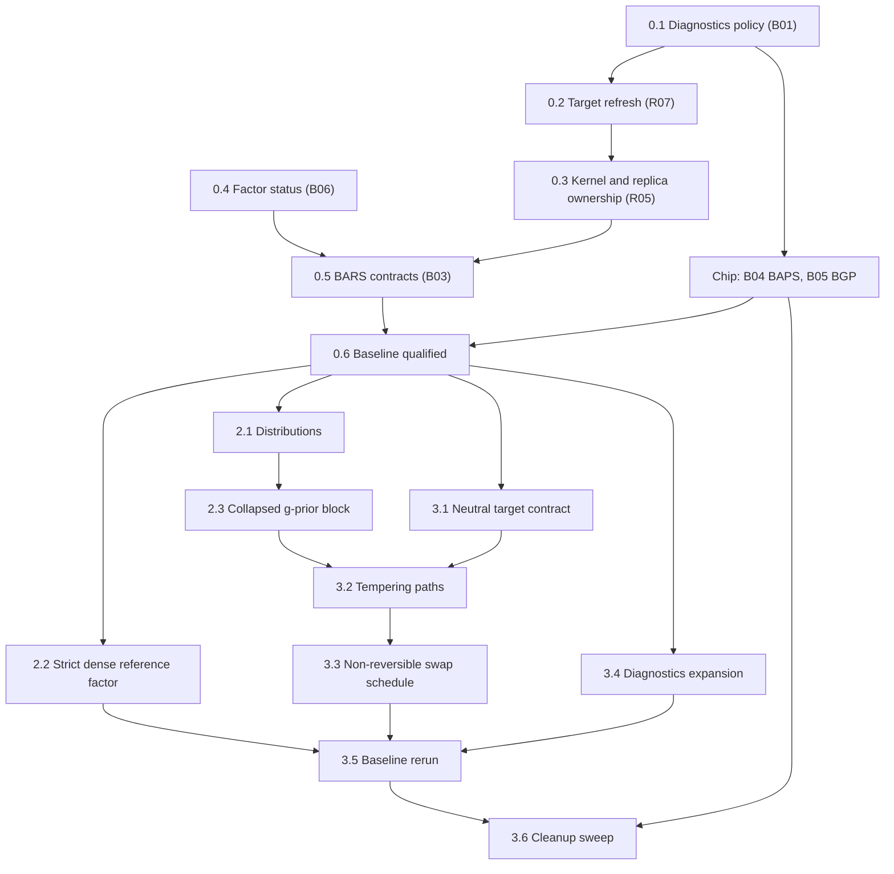

# BASS preparation brief

Date: 2026-10-19. Status: brief, not started. Each phase begins on the user's go-ahead; this document changes no source.

Prepare the existing regression and sampler engines for BASS. The work has two kinds of change: repairs of the reviewed defects, and renovations of shared contracts that BASS will consume. Each repair lands in the form BASS will reuse, so nothing is fixed twice. Repairs and refactors stay in separate commits, so every change in statistical behavior traces to a recorded repair.

Sources:

- [Full port brief](bass-full-port-brief.md): stages 0–9 and the completion contract.
- [Adaptation prerequisites review](bass-adaptation-prerequisites-review.md): findings R01–R13, batches B01–B06, closure evidence, and the baseline gate.
- [Derivations and integration review](bass-derivations-and-integration-review.md): the shared g-prior block, the tempering closed forms, and the residual and admission rules.

B04 (BAPS) and B05 (BGP) have no code path into BASS. They run in parallel under the [BAPS and BGP chip brief](baps-bgp-baseline-repairs-brief.md).

## How this brief maps onto the port stages

| Port stage | This brief | Stays in the port brief |
|---|---|---|
| 0, baseline | Phase 0: B01, B02, B03, B06 and the baseline qualification | B04 and B05 go to the chip |
| 1, specification | Nothing; it runs in parallel and takes the derivations review as input | All of stage 1 |
| 2, shared numerics | Phase 2: distributions, the strict dense reference factor, the g-prior block | Bordered and Givens updates, thin SVD, low-rank covariance solves |
| 3, sampler contracts | Phase 3: neutral targets, tempering paths, swap schedule, diagnostics expansion | The SMC core |

BASS implementation begins at port stage 4, after Phase 3 and the BASS-specific parts of stages 1–3.

## Sequence

Arrows mean **must land before**.

Steps 0.1, 0.2, 0.3 and 0.5 all touch `BarsEnsemble`, so they run in that order. Step 0.4 touches only LinAlg and can run alongside them.

## Phase 0: existing-engine baseline

### 0.1 Diagnostics failure policy (B01: R09)

Files: [ChainEnsemble](../../src/maths/samplers/ensemble/ChainEnsemble.cs#L131), [ChainDiagnostics](../../src/maths/samplers/ensemble/ChainDiagnostics.cs), the [BARS readout](../../src/maths/regression/spline/bars/BarsEnsemble.cs#L206).

- Every R̂ carries a state (estimated, constant, frozen, unavailable), and only an estimate at or below the target, or a constant functional, satisfies a stopping rule. Stopping and display report the same reading.
- Declare a minimum number of draws for stopping, and an explicit policy for a constant functional, distinct from chains frozen at different values.

This step lands first because BAPS and BGP consume these diagnostics; the chip starts after it.

### 0.2 Refresh a chain's target in place (B02: R07)

Files: [ReversibleJumpChain](../../src/maths/samplers/rjmcmc/ReversibleJumpChain.cs), [BarsEnsemble](../../src/maths/regression/spline/bars/BarsEnsemble.cs#L295).

- `ReversibleJumpChain` gains an operation that replaces or refreshes its target, recomputes the cached log target, and keeps the cumulative move counters.
- Weight resampling uses it instead of rebuilding the chain every `WeightEvery` steps. Adaptation reads the cumulative counters.
- Checks: complete and partial adaptation windows, with resampling periods that do and do not divide the window, including the default 25/200.

The same operation is what BASS needs after every τ or λ update, and what SMC needs at every stage change.

### 0.3 Kernel and replica ownership (B02: R05)

Files: [BarsEnsemble](../../src/maths/regression/spline/bars/BarsEnsemble.cs#L146), [ParallelTempering](../../src/maths/samplers/rjmcmc/ParallelTempering.cs#L48).

- Kernel tuning lives in the declarative config. Each chain and each tempering replica constructs its own mutable kernel and moves at the execution boundary.
- `ParallelTempering` takes a per-replica factory for moves; today it hands one instance to every replica.
- The adaptive-tempering exclusion holds on every construction path, including a supplied kernel.
- Checks: seeded serial-versus-concurrent runs agree.

This is the minimal tempering change needed for the repair; step 3.2 generalizes it.

### 0.4 Factor status (B06: R11 and the LinAlg side of R08)

Files: [BandCholesky](../../src/maths/linalg/BandCholesky.cs), [CholeskyDecomposition](../../src/maths/linalg/Cholesky.cs#L58).

- Add a status-reporting API beside the existing methods: finite values, floor hit, and a relative conditioning indicator. Existing methods keep their behavior.
- Inventory every caller and record which ones rely on intentional regularization or inverse output.
- Verify SPD solves, log determinants and precision-draw covariance against independent references.

BAPS and BGP call sites keep their current behavior until the chip completes; they migrate in the cleanup sweep (3.6).

### 0.5 BARS statistical contracts (B03: R13, R08, R12, R04, R01)

Run these in order. Decisions Q1–Q4 are listed below.

**a. R13: cancellation-free marginal.** Compute `a = ‖r‖²_W + Q/(m+1)` from an explicit residual in [WeightedNormalModel](../../src/maths/regression/spline/bars/WeightedNormalModel.cs#L74). The rounding-driven `a ≤ 0` rejection goes away. Any near-interpolation restriction becomes an explicit admission rule under step b.

**b. R08: rank policy per model.** Normal, Poisson, Whittle and GibbsLoss models decide admission from the step 0.4 status, under the Q4 policy. None of them scores a floored factor.

**c. R12: full posterior coefficient draws.** After Q1 is settled, `WeightedNormalModel.SampleCoefficients` draws σ² from `IG(m/2, a/2)`, then β from `N((m/(m+1))A⁻¹b, σ²(m/(m+1))A⁻¹)`, using BandCholesky's existing precision-draw path.
- Draw σ² as the reciprocal of the existing scale-parameterized Gamma, with a unit check; the explicit rate/scale API arrives in step 2.1.
- Correct the [IObservationModel](../../src/maths/regression/spline/bars/IObservationModel.cs#L35) docstring's claim that mean-based intervals are already integrated.
- Expect wider intervals for peaks, extrema and peak counts, and record that change against R12.

**d. R04: exact robust weights.** After Q2 is settled, Student-t and contaminated-normal weights use residuals from a drawn β and the scale from a drawn σ², replacing the conditional mean and the MAD scale.
- Sweep order: structure given weights, with β and σ² integrated out; then β and σ² given structure and weights; then weights given β and σ². That order is a valid collapse-then-redraw scan.
- If an approximation is kept anywhere, it carries an explicit name and stays out of exact comparisons.

**e. R01: knot measure.** After Q3 is settled, add the chosen location density to the target. Build the constant-likelihood count-law check generically over any reversible-jump target and move set, so BASS's D01 check reuses it.

### 0.6 Baseline qualification

After 0.1–0.5 and the chip report:

- Run the affected suites with `scripts/fact-harness.ps1 -Project` for `tests/Maths.Regression.Tests`, `tests/Maths.LinAlg.Tests` and `tests/Maths.Distributions.Tests`, plus the new checks.
- Record the qualified revision, toolchain and results in the report section of this brief.

This closes the baseline gate in the prerequisites review.

## Phase 2: shared numerics and the g-prior block

### 2.1 Distributions

- Add inverse gamma, truncated forms, and stable normal and Student interval probabilities.
- Make rate versus scale explicit in parameter names and factories. R's τ prior (derivations review §6) is the cautionary case.
- Step 0.5c's σ² draw switches to the new API.

### 2.2 Strict dense reference factor

A solve-oriented dense Cholesky with explicit status, no pivot flooring and no eager inverse. Existing callers keep their current path. Bordered and Givens updates build on it in the port's stage 2.

### 2.3 Collapsed g-prior block

Extract the block from the repaired `WeightedNormalModel` (derivations review §1.3). It holds:

- the sufficient statistics and the explicit residual;
- the τ setting (fixed at `1/m` for BARS) and the σ² setting (integrated out for BARS);
- composition draws;
- the likelihood-tempered closed forms from review §3, behind a banded backend first.

This step is a pure refactor. BARS outputs match the step 0.6 baseline to rounding. Build it beside the existing class, switch callers, and leave deletion to step 3.6.

## Phase 3: sampler contracts

### 3.1 Neutral target contract

- Generalize [IRjTarget](../../src/maths/samplers/rjmcmc/IRjTarget.cs) into a model-neutral log-density contract that can expose log-prior and log-likelihood separately, or a closed-form tempered density.
- Migrate `SplineTarget` and the other reversible-jump callers.
- Create a dedicated `Maths.Samplers` test host whose targets depend on neither Regression nor SPC. Move the generic sampler tests there as an explicit ownership change.

### 3.2 Tempering paths

- `ParallelTempering` evaluates each swap from each replica's own target at the other replica's state, rather than the β-linear shortcut at [ParallelTempering.cs:71](../../src/maths/samplers/rjmcmc/ParallelTempering.cs#L71).
- The tempering path is declared: the powered posterior (today's `TemperedTarget`) or the likelihood-tempered path from step 2.3.
- Validate the ladder: finite, ordered, cold value 1. Q5 sets BARS's path.
- The cold-chain target is unchanged, so BARS posteriors agree in distribution with the baseline.

### 3.3 Non-reversible swap schedule

Deterministic even/odd swaps and ladder adaptation (Syed et al. 2022). Measure them by full round trips across the ladder, not by swap acceptance.

### 3.4 Diagnostics expansion

Rank-normalized split and folded R̂, and bulk and tail ESS, built on the step 0.1 failure policy. Give ESS the same exact constant-functional handling: today a constant functional's ESS reads about C/2 or Cn depending on rounding. Then replace the 100-draw stopping floor with an ESS gate: stop only when R̂ meets the target and the per-chain ESS of the monitored functionals is at least 100.

### 3.5 Baseline rerun

Rerun the step 0.6 checks after the migrations. Every difference must trace to a recorded repair or to a declared path change.

### 3.6 Cleanup sweep

Delete the superseded surfaces in their own commit: the old target contract, the chain-rebuild path, the duplicated model math, the status-less factor calls (including BAPS and BGP once the chip has closed), and the sums-based `ChainDiagnostics.RHat` overload once BAPS has moved to the moments form.

## Decisions

| ID | Decision | Needed before | Recommendation |
|---|---|---|---|
| Q1 | What BARS's readouts mean once full draws exist | 0.5c | Keep the conditional-mean curve as the Rao-Blackwellized estimator for linear readouts. Use full draws for intervals and for nonlinear readouts (peaks, extrema, peak counts). |
| Q2 | Whether the coefficient prior uses the weighted Gram matrix | 0.5d | **Unweighted** for BARS. The weight update stays the exact Gamma draw. The marginal becomes `|G/m|^½ · |Zᵀ(W + I/m)Z|^−½ · ∏ w_i^½ · S^−m/2` with `S = ‖y − Zβ̂‖²_W + β̂ᵀ(G/m)β̂`, which reduces to today's form at unit weights and needs one extra banded factorization per proposal. The weighted alternative keeps one factorization but needs a Metropolis correction by `|ZᵀWZ|^½` on every weight sweep. BASS's robust mode decides separately, because a sampled τ changes this tradeoff. |
| Q3 | BARS knot location measure | 0.5e | Ordered uniform locations, with `log k!` added to the target, so that `p(k)` is the actual count prior, as the complexity priors are documented. |
| Q4 | Rank and admission policy per model | 0.5b | Reject rank-deficient designs in all four models, using the step 0.4 status with a relative criterion. Declare any near-interpolation limit for the Normal model as part of its prior. |
| Q5 | BARS tempering path | 3.2 | Likelihood-tempered: hot replicas approach the prior, and the swap is O(1) from the block's statistics. |

## Working rules

- **Check first.** Each repair begins with an independent check or derivation counterexample. The report records it failing at the parent revision, and the check and the fix land in the same commit.
- **One concern per commit,** on `main`. Repairs and refactors never share a commit. Stage files by explicit path, because the chip works in the same checkout.
- **Settle semantics before tests.** Statistical semantics are decided before any test expectation changes. A known-incorrect output becomes a defect fixture, never a gold standard.
- **Build beside, delete last.** New surfaces land beside old ones, and deletions wait for step 3.6. The end state has no compatibility aliases.
- **File ownership.**

  | Owner | Files |
  |---|---|
  | This brief | `src/maths/samplers/**`, `linalg/**`, `distributions/**`, `rng/**`, `regression/spline/bars/**`, the shared spline files, `docs/Maths/Samplers.md`, and the BARS sections of `docs/Maths/BayesianRegression.md` |
  | The chip | The BAPS and BGP sources, their tests, and their documentation sections |

- **Evidence per item:** the reproduction, the chosen specification, affected paths, commits, independent checks and remaining limitations, as the prerequisites review requires.

## Out of scope

BASS code, the BASS-only numerics of port stage 2, the SMC core, B04 and B05 (the chip), and unrelated subsystem work.

## Report

Append one section per completed step: date, commits, checks with results, and anything deferred.

### 0.1 Diagnostics failure policy — done 2026-10-19

Commit `2824bf9`.

**Failing checks at the parent revision `c0cfe7a`:**
- Chains frozen at different values stopped after 10 of 200 draws.
- A chain emitting NaN stopped after 10 of 200 draws.
- With a batch size of 1, the run stopped after 1 draw.
- A single chain was accepted with an R̂ target.
- Four constant chains of 0.1 read R̂ = 0.9995 instead of the constant policy.

The last check exposed a defect beyond R09: running Σ and Σ² cancel to rounding noise for a constant value that isn't exactly representable, so a constant functional produced a spurious estimate.

**Specification:**
- `RHatState` has four values: estimated, constant, frozen, unavailable.
- `RHatDiagnostic.MeetsTarget` holds for an estimate at or below the target, or for a constant functional.
- `RHatDiagnostic.Worst` orders readings as constant, then estimates by value, then frozen, then unavailable.
- R̂ is computed from streaming (Welford) moments.
- `ChainEnsemble.MinDrawsForStop = 100` draws per chain. Vehtari et al. (2021) ask for an effective sample size of 100 per chain before trusting R̂.
- An R̂ target with a single chain is rejected.

**Changed:**
- `ChainDiagnostics`, `ChainEnsemble` and `EnsembleRun`, plus the new `RunningMoments` and `RHatDiagnostic`.
- `BarsEnsemble`:
  - the consensus map is reported unclamped, and `RHatFitMax` is its worst reading;
  - the peak and mode R̂ are typed;
  - the mode R̂ uses two-pass variances and the shared core.
- `BgpResult.BandwidthRHat` is typed.
- `docs/Maths/Samplers.md` and `docs/Maths/BayesianRegression.md`.

**Results:**
- The 11 checks in `DiagnosticsPolicyTests` pass.
- `Maths.Regression.Tests` passes 87 of 87 under `scripts/fact-harness.ps1` (run `20261019_155925675`).
- `Clustering.Graphical.SPC`, `Synthetic` and `Synthetic.Tests` build.

**Deferred:**
- The ESS of a constant functional reads about C/2 or Cn depending on rounding; this goes to step 3.4.
- BAPS stays on the sums-based overload until chip item 6.
- That overload is deleted in step 3.6.

**Confirmed by the user, 2026-10-19:**
- The 100-draw floor stays as a fixed constant; step 3.4 replaces it with an ESS gate.
- A constant functional doesn't block a stop but can't certify one alone: an early stop needs at least one estimated functional, so an all-constant set runs to the end. Commit `5f8826e`; `Maths.Regression.Tests` passes 88 of 88 (run `20261019_175042153`).
