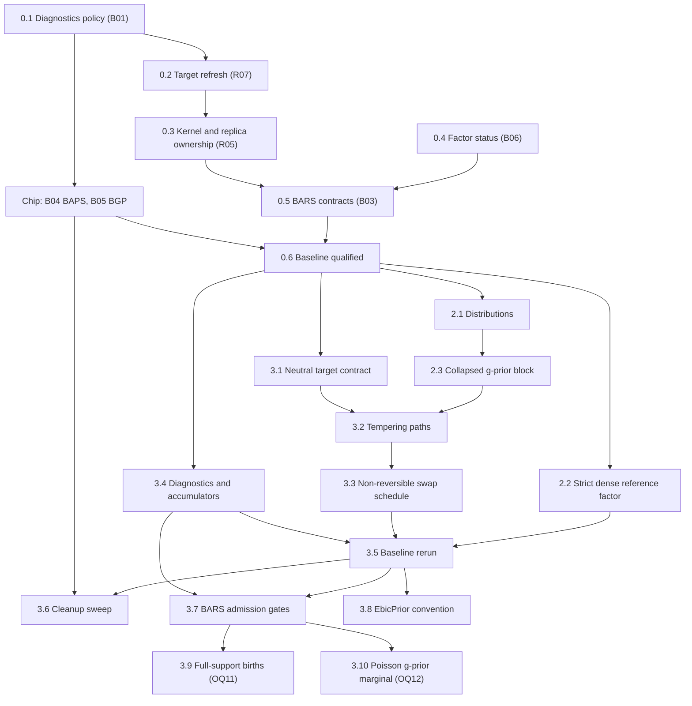

# BASS preparation brief

Date: 2026-10-19. Status: Phases 0, 2 and 3 done (2026-10-22), with the external review's follow-up; each step's report is under "Report". Each phase began on the user's go-ahead; this document changes no source.

Prepare the existing regression and sampler engines for BASS. The work has two kinds of change: repairs of the reviewed defects, and renovations of shared contracts that BASS will consume. Each repair lands in the form BASS will reuse, so nothing is fixed twice. Repairs and refactors stay in separate commits, so every change in statistical behavior traces to a recorded repair.

Sources:

- [Full port brief](bass-full-port-brief.md): stages 0–9 and the completion contract.
- [Adaptation prerequisites review](bass-adaptation-prerequisites-review.md): findings R01–R13, batches B01–B06, closure evidence, and the baseline gate.
- [Derivations and integration review](bass-derivations-and-integration-review.md): the shared g-prior block, the tempering closed forms, and the residual and admission rules.

B04 (BAPS) and B05 (BGP) have no code path into BASS. They run in parallel under the [BAPS and BGP chip brief](baps-bgp-baseline-repairs-brief.md).

## How this brief maps onto the port stages

| Port stage | This brief | Stays in the port brief |
|---|---|---|
| 0, baseline | Phase 0: B01, B02, B03, B06 and the baseline qualification | B04 and B05 go to the chip |
| 1, specification | Nothing; it runs in parallel and takes the derivations review as input | All of stage 1 |
| 2, shared numerics | Phase 2: distributions, the strict dense reference factor, the g-prior block | Bordered and Givens updates, thin SVD, low-rank covariance solves |
| 3, sampler contracts | Phase 3: neutral targets, tempering paths, swap schedule, diagnostics expansion | The SMC core |

BASS implementation begins at port stage 4, after Phase 3 and the BASS-specific parts of stages 1–3.

## Sequence

Arrows mean **must land before**.

Steps 0.1, 0.2, 0.3 and 0.5 all touch `BarsEnsemble`, so they run in that order. Step 0.4 touches only LinAlg and can run alongside them.

## Phase 0: existing-engine baseline

### 0.1 Diagnostics failure policy (B01: R09)

Files: [ChainEnsemble](../../src/maths/samplers/ensemble/ChainEnsemble.cs#L131), [ChainDiagnostics](../../src/maths/samplers/ensemble/ChainDiagnostics.cs), the [BARS readout](../../src/maths/regression/spline/bars/BarsEnsemble.cs#L206).

- Every R̂ carries a state (estimated, constant, frozen, unavailable), and only an estimate at or below the target, or a constant functional, satisfies a stopping rule. Stopping and display report the same reading.
- Declare a minimum number of draws for stopping, and an explicit policy for a constant functional, distinct from chains frozen at different values.

This step lands first because BAPS and BGP consume these diagnostics; the chip starts after it.

### 0.2 Refresh a chain's target in place (B02: R07)

Files: [ReversibleJumpChain](../../src/maths/samplers/rjmcmc/ReversibleJumpChain.cs), [BarsEnsemble](../../src/maths/regression/spline/bars/BarsEnsemble.cs#L295).

- `ReversibleJumpChain` gains an operation that replaces or refreshes its target, recomputes the cached log target, and keeps the cumulative move counters.
- Weight resampling uses it instead of rebuilding the chain every `WeightEvery` steps. Adaptation reads the cumulative counters.
- Checks: complete and partial adaptation windows, with resampling periods that do and do not divide the window, including the default 25/200.

The same operation is what BASS needs after every τ or λ update, and what SMC needs at every stage change.

In its own commit, the same step adds a construction-time check that move pairings are reciprocal: each move's reverse must name the move back. Today the chain checks only that the reverse exists ([ReversibleJumpChain.cs:62](../../src/maths/samplers/rjmcmc/ReversibleJumpChain.cs#L62)), and a non-reciprocal palette would compute inconsistent acceptance ratios.

### 0.3 Kernel and replica ownership (B02: R05)

Files: [BarsEnsemble](../../src/maths/regression/spline/bars/BarsEnsemble.cs#L146), [ParallelTempering](../../src/maths/samplers/rjmcmc/ParallelTempering.cs#L48).

- Kernel tuning lives in the declarative config. Each chain and each tempering replica constructs its own mutable kernel and moves at the execution boundary.
- `ParallelTempering` takes a per-replica factory for moves; today it hands one instance to every replica.
- The adaptive-tempering exclusion holds on every construction path, including a supplied kernel.
- Checks: seeded serial-versus-concurrent runs agree.

This is the minimal tempering change needed for the repair; step 3.2 generalizes it.

### 0.4 Factor status (B06: R11 and the LinAlg side of R08)

Files: [BandCholesky](../../src/maths/linalg/BandCholesky.cs), [CholeskyDecomposition](../../src/maths/linalg/Cholesky.cs#L58).

- Add a status-reporting API beside the existing methods: finite values, floor hit, and a relative conditioning indicator. Existing methods keep their behavior.
- Inventory every caller and record which ones rely on intentional regularization or inverse output.
- Verify SPD solves, log determinants and precision-draw covariance against independent references.

BAPS and BGP call sites keep their current behavior until the chip completes; they migrate in the cleanup sweep (3.6).

### 0.5 BARS statistical contracts (B03: R13, R08, R12, R04, R01, R14)

Run these in order. Decisions Q1–Q4 are listed below.

**a. R13: the marginal's guard.** In [WeightedNormalModel](../../src/maths/regression/spline/bars/WeightedNormalModel.cs#L74), `a ≥ Q/(m+1)`, so the `a ≤ 0` guard rejects only an identically zero response; over-knotting is caught earlier by the `m ≤ ν` rule. Correct the guard's documentation, and pin its behavior with a check. Any near-interpolation restriction becomes an explicit admission rule under step b.

Revised 2026-10-19. The first version of this step computed `a` from an explicit residual. Re-checked before coding: for BARS's τ = 1/m the subtraction loses at most log₁₀(m+1) digits, so that change waits for step 2.3, where a sampled small τ makes it matter.

**b. R08: rank policy per model (Q4 decided 2026-10-20: reject).** Normal, Poisson, Whittle and GibbsLoss models decide admission from the step 0.4 status, under the Q4 policy. None of them scores a floored factor.
- Poisson and Whittle also need a policy for IRLS non-convergence: reject with a recorded reason.
- `PoissonModel`'s N(0, 100) coefficient ridge ([PoissonModel.cs:141](../../src/maths/regression/spline/bars/PoissonModel.cs#L141)) is intentional regularization; record it in the step 0.4 inventory and in the docs. (Done: it enters only the draw's MH correction, not the marginal or any factored matrix.)

**c. R12: full posterior coefficient draws (Q1 decided 2026-10-20: option B).** `WeightedNormalModel.SampleCoefficients` draws σ² from `IG(m/2, a/2)`, then β from `N((m/(m+1))A⁻¹b, σ²(m/(m+1))A⁻¹)`, using BandCholesky's existing precision-draw path.
- **Rule for which readouts may use the conditional mean.** A readout may use the conditional (Rao-Blackwellized) mean only if it is affine in f: the mean fitted curve, derivatives, integrals. Argmax, peak counts, spans and quantile intervals use full draws. This is the SW side's "affine, so pooling commutes" rule (`SweepEdgeCurves`), applied one level down.
- **Pointwise posterior variance** (the adaptive sweep's σ_curve) comes from the law of total variance: Var[f(T)] = E_knots[v(T)] + Var_knots[m(T)].
  - m(T) is the conditional mean, and v(T) = (a/(m−2))·(m/(m+1))·z(T)ᵀA⁻¹z(T) is the closed-form conditional variance given the knots, with σ integrated out.
  - Accumulate Σm, Σm² and Σv additively and reduce once. The result is exact, with lower Monte Carlo variance than drawing.
- **Non-Normal models.** Whittle draws from its Laplace approximation, labeled as approximate. GibbsLoss labels its nonlinear readouts as reflecting knot uncertainty only, since its posterior is already a generalized one.
- **Scope note.** The BARS-for-SPC application is not deployed, and its design is still in progress; the peak and elbow readouts penciled in so far may change. Keep the readout contract general (the rule above) rather than tailored to the current peak and elbow plan.
- Draw σ² as the reciprocal of the existing scale-parameterized Gamma, with a unit check; the explicit rate/scale API arrives in step 2.1.
- Correct the [IObservationModel](../../src/maths/regression/spline/bars/IObservationModel.cs#L35) docstring's claim that mean-based intervals are already integrated.
- Expect wider intervals for peaks, extrema and peak counts, and record that change against R12.
- `PoissonModel`'s draw heuristics (keep the first Laplace draw when the log MH ratio exceeds −10, otherwise at most five independence MH steps, then β̂) get a specification under the same rule, or are replaced.

**d. R04: exact robust weights (Q2 decided 2026-10-20: unweighted g-prior).** Student-t and contaminated-normal weights use residuals from a drawn β and the scale from a drawn σ², replacing the conditional mean and the MAD scale.
- Sweep order: structure given weights, with β and σ² integrated out; then β and σ² given structure and weights; then weights given β and σ². That order is a valid collapse-then-redraw scan.
- If an approximation is kept anywhere, it carries an explicit name and stays out of exact comparisons.

**e. R01: knot measure (Q3 decided 2026-10-20: ordered uniform plus a Conway–Maxwell–Poisson count prior).** Add `log k!` to the target. Add `ConwayMaxwellPoissonPrior(λ, ν)`; its prior ratio is λ/(k+1)^ν, so no normalizer is needed. Run the validation fits at ν = 1 and ν = 2 and record the comparison in the docs. Build the constant-likelihood count-law check generically over any reversible-jump target and move set, so BASS's D01 check reuses it. Run both move schedules (constant and DMGK) through it: that checks exactly that they sample the same posterior, replacing `DmgkScheduleTests`' |Δk̄| < 0.6.

**f. R14: span coverage as a probability.** Each covering span adds 1 to a grid point (the span-coverage loop in [BarsEnsemble](../../src/maths/regression/spline/bars/BarsEnsemble.cs)), so overlapping spans of nested peaks push π(T) above 1, and `PeakModes`' 0.5 cutoff is then not a probability threshold. Count each grid point at most once per draw (the union of spans), or rename π(T) as an expected coverage count. This is a BARS readout repair that does not gate BASS.
- **Framing.** Choose the estimand, then accumulate its sufficient statistic per draw. P(T lies inside some significant span) needs the per-draw indicator of the union. The expected number of covering spans needs the per-draw count. The union has to happen per draw, because it is part of the per-function functional.
- **Default:** the union, so π(T) means what its documentation and `PeakModes`' ½ cutoff assume. Add the count as a separate accumulator only if nesting depth turns out to matter. Confirm this when the step starts.

### 0.6 Baseline qualification

After 0.1–0.5 and the chip report:

- Run the affected suites with `scripts/fact-harness.ps1 -Project` for `tests/Maths.Regression.Tests`, `tests/Maths.LinAlg.Tests` and `tests/Maths.Distributions.Tests`, plus the new checks.
- Record the qualified revision, toolchain and results in the report section of this brief.

This closes the baseline gate in the prerequisites review.

## Phase 2: shared numerics and the g-prior block

### 2.1 Distributions

- Add inverse gamma, truncated forms, and stable normal and Student interval probabilities.
- Make rate versus scale explicit in parameter names and factories. R's τ prior (derivations review §6) is the cautionary case.
- Step 0.5c's σ² draw switches to the new API.

### 2.2 Strict dense reference factor

A solve-oriented dense Cholesky with explicit status, no pivot flooring and no eager inverse. Existing callers keep their current path. Bordered and Givens updates build on it in the port's stage 2.

### 2.3 Collapsed g-prior block

Extract the block from the repaired `WeightedNormalModel` (derivations review §1.3). It holds:

- the sufficient statistics and the explicit residual;
- the τ setting (fixed at `1/m` for BARS) and the σ² setting (integrated out for BARS);
- composition draws;
- the likelihood-tempered closed forms from review §3, behind a banded backend first.

This step is a pure refactor. BARS outputs match the step 0.6 baseline to rounding. Build it beside the existing class, switch callers, and leave deletion to step 3.6.

Design notes (added 2026-10-20, from the admission discussion and its [evidence](#addendum-admission-evidence-2026-10-20)):

- **Cache the statistics that depend on neither τ nor temperature.** These are ‖r_OLS‖² (from the explicit residual), Q = ‖L⁻¹Zᵀy‖² and the dimension p.
  - With likelihood inverse-temperature β, S = β·yᵀy − β²Q/(β + τ) = β·(‖r_OLS‖² + τ/(β + τ)·Q). At β = 1 and τ = 1/m this is today's yᵀy − m/(m+1)·Q in its cancellation-free form (R13; derivations review §5).
  - At W = I the log-determinant term is (τ/(β + τ))^(p/2), and log|G| cancels.
  - So S and the marginal cost O(1) for any τ or temperature. BASS's τ updates and step 3.2's tempered swaps then need no refactorization.
- **Two paths.** At W = I, one factor G. On the robust path (step 0.5d), G and P_a are both factored and both log-determinants enter.
- **What the block does not own.** Rules about data under each basis function belong to the basis and target layer, checked before any factorization; BASS likewise checks `npart` when it proposes. Numerical admission reads the factor's status. The block takes an admitted factored system and returns marginals, residuals, tempered densities and (σ², β) draws.
- **The coefficient prior is a parameter, not an interface.** The g-prior, with τ fixed or sampled, is the only coefficient prior. An interface waits for a second one; see the [seam map](#seam-map-admission-prior-and-schedule).
- **No per-proposal allocation** beyond the factor's own storage: scratch is owned by the caller.
- **`DesignAdmission` is not touched** in steps 2.3–3.5 (Q6).

## Phase 3: sampler contracts

### 3.1 Neutral target contract

- Generalize [IRjTarget](../../src/maths/samplers/rjmcmc/IRjTarget.cs) into a model-neutral log-density contract that can expose log-prior and log-likelihood separately, or a closed-form tempered density.
- Migrate `SplineTarget` and the other reversible-jump callers.
- Create a dedicated `Maths.Samplers` test host whose targets depend on neither Regression nor SPC. Move the generic sampler tests there as an explicit ownership change.

### 3.2 Tempering paths

- `ParallelTempering` evaluates each swap from each replica's own target at the other replica's state, rather than the β-linear shortcut at [ParallelTempering.cs:71](../../src/maths/samplers/rjmcmc/ParallelTempering.cs#L71).
- The tempering path is declared: the powered posterior (today's `TemperedTarget`) or the likelihood-tempered path from step 2.3.
- Validate the ladder: finite, ordered, cold value 1. Q5 sets BARS's path.
- The cold-chain target is unchanged, so BARS posteriors agree in distribution with the baseline.

### 3.3 Non-reversible swap schedule

Deterministic even/odd swaps and ladder adaptation (Syed et al. 2022). Measure them by full round trips across the ladder, not by swap acceptance.

- **Q5's revisit trigger.** Measure round trips per unit work on the validation fits for both paths. Reopen BARS's default if the powered ladder is clearly ahead.
- **The hot end on the likelihood path.** The Normal marginal's Occam factor per basis function at rung b is (1 + mb)^(−1/2) with τ = 1/m. It is about 0.38 (≈ 0.97 nats) at b = 0.05 and m = 120, and it vanishes as b → 0. So b_min ≈ 1/m marks where the hot rungs' dimension stops being held down and they approach a diffuse count prior's spread. Ladder adaptation should watch that regime.

### 3.4 Shell readouts: diagnostics and accumulators

**Diagnostics.** Rank-normalized split and folded R̂, and bulk and tail ESS, built on the step 0.1 failure policy. Give ESS the same exact constant-functional handling: today a constant functional's ESS reads about C/2 or Cn depending on rounding. Then replace the 100-draw stopping floor with an ESS gate: stop only when R̂ meets the target and the per-chain ESS of the monitored functionals is at least 100.

Two clear-cut additions:
- **ESS cost.** ESS computes every lag before truncating, at O(Cn²) ([ChainDiagnostics.Ess](../../src/maths/samplers/ensemble/ChainDiagnostics.cs)). Compute lags until truncation, or use FFT autocovariances.
- **Acceptance rate.** Report it from post-burn counters; today the shell's rate includes burn-in, and BGP inherits that.

**Readouts, traces and checkpoints** (revised 2026-10-21; supersedes the single "accumulator contract" of 2026-10-20). The first version combined three things that pool differently: commutative statistics, ordered chain information, and restart state. A review pointed out that the port brief already separates them ("Keep posterior storage separate from checkpoints"; weight ESS separate from chain R̂ and autocorrelation ESS). They are three components:
- **Readout accumulators: mergeable statistics,** the shared infrastructure.
  - Additive sufficient statistics with an associative, commutative merge, so pooling across chains does not depend on order. The step 0.1 streaming moments already merge this way (Chan's parallel formula).
  - An optional weight on each fold, so the same statistics pool weighted particles.
  - Nonlinear reductions in a separate tier that reads only pooled statistics, applied once, at the level where the estimand lives.
  - Counts of admission rejections by reason (rank or conditioning; IRLS non-convergence; the m ≤ ν rule; and, from step 3.7, the support gate), so the truncation step 0.5b introduced stays visible.
  - BARS's readouts move onto it: the step 0.5c moments, λ, π and the peak sample.
- **Diagnostic traces: ordered per-chain draws** of the monitored functionals.
  - Rank-normalized split R̂ and autocorrelation ESS need the order of each chain's draws. Per-chain moments are not enough, and a trace does not merge like a statistic: pooling keeps the chains apart.
  - These are MCMC diagnostics. `EssDiagnostic` is autocorrelation ESS, distinct from a particle population's weight ESS (Kish), ancestry diversity and population diagnostics, which belong to the SMC module and are never reported as the same quantity.
- **Execution checkpoints: restart state,** which cannot be pooled.
  - Sampler configuration and data identity, every RNG stream's state, the iteration or stage, adaptation state, replica assignments, swap-schedule state (scan parity, the stochastic schedule's stream), and BARS's robust weights.
  - A checkpoint container owns these together with the accumulators and traces it resumes. It holds them as separate components, never as one merged structure.
- **Dependency boundaries** (the port brief's). Maths.Samplers owns the generic contracts: the statistic primitives, the trace, and the checkpoint container. Each engine in Maths.Regression supplies its own components. Neither project acquires an SPC or Graphs dependency; the SW sampler's `Accumulator` is the pattern, not a shared type.
- BASS and the SMC backend consume all three.

**Extrapolation readout** (added 2026-10-20). Report the prediction leverage h(T) = z(T)ᵀ(ZᵀZ)⁻¹z(T) beside `FitSd`: its posterior mean, or the fraction of draws with h > 1.
- A grid point with h ≫ 1 is extrapolated from the data. The g-prior adds no shrinkage there, so the fit is the least-squares extrapolation, and coefficient draws swing with it.
- Leverage flags every fit across a real data gap, so it belongs in the readouts rather than in admission ([evidence](#addendum-admission-evidence-2026-10-20)).
- It is the conditional-variance quadratic that `ReadoutQuadratics` already computes, without the σ² scale, so it adds no solves.

### 3.5 Baseline rerun

Rerun the step 0.6 checks after the migrations. Every difference must trace to a recorded repair or to a declared path change.

### 3.6 Cleanup sweep

Delete the superseded surfaces in their own commit: the old target contract, the duplicated model math, the status-less factor calls (including BAPS and BGP once the chip has closed), and the sums-based `ChainDiagnostics.RHat` overload once BAPS has moved to the moments form.

### 3.7 BARS admission: numerical and support gates (Q6)

Added 2026-10-20. This lands after step 3.5's zero-drift rerun as its own change, measured with step 3.4's rejection counts by reason. It splits today's admission rule into its two jobs ([evidence](#addendum-admission-evidence-2026-10-20)):

- **Numerical gate.** The model's factor runs without a pivot floor (a strict `BandCholesky` mode, following step 2.2's `DenseCholesky`), must be positive definite, and needs `MinRelativePivot` ≥ 1e-10. This keeps Q4's six-digit rationale, now on the equilibrated condition number that governs Cholesky accuracy (van der Sluis 1969; Demmel 1989). *(Erratum, 2026-10-22: 1/`MinRelativePivot` only bounds that condition number from below, so it can justify a refusal but cannot keep six digits. The review follow-up adds a condition estimate to the gate.)* It replaces `PivotRatio` ≥ 1e-10 and `FlooredPivots` == 0, both of which depend on column scaling.
- **Support gate.** Every basis function needs column mass Σᵢ Bⱼ(xᵢ) ≥ w_min, with default 1 (one data point's worth) and configurable. `SplineTarget` checks it before any factorization, beside the open-simplex rule, as a declared prior-support restriction.
- **Checks, before and after:**
  - the validation fits;
  - a sharp transient near a domain boundary;
  - fits across a data gap, both the posterior mean and the coefficient draws in the gap;
  - robust runs;
  - a low-rate Poisson case, to test the unmeasured prediction that `PivotRatio` rejects knots in low-count regions because μ̂ shrinks those columns;
  - rejection counts by reason.
- **Docs.** `BayesianRegression.md`'s admission section states the two gates, the alternatives (count, mass, Kish size, leverage) and the trade-offs.

### 3.8 `EbicPrior` in He, Yang and Kang's convention (Q7)

Added 2026-10-20. This lands after step 3.5, beside 3.7. Its checklist was verified on 2026-10-21 against the article's open supplementary materials, below; the main text is behind a paywall.

- **Law.** log p(k) = (1 − γ)·log C(C, k), with γ ≥ 0 and C the candidate count:
  - γ < 1 favors larger k: this is EBIC's interpolation from BIC's uniform-over-models prior at γ = 0;
  - γ = 1 is flat;
  - γ > 1 penalizes.

  Today's `EbicPrior(γ)` is this law at γ_HYK = γ + 1.
- **Support.** HYK's support, [0, C]. For γ > 1 the law rises again past C/2, so the docs advise C ≥ 2·k_max, which keeps that half out of reach. Truncating at ⌊C/2⌋ is the alternative, as a declared extension; choose between them on item 3 below.
- **Tests.** `EbicTests` moves from γ = 0 to 1 (flat) and from γ = 1 to 2 (penalized). `CountLawTests` gains an EBIC case.
- **Docs.** `BayesianRegression.md` states the three regimes, the mapping from the old γ, the support guidance and the citation.

**Verified against the supplementary materials** (2026-10-21).
- **Sources.** The user obtained `issues/regression/ABMRS_Revision_V2_Supplementary_Materials/`: the Web Appendix (`ABMRS_Biometrics_Revision_V2_WebAppendix.pdf`, extracted as `web_appendix_extracted.txt`), the `ABMRS` 0.1.0 package source (R and C++) and the demos. Their review is in `discussion/abmrs-verification-questions.md`, with a follow-up in `discussion/argon-abmrs-verification-debrief.md`. Each finding below was rechecked against the source files.
- **What the earlier external summary got wrong:** the death formula did not change since the preprint.
- **What the follow-up debrief gets wrong about this engine:**
  - Our Poisson and Whittle marginals are BIC-type, not Laplace.
  - The triceps demo's knot inference fixes k = 2, so averaging its ordered knots across draws is meaningful. Its frequentist refit at those knots does ignore their uncertainty.

| # | What to verify | Where it matters | Found (2026-10-21) |
|---|---|---|---|
| 1 | Whether the prior keeps the preprint's form: π(k) ∝ C(C,k)^(1−γ) with π(ξ \| k) = 1/C(C,k) (equation 3) | The γ_HYK = 1 + γ mapping, and so this step | **Confirmed.** Web Appendix A.1–A.2: π(k, ξ) ∝ τ(M_k)^(−γ), with τ(M_k) = C(n, k) the number of k-knot models. So π(ξ \| k) = 1/C(n, k) and π(k) ∝ C(n, k)^(1−γ). `ebars.cpp`'s schedule is Green's for that law. The mapping γ_HYK = 1 + γ holds. |
| 2 | γ's range (γ ≥ 0?), the three regimes and the recommended [0.5, 2] | Whether γ > 1 is their convention, to cite, or our extension, to label; constructor bounds; docs | **Their convention.** The package documents γ ∈ [0.5, 2.0] with default 1.0 (`wrapper.R`), and the Web Appendix runs γ = 0.8, 1.0 and 1.2. So γ > 1 is theirs to cite. The code excludes no regime. |
| 3 | Guidance on C ("typically > m"), or anything on k past C/2 | Support [0, C] with guidance, or truncation | **C = times·m,** with times = 3 by default; the demos use 2, and `n` can be set directly. Candidates are the grid j/(n + 1). There is no truncation and no stated guidance past C/2; in practice a column filter (below) keeps chains far from it. So: support [0, C] with guidance, as planned. |
| 4 | The b_k and d_k formulas; c = 0.3 and any stated reason or mixing claim | The mixing benchmark's arms ([BARS mixing](#after-phase-3-bars-mixing)) | **Confirmed.** b_k = c·min(1, ((n − k)/(k + 1))^(1−γ)), d_k = c·min(1, (k/(n − k + 1))^(1−γ)), r_k = 1 − b_k − d_k. c defaults to 0.3 within [0, 1], so relocation gets at least 0.4. The supplement gives no reason or mixing claim. Births and relocations draw uniformly from the unused candidates: global, unlike our local births (OQ11). |
| 5 | Coincident knots (multiplicity above 1) | The tensor-product extension's handling of jumps (port brief) | **Not supported.** Knots are drawn without replacement from distinct candidates, and jumps are fitted with nearly adjacent knots. Coincident knots appear only in the demos' data generators. |
| 6 | The non-normal treatment (still an EBIC plug-in?) | The docs' comparison with our Laplace marginals | **An EBIC plug-in, described but not shipped.** The README and Web Appendix A.2 ("substitute p̂ for the corresponding p") describe it, but the released package implements only the Normal model. |
| 7 | How peak inference is defined and computed (draws or a plug-in) | The readout contract for the tensor-product extension | **From draws, with no derivative machinery.** The package returns draws of knots, coefficients and predictions, and the demos summarize them pointwise. |
| 8 | Whether the γ comparison still favors γ = 1, and whether it separates the prior from mixing | The confound noted under BARS mixing | **It favors neither, and it does not separate them.** Web Table 1 (RMSE over 50 runs, Curves 1–3): at m = 200, γ = 0.8 is best on Curves 1 and 3 (Curve 3: 0.680, against 0.751 at γ = 1 and 1.533 at γ = 1.2). At m = 500 the three are close (Curve 3: 0.425, 0.437, 0.457). γ sets both the count law and the schedule. The main text's own comparison was not available. |
| 9 | Title, method name (ABMRS?), volume, issue, article ID, DOI | The citation | **Title** confirmed by the supplement's header. **The rest,** from the journal page as the user found it: Junhui He, Ying Yang and Jian Kang, "Adaptive Bayesian multivariate spline knot inference with prior specifications on model complexity", *Biometrics* 82(3), September 2026, ujag121, doi:10.1093/biomtc/ujag121. **The method** is ABMRS, in the R package `ABMRS` (classes `EBARS`, `MEBARS`). |

**Status:** the supplement settles all nine items for this step (the law, the range, the support), so step 3.8 is unblocked. Cite the article, with the supplement as the source of the verified details.

**Further findings,** recorded for comparison and not for the port:
- **Paper and code differ on the Normal marginal.**
  - Lemma 1 (Web Appendix A.1) is the exact g-prior marginal (m + 1)^(−ν/2)·a^(−m/2), with a = yᵀ(I − m/(m + 1)·P)y: BARS's own.
  - `ebars.cpp` computes m^(Δν/2)·(σ̂/σ̂′)^m, with σ̂² the OLS residual over m. That is the BIC-type form, asymptotically equivalent.
- **Thin columns are dropped, not refused.**
  - **What the code does.** `mle_regression` removes from the fit every basis column with at most `npart` = min(20, ⌊0.1·m⌋) entries above 1e-8. It keeps the configuration, zeroes those coefficients, and predicts with the full basis, so the partition of unity breaks where columns drop. The complexity term still counts the dropped columns, since ν is the full column count. A 1e-8 ridge stabilizes the factor.
  - **Where it came from.** `npart` is BASS's threshold, applied here as a column filter.
  - **How ours differs.** Step 3.7's support gate refuses the configuration instead, and judges by column mass.
- **Coefficient draws condition on σ̂.** β ~ N(m/(m + 1)·β̂, m/(m + 1)·σ̂²(ZᵀZ)⁻¹), with σ fixed at its OLS value and never drawn. Ours compose σ² then β (step 0.5c).
- **A boundary slip at k = 0** (our reading, untested). At k = 0 the move is forced to a birth, and its acceptance is multiplied by b_0, but the reverse death from k = 1 omits the matching 1/b_0. So k = 0 is undersampled whenever one knot is favored.

### 3.9 Full-support births (OQ11)

Added 2026-10-21.
- **Order.** It lands after step 3.7, whose support gate it is designed against. It is independent of step 3.8, and does not gate BASS.
- **Before the studies.** It comes before every BARS mixing or tempering study: OQ1, OQ3, OQ4, OQ8 and the move-schedule comparison. Those have so far measured the trapped kernel.

**The trap,** found by the step 3.5 seed sweep:
- Births are proposed near an existing knot.
- A death's acceptance carries the reverse birth's density at the removed knot.
- So a knot far from the rest is almost never removed (OQ11; `BayesianRegression.md`, known limitations).

**Probe** (scratch code, 2026-10-21):
- **Births:** ε·uniform + (1 − ε)·the local kernel's mixture, with deaths carrying the same density in reverse; ε = 0 runs the engine's own moves.
- **Chains:** untempered, `LocalBetaKernel(50)`, 8 chains of 100,000 steps after 5,000 burn-in per arm, with both arms on the same chain seeds.

| Fit | τ(k), ε = 0 | τ(k), ε = 0.1 | Batch-means τ, ε = 0 → 0.1 | Knot ESS per second, ε = 0 → 0.1 | Mean knots, ε = 0 / 0.1 |
|---|---|---|---|---|---|
| `EnsembleTests`' adaptive stop (sine, n = 100, Poisson(4)) | 485 | 40 | 376 → 38 | 12 → 149 | 1.856 ± 0.020 / 1.871 ± 0.006 |
| `TemperingBenchmark`'s sine with outliers (n = 120, Poisson(5)) | 2,160 | 110 | 848 → 102 | 2.3 → 47 | 2.98 ± 0.06 / 3.05 ± 0.01 |
| `TemperingBenchmark`'s peak (n = 150, Poisson(5)) | 166 | 77 | 163 → 68 | 24 → 53 | 5.614 ± 0.012 / 5.609 ± 0.008 |

- **Correct.** Under a constant likelihood, the knot count follows the Poisson(4) prior in every bin, at kernel τ = 5 and 50 (`CountLaw`, z ≤ 5).
- **The same posterior.** The arms' mean knot counts agree within their errors (|z| ≤ 1.2), at the same CPU time per arm.
- **A conservative ε = 0 figure on the sine.** Its batches of 2,000 are shorter than its τ, so batch means understate that arm's τ. Its tail ESS was 155 from 800,000 draws.
- **Smaller gain on the peak.** Its knots cluster around the bump, where local births belong; the broad fits spread theirs out.

**Plan:**
- **Base measure** for the exploratory component, designed against step 3.7's column-mass gate. Measure the choice on an uneven design.
  - Uniform on (0, 1): exact, and the same as today's k = 0 birth, but on uneven designs it wastes births in data gaps.
  - A histogram density of x: the continuous analogue of BASS's observed-value knots.
- **ε.** A study over ε ∈ {0.05, 0.1, 0.2, 0.3}, on the three probe fits and an uneven design, reading knot-count and peak-location ESS per second.
  - ε becomes a `BarsConfig` setting.
  - Its default comes from that study, set per engine, not from these three fits.
- **One move pair.** The mixture enters the existing birth density, so every death's reverse density is at least ε. `DmgkSchedule.Wrap` and the adaptive kernel compose with it unchanged. A separate global birth/death pair is the alternative; it escapes the trap only at the global death's selection rate.
- **Checks.**
  - `CountLawTests` gains mixture cases.
  - The seed sweep reruns (`SEED_SWEEP=50`).
  - `EbicTests`' burn-in may return to 800.
  - The step 3.5 probe records the trajectory change.
- **Docs.** `BayesianRegression.md`'s trap entry becomes the birth density's specification: ε, the base measure, and the trade-off of wasted exploratory births against deaths bounded below.
- **Then** the BARS-mixing table, OQ1, OQ4 and OQ8 are measured again on the new kernel.
- **BASS.** BASS already has this component. Its births draw knots from observed values, and choose interaction orders and variables with `w1` and `w2` (both 5) added to the current model's counts. The port keeps them positive (full-port brief, "Modernization choices").

### 3.10 Poisson g-prior marginal (OQ12)

Added 2026-10-21. Decided with the user the same day: remedy (c), with the original BIC pathway kept beside it.
- **Order.** It lands after step 3.7, whose numerical gate it uses, and independently of step 3.9, whose ε study uses Normal fits. It comes before any count-data mixing study, and before BARS is used on sparse counts.
- **Scope.** It touches only `PoissonModel`. Whittle and GibbsLoss are also BIC-type, but they cannot separate: Whittle's periodogram is positive almost surely, and GibbsLoss's biweight loss is bounded. Putting them on the same treatment would unify the family later, and is not required.

**The defect** (OQ12):
- Over a run of zero counts the MLE lies at −∞. IRLS stops at a fixed point of the η clamp and the μ floor, with coefficients in the thousands.
- The BIC marginal still gives such configurations real posterior mass, so the posterior-mean log-intensity runs to −10³.
- Behind it is a mismatch of two coefficient priors. The coefficient draw targets the likelihood × N(0, 100·I). The knot marginal is BIC, which approximates the Bayes factor under a unit-information prior (Kass & Wasserman 1995).

**The marginal becomes a setting:**
- **g-prior (the new default).**
  - **The prior.** β ~ N(0, g·(BᵀW₀B)⁻¹), with g = m, the unit-information choice, and W₀ = ȳ·I, the Fisher weight at the null fit. Its precision is Λ = (ȳ/g)·BᵀB. It is the GLM analogue of BARS-Normal's τ = 1/m, Zellner's g = m (Sabanés Bové & Held 2011; Li & Clyde 2018).
  - **The fit.** The MAP comes from a penalized IRLS, (BᵀŴB + Λ)·β = BᵀŴz.
  - **The marginal.** The Laplace marginal at the MAP is ℓ(β̂) − ½·β̂ᵀΛβ̂ + ½·log|Λ| − ½·log|H|, with H = BᵀŴB + Λ; the 2π terms cancel.
  - **The draw.** It is an independence MH from N(β̂, H⁻¹), targeting the likelihood × the g-prior.
  - **The readout.** The conditional variance is z(t)ᵀH⁻¹z(t).
- **BIC (kept as it is).**
  - **What it is.** The MLE fit, ℓ(β̂) − ½·ν·log m, and the ridge draw. This is DiMatteo, Genovese and Kass's original pathway, and the one He, Yang and Kang's EBIC builds on: BIC plus the count prior, which `EbicPrior` carries.
  - **Its caveat.** It keeps OQ12's separation behavior, which its docs state.

**Design notes:**
- **Why W₀ comes from the null fit.** Information at the MLE is near zero in a separated direction, so the prior variance there would blow up and the separation would stay.
- **What ȳ = 0 means.** There is no null intensity, so the configuration is refused as `ZeroResponse`, as for the Normal model's zero response.
- **The numerical gate applies to both factored matrices:** BᵀB (in |Λ|) and H.
- **Its Occam factor** is about ½·log(1 + g) per coefficient: uniform and BIC-like. A fixed ridge's would be ½·log(1 + 100·J_jj), which cheapens knots where μ is small.
- **The clamp and floor go back to being overflow guards.** Under a proper prior, the η clamp and the μ floor no longer make fixed points.
- **Tempering** keeps the linear form, b·ℓ₁, on either pathway.

**Checks:**
- **The separation case:** one knot at 0.8 over counts that are zero beyond 0.797 must give a bounded coefficient.
- **The low-rate probe of step 3.7:** the fit in the zero region must be wide but finite.
- **The Laplace marginal** against importance sampling, on a small design (ν ≈ 5, m ≈ 40).
- **Posterior knot counts** on the standard count fits, g-prior against BIC.
- **The existing count-data tests,** `CountLawTests` and the seed sweep.

**Docs.** `BayesianRegression.md`'s Laplace/BIC-type models section states both pathways, the unit-information rationale, the null-information choice and the trade-offs, with a cross-reference to the parked question of fixed-scale shrinkage in data-free directions and BASS's coefficient-prior decisions (D03).

## After Phase 3: BARS mixing

Added 2026-10-19. This section sits outside the baseline gate: nothing in it is required before BASS integration, apart from the step 3.4 items already listed there. Measured on existing regression tests (Release build):

| Test | Readout | Draws (4 chains) | ESS | ESS per draw |
|---|---|---|---|---|
| `EnsembleTests.Ensemble_Converges_RHatNearOne_ConsensusSized_AndDenoises` (sine, n = 100) | Knot count | 6000 | 105 | 1.75% |
| `PeakTests.PeakPosterior_RecoversKnownPeak_WithBracketingInterval` (bump, n = 150) | Peak location | 8000 | 11 | 0.14% |
| `TemperingTests.TemperedEnsemble_RecoversPeak_ViaColdReplica` (bump, n = 150, 5-rung ladder) | Peak location | 8000 | 652 | 8.2% |

The last two runs differ in kernel and noise seed, so the tempering gain is a lead, not a result. Even after paying for five replicas per chain, it works out to about ten times more effective peak-location draws per unit of compute.

Re-measured 2026-10-22, on the default kernel (uniform births, step 3.9) and the centred Normal model, with the same seeds: knot-count ESS 439 (7.3%), untempered peak-location ESS 57 (0.71%), tempered 90 (1.1%). The lead is gone: the ladder gives 1.6× the effective draws for 5× the compute. The decision study below confirms it.

The slow mixing is mostly structural:

- **One knot per step.** Each move changes one knot, so moving between substantially different curves is a random walk through model space.
- **Near-equivalent arrangements.** Different knot arrangements that fit about equally well form separate modes.
- **A sharp target.** With β and σ integrated out, most proposals are rejected; cold acceptance was 0.088 in the tempered run.
- **Readouts differ.** Knot count and peak location mix slowest; fitted grid values mix faster.

**Clear-cut wins.** Each of these preserves the model, rests on established results, and does not depend on the dataset:

- The ESS stopping gate in step 3.4.
- ESS reported per functional and per second, with readout time separated from kernel time. Every candidate below is judged by this measure.
- After R12 adds full draws, keep the conditional-mean (Rao-Blackwellized) curve for linear readouts; its variance is never higher.
- No thinning of chains for statistical reasons: thinning loses information per unit of compute (MacEachern and Berliner 1994; Link and Eaton 2012).

**To consider when we get there.** Each needs a measurement, a derivation, or both:

| Candidate | Why | Before adopting |
|---|---|---|
| Move schedule: Green's prior-aware weights (used by DMGK) or constant weights | Neither Green nor DMGK claims faster mixing; the schedule cancels the prior from the acceptance. At equal c it never raises a birth/death flow, and at equal budget the winner depends on the regime | Measured 2026-10-22: DMGK at c = 0.4 beat the constant schedule where the prior wants fewer knots than the data (up to 2.6×), and lost where it wants more (knot-count ESS 0.29–0.33×). No schedule dominates; the constant schedule stays the default |
| Tempering as the default for slow readouts | The lead above | Measured 2026-10-22: at equal work, tempering lost on the knot count on all four fits, and gained only on a sharp peak's location (1.4–1.65×, shallow ladder). Not a default |
| Delayed rejection on relocations (Green and Mira 2001) | Never worse in asymptotic variance than the single-stage kernel | Gain per second, since each rejection costs another target evaluation |
| A uniform component in births | Local births strand a knot far from the rest, since its death needs the reverse birth near the knots that remain (OQ11) | Done in step 3.9: births come from the uniform base by default (ε = 1) |
| Informed births scored by fitted gain (ΔQ, derivations review §5) | Proposes knots where the residual says they help | Exact reverse probabilities and a full-support exploratory component; uses step 2.3's explicit residual |
| Multi-knot or split/merge moves | Larger jumps between knot arrangements | Dimension-matching and reverse-move accounting |
| Guided walk on knot count (Gustafson 1998) | Keeps a birth/death direction, damping the random walk in k | Its own derivation for the variable-dimension case |
| Readout thinning (Owen 2017) | Pays only if processing a draw costs more than producing it | The readout-versus-kernel timing above |
| SMC for BARS | Independence comes from a population rather than one time series; BARS's likelihood-tempered weights are O(1) in closed form (derivations review §3) | The port's SMC core |
| Many short chains with nested R̂ (Margossian et al.) | Uses parallel hardware without long per-chain runs | Burn-in cost per chain, and the nested-R̂ diagnostic |

**Move schedule** (added 2026-10-20). Green (1995, §4.1) chose b_k = c·min{1, p(k+1)/p(k)} so that b_k·p(k) = d_{k+1}·p(k+1), which would make a sampler over k alone accept every move. He took c as large as possible subject to b_k + d_k ≤ 0.9. DMGK (2001) use "the general scheme used by Green (1995) and Denison et al. (1998)", with c = 0.4 as in Denison et al. Neither paper claims a mixing gain; the claim in this repository was folklore. The analysis is in `BayesianRegression.md` and in [dmgk-interpretation.md](dmgk-interpretation.md), an external review of the step 0.5d discussion:
- **Flow identity.** With the prior factored out of each proposal's flow (Ã = likelihood × proposal density), F_DMGK = c·min(p_k, p_{k+1})·min(Ã_f, Ã_r), against F_const = c·min(p_k·Ã_f, p_{k+1}·Ã_r). The two agree under the prior alone.
- **At equal c,** ESJD(k) and the lag-1 autocorrelation of k are exactly ordered in favor of constant weights: relocations do not change k, so only the dimension flows enter. ESS(k) is not ordered, because DMGK's extra relocations interact with later dimension moves.
- **At equal budget** max_k(b_k + d_k), DMGK leads near a flat prior top and loses about a factor p(k+1)/p(k) where prior and likelihood conflict. At c = 0.4 under Poisson(4), DMGK's budget is 0.72 against constant weights' 0.8, so the step 0.5d sweep compared unequal budgets.
- **Measured so far.** The step 0.5d sweep used equal c on a posterior at the Poisson(4) mode, where the schedules coincide on the 3↔4 bridge. It found no ESS(k) difference.

**He, Yang and Kang's schedule is this one, applied to their count law** (added 2026-10-20).
- Their b_k = c·min(1, {(C−k)/(k+1)}^(1−γ)) and d_k = c·min(1, {k/(C−k+1)}^(1−γ)) (preprint §3) are Green's schedule for π(k) ∝ C(C,k)^(1−γ). At γ = 1 it is the constant schedule, which at equal c has the largest birth/death flows.
- So their finding that γ = 1 gives the best MSE changes the prior and the mixing together. The *Biometrics* supplement's Web Table 1 does not favor γ = 1 (step 3.8, item 8). At γ = 0, with k ≈ 5 and C large, d_k ≈ c·k/C is about 1%, so deaths are almost never proposed, and part of that γ's overfitting may be finite-chain mixing.
- Our engine keeps the schedule and the count prior separate ([seam map](#seam-map-admission-prior-and-schedule), gates 1 and 4), so γ here is purely a prior parameter.
- Their *Biometrics* package defaults to c = 0.3, which puts relocation at 0.4 or more (verified in step 3.8's checklist, item 4).

The comparison, after the step 3.4 ESS fixes:
- **Arms:** constant weights; DMGK at c = 0.4 and at Green's budget-scaled c, which needs the 0.5 cap in `DmgkSchedule.Wrap` relaxed; a masked constant schedule at equal budget (constant weights, with zero mass on moves into zero-prior states, reassigned to relocation); and the constant schedule at HYK's c = 0.3 (0.3/0.3/0.4).
- **Regimes:** the posterior at the prior mode; prior–likelihood conflict (a Poisson(1) prior and a truth that needs about 8 knots); an active hard cap.
- **Readouts:** ESJD(k); the immediate-reversal rate, since a birth undone by the next dimension move inflates ESJD without decorrelating anything; and ESS of knot count, fit and peak location, per second. ESJD is a sum and a count, so it fits the step 3.4 accumulator contract.
- **Seeds:** at least 20 per arm and regime.

## Addendum: triage of the additional-bugs review

Added 2026-10-19. [gemini-additional-bugs.md](gemini-additional-bugs.md) compares the briefs with external deliverable reviews and lists issues they did not cover. Each claim below was checked against the source; this table records where it went.

| Finding | Checked | Destination |
|---|---|---|
| Whittle and GibbsLoss return the conditional mean | Confirmed: no `SampleCoefficients` override | Step 0.5c, decision Q1 |
| PoissonModel draw heuristics and N(0, 100) ridge | Confirmed | Steps 0.5b and 0.5c |
| No IRLS non-convergence policy | Not checked separately | Step 0.5b |
| Span coverage π(T) exceeds 1 under nested peaks | Confirmed in the coverage loop | New R14, step 0.5f |
| Move pairings not checked for reciprocity | Confirmed: only existence is checked | Step 0.2, own commit |
| ESS computes every lag, O(Cn²) | Confirmed | Step 3.4 |
| Acceptance rates include burn-in | Confirmed and already documented | Step 3.4 |
| BGP fits a zero-mean GP to the raw response | Confirmed: `GpRegression.Fit` uses the response as given | The chip, item 2 (the R10 transform policy) |
| BAPS items: single-chain hierarchical sampler, `IBandPenalty` seam, no anisotropic λ optimizer, repeated factorization in `MarginalEvidence` | The first and third already documented | The chip brief's addendum. The hierarchical sampler moved to the shell in OQ18 phase B; the seam was built 2026-10-24 (report "BARS's shared fit and the penalty seam"); the anisotropic optimizer, anisotropic sampling and the collapsed scheme's factorization were done the same day (report "The last BAPS items: one factorization per proposal, anisotropic smoothing") |
| `SplineExtrema` switches root finders above degree 3 | Documented design, not a defect | No action |
| `SpectralNoiseField` is not periodic over the box | Already documented | No action |
| `ExactChangepoint`: σ² documentation mismatch, Cauchy quadrature cost and truncation | Checked 2026-10-24: the σ² formula was already documented right; the truncation bites only under a narrow user prior; the quadrature also failed to resolve narrow posteriors, which the review did not name | Fixed in `3e29261` and `9617747` (report "ExactChangepoint review and retained posterior") |

## Seam map: admission, prior and schedule

Added 2026-10-20, adapted from an external review of the admission discussion (`aghado01-issues/argon-bars-bass-discussion.md`). Each concern lives in one place. An interface exists only where two implementations do.

| Gate | Concern | Lives in | Implementations |
|---|---|---|---|
| 1. Support | Does each basis function have data under it? | Basis and target layer, before factorization | BARS: column mass (step 3.7). BASS: `npart` count over half-space hinges. An interface once BASS lands. |
| 2. Numerical | Can the factored system be trusted? | `DesignAdmission`, reading `FactorStatus` | Strict factor with `MinRelativePivot` (step 3.7) |
| 3. Coefficient prior | β's prior given the basis | The g-prior block (step 2.3) | g-prior with τ fixed (BARS) or sampled (BASS). A parameter until a second prior exists. |
| 4. Move schedule | Birth/death/relocate selection | The reversible-jump move set | Constant weights, Green's prior-aware schedule, masked constant ([BARS mixing](#after-phase-3-bars-mixing)) |

## Addendum: admission evidence (2026-10-20)

Probes on the Grams a BARS chain evaluates: 6,000 steps per dataset, Normal model, Poisson(5–8) count prior, cubic basis. The curve was a bump plus sin(3x) with noise 0.1, on four designs: dense x (n = 150), x with a gap (0.35, 0.65) (n = 120), a sparser gap design (n = 60), and small n = 40. The probes were temporary and are not in the tree.

**Disagreements between the rules are rare, and run one way.**

| Data | Not positive definite | Rejected by `PivotRatio` only | By `MinRelativePivot` only | By both |
|---|---|---|---|---|
| dense, n = 150 | 0 | 0 | 0 | 0 |
| gap, n = 120 | 83 | 3 | 0 | 0 |
| small, n = 40 | 21 | 2 | 0 | 1 |

**What `PivotRatio` alone rejects is thin support, not ill-conditioning.** Those configurations have relative pivots of 0.1–0.2. A basis function whose data sit only in its cubic tail gets βⱼ ≈ r/Bⱼ(xᵢ) and spikes inside the gap. The g-prior's shrinkage m/(m+1) is isotropic, so it adds nothing in data-free directions. On data ranging 0–2, the conditional-mean fit in the gap reached 290–1,310, on both sides of the 1e-10 cut. `PivotRatio` was in effect thresholding column energy against the largest pivot.

**Which support statistic separates the wild fits** (wild: max |fit| in the gap > 10):

| Rule | gap (38 wild) | gap-sparse (26 wild) | dense (0 wild) |
|---|---|---|---|
| count ≥ 12 (about BASS's `npart`) | 5 wild pass; 335 sane fail | 0 pass; 1,416 sane fail | 33 sane fail |
| Kish size (ΣB)²/ΣB² ≥ 6 | 5 wild pass; 422 sane fail | 0 pass; 1,869 sane fail | 32 sane fail |
| mass ΣB ≥ 2.5 | 0 pass; 896 sane fail | 0 pass; 1,720 sane fail | 20 sane fail, 18 at a boundary basis function |
| mass ΣB ≥ 1 | 0 pass; 403 sane fail | 0 pass; 728 sane fail | 0 |
| leverage ≤ 30 across the gap | 0 pass; 824 sane fail | 0 pass; 452 sane fail | 0 |

- **Count fails** because tail points count fully. **Kish fails** because it ignores a common scale.
- **Mass works.** The largest wild mass was 0.19 (gap) and 0.015 (gap-sparse).
- **What mass means.** For uniformly spread data, an interior basis function's mass is about the number of data points per knot interval, and the first basis function's is about n·ξ₁/4. So a threshold sets resolution: mass ≥ 2.5 needs about 10 points before the first interior knot. BASS's `npart` = min(20, 0.1·n) (`bass.R:23`, `bass.R:259–261`, enforced in `rjmcmc_des_*.R`) is a count over half-space hinges, which is the right statistic for that basis and the wrong one for local B-splines.
- **"Sane" low-mass configurations are sane only in their mean.** Since step 0.5c, nonlinear readouts use coefficient draws, whose variance grows like 1/B². So these configurations are wild in draws, and rejecting them loses nothing.
- **Leverage is the exact measure of the instability**, but it flags every fit across a real gap. Hence step 3.4's extrapolation readout, not an admission rule.
- **Root cause, parked.** The g-prior has no fixed-scale shrinkage in data-free directions. A proper coefficient prior with a fixed-scale component would fix that, but it would break the BARS ≡ BASS(τ = 1/m) identity unless BASS changes too. It belongs with BASS's coefficient-prior decisions.

## Retention inventory (2026-10-23)

Recorded at the user's request, after OQ17 found that BARS keeps no posterior sample. For each engine it lists what is computed per draw (per run, for the exact engine), what reaches the result, and what is dropped. "Dropped" means the information is gone once the run returns, and getting it back needs a rerun. Read from the code at `47c98ea`.

The principle, from the user: keep each draw's generative state, derive views from it, and where alternatives keep different information, offer both as options.

Only BARS and BGP run on the ensemble shell. BAPS runs its own chain loop, and the changepoint engine is exact, with no draws.

### The ensemble shell (`samplers/ensemble`)

- **The contract.** `IChainRun.Accumulate` reduces each draw to a fixed vector of functionals and folds the model's own sinks. The shell never stores `TDraw`.
- **Kept:**
  - per-chain traces of the monitored functionals only (`ChainTrace`, the first `MonitoredDim`: BARS's knot count, BGP's bandwidth);
  - running moments of every functional;
  - acceptance, seeds and an in-memory checkpoint.
- **Dropped:**
  - every draw;
  - the per-draw values of unmonitored functionals. Of BARS's fitted grid values only the mean and variance survive, so there is no quantile band on the fit and no ESS for it;
  - all burn-in draws, so there is no warm-up trace for equilibration or the adaptive-τ schedule.

### BARS (`BarsEnsemble`)

| Computed per draw | Reaches the result | Dropped |
|---|---|---|
| Knot configuration | Knot count (traced), mean knot count; since `43566f8` each draw's configuration, in `Draws` | Nothing, since `43566f8` |
| Conditional-mean curve on the grid | Fit, FitSd, per-point classic R̂ | The per-draw curves, recomputable since `43566f8` from the retained knots and weights |
| Coefficient draw (`SampleConditional` since `43566f8`, before `SampleCoefficients`) | The readouts below; since `43566f8` each draw's coefficients, in `Draws` | Nothing, since `43566f8` |
| σ², drawn with β in `WeightedNormalModel.SampleConditional` | Since `43566f8`, each draw's σ², in `Draws`; the seam returns it with β | Nothing, since `43566f8` (before: σ², since the public seam returned β only) |
| Argmax location and height | Location mean and interval, height mean; since `724bdf2` also each draw's exact values, in `PeakDraws`, over which the summary is a view since `dc4daef` | Nothing, since `724bdf2` (before: the per-draw sample, kept in-run but not returned) |
| Significant spans (`PeakSpan`: location, height, left, right, two clipping flags) | Since `724bdf2`, every span exactly, in `PeakDraws`; λ(T), π(T) and the modes are views over them (`6b6aa5f`) | Nothing, since `724bdf2` (before: exact locations and endpoints snapped to the grid, the heights, and both clipping flags) |
| Conditional variance on the grid | Pooled into FitSd | The per-draw values, recomputable since `43566f8` from the retained knots and weights |
| Robust weights (weighted model) | Since `43566f8`, the weights in force at each draw, in `Draws` | Nothing, since `43566f8` |
| Tempering rungs | Pair rejection, round trips, final ladders | Hot-rung states and the per-rung target values the swaps use (no path-sampling evidence) |

Two of these drops broke the readout's own contract (`lean/Protolemmata/BARS/spc-bars-readout-obligations.md`). **Both were fixed on 2026-10-23** (`724bdf2`, `6b6aa5f`; report "Retained peak draws").
- **Exact locations snapped to the grid.** The closed-form peak locations are exact by design (O1–O2, "no grid search"), but they are snapped to grid indices before pooling, which reintroduces the scan error the readout was built to avoid.
- **Clipping flags lost.** O3 requires a span result carrying the left and right crossings and independent clipping flags. The flags are computed per draw and never reach the result.

### BGP (`BgpSampler`)

- **Computed per step:** a bandwidth t, its GP fit (`GpFit`: α and the log marginal), and the conditional mean at the test points.
- **Reaches the result:** the Bayes-averaged mean; the bandwidth's mean and 95% interval in both frames; its rank-normalized diagnostics.
- **Dropped,** until `513c317`, which retains every draw's bandwidth and GP fit in `BgpResult.BandwidthDraws` (report "BGP and BAPS draws retained"):
  - the bandwidth sample, which every chain kept: it is pooled and sorted for two quantiles, then discarded;
  - the per-draw curves and their spread across bandwidths. Only a running sum is kept, so the between-bandwidth uncertainty is lost. The curves can now be recomputed from the retained fits;
  - each draw's log marginal.
- **Never computed,** until `3e270b9` added `PosteriorSd` (report "Tier 2: uncertainty for BGP and BAPS"): the GP's conditional variance at the test points (`PredictMean` only), so `BgpResult` carried no uncertainty on f at all. σ² was fixed at construction, not inferred. Since `e8bb73c` an unknown-scale noise model infers it as an option, with known σ² still the default (report "BGP: resume and an unknown-scale noise model").
- **No resume:** `RestoreChain` refuses (OQ10). Fixed in `647422e`: checkpoints, resume and the early stop.

### BAPS (`BapsSampler`, its own loop)

- **Computed per draw (Gibbs modes):** a full β draw, σ², τ² and λ = σ²/τ²; in the adaptive mode also η and the local field λᵢ.
- **Reaches the result:** the mean of β, three quantiles of λ, the mean of σ (not σ², and with no interval), the mean local field, and classic R̂ on log λ.
- **Dropped,** until `3d88ab1`, which retains every draw in `BapsResult.PosteriorDraws` (report "BGP and BAPS draws retained"): every β draw, so there is no band on the fit and no nonlinear readout; the σ², τ² and η draws; the λ sample beyond its three quantiles; and the local field beyond its mean.
- **The marginal-evidence mode** recorded the conditional mean `Coefficients(λ)` and the profiled σ in place of draws, so its coefficient uncertainty was zero by construction. Fixed in `b3faccb` with exact conjugate draws (report "Tier 2: uncertainty for BGP and BAPS").
- **Off the shell:** no traces, no ESS or rank-normalized R̂, no early stop, no checkpoint. Fixed in `e9403a3`, which moves BAPS onto the shell with its draws unchanged (report "Tier 3: BAPS on the ensemble shell").

### Changepoint (`ExactChangepoint`, exact)

- **Computed:**
  - the per-segment evidence and level tables;
  - the forward and backward DP tables, which together are the exact posterior over all segmentations;
  - P(segment [a..b] | y) for every segment.
- **Reaches the result:** P(k | y), the MAP k, the evidence, the per-position break marginals, and the curve's mean and sd.
- **Dropped:** the DP tables and the segment posteriors.
  - **What they would give:** exact segmentation draws, by forward filtering and backward sampling. Those give joint break locations (which breaks co-occur), per-draw features and exact pointwise predictives. The marginals alone cannot.
  - **Cost of keeping them:** small. The tables are (K+1)×(n+1) and (n+1)², which is nothing for a thermal grid.
  - **Kept since `2da510f`** (`ChangepointResult.Posterior`), with exact segmentation draws (report "ExactChangepoint review and retained posterior").

### SPC samplers (`SwendsenWang`, `SwRunner`)

Moved on 2026-10-24 to a side brief, `issues/spc/sw-retention-brief.md` (items S1–S6), parked for later. The inventory below stays as the record.

- **Computed per sweep:** the spins, the FK bonds and their clusters (union-find), the energy, the magnetization, Σ|c|², and the largest and giant clusters.
- **Kept:**
  - running sums of E, E², m, m², Σ|c|², and Σ|c|² without the largest cluster;
  - the cluster-size histogram;
  - the final spins and RNG state, for resume;
  - the optional per-edge counts and per-node sums.

  A sweep keeps every run's accumulator, per temperature and replica (`SweepResult.SweepRuns`).
- **Dropped:**
  - **The per-sweep series of E, m and Σ|c|².**
    - With sums only there is no autocorrelation time, so χ and C_v from a single run have no Monte Carlo error bar; only replicate spread gives one.
    - Histogram reweighting is also impossible: Ferrenberg–Swendsen needs per-sweep energies paired with the observables.
    - σ_E itself survives, from E and E², so the thermodynamic-length estimate is not blocked.
  - **Higher moments:** no m⁴ (the Binder cumulant) and no E³ or E⁴.
  - **The per-sweep partitions** (cluster labels). Only co-membership counts survive, so partition posteriors, draw-level lineage across T, and a process trace of the clusters are out of reach.
  - **Burn-in sweeps,** so there is no equilibration trace.
- **A view that drops spread:** `SweepCurves` averages the replicas at each T without their spread. The runs still carry it, so it can be recovered.

### Seams that return less than they compute

1. `IObservationModel.SampleCoefficients` returns β. `WeightedNormalModel.SampleConditional` drew σ² with it, and only the robust weight update sees that σ². Fixed in `43566f8`: the seam's `SampleConditional` returns both, and BARS retains them.
2. `SplineExtrema.SignificantPeakSpans` returns exact spans with clipping flags; `BarsEnsemble.AccumulateDraw` keeps grid counts.
3. `BgpChainRun` keeps the bandwidth sample; `BgpSampler.Run` returns three numbers from it. Fixed in `513c317`.
4. `BapsSampler`'s chain accumulators keep the λ sample; `BapsResult` returns three quantiles. Fixed in `3d88ab1`.
5. `ExactChangepoint.Infer` builds the full forward and backward tables; it returns marginals. Fixed in `2da510f`: the result keeps them.
6. `IChainRun.Accumulate` receives each draw and is told to reduce it: the shell's contract is the root of the pattern.
7. `SwendsenWang`'s cycle finds the largest cluster's size every sweep. It survives only folded into Σ|c|² without the largest.

### What follows (not scheduled)

- **Retention at the source.** Each result carries a retained sample of draw states, or, for the exact engine, its tables. Today's summaries become views over that sample.
  - BARS: knots, β, σ² and weights. Done in `43566f8` (report "BARS: draw state retained").
  - BGP: t and its fit.
  - BAPS: β, σ², τ², λ and η.
  - SW: the per-sweep scalars and, optionally, the partitions.
- **The shell's contract becomes "record, then reduce."** Each chain gets a retained-draw store beside its traces, with thinning as an option, not a substitute. Done in `a9bb16c`: `DrawStore<T>`, which every engine's chain run now keeps its draws in. This is the posterior storage the port brief already requires of BASS ("Posterior ownership and prediction"), and Archivory's persistence (OQ10) sits behind it.
- **Sizes.**
  - **Small:** BARS at 4 chains × 10,000 draws is about 13 MB. BAPS is a few MB. SW's per-sweep scalars are about 0.3 MB per run at 10⁴ sweeps.
  - **Large:** SW partitions are N integers per sweep, about 40 MB per run at N = 1,000 and 10⁴ sweeps, so gigabytes over a sweep's temperatures and replicas. They are an option with thinning, not a default.
- **The first step is done:** the two BARS contract breaches (exact spans and clipping flags), which the readout design that OQ7 waits on depends on (report "Retained peak draws").

## Decisions

| ID | Decision | Needed before | Recommendation |
|---|---|---|---|
| Q1 | What BARS's readouts mean once full draws exist | 0.5c | **Decided 2026-10-20: option B.** The conditional mean serves readouts that are affine in f; full draws serve the rest; pointwise variance comes from conditional moments (step 0.5c). Whittle draws from its Laplace approximation; GibbsLoss is labeled knot-uncertainty only. The BARS-for-SPC application is not deployed, so readouts stay general. |
| Q2 | Whether the coefficient prior uses the weighted Gram matrix | 0.5d | **Decided 2026-10-20: unweighted** for BARS. The weight update stays the exact Gamma draw. The marginal becomes `|G/m|^½ · |Zᵀ(W + I/m)Z|^−½ · ∏ w_i^½ · S^−m/2` with `S = ‖y − Zβ̂‖²_W + β̂ᵀ(G/m)β̂`, which reduces to today's form at unit weights and needs one extra banded factorization per proposal. The weighted alternative keeps one factorization but needs a Metropolis correction by `|ZᵀWZ|^½` on every weight sweep. BASS's robust mode decides separately, because a sampled τ changes this tradeoff. |
| Q3 | BARS knot location measure | 0.5e | **Decided 2026-10-20: ordered uniform locations,** with `log k!` added to the target, so that `p(k)` is the actual count prior. The complexity penalty stays configurable through the count prior: a new `ConwayMaxwellPoissonPrior(λ, ν)`, with ν = 1 plain Poisson and ν = 2 reproducing today's effective prior, λᵏ/(k!)². The marginal's Occam factor of about ½·log(m+1) per basis function remains either way. Compare ν = 1 and ν = 2 on the existing validation fits and document the result, rather than choosing ν from one dataset. |
| Q4 | Rank and admission policy per model | 0.5b | (Its `PivotRatio` criterion is superseded by Q6 at step 3.7.) **Decided 2026-10-20: reject** rank-deficient designs in all four models, using the step 0.4 status with a relative criterion (`PositiveDefinite` and `PivotRatio` ≥ r_min, with r_min recorded with its rationale). This is a declared prior support restriction: every basis function must be supported by data. Declare any near-interpolation limit for the Normal model as part of its prior. |
| Q5 | Tempering path, per engine | 3.2 | **Decided per engine (2026-10-21, revised).** There is no house default: `ParallelTempering` requires a declared path, and each engine sets and documents its own default, with every path selectable. **BARS** defaults to the likelihood-tempered path (`c510876`), the principled choice: a chain targets a measure, and powering a density f = dΠ/dμ gives a hot measure f^β·dμ that depends on the reference μ. Ordered and labeled knots give powered hot rungs of 1.08 and 14.17 mean knots for one posterior at λ = 5, β = 0.05, while the likelihood path, dΠ_b/dΠ₀ = L^b, is the same in every representation. **Measured since** (step 3.4, cold-chain ESS at equal work): at a shared hot end β = 0.05 the powered ladder led on counts (about 5×) and peak (about 1.6×) and tied on sine, tracking each ladder's barrier; that comparison favours the path whose hot end stays near the posterior. [OQ1](#open-questions) settles BARS's default by comparing tuned ladders. **Other engines** choose their own path when they land ([OQ6](#open-questions)); nothing is inherited from BARS. |
| Q6 | BARS admission policy | 3.7 | **Decided 2026-10-20: split the rule into its two jobs** (step 3.7; implemented in `0986bac` and `21e5325`). Numerical: a strict factor, positive definite, `MinRelativePivot` ≥ 1e-10. Support: column mass Σᵢ Bⱼ(xᵢ) ≥ 1 per basis function, configurable. It lands after step 3.5, so steps 2.3–3.5 stay a zero-drift refactor. BASS's count-based `npart` default is rejected for BARS. Basis for the decision: the [evidence](#addendum-admission-evidence-2026-10-20). |
| Q7 | `EbicPrior`'s count law | 3.8 | **Decided 2026-10-20: adopt He, Yang and Kang's convention** (step 3.8): log p(k) = (1 − γ)·log C(C, k) with γ ≥ 0, so γ < 1 favors more knots, γ = 1 is flat and γ > 1 penalizes. Today's law C(n_c, k)^(−γ) is that law at γ_HYK = 1 + γ, inside the range [0.5, 2] their *Biometrics* version (2026) reportedly recommends. Support stays [0, C], with guidance C ≥ 2·k_max. The citation waits on verifying the published text against step 3.8's checklist; the preprint (arXiv 2405.13353) already states the law for γ ≤ 1. |

## Open questions

Tracked so that they are not lost between sessions. Each entry says what is known, what would settle it, and where it belongs. Close an entry by moving its outcome into the decision table or a step report, and leave a one-line pointer here.

| ID | Question | Known so far | What would settle it | Belongs with |
|---|---|---|---|---|
| OQ1 | BARS's tempering default: likelihood or powered, each tuned on its own terms | Step 3.4: at a shared hot end β = 0.05 the powered ladder led on cold-chain ESS at equal work (counts: knot ESS about 87,000 against 17,500 at 8 rungs; peak: about 1.6×; sine: a tie), following the barriers (counts 0.24 against 1.4). Both ladders beat untempered chains of equal work on counts (11× and 2.3×) and sine (6× and 5×); on peak the likelihood ladder fell below them (0.73×). The likelihood ladder's hot end at β = 0.05 is nearly the knot prior, so it pays for reach a unimodal posterior does not need. These gains were measured on the trapped birth kernel (OQ11). There, an untempered chain with ε = 0.1 births gained 12–20× in knot-count ESS per second on two fits at no extra cost, so part of tempering's gain was probably trap escape. **Measured 2026-10-22 on the default kernel** (uniform births; hot ends β_min 0.05, 0.2, 0.35 and 0.5 on the likelihood path, 0.05 powered; adapted DEO; 8 ladders × 2 groups; untempered chains of equal work as reference). With the hot end tuned, the likelihood path matched or beat the powered path on every Normal fit. On counts both lost to untempered chains (0.40× and 0.46× knot-count ESS at 8 rungs). Step 3.4's powered lead came from the shared deep hot end on the trapped kernel. | Closed: the likelihood path stays BARS's tempering path. Where the hot end goes is OQ3's. | Closed (BARS-mixing re-measurement) |
| OQ2 | An exact reference rung: β = 0 drawn exactly, so each annealed restart is an independent draw (the setting of Syed et al.'s round trips) | Both BARS paths have an exactly drawable β = 0. Powered: on ordered knots the reference measure is k ~ Poisson(1) with uniform locations, defined even for the Normal model's improper σ² prior, because powering never re-integrates σ². Likelihood: the knot prior itself, which needs a marginal defined at b = 0 (the linear-form models now; the Normal model only with a proper σ² prior). `CollapsedGPrior.At(τ, b)` still refuses b = 0 (step 3.2's report). The linear form's b = 0 endpoint keeps every refusal, so it is the prior restricted to admitted configurations (external review, item 4). The refusal reasons separate what an exact reference needs: `ThinSupport` and `TooFewObservations` are declared prior restrictions, drawable by rejection, whose normalizer enters the evidence; `Inadmissible`, `NotConverged` and `ZeroResponse` are numerical or depend on the response, and must be ruled out or accounted for. When SMC lands, the particle weights' ESS is a different quantity from the chains' MCMC ESS and gets its own name. | Build it with the SMC module, which needs the same machinery (exact draws from a normalized reference, a proper-prior mode); then rerun OQ1. | SMC stage (full-port brief, "SMC integration") |
| OQ3 | Placing the hot end and choosing the rung count | `AdaptLadder` keeps both ends fixed. The integrated Normal marginal's Occam factor holds hot rungs' knots down until b ≈ 1/m, while the linear form's hot rungs approach the prior (step 3.2 addendum). `TemperingLadder.RecommendedLevels` gives N ≈ 2Λ but nothing applies it. Measured 2026-10-22: on four unimodal fits, efficiency rose with β_min from 0.05 to 0.5 on every readout, and the default 0.05 was the worst likelihood arm everywhere. | A rule for β_min per model and path, measured by cold-chain ESS. **Decided 2026-10-22: the default stays deep (0.05).** Tempering is for suspected barriers, which a shallow ladder cannot cross, and the costly failure is the silent one, every chain settling in one mode. On unimodal fits the deep end costs about 2× efficiency, not correctness. A shallow end (0.35–0.5) is the efficiency option for a known-unimodal slow readout. | With OQ1 |
| OQ4 | When BARS should temper at all | At equal work, tempering helped where untempered chains were stuck (sine, R̂ 1.18) or slow (counts), and did not help on peak. Measured on the trapped birth kernel (OQ11). **Measured 2026-10-22 on the default kernel:** at equal work no ladder beat untempered chains on the knot count, on any of four fits. The one gain was a narrow peak's location, 1.4–1.65× with β_min 0.2–0.5. On six two-bump designs untempered chains crossed between the modes freely (R̂ ≤ 1.011), so no multimodal BARS posterior was found. | Closed: tempering stays off by default. The docs' guidance: run untempered and read `Knots` and `Peak.LocationConvergence`; for a sharp peak's location use a shallow ladder; keep deep ladders for real barriers. | Closed (BARS-mixing re-measurement) |
| OQ5 | Keep or delete the sequential sweep | Its round-trip lead is a cascade effect (step 3.3), and its cold-chain ESS was indistinguishable from DEO's (step 3.4). | **Decided in step 3.6: keep** it as a selectable schedule, not the default. It is a valid kernel, a composition of reversible pair swaps, not a compatibility path, and options stay open to users with a principled default (DEO). The docs state why its round trips read high. | Closed |
| OQ6 | Each engine's own tempering path | BASS's conjugate blocks keep closed-form conditionals on either path (a powered Gamma(a, b) block is Gamma(β(a+M−1)+1, β(b+1))); the likelihood path leaves them unchanged across rungs, which is simpler. SMC and path-sampling evidence start from a normalized endpoint, which the likelihood path's prior is. | Each engine decides at its port with its own measurements; no default is inherited. | BASS port; SMC stage |
| OQ7 | Which readouts gate an R̂ stop | BARS monitors the knot count only. The peak location is diagnosed (`Peak.LocationConvergence`) but does not gate the stop, and its ESS has been about 0.14% of draws. Measured 2026-10-22 (OQ8): on peaked fits the peak location's autocorrelation time is 250–330 steps, four to six times the knot count's, so a stop gated on the knot count alone ends before the peak readout is estimated. | **Parked 2026-10-22,** to be decided with the readout design for the SPC work. The stop becomes a strategy over the readout's features, which are not all built yet, not a gate on any single one: the peak location alone would be the wrong gate. | With the readout design |
| OQ8 | BARS's knot-count mixing and default run lengths | On the adaptive-stop fit the knot count's autocorrelation time is about 450 steps (Stan's estimator and batch means agree), so the default gate of 100 effective draws per chain needs about 45,000 draws per chain. The earlier 1.75% figure came from the classic variogram estimator. Most of it is the local-birth trap (OQ11). With ε = 0.1 uniform births, the autocorrelation time on this fit falls to about 40, so the gate needs about 4,000 draws per chain. Since step 3.9 (ε = 1) the time on the adaptive-stop fit is about 14 (`BirthBenchmark`), so the gate needs about 1,400 draws per chain. **Measured 2026-10-22 at the defaults** (centred Normal model; `BirthBenchmark`, 10 seeds): knot-count τ is 8–61 on fits with up to 6 knots and 298 at 13. Peak-location τ reaches 333 on peaked fits. 2,000 draws per chain give 7–260 effective knot counts per chain. The relocation and move-schedule studies ran 2026-10-22: the adaptive relocation kernel was the robust arm, and DMGK's schedule at c = 0.4 beat the default constant one everywhere. Neither fixes the narrow peak's location. | **Parked with OQ7:** the default run length waits on the readout design, and no default changed. The relocation and move-schedule studies have run (2026-10-22). Every efficiency default is now OQ14's, to be decided in one designed pass. | With OQ7; the two studies any time |
| OQ9 | An external reference for the rank-normalized diagnostics | Checked against theory only (AR(1) ESS, scale mismatch, Cauchy draws). R is installed, but the `posterior` package is not, and installing it means a download. | Add `posterior` to the `r/` oracles' environment (with approval for the download) and compare R̂, bulk ESS and tail ESS on shared fixtures. | Any time |
| OQ10 | Checkpoint scope | Step 3.4 checkpoints are in-memory copies, taken after burn-in at a round boundary. The run fingerprint covers data, settings and component types, not components' internal parameters. Only BARS implements `RestoreChain`; BGP and BAPS do not resume. BAPS has resumed since `e9403a3`; its fingerprint covers the design, responses, penalty order, hyperparameters and mode. BGP has resumed since `647422e`; its fingerprint covers the GP's data, noise variance, kernel and input map, the prior, the test points, the starting bandwidth and the proposal scale. Step 3.10's `PoissonMarginal` is one such parameter: the fingerprint does not tell the two Poisson pathways apart. | Persist checkpoints to disk through Archivory (format, versioning, data identity); decide whether mid-burn checkpoints are needed (adaptation state in flight); fingerprint component parameters (value records, or a component fingerprint member); resume for BGP and BASS. | With the BASS port's posterior storage, and Archivory |
| OQ11 | Local births strand isolated knots | Births are proposed near an existing knot (`LocalBetaKernel`, τ = 50, an SD of about 0.07; uniformly only at k = 0). A death's acceptance carries the reverse birth's density at the removed knot, so a knot far from the rest is almost never removed: from knots at 0.39 and 0.96 that density is e⁻³⁷ or e⁻⁶¹, against a posterior gain of e^3.8 to e^5.3, so a death is accepted with probability e⁻³¹ at best. In `EbicTests`' γ = 1 runs, overdispersed starts held such knots for about 1,500 steps (the 3.5 seed sweep). A probe settled the mechanism: ε = 0.1 uniform births in the birth density cut the knot count's autocorrelation time 12× (adaptive-stop fit, 485 → 40), about 20× (outlier sine, 2,160 → 110) and 2× (peak, 166 → 77), at the same cost per step, on the same posterior, with the count law intact. BASS's `w1` and `w2` pseudo-counts are its own exploratory component. **Resolved in step 3.9:** births now come from the uniform base by default (ε = 1), which `BirthBenchmark` found best or tied on every fit (knot-count ESS up to 76×, peak-location ESS up to 31×). | Closed. ε stays a setting, for fits outside the benchmark where local births might help. | Closed (step 3.9) |
| OQ12 | Poisson fits over runs of zero counts | Where every count under a basis function is zero, the Poisson MLE lies at −∞. IRLS stops at a fixed point set by the η clamp (±30) and the μ floor (1e-10), with coefficients in the thousands: −5,961 with one knot at 0.8 when the counts are zero beyond 0.797. The BIC-type marginal stays near the knot-free one (−75.8 against −73.5), so such configurations take real posterior mass and the posterior-mean log-intensity there runs to −10³. Present before step 3.7. The pivot ratio happened to refuse many of them (1,590 of 11,969 evaluations, against 76 under the scale-free gate). Decided 2026-10-21: remedy (c), with the BIC pathway kept as a setting. **Resolved in step 3.10:** the g-prior pathway is the default. On the low-rate fit the log-intensity's MSE fell from 163,982 to 0.16 and knot-count ESS rose from 119 to 638; away from separation it agrees with BIC. | Closed. The BIC pathway keeps the behavior, as its docs state. | Closed (step 3.10) |
| OQ13 | He, Yang and Kang's repositories as external fixtures and demos | The user, 2026-10-21: the ABMRS repositories (github.com/junhuihe2000/ABMRS and exampleABMRS) and the supplement's data and demos (`triceps`, the jump curves, the surfaces) would serve as fixtures for the R harness and as demo material, fitting the same data with this engine. The supplement is already in `issues/regression/ABMRS_Revision_V2_Supplementary_Materials/`. Its code differs from the paper in places (step 3.8's findings), so fixtures must record which version they come from. | Decide what to fix as oracles: their EBARS fits as an external comparison, not ground truth, and the datasets. Fetching the repositories, and installing the package into the `r/` oracles' environment, needs approval for the download. | With the R harness; demos after the BASS port |
| OQ14 | BARS's efficiency defaults: move schedule, relocation kernel, hot end, run length | Measured 2026-10-22 on the default kernel (reports "After Phase 3: BARS mixing re-measured", "Relocation and move-schedule studies" and "Confirmation of the two candidates"). Each result is scoped to its regimes, and the winners flipped between regimes: DMGK at c = 0.4 won where the prior wants fewer knots than the data (up to 2.6×) and lost where it wants more (0.29–0.33× knot-count ESS). The adaptive relocation kernel passed the confirmation's criterion (knot count 1.05×, peak location 1.15×, nine fits). The constant 0.3/0.3/0.4 schedule is untested on the prior-wants-more conflict. Tempering helped only a narrow peak's location, and nothing tried fixes that readout's τ ≈ 330. No default has changed. | One designed pass, deciding every efficiency default at once (the brief's "Follow-up record"). It needs both directions of prior–likelihood conflict, sparse and dense fits, counts and peaks, and a criterion fixed before the run. The stopping strategy (OQ7) joins it once the readout design exists. | With the readout design (OQ7) |
| OQ15 | Robust centring of the Normal prior | The null-fit centre uses the plain mean, which keeps the robust weights' Gibbs conditional exact, since the prior cannot depend on the sampled weights. But an outlier whose likelihood weight goes to zero still moves the centre, and pulls the fit by about R/m² (second external review, item 3: intercept-only, m = 40, outlier at 10⁶, conditional mean 625). **Decided 2026-10-22 by the user: the median centre**, the Normal model's default (`Mean` and `Zero` stay selectable). Measured: the contaminated intercept-only fit stays at about 1e-12·R/m against the mean centre's R/m²; a robust BARS fit with a 10⁶ glitch matches the clean fit (MSE 0.00328 against 0.00296; the mean centre gives 6,790); clean asymmetric fits differ from the mean centre's by exactly (median − mean)/(m + 1). | Open for later, with the user's planned look at robust statistics: the flat intercept (Liang et al. 2008; exact, but it changes the shared block's closed forms, so it goes with BASS's D03), and robust centring more generally. | Median decided; flat intercept with D03 |
| OQ16 | Robust centring and bases for functional BASS | OQ15's functional counterpart, raised by the user on 2026-10-22 from `Maths.Geometry`'s geometric median and Weiszfeld scatter. In direct functional BASS the level is a curve, and the geometric (spatial) median of the curves is the standard robust functional location (Gervini 2008; Cardot, Cénac and Zitt 2013). It depends only on the data, is translation-equivariant and has breakdown point 1/2; `EuclideanMedian` computes it. For `bassPCA`, spherical PCA (Locantore et al. 1999) takes the eigenvectors of the spatial-sign covariance (weights 1/‖v‖²), whose influence is bounded; the Weiszfeld scatter's 1/‖v‖ weights leave it growing linearly. Distances must be L²(t), with coordinates scaled by √Δt, and `Maths.Regression` does not reference `Maths.Geometry` yet. | An extension beyond R parity, specified under D03 (the curve centre) and D07 (the basis), with the user's later look at robust statistics. Details are in the port brief's deferred extensions. | BASS port, after parity |
| OQ17 | Per-observation log density per draw on the shared observation-model seam | Raised 2026-10-23 with the user's question on conformal Bayes (Fong and Holmes 2021). `IObservationModel` exposes the collapsed marginal, conditional means and coefficient draws, and the conditional variance, but no log p(yᵢ \| xᵢ, draw). Three consumers need the n × S matrix: conformal Bayes (add-one-in importance weights over the existing draws; coverage under exchangeability up to Monte Carlo error; no refits), WAIC and PSIS-LOO across BARS, BAPS and BASS, and the noise-model calibration check. On SPC × BARS's fixed grid only the replicates at a temperature are exchangeable. Coverage there is for a new replicate at a measured temperature, in steps of 1/(k+1), and says nothing about unmeasured temperatures, the curve or the readout's features. | **Decided 2026-10-23 by the user: both draw contents, as configurable options.** One option retains the coefficients and noise scale with each structural draw (a plain likelihood); the other gives the collapsed posterior predictive per structural draw. Each engine picks its default at its port (D04, D07). The prerequisite is a retained posterior sample. BARS has kept one since `43566f8` (`BarsResult.Draws`: knots, coefficients, σ² and weights; report "BARS: draw state retained"), so the retained-parameters option needs only the pointwise term. **The unit is the caller's (decided 2026-10-24 by the user):** a replicate at a temperature to start, but as one application among several, not built into the engine. **Proposed design (agreed in direction):** a caller-supplied unit map (observation to unit) and stratum map (unit to exchangeability stratum, read only by consumers; Mondrian conformal); a latent is integrated out when all its dependents lie inside the unit, otherwise conditioned on, so the unit chooses the predictive question; models declare their latents' scope, and the result reports what was integrated. Details in the port brief. **Built 2026-10-24** for BARS, `HierarchicalPSpline` and the changepoint draws, with WAIC and PSIS-LOO as consumers (`c1adf92`, `7bae205`; report "OQ17 built: the draw store, the pointwise seam and the predictive checks"); Whittle's term is the exponential ordinate density and Gibbs loss declines. BAPS's terms, the collapsed content for Normal BARS and BGP's collapsed terms followed the same day (`78810a7`, `a6e8e5c`, `a1f56b1`; report "OQ17's remaining terms: BAPS, collapsed BARS and BGP"). Still open: the collapsed content for BAPS, `HierarchicalPSpline` and the changepoint draws, and PSIS's relative efficiency. The conformal readout itself waits for the SPC × BARS work. Details are in the port brief's "Posterior ownership and prediction"; the inventory across engines is under "Retention inventory". | BASS port (the seam and retention); SPC × BARS (conformal Bayes) |
| OQ18 | Shared Gibbs building blocks, and separating samplers from model classes | Raised 2026-10-23. The user: this unification is the ideal, and samplers should be separate from model classes where that is not unwieldy. The engines hand-roll the same conjugate steps, 21 sites across 7 regression files: banded Gaussian conditional draws, inverse-gamma updates from a sum of squares, gamma updates for local multipliers, and scalar random-walk Metropolis. BASS needs all of them. `BapsSampler` cannot move to `Maths.Samplers` as it stands, because its conditionals use `PenalizedSpline`, `DifferencePenalty` and `BandedDesign` in Regression, which references Samplers: a cycle. | Design the primitives and a generic block scan in `Maths.Samplers`. The scan saves state for checkpoints, is driven by the shell, and composes with the reversible-jump chain for BARS's weight block and BASS. Move BAPS's three modes, `HierarchicalPSpline`'s sweep and BARS's weight block onto them, each bit-identical to its current sampler; model-specific blocks stay in Regression. **The naming plan rides along (decided 2026-10-23):** BAPS stays the method name ("baps is the method, something that sits above just the sampler"), `BapsSampler` becomes `Baps`, and `BapsLambdaUpdate` becomes `BapsScheme { Gibbs, Collapsed, LocallyAdaptiveGibbs }`. The embedded samplers come out under their field names, block Gibbs and collapsed Metropolis. Details are in the port brief's "Reuse and shared renovations". **Phase A done 2026-10-24** (`c525cd4`, `fb077f3`; report "OQ18 phase A: shared blocks, HierarchicalPSpline on them"). **Phase B done** (`d2db820`; report "OQ18 phase B: HierarchicalPSpline on the ensemble shell"). **Phase C done** (`d59a0c4`; report "OQ18 phase C: HierarchicalPSpline's mixing"), with the combined scheme (`a01e221`). **Phase D done** (`21f6c04`, `6880dcf`, `e9e021b`; report "OQ18 phase D: BAPS and BARS's weight block on the blocks"); the naming plan is applied. **The remaining single draws moved 2026-10-24** (`d5b0b60`; report "OQ18 finished: the single draws"). | BASS port (shared renovations); before `HierarchicalPSpline` moves onto the shell |
| OQ19 | Units: the BAPS family's variance priors act in the response's raw units | Raised 2026-10-24, from a probe refitting one surface with y × 10³, 1, 10⁻³ and 10⁻⁶. IG(10⁻³, 10⁻³), applied to raw y, behaves as Bach & Klein's IG(0.001, 0.001) only when y is of order 1; their R code standardizes y first. At y × 10³ the τ² prior acts like an improper 1/τ² and chains drift towards τ² → 0 (fit error ×2.9). At y × 10⁻³ its e^(−b/τ²) cutoff dominates and erases the anisotropy (error ×10). The σ² prior has the same flaw: at y × 10⁻³, b = 10⁻³ outweighs RSS/2 ≈ 1.6·10⁻⁶ and inflates σ², so every λ = σ²/τ² oversmooths (×70 with the scaled Weibull alone). **Fixed for BAPS's anisotropic scheme** (`d42115a`): scaled Weibull on each τⱼ², Jeffreys on σ², a start at the response's variance; its λ medians now agree to four digits from × 10⁻⁶ to × 10³. **Still raw-unit:** BAPS's `Gibbs` and `LocallyAdaptiveGibbs` (σ², τ²), and `HierarchicalPSpline` (σ², τ_u² and the isotropic τ₀² under IG). Its half-t deviation prior already scales with the pooled sd. The collapsed scheme is scale-free (Jeffreys σ², uniform-edf λ). Unaudited: BGP, the changepoint priors (their defaults are data-scaled), and BASS's own priors. **Option 2, recorded and not built:** a Weibull on the unitless τⱼ²/σ² = 1/λⱼ, the model written as β | σ², λ ~ N(0, σ²(ΣⱼλⱼPⱼ)⁻). Under Jeffreys σ² stays conjugate, IG((n + rank)/2, (RSS + ΣⱼλⱼβᵀPⱼβ)/2), and λ's conditional is `ComponentSmoothing`'s with the roughness divided by σ². It is unit-free without looking at y. But its scale still needs setting in noise units, P(‖Zu‖∞ ≥ cσ) = α, and a fixed signal-to-noise bound c oversmooths high-SNR data and undersmooths noisy data, so it is harder to default than max\|y − ȳ\|. | Two routes to choose between. (a) Standardize y inside BAPS and `HierarchicalPSpline`, as the reference R code does, and transform the results back. Every hyperparameter then means what it means in the literature, but every existing default fit changes. (b) Scale-free priors per variance: Jeffreys σ², scaled smoothing priors (the scaled Weibull, or an IG whose scale comes from the response), and the half-t for τ_u. That keeps the old priors selectable but leaves the conjugate schemes needing a scaled IG. A units-equivariance test per engine, like `Defaults_AreScaleFree_AcrossNineDecades`, settles either. | Before BASS stage 1's prior decisions (D03), which face the same question; the broad BAPS and `HierarchicalPSpline` defaults |

Tracked elsewhere: the `EbicPrior` text check (step 3.8, waiting on the *Biometrics* PDF), BARS admission (step 3.7), the b = 0 guard (step 3.2's report), and the linear form's weaker hot-rung Occam penalty (step 3.2 addendum).

## Working rules

- **Check first.** Each repair begins with an independent check or derivation counterexample. The report records it failing at the parent revision, and the check and the fix land in the same commit.
- **One concern per commit,** on `main`. Repairs and refactors never share a commit. Stage files by explicit path, because the chip works in the same checkout.
- **Settle semantics before tests.** Statistical semantics are decided before any test expectation changes. A known-incorrect output becomes a defect fixture, never a gold standard.
- **Build beside, delete last.** New surfaces land beside old ones, and deletions wait for step 3.6. The end state has no compatibility aliases.
- **File ownership.**

  | Owner | Files |
  |---|---|
  | This brief | `src/maths/samplers/**`, `linalg/**`, `distributions/**`, `rng/**`, `regression/spline/bars/**`, the shared spline files, `docs/Maths/Samplers.md`, and the BARS sections of `docs/Maths/BayesianRegression.md` |
  | The chip | The BAPS and BGP sources, their tests, and their documentation sections |

- **Evidence per item:** the reproduction, the chosen specification, affected paths, commits, independent checks and remaining limitations, as the prerequisites review requires.
- **Document every statistical choice.** When a decision lands, its `docs/Maths` page states the choice, the alternatives considered, the trade-offs and the implications for users: `BayesianRegression.md` for BARS, `Samplers.md` for the shell. The brief's record is the provenance, and the docs are the user-facing statement.

## Out of scope

BASS code, the BASS-only numerics of port stage 2, the SMC core, B04 and B05 (the chip), and unrelated subsystem work.

## Report

Append one section per completed step: date, commits, checks with results, and anything deferred.

### 0.1 Diagnostics failure policy — done 2026-10-19

Commit `2824bf9`.

**Failing checks at the parent revision `c0cfe7a`:**
- Chains frozen at different values stopped after 10 of 200 draws.
- A chain emitting NaN stopped after 10 of 200 draws.
- With a batch size of 1, the run stopped after 1 draw.
- A single chain was accepted with an R̂ target.
- Four constant chains of 0.1 read R̂ = 0.9995 instead of the constant policy.

The last check exposed a defect beyond R09: running Σ and Σ² cancel to rounding noise for a constant value that isn't exactly representable, so a constant functional produced a spurious estimate.

**Specification:**
- `RHatState` has four values: estimated, constant, frozen, unavailable.
- `RHatDiagnostic.MeetsTarget` holds for an estimate at or below the target, or for a constant functional.
- `RHatDiagnostic.Worst` orders readings as constant, then estimates by value, then frozen, then unavailable.
- R̂ is computed from streaming (Welford) moments.
- `ChainEnsemble.MinDrawsForStop = 100` draws per chain. Vehtari et al. (2021) ask for an effective sample size of 100 per chain before trusting R̂.
- An R̂ target with a single chain is rejected.

**Changed:**
- `ChainDiagnostics`, `ChainEnsemble` and `EnsembleRun`, plus the new `RunningMoments` and `RHatDiagnostic`.
- `BarsEnsemble`:
  - the consensus map is reported unclamped, and `RHatFitMax` is its worst reading;
  - the peak and mode R̂ are typed;
  - the mode R̂ uses two-pass variances and the shared core.
- `BgpResult.BandwidthRHat` is typed.
- `docs/Maths/Samplers.md` and `docs/Maths/BayesianRegression.md`.

**Results:**
- The 11 checks in `DiagnosticsPolicyTests` pass.
- `Maths.Regression.Tests` passes 87 of 87 under `scripts/fact-harness.ps1` (run `20261019_155925675`).
- `Clustering.Graphical.SPC`, `Synthetic` and `Synthetic.Tests` build.

**Deferred:**
- The ESS of a constant functional reads about C/2 or Cn depending on rounding; this goes to step 3.4.
- BAPS stays on the sums-based overload until chip item 6.
- That overload is deleted in step 3.6.

**Confirmed by the user, 2026-10-19:**
- The 100-draw floor stays as a fixed constant; step 3.4 replaces it with an ESS gate.
- A constant functional doesn't block a stop but can't certify one alone: an early stop needs at least one estimated functional, so an all-constant set runs to the end. Commit `5f8826e`; `Maths.Regression.Tests` passes 88 of 88 (run `20261019_175042153`).

**Correction, 2026-10-19.** The fact-harness counts above (87 and 88) overstate coverage: before `1f96cb4`, the harness never ran theory cases, and counted them as passing. Four theories existed then (in `BandCholeskyTests`, `BapsTests`, `BgpTests` and `PeakTests`). The step 0.1 code is confirmed by a full `dotnet test` run at `fbe6d0d`, which runs every theory case: 121 of 121 pass.

### 0.2 Target refresh and move-pair reciprocity — done 2026-10-19

Commits: `c7035d5` (reciprocity), `201b2c2` (target refresh), `d10d676` (cleanup).

**Failing checks at the parent revision `5d706a2`:**
- A palette in which "up" names "down" as its reverse, but "down" names itself, was accepted.
- Under adaptive τ, a resampler that keeps unit weights changed the result. Mean knot count compared with the run without a resampler:

  | Period | Burn-in | With resampler | Without |
  |---|---|---|---|
  | 25 | 1000 | 2.30 | 1.60 |
  | 30 | 1000 | 1.28 | 1.60 |
  | 25 | 950 | 2.38 | 1.45 |
  | 30 | 950 | 1.30 | 1.45 |

  At period 25 every 200-step window saw no relocate attempts, so τ never moved. At period 30 the counters were differenced across rebuilt chain segments.

**Specification:**
- The chain constructor requires each move pair to name each other, or a move to name itself.
- `ReversibleJumpChain.ReplaceTarget` swaps the target, keeps the state and the cumulative counters, and re-evaluates the cached log target.
- BARS weight resampling uses `ReplaceTarget` instead of rebuilding the chain.
- The per-rebuild counter banking is removed, since the chain now lives for the whole run.

**Results:**
- The checks in `ChainContractTests` and `AdaptationAcrossResamplingTests` pass. With a weight-keeping resampler, every schedule now reproduces the run without a resampler exactly.
- `Maths.Regression.Tests` passes 128 of 128 under the fixed harness (run `20261019_212345405`, and again after the cleanup).

**Deferred:** none. The chain-rebuild deletion that step 3.6 listed is done here, and that item is removed from 3.6.

### 0.3 Kernel and replica ownership — done 2026-10-19

Commit `a566f53`.

**Failing checks at the parent revision `e62a038`:**
- A supplied `AdaptiveLocalBetaKernel` was accepted, and was accepted alongside tempering, which bypassed the exclusion.
- With one adaptive kernel shared by 4 parallel chains, the mean knot count was 2.14, against 2.19 with per-chain kernels from `adaptKernelTau`, at the same seed. This was a temporary check, removed once the shared path no longer existed.
- `ParallelTempering` handed one move list to every replica.

**Specification:**
- `AdaptiveLocalBetaKernel` is internal. `BarsEnsemble` builds one per chain from `adaptKernelTau` and rejects a supplied adaptive kernel.
- `BarsConfig.AdaptKernelTau` requests per-chain τ tuning declaratively.
- A supplied `IKnotKernel` instance is documented as shared, and therefore immutable.
- `ParallelTempering` takes a `movesForReplica` factory, called once per replica.

**Results:**
- The checks in `KernelOwnershipTests` and `ChainContractTests` pass. These cover: a supplied adaptive kernel rejected, alone and with tempering; adaptive τ rejected with tempering; repeated 4-chain concurrent runs that agree exactly; and each replica getting its own moves.
- `Maths.Regression.Tests` passes 133 of 133 under the harness. `Clustering.Graphical.SPC` builds.

**Deferred:** none.

### 0.4 Factor status — done 2026-10-19

Commit `92c0db6`.

**Behavior at the parent revision `a51fd33`:**
- Dense `CholeskyDecomposition` on the singular `[[1,1],[1,1]]`: log-determinant −27.6 and a solve of ±10¹², with no signal of any kind.
- `BandCholesky` on the perfectly conditioned 10⁻²⁰·I: `HitFloor` set (read as singular), and log-determinant −55.3 for a true −92.1.
- `BandCholesky` with a NaN entry: `HitFloor` false, log-determinant NaN, no signal.

**Specification:**
- Both classes set a `FactorStatus` after each factorization: `Finite`, `FlooredPivots`, `MinPivot` and `MaxPivot` (the Schur pivots before flooring), `PivotRatio` (at least 1/κ for a positive-definite matrix), and `PositiveDefinite`.
- The factor, `LogDet`, the solves and `HitFloor` are unchanged. Callers keep their behavior; LinAlg reports, and the model decides admission.

**Results:**
- `FactorReferenceTests` (19 cases, in `Maths.LinAlg.Tests`) checks against references that share no code with the factorizations:
  - LU-with-pivoting solves and log-determinants;
  - A·A⁻¹ = I and L·Lᵀ = A;
  - the innovation map's M·Mᵀ = A⁻¹, exactly, from unit vectors;
  - the pivot-ratio bound on a matrix with known eigenvalues;
  - the status on singular, tiny-scale, ill-conditioned and non-finite input, for all three factorizations.
- `Maths.Regression.Tests` passes 133 of 133 under the harness.
- `Maths.LinAlg.Tests` passes 23 of 24 under the harness. The one failure is a wall-clock benchmark, below.

**Caller inventory.** "Floor" says what each caller relies on when a pivot is clamped; "Reg." names explicit regularization that keeps the matrix positive definite.

| Caller | Factor and use | Floor | Reg. | Inverse or draw |
|---|---|---|---|---|
| `GaussianComponent.UpdateCache` (GMM) | Dense; `LogDet` for the PDF | Silent backstop for collapsing components | M-step adds `regularization` to the diagonal | `WriteInverseTo` for the PDF; `Sample` |
| `BhattacharyyaCoefficient` (two overloads) | Dense; `LogDet` of the averaged and individual covariances | Silent backstop | Inherits the components' regularization | `WriteInverseTo` |
| `serializer.ComputeCholeskiFactors` (viz-core) | Dense, 3×3; `WriteLTo` for ellipsoid rendering | Keeps degenerate covariances renderable | Pads missing dimensions with 1e-8 | Factor only |
| `GpRegression.Fit` (BGP) | Dense; two `Solve`s and `LogDet` | Should never trigger | Nugget σ²I | None |
| `WeightedNormalModel.LogMarginalLikelihood` (BARS) | Band LDLᵀ; `Solve` | `HitFloor` → −∞ (admission) | None | None |
| `WeightedNormalModel.PosteriorMeanCoefficients` (BARS) | Band LDLᵀ; `Solve` | Ignored | None | None |
| `PoissonModel` (BARS, two sites) | Band LDLᵀ; IRLS solve and Laplace factor | Ignored (R08) | None in the factored matrices. The N(0, 100) ridge enters only the draw's MH correction (corrected in step 0.5b) | `SampleInnovation` |
| `WhittleModel` (BARS) | Band LDLᵀ; IRLS solve | Ignored (R08) | None | None |
| `GibbsLossModel` (BARS) | Band LDLᵀ; solve | Ignored (R08) | None | None |
| `PenalizedSpline.Solve` (BAPS) | Band LDLᵀ; `Solve` and `LogDet` for the evidence | Ignored | Penalty λP | None |
| `PenalizedSpline` posterior columns (BAPS) | Band LDLᵀ | `HitFloor` → throws | Penalty P | `SampleInnovation` on unit vectors |
| `BapsSampler` (BAPS, two sites) | Band LDLᵀ | Ignored | Penalty λP | `SampleInnovation` |
| `HierarchicalPSpline` (BAPS, two sites) | Band LDLᵀ | Ignored | Penalty | `SampleInnovation` |
| `AnisotropicTensorSpline.Factor` (BAPS) | Band LDLᵀ; `LogDet` for REML | Ignored | Penalties λₓPₓ + λᵧPᵧ | None |

Steps 0.5b (R08, the BARS rows) and 3.6 (the BAPS and BGP rows, after the chip) move callers onto `Status`. The GMM, Bhattacharyya and viz-core callers are outside this brief; their reliance on the silent floor is recorded here for the clustering and viz owners.

**Found outside this step:** `GramMatrixBenchmarks.GramMatrixVsNaive_HeadToHead(n: 500, p: 100)` asserts that SIMD beats the naive Gram computation by wall-clock time. It passes alone (4× faster, three runs). It fails under the harness's full load (0.47×): 18 workers, one per logical processor of this 14-core Core Ultra 5 125H (4 P-cores with Hyper-Threading, 8 E-cores, 2 LP-E cores). Each worker is a whole `dotnet test` process, so runnable threads exceed the logical processors. An earlier version of this note said 24-way, confusing the suite's 24 cases with the worker count. Before `1f96cb4`, the harness never ran this theory case.

**Parked, 2026-10-20: a core-type and load ramp.** The user expects the SIMD-versus-naive crossover somewhere between 14- and 18-way concurrency on this hybrid chip. A competing explanation for the failure: the SIMD timing of 15 ms matches one Windows scheduler quantum (about 15.6 ms), which points to a single preemption during a 1 ms measurement rather than slower vector units.

To tell the two apart:
- time SIMD and naive pinned to P-, E- and LP-E cores, taking the minimum of N runs at tick resolution;
- ramp the harness from 1 to 18 workers, recording the spread of the speedup and the suite's wall time.

The second also informs the harness's default worker count.

**Resolved after the step:** the benchmark now logs the speedup and asserts only element-wise agreement. `Maths.LinAlg.Tests` passes 24 of 24 under the harness. No other test asserts on wall-clock time.

### 0.5a The marginal's guard (R13) — done 2026-10-19

Commits: `4d2564d` (comment and check), `b1f4744` (analysis correction).

**Re-check before coding.** `a = ‖r‖²_W + Q/(m+1) ≥ Q/(m+1)`, so the `a ≤ 0` guard fires only for an identically zero response, and over-knotting is the separate `m ≤ ν` rule. Computing `S = yᵀy − Q/(1+τ)` loses at most `log₁₀((1+τ)/τ)` digits, which for BARS's τ = 1/m is at most log₁₀(m+1). The original R13 overstated the BARS case. R13, the derivations review §5 and this step are corrected. The cancellation-free form stays with step 2.3, where a sampled small τ makes it matter.

**Change.** The guard's comment states what it rejects and the bound on the digits lost. A new check, `Marginal_ZeroResponse_IsRejected_WhileAnInterpolatingFitIsNot`, pins the behavior, which is unchanged.

**Results:** `Maths.Regression.Tests` passes 134 of 134 under the harness.

**Next:** steps 0.5b–0.5f wait on decisions Q1–Q4 and the R14 choice.

### 0.5b Rank and admission policy (R08) — done 2026-10-20

Commit `594c19f`.

**Failing checks at the parent revision `9968e40`** (7 of 12):
- Poisson, Whittle and GibbsLoss scored a design whose B-splines had no data under them finitely. Normal already rejected it, through the absolute floor.
- All four models scored a nearly collinear design (pivot ratio about 3e-11, no pivot floored) finitely.
- The IRLS fits returned their last iterate when the iteration cap was hit. This is a source fact; the cap was not adjustable at the parent.

**Specification (Q4):**
- `DesignAdmission.Admits` requires `PositiveDefinite`, no floored pivot, and `PivotRatio` ≥ 1e-10. A smaller ratio proves κ > 1e10.
- All four models apply it to every factored Gram or Hessian.
- Poisson, Whittle and GibbsLoss also reject when IRLS hits its cap (100, 100 and 50 iterations) before the squared step drops below 1e-9.
- For Normal and Whittle this is a declared prior-support restriction: every basis function needs data under it. For Poisson and GibbsLoss, whose factored matrix is weighted by the fit, admission depends on the response, so it is a numerical truncation of the posterior.

**Also corrected:** the step 0.4 inventory said the Poisson ridge regularized a factored matrix. It enters only the draw's MH correction.

**Docs:** `BayesianRegression.md` states the rule, the threshold's rationale, the alternatives considered (model-specific admission; the absolute floor alone), what the rule means for each model, and the Poisson ridge's scope.

**Results:**
- `DesignAdmissionTests`: 15 cases. They cover unsupported basis functions, a nearly collinear design and well-posed designs across the four models, plus IRLS non-convergence for the three IRLS models.
- `Maths.Regression.Tests` passes 149 of 149 under the harness.

**Deferred:** counting rejections by reason, added to the step 3.4 accumulator contract.

### 0.5c Full coefficient draws (R12) — done 2026-10-20

Commits: `7971749` (shell: mergeable moments, pooled variance), `3bd4fcf` (BARS readouts).

**Failing check at the parent revision `e6fb5dd`:** `WeightedNormalModel`'s draws had covariance 0 against a true 0.034, because they returned the conditional mean.

**Specification (Q1, option B):**
- Readouts affine in the curve (`Fit`, `RHatFit`) use the conditional mean. Nonlinear readouts (`Peak`, λ, π, `PeakCountMean`, `PeakModes`) use a coefficient draw.
- `BarsResult.FitSd` is the pointwise posterior sd by the law of total variance. The shell pools the variance of the conditional means (`EnsembleRun.FunctionalVariance`, via `RunningMoments.Merge`), and BARS accumulates the models' conditional variances.
- `BarsResult.Uncertainty` carries the model's `CoefficientUncertainty` label:
  - **Normal:** `Exact`. Draws σ² ~ IG(m/2, a/2), then β, with the exact conditional variance.
  - **Whittle:** `Approximate`. Laplace draws and variance.
  - **Poisson:** `Approximate`. Independence MH started from a Laplace draw, with standard accept/reject, replacing the early-return heuristic; Laplace variance.
  - **GibbsLoss:** `KnotOnly`.

**Results:**
- `CoefficientDrawTests`:
  - the Normal draw mean and covariance against a dense Gauss–Jordan reference (40,000 draws);
  - Normal, Whittle and Poisson conditional variances against dense references, to 10–12 digits;
  - the labels, and BARS `FitSd` being finite, positive and plausible.
- The moments merge has its own check. `SkewedPoissonTests` passes with the proper MH.
- `Maths.Regression.Tests` passes 155 of 155.
- On the test problems the single-bump peak interval is unchanged at [0.394, 0.404]: knot uncertainty dominates at that signal-to-noise. The tempered argmax ESS rose from 652 to 1620, because of the independent coefficient noise.

**Docs:** `BayesianRegression.md` gives the rule, the per-model table, the alternatives considered, and the implications for counts, ESS and the readout seed. `Samplers.md` covers the pooled variance and the merge.

**Deferred:** none.

### 0.5d Exact robust weights (R04) — done 2026-10-20

Commits: `a8c61eb` (the exact weight block), `1b8572c` (dead plug-in helpers removed), `16b50e6` (seed fan-out, and the seed-fragile tests it exposed).

**Failing checks at the parent revision `4731486`:**
- The weighted marginal read −7.69 against the unweighted-g-prior reference −16.75, because it put the g-prior on the weighted Gram ZᵀWZ.
- The weighted draw mean was −0.1607 against −0.1655.
- A resampler paired with the Poisson model was accepted, although Poisson ignores the weights.

**Specification (Q2, unweighted g-prior):**
- **Prior.** β ~ N(0, mσ²(ZᵀZ)⁻¹), whatever the weights.
- **Marginal.** ½log|G/m| − ½log|Pa| + ½Σlog wᵢ − (m/2)·log S, with Pa = Zᵀ(W + I/m)Z, h = ZᵀWy and S = yᵀWy − hᵀPa⁻¹h.
- **Posterior.** β ~ N(Pa⁻¹h, σ²Pa⁻¹) and σ² ~ IG(m/2, S/2).
- **Sweep.** Knots given w (β and σ² integrated out); then (σ², β) given knots and w (`WeightedNormalModel.SampleConditional`); then w given β and σ².
- **Weight conditionals.**
  - Student-t: Gamma((ν+1)/2, scale 2/(ν + r²/σ²)).
  - Contaminated normal: a Bernoulli responsibility between 1 and 1/κ².
- **Model requirement.** A resampler requires `WeightedNormalModel`, and the ensemble constructor rejects any other model.
- **Null weights.** The null-weights path is unchanged bit for bit. Unit weights take the weighted path and agree to about 5e-16.

**Seed hygiene, found while wiring the weight stream:**
- **Pre-existing overlap.** `StartChain` used the chain seed twice. `Xoshiro256PlusPlus(chainSeed)` takes SplitMix64 outputs 1–4 as its state, and the tempering ladder's `SeedTree.Derive(chainSeed, L+1)` reads outputs 1…L+1 of the same sequence. The streams did not coincide, because each replica re-expands its seed, but the derivation was not separated.
- **Collision in `a8c61eb`.** My first wiring (output 5) collided exactly with the ladder at L ≥ 4: it took the swap generator's seed at L = 4, and replica 4's at L ≥ 5. `TemperingTests`' robust five-level run was such a case.
- **Fix.** The chain seed now fans out into three child seeds: the start and untempered chain, the ladder, and the weights. Every BARS trajectory changed.
- **Rule for the deferred RNG audit:** a seed either seeds one generator or fans out, never both. In `src/maths/regression` and `src/maths/samplers`, `StartChain` was the only violation found by a search of `SeedTree.Derive` and `new Xoshiro256PlusPlus(`.

**Seed-fragile tests exposed by the new trajectories:**
- **`AdaptationAcrossResamplingTests`** compared `Fit` by rounding to 12 places. That fails when a 4e-16 difference straddles a rounding boundary. It now uses an absolute tolerance of 1e-12; knots and acceptance stay exact.
- **`DmgkScheduleTests`** asserted that DMGK gives a higher knot-count ESS than equal weights. A 12-seed sweep found that it does in 5 of 12: the median was 40 against 44.5, and single-seed ESS(k) ranged from 6 to 223. The test now checks only the shared posterior and logs ESS, and the docstrings no longer assert the gain. A first rewording credited the gain to DMGK, who make no such claim; the follow-up docs commit corrects that (see **Move schedule** under BARS mixing). The open question is a new row in the BARS-mixing table.

**Results:**
- **`RobustWeightTests`:**
  - the marginal against a dense LU reference, to 9 digits;
  - the draw mean and covariance against Pa⁻¹h and E[σ²]·Pa⁻¹ (40,000 draws);
  - both weight conditionals against their closed forms (40,000 draws each);
  - the Poisson rejection.
- **`Maths.Regression.Tests`** passes 160 of 160.
- **Robust MSE to the truth** is 110× (Student-t) and 144× (contaminated normal) lower than least squares. Before the seed fan-out the same code gave 146× and 159×, so single-seed ratios carry tens of percent of seed noise and do not measure the exact block's gain. Its justification is that it targets the right posterior.

**Cost:** two banded factorizations per proposal in robust runs (G and Pa) instead of one. Not timed.

**Docs:** `BayesianRegression.md` gives:
- the weighted marginal and posterior, and the sweep and its conditionals;
- the model requirement and the seed fan-out;
- the trade-off against a weighted g-prior: one factorization, but a curve prior that moves with the outlier weights, and a |ZᵀWZ|^½ factor in the weights' conditional that needs a Metropolis correction;
- the caveat on the measured effect.

**Deferred:**
- The DMGK mixing question: a multi-seed comparison at equal compute after the step 3.4 ESS fixes (BARS-mixing table).
- The repository-wide RNG audit, under the rule above.

### 0.5e Knot measure (R01) — done 2026-10-20

Commit: `98aa181`.

**Failing checks at the parent revision `b884dbc`:** under a constant likelihood, the knot count did not follow p(k).
- **First, a runaway.** Under Poisson(4), about 95% of the mass sat above k = 10, and one case ran for 9.5 minutes as k grew; a capped uniform prior jammed at its cap. That was the boundary bug below.
- **With the support rule alone,** the law was p(k)/k!. For Poisson(4) that is λᵏ/(k!)², normalized (0.089, 0.354, 0.354, 0.157, 0.039, 0.006). Both schedules matched it to within about 1σ.

**Specification (Q3):**
- **Measure.** Given k, the knot locations are the order statistics of k uniforms, with density k! on the open ordered simplex. `SplineTarget` adds log k! and returns −∞ off the simplex.
- **Count prior.** `ConwayMaxwellPoissonPrior(λ, ν)`: log p(k) = k·log λ − ν·log k!, unnormalized. ν = 0 requires λ < 1.
- **Default unchanged:** `PoissonPrior(5)`, which is ν = 1. Runs with `PoissonPrior` now carry a weaker penalty, and `UniformPrior` is now flat; `ConwayMaxwellPoissonPrior(λ, 2)` reproduces the old Poisson law exactly.

**Boundary bug, found by the oracle:**
- **Mechanism.** `Beta.Sample` can underflow to exactly 0 or 1, where `Beta.LogPdf` is −∞. A birth or relocation there got a Hastings term of +∞, so it was accepted. Its death needs the reverse density at the boundary, which is 0, so it was never removed. The boundary knot's clamped kernel shape then kept proposing more knots at the boundary.
- **Reach.** With data, design admission (step 0.5b) rejected such configurations. The sum −∞ + ∞ is NaN, and NaN fails both acceptance comparisons. Before step 0.5b the non-Normal models continued through floored factors, so they may have been exposed; not checked.
- **Fix.** The substantive fix is the target's support rule. The engine now sets the log acceptance to −∞ for a −∞ or NaN candidate before adding the proposal ratio. That formalizes what the NaN comparisons already did, and the uniform is still drawn, so no trajectory changes.

**Count-law oracle:**
- **Design.** `CountLaw.Sample` is generic over the target, the move set and the carrier. It uses batch-means standard errors, and the tests require |observed − expected| ≤ 5·SE + 0.002 in every bin.
- **Cases:**
  - Poisson(4) under both schedules, with `UniformKernel` and with `LocalBetaKernel(5)`;
  - capped uniform (6) under both schedules;
  - CMP(4, 2) under both schedules;
  - CMP(1.5, 0.5).
- **Kernel choice.** Under a flat target, `LocalBetaKernel(50)` wanders slowly, and 40 batches understate its error.
  - A 2M-step uniform-prior run put P(k ≤ 1) 2.9σ low by batch SE.
  - Four runs of 10M steps gave 0.2837 ± 0.0016 against 0.2857 (1.3σ, seed sd 0.0032).
  - τ = 5 gave 0.28561, and `UniformKernel` was exact to ±0.001.
  - So there is no bias, and the tests use kernels that mix within their batches.
- **`DmgkScheduleTests`.** Its |Δk̄| < 0.6 check is gone; the test checks curve recovery and logs mixing.

**ν comparison** on the `DmgkValidationTests` fits, 8 paired seeds per case:

| Case | Mean fit/data MSE ratio, ν = 1 / ν = 2 | Mean k̄, ν = 1 / ν = 2 | ν = 1 better |
|---|---|---|---|
| Smooth | 0.077 / 0.086 | 2.36 / 1.82 | 6 of 8 |
| Sharp peak | 0.078 / 0.096 | 4.70 / 4.12 | 5 of 8 |
| Jump | 0.103 / 0.110 | 4.78 / 4.09 | 4 of 8 |

ν = 1 adds about half a knot and is slightly better on average, mostly within seed noise. Both ν pass the existing thresholds, which the tests now run at both. As Q3 asked, the docs state the trade-off and do not pick ν from these data.

**Results:** `Maths.Regression.Tests` passes 176 of 176. The 16 new tests are 12 count-law, CMP and support tests, three ν = 2 validation cases and one engine contract test.

**Docs:** `BayesianRegression.md` covers the knot measure, the oracle, the behavior change for existing priors, the ν trade-off, the support rule and `EbicPrior`'s law. The p(k)/k! caveat in Status is replaced by the open `EbicPrior` question.

**Open, for decision:** `EbicPrior`'s count law. Its law is now exactly C(n_c, k)^(−γ), which is symmetric in k ↔ n_c − k, so it penalizes only below n_c/2. He, Yang and Kang's prior gives each of the C(n, k) models the mass C(n, k)^(−γ), so their count law is C(n, k)^(1−γ): flat at γ = 1 and peaked at n/2 below it. Which law is intended is undecided. `EbicTests` uses n_c = 200, so only the falling half is reached there.

**Deferred:** none beyond the `EbicPrior` decision.

### 0.5f Span coverage as a probability (R14) — done 2026-10-20

Commit: `5a42bcd`.

**Failing check at the parent revision `f3632f1`:** on a nested-peak curve, π(0.40) was 1.933 and π(0.54) was 1.067. The curve is N(0.40, 0.08) plus 0.8·N(0.54, 0.03), n = 200, noise sd 0.02, with 2.01 significant peaks per draw.

**Specification (the default the plan named, confirmed when the step started):**
- **Estimand.** π(T) is P(T lies in some significant span). Each draw therefore adds 1 to a grid point at most once: `BarsEnsemble.AddSpanCoverage` counts the union of the draw's spans.
- **λ(T) unchanged.** It stays an intensity, one count per span, with sum `PeakCountMean`.
- **No count readout.** There is no separate expected-coverage-count accumulator; add one only if nesting depth turns out to matter.

**When nesting happens:** a lower peak joined to a higher one by a col above the higher peak's half-prominence level. The higher span then runs over the col and contains the lower peak's span.

**Consequence for `PeakModes`:** its ½ cutoff is now a probability threshold. It reads only the pooled π, so nested modes share one span: on the test curve both report [0.307, 0.573], the higher peak's span. A nested peak's own span would need spans matched across draws. On this curve the π ≥ ½ regions are the same before and after the fix, so the modes there did not change.

**Results:**
- `SpanCoverageTests` adds the union on explicit nested and disjoint spans, and the nested-peak ensemble check: π = 1.000 at both peaks, with max π = 1.000.
- `Maths.Regression.Tests` passes 178 of 178.

**Docs:** `BayesianRegression.md` defines π as the union probability and states when nesting occurs and what it means for `PeakModes`.

**Step 0.5 is complete.** The next step is 0.6, baseline qualification.

**Deferred:** none.

### 0.6 Baseline qualification — done 2026-10-20

**Qualified revision:** `4c97de2`, the source at the end of step 0.5f. The commit that records this report changes no code.

**Toolchain:**
- .NET SDK 10.0.201, target `net10.0`, Release.
- Windows 11 Home 10.0.26220.
- Intel Core Ultra 5 125H: 14 cores, 18 logical processors.

**Results** (`scripts/fact-harness.ps1 -Project`, each case its own `dotnet test` process):

| Suite | Cases | Passed | Workers | Wall time | Run |
|---|---|---|---|---|---|
| `Maths.Regression.Tests` | 178 | 178 | 18 | 93.2 s | `20261020_081536293` |
| `Maths.LinAlg.Tests` | 24 | 24 | 18 | 9.6 s | `20261020_081728988` |
| `Maths.Distributions.Tests` | 5 | 5 | 5 | 2.5 s | `20261020_081747051` |

Runs are under `artifacts/test-runs/TestHarness.Runner/`.

- **Not vacuous.** Every one of the 207 per-case logs reports exactly one test run and passed. The runner also sets `TreatNoTestsAsError`, so a case whose selection matched nothing would have failed.
- **The new checks** from steps 0.1–0.5 and the chip all live in `Maths.Regression.Tests`, along with the sampler tests, so the table covers them. They include R̂, reciprocity, ownership, factor references, admission, coefficient draws, robust weights, the count law, span coverage and the BAPS and BGP checks. Theory cases with string arguments, such as `CountLawTests`', ran by exact display name.

**Coverage against the gate** in the [prerequisites review](bass-adaptation-prerequisites-review.md#baseline-completion-gate):
- **Item 1.** Each batch's report records its failing check at the parent revision.
- **Item 2.** B01 is step 0.1; B02 is steps 0.2–0.3; B03 is steps 0.5a–f; B06 is steps 0.4 and 0.5b; B04 and B05 are the chip, complete at `fbe6d0d`.
- **Item 3.** This report.

**Intentional output changes in this baseline** (the chip's request 3). The baseline is recorded after them, so later comparisons start from:
- the chip's BAPS and BGP result and API changes;
- BARS's full coefficient draws and `FitSd` (0.5c);
- exact robust weights (0.5d);
- the ordered-uniform knot measure (0.5e). Runs with `PoissonPrior` or `UniformPrior` now use more knots than before.
- the span-coverage union (0.5f).

Step 3.5 reruns these checks after the Phase 3 migrations.

**Not part of this qualification** (recorded so they are not lost):
- **The open `EbicPrior` count-law decision** (0.5e).
- **The multi-seed sweep of comparative stochastic assertions,** floated in the step 0.5d discussion and not adopted as part of 0.6. A candidate for step 3.5: every "A beats B on an MCMC statistic" test, swept across seeds, keeping only the margins that survive.
- **Seed-fragile tolerances.** The harness runs each case alone, so it does not exercise seed fragility. Single-seed tolerances remain as recorded in steps 0.5d and 0.5e.

**Gate status:** closed at `4c97de2`. Phase 2 can start.

### 2.1 Distributions — done 2026-10-20

Commit: `67b1757`.

**Starting point.** The library had `Normal`, `Gamma` (scale only), `Beta` and `LogGamma`. It had no CDFs, no inverse gamma, no Student-t and no truncation.
- **Rate-to-scale conversions.** Every caller holding a rate converted it at the call site: the Student-t weights, the σ² draw, BAPS's η draw, and two private `InvGamma` helpers. All of those conversions were correct, but the pattern is the hazard that R's τ prior shows (derivations review §6).
- **Duplicated draws.** Three private Box–Muller copies duplicated `Normal`.
- **Unchecked claim.** The docs listed `LogGamma`'s accuracy as unchecked.

This step is additive, so there was no defect to reproduce first.

**Specification:**
- **Value types with named factories.** `Gamma.ShapeRate` and `Gamma.ShapeScale` each store both rate and scale. The others are `InverseGamma.ShapeScale`, `Normal.MeanSd`, `Normal.MeanVariance` and `Normal.Standard`, `StudentT.Standard` and `StudentT.LocationScale`, and `Beta.Shapes`. `Normal.SampleStandard` and `Gamma.SampleStandard` are the unit draws: a static and an instance `Sample(rng)` cannot share a signature.
- **`IContinuousDistribution`.** It provides `LogPdf`, `Cdf`, `Survival`, `LogCdf`, `LogSurvival`, `IntervalProbability` and `LogIntervalProbability`. `Truncated<T>`, built with `Truncated.Of`, normalizes by the parent's log interval probability and is generic over value types, so it adds no allocation.
- **Special functions.** The regularized incomplete gamma P and Q and the incomplete beta I_x are computed in log space, with accurate complements through `Log1p`, `Expm1` and `Log1mExp`. The normal tail is Φ(−z) = ½·Q(½, z²/2). The Student-t tail is ½·I_x(ν/2, ½), with x and 1 − x formed without overflow.
- **Interval rule.** A same-tail interval subtracts tail masses in log space. An interval across the median is 1 − F(a) − S(b), except that the normal and Student-t use their central forms (erf, and P(|T| < t)) there.

**Design choice.** The alternative was static methods with explicit names (`SampleRate`, `SampleScale` and so on).
- Value types state each parameterization once, and let truncation be generic.
- The cost is an API break at every call site; there were six.

**Results:**
- **Bit-identity.** A temporary probe hashed the outputs of six seeded runs before and after the migration, and every hash matched. The runs were robust BARS with Student-t and with contaminated-normal weights, BAPS in its Gibbs, AdaptiveGibbs and MarginalEvidence modes, and the hierarchical P-spline. Each new draw keeps the old arithmetic order, for example 1/(S/2) and 2/S round to the same double.
- **References.** `DistributionReferenceTests` checks against mpmath at 50–60 digits: `LogGamma`, the incomplete gamma and beta, normal and Student-t log CDFs and intervals (including log values below 10⁻³⁰⁰ and narrow centred intervals), Gamma rate–scale equivalence, inverse-gamma CDF and density, draws and moments, a Student-t KS check, and truncation in the far tail.
  - The incomplete functions' tolerance is 8ε·S, where S is the size of their log prefactor. An implementation built on lnΓ can do no better: I₀.₅(100, 100), for example, is off by 2·10⁻¹³.
- **Suites.** `Maths.Distributions.Tests` passes 78 of 78 (previously 5), `Maths.Regression.Tests` passes 178 of 178, and `Maths.Geometry` builds.

**Docs:** `ProbabilityAndInformation.md` gives the design, API, algorithms and accuracy contract. That covers same-tail narrow intervals, about ε·max(1, |α|)/(β − α) for the normal, and large shapes. The `LogGamma` caveat is now checked. `BayesianRegression.md` states the Student-t weight conditional as a rate.

**Deferred:**
- Truncated sampling and quantile functions: no caller yet. Calibration (port P06) will need them.
- Truncated and interval moments: the BASS sensitivity stage (D08).
- The truncated-Poisson count prior (D02): the incomplete gamma now supplies its normalizer.
- Student-t accuracy at very large ν, where ln B(ν/2, ½) cancels.
- Synthetic's `System.Random` normal draws: the shelved RNG audit.

### 2.2 Strict dense reference factor — done 2026-10-20

Commit: `92d0deb`.

**Starting point.** The only dense factor was `CholeskyDecomposition`. It floors pivots at an absolute 1e-12, forms L⁻¹ on every decomposition, and draws covariance-side with `System.Random`. That is right for its GMM callers and the opposite of what BASS's dense Gram needs. The step 0.4 caveat listed a strict path as planned. This step is additive, so there was no defect to reproduce.

**Specification: `DenseCholesky`:**
- **Strict.** There is no floor. The first pivot that is not finite and positive stops the factorization:
  - `FailedAt` gives its row;
  - `Status` covers the pivots up to and including it, with `FlooredPivots` always 0;
  - `LogDet` is NaN, and every solve throws.

  LinAlg reports the failure; admission stays the caller's decision.
- **Solve-oriented.** The members are `Solve` and `SolveInPlace`, `ForwardSolveInPlace` and `BackSolveInPlace`, `InverseQuadraticForm` (‖L⁻¹b‖², a sum of squares), `SampleInnovation` (L⁻ᵀz ~ N(0, A⁻¹)), `LogDet`, `Factor(i, j)` and `RelativePivot(j)`. No inverse is formed.
- **Row at a time.** Rows are factored by Cholesky–Banachiewicz into packed row-major storage, each row the bordered extension of the factor above it. A port-stage-2 birth appends a row through the same step. Storage is allocated once, for a capacity.
- **Agreement.** It uses `CholeskyDecomposition`'s loop order, so with no pivot near the floor the factor, `LogDet` and `Status` are bit-identical. A test asserts this.

**Scale-aware check: `FactorStatus.MinRelativePivot`, reported by all three factors.** It is min dⱼ/Aⱼⱼ, the pivots of the equilibrated matrix D^(−½)AD^(−½):
- it does not change when columns are rescaled;
- 1/MinRelativePivot is a lower bound on the equilibrated matrix's condition number;
- for a Gram matrix's last column it is sin² of the column's angle to the span of the others, which is the derivations review's D06 admission statistic for a birth.

This is the relative check the port brief asks for, in place of an absolute 1e-12. `PivotRatio` is unchanged, as is everything BARS admits.

**Design choices:**
- **Stop at the first bad pivot, rather than continue and report every pivot.** After a non-positive pivot the later ones mean nothing, and the failing row is the fact a caller acts on.
- **Packed rows, rather than a 2-D array.** Bordering appends a row, and both triangular solves read rows contiguously.
- **The relative pivot in the shared `FactorStatus`, rather than a field of the strict factor only.** One meaning across all three factors, at the cost of one division per pivot.
- **No pivoted, rank-revealing Cholesky.** The reference factor keeps the model's term order, so its diagnostics depend on that order. The docs say so.

**Results:**
- **`DenseCholeskyTests`:**
  - reconstruction of LLᵀ = A to backward-error size, at n = 1, 2, 7 and 40;
  - solve and log-determinant against an independent LU;
  - bᵀA⁻¹b;
  - the innovation map against the exact inverse (A·Σvvᵀ = I);
  - bit-identity with `CholeskyDecomposition`;
  - failure at the exact pivot for singular, indefinite and negative-diagonal inputs;
  - a non-finite entry;
  - 10⁻²⁰I factored exactly;
  - Hilbert(10) solved backward-stably;
  - the relative pivot as sin²θ for a constructed angle;
  - its invariance under column scaling and its κ bound for all four factor kinds;
  - capacity reuse and bounds.
- **Suites.** `Maths.LinAlg.Tests` passes 46 of 46 (previously 24), `Maths.Regression.Tests` passes 178 of 178, and GMM builds.

**Docs:** `LinearAlgebra.md` gains the strict factor's section, its API and the `MinRelativePivot` row, and the planned-strict-path caveat is resolved.

**Deferred:**
- Bordered births, Givens deletions and the staged replace: port stage 2.
- **Scale-aware BARS admission.** `DesignAdmission` still uses `PivotRatio` ≥ 1e-10, which depends on column scaling. Switching it to `MinRelativePivot` is a Regression policy decision, for step 2.3's g-prior block or later.
- `CholeskyDecomposition`'s callers stay on the floored path: they want its regularization semantics.

### 2.3 Collapsed g-prior block — done 2026-10-20

Commits: `98347f1` (a sampler repair this step found), `bab4e87` (the block, with BARS built on it), `c2dbbfc` (samplers docs).

**Specification:**
- **The block.** `CollapsedGPrior` (namespace `Maths.Regression.GPrior`) holds the closed forms for y ~ N(Zβ, σ²W⁻¹) under β | σ² ~ N(0, σ²(τG)⁻¹), with the likelihood at inverse temperature b.
  - **Unweighted.** It caches the factor of G, β_OLS, ‖r‖² and Q, none of which depend on τ or b. `At(τ, b)` then costs O(1) plus the mean vector, with S = b(‖r‖² + τ/(τ+b)·Q) computed from the explicit residual.
  - **Weighted.** It is built at one τ and b = 1, because P_a = Zᵀ(W + τI)Z depends on both.
- **`GPriorConditional`.** It carries S, the determinant term, the covariance scale and the mean, and gives:
  - `Sigma2Posterior`: IG(g₁ + mb/2, g₂ + S/2), with the improper 1/σ² when no prior is given;
  - `LogMarginal`: the complete ln p_b(y | Z, τ), comparable across τ and b;
  - `Sample`: a composition draw, with stack scratch for p ≤ 128;
  - `ConditionalVariance`.
- **Seams.**
  - `ISpdFactor` in LinAlg, implemented by `BandCholesky` and `DenseCholesky`. `BandCholesky`'s `Solve`, `SolveInPlace` and `SampleInnovation` now take spans.
  - `SpdFactorExtensions.InverseQuadraticForms`, through which `ReadoutQuadratics` now routes.
  - `BandedGPrior` builds the block from a banded spline design, using a new `BandedDesign.Apply` for the fitted values.
- **`WeightedNormalModel` on the block.** It keeps its marginal formula (up to the σ-integration constant), the m ≤ ν rule and admission, unchanged.

**Design choices:**
- **The block owns no design, support rule or admission policy.** It reports the factors' statuses (seam map, gates 1–3).
- **The coefficient prior is the parameter τ, not an interface.**
- **`ISpdFactor` is an interface** because both of its implementations already exist.
- **The improper σ² prior's constant is dropped**, and documented as such. Tempering at b → 0 needs a proper prior, as derivations review §3 says.

**Verification:** a temporary probe recorded five seeded BARS runs before the change: plain, Student-t, contaminated, three-rung tempered and Poisson.
1. **Untempered runs.** After the switch, the four untempered runs kept identical knot trajectories and acceptance, with continuous outputs within 2.05e-15.
2. **The tempered run diverged.** The two scale formulas differ by at most 6e-11 on admitted designs, so a genuine accept/reject flip was implausible. A seed sweep localized the divergence:
   - over 30 master seeds, most single-chain runs parted within the first 10–60 evaluations, often at the empty configuration;
   - the cause was `ParallelTempering`'s swap, which skipped its uniform when logA ≥ 0;
   - replicas holding the same state carry log targets that differ by rounding (L/β after an earlier swap's β·L), so a tie's sign decided whether the swap stream advanced.
3. **The repair.** The uniform is now drawn on every attempt (`98347f1`, register R16). Over the same 30 seeds, the old and new formulas then gave zero divergences. A regression test now requires two ladders whose targets differ by 1e-15 to run identically; it fails without the repair.
4. **Re-baselined at `98347f1`.** All five runs keep identical knot trajectories and acceptance. Continuous outputs are within 2.05e-15, and Poisson is bit-identical.

**Results:**
- `CollapsedGPriorTests` has 13 checks:
  - dense algebra at four (τ, b) settings;
  - the complete log marginal against σ² quadrature, under improper and proper priors and at tempered rungs;
  - draw moments at a tempered rung;
  - conditional variances;
  - the weighted path and its fixed τ;
  - a constructed near-interpolating fit at τ = 1e-18, where the subtracted form loses its digits and the block keeps them;
  - validation.
- `ChainContractTests` gains the swap-stream test.
- `Maths.Regression.Tests` passes 192 of 192 and `Maths.LinAlg.Tests` 46 of 46.

**Docs:**
- `BayesianRegression.md` gains a section for the block and states that `WeightedNormalModel` computes its scale through it.
- `LinearAlgebra.md` covers `ISpdFactor` and the span signatures.
- `Samplers.md` states why the swap uniform is drawn on every attempt.

**For step 3.5:** the tempered runs' trajectories changed at `98347f1`, which is a recorded repair, so differences from the 0.6 baseline in tempered runs trace to it.

**Deferred:**
- **Allocation-free proposals at the model level.** This needs per-chain workspaces passed through `IObservationModel`, because one model instance serves all chains. The block allocates only its mean vector; the model still allocates its band storage and factors per proposal, as before.
- **The Metropolis step's draw-only-when-needed pattern.** `ReversibleJumpChain` still skips the uniform when logα ≥ 0. A tie there needs a candidate whose target equals the current one to rounding, and none appeared: untempered trajectories stayed identical. It goes to the RNG audit.
- **Step 3.2** uses `At(τ, b < 1)` for the likelihood-tempered path.
- **BASS's dense or incremental design layer** builds the block through `FromLeastSquares` (port stage).

### 3.1 Neutral target contract — done 2026-10-21

Commits: `1522f46` (the contract, the engine and the migrations), `ed3f9d8` (the `Maths.Samplers.Tests` host), `bdd9578` (three stale crefs from step 2.3's span change), `5f79bf6` (docs).

**Specification:**
- **The contract** (namespace `Maths.Samplers`, `src/maths/samplers/targets/`).
  - `ISamplingTarget<TState>.Evaluate(state)` returns an `ITargetEvaluation`: `LogPrior`, untempered, and `LogLikelihood(b)` for b in [0, 1].
  - `Temperature(b, path)`. `TemperingPath.Powered` gives b(ln p + ℓ₁); `TemperingPath.Likelihood` gives ln p + ℓ_b. `LogDensity(evaluation)` returns −∞ for a −∞ prior without touching the likelihood. `Posterior` is b = 1 and `LogPosterior` its density.
  - Helpers: `SamplingTarget.FromLogDensity` (a likelihood under a flat prior), `SamplingTarget.Separable`, the extension `target.LogPosterior(state)`, and `SeparableEvaluation` (ℓ_b = b·ℓ₁, which keeps −∞ at b = 0 rather than NaN).
- **Engine.**
  - `ReversibleJumpChain` takes a target and an optional temperature, the posterior by default. It caches the current evaluation and its density, and exposes `Temperature`, `CurrentEvaluation`, `CurrentLogDensity`, `SetState(state, evaluation)` and `ReplaceTarget(target)`. The −∞ support rule and the RNG pattern are unchanged.
  - `ParallelTempering` builds replica i at `Temperature(β_i, Powered)`. Each swap reads L from the two evaluations rather than dividing the cached density by β, and an accepted swap hands the evaluations over, so nothing is re-evaluated. Every β must lie in (0, 1].
- **Regression side.**
  - `IObservationModel.TemperedMarginal(design, y, weights)` returns an `ITemperedMarginal`. The default serves b = 1 only, from `LogMarginalLikelihood`.
  - `WeightedNormalModel` overrides it through the block. Unweighted, it serves any b in (0, 1] as LDT_b − (mb/2)·ln S_b, with the b = 1 value computed once. Weighted, it serves b = 1 only. m ≤ ν, an inadmissible design or a zero response is −∞ at every b. `LogMarginalLikelihood` is now its b = 1 value.
  - `SplineTarget` is an `ISamplingTarget<KnotConfig>` with log prior ln p(k) + ln k!. Off the open simplex, or where p(k) = 0, it builds no design.
- **Migrated:** `BarsEnsemble` (no source change: `SplineTarget` type-checks against the new parameters), `CountLaw`, and every test target.

**Design choices** (alternatives and costs are in `Samplers.md`, "The target contract"):
- **An evaluation object.** A state is evaluated once, and each temperature is a query on the result. Likelihood-path swaps and SMC reweighting need exactly this; a number-returning target would re-evaluate per temperature.
- **Constants** may depend on b and the data, never on the state. The Normal model omits lnΓ(mb/2) − (mb/2)·ln π.
- **Refusals by exception type:** `NotSupportedException` for b ≠ 1, and `ArgumentOutOfRangeException` for b = 0 under an improper prior.
- **Scope kept to 3.1.** The ladder stays on the powered path with today's swap formula. Declaring the path and evaluating each swap from each replica's own density are step 3.2.
- **Build beside.** `IRjTarget` and `TemperedTarget` are left in place, unused, for step 3.6 to delete.

**Verification:**
- **Bit-identical BARS.** A temporary probe recorded seven seeded runs before the change: plain, Student-t, contaminated, three-rung tempered, DMGK, capped (`UniformPrior(3)`) and Poisson. After it, every output of every run is bit-identical: knot counts, acceptance, each fit and SD value, and the peak readouts.
- **The swap-tie test was rebuilt.** Reading L from the evaluations removes the L/β rounding the step 2.3 test relied on, so its two targets (scaled by 1 and 1 + 10⁻¹⁵) no longer produced ties and it could no longer fail. The new pair breaks a peaked target's 2-versus-4 tie in opposite directions by 10⁻¹⁵. With the pre-R16 skip-draw swap restored temporarily it fails; with the repair it passes.

**Results:**
- **`Maths.Samplers.Tests` (new)** passes 36 of 36, also under the fact harness.
  - 22 cases moved from `Maths.Regression.Tests`: `ChainContractTests`, `RjGeneralityTests`, `DiagnosticsPolicyTests`, and the bimodal tempering check, now in `ParallelTemperingTests`.
  - 14 are new. `SamplingTargetTests` covers the two paths, the off-support short cut, a zero likelihood at b = 0, temperature validation, `SetState` recomputing at the chain's own temperature, and a chain on each path against its Gaussian law. `ParallelTemperingTests` adds swaps that exchange evaluations without re-evaluating, and ladder validation.
- **`Maths.Regression.Tests`** passes 179 of 179.
  - New `TemperedMarginalTests` (8 cases): the omitted constant is design-free across three designs at three values of b; b = 1 equals the untempered marginal, weighted and unweighted; the refusals; an over-knotted design is −∞ at every b; Poisson serves b = 1 only; and the spline target's two paths.
  - A count-prior short-cut test in `CountLawTests`.
  - `TemperingTests` keeps the BARS ensemble checks.

**Ownership:** the new host's targets come from `Maths.Samplers` alone; it references no Regression or SPC project. `CountLaw` stays in regression, because BARS and BASS are its users. `BandCholeskyTests` is still a LinAlg test living in regression, as noted before; it was not part of this move.

**For later steps:**
- **Step 3.2.**
  - Put the replicas on `Temperature(b, Likelihood)` for BARS (Q5).
  - Swap on each replica's own density at the other's evaluation; the cached evaluations make this free.
  - Check the ladder's order and β₀ = 1.
  - Keep BARS's hottest rung above b = 0, because the improper σ² prior refuses it.
  - Tempering stays incompatible with the robust resampler, since the weighted marginal serves b = 1 only.
- **Step 3.4.** Readouts could reuse the chain's cached evaluation, which holds the block, instead of refitting each draw.
- **Step 3.6.** Delete `IRjTarget` and `TemperedTarget`.
- **Allocation.** Each proposal allocates one evaluation object, and for the Normal model one marginal object. The model-level workspace item from step 2.3 still stands.

### 3.2 Tempering paths — done 2026-10-21

Commits: `b5e9737` (a repair this step found, R17), `8e5aa62` (the engine), `c510876` (BARS on the likelihood path), `dc1f324` (docs).

**Specification:**
- **Declared paths.** `ParallelTempering` takes one `TemperingPath` for the whole ladder; replica i samples `Temperature(β_i, path)`. The caller declares it, so the sampler holds no default.
- **The swap.** It is evaluated from each replica's own density at the other's state: log α = d_i(x_j) + d_j(x_i) − d_i(x_i) − d_j(x_j). The two current densities are cached and the two cross terms query cached evaluations, so a swap evaluates no state. On the powered path this reduces to the old (β_i − β_j)(L_j − L_i). The uniform is still drawn on every attempt.
- **Ladder validation.** At least two rungs, strictly descending, cold rung exactly 1. The hot end must be positive on the powered path, where β = 0 would be the bare reference measure. It may be 0 on the likelihood path, where β = 0 is the prior.
- **`Replicas`** exposes every rung, cold first, for per-rung diagnostics (and for step 3.3's round trips).
- **BARS.** `BarsEnsemble` gains `temperPath`, defaulting to `TemperingPath.Likelihood` per Q5. `IObservationModel.CanTemperLikelihood` reports whether a model has a tempered marginal; only `WeightedNormalModel` does. The constructor rejects the likelihood path for any other model, and checks `temperBetaMin` in (0, 1) up front instead of inside the parallel run.

**Q5's status.** At the time of the step, the decision table recorded Q5 as a recommendation; this step implemented it as BARS's default and kept the powered path selectable. Q5 was decided afterwards, on 2026-10-21, with the revisit trigger in the decision table. Confirming it changed no code.

**Verification:**
- **Check first (the swap).** A six-state target with a likelihood that is not linear in β (ℓ_β = 3·ln(1 + βa) − βc).
  - With the general swap, every rung matches its path's law to total variation ≤ 0.005, on both paths, including a β = 0 rung on the likelihood path.
  - With the β-linear shortcut temporarily restored, the likelihood path fails on its cold rung (state 0 at 0.0114 against the exact 0.0223); the powered path still passes.
- **The swap-tie test** (R16) still fails with the skip-draw swap restored, under the new formula.
- **Per-rung knot-count laws for BARS** (`CountLawTests`, constant likelihood, Poisson(4) prior, ladder 1, 0.5, 0.25).
  - On the likelihood path every rung follows Poisson(4).
  - On the powered path rung β follows Poisson(4^β): Poisson(2) and Poisson(1.41). On varying dimension a powered density depends on each subspace's reference measure; here the ordered simplex's volume 1/k! turns (p(k)·k!)^β into Poisson(λ^β). This is the concrete form of the reference-measure point in the derivations review §3.
- **Bit-identical powered BARS.** With BARS pinned to the powered path (`8e5aa62`), all seven probe runs are bit-identical to the 3.1 baseline, the tempered run included. The general swap formula makes the same decisions as the shortcut there.
- **The likelihood path's cold chain agrees in distribution.** Configurations: a 4-rung ladder on each path (burn 5,000, 20,000 samples, 4 chains), and untempered chains (burn 10,000, 60,000 samples, 4 chains), 8 master seeds each. Summaries: mean knots, the fit at 0.25, 0.5 and 0.75, the pointwise SD at 0.5, and the peak count.
  - Every pairwise comparison has |z| ≤ 1.6. Mean knots: 3.06 ± 0.02 (likelihood), 3.05 ± 0.02 (powered), 3.01 ± 0.03 (untempered).
  - At short lengths (burn 1,000, 4,000 samples, 12 seeds) the two ladders agreed with each other, but the untempered chains did not agree with their own long runs (|z| up to 3.95). One seed sat at a mean of 1.60 knots. The likelihood ladder showed z ≈ 2.8 against the long untempered runs on two summaries, which vanished at the long length. Judge tempered-versus-untempered agreement at lengths where the untempered chain itself has converged.

**Repair found by this step (R17, `b5e9737`):**
- **The defect.** The first long likelihood-path run threw from `CollapsedGPrior.FromLeastSquares`. Since step 2.3, `WeightedNormalModel` built the block, solving with the Gram factor, before checking admission. A hot rung proposed four knots crowded at the left edge (0.0103, 0.0128, 0.0211, 0.0688). The factor broke down (six floored pivots, one near −1e155), and its solve was NaN. Untempered chains had not proposed such a design. `DesignAdmissionTests`' rank-deficient designs floor to finite values, which is why they did not catch it.
- **The fix.** `BandedGPrior.Fit` takes the caller's admission rule and returns no block for a refused factor, before anything is solved with it. The Normal model maps a refused design to −∞ at every temperature and to NaN coefficients and variances. The block itself still decides no admission.
- **Check.** A test with the captured design failed at the parent revision with the exception. The repair commit leaves all seven probe runs bit-identical.

**Results:**
- `Maths.Samplers.Tests` passes 44 of 44 under the fact harness: the path laws (2), declared rungs (1) and invalid ladders (8) are new, replacing three earlier ladder cases.
- `Maths.Regression.Tests` passes 185 of 185 under the fact harness: per-rung count laws (2), the likelihood path refused for Poisson (1), hot-end validation (2) and the R17 check (1) are new.

**Docs:** `Samplers.md` covers the paths, what separates them, ladder validation and the general swap. `BayesianRegression.md` covers BARS's `temperPath` (Q5) with its requirements, evidence and trade-off, and admission before the fit (R17). The register gains R17.

**For later steps:**
- **Step 3.3.** Non-reversible even/odd swaps and round-trip counts can read `Replicas` and each rung's `Temperature`. Per-pair swap rates are not yet exposed.
- **Mixing evidence.** Between-seed spread of mean knots was similar for the two ladders (SE 0.017 and 0.018). That is not an efficiency comparison, because the cost per sweep differs; the DMGK and ladder benchmarks after step 3.4 should measure ESS per unit work.
- **Step 3.5.** The tempered BARS run's trajectories change at `c510876` (the likelihood path is now the default), so differences from the 0.6 baseline in tempered runs trace to it as well as to `98347f1`.
- **Step 3.6** deletes `IRjTarget` and `TemperedTarget` as planned.
- **b = 0 with a proper σ² prior (SMC and BASS stage).** `CollapsedGPrior.At(τ, b)` refuses b = 0 even though, with a proper IG(g₁, g₂) prior, every quantity there is finite and the log marginal is exactly 0. Relax the guard when the first consumer (an SMC start at the prior) needs it. The block already takes the proper prior in `Sigma2Posterior`, `LogMarginal` and `Sample`, so nothing else changes.
- **A likelihood path for the non-Normal models: built** (`9137f7a`, addendum below).

#### Addendum: linear marginal tempering — done 2026-10-21

Commits: `4b3fdfe` (Q5 decided), `9137f7a` (the linear form).

- **What.** Poisson, Whittle and Gibbs-loss temper their marginal linearly, ℓ_b = b·ℓ₁, with the knot prior untempered, and report `CanTemperLikelihood`. Every built-in model can now take BARS's likelihood path. The interface default still serves b = 1 only, so a custom model opts in.
- **Why linear.** The integrated form would need an IRLS fit at every rung and at every swap. The linear form costs nothing per swap; it is likelihood-tempered, so the hot measure is the same in every representation; and it runs from the prior at b = 0 to the posterior. A marginal of −∞ stays −∞ at every b, b = 0 included.
- **The difference from the Normal model's integrated form** is the hot rungs' charge for dimension. The integrated factor per basis function is (1 + mb)^(−½), about 0.97 nats at b = 0.05 and m = 120; the linear form charges b·½·ln m, about 0.12 nats. Per-rung mean knots, measured on ladder 1, 0.368, 0.136, 0.05 under a Poisson(5) prior over 20,000 sweeps:

  | Model and path | b = 1 | 0.368 | 0.136 | 0.05 | Swap rate |
  |---|---|---|---|---|---|
  | Normal, integrated (likelihood) | 3.10 | 1.68 | 1.51 | 1.97 | 0.52 |
  | Normal, powered | 2.75 | 1.55 | 1.16 | 1.03 | 0.54 |
  | Poisson, linear (likelihood) | 0.58 | 2.19 | 3.66 | 4.37 | 0.56 |
  | Poisson, powered | 0.68 | 0.93 | 1.05 | 1.10 | 0.92 |

  The linear form's hot rungs approach the prior mean of 5. The integrated form's are still held near 2 knots at b = 0.05, above the b ≈ 1/m regime where its Occam factor fades. Both powered ladders head for Poisson(5^β) ≈ 1.08 knots, as derived. The powered Poisson ladder's high swap rate reflects rungs that barely differ, which is not the same as moving well; step 3.3's round trips are the measure.
- **Verification.**
  - Untempered BARS runs, and the probe's tempered runs, are bit-identical.
  - On count data, a 4-rung Poisson ladder on the linear path agrees with untempered chains 15 times longer and with a powered ladder: 8 seeds each, all |z| ≤ 1.66. Mean knots were 0.611, 0.601 and 0.608.
  - `TemperedMarginalTests` checks the linear values, b = 0, the range, and −∞ off the support at b = 0, for all three models; the interface default still refuses b ≠ 1. `TemperingTests` adds a Poisson ladder on the likelihood path that finds the peak at 0.401, against a true 0.4.
  - `Maths.Regression.Tests` passes 192 of 192.
- **For step 3.3.** The two forms give ladders of different shape at the same β: the linear form's hot end is near the prior, the integrated form's is not until b ≈ 1/m. Ladder adaptation should be per model, not one β_min for all.
- **BASS** still needs the integrated form, because it samples σ² as a Gibbs block.

### 3.3 Non-reversible swap schedule — done 2026-10-21

Commits: `e7efd67` (the engine), `b28d1dc` (BARS), `08c5f45` (the sweep's tests), `2ff9b0b` (the benchmark), `a5b0ee6` (docs).

**Specification:**
- **Schedules** (`SwapSchedule`).
  - Deterministic even-odd is the default: even pairs on even scans, odd pairs on odd ones (Syed, Bouchard-Côté, Deligiannidis and Doucet 2022).
  - Stochastic even-odd picks the even or the odd pairs by a fair coin each scan; it is the reversible baseline.
  - The sequential sweep (all pairs, cold to hot) is the schedule used until now, kept for comparison and reproduction.
  - An even-odd scan takes all its ratios before any swap, since its pairs are disjoint.
- **Statistics.**
  - Every pair's rejection probability, 1 − α, is recorded on every scan, attempted or not. It is Rao–Blackwellized from the cached evaluations, as in their Algorithm 1.
  - Round trips (a state's hot → cold → hot) and annealed restarts (its hot → cold arrivals) are counted by tracking each state's label.
  - `PairStats` and `Betas` expose the ladder.
- **Adaptation** (`AdaptLadder`). It re-spaces the interior rungs to equal rejection by inverting a Fritsch–Carlson monotone cubic interpolation of the cumulative barrier, their Algorithms 2 and 3. Both ends stay fixed. It uses the scans since the previous adaptation. Each replica retempers through `ReversibleJumpChain.SetTemperature`, a query on its cached evaluation, so nothing is re-evaluated.
- **`TemperingLadder`** holds the arithmetic:
  - `Barrier`, the sum of the rejection rates;
  - `IdealRoundTripRate`, their Theorem 1: 1/(2 + 2E) for DEO and 1/(2N + 2E) for SEO;
  - `Equalize`;
  - `RecommendedLevels`, from N ≈ 2Λ pairs.
- **BARS.** `temperSchedule` defaults to DEO and `temperAdaptLadder` to true. Burn-in runs their Algorithm 4 (rounds of 1, 2, 4, … scans, each followed by `AdaptLadder`), and sampling keeps the last ladder.

**Check first** (`SwapScheduleTests`, exact Gaussian draws on the likelihood path, so that efficient local exploration holds):
- **Theorem 1 from observed rejection rates:** DEO 0.1366 against 0.1369, SEO 0.0516 against 0.0518.
- **Rejection-free limits:** DEO 0.4999 (theory ½), SEO 0.1007 (1/(2N) with five pairs).
- **Equalized ladders from 5 to 17 rungs:** DEO rises 0.120 → 0.160, against the bound 1/(2 + 2Λ) = 0.178; SEO falls 0.070 → 0.027.
- **Adaptation** from a uniform ladder takes the spread of rejection rates from 6.8× to 1.04× and keeps the barrier (Λ̂ 1.79 → 1.84, their Corollary 2).

**Other verification:**
- The swap-tie test (R16) still fails with the skip-draw swap restored, under the DEO default.
- With BARS pinned to the sequential sweep and no adaptation, all eight probe runs are bit-identical to the 3.2 state, the tempered runs included.
- With the new defaults, the tempered BARS tests find their peaks: 0.396 for the Normal fit, against a true 0.4, and 0.399 for the Poisson fit.
- The cold chain's mean knots agree across every schedule, path and adaptation setting in the benchmark: sine 2.96–3.16, peak 5.58–5.65, counts 0.56–0.65.

**Benchmark** (`TemperingBenchmark`: three fits, two paths, three schedule and adaptation settings, 4 or 8 rungs, 3 seeds × 20,000 scans):
- **Adaptation** raised DEO's round trips on the sine fit by about 1.3× at 4 rungs and 1.2× at 8, was neutral on the peak and count fits, and never hurt.
- **The sweep completed 1.4–2.0× DEO's round trips, but that is not a mixing advantage.**
  - Within one swap phase a state cascades up several rungs with no local step between, and it gets one local step at the hot end where DEO gives two. Both schedules spend the same local steps per scan, so the sweep's extra trips each carry less exploration. Without rejections it completes one round trip per scan against DEO's ½.
  - Theorem 1 and the adaptation rule assume each swap a state takes is separated from its next by local exploration; the sweep violates that.
  - The cold chain's ESS per second does not separate the two schedules: 0.97–1.33× across fits on the likelihood path, within the noise of 3-chain estimates.
  - Under exact local exploration the sweep's advantage is real (about 1.7×), because one exact draw refreshes a state fully. It is worth less as local moves weaken.
  - The cascade point came from the user's review (`discussion/sweeps-notes.md`). Its explanations for the count and peak fits did not match the measured knot counts: the count posterior averages 0.6 knots, and the powered peak ladder's hot rung held 3.9.
- **Decision: DEO stays the default.** Round trips and Theorem 1 apply to it, adaptation is derived for it, and its swaps within a scan are independent, so a parallel or distributed ladder can run them at once.

**Q5's revisit trigger:**
- **Round trips favour the powered ladder** on the peak fit (about 2×) and the count fit (about 5×). But round trips cannot compare paths, because their hot ends differ: on counts the powered ladder's barrier is Λ̂ ≈ 0.24 against 1.4, and its hot rung holds 1.0 knots against the prior's 4.4.
- **The cold chain's ESS per second**, powered against likelihood like for like:

  | Fit | Knot-count ESS/s | Energy ESS/s |
  |---|---|---|
  | sine | 1.5× | 0.97× |
  | peak | 1.4× | 1.3× |
  | counts | 0.85× | 0.84× |

  These are all within the noise of 3-chain estimates, whose single values swing 2–8×.
- **Outcome.** The powered ladder is not clearly ahead per unit work, so Q5 stands. The peak fit is the one to re-measure with step 3.4's ESS.

**Results:**
- `Maths.Samplers.Tests` passes 57 of 57 under the fact harness: 13 new schedule, round-trip, adaptation and ladder-arithmetic cases.
- `Maths.Regression.Tests` passes 193 of 193 under the fact harness: the benchmark's fact, off by default.

**For later steps:**
- **Step 3.4.**
  - Put the ladder's readouts (round trips, barrier, final rungs, per-pair rates) in `BarsResult`.
  - Re-measure schedules and paths by rank-normalized ESS with more chains; the peak fit first.
  - The ESS cost fix matters here: the benchmark thinned its series tenfold to keep ESS affordable.
- **The hot end does not adapt.** `AdaptLadder` keeps β_min, so the b_min ≈ 1/m regime noted for this step is unexplored. Choosing β_min, and the rung count from `RecommendedLevels`, are still the caller's.
- **Adaptation on the sequential sweep** is allowed but not theory-backed: the equal-rejection rule is derived for even-odd schedules.
- **Step 3.6** decides whether the sequential sweep stays, for reproduction and comparison, or goes.

### 3.4 Shell readouts: diagnostics, readouts, traces and checkpoints — done 2026-10-21

Commits, in order:

| Commit | Content |
|---|---|
| `b1e666f` | The normal quantile |
| `7c32a75` | `RHatState` becomes `DiagnosticState` |
| `f80efae` | Rank-normalized diagnostics |
| `bd2ab6a` | ESS gate, monitored functionals, post-burn acceptance |
| `646eb64` | Ladder readouts |
| `c741e32` | The design split into readouts, traces and checkpoints |
| `0038ce0` | `ChainTrace` |
| `ca4cded` | `BarsConfig.MinEssPerChain` |
| `973d0b3` | Diagnostics docs |
| `e4c7677` | Benchmark |
| `cef2966` | Q5 per engine; open questions |
| `1d48fb6` | Readout primitives |
| `54eb8a4` | BARS readouts and rejection reasons |
| `bcf2808` | Checkpoint container |
| `67ed136` | BARS resume |
| `b2d32b3` | Docs |

**Specification:**
- **Diagnostics** (Vehtari, Gelman, Simpson, Carpenter and Bürkner 2021). `ChainDiagnostics.Diagnose` returns a `ConvergenceDiagnostic`:
  - split R̂ on rank-normalized draws (bulk) and on folded draws (tail); `RHat` is the less favourable;
  - bulk ESS and tail ESS (the 5% and 95% exceedance indicators).

  ESS follows Stan: FFT autocovariances, Geyer's initial positive and monotone sequences, τ̂ ≥ 1/log₁₀ S, at O(S log S). `EssDiagnostic` carries R̂'s failure policy, under the shared `DiagnosticState`. A normal quantile (Wichura's AS 241) was added to Maths.Distributions for the rank normalization, and Maths.Samplers now references Distributions, one layer below.
- **Shell.**
  - `MonitoredDim` replaces `EssDim`: the leading functionals keep their draws and get the rank-normalized diagnostics (`EnsembleRun.Monitored`, `EnsembleRun.Traces`). The rest keep classic R̂ from streaming moments.
  - An R̂ stop now also waits until every monitored functional's bulk and tail ESS reach `minEssPerChain` per chain. The default, 100, replaces the 100-draw floor; the setting is configurable, and `BarsConfig.MinEssPerChain` passes it through.
  - Acceptance counts the sampling phase only.
- **Readouts** (`IMergeable<T>`): `RunningMoments` with fold weights, `WeightedSums`, `DrawSample` and `Tally<TEnum>`, each with an associative, commutative merge and unit weights reproducing the unweighted arithmetic exactly. BARS's sinks become one `BarsReadout`, merged once and reduced.
- **Admission outcomes.** The models report `DesignRejection` through `ITemperedMarginal.Rejection`; the IRLS fits now tell an inadmissible factor from non-convergence. `SplineTarget` tallies every evaluation into a counter its chain owns, reported as `BarsResult.Evaluations`.
- **Traces** (`ChainTrace`): ordered per-chain draws that never merge; pooling keeps the chains apart. BARS keeps one for the peak location, which it diagnoses but does not gate on (OQ7).
- **Checkpoints.**
  - **Container.** `EnsembleCheckpoint` owns the run's identity (master seed, chain count, model fingerprint), the chain seeds, the draws so far, and per chain the engine's `IChainState`, the shell's moments, its trace and its burn-in counters, all as separate components.
  - **Shell.** `ChainEnsemble.Run` takes `checkpoint` and `resumeFrom`.
  - **Snapshots.** `ReversibleJumpChain` and `ParallelTempering` gain `Snapshot` and `Restore`.
  - **BARS** saves each chain's configuration, weights, RNG streams, the kernel's exact log τ, the chain or ladder snapshot, the burn-in ladder counts, and copies of its readout and peak trace. Its fingerprint covers the data, the settings and the component types.
- **Ladder readouts.** `BarsResult.Tempering` reports the sampling-phase round-trip and annealed-restart rates, the pair rejection rates, the barrier, Theorem 1's ideal rate and the final rungs.

**Design changes during the step:**
- **Readouts, traces and checkpoints are three components** (`c741e32`), not one accumulator contract. A review pointed out that the first design combined commutative statistics, ordered chain information and restart state, contrary to the port brief.
- **MCMC diagnostic ESS stays distinct from particle-weight ESS,** which belongs to the SMC module.
- **Q5 was reframed per engine** (`cef2966`). The tempering questions it raised are tracked as OQ1–OQ6.

**Verification:**
- **Diagnostics** (`ConvergenceDiagnosticsTests`, 11 cases):
  - bulk ESS within 6% of AR(1) theory at φ = 0, 0.9 and −0.5;
  - tail ESS between the bulk and S at φ = 0.9;
  - the folded R̂ catches a 3× scale mismatch that classic and bulk R̂ miss (1.150 against 0.9998);
  - Cauchy draws give ESS ≈ S and R̂ ≈ 1;
  - discrete draws with ties are diagnosed;
  - the failure policy holds;
  - 800,000 draws take about 2 s;
  - traces diagnose like their draws.
- **The knot count's mixing, measured independently.** On the adaptive-stop fit, batch means on 400,000-step chains give an autocorrelation time of about 340–460, against Stan's estimate of about 450. The default gate needs about 45,000 draws per chain there, and the adaptive-stop test now runs the gate at 10.
- **Readouts** (`ReadoutTests`): merges in any order; unit weights equal to the unweighted update; type-7 quantiles; weighted ECDF interpolation. `DesignRejectionTests` reaches each reason, and the tally appears in `BarsResult`.
- **Bit-identity.** Moving BARS onto the readouts left every knot count, fit, SD and peak value of the eight probe runs bit-identical to step 3.3; only the acceptance rate moved, by the post-burn change. The checkpoint work left the probe bit-identical again, acceptance included.
- **Checkpoints** (`SnapshotTests`, `BarsResumeTests`).
  - Restored chains and ladders, with mid-round adaptation statistics, continue identically.
  - A BARS run checkpointed after 200 draws and resumed for 300 in a fresh ensemble equals the 500-draw run exactly, for the untempered chain, robust weights, the adaptive kernel and a tempered ladder.
  - Resuming twice from one checkpoint gives the same result.
  - Another problem's checkpoint is refused, as is a model that cannot restore or a chain that cannot save.
- **Results** under the fact harness: `Maths.Samplers.Tests` 81 of 81, `Maths.Regression.Tests` 203 of 203 (the benchmark facts off by default), `Maths.Distributions.Tests` 86 of 86.

**Findings recorded as open questions:**
- **OQ1 and OQ4–OQ6** (the tempering study, cold-chain ESS at equal work):
  - the powered ladder led the likelihood ladder at a shared hot end;
  - ladders beat untempered chains on counts and sine and not on peak;
  - DEO and the sweep were indistinguishable.
- **OQ8:** the knot count's slow mixing.
- **OQ10:** the checkpoint scope: in memory and after burn-in only, a fingerprint that covers component types but not their parameters, and only BARS resumes.

**For later steps:**
- **Step 3.5.** Against the 0.6 baseline, the acceptance rate now counts post-burn draws only, and ESS values come from a different estimator. Tempered runs changed trajectory at `98347f1`, `c510876` (the likelihood path) and `b28d1dc` (DEO and adaptation).
- **Step 3.6.** Delete `ChainDiagnostics.Ess` (the classic variogram, now unused), the sums-based `RHat` overload (a trap: `RHat(double[], double[], int)` binds to it), `IRjTarget` and `TemperedTarget`, and decide the sequential sweep (OQ5).

### 3.5 Baseline rerun — done 2026-10-21

**Qualified revision:** `2efa134`. Its source, projects and tests are those of `67ed136`, the end of step 3.4; the later commits add documents only. The toolchain is step 0.6's: .NET SDK 10.0.201, `net10.0`, Release, on the same machine.

**Suites** (`scripts/fact-harness.ps1 -Project`, each case its own `dotnet test` process, 18 workers):

| Suite | Cases | Passed | Wall time | Run |
|---|---|---|---|---|
| `Maths.Regression.Tests` | 203 | 203 | 160.7 s | `20261021_192223527` |
| `Maths.Samplers.Tests` | 81 | 81 | 102.0 s | `20261021_192518170` |
| `Maths.LinAlg.Tests` | 46 | 46 | 47.6 s | `20261021_192713210` |
| `Maths.Distributions.Tests` | 86 | 86 | 133.0 s | `20261021_192814818` |

- **Not vacuous.** Each of the 416 per-case logs reports exactly one test run, and passed.
- **Where step 0.6's cases went.** The generic sampler tests that step 0.6 ran inside `Maths.Regression.Tests` (chain contract, diagnostics policy, reversible-jump generality, the bimodal ladder) now live in `Maths.Samplers.Tests`, whose host step 3.1 added. The case counts grew with the tests of steps 2.1–3.4.
- **Downstream consumers.** `Maths.Geometry.Tests` (on Maths.Distributions) passes 49 of 49 and `Synthetic.Tests` (on Maths.Samplers) 38 of 38, under plain `dotnet test`. `Clustering.Graphical.SPC.Tests`, which uses only the unchanged `Maths.Samplers.Iid`, builds without errors and was not run.

**Seeded outputs, revision by revision.** A temporary probe, not committed, writes every output field at full precision for seeded runs:
- **BARS:** plain, Student-t and contaminated-normal weights, a capped count prior, Poisson counts, the adaptive kernel, an adaptive stop on clean data, the DMGK schedule, and Normal and Poisson ladders;
- **BAPS:** each λ update;
- **the hierarchical P-spline;**
- **BGP:** with and without burn-in.

It compiles against the old API at four revisions extracted with `git archive`, and against HEAD. At HEAD the ladders are given step 0.6's settings explicitly: the powered path, the sequential sweep, and a fixed geometric ladder. Of 183 fields:

| From → to | Fields that differ | What differs | Traces to |
|---|---|---|---|
| `4c97de2` → `dba7d1d` (steps 2.1–2.2) | 0 | nothing | the zero-drift migrations |
| `dba7d1d` → `98347f1` | 28 | the two ladders' every output | R16, the swap uniform drawn on every attempt (recorded repair) |
| `98347f1` → `bab4e87` (step 2.3) | 21 | continuous outputs, by at most 2.05e-15 relative (R̂ of the fit by at most 1.7e-14); knot counts, acceptance and draws identical; Poisson, BAPS, the hierarchical spline and BGP bit-identical | the collapsed g-prior block's arithmetic, as the 2.3 report recorded |
| `bab4e87` → HEAD (steps 3.1–3.4) | 44 | acceptance; the diagnostics; the adaptive stop | below |

The last row's differences:
- **Acceptance** now counts the sampling phase only (`bd2ab6a`). At HEAD the probe rebuilds the old whole-run figure from the checkpoint's counters (each chain's cumulative counts and the burn-in counts the shell subtracts). It equals the baseline value bit for bit in all nine fixed-length BARS runs, tempered ones included. BGP without burn-in, where the two definitions coincide, is bit-identical (0.6133), and with burn-in it moves from 0.603 to 0.570.
- **Diagnostics** of the knot count, the peak location and the BGP bandwidth come from the rank-normalized estimator (`f80efae`). On the contaminated-normal run, for example, the peak location's classic R̂ was 19.5 on raw draws and is now 2.36. Both report non-convergence; the classic statistic is dominated by a few extreme draws, which rank normalization bounds.
- **The adaptive stop** waits for the ESS gate (`bd2ab6a`). At the baseline the run stopped at 500 draws per chain on R̂ alone, with a knot-count ESS of 36 across 4 chains. HEAD runs to the 6,000-draw cap, where that ESS is 324 (81 per chain), still under the gate of 100. Its outputs move with its length.

Everything else in the row is bit-identical: knot counts, fits, SDs, R̂ maps, peak readouts, modes, move statistics, BAPS, the hierarchical spline, and BGP's means and bandwidths.

**Declared path changes outside the chain.** HEAD's ladder defaults, the likelihood path (`c510876`) and DEO with burn-in adaptation (`b28d1dc`), change tempered trajectories by design, so they are not compared draw by draw. The evidence that they sample the same posterior:
- step 3.2's agreement in distribution with long untempered runs, 8 seeds each, Normal and Poisson (|z| ≤ 1.66 for Poisson);
- `CountLawTests`' per-rung count laws on both paths;
- step 3.3's benchmark, where cold-chain mean knots agree across schedules, paths and adaptation settings.

**Test changes since step 0.6,** audited by diff:
- **API renames only:**
  - `RHatState` → `DiagnosticState`;
  - `EssKnots` → `Knots`;
  - `LocationRHat` and `LocationEss` → `LocationConvergence`;
  - `IRjTarget` → `ISamplingTarget`;
  - the distributions' named factories;
  - `AddSpanCoverage` → `CoveredGridPoints`;
  - private test helpers made internal.

  The tests involved: `DistributionsTests`, `FactorReferenceTests`, `BapsTests`, `DmgkScheduleTests`, `PeakTests`, `SpanCoverageTests`, `WeightedNormalMarginalTests`, `RjGeneralityTests`, `CountLaw`, and `ChainContractTests`, whose ladder test now names the powered path, step 0.6's.
- **Changed semantics,** each traced:
  - `DiagnosticsPolicyTests`: the 100-draw floor became the ESS gate (`bd2ab6a`).
  - `EnsembleTests`' adaptive stop: its budget rose from 6,000 to 40,000 draws, with the gate at 10 per chain, and it now asserts the gate (`bd2ab6a`, and the knot count's τ ≈ 450, OQ8).
  - `AdaptiveKernelTests`: its comparison of peak-location ESS now reads the bulk ESS (`f80efae`). The margin is wide: 184 against 8 for the too-tight fixed kernel (knot count 106 against 5).
  - The bimodal ladder test moved to `Maths.Samplers.Tests` with its thresholds unchanged. It now runs DEO, the new default, on an explicit powered path. The BARS ladder's peak test keeps its assertion under the new defaults.
- **No tolerance was loosened.** The one number that grew is the adaptive-stop test's draw budget, which is a cap, not an acceptance threshold.

**Carried forward:**
- **The multi-seed sweep of comparative assertions** (step 0.6's candidate) stays open. Phase 3 left untempered trajectories unchanged up to rounding, so the single-seed margins of "A beats B" tests are those of step 0.6. The exceptions are the adaptive-kernel ESS comparison and the ladder tests. About a dozen such assertions exist, among them anisotropic against isotropic tensors, adaptive against global BAPS smoothing, hierarchical against independent fits, Gibbs loss against least squares, strict against flat EBIC, and Gaussian against Cauchy changepoints.
- **The probe** remains in the scratchpad, not the repository, like the earlier steps' probes.

**Gate status:** closed at `2efa134`. Steps 3.6 (cleanup), 3.7 (admission gates) and 3.8 (`EbicPrior`) measure against this baseline.

#### Addendum: the multi-seed sweep of comparative assertions — done 2026-10-21

Step 0.6's candidate: every test asserting "A beats B" on a stochastic result, swept across seeds, keeping the margins that survive.

| Commit | Content |
|---|---|
| `186ca3b` | Each such test computes through an internal function of its seeds; same seeds, same printed values |
| `b2e7764` | `SeedSweep` and the two hosts' `ComparativeSweep` registries |
| `1e29617` | The changes the results called for |
| docs commit | This addendum, OQ11, `BayesianRegression.md`, `CONTRIBUTING.md` |

**Scope.** There are 15 claims, holding 22 assertions:
- **Eight claims rest on MCMC runs:**
  - BARS: the adaptive kernel, EBIC's γ, Student-t weights, contaminated-normal weights and the Gibbs loss;
  - BAPS: adaptive against global λ;
  - the hierarchical P-spline;
  - in `Maths.Samplers.Tests`: the bimodal ladder and ladder adaptation.
- **Six are exact computations on simulated data:** anisotropic against isotropic REML, Cauchy against Gaussian changepoints, the marginal's true knots against spurious ones, P-spline REML, tensor P-spline REML, and the difference penalty.

Left out:
- **Theorems:** roughness falls with λ, and the EBIC log prior's order.
- **`EnsembleTests`' iid-against-AR(1) ESS,** whose classic estimator step 3.6 deletes.
- **Single-value tolerances** such as an MSE below 0.01, which are step 0.6's other carried item.

**Method** (`SEED_SWEEP=50`):
- Each claim runs once at its test's own seeds, which reproduced every test's printed values.
- It then runs on two axes of 50 seeds each, derived by `SeedTree` from the test's seeds:
  - **chain seeds alone** on the test's data, which tests whether the assertion is stable against the sampler's draws;
  - **data and chain seeds together,** which tests whether the claim holds for the data-generating process its wording names.
- A first sweep used arithmetic seed offsets, against the repository's RNG rule. It was rerun with `SeedTree` seeds, and the counts below pool both.
- Costs: 2 min 44 s for the regression host and 3 s for the sampler host.

**Rule applied.** The chain axis decides robustness:
- An assertion that fails there gets the budget its mechanism needs, or its measured rate beside it.
- One that fails often, as DMGK's did (7 of 12 seeds, step 0.5d), is replaced.

The data axis decides wording: a claim that fails on some datasets is stated for its own.

**Results** (pass counts over 100 runs per axis; ratio = the losing side over the winning side, on the data axis, or on the chain axis for claims with no data):

| Claim and assertion | Chain axis | Data axis | Median ratio (worst) | Action |
|---|---|---|---|---|
| EBIC: mean knots, γ = 1 below γ = 0, at burn-in 800 | 96 | 96 | — | Burn-in 2,000: then 100 and 100, in the sweep and in a separate 50-seed check |
| Adaptive kernel: peak-location bulk ESS above the too-tight fixed kernel's | 99 | 100 | 0.06–0.07 (0.73) | Kept; rate noted |
| BAPS: adaptive λ's MSE below global λ's | 100 (ratios ≤ 0.79) | 99 | 0.72 (1.12) | Kept; stated for its bump |
| BAPS: local λ lighter at the bump | 100 | 100 | 0.44 (0.49) | — |
| Student-t, contaminated-normal and Gibbs-loss MSE below least squares | 100 each | 100 each | 0.007–0.008 (≤ 0.23) | — |
| Hierarchical per-replicate MSE below independent REML | 100 | 100 | 0.29–0.32 (0.61) | — |
| Anisotropic MSE below isotropic; λy below λx | — | 100; 100 | 0.86–0.88 (0.97); 0.03 (0.10) | — |
| Cauchy MAP segments below Gaussian's | — | 100 | 0.22 (0.25) | — |
| True knots' log posterior above nine spurious ones | — | 100 | margin ≥ 3.19 | — |
| P-spline REML: interior argmax; MSE below λ → 0 and λ → ∞ | — | 100 each | 0.32 (0.60); 0.008 (0.02) | — |
| Tensor P-spline REML: the same three | — | 100 each | 0.48 (0.63); 0.009 (0.013) | — |
| Penalized MSE below unpenalized | — | 100 | 0.22–0.25 (0.51) | — |
| Bimodal ladder: single chain stuck; cold replica near half | 100; 100 | — | 0.09 (0.30) for the second | — |
| Ladder adaptation: rejection spread below the uniform ladder's | 100 | — | 0.15 (0.16) | — |

- **EBIC.** The two EBIC failures on the chain axis came from the test's own data. In each, one γ = 1 chain held one or two knots for the first 570–730 sampling draws, with R̂ 4.5 and 2.5 and a bulk ESS of about 2. Long runs give posterior means of 0.0013 knots at γ = 1 and 0.395 at γ = 0, so the claim is right and the short run was not.
- **The mechanism** is a sampler property, recorded as OQ11 and in `BayesianRegression.md`:
  - births are proposed near an existing knot, and a death's acceptance carries the reverse birth's density at the removed knot;
  - so from knots at 0.39 and 0.96 a death is accepted with probability e⁻³¹ at best, although it would raise the posterior 40- to 200-fold;
  - the chain escapes only by first relocating the knots together.
- **Adaptive kernel.** The fixed kernel's peak-location ESS estimate ranges from 7.7 to 100 across seeds. The single reversal was its highest value, against an adaptive value of 95.
- **BAPS.** The comparison is chain-stable on its data, and adaptive λ loses on 1 dataset in 100.

**Found while documenting:**
- Two of `BayesianRegression.md`'s reporting limits had been wrong since step 3.4. BGP's acceptance no longer includes burn-in, and a single chain now gets split rank diagnostics instead of NaN ESS.
- The open-questions table had a blank line before OQ10, left by step 3.4's edit, which cut it off from the table.

Both are corrected.

**Results** under the fact harness: `Maths.Regression.Tests` 204 of 204 (run `20261021_200133536`) and `Maths.Samplers.Tests` 82 of 82 (`20261021_200351350`). Each count includes its host's gated sweep fact, which returns at once without `SEED_SWEEP`.

**For later steps:**
- **Steps 3.7 and 3.8 move BARS trajectories** (admission, and `EbicPrior`'s convention). Each reruns `SEED_SWEEP=50` and reports the table again. Step 3.8 ports the EBIC claim to the new γ, keeping the 2,000-step burn-in.
- **Step 3.6** deletes `ChainDiagnostics.Ess`. `EnsembleTests`' iid-against-AR(1) test, which uses it, goes with it or moves to `Diagnose`.
- **Single-value tolerances** remain unswept.

### 3.6 Cleanup sweep — done 2026-10-21

| Commit | Content |
|---|---|
| `25f7312` | BAPS and BGP factors read their status |
| `f1a77c2` | The superseded surfaces deleted |
| `9f82787` | The last private normal samplers replaced |
| docs commit | This report |

**Deleted:**
- **`IRjTarget` and `TemperedTarget`,** unused since step 3.1.
- **The sums-based `ChainDiagnostics.RHat(double[], double[], int)`.**
  - Its last caller had left with the chip, and its signature was a trap: arrays of chain means and variances bound to it rather than to the moments form.
  - The `.AsSpan()` calls that avoided the trap go with it.
  - `EnsembleTests`' R̂ test moves to the moments form, keeping its √0.8 case and its shifted case.
- **The classic `ChainDiagnostics.Ess`,** the BDA3 variogram estimator at O(Cn²), replaced in step 3.4. `EnsembleTests`' iid-against-AR(1) test goes with it, since `ConvergenceDiagnosticsTests` checks the same claim against AR(1) theory at φ = 0, 0.9 and −0.5.
- **`BandCholesky.HitFloor`,** once its last caller read `Status`. The floor's count is in `Status.FlooredPivots`.

**Migrated:** the chip's request 2.
- **The sites.** Seven BAPS and BGP factor calls now require a finite, positive-definite factor with no clamped pivot, and throw `InvalidOperationException` otherwise, naming the matrix and its status:
  - `PenalizedSpline`'s solve and penalty spectrum;
  - both `BapsSampler` Gibbs modes;
  - both `HierarchicalPSpline` blocks;
  - `AnisotropicTensorSpline`'s REML factor;
  - `GpRegression.Fit`.
- **Why throw.** Each system is positive definite by construction once its design identifies the penalty's null space, and the hierarchical identity terms and BGP's nugget make theirs so unconditionally. A clamp therefore means degenerate input, and the floored solves would describe another matrix.
- **Why BARS differs.** BARS refuses such a configuration as outside its support instead (design admission), because a knot configuration is a proposal.
- **Not migrated:** the GMM, Bhattacharyya and viz-core callers. They are outside this brief, and step 0.4's inventory records their reliance on the floor for their owners.

**Already gone:** the plan's "duplicated model math".
- Step 2.3 rebuilt `WeightedNormalModel`'s marginal on the collapsed block in place, and a search finds no other g-prior marginal.
- Step 2.1 removed three private Box–Muller copies. The search found two more, in `BgpSampler` and `SpectralNoiseField`, with `Normal.SampleStandard`'s arithmetic and uniform order; they now call it (`9f82787`).

**Decided:** OQ5. The sequential sweep stays as a selectable schedule, not the default. It is a valid kernel, a composition of reversible pair swaps, not a compatibility path, and options stay open to users behind a principled default.

**Also fixed:** the ambiguous `cref` to `ChainDiagnostics.Diagnose` in `IEnsembleModel`, a CS0419 warning since step 3.4.

**Process note.** A shell slip first committed the two target deletions under `9f82787`'s message. The commit was local and unpushed, and it was amended into `f1a77c2` before anything built on it.

**Verification:**
- **Fact harness:** `Maths.Regression.Tests` 203 of 203 (run `20261021_210445829`), `Maths.Samplers.Tests` 82 of 82 (`20261021_210717067`) and `Maths.LinAlg.Tests` 46 of 46 (`20261021_210051612`, before the sampler swap, which touches no LinAlg code). Regression has one case fewer than at step 3.5: the deleted ESS test.
- **Downstream:** `Synthetic.Tests` 38 of 38, which exercises `SpectralNoiseField`. Every test host that compiles against the changed libraries builds without errors: Regression, Samplers, LinAlg, Synthetic, `Clustering.Graphical.SPC` and Geometry.
- **Zero drift:** the step 3.5 probe at the final revision is byte-identical to its step 3.5 output (207 fields: BARS, BAPS, the hierarchical spline and BGP).

**For later steps:**
- **Step 3.7** is next, then step 3.9 (full-support births, OQ11).
- **Step 3.8** waits on the *Biometrics* text.

### 3.7 BARS admission: numerical and support gates — done 2026-10-21

| Commit | Content |
|---|---|
| `8caff04` | A strict mode for `BandCholesky` |
| `0986bac` | The numerical gate |
| `21e5325` | The support gate |
| docs commit | This report, OQ12 |

**Specification:**
- **Strict band factor** (`new BandCholesky(n, p, mode, strict: true)`). There is no pivot floor. As `DenseCholesky`, the first pivot that is not finite and positive stops the factorization: `FailedAt` gives its row, `LogDet` is NaN, and solves and draws throw. On a matrix whose pivots all clear the floor, it computes the floored factor's numbers exactly.
- **Numerical gate** (`DesignAdmission`). The rule is `PositiveDefinite`, no floored pivot, and `MinRelativePivot` ≥ 1e-10.
  - **Every BARS model factors strictly:** the Normal model's G and P_a, Poisson's IRLS and Laplace factors, Whittle and GibbsLoss.
  - **Poisson's coefficient draw** falls back to β̂ when its Laplace factor fails the gate, as Whittle's draw already did.
- **Support gate** (`SplineTarget.MinColumnMass`, default 1; 0 turns it off). Every basis function needs column mass Σᵢ Bⱼ(xᵢ) ≥ 1, checked before any factorization. A refusal is counted as the new reason `ThinSupport`. `BarsEnsemble(…, minColumnMass)` and `BarsConfig.MinColumnMass` carry the setting, and the run fingerprint covers it.

**Measured** with a scratch probe at three revisions: the pre-3.7 source (`1056245`), the numerical gate alone (`0986bac`), and both gates (`21e5325`). Each fit is BARS, 4 chains × 3,000 draws after 1,500 burn-in, with a Poisson(6) count prior, read on a 201-point grid.

| Fit | Before | Numerical gate only | Both gates |
|---|---|---|---|
| Dense (n = 150, bump + sin 3x) | MSE 5.4e-4; refusals: 6 inadmissible | identical | MSE 5.6e-4; mean knots 5.61 → 5.78; refusals: 101 thin support (0.6%) |
| Gap (0.35, 0.65), n = 120 | MSE 6.0e-3; largest SD in the gap 0.37; 130 inadmissible | 127 inadmissible; fit unchanged | MSE 2.0e-4 (29× lower); SD 0.032; 435 thin support |
| Gap, n = 60 | MSE 8.4e-4; SD 0.065 | identical | MSE 3.0e-4; SD 0.072 |
| Sharp transient at x = 0.03 (n = 150) | MSE on [0, 0.1] 0.093; mean SD there 5.1 | identical | MSE 0.0037 (25×); SD 0.075 (68×); peak 0.0309 [0.0289, 0.0329] against 0.03; 1,877 thin support (10%) |
| Gap, Student-t weights, 5 outliers | MSE 9.0e-4 | identical | MSE 3.2e-4; R̂(k) 1.22, ESS(k) 14 |
| Low-rate Poisson, μ = exp(1.5 − 5x) | 1,590 of 11,969 inadmissible; log-intensity MSE on x > 0.6 1.7e5 | 76 inadmissible, 11 not converged; MSE 6.9e5 | 309 thin support, 9 inadmissible; MSE 7.0e5 |

- **The support gate does what the evidence predicted.**
  - Across the gap and beside the boundary transient, the wild fits and their posterior SDs are gone.
  - The transient is still resolved, so mass ≥ 1 sets no visible resolution limit at n = 150.
  - Dense data are unchanged up to Monte Carlo noise.
- **The numerical gate alone moved almost nothing on the Normal fits:** a few configurations a scale-dependent ratio had refused (130 → 127, 154 → 153, 186 → 182, 104 → 103). Of the step 3.5 probe's 13 validation rows it changed 2, plain and tempered BARS; the rest, BAPS, the hierarchical spline and BGP included, stayed bit-identical. The support gate then moves every BARS row, as a support restriction should.
- **The low-rate Poisson prediction is confirmed.**
  - **What the pivot ratio was doing.** It refused knots in low-count regions because μ̂ shrinks those columns: 1,590 refusals against 76 under the scale-free gate.
  - **What those configurations are.** A scratch check on the same data, where every count beyond x = 0.797 is zero, shows a separation pathology. With one knot at 0.8, IRLS stops at a fixed point set by the η clamp (±30) and the μ floor, with a coefficient of −5,961, yet the BIC-type marginal (−75.8) stays close to the knot-free fit's (−73.5).
  - **So the defect is in the model.** It was present before (MSE 1.7e5), and the old ratio hid part of it by accident. It is recorded as OQ12 with three remedies to measure, and in `BayesianRegression.md`'s limitations. The gate stays scale-free.

**Tests:**
- **New:**
  - `BandCholeskyStrictTests` (8 cases): equality with the floored factor, stops and refusals, non-finite entries, a 1e-20-scale matrix.
  - `DesignAdmissionTests.ColumnScaling_DoesNotChangeAdmission` (4 models): a column scaled by 1e-8 is admitted, and the Normal marginal is unchanged to six places.
  - `CountLawTests.SupportGate_RestrictsTheKnotPrior_AndNothingElse`: under a constant likelihood the knot count follows p(k)s(k)/Z, with s(k) from direct sampling of uniform knots, apart from the chain. Every bin agrees. s(1) = 0.726 on 30 points, as mass ≥ 1 on the first basis function needs ξ₁ ≥ 4/30.
  - `DesignRejectionTests` covers `ThinSupport`: a basis function in a gap with mass 0.002 and relative pivot 0.24, refused by the support gate alone.
- **Changed:**
  - The collinear fixture moves from 1e-5 to 1e-6. At 1e-5 its relative pivot is 1.5e-10, just inside the gate, where its pivot ratio of 5e-11 had refused it.
  - The bare-prior count-law tests and the off-support test turn the gate off, since their single data point supports no design.
  - The gap case now reads `ThinSupport`, with `Inadmissible` checked with the gate off.

**Seed sweep** (`SEED_SWEEP=50`, the seeds of step 3.5):
- Every assertion holds on every run, EBIC's included, except two single data-axis reversals.
- The adaptive-kernel ESS comparison reversed once (ratio 1.8). The rate noted beside it stands at about 1 in 100.
- BAPS's MSE comparison reversed once, as before (BAPS code is unchanged).

**Results** under the fact harness:
- `Maths.Regression.Tests` 208 of 208 (`20261021_212719074`);
- `Maths.LinAlg.Tests` 54 of 54 (`20261021_213621885`);
- `Maths.Samplers.Tests` 82 of 82 (`20261021_213752025`).

**For later steps:**
- **Step 3.9** designs its exploratory birth against this gate. Uniform births into data gaps will now be refused as `ThinSupport`, which argues for a base measure that follows the data.
- **OQ12,** the Poisson fix, is its own step. It should land before BARS is used on sparse counts.
- **Step 3.8** still waits on the *Biometrics* text.

### 3.8 `EbicPrior` in He, Yang and Kang's convention — done 2026-10-21

| Commit | Content |
|---|---|
| `4666a26` | The checklist, verified against the article's open supplement; the main text is paywalled |
| `ff29c94` | The law and its tests |
| docs commit | `BayesianRegression.md`, OQ13, this report |

**Specification:**
- **Law.** log p(k) = (1 − γ)·log C(C, k) on [0, C], for any finite γ ≥ 0:
  - γ = 0 is BIC's uniform prior over models;
  - γ = 1 is flat;
  - γ > 1 penalizes.

  The authors' recommended [0.5, 2] is documented but not enforced: it is calibration, not a constraint of the law.
- **Support.** [0, C] with guidance, C ≥ 2·k_max, as theirs. Truncating at ⌊C/2⌋ is recorded as the alternative not taken.
- **Mapping.** Before this step, `EbicPrior(γ)` was −γ·log C(C, k), the new law at γ + 1.
- **Callers.** The only callers are tests. Their γ = 0 and 1 become 1 and 2: the same laws, so trajectories are unchanged.

**Verification:**
- **Bit-identity.** The EBIC fit's own-seed values in the seed sweep are 0 and 0.2329166666666666 both before and after. No other code uses `EbicPrior`, so the step 3.7 sweep table stands.
- **`EbicTests`** pins the closed form at γ = 0, 0.5 and 2 (log C(10, 3) = log 120). It also checks the γ < 1 peak at C/2, the γ > 1 symmetry and its return to 0 at k = C, and the bounds: γ < 0 and NaN are refused, while 2.5 is accepted.
- **`CountLawTests`** gains three cases under a constant likelihood:
  - γ = 0.5 with C = 12: the law peaks at k = 6;
  - γ = 2 with C = 6, under constant weights and DMGK's schedule: the chain reproduces the U shape, 0.404 and 0.394 at the ends against 0.397 expected, and visits nothing past C.
- **Results** under the fact harness: `Maths.Regression.Tests` 212 of 212 (`20261021_220410784`): the 208 of step 3.7 plus the closed-form test and the three count-law cases. Nothing outside `Maths.Regression` changed.

**Docs.** `BayesianRegression.md` states the regimes, the range, the support and its U shape, the truncation alternative, and the mapping from the earlier convention. It also says why only the count law is theirs: BARS's knots are continuous, so C is a complexity parameter, not a grid. And it says how the pieces map:
- their Lemma 1 is `WeightedNormalModel`'s marginal, so `WeightedNormalModel` with `EbicPrior` is ABMRS's Normal model on continuous knots;
- for non-normal responses, step 3.10's BIC pathway is the EBIC route.

**Recorded:** OQ13, the user's proposal to use the ABMRS repositories, data and demos as fixtures for the R harness and as demo material. Fetching them waits on approval for the download.

**For later steps:**
- **Moot now.** The external debrief's suggestion of a `FromHyk` factory no longer applies, since the constructor takes their γ directly.
- **Still open:** steps 3.9 (full-support births) and 3.10 (the Poisson g-prior marginal).

### 3.9 Full-support births — done 2026-10-21

| Commit | Content |
|---|---|
| `8679786` | The birth density and its two bases, with the default off; byte-identical probes |
| `32e2d72` | `BirthBenchmark` |
| `62e8d6e` | Births from the uniform base by default |
| docs commit | `BayesianRegression.md`, OQ8 and OQ11, this report |

**Specification:**
- **The density.** `KnotBirthDensity` is q(t | ξ) = ε·b(t) + (1 − ε)·(local mixture), with q = b when there are no knots. It is shared by `KnotBirthMove` and `KnotDeathMove`, so the reverse density always matches.
- **The bases.** `UniformKnotBase`; and `DesignHistogramBase`, a histogram of the inputs over ⌈√n⌉ bins (5 to 100), mixed with the uniform at weight 0.1.
- **The settings.** `BarsEnsemble(…, birthExploration, birthBase)` and `BarsConfig.BirthExploration` / `BirthBase` carry them, and the run fingerprint covers them.
- **The default** is ε = 1 with the uniform base. ε = 0 restores DMGK's local births exactly: the same draws and densities as before.

**Study** (`BirthBenchmark`, `BIRTH_BENCH=10`):
- **Design.** ε ∈ {0, 0.05, 0.1, 0.2, 0.3, 0.5, 0.7, 1}, 10 seeds, 4 chains × 10,000 draws after 2,000 burn-in.
- **Fits:** the adaptive-stop fit, the sine with outliers, the narrow peak, a data gap, a skewed design, a jump, and an oscillation with about 13 knots. The design base was run on the two uneven designs.
- **Measured by deterministic ESS.** Comparisons use ESS medians rather than ESS per second, because wall time varied about 25% between identical runs; the cost per step did not change with ε.

| Fit | Knot-count ESS at ε = 0.1 / 0.5 / 1 | Peak-location ESS at ε = 1 | Knot autocorrelation time, ε = 0 → 1 |
|---|---|---|---|
| Adaptive-stop sine | 10× / 24× / 27× | 3.7× | 388 → 14 |
| Sine with outliers | 23× / 54× / 76× | 31× | 3,377 → 45 |
| Gap | 23× / 38× / 38× | 1.2× | 265 → 7 |
| Jump | 12× / 12× / 13× | 0.9× | 390 → 31 |
| Skewed design | 3.5× / 5.0× / 5.5× | 1.0× | 249 → 45 |
| Narrow peak | 1.6× / 1.8× / 2.1× | 1.0× | 121 → 59 |
| Oscillation, about 13 knots | 0.9× / 0.9× / 0.9× | 0.95× | — |

**Choosing the default:**
- **The rule:** the smallest ε within 10% of the best knot-count ESS on every fit where the trap bites. It gives ε = 1, because the sine with outliers reaches 76× there against 66× at 0.7 and 54× at 0.5.
- **The hedge at ε = 0.5 failed on the evidence.** On the dense-knot fit, the one place locality might matter, 0.5 recovers nothing over 1 (0.9× both).
- **Local births did not pay even where designed for.** The jump's cluster of nearby knots, the case DMGK's locality was designed for, gained 13× from uniform births.
- **The design base was never better** (27× against 38× on the gap at ε = 1).
- **The posterior did not move:** mean knots and MSE were flat across ε on every fit.

**Effects at the default:**
- **The step 3.7 probe fits** moved as follows.
  - Knot-count ESS: dense 64 → 495, gap 66 → 1,510, sparse gap 57 → 1,705, boundary transient 43 → 398, robust gap 14 → 1,809.
  - The robust gap's R̂(k) went from 1.22 to 1.001.
  - The boundary transient is still located at 0.0311 [0.0290, 0.0334].
- **The validation rows.** Every BARS row moved, as a kernel change should; BAPS, BGP and the hierarchical spline did not.
- **The low-rate Poisson fit** is still OQ12's, for step 3.10.

**Verification:**
- **Zero drift at ε = 0.** With the default off, both step probes were byte-identical to their step 3.7 outputs.
- **`KnotBirthDensityTests`** (8 cases):
  - each density and base integrates to 1, and their samples follow them within five standard errors;
  - ε = 0 is DMGK's mixture exactly;
  - an empty configuration draws from the base;
  - ε bounds the isolated knot's reverse density (e⁻³⁷ locally, at least 0.1 at ε = 0.1);
  - the bounds hold.
- **`CountLawTests.MixtureBirths_KeepTheCountLaw`** (3 cases: ε = 0.1 on the uniform and design bases, and ε = 1 on the design base, packed into [0.6, 0.9]). Under a constant likelihood the knot count follows the prior in every bin.
- **Seed sweep** (`SEED_SWEEP=50`):
  - `EbicTests` now passes 100 of 100 at burn-in 800, so step 3.5's 2,000-step workaround is withdrawn.
  - The adaptive-kernel comparison fell to 42 of 50 on the chain axis under uniform births. That was expected: with births no longer governed by τ, a bad τ costs far less. The test now keeps births local (ε = 0), which restores its previous behavior exactly, since it measures the kernel's adaptation.
  - Every other assertion holds as at step 3.7.
- **Results** under the fact harness: `Maths.Regression.Tests` 223 of 223 (`20261021_230019809`): the 212 of step 3.8, the 8 density cases, the 3 mixture count-law cases, and the benchmark fact, which is off by default.

**For later steps:**
- **Measure again on the new kernel:** the BARS-mixing table, OQ1, OQ4 and OQ8, in "After Phase 3: BARS mixing". Tempering's measured gains were partly trap escape.
- **Relocation is still local.** ABMRS's relocations are global, uniform over unused candidates, and an exploratory share for relocation is unmeasured. It goes with the move-schedule study.
- **Step 3.10,** the Poisson g-prior marginal, is next.

### 3.10 Poisson g-prior marginal — done 2026-10-22

| Commit | Content |
|---|---|
| `1e6aec2` | `PoissonMarginal`: the g-prior pathway beside BIC, as the default; its tests |
| docs commit | `BayesianRegression.md`, OQ10 and OQ12, this report |

**Specification:**
- **The setting.** `new PoissonModel(PoissonMarginal marginal = GPrior)`, reported by `Marginal`. `Bic` is the previous code path exactly.
- **The g-prior** is N(β₀, Λ⁻¹), with Λ = (ȳ/m)·BᵀB and β₀ = log ȳ·(BᵀB)⁻¹Bᵀ1, which is log ȳ·1 for B-splines.
  - The mode comes from penalized IRLS started at β₀.
  - The marginal is its Laplace approximation at the mode.
  - The draw is an independence MH from N(β̂, H⁻¹), targeting the likelihood × the g-prior.
  - The readout is z(t)ᵀH⁻¹z(t).
- **The rules.** ȳ = 0 is refused as `ZeroResponse`. The numerical gate applies to BᵀB and to H. Tempering keeps b·ℓ₁.
- **One departure from the plan: the prior's mean.** The plan wrote N(0, ·), the form of the Normal model's Zellner prior.
  - **The problem with zero.** On the log-intensity, mean 0 puts the prior's pseudo-observation at one count per bin. It pulls the log-rate toward 0 by about log ȳ/(m+1), about 4% of the rate at ȳ = 50, m = 100. Its penalty on the fit's shape scales with 1 − log ȳ, so above ȳ = e it rewards shape.
  - **The fix.** Centring on the null fit removes both, for one extra solve. It is the proper counterpart of Sabanés Bové and Held's flat intercept.
  - **Measured.** The level's bias stayed under 0.01 on the log scale at every count level, including ȳ ≈ 35 (m = 150), where mean 0 would pull it by about 0.024.
- **The fingerprint** covers component types only (OQ10), so a checkpoint does not distinguish the two pathways. This is recorded in OQ10.

**Verification:**
- **Zero drift on the BIC pathway.** With `PoissonMarginal.Bic`, both step probes are byte-identical to their step 3.9 outputs.
- **`PoissonGPriorTests`** (3 cases). Each reference is computed densely from the prior's definition.
  - **Separation.** In OQ12's case (one knot at 0.8, zero counts beyond 0.797), the g-prior's separated coefficient is −4.59, against BIC's −59,440. The mode is a stationary point of the log posterior, with |gradient| < 1e-6.
  - **A zero response** is refused as `ZeroResponse`. Without a g-prior, the draw falls back to the fit, as when H is refused, rather than to BIC's ridge target.
  - **The Laplace marginal against importance sampling** (a multivariate t proposal, 200,000 draws, standard errors 0.0013–0.0015, m = 40). The errors were −0.017 at ν = 5, −0.024 at ν = 6, and −0.008 on their ratio. The bounds are 0.05 and 0.02.
- **Updated:**
  - `SkewedPoissonTests` runs on both pathways' targets. The MH mean came within 0.007 of the quadrature mean under the g-prior, and within 0.0045 under BIC.
  - `CoefficientDrawTests` checks the readout against (BᵀŴB + Λ)⁻¹ at the g-prior's mode, and against (BᵀŴB)⁻¹ at BIC's MLE.
- **Results** under the fact harness: `Maths.Regression.Tests` 227 of 227 (`20261022_050834425`): the 223 of step 3.9, the 3 `PoissonGPriorTests` cases, and the BIC case of `SkewedPoissonTests`, now a theory.
- **Seed sweep** (`SEED_SWEEP=50`, `20261022_050720639`). No claim in the registry uses the Poisson model, and every claim holds as at step 3.9. The adaptive-kernel rows match step 3.7's sweep exactly, which confirms that step 3.9's ε = 0 pin restored that test.

**Effects at the default:**
- **Step 3.7's low-rate fit** (4 chains × 3,000 draws), BIC → g-prior:

  | Measure | BIC | g-prior |
  |---|---|---|
  | Log-intensity MSE over the data | 163,982 | 0.16 |
  | Log-intensity MSE beyond x = 0.6 | 412,006 | 0.33 |
  | Largest posterior SD | 199 | 0.54 |
  | Peak interval | [0, 0.81] | [0, 0.072] |
  | R̂(k) | 1.058 | 1.002 |
  | Knot-count ESS | 119 | 638 |
  | Inadmissible or non-converged evaluations | 14 | 0 |

- **Five count fits,** 5 data seeds each (`BayesianRegression.md` has the table).
  - **Away from separation** the fits agree within seed noise. The g-prior carries 0.03–0.23 more knots, because its Occam factor, about ½·log(1 + m·μⱼ/ȳ) per basis function, is lighter where the rate is low.
  - **The low-rate fit's** median MSE is 0.17 against BIC's 12,948.
- **Step 3.5's probe:** only the Poisson rows moved. Mean knots went 0.49 → 0.66 (plain) and 0.55 → 0.68 (tempered), on 2 chains × 300 draws.
- **Speed.** On the peak fit an evaluation took 52–59 µs against BIC's 76–99 µs. IRLS starts at the null fit and needs fewer steps.

**For later steps:**
- **Phase 3 is complete.** Next come the "After Phase 3: BARS mixing" re-measurements on the new kernel (OQ1, OQ4, OQ8), then the BASS port.
- **Whittle and GibbsLoss stay BIC-type.** They cannot separate (the plan's scope), and moving them to the same footing would only unify the family.
- **A note for BASS's coefficient-prior decisions (D03).** The Normal model's Zellner prior is centred at zero (DMGK), so it shrinks the level by m/(m+1). Being Gaussian, it has no shape term, so the bias is the level's alone. Centring it on the null fit would be the same choice as here.

### Review follow-up — done 2026-10-22

An external review of the preparation, anchored at `64d98a4` (end of step 3.3), is in `discussion/astra-bass-prep-review.md`. Each item was checked against the current code before anything changed.

| Commit | Content |
|---|---|
| `b8b111f` | Item 1: contaminated-normal weights from the log odds |
| `8777fed` | Item 3: `ISpdFactor.EquilibratedCondition`, a condition estimate for both factors |
| `62510b9` | Item 3: admission gates on the estimate |
| `7c7103d` | Item 2: robust admission reads the knots alone |
| docs commit | `BayesianRegression.md`, `LinearAlgebra.md`, the erratum, OQ2, the status line, this report |

**Item 1: gross outliers got full weight. Confirmed and fixed.**
- **The defect.** The contaminated-normal responsibility was a ratio of the two component densities. Past about 386σ (κ = 10) both underflow, the ratio is NaN, and the comparison with it is false, so the point got weight 1.
- **The fix.** The responsibility now comes from its log odds.
- **Verified.** A new test checks residuals out to 10⁶σ against the log densities' odds. The step probes' robust rows are byte-identical.

**Item 2: a weight update could move the knots out of the support. Structure confirmed, unreachable, fixed.**
- **The structure.** The weighted block gated $P_a$ = Zᵀ(W + τI)Z, which depends on the weights. The weight block replaced the target without checking the current knots.
- **Unreachable since step 3.7.**
  - In about 3,500 admitted configurations, half with near-coincident knots, no down-weighting to 0.01, 1e-4 or 1e-8 refused one.
  - Over about 59,000 supported configurations per design, G's relative pivot stayed at or above 0.25 (even) and 0.024 (gapped).
  - The review's reproduction predates the support gate.
- **The decision: admission is structural.** The weighted block admits on G alone. $P_a$ ⪰ τG is then positive definite, and a failure throws.
  - The weight conditional is untruncated, so the sweep is exact as written.
  - Robust and plain fits share one knot support, and the b = 0 reference does not depend on w.
  - The alternative was the joint gate with a rejecting weight update. It is exact too, but it hides numerical failures as statistical events and ties the knot support to latent weights.
- **Verified.** The probes are byte-identical. A new test checks that the verdict at resampler-like weights, down to 1e-12, equals the verdict at unit weights. It pins the semantics: the old code would also have passed it on these designs.

**Item 3: `MinRelativePivot` does not certify accuracy. Confirmed, and closed with a condition estimate.**
- **The counterexample holds.** Every relative pivot is 0.2, while the equilibrated condition number is 2.1·10¹⁵ (numpy).
- **Where the texts stood.** `FactorStatus` and `BayesianRegression.md` already called the reciprocal a lower bound. This brief's step 3.7 text and `DesignAdmission`'s remarks overclaimed "six digits"; both are corrected, the brief by an erratum.
- **The estimate.** It is Higham's refinement of Hager's method, as in LAPACK's xPOCON, run through the factor's solves.
  - On 120 random matrices it stayed between a third of the exact value and the exact value.
  - It measures the counterexample at above 10¹⁴.
- **The gate** requires an estimate of at most 1e10. IRLS steps check the pivots, and each fit's final system gets the full gate.
- **Measured on spline Grams.** Over about 17,000 supported configurations, the worst true equilibrated condition number was 537, and the pivot bound came within 60× of it. The probes are byte-identical, so the estimate guards designs outside that range, BASS's dense ones first.

**Item 4: b = 0 is not the plain prior. Confirmed, and corrected in the docs.**
- The linear form's b = 0 endpoint keeps every refusal, so it is the prior restricted to admitted configurations.
- `BayesianRegression.md` now says so, and OQ2 records which refusal reasons an exact reference must treat as prior restrictions, and which it must rule out or account for.

**Item 5: accumulators, traces and checkpoints. Already done in step 3.4.**
- Step 3.4 split them three ways: mergeable `Readouts`; `ChainTrace`, which is never merged and keeps the ordered draws that rank-normalized ESS needs; and `Checkpoint`, with per-chain state.
- No particle-weight ESS exists yet. OQ2 notes that it will get its own name.

**The status line** at the top of this brief now reflects the completed phases.

**Results** under the fact harness: `Maths.Regression.Tests` 230 of 230 (`20261022_124455338`: step 3.10's 227, the extreme-tail weights, the ill-conditioned factor and the weight-independent verdict); `Maths.LinAlg.Tests` 64 of 64 (`20261022_124708496`, 10 new); `Maths.Samplers.Tests` 82 of 82 (`20261022_124752112`).

**Seed sweep** (`SEED_SWEEP=50`): the summary is identical to step 3.10's (`20261022_125115176`), the robust claims included.

### Normal null-fit centre — done 2026-10-22

Added after step 3.10's discussion, at the user's go-ahead, before the BARS-mixing studies. It is the change step 3.10's report noted for BASS's coefficient-prior decisions (D03).

| Commit | Content |
|---|---|
| `3ac0755` | `CollapsedGPrior` takes a prior mean; `BandedGPrior.Fit` takes a `GPriorCentre` (Zero by default, unchanged) |
| `c2eb203` | `WeightedNormalModel(GPriorCentre centre = NullFit)`; the reference tests on both centres; `NormalCentreTests` |
| docs commit | `BayesianRegression.md`, this report |

**The defect, measured before the change.**
- **The mechanism.** DMGK's prior β ~ N(0, mσ²G⁻¹) shrinks the fit toward zero, level included, and the level's energy enters the scale a. For a response far from zero against its noise, that term swamps the residual, so a knot barely moves the marginal.
- **On a sine with noise 0.15** (n = 100, 4 chains × 3,000 draws):
  - an offset of 3 (20σ) halved the knot count (1.80 → 0.82) and nearly doubled the pointwise SD;
  - an offset of 300 gave 0.40 knots, MSE 8.9 and a level 3.0 low.
- **Why nothing caught it.** BARS did not centre the response, and every test curve sat near zero. Any real curve away from zero was under-fitted.

**Specification:**
- **The prior** is N(μ₀, σ²(τG)⁻¹), with μ₀ = ȳ·G⁻¹Zᵀ1, the null fit's level projected onto the basis (ȳ·1 for B-splines). The block's statistics are those of ỹ = y − Zμ₀, and μ₀ is added back to every mean and draw.
- **The weights stay out of it.** ȳ is the plain mean even under robust weights, so the prior does not enter the weights' conditional.
- **Tempering** is unchanged in form: ỹ is fixed data at every rung.
- **A constant response** centres to zero, and is refused as `ZeroResponse`.
- **`GPriorCentre.Zero`** keeps DMGK's original, selectable. The block's own default stays Zero, so BASS's use is unchanged until its port decides.
- **The fingerprint** covers component types only (OQ10), so it does not tell the two centres apart.

**Verification:**
- **Location invariance.**
  - At the model level: the marginal, the coefficients (shifted by the offset) and the pointwise variance agree at offsets 7, −250 and 10⁴, with and without weights.
  - At the BARS level: the same chains on y and on y + 1,000 give identical knots, fits (shifted) and SDs. Under the zero centre the shift costs more than half the knots (1.76 → 0.36).
- **The block:** the null-fit block equals the zero-centred block on y − ȳ, at offsets 0, 5 and −300, with and without weights.
- **The dense-reference tests** (draw moments, conditional variance, the weighted marginal and draws, the perfect-fit marginal, the tempered marginal's design-free constant) now run on both centres.
- **The offset probe:** every offset from 0 to 300 gives 1.80 knots, MSE 0.0040 and mean SD 0.046.
- **Results** under the fact harness: `Maths.Regression.Tests` 241 of 241 (`20261022_135201603`): the 230 of the review follow-up, 4 block cases, 5 reference cases on the null-fit centre, and 2 `NormalCentreTests`; `Maths.Samplers.Tests` 82 of 82 (`20261022_135425649`).
- **Seed sweep** (`SEED_SWEEP=50`): `20261022_135753369`. Every claim holds as before except the adaptive-kernel comparison on the data axis, 49 → 48 of 50. Under the sweep's policy that is a wording matter for its dataset, since the test measures the kernel's adaptation and the data axis changes the data.

**Effects at the default:**
- **Step 3.5's probe.** BAPS, BGP and Poisson are byte-identical. On its near-zero-mean BARS fits the level moved about 0.1%, the old shrinkage, and the knots did not move. The short Student-t run changed trajectory (3.89 → 4.04 knots, 400 draws).
- **Step 3.7's fits** average about 0.6 against noise of 0.1, an offset of 6σ:
  - knot counts rose 3–20%: dense 5.61 → 5.78, gap 0.72 → 0.79, sparse gap 0.85 → 0.96, robust gap 0.66 → 0.79;
  - pointwise SDs fell by up to 14%;
  - MSE moved both ways, within single-seed noise.
  - Knot-count ESS fell on two fits (dense 495 → 188, robust gap 1,809 → 939), on one seed.

**For later steps:**
- **The BARS-mixing studies** (OQ1, OQ4, OQ8) now measure the centred model; the ESS drop above is theirs to confirm or dismiss.
- **BASS's D03.** The shared block now carries a prior mean, so BASS's port decides its own centre on its own evidence.

### After Phase 3: BARS mixing re-measured — 2026-10-22

Measured on the default kernel (uniform births, step 3.9) and the centred Normal model, as step 3.9's report asked.

| Commit | Content |
|---|---|
| `34ed42d` | `TemperingBenchmark` on BARS's default moves, with hot-end arms, the oscillation fit and a peak-location readout; `BIRTH_BENCH_EPS` |
| docs commit | `BayesianRegression.md` (tempering and mixing), OQ1, OQ3, OQ4, OQ7 and OQ8, this report |

**A correction first.** `TemperingBenchmark` built its moves from the kernel alone, which gives local births (ε = 0). So step 3.4's tempering study, and every tempering figure before it, measured the trapped kernel rather than BARS's default since step 3.9. It now shares one birth density from the uniform base, as `BarsEnsemble` does.

**The mixing table** (same tests and seeds as the section's table):

| Test | Readout | Draws (4 chains) | ESS then | ESS now |
|---|---|---|---|---|
| Ensemble sine, n = 100 | Knot count | 6,000 | 105 (1.75%) | 439 (7.3%) |
| Peak bump, n = 150 | Peak location | 8,000 | 11 (0.14%) | 57 (0.71%) |
| Tempered peak, 5 rungs | Peak location | 8,000 | 652 (8.2%) | 90 (1.1%) |

**OQ8: autocorrelation times at the defaults** (`BirthBenchmark` at ε = 1, 10 seeds × 4 chains × 10,000 draws):

| Fit | Knot-count τ (median, range) | Peak-location τ | Draws per chain for 100 effective knot counts |
|---|---|---|---|
| Data gap | 8 (7–9) | 1 | 770 |
| Sine, n = 100 | 14 (12–16) | 19 | 1,440 |
| Jump | 35 (33–43) | 55 | 3,530 |
| Sine with outliers | 46 (39–52) | 39 | 4,600 |
| Skewed design | 55 (42–79) | 248 | 5,520 |
| Narrow peak | 61 (39–160) | 333 | 6,150 |
| Oscillation, about 13 knots | 298 (174–776) | 32 | 29,850 |

- **At the defaults** (2,000 draws per chain, no early stop), a run gets 7–260 effective knot counts per chain.
- **On peaked fits** it gets 6–8 effective peak locations per chain. That is ThermoMapper's main readout, and it mixes four to six times slower than the knot count there.

**OQ1 and OQ4: the tempering decision study.**
- **Design.** Adapted DEO ladders of 4 and 8 rungs: the likelihood path at β_min 0.05, 0.2, 0.35 and 0.5, and the powered path at 0.05.
  - Each estimate pools 8 ladders, in two replicate groups.
  - Measurement is 20,000 scans after Algorithm 4's burn-in.
  - The reference is untempered chains of equal work (8 × L chains, each as long), and comparisons use cold-chain ESS per replica-step.
  - The run took 51 minutes.
- **Results at 8 rungs**, relative to untempered chains:

  | Fit | Knot count: β_min 0.05 / 0.2 / 0.35 / 0.5 / powered 0.05 | Peak location: the same arms |
  |---|---|---|
  | Narrow peak | 0.51 / 0.78 / 1.00 / 1.18 / 0.65 | 1.03 / 1.40 / 1.63 / 1.65 / 1.37 |
  | Sine with outliers | 0.65 / 0.73 / 0.85 / 0.96 / 0.70 | 0.65 / 0.71 / 0.75 / 0.91 / 0.65 |
  | Counts | 0.34 / 0.37 / 0.38 / 0.40 / 0.46 | 0.36 / 0.37 / 0.38 / 0.41 / 0.42 |
  | Oscillation | 0.31 / 0.58 / 0.73 / 0.96 / 0.33 | 0.37 / 0.65 / 0.64 / 1.10 / 0.37 |

- **What it shows.**
  - The two groups agree to about 10%, and 4 rungs tell the same story.
  - Tempering lost on the knot count everywhere, apart from the shallowest ladder on the narrow peak.
  - It gained on one readout, the narrow peak's location (1.4–1.65×).
  - Efficiency rose with β_min on every fit and readout.
- **The multimodal fit OQ1 asked for was not found.**
  - On six two-bump designs, untempered chains with uniform births crossed between the bumps freely: R̂ of the peak location stayed at or below 1.011, with per-chain shares on each bump within about ±0.1 of one another.
  - Switching which feature a small model fits passes through fitting neither. That costs about one feature's evidence, which is comparable to its Occam cost exactly when only one feature can be afforded.
  - So the hard case stood in for it: the 13-knot oscillation, where tempering also lost.

**Open questions settled:**
- **OQ1 closed.** The likelihood path stays BARS's tempering path. Tuned, it matched or beat the powered path on every Normal fit, and step 3.4's powered lead came from the shared deep hot end on the trapped kernel.
- **OQ4 closed.** Tempering stays off by default. The docs say to run untempered first, to use a shallow ladder for a sharp peak's location, and to keep deep ladders for real barriers.
- **OQ3 updated.** The default hot end, 0.05, was the worst likelihood arm on every fit. A shallow end (0.35–0.5) is the measured choice for unimodal fits until a rule exists.
- **OQ7 and OQ8 updated.** The default run length is open: a stop gated on the knot count alone ends before the peak location is estimated.

**Decisions for the user:**
- **The default run length (OQ7 and OQ8).** One option is an ESS-gated stop on the knot count and the peak location, with a cap; on peaked fits it would run about 30,000 draws per chain. The other is a longer fixed run.
- **`temperBetaMin`'s default** for opt-in tempering: 0.05 now, against the measured 0.35–0.5.

**Not in this round: the move-schedule comparison** (the section's "Move schedule"). It needs new schedule arms in `DmgkSchedule`, a relaxed 0.5 cap and a masked constant schedule, so it is a study of its own.

### Parked decisions — 2026-10-22

Recorded at a pause, after discussing the defaults the BARS-mixing report left open.
- **The stopping strategy (OQ7, OQ8) waits on the readout design.** The readouts for the SPC work are not complete, and more features are planned. A stop gated on the peak location alone, or on any single feature, would decide the question before the thing it depends on exists. So it will be designed with the readouts, as a strategy over their features. Until then the defaults stay as they are: 2,000 draws per chain, an R̂ stop only on request, gated on the knot count.
- **The hot end stays deep (OQ3).** `temperBetaMin` keeps its default of 0.05. A user tempers because barriers are suspected, which a shallow ladder cannot cross, and the failure that matters is the silent one, every chain settling in one mode. The measured shallow-end gain (1.4–1.65× on a narrow peak's location) is parallel chains with swaps, not barrier crossing. This replaces the BARS-mixing report's lean toward a shallow default.
- **Independent of both, and measurable any time:** the adaptive relocation kernel's effect on the peak location's τ (relocation is still local, and most relocations near a sharp peak are refused), and the move-schedule comparison.
- **Nothing here blocks the BASS port.**

### Relocation and move-schedule studies — 2026-10-22

The two mixing studies the parked decisions left independent, run on the default kernel (uniform births) and the centred Normal model.

| Commit | Content |
|---|---|
| `4fc97f4` | `DmgkSchedule`: c up to 1, the bound the schedule needs, and `GreenConstant` |
| `d34454b` | `MixingBenchmark`: `RELOC_BENCH` and `SCHEDULE_BENCH` |
| docs commit | `BayesianRegression.md` (relocation kernel, schedule comparison), this report |

**Relocation** (`RELOC_BENCH=10`: six arms, `BirthBenchmark`'s seven fits, 4 chains × 10,000 draws; 13 minutes):
- **The arms.** The local Beta kernel at τ = 10, 50 (the default) and 500; adaptive from 50 (`adaptKernelTau`); uniform (a global relocation, as in ABMRS); and an even mixture of the two.
- **The adaptive kernel is the robust choice.** Knot-count ESS was 0.98–1.09× of the default's on every fit, and peak-location ESS 0.87–2.70× (2.70× on the jump, 1.27× on the skewed design, 0.87× on the narrow peak). Each fixed spread won on some fits and lost badly on others: τ = 500 gave 2.45× on the jump but 0.58× on the sine.
- **Global relocation hurt every fit with five or more knots** (peak-location 0.13–0.55×).
- **The narrow peak's location** (τ ≈ 330) was not improved by any arm, so its slow mixing is not a matter of relocation reach. I had guessed that oversized steps caused it; the adaptive kernel shrank the steps there and lost a little. Tempering (1.4–1.65×) is the only measured remedy.

**Move schedules** (`SCHEDULE_BENCH=20`: five arms, three regimes, 20 seeds × 4 chains × 10,000 steps; 8 minutes):
- **The arms.**
  - constant 0.4/0.4/0.2, the default;
  - constant 0.3/0.3/0.4, He, Yang and Kang's;
  - DMGK at c = 0.4;
  - DMGK at Green's c (0.54, 0.6, 0.45 by regime), which needed the cap relaxed (`4fc97f4`);
  - a constant schedule at DMGK's budget, masked where the prior has no mass.
- **The regimes.**
  - the sine under Poisson(2), with the posterior at the prior's mode;
  - sin 7πx, which wants about 8 knots, under Poisson(1), a conflict;
  - the same data under a uniform prior capped at 8. A cap at 5 was tried first, but it froze k at 5, leaving no dimension mixing to measure.
- **DMGK at c = 0.4 beat the default on every regime and readout:** knot count 1.06–1.63×, energy 1.15–2.30×, fit at 0.5 1.16–1.95×, and peak location 1.22–2.56×. It was the best arm at the mode and under conflict; under the cap the 0.3/0.3/0.4 schedule led (1.18–1.61×).
- **Why it wins.** At the posterior's k, DMGK spends about a third of its proposals on relocation, against the default's fifth, and it scales dimension moves by the prior. The masked constant schedule at DMGK's budget recovered only part of the gain, so the prior-awareness counts beyond the relocation share.
- **The theory holds.** ESJD(k) was equal at the mode and favored the constant schedule under conflict, as the flow identity says, while ESS(k) favored DMGK. The step 0.5d sweep's null result came from a regime where the schedules coincide.
- **Reversals** ran at 72–86% in every arm.
- **Check.** The masked arm equals the 0.3/0.3/0.4 schedule under Poisson(1), and their results agreed within seed noise.

**Candidate default changes** (not applied):
- **The move schedule:** DMGK at c = 0.4, which is DMGK's own published schedule, measured at last.
- **Relocation:** the adaptive kernel from τ = 50.
- **Neither depends on the readout design,** so the parked stopping question does not hold them.
- **Measured only on Normal fits, and separately.** A confirmation run of the combination, with the Poisson counts fit added, should come before switching.

### Confirmation of the two candidates — 2026-10-22

The user asked for DMGK at c = 0.4 and the adaptive relocation kernel to be confirmed together, and for both defaults to switch if the combination held.

**The criterion, fixed before the run:** the combination's ESS ratio to the current default must have a geometric mean above 1 across fits, for both the knot count and the peak location. No fit may fall below 0.8× on either readout. Mean knots must stay within 3% and median MSE within 10% on every fit.

**The run** (`MixingBenchmark.Combination_Confirmation`, `CONFIRM_BENCH=10`; 14 minutes):
- **Arms:** the default, each change alone, and both.
- **Fits:** `BirthBenchmark`'s seven, plus two Poisson fits (the tempering study's counts and `PoissonTests`' intensity peak), under each fit's Poisson count prior.
- **Draws:** 4 chains × 10,000 after 2,000.

| Arm | Knot-count ESS: geometric mean (worst fit) | Peak-location ESS: geometric mean (worst fit) | Mean knots | MSE |
|---|---|---|---|---|
| DMGK c = 0.4 | 0.73 (0.29, counts) | 1.08 (0.68, gap) | within 2.3% | within 5.3% |
| Adaptive kernel | 1.05 (0.98) | 1.15 (0.87) | within 0.8% | within 4.0% |
| Both | 0.74 (0.30, counts) | 1.38 (0.83) | within 1.4% | within 2.6% |

**Verdict.**
- **The combination fails on the knot count** (geometric mean 0.74; the gap at 0.33× and the counts at 0.30×), so neither default was switched.
- **The cause is DMGK's,** and it is the regime the schedule study did not cover. There the prior wanted fewer knots than the data. Here, under a Poisson(5) prior, it wants more: on the gap and the counts the posterior sits at 0–1 knots. DMGK proposes a death from k = 1 at 0.4·p(0)/p(1) = 0.08, the factor p(k+1)/p(k) the flow identity predicts.
- **No schedule dominates,** and the constant schedule stays the default. Its relocation-heavier form, 0.3/0.3/0.4, never lost badly in the schedule study, but is untested on this conflict.
- **The adaptive kernel alone passes the same criterion.** Its per-second ratios average 1.03× and 1.13×, but on the narrow peak they fell to 0.75× and 0.58×, so its runs took longer there. Wall time varies by about 25% between identical runs, but that drop is larger.

**Open, for the user:** switching the adaptive kernel alone, which passed. That needs the API change designed for it: `adaptKernel = true` tuning a private copy of the given `LocalBetaKernel` from its own τ, in untempered runs only.

### Follow-up record — 2026-10-22

Where the efficiency work stands, for the pass OQ14 calls for. **No default changed** in any of this; the engine runs as it did after step 3.10 and the Normal centre.

**What was measured, and where it is written up:**

| Question | Report in this brief | Docs section (`BayesianRegression.md`) |
|---|---|---|
| Autocorrelation times at the defaults (OQ8) | After Phase 3: BARS mixing re-measured | Status and caveats: "Knot count and peak location mix slowly" |
| Tempering at equal work, by hot end and path (OQ1, OQ4) | After Phase 3: BARS mixing re-measured | Tempering: "Measured on the default kernel", "When to temper" |
| Multimodality (two-bump designs) | After Phase 3: BARS mixing re-measured | Tempering: "No multimodal fit was found" |
| Relocation kernel reach | Relocation and move-schedule studies | Moves: "Relocation kernel" |
| Move schedules in three regimes | Relocation and move-schedule studies | DMGK schedule: "The schedule comparison" |
| The two candidates together | Confirmation of the two candidates | DMGK schedule: "The other conflict"; Relocation kernel: "Confirmed" |

**What stands:**
- **Settled:** tempering stays opt-in on the likelihood path (OQ1, OQ4), and the hot end stays deep (OQ3).
- **Candidates, not defaults:**
  - the adaptive relocation kernel, which passed the confirmation;
  - the constant 0.3/0.3/0.4 schedule, which still needs the prior-wants-more conflict.
- **Regime-dependent, so no default:** DMGK's schedule, which wins in one direction of conflict and loses in the other.
- **Unexplained:** the narrow peak's location mixes slowly (τ ≈ 330). Relocation reach doesn't fix it, and only tempering helped (1.4–1.65×). Its cause is unknown, so it needs a diagnosis rather than another tuning arm.

**What the pass must cover**, so that no regime surprises it the way the confirmation did:
- **Prior–likelihood conflict in both directions:** a prior wanting fewer knots than the data, and a prior wanting more, as in the default Poisson(5) prior on sparse fits.
- **Fits:** sparse (0–1 knots), moderate and dense (13 knots); Normal and Poisson; peaked and smooth; a data gap; an active cap.
- **Readouts:** the knot count, the peak location, the fit and the energy, plus the readout design's own features once they exist (OQ7).
- **A criterion written before the run,** in the form the confirmation used:
  - the geometric mean of ESS ratios across fits must exceed 1 on each readout;
  - no fit may fall below 0.8×;
  - the posterior must not move (mean knots within 3%, MSE within 10%).
- **Per-second ratios beside per-step ones.** On the narrow peak the adaptive kernel's runs took longer (0.58× peak-location ESS per second against 0.87× per step).
- **Interactions** between changes, measured together, never inferred from separate studies.

**Rerunning the studies** (each is a guarded fact in `Maths.Regression.Tests`; set the variable to run it):

| Study | Fact | Variables |
|---|---|---|
| Birth share and autocorrelation times | `BirthBenchmark.ExploratoryBirths_EssPerSecond` | `BIRTH_BENCH` = seeds; `BIRTH_BENCH_FITS`, `BIRTH_BENCH_EPS` |
| Tempering, by hot end and path | `TemperingBenchmark.HotEnds_ByColdChainEss` | `TEMPER_BENCH_ESS` = output TSV; `TEMPER_BENCH_FITS` |
| Untempered chains of equal work | `TemperingBenchmark.Untempered_EqualWorkBaseline` | `TEMPER_BENCH_BASE` = output TSV |
| Relocation kernel | `MixingBenchmark.Relocation_KernelSpread` | `RELOC_BENCH` = seeds; `MIXING_BENCH_FITS` |
| Move schedules | `MixingBenchmark.MoveSchedules_ByRegime` | `SCHEDULE_BENCH` = seeds |
| Candidates together | `MixingBenchmark.Combination_Confirmation` | `CONFIRM_BENCH` = seeds; `MIXING_BENCH_FITS` |

- **Example:** `RELOC_BENCH=10 dotnet test tests/Maths.Regression.Tests/Maths.Regression.Tests.csproj -c Release --filter "FullyQualifiedName~MixingBenchmark.Relocation_KernelSpread"`.
- **Raw tables.** They go under `artifacts/test-runs/<Benchmark>/`, which git ignores, so this machine's copies are not in the repository. The figures quoted in the reports above are the record, and the runs are deterministic given their seeds.
- **Cost:** the tempering study took 51 minutes, the relocation study 13, the schedule study 8 and the confirmation 14.
- **The two-bump scan** was a scratch probe and is not in the repository. Its designs are listed in the tempering docs, so it can be rebuilt.

### Second external review — 2026-10-22

`astra-bass-prep-review-2.md`, anchored at `1783921`. All four items held against the code; three are fixed, and one waits on the user.

| Commit | Content |
|---|---|
| `ac082ea` | Item 4: the condition estimate refuses after a floored pivot |
| `bce1780` | Item 1: weighted quantiles pool ties and drop zero mass |
| `eff9172` | Item 2: a constant response centres to exactly zero |
| docs commit | `Samplers.md`, `BayesianRegression.md`, OQ15, this report |

- **Item 1: weighted quantiles depended on merge order. Fixed.**
  - **The cause.** `DrawSample`'s weighted path interpolated between individual draws' weight midpoints. So the order of tied values mattered: (0, 1), (0, 3), (1, 1) gave a 70th percentile of 0.5 or 0. A zero-weight draw still took a midpoint, which pulled a 5th percentile to −78, and a sample with no mass returned a value.
  - **The fix.** It now works on distinct values with pooled positive weights, sorted by value and weight so the sums repeat exactly, and returns NaN with no mass.
  - **Tests:** the review's cases, and invariance to insertion order and merge order (exact, over 20 shuffles and splits) and to weight rescaling (12 digits).
  - **BARS was unaffected**, since it uses only unit weights. The bug would have bitten SMC, where duplicate particles and zero weights are normal.
- **Item 2: a constant response was admitted. Fixed; my bug from the centring step.**
  - **The cause.** The centring report said a constant response is refused as `ZeroResponse`, but only an exactly zero centred response was. A projected constant left roundoff of about 1e-16, admitted with marginals near 1,300.
  - **The fix.** The centre keeps the constant exactly:
    - a constant response takes its value as ȳ;
    - a basis that sums to one holds μ₀ = ȳ·1 with no solve;
    - another basis whose span holds the constant (its projection reproduces 1 to 1e-10) sets a constant response's centred value to zero.
  - **Tests:** six constant levels, three knot configurations, both paths, with and without weights. The zero centre still refuses only the zero response.
  - **Effect on fits.** Step 3.7's probe is byte-identical. Step 3.5's differs only in rounding (at most 9e-15 relative), with every trajectory unchanged.
- **Item 3: the plain-mean centre lets an outlier back in through the prior. Open as OQ15, the user's decision.** The options are a median centre for BARS's robust runs, or a flat intercept with BASS's D03. The docs state the trade-off.
- **Item 4: the condition estimate after flooring. Fixed; my bug from the review follow-up.**
  - A floored factor's solves describe the floored matrix, while the estimate's scaling came from the original. That gave 1e-8 for [1e-20], whose condition number is 1.
  - It now throws once any pivot was floored, and the docs no longer claim otherwise.
  - BARS was unaffected: admission checks for floored pivots first.
- **For BASS,** the review narrows what remains: the statistical specification, dense incremental factor operations, the basis and support rules, and reference fixtures. It places OQ10's parameter-complete checkpoint identity before dependable resume, and normalized reference distributions and evidence accounting before SMC (OQ2).
- **Results** under the fact harness: `Maths.Regression.Tests` 246 of 246 (`20261022_171130801`), `Maths.Samplers.Tests` 84 of 84 (`20261022_171423619`), `Maths.LinAlg.Tests` 65 of 65 (`20261022_171512572`).
- **Seed sweep** (`SEED_SWEEP=50`): every hold count matches the post-centring sweep (`20261022_171806396`).

### Median centre (OQ15) — 2026-10-22

The user chose the median centre for the Normal prior, with checks for contamination by extreme responses, translation equivariance and clean asymmetric responses. The flat intercept stays open for a later look at robust statistics.

| Commit | Content |
|---|---|
| `73ed8c0` | `GPriorCentre { Median, Mean, Zero }`, with the Normal model defaulting to `Median`; the checks; reference tests on all three centres |
| docs commit | `BayesianRegression.md`, OQ15, this report |

**Specification:**
- **The prior** is μ₀ = med(y)·G⁻¹Zᵀ1, which is med(y)·1 for a basis that sums to one.
- **The median is unweighted,** so the robust weights' Gibbs step stays exact.
- **A constant response** still centres to exactly zero.
- **`Mean`** keeps the previous centre, and **`Zero`** DMGK's original. The block's own default stays `Zero`, so BASS is untouched until D03.
- **The fingerprint** covers component types only (OQ10), so it does not tell the centres apart.

**The checks** (`NormalCentreTests`):
- **Contamination.**
  - In the review's intercept-only fixture (m = 40, an outlier at weight 1e-12), the fit at R = 10³, 10⁴ and 10⁶ is 2.5e-11, 2.5e-10 and 2.5e-8 under the median centre, against R/m² (0.625, 6.25 and 625) under the mean centre.
  - A robust BARS fit (Student-t weights) of a sine with one reading at 10⁶ reaches MSE 0.00328 under the median centre, against 0.00296 without the glitch and 6,790 under the mean centre.
- **Translation equivariance.** The marginal, the coefficients (shifted) and the pointwise variance agree at offsets 7, −250 and 10⁴ for both level centres, and BARS fits a response shifted by 1,000 identically.
- **Clean asymmetric responses.**
  - On a narrow peak over a flat baseline (median 0.013, mean 0.155), the two centres' conditional-mean fits differ by exactly (median − mean)/(m + 1) at fixed knots, to 1e-12.
  - Over the chains they agree: 5.50 against 5.60 knots, and MSE 0.000309 against 0.000282 on one seed.

**Effects on the step probes** (against the mean centre):
- **Step 3.5's fits** moved by at most 0.3%, the level shift.
- **Step 3.7's fits:** knot counts within 2% and MSE within single-seed noise. Knot ESS on the robust gap rose from 939 to 1,150.

**Results** under the fact harness: `Maths.Regression.Tests` 254 of 254 (`20261022_181345350`): the three new checks, plus a `Mean` case beside each `Median` case in the reference theories; `Maths.Samplers.Tests` 84 of 84 (`20261022_181620747`).

**Seed sweep** (`SEED_SWEEP=50`): `20261022_182007796`. Every hold count matches the previous sweep, except the adaptive-kernel comparison on the data axis, which went from 48 to 49 of 50.

### Retained peak draws — 2026-10-23

The user asked for the two BARS readout breaches the retention inventory found to be fixed. `BarsResult` now returns the exact per-draw peak and span readout, and λ(T) and π(T) are views over it.

| Commit | Content |
|---|---|
| `724bdf2` | `PeakDraw` (each draw's exact argmax and spans) retained per chain in `BarsReadout`, carried by checkpoints and returned as `BarsResult.PeakDraws`; `PeakDrawTests`; the resume test also compares the retained draws |
| `6b6aa5f` | λ(T) and π(T), and the per-chain λ counts behind the mode R̂, read from the retained draws; the two accumulators deleted |
| docs commit | `BayesianRegression.md`, the retention inventory, this report |

**What is retained.**
- **Per draw, per chain, in draw order:** the closed-form argmax (location and height), and the significant spans in location order (`PeakSpan`: location, height, left and right crossings, both clipping flags).
- **A basis without closed-form peaks** records a NaN argmax and no spans, so every draw still counts in λ's and π's denominator.

**The checks** (`PeakDrawTests`):
- **Off the grid.** On an 11-point readout grid, both the span locations and the argmax locations lie off the grid points; the test requires more than 1e-3 from the nearest one. Grid-snapped values would sit on them.
- **Views.** λ and π rebuilt from the retained draws equal the result's exactly, and the peak-count mean matches to 1e-12. The check passed against the accumulators in `724bdf2` and against the views in `6b6aa5f`, so the values did not change.
- **Clipping.** On a rising ramp, more than half the draws keep a span that is clipped on the right, ends at its boundary apex, and is unclipped on the left. λ and π cannot show this.
- **Resume.** In all four resume setups, a resumed run returns the same retained draws as the uninterrupted one.

**Not changed:**
- **`PeakModes`** still takes mode locations and intervals from the grid-based λ. With exact per-draw locations retained, it could read them off the draws instead; that is a readout-design question (OQ7).
- **`Peak`, `PeakSample` and the peak trace** still accumulated beside the draws. Superseded the same day; see the follow-up below.

**Results** under the fact harness: `Maths.Regression.Tests` 257 of 257 (`20261023_124320705`). The solution builds.

**Follow-up, the same day: the peak summary from the draws** (`dc4daef`). At the user's request, `PeakPosterior` (location and height means, the 95% interval, the location's R̂ and ESS) and `PeakCountMean` are now read from `PeakDraws`. The `Peak` sums, the `PeakSample` and the per-chain `PeakTrace` are deleted, and the checkpoint no longer carries a duplicate trace.
- **Spline bases are bit-identical.** A probe over the plain, robust, adaptive and tempered resume setups matched the previous code to the last digit on every field. The probe was not committed.
- **One behaviour change.** A basis without closed-form peaks (`StepBasis`) used to report a peak location and height of 0, a location that does not exist. It now reports NaN, matching its empty interval. A new test pins this, and no consumer read the old value.
- **Results:** `Maths.Regression.Tests` 258 of 258 (`20261023_125325276`). The solution builds.

### BGP and BAPS draws retained — 2026-10-23

The user asked for tier 1 of the retention work on BGP and BAPS: retain each draw's state and read the existing summaries from it, bit-identical, one commit per engine, each checked against the old code with a probe.

| Commit | Content |
|---|---|
| `513c317` | `BgpDraw` (bandwidth and GP fit), retained per chain and returned as `BgpResult.BandwidthDraws`; the posterior mean and the bandwidth summary read from it; `BgpDrawTests` |
| `3d88ab1` | `BapsDraw` (coefficients, λ, σ², τ², η), retained per chain and returned as `BapsResult.PosteriorDraws`; every summary read from it; `BapsDrawTests` |
| docs commit | `BayesianRegression.md`, the retention inventory, this report |

**What is retained:**
- **BGP:** each draw's bandwidth t with the GP fit the chain held there (log marginal, α, mean). Given t the GP posterior is fixed, so this is the whole state. A rejected proposal shares the previous fit, so only distinct fits cost memory.
- **BAPS:** each draw's coefficients, λ, σ² and τ², plus η in the adaptive mode. The marginal-evidence mode keeps what it recorded before (the conditional mean and the profiled σ²), with τ² NaN. Repairing it into real draws is tier 2.

**How the summaries stay bit-identical.** Each sum runs in the old order: per chain in draw order, then over chains. The bandwidth mean averages the chains' running means as the shell did, the λ R̂ rebuilds each chain's running moments from the retained λ, and the quantiles sort the same pooled values. BGP predicts each distinct fit once, which changes nothing numerically.

**The probes** (temporary, not committed) compared every reported field against the previous code:
- **BGP:** 1 and 3 chains, posterior mean at 25 test points, both bandwidth summaries, acceptance and convergence.
- **BAPS:** the Gibbs, marginal-evidence and adaptive modes at 1 and 3 chains, coefficients, λ quantiles, σ mean, R̂ and the local field.

All matched to the last digit.

**The tests:**
- **`BgpDrawTests`:** every draw is kept; each fit sits at its draw's bandwidth; rejected proposals share fits; the posterior mean is the draws' average prediction; and the interval is the draws' type-7 quantiles.
- **`BapsDrawTests`:** in each mode, every draw is kept as its own arrays; λ = σ²/τ² in the Gibbs modes; τ² is NaN in the marginal mode; η is present only in the adaptive mode; and the coefficients, σ mean, λ median and local field are the draws' summaries.

**Not done here:** BGP's predictive variance at the test points (its factor was still dropped after each fit), the BAPS fit band and σ²/τ² intervals, exact conjugate draws in BAPS's marginal-evidence mode, and BAPS on the ensemble shell (tier 3). The first three followed the same day (report "Tier 2: uncertainty for BGP and BAPS").

**Results** under the fact harness: `Maths.Regression.Tests` 262 of 262 (`20261023_131411056`). The solution builds.

### Tier 2: uncertainty for BGP and BAPS — 2026-10-23

The user asked for tier 2: BGP's predictive variance at the test points by the law of total variance, computed during the run while each fit's factor exists; the BAPS fit band and σ²/τ² intervals from the retained draws; and exact conjugate draws in BAPS's marginal-evidence mode, with a quadrature check.

| Commit | Content |
|---|---|
| `3e270b9` | `BgpResult.PosteriorSd`; `BgpDraw.ConditionalVariance`; `GpRegression.PredictVariance`; `BgpVarianceTests`, and `BgpDrawTests` extended |
| `b3faccb` | Exact σ² and β draws in BAPS's marginal-evidence mode on their own stream; `BapsDraw.ConditionalMean`; τ² = σ²/λ; the quadrature check in `BapsMarginalEvidenceTests` |
| `493995d` | `BapsResult.FitBand(design)`, `Sigma2Interval` and `Tau2Interval`, views over the retained draws; `BapsDrawTests` extended |
| docs commit | `BayesianRegression.md`, the retention inventory, this report |

**BGP posterior sd.**
- **The quantity:** the spread of the draws' conditional means plus their mean conditional variance.
- **The conditional variance** integrates the constant mean out under its flat prior: k** − k*ᵀK⁻¹k* + (1 − 1ᵀK⁻¹k*)²/1ᵀK⁻¹1. It is computed once per distinct fit while that fit's factor exists, then retained per draw. The factor (n² numbers) is held only while its fit is current.
- **The independent check:** a proper N(0, 10⁸) prior on the mean, conditioned as one joint Gaussian and solved by Gaussian elimination in `decimal`, so neither the formula nor the arithmetic is shared. It agrees to 10⁻⁹ at six points: inside, at the edges, and up to 1.5 beyond the data.
- **No other output moved:** a probe at 1 and 3 chains showed the existing outputs bit-identical.

**BAPS marginal-evidence draws.**
- **The draws.** Given each retained λ, σ² | λ, y ~ IG((n − r)/2, RSS_pen/2) under the Jeffreys prior the evidence assumes, then β | σ², λ, y ~ N(β̂, σ²A⁻¹), and τ² = σ²/λ. They come from a readout stream: the master seed's tree is extended past the chain seeds, so the λ chain is unchanged.
- **The coefficient mean** stays Rao–Blackwellized on β̂(λ) (`ConditionalMean`). It is an affine readout, as in BARS.
- **What changed:** the marginal mode's σ mean, on the probe's data, from the profiled plug-in (0.0938) to the posterior draws (0.0956). Everything else, in all three modes, is bit-identical.
- **The quadrature check** (dense reference, 10 runs × 4 chains × 4,000 draws, on linear and sine data). E[σ²], Var[σ²], E[f] and Var[f] at a mid-design row agree within |z| ≤ 2.4.
- **Locating the small low readings.** All the marginal z-scores are low, E[σ²] the most at −1.8 and −2.4, so a sharper check separates the draws from the λ chain. On the run's own λ sample, the draws match their exact conditional expectations to |z| ≤ 0.64. The low readings therefore follow the λ chain's small downward offset against quadrature. That offset predates this change: the chip's R02 check shows the same quantiles.

**BAPS band and intervals.**
- **What they are:** views over `PosteriorDraws`, computed on request. The band's mean is the design times the reported coefficients. Its sd and quantiles are those of the draws' fits.
- **The marginal mode's band now matches the Gibbs mode's.** On the probe's data both average sd 0.0384, against 0.0021 for the spread of the conditional means alone, so a band built before the fix would have been about 18× too narrow. The two modes' σ² intervals agree: [0.0063, 0.0135] against [0.0061, 0.0138], both with median 0.0090.

**Still open:** BAPS on the ensemble shell (tier 3), `HierarchicalPSpline`'s single chain, BGP's fixed σ², and the changepoint and SW items of the retention inventory.

**Results** under the fact harness: `Maths.Regression.Tests` 268 of 268 (`20261023_133234392`). The solution builds.

### Tier 3: BAPS on the ensemble shell — 2026-10-23

The user asked for tier 3: move `BapsSampler` onto the ensemble shell (traces, rank-normalized R̂ and ESS, the early stop, checkpoints), keep the retained draws and every summary, and check the results agree in distribution with the previous sampler.

| Commit | Content |
|---|---|
| `e9403a3` | `BapsSampler` as a `ChainEnsemble` client (`BapsEnsemble`, `BapsChainRun`, `BapsChainState`); `BapsResult` gains `LogLambdaConvergence`, `LogSigma2Convergence`, `AcceptanceRate`, `ChainSeeds` and `Checkpoint`; `Run` gains `rHatTarget`, `batchSize`, `minEssPerChain`, `checkpoint` and `resumeFrom`; `BapsEnsembleTests` |
| docs commit | `BayesianRegression.md`, OQ10, the retention inventory, this report |

**The design.**
- **Each chain is a `BapsChainRun`.** One step is one sweep of its mode. Burn-in advances without recording, and each sampling step advances once and records the draw.
- **The monitored functionals are log λ and log σ².** They get split R̂ and bulk and tail ESS, and they gate the early stop.
- **The restart state** is both streams' words, the state the next sweep conditions on (σ², τ² and η, or log λ and its target value), the counters and the retained draws.
- **The fingerprint** covers the design, responses, penalty order, hyperparameters and mode.
- **`RHatLogLambda`** stays the classic reading, now the shell's classic R̂ on the same functional.

**Agreement with the previous sampler: bit-identical, not only in distribution.** The shell derives the same kernel and readout seeds the sampler used (`SeedTree.Derive(master, 2·chains)`, kernels first). A chain's step order is unchanged. A probe over the Gibbs, marginal-evidence and adaptive modes at 1 and 3 chains matched every summary and a hash over every draw's λ, σ² and coefficients. The summaries it covered were the coefficients, the λ quantiles, the σ mean, R̂, the local field, the σ² and τ² intervals, and band samples. The probe was not committed.

**The tests** (`BapsEnsembleTests`):
- **Resume.** A run checkpointed after 200 draws and resumed for 300 equals the uninterrupted 500 in every mode: every draw, summary, diagnostic and acceptance rate. Resuming twice from one checkpoint gives the same result.
- **Refusal.** A checkpoint is refused for perturbed data, another mode, and another setting (φ).
- **Early stop.** With an R̂ target of 1.01 and rounds of 250, it ends before its cap with both functionals converged and ample ESS. On the test's data that was 250 draws per chain for Gibbs and 750 for the marginal and adaptive modes, against a cap of 20,000. ESS on log λ was 444–500, and R̂ ≤ 1.009.
- **Diagnostics.** They are estimated with three chains. Acceptance is 1 for the Gibbs modes; the marginal mode's Metropolis rate on log λ was 0.67 in the probe.

**Still open:** `HierarchicalPSpline`'s single chain (a shell candidate), BGP's resume (OQ10), BGP's fixed σ², and the changepoint and SW items of the retention inventory.

**Results** under the fact harness: `Maths.Regression.Tests` 278 of 278 (`20261023_134456769`). The solution builds.

### HierarchicalPSpline: draws retained, bands, intervals and Rao–Blackwellized means — 2026-10-23

The user asked for tiers 1 and 2 of the same retention work on `HierarchicalPSpline`: retain every draw (full by default) with the summaries read from it bit-identically, then bands, variance intervals and Rao–Blackwellized means beside the current ones. Its move onto the ensemble shell waits for OQ18, so that it lands on the shared block Gibbs scan.

| Commit | Content |
|---|---|
| `40958d7` | `HierarchicalDraw` retained per chain (one chain for now), with the conditional means the sweep used to drop; the summaries read from it; `Run(retainReplicates: false)`; `HierarchicalDrawTests` |
| `62422b6` | `PosteriorInterval.Of` and `PointwiseBand.Of` shared from `PosteriorSummaries.cs`, used by BAPS and the hierarchical model; BAPS's arithmetic is unchanged |
| `eaf7ade` | Rao–Blackwellized population and replicate means, three variance intervals, `PopulationBand` and `ReplicateBand`; `HierarchicalDrawTests` extended |
| docs commit | `BayesianRegression.md`, this report |

**What is retained.**
- **Per draw:** the population curve, each replicate's curve, σ², τ_u², τ₀², and E[β₀ | ·] and each E[β_r | ·]. The sweep computed those conditional means and dropped them.
- **The opt-out.** Replicate curves dominate memory, at R × ν numbers twice over per draw. `retainReplicates: false` keeps the population curve and the variances only. The replicate means, plain and Rao–Blackwellized, then accumulate as the chain runs, to identical values (tested).

**The checks.**
- **Bit-identical.** A probe at two seeds matched every existing summary against the previous code, after tier 1 and again after tier 2.
- **Exact relations** (`HierarchicalDrawTests`):
  - every summary is its draws' average;
  - the Rao–Blackwellized means are the conditional means' average;
  - the intervals and the band quantiles are the draws' type-7 quantiles;
  - the band means are the design times the reported coefficients.
- **Plain against Rao–Blackwellized.** The two population means differ by far less than 5 posterior sds over √N.

**The variance reduction, measured, not asserted.** Across 12 seeds the Rao–Blackwellized means lowered the across-seed variance of the coefficient estimates by about 16%: ratio 0.84 for the population curve and 0.85 for replicate 0. Most of the spread comes from how the variance components mix, which Rao–Blackwellization does not touch. For a scan of more than two blocks, the reduction is typical rather than guaranteed (Liu, Wong & Kong 1994). The estimate is too noisy at 12 seeds to pin in a test.

**Still open:** the ensemble shell (waits for OQ18), BGP's resume (OQ10), BGP's fixed σ², and the changepoint and SW items of the retention inventory.

**Results** under the fact harness: `Maths.Regression.Tests` 282 of 282 (`20261023_181341941`). The solution builds.

### BGP: resume and an unknown-scale noise model — 2026-10-23

The user asked for the two open BGP items: checkpoint resume (OQ10), and inferring σ². For σ² they chose option B beside known σ², which stays the default: K = s²(h_t + ηI), with s² integrated out under 1/s², Metropolis on (log t, log η) with a log-uniform η prior, s² drawn per draw, and the trade-offs documented.

| Commit | Content |
|---|---|
| `647422e` | Checkpoints, resume and the early stop for `BgpSampler`; `BgpResumeTests` |
| `7976441` | Docs for resume |
| `83d3193` | `PosteriorInterval` and `PointwiseBand` moved to the regression root, for BGP's intervals |
| `e8bb73c` | `GpNoiseModel.UnknownScale` (`GpRegression.WithUnknownScale`, `Fit(t, η)`), the joint (log t, log η) walk, per-draw s² draws, η monitored, noise, signal and ratio intervals; `BgpUnknownScaleTests` |
| docs commit | `BayesianRegression.md` (the noise model and its trade-offs), this report |

**Why σ² was a decision, not a port.**
- **The paper's model:** TWCD2025's algorithm takes σ² as an input with a unit signal variance, and its contraction theory assumes σ known.
- **No reference to follow:** its Lucky Cat table has a "+ unknown σ" row that states no prior.
- **The trap in inferring σ² alone:** it leaves the scale mismatch in place, so option B infers the signal variance too.

**Resume.**
- **The chain's state:** its streams (the readout stream too, for s²), log t (and log η), the log target, the bandwidth and nugget its current fit was made at (refitted on restore, to the same fit), its counters and its retained draws.
- **The fingerprint:** the GP's data, noise model, noise variance, kernel and input map, both priors, the test points, the starting values and the proposal scales.
- **Tested:** a resumed run equals the uninterrupted one draw for draw, in both noise models. A checkpoint is refused for other data, σ², prior, test points, proposal or η range. The early stop ends before its cap.

**The unknown-scale model.**
- **The equations:** the marginal, the s² conditional and the sampler are in `BayesianRegression.md`.
- **The checks:**
  - the closed-form marginal agrees with quadrature over s², against a dense reference, to 10⁻⁸ at three (t, η);
  - rescaling the response shifts it by −(n − 1) log c, to 10⁻⁹;
  - the s² draws match E[s² | ·] = Q/(n − 3), z = −0.08 over 3,000 draws;
  - a known σ² reports s² = 1 and the given σ².
- **Known σ² is untouched:** bit-identical, down to each draw's log marginal (probe at 1 and 3 chains).

**Measured, on single data sets (exploration, not a study for defaults), 4 chains × 4,000 draws:**

| Data | Model | MSE | 95% coverage | t ESS | η ESS |
|---|---|---|---|---|---|
| sine, amplitude 1 | known σ² = 0.25 | 0.022 | 0.92 | 1,567 | — |
| sine, amplitude 1 | unknown scale | 0.024 | 0.96 | 174 | 137 |
| sine, amplitude 6 | known σ² = 0.25 | 0.054 | 0.82 | 3,746 | — |
| sine, amplitude 6 | unknown scale | 0.020 | 1.00 | 372 | 279 |

- **What the table shows.** With amplitude 6 the known model, even given the true σ², shrinks the bandwidth to compensate for its unit signal variance (t ≈ 0.025 against 0.13). The unknown-scale model fixes that at about ten times fewer effective draws, because t and η trade off in the posterior. σ² was recovered at 0.30 [0.22, 0.42] against a true 0.25.
- **s² is weakly identified:** [16, 1263] on the amplitude-6 data. The signal variance and the bandwidth trade off, and the 100% coverage suggests conservative bands.
- **Follow-ups worth a look:** a correlated or adaptive proposal on (log t, log η), done the same day (below), and a designed comparison before any change of the noise model's default.

**Results** under the fact harness: `Maths.Regression.Tests` 292 of 292 (`20261023_185409669`). The solution builds.

**Follow-up, the same day: an adaptive proposal for the unknown-scale walk** (`9deb29a`). The user asked for an adaptive correlated proposal: tune its covariance in burn-in, freeze it for sampling, keep the fixed walk selectable, and measure ESS against the fixed walk on the same data.
- **The method: adaptive Metropolis** (Haario, Saksman & Tamminen 2001), learned in burn-in and frozen for sampling.
  - Its shape is (2.38²/2)·Σ̂ from the burn-in draws after the first tenth, updated every 50 steps.
  - Its global scale takes a vanishing Robbins–Monro step toward acceptance 0.35 (Andrieu & Thoms 2008, algorithm 4).
  - It is the default for an unknown scale; `BgpProposal.Fixed` keeps the independent steps.
  - The frozen step's Cholesky factor travels with checkpoints, and the proposal enters the fingerprint.
- **Measured at equal work** (4 chains × 4,000 draws, burn 1,000; sines of amplitude 1 and 6 × three seeds), adaptive against fixed:
  - t bulk ESS 1,695–2,098 against 160–371;
  - η bulk ESS 1,593–2,130 against 129–269;
  - R̂ ≤ 1.003 against up to 1.025;
  - acceptance 0.32–0.37, near its target;
  - the same posterior means, σ² medians and fit MSE.
- **Correctness.** Both proposals match a two-dimensional quadrature of the (log t, log η) posterior means over 8 runs × 4 chains: adaptive within 0.4 and 0.9 SE, fixed within 0.2 and 0.1 SE. The fixed walk's SEs were four times larger. Resume is exact, and a checkpoint is refused under the other proposal.
- **Unchanged:** known σ² and the fixed walk are bit-identical to before (probe). The recovery test's R̂ fell from 1.09 and 1.13 under the fixed walk to 1.002 and 1.003.
- **Why it became the default here.** It won every comparison at equal cost per step. The unknown-scale mode is new, so no established default changed, and a short burn-in simply leaves the step at the fixed one.

**Still open:** `HierarchicalPSpline`'s shell move (waits for OQ18), and the changepoint and SW items of the retention inventory.

**Results** under the fact harness: `Maths.Regression.Tests` 295 of 295 (`20261023_191116331`). The solution builds.

### BARS: draw state retained — 2026-10-24

At the user's request: retain each BARS draw's knots, β, σ² and weights, with the summaries read from them. It closes the BARS rows of the retention inventory and its first seam.

| Commit | Change |
|---|---|
| `43566f8` | `BarsDraw` (knots, coefficients, σ², weights and the peak readout) retained per chain in `BarsReadout`, carried by checkpoints and returned as `BarsResult.Draws`, which replaces `PeakDraws`. The seam's `SampleConditional` returns σ² with β and replaces `SampleCoefficients`. |

- **What a draw holds.**
  - `Knots`: the configuration the chain held.
  - `Coefficients` and `Sigma2`: one joint draw from their conditional posterior given the knots and weights, on the readout stream. Exact for the Normal model, labelled by `Uncertainty` otherwise. σ² is NaN for Poisson, Whittle and Gibbs loss, which have no noise scale.
  - `Weights`: the robust weights in force at the draw, or null. The block replaces the array at each update, so draws share it between updates: 600 robust draws shared 26 arrays.
  - `Peak`: the exact peak readout, as before.
- **Not stored, because recomputable.** The conditional mean curve and the conditional variance follow from the knots and weights. A test recomputes `Fit` from them to 1e-10 under robust weights, which also checks that each draw kept the weights the run used.
- **The seam.** `IObservationModel.SampleConditional` returns a `ConditionalDraw` (coefficients, σ²). Weighted Normal's joint draw was internal; it is now the seam's implementation.
- **Every basis draws coefficients.** The step basis used to skip the draw. It now draws on the readout stream, which nothing else reads, so every other output is unchanged.
- **Bit-identity.** A probe over seven setups matched the previous code byte for byte: fit, sd, the R̂ map, λ, π, the modes, every peak draw, move statistics, evaluations and tempering. The setups were plain, robust weights, adaptive τ, tempered, the step basis, Poisson and Gibbs loss, each at 2 chains × 300 draws.
- **Measured.** σ² on n = 200 points at σ = 0.1: median 0.0092, 95% interval [0.0076, 0.0113] against 0.01 (4 chains × 500 draws).
- **Cost.** About (2k + 4) numbers per draw for a cubic spline with k knots, plus n per weight update.
- **What it enables.** OQ17's retained-parameters option (a plain likelihood per draw), quantile bands and new nonlinear readouts without a rerun, and per-draw σ² for the noise-model calibration check.
- **Noticed, not changed.** Each draw refits the knots' g-prior block three times: for the conditional mean, the conditional variance and the joint draw. One conditional per draw would serve all three; it is an efficiency item, not a correctness one. Done in `895e77a` (report "BARS's shared fit and the penalty seam").

**Results** under the fact harness: `Maths.Regression.Tests` 301 of 301 (`20261024_015633005`). The solution builds.

**Still open:** `HierarchicalPSpline`'s shell move (waits for OQ18), OQ17's pointwise term, and the changepoint items of the retention inventory. The SW items moved to `issues/spc/sw-retention-brief.md`.

### ExactChangepoint review and retained posterior — 2026-10-24

At the user's request: check the three changepoint items the additional-bugs triage set aside (the σ² documentation mismatch, the Cauchy quadrature's cost and its truncation), then keep the dynamic program's tables with exact segmentation draws.

| Commit | Change |
|---|---|
| `3e29261` | Cauchy quadrature: a range over the prior and the data, a spacing from a curvature bound, per-segment windowing, a `Resolution` diagnostic, and refusal of an unresolvable scale |
| `9617747` | The default σ²'s exact divisor, 2·Φ⁻¹(¾)²; the doc comments state the ρ² formula and the curve's cost |
| `2da510f` | `ChangepointResult.Posterior` keeps the tables; `Sample` gives exact segmentation draws; segment models gain `SampleLevel` |

- **σ² documentation.** The docs already gave the right formula, the median of the squared differences rather than the square of the median difference; an earlier docs pass had fixed it. Two inaccuracies remained and are corrected:
  - the docs said "lower median", where the code takes the upper middle value for an even count;
  - the code's doc comment called ρ² "data variance", where the code nets out σ² and floors it.

  The divisor 0.9098 truncated 2·median χ²₁ = 0.909873, an 8·10⁻⁵ relative shift in σ²; it is now exact.
- **Truncation** was real only under a user-set narrow prior. On default hyperparameters the Gaussian prior keeps Cauchy segment levels inside ν ± 6ρ (worst 5·10⁻⁴ in log D). With ν = 0, ρ = 0.5 and a level near 5, the old grid lost 132 nats and pinned the level at 2.95.
- **Resolution was the larger defect, and the review did not name it.** The fixed spacing 12ρ/511 stops resolving a long segment's posterior, about γ/√(2n) wide, once ρ/γ passes about 20. At ρ/γ ≈ 110, integer levels under light noise as in b₁(T), log D was off by 6.1, level means by 4 posterior sds, P(k) by 0.017 and the evidence by 3.7. The MAP counts stayed right on the probes.
- **The fix.**
  - Range [min(ν, y_min) − 6ρ, max(ν, y_max) + 6ρ]: the cut mass is at most the prior's 6ρ tail ratio, about 2·10⁻⁹ per side.
  - Spacing ½/√C with C = 1/ρ² + 2n/γ², a bound on the log integrand's curvature.
  - Windowing per segment from every 16th node, keeping what can come within 50 nats of the maximum.

  Against a fine reference the error is at most 4·10⁻¹¹ in log D on all seven probed cases: moderate data, integer steps at three noise levels, a short far segment, the narrow prior, and Cauchy noise.
- **The cost**, which the review raised. O(n²G) was cheap at G = 512, but a resolving grid is larger (1,900 to 65,000 nodes on the probes). A first, unwindowed version took 74 s at n = 200 and ρ/γ = 110. Windowing brings that to 4.4 s, against the old grid's 0.7 s with wrong answers, and to 20–200 ms at n = 60.
- **Retained posterior.**
  - The tables, 4(n+1)² + 2(K+1)(n+1) numbers, and the segment model.
  - Exact draws by forward filtering and backward sampling. Levels come from the segment model: the conjugate draw for the Gaussian model, and quadrature nodes for the Cauchy model.
  - Every existing output is bit-identical (probe over both models on two series).
- **Checks.**
  - Brute force over all 64 segmentations of a 7-point series, with each segment's Gaussian evidence from an explicit covariance. P(k | y), the break marginals, every segment probability and the curve agree to 10⁻¹², the evidence to 10⁻¹⁰.
  - 100,000 draws match all 64 segmentation probabilities within 5 SE, and the curve's mean and variance.
  - Cauchy draws match the curve within 5 SE.
  - Each point lies in exactly one segment: Σ P(segment ∋ i) = 1 to 10⁻¹² under both models.
- **Not done:** OQ17's per-draw pointwise term.

**Results** under the fact harness: `Maths.Regression.Tests` 310 of 310 (`20261024_124337333`). The solution builds.

**Still open:** `HierarchicalPSpline`'s shell move (waits for OQ18) and OQ17's pointwise term. The SW items are in `issues/spc/sw-retention-brief.md`.

### OQ18 phase A: shared blocks, HierarchicalPSpline on them — 2026-10-24

At the user's request, after the discussion of `HierarchicalPSpline`, OQ17 and OQ18: the primitives and the block scan in `Maths.Samplers`, then `HierarchicalPSpline`'s sweep as five blocks, bit-identical.

| Commit | Change |
|---|---|
| `c525cd4` | `Maths.Samplers.Blocks`: `GaussianConditional`, `ConjugateUpdates`, `IBlock<T>`, `BlockScan<T>` and `BlockScanSnapshot<T>`, with tests |
| `fb077f3` | `HierarchicalPSpline`'s sweep as five blocks (replicates, population, noise, deviation and smoothing variances) on a `BlockScan` inside the same single-chain `Run` |

- **The primitives follow the 21 sites.** Every Gaussian site draws standard normals in order, takes the factor's innovation and adds it at a scale: 1 in `HierarchicalPSpline`, σ in BAPS, √(σ²c) in the g-prior block. `GaussianConditional.Draw` solves for the mean and returns it beside the draw, so Rao–Blackwellized means need no second solve. `Perturb` serves a precomputed mean.
- **The scan is thin:** blocks in order on one stream, a cadence per block (`IBlock.Every`, which BARS's weight block will use), per-block counters as `MoveStat`, and snapshots through the model's state copy. It implements `IChain`, so the shell drives it like any kernel.
- **Deferred:** the scalar random-walk Metropolis primitive. BAPS's λ step always draws a uniform, while BGP's t step skips it when the ratio is at least 1, so no one primitive is bit-identical to both. It is designed with those moves in phase D.
- **Tempering** belongs to each model's blocks, which scale their own statistics by b; the primitives never see a temperature.
- **Checks.**
  - The Gaussian draw matches an explicitly inverted precision's mean and covariance through a banded and a dense factor (200,000 draws, 5 SE).
  - Both conjugate posteriors match numerical integration to 10⁻⁸.
  - A two-block Gibbs scan samples a bivariate normal with ρ = 0.8.
  - Cadences and counters follow the schedule.
  - A restored scan continues exactly and leaves its snapshot usable.
- **Bit-identity.** A probe over three data shapes (6 replicates with penalty order 2, 3 with order 1, 10 with order 3), with and without retained replicates, matched every draw, conditional mean and summary of the former loop.

**Results** under the fact harness: `Maths.Regression.Tests` 310 of 310 (`20261024_135310500`), `Maths.Samplers.Tests` 91 of 91 (`20261024_135822730`). The solution builds.

**Next:** phase B, `HierarchicalPSpline` onto the ensemble shell: overdispersed starts, rank-normalized diagnostics on the log variances, the early stop, checkpoints, and agreement in distribution with the single chain. Then phase C, the mixing study under near-identical replicates, few and many replicates, and weak data per replicate.

### OQ18 phase B: HierarchicalPSpline on the ensemble shell — 2026-10-24

At the user's request: `HierarchicalPSpline` onto the ensemble shell with overdispersed starts, rank-normalized diagnostics on the log variances, the early stop and checkpoints, checked for agreement in distribution with the single chain.

| Commit | Change |
|---|---|
| `d2db820` | `Run(chains, masterSeed, burn, samples, retainReplicates, start, rHatTarget, batchSize, minEssPerChain, checkpoint, resumeFrom)`, as BAPS's; `HierarchicalStart { Overdispersed, Fixed }`; diagnostics, consensus map, seeds and checkpoint on `HierarchicalResult`; the existing tests moved to the new signature |

- **Starts.** `Overdispersed` is the default. Each variance starts at the responses' pooled variance v times exp(2z), z ~ N(0, 1), so chains begin orders of magnitude apart, and the population coefficients at N(0, v) draws. The replicate curves are drawn first in every sweep, so their start is never read.
  - `Fixed`, the original start (curves 0, variances 1), stays selectable. The first-sweep conditional checks need it: they compare the first sweep's draws with their closed forms given the known start.
  - Each chain's seed splits into a start stream and a sweep stream.
  - After one sweep, the sd of log σ² across 32 chains was more than three times wider from overdispersed starts than from the fixed one.
- **Functionals.**
  - log σ², log τ_u² and log τ₀² are monitored: split R̂, bulk and tail ESS, and the early stop's ESS gate.
  - The population coefficients follow with classic R̂ (`RHatPopulation`, worst reading `RHatPopulationMax`), a consensus map like BARS's per-grid fit. The early stop waits on it too, because the population curve is the main readout. This is a choice beyond the request, and easy to drop if the stop should wait on the variances alone.
- **Agreement in distribution with the single chain.** Four overdispersed chains of 4,000 draws matched one chain of 16,000 from the original fixed start within 4.5 batch-means standard errors on log σ², log τ_u², log τ₀² and every population coefficient. The single chain on the fixed start is the former sampler: phase A showed its sweep bit-identical, and only the seed path differs.
- **Checkpoints.** A chain's restart state holds the scan's snapshot, its retained draws and, without retained replicate draws, the replicate sums. A resumed run matched the uninterrupted one exactly, with and without retained replicates, and a resume of the same checkpoint twice gave the same result. Another problem's checkpoint (one response changed by 10⁻⁹) and a different retention setting are refused.
- **Early stop.** With an R̂ target of 1.01 in rounds of 500, sampling stopped well short of 20,000 draws per chain, with every monitored functional at the target and its ESS gate, and the consensus map at the target.
- **What the diagnostics showed at once.** τ_u² mixes slowly under the centred parameterization. On the 6-replicate test fit (4 chains):

  | Draws per chain | σ² bulk ESS | τ_u² bulk ESS | τ₀² bulk ESS | τ_u² R̂ |
  |---|---|---|---|---|
  | 600 after 500 burn | 505–805 | 27–43 | 476–612 | 1.08–1.14 |
  | 2,000 after 500 burn | 1,783–2,347 | 167–172 | 1,534–1,659 | 1.02 |
  | 4,000 after 2,000 burn | 2,802–3,236 | 333–350 | 2,386–2,638 | 1.006–1.019 |

  About 2% of draws are effective for τ_u², against 15–20% for σ² and τ₀². When τ_u² is small, β_r and β₀ are tightly coupled, so drawing them in turn moves slowly. This is phase C's subject: a collapsed β₀ block, interweaving, or a half-t prior on τ_u by parameter expansion, as options beside the current scan.

**Results** under the fact harness: `Maths.Regression.Tests` 317 of 317 (`20261024_142208066`). The solution builds.

**Next:** phase C, the mixing study. It covers near-identical replicates, few (R = 3) and many (R = 30) replicates, and weak data per replicate, with the τ_u² figures above as the baseline.

### OQ18 phase C: HierarchicalPSpline's mixing — 2026-10-24

At the user's request: measure τ_u²'s mixing across regimes (near-identical replicates, R = 3 and R = 30, weak data per replicate), then add a collapsed β₀ block, interweaving and a half-t τ_u prior as selectable options beside the current scan.

| Commit | Change |
|---|---|
| `d59a0c4` | `HierarchicalScheme { Centred, CollapsedPopulation, Interweaved, ParameterExpanded }` on `Run`; `HalfTDeviationPrior(Degrees = 1, Scale = null)` on the constructor; six new blocks; exactness tests for every scheme; `HierarchicalMixingBenchmark` (`HPS_MIXING_BENCH`) |

- **The options.**
  - **Collapsed population block.** β₀ is drawn with every β_r integrated out, then β_r given β₀, as one joint block. The marginal precision is formed through the eigendecomposition of ZᵀZ (taken once): R·V diag(λ/(σ² + τ_u²λ)) Vᵀ, which avoids the cancellation of I/τ_u² − Q_r⁻¹/τ_u⁴ as τ_u² → 0, the near-identical regime.
  - **Interweaving of the scale** (Yu & Meng 2011). After the centred τ_u² draw, τ_u is drawn again with the standardized deviations fixed, where the likelihood is Gaussian in τ_u. That Gaussian proposes over the whole line, and the step accepts on the prior ratio; a negative proposal flips the deviations, under which the posterior is symmetric.
  - **Half-t prior on τ_u by parameter expansion** (Gelman 2006): β_r = β₀ + ξη_r, ξ ~ N(0, A²), σ_η² ~ IG(ν/2, ν/2), so τ_u = |ξ|σ_η is half-t(ν, A). Every block is conjugate. The defaults are the half-Cauchy (ν = 1) and A = the responses' pooled sd.
  - With no scheme, each prior takes its own: centred for the inverse-gamma, parameter-expanded for the half-t. Mismatches are refused.
- **Exactness.**
  - All four schemes match quadrature over the variances with every coefficient integrated out, on the conditional tests' tiny model, 16 chains × 20,000 draws each: every |z| ≤ 2.82.
  - The half-t reference integrates τ_u in κ·sinh coordinates. Its density stays finite as τ_u → 0 and its upper tail decays only about as τ_u⁻¹⁰, so the log coordinates the inverse-gamma case uses ran off both ends of the grid.
  - The collapsed block's first sweep matches its closed form through an explicit n × n covariance, and every scheme resumes exactly.
- **Mixing.** Bulk ESS per 1,000 draws, median of 3 seeds, 4 chains × 4,000 draws after 1,000 burn-in:

  | Regime | τ_u²: centred / collapsed / interweaved / half-t PX | weakest β₀ coefficient: same order | worst R̂: centred / half-t PX |
  |---|---|---|---|
  | base (R = 6) | 20 / 20 / 197 / 211 | 36 / 858 / 40 / 518 | 1.011 / 1.001 |
  | near-identical replicates | 15 / 16 / 285 / 256 | 12 / 849 / 12 / 741 | 1.017 / 1.001 |
  | few (R = 3) | 28 / 29 / 327 / 406 | 15 / 795 / 19 / 679 | 1.012 / 1.001 |
  | many (R = 30) | 53 / 58 / 302 / 333 | 46 / 889 / 41 / 509 | 1.007 / 1.001 |
  | weak data (12 points, noise 0.5) | 3.8 / 3.3 / 75 / 83 | 3.8 / 619 / 8.9 / 387 | 1.054 / 1.003 |

  - **The two inverse-gamma options are complementary.** The collapsed block cures β₀ (20–160×) and τ₀² (2–7×) but leaves τ_u² as it was. Interweaving cures τ_u² (10–20×) and σ² (about 2×) but leaves β₀ as it was. The scan would compose them: the collapsed block, then interweaving, in one sweep.
  - **The half-t sweep cures both,** and is the only arm with R̂ ≤ 1.003 in every regime. But it is a different posterior. Against the well-mixed inverse-gamma schemes, τ_u's median moved from 0.17 to 0.30 on the weak data and from 0.049 to 0.039 on near-identical replicates, the inverse-gamma prior's known sensitivity where τ_u is small or poorly identified. (Corrected the same day: this first read 0.21 → 0.30, comparing against the centred sweep's unconverged median; see the follow-up below.)
  - **Cost per draw:** about 2× the centred sweep for the collapsed and interweaved sweeps, about 4× for the half-t sweep. Per second, τ_u²'s ESS still rose 4–22× under interweaving and 3–17× under the half-t sweep.
- **Defaults unchanged.** These are single data sets, exploration rather than a study for defaults. The prior question in particular is statistical, not a mixing one.

**Results** under the fact harness: `Maths.Regression.Tests` 327 of 327 (`20261024_150415768`). The solution builds.

**Open:**
- A combined collapsed-plus-interweaved scheme for the inverse-gamma prior (a block list, plus a quadrature row).
- The pre-registered comparison any default change needs.
- Phase D: BAPS's three schemes and BARS's weight block onto the blocks, with the renames.

#### Follow-up: the collapsed and interweaved blocks in one sweep — 2026-10-24

At the user's request: a combined scheme, with its quadrature row, a resume check and a benchmark arm. Committed as `a01e221`.

- **`HierarchicalScheme.CollapsedInterweaved`:** the collapsed population block, β_r given β₀, the variances, then the non-centred τ_u draw. It is a block list; neither block changed.
- **Exactness:** it matches the quadrature reference on the tiny model (every |z| ≤ 1.76), resumes exactly, and the half-t prior refuses it.
- **Mixing** (same benchmark, median of 3 seeds, bulk ESS per 1,000 draws):

  | Regime | τ_u² | weakest β₀ coefficient | worst R̂ |
  |---|---|---|---|
  | base (R = 6) | 206 | 846 | 1.001 |
  | near-identical replicates | 275 | 839 | 1.000 |
  | few (R = 3) | 364 | 814 | 1.001 |
  | many (R = 30) | 322 | 872 | 1.001 |
  | weak data | 79 | 647 | 1.004 |

  β₀ mixes at the collapsed block's level and τ_u² at the interweaving's; σ² and τ₀² do at least as well as either alone. It matches the half-t sweep's mixing while keeping the inverse-gamma prior, at three to four times the centred sweep's cost per draw. Per second, τ_u²'s ESS rose 4–15× over the centred sweep within one run.
- **A correction the arm exposed.** On the weak data the centred and collapsed sweeps put τ_u's median at 0.21. Their τ_u² had 50–60 effective draws and R̂ up to 1.07, while the two inverse-gamma schemes that mix τ_u² agree on 0.171 and 0.174. The phase C entry above compared the half-t prior's 0.30 with the unconverged 0.21; it now compares with 0.17. A short centred run's summaries can be biased by the mixing alone, which the shell's diagnostics flag (R̂ 1.054 there).
- **Defaults unchanged.** The combined scheme is a candidate for the inverse-gamma prior's default, to be settled by the pre-registered comparison along with the prior question.

**Results** under the fact harness: `Maths.Regression.Tests` 329 of 329 (`20261024_152409637`). The solution builds.

### OQ18 phase D: BAPS and BARS's weight block on the blocks — 2026-10-24

At the user's request: BAPS's three schemes onto the shared blocks with the renames, then BARS's weight block as a cadence block, each bit-identical to its current sampler.

| Commit | Change |
|---|---|
| `21f6c04`, `6880dcf`, `e9e021b` | `RandomWalkMetropolis` in `Maths.Samplers.Blocks`; `BapsSampler` → `Baps` and `BapsLambdaUpdate { Gibbs, MarginalEvidence, AdaptiveGibbs }` → `BapsScheme { Gibbs, Collapsed, LocallyAdaptiveGibbs }` on blocks; BARS's step as a block scan |

- **The Metropolis primitive.** `RandomWalkMetropolis.Step` proposes x + s·z and accepts on log(1 − U) < f(x′) − f(x), drawing the uniform every step: BAPS's form.
  - BGP's bandwidth walk skips the uniform when the ratio is at least 1, which consumes the stream differently. It keeps its own step; moving it would change its stream.
- **BAPS.**
  - Its Gibbs schemes are a block Gibbs scan: coefficients (`GaussianConditional` on A = ZᵀZ + λP, scaled by σ), noise variance and penalty variance (`ConjugateUpdates.NormalVariance`), and the local multipliers in the locally adaptive scheme (`ConjugateUpdates.NormalPrecision`).
  - Its collapsed scheme is one `RandomWalkMetropolis` block on ln λ. The conditional σ² and β draws stay at the record step, on the readout stream.
  - The chain state and checkpoint are the scan's snapshot plus the readout stream and the draws.
  - The scheme enum keeps its order, so fingerprints keep their values.
- **The renames follow the plan.** BAPS is the method, and the samplers inside it are named for their algorithms: block Gibbs, collapsed Metropolis. `BapsResult` and `BapsDraw` keep their names.
- **BARS.**
  - The step is a block scan of the knot step (the reversible-jump step or the tempered ladder, each on its own stream) and the robust weight block on its cadence (`Every` = `weightEvery`).
  - The scan's own stream is the weight stream. The cadence's counter is the scan's step count, which replaces `SinceWeight` in the restart state.
  - The chain run still reports the reversible-jump chain's acceptance, so the acceptance rate is unchanged.
- **Bit-identity.**
  - BAPS: all three schemes, 3 chains × 200 draws. Every draw, the λ quantiles, σ, R̂, the rank-normalized diagnostics, the acceptance rate and the seeds matched the previous code byte for byte.
  - BARS: plain, Student-t weights, contaminated-normal weights with the adaptive kernel, and tempered, at `weightEvery` = 7. Every output matched, every retained draw included.
- **OQ18's plan is complete.** The shared blocks serve `HierarchicalPSpline`, BAPS and BARS's weight block, and BASS's coefficient, variance and count-intensity blocks are their next clients.

**Results** under the fact harness: `Maths.Regression.Tests` 329 of 329 (`20261024_154242799`), `Maths.Samplers.Tests` 92 of 92 (`20261024_154608978`). The solution builds.

### OQ17 built: the draw store, the pointwise seam and the predictive checks — 2026-10-24

At the user's request, the last two items before BASS: the stale baseline line in the port brief (`cca6fd9`), then the pointwise density seam with the retained-draw store contract.

| Commit | Change |
|---|---|
| `a9bb16c` | `DrawStore<T>` in `Maths.Samplers.Ensemble`: every draw by default, one in k as an option that carries its phase through a checkpoint copy, concatenation for pooled chains; BGP, BAPS, `HierarchicalPSpline` and BARS's readout keep their draws in it |
| `c1adf92` | `UnitPartition`, `PointwiseLogDensity`, `LatentReport` and `PredictiveChecks` (WAIC, PSIS-LOO, the generalized Pareto fit) |
| `7bae205` | Pointwise densities for BARS, `HierarchicalPSpline` and the changepoint draws; `IWeightResampler.MarginalLogDensity`; `ISegmentModel.LogLikelihood` |

- **The draw store** is the retention inventory's "record, then reduce" store. With every draw kept, the engines behave exactly as before.
- **The seam** implements the design agreed earlier the same day.
  - The caller supplies the unit map and the stratum map. A latent is integrated out of a unit's term when everything that depends on it lies inside the unit, and conditioned on otherwise.
  - Each latent's treatment is reported.
  - The default unit is each observation; `ConsecutiveBlocks` makes curves.
- **Engines.**
  - **BARS:** knots, β and σ² are conditioned on. Robust weights are integrated through the resampler's marginal (Student t, or the contaminated-normal mixture). Poisson and Whittle have their own terms; Gibbs loss declines, as a pseudo-likelihood.
  - **`HierarchicalPSpline`:** a unit holding a whole replicate integrates β_r, through ZᵀZ's eigendecomposition. Otherwise it conditions on the retained curve; curve units work without retained replicate draws.
  - **The changepoint draws:** a unit holding a whole segment takes its evidence from the tables. Otherwise the drawn level is conditioned on.
- **Consumers.** WAIC, and PSIS-LOO following the loo package: Zhang–Stephens Pareto fit with the weakly informative shape adjustment, truncation at the raw maximum, and k̂ per unit. Both assume independent draws.
- **Checks.**
  - The Pareto fit recovers shapes 0, 0.3 and 0.7.
  - PSIS-LOO matches exact leave-one-out within 0.03 per observation on a conjugate linear model, and flags its outlier.
  - WAIC follows its definition and agrees with exact LOO to O(1/n).
  - The Student-t marginal matches numerical integration over the Gamma prior.
  - Curve units match an explicit dense multivariate normal, and observation and whole-segment units match their terms.
  - On outlying data, robust BARS's PSIS-LOO beats the Normal model's by more than 5 nats.
- **Not built:** the collapsed-predictive content (OQ17's second option), BAPS's and BGP's terms, and conformal Bayes (SPC × BARS).

**Results** under the fact harness: `Maths.Regression.Tests` 344 of 344 (`20261024_162722104`), `Maths.Samplers.Tests` 96 of 96 (`20261024_163332636`). The solution builds.

**With this, the preparation pass is complete.** The next step is BASS stage 1: the statistical specification and the decision register (D01–D04 and D06 first), with a fresh baseline rerun before its first integration tests.

### BARS's shared fit and the penalty seam — 2026-10-24

At the user's request, two loose ends from the reports, before the user's own design pass ahead of BASS.

| Commit | Change |
|---|---|
| `895e77a` | `IObservationModel.FitConditional` → `IConditionalFit`: BARS's readout fits each draw's knot configuration once, for the conditional mean, the conditional variance and the joint draw |
| `7ece987` | `Baps` and `HierarchicalPSpline` take any `IBandPenalty`; `ILocallyAdaptivePenalty` for the locally adaptive scheme; `IBandPenalty.Roughness` |

- **The shared fit.**
  - **What it replaces.** The readout fitted each draw's configuration three times, once each for the conditional mean, the conditional variance and the joint draw (noticed in report "BARS: draw state retained").
  - **Models.** The interface's default calls the three methods separately, so a new model needs nothing. Normal, Poisson and Whittle override it; Poisson builds its Laplace factor lazily. Gibbs loss returns its mean alone.
  - **Bit-identity.** A probe matched the previous code byte for byte across eight setups: plain, robust, adaptive τ, tempered, the step basis, Poisson, Whittle and Gibbs loss.
  - **Speed.** Single-chain wall time fell 12–25%, for example plain 434 → 378 ms and Poisson 836 → 615 ms.
  - **Considered and declined:** reusing the chain's cached target evaluation as well. It would save about 6% more, but it would tie the readout to the chain's cache.
- **The penalty seam.**
  - **What the samplers read.** They take the nullity, bandwidth and roughness βᵀPβ from the penalty, not from a difference order. The band factor's half-bandwidth is the larger of the design's and the penalty's. The fingerprints now include the penalty's type, nullity and bandwidth.
  - **The locally adaptive scheme** needs one local term per row of a full-row-rank D, so that the η conditionals are Gamma. It therefore takes only an `ILocallyAdaptivePenalty`. `DifferencePenalty` implements it; `TensorPenalty` cannot, because its stacked differences are rank-deficient.
  - **What it enables.** BAPS and `HierarchicalPSpline` sample the isotropic tensor surface smoother, so replicate surfaces get the hierarchy.
  - **Bit-identity.** A probe matched the difference-penalty paths byte for byte: BAPS at orders 1–3 under all three schemes, `HierarchicalPSpline` at orders 1–2 under Centred, CollapsedPopulation and ParameterExpanded.
  - **Checks** (`PenaltySeamTests`): tensor roughness against an explicit Kronecker P; BAPS's first coefficient draw whitened against an independent A; the first τ² and τ₀² draws against their Gamma shapes a + (ν − r)/2; the adaptive scheme's refusal; the hierarchical fit's recovery of a population surface.
- **Not built:** the triage row's other two BAPS items. There is still no anisotropic λ in the samplers (`AnisotropicTensorSpline` stays REML-only), and `Collapsed` still repeats its factorization.

**Results** under the fact harness: `Maths.Regression.Tests` 348 of 348 (`20261024_165628398`), `Maths.Samplers.Tests` 96 of 96 (`20261024_170335220`). A first Samplers run, under load, failed only `Ess_IsLinearithmic`'s 10 s wall-clock limit (11.9 s); the test takes 1.1 s alone. The solution builds.

### The last BAPS items: one factorization per proposal, anisotropic smoothing — 2026-10-24

At the user's request, the two BAPS items the previous report left open: the collapsed scheme's repeated factorization, and anisotropic smoothing. The triage row named the second as "no anisotropic λ optimizer"; the previous report had widened it to "no anisotropic λ in the samplers". Both are now done.

| Commit | Change |
|---|---|
| `7d90e2e` | The collapsed scheme factors once per proposal: `PenalizedSpline` caches ZᵀZ and Zᵀy, and the accepted proposal's solve serves the draw |
| `03f44f9` | `IAnisotropicPenalty` and `PenaltySpectrum` (Bach & Klein 2025); `TensorPenalty` implements them; `AnisotropicTensorSpline` builds on it, bit-identically, and gains `RemlOptimum` (an internal box-clamped `NelderMead`) |
| `38a870d` | `NewtonMetropolis` in `Maths.Samplers.Blocks`: Bach & Klein's Taylored update with the Hessian's eigenvalues capped at −1/π |
| `16690e5` | `BapsScheme.AnisotropicGibbs`, with `ComponentSmoothing`: one smoothing variance per penalty component |
| `a6b6d59` | `HierarchicalPSpline(…, anisotropicSmoothing: true)`, under every scheme |

- **The collapsed scheme.**
  - **Before:** each proposal re-assembled ZᵀZ and factored A, and each recorded draw did both again.
  - **After:** one factorization per proposal and none per draw.
  - **Bit-identical,** on a probe over `PenalizedSpline`, `AnisotropicTensorSpline`, BAPS (every scheme, difference and tensor penalties) and `HierarchicalPSpline`.
  - **Speed:** at ν = 44 and 2,500 sweeps, 59 → 24 ms at n = 200 and 314 → 20 ms at n = 2,000; the cost no longer grows with n.
  - **Considered and declined:** a spectral evidence in O(ν) per proposal, from the generalized eigenbasis of (P, ZᵀZ + P). It would not be bit-identical, and it would not extend to several λ, where a band factorization per evaluation is needed anyway.
- **The REML optimum.**
  - **The search:** Nelder–Mead over (ln λ_x, ln λ_y), from each axis's balance point tr(ZᵀZ)/tr(P_axis), within 10^±8 of it.
  - **Edges:** an axis that ends at the box's edge is flagged; the evidence levels off when the data have no curvature along that axis.
  - **Measured:** 141 evaluations on a test surface, beating a 25 × 25 grid around the optimum. On a surface constant in x, λ_x came out 1.6·10⁵ times λ_y.
- **Anisotropic sampling** (Bach & Klein 2025, read from arXiv 2211.16218).
  - **Model and reduction.** Each component's τ_j² has the IG(a, b) prior BAPS gives τ². The prior's pseudo-determinant is O(ν) from the shared Kronecker eigenbasis. With one component the conditional reduces to the isotropic IG.
  - **The update** is a Newton-proposal Metropolis step on every ln τ_j² at once, then one random-walk step per component, sd 1.
  - **Why the random-walk steps (found while testing).** Newton steps alone are exact (one update from exact draws leaves the conditional in place to 0.04% over 8·10⁶ draws), but they stick in the conditional's exponential upper tail.
    - On a fixed β, 4·10⁶ Newton steps never reached a region of probability 4.4·10⁻⁴, with rejection runs of 10⁴ steps, and the variance came out 7–10% low.
    - With the random-walk steps the visit rate is 4.47·10⁻⁴, and the longest stay at one point is 8 steps.
  - **Measured, BAPS.** On a surface gentle in x and fast in y, λ_x and λ_y have separated 95% intervals and medians within 4% of the REML optimum. The fit's error is 23% below the isotropic scheme's, with R̂ 1.001 on both log λ_j.
  - **Measured, `HierarchicalPSpline`.** On replicate surfaces all five schemes agree within 2% on both population variances, with R̂ ≤ 1.009.
  - **Isotropic paths:** bit-identical throughout.
- **Not built.**
  - The collapsed scheme stays isotropic: its uniform-edf prior has no cheap anisotropic counterpart.
  - No Weibull(½, λ) prior on the τ_j², which Bach & Klein prefer for stability; it would be a new option beside the IG.
  - No slice-sampling alternative to the composite update.
  - None of these blocks a use; each is recorded in `docs/Maths/BayesianRegression.md` ("Anisotropic smoothing").

**Results** under the fact harness: `Maths.Regression.Tests` 360 of 360 (`20261024_175751414`), `Maths.Samplers.Tests` 99 of 99 (`20261024_180219649`). The solution builds.

### Anisotropic smoothing: the Weibull prior, slice sampling, and the collapsed question — 2026-10-24

At the user's request, two of the previous report's "not built" items: the Weibull prior, with a Weibull distribution in `Maths.Distributions`, and a slice-sampling alternative to the update. The user was unsure about a collapsed scheme with several λ; the answer is recorded below.

| Commit | Change |
|---|---|
| `b106db6` | `Weibull` in `Maths.Distributions`: moments, inversion sampling, quantile, log-space tails |
| `bcc0a78` | `ISmoothingVariancePrior`: `InverseGammaVariancePrior` (the default) and `WeibullVariancePrior` with `ScaledTo` (prior scaling); `IAnisotropicPenalty.SamplePrior`, exact for `TensorPenalty` |
| `5b04a57` | `SliceSampler` in `Maths.Samplers.Blocks` (Neal 2003: stepping out and shrinkage) |
| `b4c229f` | `SmoothingVarianceUpdate { Slice, Newton }`: the anisotropic schemes' update, selectable |
| `54db893` | `SmoothingUpdateBenchmark` (`SMOOTHING_BENCH`), with its rule registered before the run |
| `79d7798` | Slice becomes the default update, by that rule |

- **The Weibull prior.**
  - **What it is.** W(½, λ) on each τⱼ² is the law of τ² for an exponential τ (Klein & Kneib 2016), the prior Bach & Klein prefer.
  - **Prior scaling.** τⱼ² = λWⱼ makes a function draw √λ times one at λ = 1, so `ScaledTo` is closed-form given a Monte Carlo quantile: λ = (bound/q)².
  - **Not the default.** Its scale is a modelling input, so the IG prior stays the default.
  - **Measured.** A prior scaled to bound 2 at α = 0.05 held the bound with probability 0.9485 on fresh draws. On the asymmetric surface it matched the IG prior's fit error, with λ_y's median at 3.9·10⁻⁴ against 2.1·10⁻⁴.
  - **Where the scaling came from.** Bach & Klein's appendix with their scaling procedure is not in the arXiv PDF. This rule follows their one-line description, that λ is set so the prior's function draws have a reasonable scale, and is recorded as ours.
- **The slice update.**
  - **The update:** one slice update per ln τⱼ², width 1, at most 32 steps out.
  - **Checks:** it is exact (one update from exact draws leaves the conditional in place under both priors), it visits the upper tail at the conditional's rate (9.64·10⁻³ against 9.56·10⁻³), and its λ medians match the Newton update's within 0.2%.
- **The default, by the pre-registered rule.**
  - **The rule:** slice becomes the default only if its ratio to Newton is at least 1.2 somewhere and at least 0.8 everywhere.
  - **The measure:** worst-component bulk ESS of the log smoothing per second, 3 seeds, 4 chains × (1,000 + 2,000).
  - **The ratios:** 1.28 (BAPS, IG), 1.37 (BAPS, scaled Weibull), 1.34 (BAPS, ν = 196), 1.31 (BAPS, five times the noise) and 1.05 (`HierarchicalPSpline`). In the four BAPS regimes every slice seed beat every Newton seed.
  - **The result:** slice is the default, and Newton stays selectable.
- **A collapsed scheme with several λ.** Not built; this is the reasoning, for the user's call.
  - **The evidence is not the obstacle:** `AnisotropicTensorSpline` evaluates it at any (λ_x, λ_y).
  - **The prior is.** The uniform-edf prior that makes the isotropic collapsed scheme proper and scale-free has no cheap version for several λ.
  - **The route if it is needed** is a partially collapsed sampler (van Dyk & Park 2008). It integrates β but keeps σ², and draws the ln τⱼ² from p(τ | σ², y) under the same component priors. That needs no new prior, one band factorization per evaluation, and values only, which the slice update needs and nothing more.
  - **Its value would be mixing where β and the smoothings are strongly coupled.** No regime so far shows that: every benchmark regime converged, with R̂ ≤ 1.03 in the tests.
  - **The proposed trigger** is a measured regime where the anisotropic Gibbs scheme mixes slowly in its smoothing.

**Results** under the fact harness: `Maths.Regression.Tests` 372 of 372 (`20261024_182347373`), `Maths.Samplers.Tests` 105 of 105 (`20261024_182810944`), `Maths.Distributions.Tests` 93 of 93 (`20261024_182920055`). The solution builds.

### Prior scaling checked against the sources — 2026-10-24

The user supplied Klein & Kneib's 2016 supplement and Bach & Klein's 2025 supplementary material: their Appendix D and their R code.

- **Verified.** `WeibullVariancePrior.ScaledTo` is Bach & Klein's procedure, step for step (Appendix D; R `prior_scaling_WB`):
  - prior draws u ~ N(0, Γ₊(τ²)⁻¹) on the non-null modes, with τⱼ² ~ Weibull(½, 1);
  - the (1 − α)-quantile q of ‖Zu‖∞ over the design rows;
  - λ = (q/c)².
  - Their λ is a rate, so it is our 1/scale; their log kernel −√λ e^(ρ/2) + ρ/2 equals ours, now pinned by a test.
  - This corrects the previous report: the rule was not ours, only unverified.
- **Aligned** (`cdfaf29`):
  - α defaults to their 0.05 (was 0.01).
  - `ScaledToResponse` takes their default bound, ‖y‖∞ on standardized y, which is max|yᵢ − ȳ| in raw units and gives the same prior.
  - `Rate` exposes their λ.
  - Draws stay at 2,000 against their 1,000: Monte Carlo precision only.
  - `SmoothingUpdateBenchmark`'s Weibull regime now scales at α = 0.05; its recorded run used 0.01.
- **Klein & Kneib's original** (2016, Supplement B) is a pointwise criterion, P(|z′β| ≤ c) ≥ 1 − α at one point, with c = 3 and α = 0.01, by integration in sdPrior. Recorded, not built: the simultaneous version is the one Bach & Klein use.
- **Open, for the user.** Bach & Klein's default prior is the scaled Weibull (`prior = "WB"`, `prior_scaling = TRUE`), backed by their simulation study (Weibull-PS-10 best; the IG needed the Hessian cap in 10% of runs). Ours stays IG(10⁻³, 10⁻³). With `ScaledToResponse` the Weibull needs no user input, so it could be the anisotropic default.

### Scale-free anisotropic defaults, and the units question (OQ19) — 2026-10-24

At the user's request: option 1, a scaled Weibull that resolves itself, plus Jeffreys on σ², with notes for later on option 2 and on the BAPS family as a whole (OQ19).

| Commit | Change |
|---|---|
| `d42115a` | `ScaledWeibullPrior` (an `ISmoothingVariancePriorChoice`, resolved on first use against the model's design and response); `NoiseVariancePrior { InverseGamma, Jeffreys }`; the anisotropic scheme's defaults become scale-free; `Baps.ComponentPrior`; `HierarchicalPSpline`'s anisotropic component default and noise-prior option |

- **What prompted it.** A units probe (OQ19's "Known so far"): the raw-unit IG defaults on τ² and σ² failed at y × 10³ and y × 10⁻³, and the scaled Weibull alone failed at small units through σ².
- **The defaults now.** BAPS's anisotropic scheme takes:
  - the scaled Weibull on each τⱼ², resolved lazily, so isotropic users never pay for the Monte Carlo;
  - Jeffreys on σ², like the collapsed scheme;
  - a start at the response's variance.

  A change of units is then a translation in every ln variance.
- **Measured** (`Defaults_AreScaleFree_AcrossNineDecades`). From y × 10⁻⁶ to y × 10³ the λ medians agree to four digits (λx 2.597·10⁻², λy 4.978·10⁻⁴). The fit error in unit-1 terms is identical (3.452·10⁻³). The resolved scale moves by exactly unit².
- **Unchanged.** The isotropic Gibbs schemes, the collapsed scheme and `HierarchicalPSpline`'s σ² and τ_u² priors. A probe matched every non-anisotropic path to this morning's baseline byte for byte. `SmoothingUpdateBenchmark` now pins its recorded priors.
- **`HierarchicalPSpline`.** Its anisotropic component prior defaults to the scaled Weibull, resolved against the pooled replicates. Its σ² and τ_u² stay raw-unit IG by default, so it is not yet units-safe (OQ19). `noisePrior: Jeffreys` is now selectable.
- **For later (OQ19):** standardize y across BAPS and `HierarchicalPSpline`, or make each variance prior scale-free; option 2, the unitless Weibull on τⱼ²/σ², with its trade-off; and an audit of BGP, the changepoint priors and BASS's own.

**Results** under the fact harness: `Maths.Regression.Tests` 375 of 375 (`20261024_191726007`), `Maths.Samplers.Tests` 105 of 105 (`20261024_192333081`). The solution builds.

### OQ18 finished: the single draws — 2026-10-24

At the user's request, the hand-rolled sites left from OQ18's inventory, and those added since, were moved where the move made sense (`d5b0b60`).

- **Moved:**
  - **The g-prior block** (BARS's coefficient block, and BASS's to come): its σ² posterior as `ConjugateUpdates.NormalVariance`, and its coefficient draw as a new static `GaussianConditional.Perturb` on the caller's scratch, which keeps the block's stack allocation.
  - **The Student-t robust weights,** as `NormalPrecision` with the Gamma(ν/2, ν/2) prior and one term.
  - **BGP's unknown-scale s² draw,** as `NormalVariance` with a = b = 0.
  - **The Whittle and Poisson Laplace coefficient draws.** Poisson reads zᵀz back from its scratch for the independence proposal's density.
- **Bit-identical.** A probe of every BARS draw matched byte for byte: Normal, Student-t, contaminated normal, Poisson under both marginals, and Whittle. So did every BGP unknown-scale draw. The arithmetic matches because halving is exact, so the primitives' regrouping rounds identically.
- **Left hand-rolled, on purpose:**
  - **BGP's bandwidth walk:** its skip-the-uniform form would change BGP's stream.
  - **The Poisson and interweaving Metropolis steps:** their acceptance ratios are model-specific.
  - **The contaminated-normal weights:** Bernoulli draws, not a conjugate update.
- **Noted:** `Ess_IsLinearithmic`, a 10 s wall-clock check, failed a second time under machine load (26 s; about 1 s alone). The rerun was green. Hardened in `d0cc789`: four times the draws against one, measured in process CPU time with the least of three interleaved rounds, the ratio under 10. Measured 4.4–4.9 alone and up to 6.6 under a full suite's load, against 16 for the n² regression it guards against. A wall-clock ratio was not enough: it reached 18–24× under the same load.

**Results** under the fact harness: `Maths.Regression.Tests` 375 of 375 (`20261024_193636381`), `Maths.Samplers.Tests` 105 of 105 (`20261024_194505994`; the first run failed only that timing check). The solution builds.

### OQ17's remaining terms: BAPS, collapsed BARS and BGP — 2026-10-24

At the user's request: BAPS's pointwise terms, then the collapsed predictive for Normal BARS through `IConditionalFit`, then BGP's collapsed terms (`78810a7`, `a6e8e5c`, `a1f56b1`).

- **The collapsed content** (`PointwiseContent.CollapsedPredictive`). It keeps a draw's structure and integrates its coefficients and scale against their posterior given the observations outside the unit, so each term is ln p(y_U | y_rest, structure): PSIS-LOO's term for a non-factorized model (Bürkner, Gabry & Vehtari 2021). Its latents are reported `IntegratedGivenOthers`, which `PointwiseLogDensity.LeavesUnitsOut` reads. One helper, `LeaveOutPredictive`, does the arithmetic for the Gaussian engines: a Gaussian for a known scale, a Student t under σ² ~ IG(a, b).
- **BAPS** (`Baps.PointwiseLogDensity`): the retained content, N(yᵢ; zᵢβ, σ²), for every scheme.
- **Normal BARS** (`BarsEnsemble.PointwiseLogDensity(..., content)`): the g-prior's leave-out Student t at each draw's knots, through `IConditionalFit.LeaveOutLogDensities`, which is null by default, so models without a closed form decline. Robust weights decline too. The default stays the retained content. `GPriorConditional.LeaveOutLogDensity` now takes σ²'s prior, like its sibling methods, for BASS.
- **BGP** (`BgpSampler.PointwiseLogDensity`, `GpRegression.LeaveOutLogDensities`): the collapsed content only, since f is never drawn. The flat mean leaves the projected precision, with PY = α and YᵀPY = Q: a Gaussian for a known σ², a Student t over n − 1 for an unknown scale.
- **Consumers.** WAIC refuses leave-out terms. PSIS-LOO reads them, with the effective parameters NaN. A tail whose largest ratios tie now has k̂ = −∞ and is left unsmoothed; it was +∞.
- **Checks.** The collapsed terms are exact: BARS's against a dense multivariate t (1e-9, including a proper σ² prior), BGP's against evidence differences (1e-8). BARS's collapsed PSIS-LOO agrees with its retained one to 0.006 nats per unit. BGP's, with a known σ², matches exact LOO by quadrature over t to 0.02 nats in every unit.
- **Found: k̂ runs pessimistic on the collapsed content.** Its ratios vary only with the chain's slow part, so they clump, and the Pareto fit reads the clumps as a heavy tail.
  - Two claims were wrong on first writing. BARS's test first asserted the collapsed ratios were smoother than the retained ones. BGP's first asserted k̂ < 0.7, on the grounds that a continuous bandwidth would not clump.
  - In BGP's case the three flagged units (k̂ up to 3.1) were within 0.003 nats of exact LOO, among the run's smallest errors. Lowering the walk's step, which raised acceptance to 0.91 and cut the repeats, raised the worst k̂ to 6.7, so autocorrelation, not ties alone, drives it.
- **Open.**
  - **PSIS's relative efficiency r_eff.** It sets loo's per-unit tail length, M = 3√(S/r_eff), and its Monte Carlo error for autocorrelated chains. It needs chain boundaries in `PointwiseLogDensity`. Whether it repairs k̂ on clumped ratios is untested.
  - **More collapsed content:** BAPS (β and σ² given λ, a proper Gaussian prior on β), `HierarchicalPSpline` and the changepoint draws.

**Results** under the fact harness: `Maths.Regression.Tests` 396 of 396 (`20261024_220925274`). `Maths.Samplers.Tests` does not reference the regression code, and its last run (105 of 105, `20261024_204438894`) stands.
